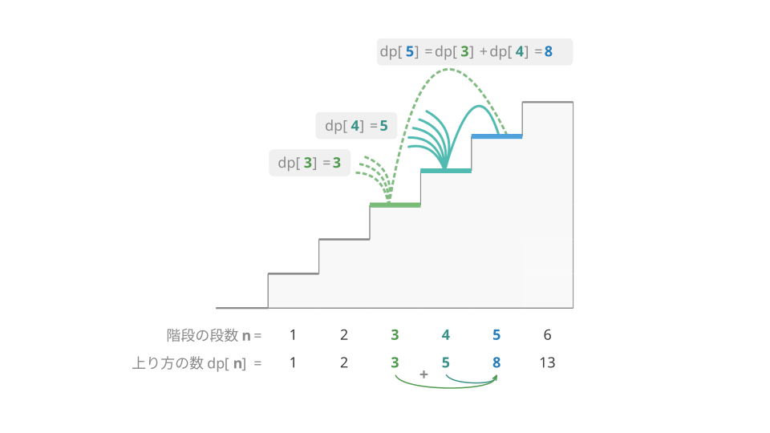
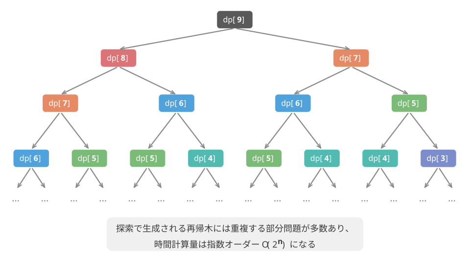

# 14.1 &nbsp; 動的計画法入門

<u>動的計画法（dynamic programming）</u>は、アルゴリズム設計の重要な手法です。問題をより小さな部分問題に分解し、その解を保存して重複計算を避けることで、計算時間を大幅に短縮します。

この節では代表的な例題を取り上げます。まずバックトラックによる全探索で解き、部分問題の重複を確かめてから、より効率のよい動的計画法を段階的に導きます。

!!! question "階段の登り方"

    $n$ 段の階段を、1 歩で $1$ 段または $2$ 段登れます。最上段までの登り方は何通りありますか。

図 14-1 のように、$3$ 段の階段では最上段までの登り方は $3$ 通りあります。

{ class="animation-figure" }

<p align="center"> 図 14-1 &nbsp; 3 段目までの登り方の数 </p>

目標は登り方を数えることなので、**バックトラックですべての可能性を列挙できます**。地面から出発し、毎回 $1$ 段か $2$ 段かを選ぶと考えましょう。最上段に着くたびに通り数に $1$ を加え、最上段を越えたらその分岐を打ち切ります。コードは次のとおりです。

=== "Python"

    ```python title="climbing_stairs_backtrack.py"
    def backtrack(choices: list[int], state: int, n: int, res: list[int]) -> int:
        """バックトラック"""
        # n 段目に着いたら、登り方の数を 1 増やす
        if state == n:
            res[0] += 1
        # すべての選択肢を調べる
        for choice in choices:
            # 枝刈り：n 段目を越えないようにする
            if state + choice > n:
                continue
            # 選択肢を試し、状態を更新する
            backtrack(choices, state + choice, n, res)
            # 選択を取り消す

    def climbing_stairs_backtrack(n: int) -> int:
        """階段の登り方：バックトラック"""
        choices = [1, 2]  # 1 段または 2 段登れる
        state = 0  # 0 段目から登り始める
        res = [0]  # res[0] に登り方の数を記録する
        backtrack(choices, state, n, res)
        return res[0]
    ```

=== "C++"

    ```cpp title="climbing_stairs_backtrack.cpp"
    /* バックトラック */
    void backtrack(vector<int> &choices, int state, int n, vector<int> &res) {
        // n 段目に着いたら、登り方の数を 1 増やす
        if (state == n)
            res[0]++;
        // すべての選択肢を調べる
        for (auto &choice : choices) {
            // 枝刈り：n 段目を越えないようにする
            if (state + choice > n)
                continue;
            // 選択肢を試し、状態を更新する
            backtrack(choices, state + choice, n, res);
            // 選択を取り消す
        }
    }

    /* 階段の登り方：バックトラック */
    int climbingStairsBacktrack(int n) {
        vector<int> choices = {1, 2}; // 1 段または 2 段登れる
        int state = 0;                // 0 段目から登り始める
        vector<int> res = {0};        // res[0] に登り方の数を記録する
        backtrack(choices, state, n, res);
        return res[0];
    }
    ```

=== "Java"

    ```java title="climbing_stairs_backtrack.java"
    /* バックトラック */
    void backtrack(List<Integer> choices, int state, int n, List<Integer> res) {
        // n 段目に着いたら、登り方の数を 1 増やす
        if (state == n)
            res.set(0, res.get(0) + 1);
        // すべての選択肢を調べる
        for (Integer choice : choices) {
            // 枝刈り：n 段目を越えないようにする
            if (state + choice > n)
                continue;
            // 選択肢を試し、状態を更新する
            backtrack(choices, state + choice, n, res);
            // 選択を取り消す
        }
    }

    /* 階段の登り方：バックトラック */
    int climbingStairsBacktrack(int n) {
        List<Integer> choices = Arrays.asList(1, 2); // 1 段または 2 段登れる
        int state = 0; // 0 段目から登り始める
        List<Integer> res = new ArrayList<>();
        res.add(0); // res[0] に登り方の数を記録する
        backtrack(choices, state, n, res);
        return res.get(0);
    }
    ```

=== "C#"

    ```csharp title="climbing_stairs_backtrack.cs"
    /* バックトラック */
    void Backtrack(List<int> choices, int state, int n, List<int> res) {
        // n 段目に着いたら、登り方の数を 1 増やす
        if (state == n)
            res[0]++;
        // すべての選択肢を調べる
        foreach (int choice in choices) {
            // 枝刈り：n 段目を越えないようにする
            if (state + choice > n)
                continue;
            // 選択肢を試し、状態を更新する
            Backtrack(choices, state + choice, n, res);
            // 選択を取り消す
        }
    }

    /* 階段の登り方：バックトラック */
    int ClimbingStairsBacktrack(int n) {
        List<int> choices = [1, 2]; // 1 段または 2 段登れる
        int state = 0; // 0 段目から登り始める
        List<int> res = [0]; // res[0] に登り方の数を記録する
        Backtrack(choices, state, n, res);
        return res[0];
    }
    ```

=== "Go"

    ```go title="climbing_stairs_backtrack.go"
    /* バックトラック */
    func backtrack(choices []int, state, n int, res []int) {
        // n 段目に着いたら、登り方の数を 1 増やす
        if state == n {
            res[0] = res[0] + 1
        }
        // すべての選択肢を調べる
        for _, choice := range choices {
            // 枝刈り：n 段目を越えないようにする
            if state+choice > n {
                continue
            }
            // 選択肢を試し、状態を更新する
            backtrack(choices, state+choice, n, res)
            // 選択を取り消す
        }
    }

    /* 階段の登り方：バックトラック */
    func climbingStairsBacktrack(n int) int {
        // 1 段または 2 段登れる
        choices := []int{1, 2}
        // 0 段目から登り始める
        state := 0
        res := make([]int, 1)
        // res[0] に登り方の数を記録する
        res[0] = 0
        backtrack(choices, state, n, res)
        return res[0]
    }
    ```

=== "Swift"

    ```swift title="climbing_stairs_backtrack.swift"
    /* バックトラック */
    func backtrack(choices: [Int], state: Int, n: Int, res: inout [Int]) {
        // n 段目に着いたら、登り方の数を 1 増やす
        if state == n {
            res[0] += 1
        }
        // すべての選択肢を調べる
        for choice in choices {
            // 枝刈り：n 段目を越えないようにする
            if state + choice > n {
                continue
            }
            // 選択肢を試し、状態を更新する
            backtrack(choices: choices, state: state + choice, n: n, res: &res)
            // 選択を取り消す
        }
    }

    /* 階段の登り方：バックトラック */
    func climbingStairsBacktrack(n: Int) -> Int {
        let choices = [1, 2] // 1 段または 2 段登れる
        let state = 0 // 0 段目から登り始める
        var res: [Int] = []
        res.append(0) // res[0] に登り方の数を記録する
        backtrack(choices: choices, state: state, n: n, res: &res)
        return res[0]
    }
    ```

=== "JS"

    ```javascript title="climbing_stairs_backtrack.js"
    /* バックトラック */
    function backtrack(choices, state, n, res) {
        // n 段目に着いたら、登り方の数を 1 増やす
        if (state === n) res.set(0, res.get(0) + 1);
        // すべての選択肢を調べる
        for (const choice of choices) {
            // 枝刈り：n 段目を越えないようにする
            if (state + choice > n) continue;
            // 選択肢を試し、状態を更新する
            backtrack(choices, state + choice, n, res);
            // 選択を取り消す
        }
    }

    /* 階段の登り方：バックトラック */
    function climbingStairsBacktrack(n) {
        const choices = [1, 2]; // 1 段または 2 段登れる
        const state = 0; // 0 段目から登り始める
        const res = new Map();
        res.set(0, 0); // res[0] に登り方の数を記録する
        backtrack(choices, state, n, res);
        return res.get(0);
    }
    ```

=== "TS"

    ```typescript title="climbing_stairs_backtrack.ts"
    /* バックトラック */
    function backtrack(
        choices: number[],
        state: number,
        n: number,
        res: Map<0, any>
    ): void {
        // n 段目に着いたら、登り方の数を 1 増やす
        if (state === n) res.set(0, res.get(0) + 1);
        // すべての選択肢を調べる
        for (const choice of choices) {
            // 枝刈り：n 段目を越えないようにする
            if (state + choice > n) continue;
            // 選択肢を試し、状態を更新する
            backtrack(choices, state + choice, n, res);
            // 選択を取り消す
        }
    }

    /* 階段の登り方：バックトラック */
    function climbingStairsBacktrack(n: number): number {
        const choices = [1, 2]; // 1 段または 2 段登れる
        const state = 0; // 0 段目から登り始める
        const res = new Map();
        res.set(0, 0); // res[0] に登り方の数を記録する
        backtrack(choices, state, n, res);
        return res.get(0);
    }
    ```

=== "Dart"

    ```dart title="climbing_stairs_backtrack.dart"
    /* バックトラック */
    void backtrack(List<int> choices, int state, int n, List<int> res) {
      // n 段目に着いたら、登り方の数を 1 増やす
      if (state == n) {
        res[0]++;
      }
      // すべての選択肢を調べる
      for (int choice in choices) {
        // 枝刈り：n 段目を越えないようにする
        if (state + choice > n) continue;
        // 選択肢を試し、状態を更新する
        backtrack(choices, state + choice, n, res);
        // 選択を取り消す
      }
    }

    /* 階段の登り方：バックトラック */
    int climbingStairsBacktrack(int n) {
      List<int> choices = [1, 2]; // 1 段または 2 段登れる
      int state = 0; // 0 段目から登り始める
      List<int> res = [];
      res.add(0); // res[0] に登り方の数を記録する
      backtrack(choices, state, n, res);
      return res[0];
    }
    ```

=== "Rust"

    ```rust title="climbing_stairs_backtrack.rs"
    /* バックトラック */
    fn backtrack(choices: &[i32], state: i32, n: i32, res: &mut [i32]) {
        // n 段目に着いたら、登り方の数を 1 増やす
        if state == n {
            res[0] = res[0] + 1;
        }
        // すべての選択肢を調べる
        for &choice in choices {
            // 枝刈り：n 段目を越えないようにする
            if state + choice > n {
                continue;
            }
            // 選択肢を試し、状態を更新する
            backtrack(choices, state + choice, n, res);
            // 選択を取り消す
        }
    }

    /* 階段の登り方：バックトラック */
    fn climbing_stairs_backtrack(n: usize) -> i32 {
        let choices = vec![1, 2]; // 1 段または 2 段登れる
        let state = 0; // 0 段目から登り始める
        let mut res = Vec::new();
        res.push(0); // res[0] に登り方の数を記録する
        backtrack(&choices, state, n as i32, &mut res);
        res[0]
    }
    ```

=== "C"

    ```c title="climbing_stairs_backtrack.c"
    /* バックトラック */
    void backtrack(int *choices, int state, int n, int *res, int len) {
        // n 段目に着いたら、登り方の数を 1 増やす
        if (state == n)
            res[0]++;
        // すべての選択肢を調べる
        for (int i = 0; i < len; i++) {
            int choice = choices[i];
            // 枝刈り：n 段目を越えないようにする
            if (state + choice > n)
                continue;
            // 選択肢を試し、状態を更新する
            backtrack(choices, state + choice, n, res, len);
            // 選択を取り消す
        }
    }

    /* 階段の登り方：バックトラック */
    int climbingStairsBacktrack(int n) {
        int choices[2] = {1, 2}; // 1 段または 2 段登れる
        int state = 0;           // 0 段目から登り始める
        int *res = (int *)malloc(sizeof(int));
        *res = 0; // res[0] に登り方の数を記録する
        int len = sizeof(choices) / sizeof(int);
        backtrack(choices, state, n, res, len);
        int result = *res;
        free(res);
        return result;
    }
    ```

=== "Kotlin"

    ```kotlin title="climbing_stairs_backtrack.kt"
    /* バックトラック */
    fun backtrack(
        choices: MutableList<Int>,
        state: Int,
        n: Int,
        res: MutableList<Int>
    ) {
        // n 段目に着いたら、登り方の数を 1 増やす
        if (state == n)
            res[0] = res[0] + 1
        // すべての選択肢を調べる
        for (choice in choices) {
            // 枝刈り：n 段目を越えないようにする
            if (state + choice > n) continue
            // 選択肢を試し、状態を更新する
            backtrack(choices, state + choice, n, res)
            // 選択を取り消す
        }
    }

    /* 階段の登り方：バックトラック */
    fun climbingStairsBacktrack(n: Int): Int {
        val choices = mutableListOf(1, 2) // 1 段または 2 段登れる
        val state = 0 // 0 段目から登り始める
        val res = mutableListOf<Int>()
        res.add(0) // res[0] に登り方の数を記録する
        backtrack(choices, state, n, res)
        return res[0]
    }
    ```

=== "Ruby"

    ```ruby title="climbing_stairs_backtrack.rb"
    ### バックトラック ###
    def backtrack(choices, state, n, res)
      # n 段目に着いたら、登り方の数を 1 増やす
      res[0] += 1 if state == n
      # すべての選択肢を調べる
      for choice in choices
        # 枝刈り：n 段目を越えないようにする
        next if state + choice > n

        # 選択肢を試し、状態を更新する
        backtrack(choices, state + choice, n, res)
      end
      # 選択を取り消す
    end

    ### 階段の登り方：バックトラック ###
    def climbing_stairs_backtrack(n)
      choices = [1, 2] # 1 段または 2 段登れる
      state = 0 # 0 段目から登り始める
      res = [0] # res[0] に登り方の数を記録する
      backtrack(choices, state, n, res)
      res.first
    end
    ```

??? pythontutor "実行の様子を見る"

    <div style="height: 549px; width: 100%;"><iframe class="pythontutor-iframe" title="実行の様子を見る" src="https://pythontutor.com/iframe-embed.html#code=def%20backtrack%28choices%3A%20list%5Bint%5D,%20state%3A%20int,%20n%3A%20int,%20res%3A%20list%5Bint%5D%29%20-%3E%20int%3A%0A%20%20%20%20%22%22%22%E3%83%90%E3%83%83%E3%82%AF%E3%83%88%E3%83%A9%E3%83%83%E3%82%AF%22%22%22%0A%20%20%20%20%23%20n%20%E6%AE%B5%E7%9B%AE%E3%81%AB%E7%9D%80%E3%81%84%E3%81%9F%E3%82%89%E3%80%81%E7%99%BB%E3%82%8A%E6%96%B9%E3%81%AE%E6%95%B0%E3%82%92%201%20%E5%A2%97%E3%82%84%E3%81%99%0A%20%20%20%20if%20state%20%3D%3D%20n%3A%0A%20%20%20%20%20%20%20%20res%5B0%5D%20%2B%3D%201%0A%20%20%20%20%23%20%E3%81%99%E3%81%B9%E3%81%A6%E3%81%AE%E9%81%B8%E6%8A%9E%E8%82%A2%E3%82%92%E8%AA%BF%E3%81%B9%E3%82%8B%0A%20%20%20%20for%20choice%20in%20choices%3A%0A%20%20%20%20%20%20%20%20%23%20%E6%9E%9D%E5%88%88%E3%82%8A%EF%BC%9An%20%E6%AE%B5%E7%9B%AE%E3%82%92%E8%B6%8A%E3%81%88%E3%81%AA%E3%81%84%E3%82%88%E3%81%86%E3%81%AB%E3%81%99%E3%82%8B%0A%20%20%20%20%20%20%20%20if%20state%20%2B%20choice%20%3E%20n%3A%0A%20%20%20%20%20%20%20%20%20%20%20%20continue%0A%20%20%20%20%20%20%20%20%23%20%E9%81%B8%E6%8A%9E%E8%82%A2%E3%82%92%E8%A9%A6%E3%81%97%E3%80%81%E7%8A%B6%E6%85%8B%E3%82%92%E6%9B%B4%E6%96%B0%E3%81%99%E3%82%8B%0A%20%20%20%20%20%20%20%20backtrack%28choices,%20state%20%2B%20choice,%20n,%20res%29%0A%20%20%20%20%20%20%20%20%23%20%E9%81%B8%E6%8A%9E%E3%82%92%E5%8F%96%E3%82%8A%E6%B6%88%E3%81%99%0A%0A%0Adef%20climbing_stairs_backtrack%28n%3A%20int%29%20-%3E%20int%3A%0A%20%20%20%20%22%22%22%E9%9A%8E%E6%AE%B5%E3%81%AE%E7%99%BB%E3%82%8A%E6%96%B9%EF%BC%9A%E3%83%90%E3%83%83%E3%82%AF%E3%83%88%E3%83%A9%E3%83%83%E3%82%AF%22%22%22%0A%20%20%20%20choices%20%3D%20%5B1,%202%5D%20%20%23%201%20%E6%AE%B5%E3%81%BE%E3%81%9F%E3%81%AF%202%20%E6%AE%B5%E7%99%BB%E3%82%8C%E3%82%8B%0A%20%20%20%20state%20%3D%200%20%20%23%200%20%E6%AE%B5%E7%9B%AE%E3%81%8B%E3%82%89%E7%99%BB%E3%82%8A%E5%A7%8B%E3%82%81%E3%82%8B%0A%20%20%20%20res%20%3D%20%5B0%5D%20%20%23%20res%5B0%5D%20%E3%81%AB%E7%99%BB%E3%82%8A%E6%96%B9%E3%81%AE%E6%95%B0%E3%82%92%E8%A8%98%E9%8C%B2%E3%81%99%E3%82%8B%0A%20%20%20%20backtrack%28choices,%20state,%20n,%20res%29%0A%20%20%20%20return%20res%5B0%5D%0A%0A%0A%22%22%22Driver%20Code%22%22%22%0Aif%20__name__%20%3D%3D%20%22__main__%22%3A%0A%20%20%20%20n%20%3D%204%0A%0A%20%20%20%20res%20%3D%20climbing_stairs_backtrack%28n%29%0A%20%20%20%20print%28f%22%E5%85%A8%20%7Bn%7D%20%E6%AE%B5%E3%81%AE%E9%9A%8E%E6%AE%B5%E3%81%AE%E7%99%BB%E3%82%8A%E6%96%B9%E3%81%AF%20%7Bres%7D%20%E9%80%9A%E3%82%8A%22%29&codeDivHeight=472&codeDivWidth=350&cumulative=false&curInstr=5&heapPrimitives=nevernest&origin=opt-frontend.js&py=311&rawInputLstJSON=%5B%5D&textReferences=false"> </iframe></div>
    <div style="margin-top: 5px;"><a href="https://pythontutor.com/iframe-embed.html#code=def%20backtrack%28choices%3A%20list%5Bint%5D,%20state%3A%20int,%20n%3A%20int,%20res%3A%20list%5Bint%5D%29%20-%3E%20int%3A%0A%20%20%20%20%22%22%22%E3%83%90%E3%83%83%E3%82%AF%E3%83%88%E3%83%A9%E3%83%83%E3%82%AF%22%22%22%0A%20%20%20%20%23%20n%20%E6%AE%B5%E7%9B%AE%E3%81%AB%E7%9D%80%E3%81%84%E3%81%9F%E3%82%89%E3%80%81%E7%99%BB%E3%82%8A%E6%96%B9%E3%81%AE%E6%95%B0%E3%82%92%201%20%E5%A2%97%E3%82%84%E3%81%99%0A%20%20%20%20if%20state%20%3D%3D%20n%3A%0A%20%20%20%20%20%20%20%20res%5B0%5D%20%2B%3D%201%0A%20%20%20%20%23%20%E3%81%99%E3%81%B9%E3%81%A6%E3%81%AE%E9%81%B8%E6%8A%9E%E8%82%A2%E3%82%92%E8%AA%BF%E3%81%B9%E3%82%8B%0A%20%20%20%20for%20choice%20in%20choices%3A%0A%20%20%20%20%20%20%20%20%23%20%E6%9E%9D%E5%88%88%E3%82%8A%EF%BC%9An%20%E6%AE%B5%E7%9B%AE%E3%82%92%E8%B6%8A%E3%81%88%E3%81%AA%E3%81%84%E3%82%88%E3%81%86%E3%81%AB%E3%81%99%E3%82%8B%0A%20%20%20%20%20%20%20%20if%20state%20%2B%20choice%20%3E%20n%3A%0A%20%20%20%20%20%20%20%20%20%20%20%20continue%0A%20%20%20%20%20%20%20%20%23%20%E9%81%B8%E6%8A%9E%E8%82%A2%E3%82%92%E8%A9%A6%E3%81%97%E3%80%81%E7%8A%B6%E6%85%8B%E3%82%92%E6%9B%B4%E6%96%B0%E3%81%99%E3%82%8B%0A%20%20%20%20%20%20%20%20backtrack%28choices,%20state%20%2B%20choice,%20n,%20res%29%0A%20%20%20%20%20%20%20%20%23%20%E9%81%B8%E6%8A%9E%E3%82%92%E5%8F%96%E3%82%8A%E6%B6%88%E3%81%99%0A%0A%0Adef%20climbing_stairs_backtrack%28n%3A%20int%29%20-%3E%20int%3A%0A%20%20%20%20%22%22%22%E9%9A%8E%E6%AE%B5%E3%81%AE%E7%99%BB%E3%82%8A%E6%96%B9%EF%BC%9A%E3%83%90%E3%83%83%E3%82%AF%E3%83%88%E3%83%A9%E3%83%83%E3%82%AF%22%22%22%0A%20%20%20%20choices%20%3D%20%5B1,%202%5D%20%20%23%201%20%E6%AE%B5%E3%81%BE%E3%81%9F%E3%81%AF%202%20%E6%AE%B5%E7%99%BB%E3%82%8C%E3%82%8B%0A%20%20%20%20state%20%3D%200%20%20%23%200%20%E6%AE%B5%E7%9B%AE%E3%81%8B%E3%82%89%E7%99%BB%E3%82%8A%E5%A7%8B%E3%82%81%E3%82%8B%0A%20%20%20%20res%20%3D%20%5B0%5D%20%20%23%20res%5B0%5D%20%E3%81%AB%E7%99%BB%E3%82%8A%E6%96%B9%E3%81%AE%E6%95%B0%E3%82%92%E8%A8%98%E9%8C%B2%E3%81%99%E3%82%8B%0A%20%20%20%20backtrack%28choices,%20state,%20n,%20res%29%0A%20%20%20%20return%20res%5B0%5D%0A%0A%0A%22%22%22Driver%20Code%22%22%22%0Aif%20__name__%20%3D%3D%20%22__main__%22%3A%0A%20%20%20%20n%20%3D%204%0A%0A%20%20%20%20res%20%3D%20climbing_stairs_backtrack%28n%29%0A%20%20%20%20print%28f%22%E5%85%A8%20%7Bn%7D%20%E6%AE%B5%E3%81%AE%E9%9A%8E%E6%AE%B5%E3%81%AE%E7%99%BB%E3%82%8A%E6%96%B9%E3%81%AF%20%7Bres%7D%20%E9%80%9A%E3%82%8A%22%29&codeDivHeight=800&codeDivWidth=600&cumulative=false&curInstr=5&heapPrimitives=nevernest&origin=opt-frontend.js&py=311&rawInputLstJSON=%5B%5D&textReferences=false" target="_blank" rel="noopener noreferrer">全画面で表示 ></a></div>

## 14.1.1 &nbsp; 方法 1：全探索

バックトラックでは通常、問題を明示的に分解しません。問題を解くことを一連の選択と捉え、選択肢を試しながら枝刈りし、可能な解をすべて探索します。

今度は問題を分解する観点から考えましょう。$i$ 段目までの登り方を $dp[i]$ 通りとすると、元の問題は $dp[i]$ であり、次の部分問題が含まれます。

$$
dp[i-1], dp[i-2], \dots, dp[2], dp[1]
$$

1 歩で登れるのは $1$ 段か $2$ 段なので、$i$ 段目に着く直前にいたのは $i - 1$ 段目か $i - 2$ 段目です。つまり、$i$ 段目に進めるのは $i -1$ 段目か $i - 2$ 段目からだけです。

ここから大切な関係がわかります。**$i - 1$ 段目までの登り方の数と $i - 2$ 段目までの登り方の数の和は、$i$ 段目までの登り方の数に等しくなります**。式で表すと次のようになります。

$$
dp[i] = dp[i-1] + dp[i-2]
$$

つまり階段の問題では、部分問題の間に漸化式が成り立ち、**部分問題の解から元の問題の解を構成できます**。図 14-2 にこの関係を示します。

{ class="animation-figure" }

<p align="center"> 図 14-2 &nbsp; 登り方の数の漸化式 </p>

漸化式を使うと全探索で解けます。$dp[n]$ から出発し、**大きな問題をより小さい 2 つの問題の解の和に再帰的に分解して**、最小の部分問題 $dp[1]$、$dp[2]$ で値を返します。これらの解はすでにわかっており、$dp[1] = 1$、$dp[2] = 2$ です。これは $1$ 段目、$2$ 段目までの登り方がそれぞれ $1$ 通り、$2$ 通りあることを表します。

次のコードは、標準的なバックトラックと同じ深さ優先探索ですが、より簡潔に書けます。

=== "Python"

    ```python title="climbing_stairs_dfs.py"
    def dfs(i: int) -> int:
        """探索"""
        # 既知の値 dp[1] と dp[2] のうち、該当する方を返す
        if i == 1 or i == 2:
            return i
        # dp[i] = dp[i-1] + dp[i-2]
        count = dfs(i - 1) + dfs(i - 2)
        return count

    def climbing_stairs_dfs(n: int) -> int:
        """階段の登り方：探索"""
        return dfs(n)
    ```

=== "C++"

    ```cpp title="climbing_stairs_dfs.cpp"
    /* 探索 */
    int dfs(int i) {
        // 既知の値 dp[1] と dp[2] のうち、該当する方を返す
        if (i == 1 || i == 2)
            return i;
        // dp[i] = dp[i-1] + dp[i-2]
        int count = dfs(i - 1) + dfs(i - 2);
        return count;
    }

    /* 階段の登り方：探索 */
    int climbingStairsDFS(int n) {
        return dfs(n);
    }
    ```

=== "Java"

    ```java title="climbing_stairs_dfs.java"
    /* 探索 */
    int dfs(int i) {
        // 既知の値 dp[1] と dp[2] のうち、該当する方を返す
        if (i == 1 || i == 2)
            return i;
        // dp[i] = dp[i-1] + dp[i-2]
        int count = dfs(i - 1) + dfs(i - 2);
        return count;
    }

    /* 階段の登り方：探索 */
    int climbingStairsDFS(int n) {
        return dfs(n);
    }
    ```

=== "C#"

    ```csharp title="climbing_stairs_dfs.cs"
    /* 探索 */
    int DFS(int i) {
        // 既知の値 dp[1] と dp[2] のうち、該当する方を返す
        if (i == 1 || i == 2)
            return i;
        // dp[i] = dp[i-1] + dp[i-2]
        int count = DFS(i - 1) + DFS(i - 2);
        return count;
    }

    /* 階段の登り方：探索 */
    int ClimbingStairsDFS(int n) {
        return DFS(n);
    }
    ```

=== "Go"

    ```go title="climbing_stairs_dfs.go"
    /* 探索 */
    func dfs(i int) int {
        // 既知の値 dp[1] と dp[2] のうち、該当する方を返す
        if i == 1 || i == 2 {
            return i
        }
        // dp[i] = dp[i-1] + dp[i-2]
        count := dfs(i-1) + dfs(i-2)
        return count
    }

    /* 階段の登り方：探索 */
    func climbingStairsDFS(n int) int {
        return dfs(n)
    }
    ```

=== "Swift"

    ```swift title="climbing_stairs_dfs.swift"
    /* 探索 */
    func dfs(i: Int) -> Int {
        // 既知の値 dp[1] と dp[2] のうち、該当する方を返す
        if i == 1 || i == 2 {
            return i
        }
        // dp[i] = dp[i-1] + dp[i-2]
        let count = dfs(i: i - 1) + dfs(i: i - 2)
        return count
    }

    /* 階段の登り方：探索 */
    func climbingStairsDFS(n: Int) -> Int {
        dfs(i: n)
    }
    ```

=== "JS"

    ```javascript title="climbing_stairs_dfs.js"
    /* 探索 */
    function dfs(i) {
        // 既知の値 dp[1] と dp[2] のうち、該当する方を返す
        if (i === 1 || i === 2) return i;
        // dp[i] = dp[i-1] + dp[i-2]
        const count = dfs(i - 1) + dfs(i - 2);
        return count;
    }

    /* 階段の登り方：探索 */
    function climbingStairsDFS(n) {
        return dfs(n);
    }
    ```

=== "TS"

    ```typescript title="climbing_stairs_dfs.ts"
    /* 探索 */
    function dfs(i: number): number {
        // 既知の値 dp[1] と dp[2] のうち、該当する方を返す
        if (i === 1 || i === 2) return i;
        // dp[i] = dp[i-1] + dp[i-2]
        const count = dfs(i - 1) + dfs(i - 2);
        return count;
    }

    /* 階段の登り方：探索 */
    function climbingStairsDFS(n: number): number {
        return dfs(n);
    }
    ```

=== "Dart"

    ```dart title="climbing_stairs_dfs.dart"
    /* 探索 */
    int dfs(int i) {
      // 既知の値 dp[1] と dp[2] のうち、該当する方を返す
      if (i == 1 || i == 2) return i;
      // dp[i] = dp[i-1] + dp[i-2]
      int count = dfs(i - 1) + dfs(i - 2);
      return count;
    }

    /* 階段の登り方：探索 */
    int climbingStairsDFS(int n) {
      return dfs(n);
    }
    ```

=== "Rust"

    ```rust title="climbing_stairs_dfs.rs"
    /* 探索 */
    fn dfs(i: usize) -> i32 {
        // 既知の値 dp[1] と dp[2] のうち、該当する方を返す
        if i == 1 || i == 2 {
            return i as i32;
        }
        // dp[i] = dp[i-1] + dp[i-2]
        let count = dfs(i - 1) + dfs(i - 2);
        count
    }

    /* 階段の登り方：探索 */
    fn climbing_stairs_dfs(n: usize) -> i32 {
        dfs(n)
    }
    ```

=== "C"

    ```c title="climbing_stairs_dfs.c"
    /* 探索 */
    int dfs(int i) {
        // 既知の値 dp[1] と dp[2] のうち、該当する方を返す
        if (i == 1 || i == 2)
            return i;
        // dp[i] = dp[i-1] + dp[i-2]
        int count = dfs(i - 1) + dfs(i - 2);
        return count;
    }

    /* 階段の登り方：探索 */
    int climbingStairsDFS(int n) {
        return dfs(n);
    }
    ```

=== "Kotlin"

    ```kotlin title="climbing_stairs_dfs.kt"
    /* 探索 */
    fun dfs(i: Int): Int {
        // 既知の値 dp[1] と dp[2] のうち、該当する方を返す
        if (i == 1 || i == 2) return i
        // dp[i] = dp[i-1] + dp[i-2]
        val count = dfs(i - 1) + dfs(i - 2)
        return count
    }

    /* 階段の登り方：探索 */
    fun climbingStairsDFS(n: Int): Int {
        return dfs(n)
    }
    ```

=== "Ruby"

    ```ruby title="climbing_stairs_dfs.rb"
    ### 探索 ###
    def dfs(i)
      # 既知の値 dp[1] と dp[2] のうち、該当する方を返す
      return i if i == 1 || i == 2
      # dp[i] = dp[i-1] + dp[i-2]
      dfs(i - 1) + dfs(i - 2)
    end

    ### 階段の登り方：探索 ###
    def climbing_stairs_dfs(n)
      dfs(n)
    end
    ```

??? pythontutor "実行の様子を見る"

    <div style="height: 549px; width: 100%;"><iframe class="pythontutor-iframe" title="実行の様子を見る" src="https://pythontutor.com/iframe-embed.html#code=def%20dfs%28i%3A%20int%29%20-%3E%20int%3A%0A%20%20%20%20%22%22%22%E6%8E%A2%E7%B4%A2%22%22%22%0A%20%20%20%20%23%20%E6%97%A2%E7%9F%A5%E3%81%AE%E5%80%A4%20dp%5B1%5D%20%E3%81%A8%20dp%5B2%5D%20%E3%81%AE%E3%81%86%E3%81%A1%E3%80%81%E8%A9%B2%E5%BD%93%E3%81%99%E3%82%8B%E6%96%B9%E3%82%92%E8%BF%94%E3%81%99%0A%20%20%20%20if%20i%20%3D%3D%201%20or%20i%20%3D%3D%202%3A%0A%20%20%20%20%20%20%20%20return%20i%0A%20%20%20%20%23%20dp%5Bi%5D%20%3D%20dp%5Bi-1%5D%20%2B%20dp%5Bi-2%5D%0A%20%20%20%20count%20%3D%20dfs%28i%20-%201%29%20%2B%20dfs%28i%20-%202%29%0A%20%20%20%20return%20count%0A%0A%0Adef%20climbing_stairs_dfs%28n%3A%20int%29%20-%3E%20int%3A%0A%20%20%20%20%22%22%22%E9%9A%8E%E6%AE%B5%E3%81%AE%E7%99%BB%E3%82%8A%E6%96%B9%EF%BC%9A%E6%8E%A2%E7%B4%A2%22%22%22%0A%20%20%20%20return%20dfs%28n%29%0A%0A%0A%22%22%22Driver%20Code%22%22%22%0Aif%20__name__%20%3D%3D%20%22__main__%22%3A%0A%20%20%20%20n%20%3D%209%0A%0A%20%20%20%20res%20%3D%20climbing_stairs_dfs%28n%29%0A%20%20%20%20print%28f%22%E5%85%A8%20%7Bn%7D%20%E6%AE%B5%E3%81%AE%E9%9A%8E%E6%AE%B5%E3%81%AE%E7%99%BB%E3%82%8A%E6%96%B9%E3%81%AF%20%7Bres%7D%20%E9%80%9A%E3%82%8A%22%29&codeDivHeight=472&codeDivWidth=350&cumulative=false&curInstr=5&heapPrimitives=nevernest&origin=opt-frontend.js&py=311&rawInputLstJSON=%5B%5D&textReferences=false"> </iframe></div>
    <div style="margin-top: 5px;"><a href="https://pythontutor.com/iframe-embed.html#code=def%20dfs%28i%3A%20int%29%20-%3E%20int%3A%0A%20%20%20%20%22%22%22%E6%8E%A2%E7%B4%A2%22%22%22%0A%20%20%20%20%23%20%E6%97%A2%E7%9F%A5%E3%81%AE%E5%80%A4%20dp%5B1%5D%20%E3%81%A8%20dp%5B2%5D%20%E3%81%AE%E3%81%86%E3%81%A1%E3%80%81%E8%A9%B2%E5%BD%93%E3%81%99%E3%82%8B%E6%96%B9%E3%82%92%E8%BF%94%E3%81%99%0A%20%20%20%20if%20i%20%3D%3D%201%20or%20i%20%3D%3D%202%3A%0A%20%20%20%20%20%20%20%20return%20i%0A%20%20%20%20%23%20dp%5Bi%5D%20%3D%20dp%5Bi-1%5D%20%2B%20dp%5Bi-2%5D%0A%20%20%20%20count%20%3D%20dfs%28i%20-%201%29%20%2B%20dfs%28i%20-%202%29%0A%20%20%20%20return%20count%0A%0A%0Adef%20climbing_stairs_dfs%28n%3A%20int%29%20-%3E%20int%3A%0A%20%20%20%20%22%22%22%E9%9A%8E%E6%AE%B5%E3%81%AE%E7%99%BB%E3%82%8A%E6%96%B9%EF%BC%9A%E6%8E%A2%E7%B4%A2%22%22%22%0A%20%20%20%20return%20dfs%28n%29%0A%0A%0A%22%22%22Driver%20Code%22%22%22%0Aif%20__name__%20%3D%3D%20%22__main__%22%3A%0A%20%20%20%20n%20%3D%209%0A%0A%20%20%20%20res%20%3D%20climbing_stairs_dfs%28n%29%0A%20%20%20%20print%28f%22%E5%85%A8%20%7Bn%7D%20%E6%AE%B5%E3%81%AE%E9%9A%8E%E6%AE%B5%E3%81%AE%E7%99%BB%E3%82%8A%E6%96%B9%E3%81%AF%20%7Bres%7D%20%E9%80%9A%E3%82%8A%22%29&codeDivHeight=800&codeDivWidth=600&cumulative=false&curInstr=5&heapPrimitives=nevernest&origin=opt-frontend.js&py=311&rawInputLstJSON=%5B%5D&textReferences=false" target="_blank" rel="noopener noreferrer">全画面で表示 ></a></div>

図 14-3 は全探索でできる再帰木です。問題 $dp[n]$ では木の深さが $n$、時間計算量が $O(2^n)$ です。指数オーダーでは計算量が爆発的に増えるので、少し大きな $n$ を入力するだけで長時間待たされます。

{ class="animation-figure" }

<p align="center"> 図 14-3 &nbsp; 階段の登り方を求める再帰木 </p>

図 14-3 から、**時間計算量が指数オーダーになる原因は部分問題の重複にある**とわかります。たとえば $dp[9]$ は $dp[8]$ と $dp[7]$ に、$dp[8]$ は $dp[7]$ と $dp[6]$ に分解され、どちらにも部分問題 $dp[7]$ が含まれます。

さらに小さな部分問題にも同じように重複が現れ、分解するたびに繰り返されます。計算資源の大半は、こうした部分問題の再計算に費やされます。

## 14.1.2 &nbsp; 方法 2：メモ化探索

効率を上げるには、**重複する部分問題をそれぞれ 1 回だけ計算する**ようにしたいところです。そこで配列 `mem` に各部分問題の解を記録し、探索中に重複する部分問題を枝刈りします。

1. 初めて $dp[i]$ を計算したら、後で使えるように `mem[i]` に記録します。
2. 再び $dp[i]$ が必要になったら、`mem[i]` から結果を直接取得し、この部分問題の再計算を省けます。

コードは次のとおりです。

=== "Python"

    ```python title="climbing_stairs_dfs_mem.py"
    def dfs(i: int, mem: list[int]) -> int:
        """メモ化探索"""
        # 既知の値 dp[1] と dp[2] のうち、該当する方を返す
        if i == 1 or i == 2:
            return i
        # dp[i] が記録済みなら、その値を返す
        if mem[i] != -1:
            return mem[i]
        # dp[i] = dp[i-1] + dp[i-2]
        count = dfs(i - 1, mem) + dfs(i - 2, mem)
        # dp[i] を記録する
        mem[i] = count
        return count

    def climbing_stairs_dfs_mem(n: int) -> int:
        """階段の登り方：メモ化探索"""
        # mem[i] に i 段目までの登り方の総数を記録する。-1 は未記録を表す
        mem = [-1] * (n + 1)
        return dfs(n, mem)
    ```

=== "C++"

    ```cpp title="climbing_stairs_dfs_mem.cpp"
    /* メモ化探索 */
    int dfs(int i, vector<int> &mem) {
        // 既知の値 dp[1] と dp[2] のうち、該当する方を返す
        if (i == 1 || i == 2)
            return i;
        // dp[i] が記録済みなら、その値を返す
        if (mem[i] != -1)
            return mem[i];
        // dp[i] = dp[i-1] + dp[i-2]
        int count = dfs(i - 1, mem) + dfs(i - 2, mem);
        // dp[i] を記録する
        mem[i] = count;
        return count;
    }

    /* 階段の登り方：メモ化探索 */
    int climbingStairsDFSMem(int n) {
        // mem[i] に i 段目までの登り方の総数を記録する。-1 は未記録を表す
        vector<int> mem(n + 1, -1);
        return dfs(n, mem);
    }
    ```

=== "Java"

    ```java title="climbing_stairs_dfs_mem.java"
    /* メモ化探索 */
    int dfs(int i, int[] mem) {
        // 既知の値 dp[1] と dp[2] のうち、該当する方を返す
        if (i == 1 || i == 2)
            return i;
        // dp[i] が記録済みなら、その値を返す
        if (mem[i] != -1)
            return mem[i];
        // dp[i] = dp[i-1] + dp[i-2]
        int count = dfs(i - 1, mem) + dfs(i - 2, mem);
        // dp[i] を記録する
        mem[i] = count;
        return count;
    }

    /* 階段の登り方：メモ化探索 */
    int climbingStairsDFSMem(int n) {
        // mem[i] に i 段目までの登り方の総数を記録する。-1 は未記録を表す
        int[] mem = new int[n + 1];
        Arrays.fill(mem, -1);
        return dfs(n, mem);
    }
    ```

=== "C#"

    ```csharp title="climbing_stairs_dfs_mem.cs"
    /* メモ化探索 */
    int DFS(int i, int[] mem) {
        // 既知の値 dp[1] と dp[2] のうち、該当する方を返す
        if (i == 1 || i == 2)
            return i;
        // dp[i] が記録済みなら、その値を返す
        if (mem[i] != -1)
            return mem[i];
        // dp[i] = dp[i-1] + dp[i-2]
        int count = DFS(i - 1, mem) + DFS(i - 2, mem);
        // dp[i] を記録する
        mem[i] = count;
        return count;
    }

    /* 階段の登り方：メモ化探索 */
    int ClimbingStairsDFSMem(int n) {
        // mem[i] に i 段目までの登り方の総数を記録する。-1 は未記録を表す
        int[] mem = new int[n + 1];
        Array.Fill(mem, -1);
        return DFS(n, mem);
    }
    ```

=== "Go"

    ```go title="climbing_stairs_dfs_mem.go"
    /* メモ化探索 */
    func dfsMem(i int, mem []int) int {
        // 既知の値 dp[1] と dp[2] のうち、該当する方を返す
        if i == 1 || i == 2 {
            return i
        }
        // dp[i] が記録済みなら、その値を返す
        if mem[i] != -1 {
            return mem[i]
        }
        // dp[i] = dp[i-1] + dp[i-2]
        count := dfsMem(i-1, mem) + dfsMem(i-2, mem)
        // dp[i] を記録する
        mem[i] = count
        return count
    }

    /* 階段の登り方：メモ化探索 */
    func climbingStairsDFSMem(n int) int {
        // mem[i] に i 段目までの登り方の総数を記録する。-1 は未記録を表す
        mem := make([]int, n+1)
        for i := range mem {
            mem[i] = -1
        }
        return dfsMem(n, mem)
    }
    ```

=== "Swift"

    ```swift title="climbing_stairs_dfs_mem.swift"
    /* メモ化探索 */
    func dfs(i: Int, mem: inout [Int]) -> Int {
        // 既知の値 dp[1] と dp[2] のうち、該当する方を返す
        if i == 1 || i == 2 {
            return i
        }
        // dp[i] が記録済みなら、その値を返す
        if mem[i] != -1 {
            return mem[i]
        }
        // dp[i] = dp[i-1] + dp[i-2]
        let count = dfs(i: i - 1, mem: &mem) + dfs(i: i - 2, mem: &mem)
        // dp[i] を記録する
        mem[i] = count
        return count
    }

    /* 階段の登り方：メモ化探索 */
    func climbingStairsDFSMem(n: Int) -> Int {
        // mem[i] に i 段目までの登り方の総数を記録する。-1 は未記録を表す
        var mem = Array(repeating: -1, count: n + 1)
        return dfs(i: n, mem: &mem)
    }
    ```

=== "JS"

    ```javascript title="climbing_stairs_dfs_mem.js"
    /* メモ化探索 */
    function dfs(i, mem) {
        // 既知の値 dp[1] と dp[2] のうち、該当する方を返す
        if (i === 1 || i === 2) return i;
        // dp[i] が記録済みなら、その値を返す
        if (mem[i] != -1) return mem[i];
        // dp[i] = dp[i-1] + dp[i-2]
        const count = dfs(i - 1, mem) + dfs(i - 2, mem);
        // dp[i] を記録する
        mem[i] = count;
        return count;
    }

    /* 階段の登り方：メモ化探索 */
    function climbingStairsDFSMem(n) {
        // mem[i] に i 段目までの登り方の総数を記録する。-1 は未記録を表す
        const mem = new Array(n + 1).fill(-1);
        return dfs(n, mem);
    }
    ```

=== "TS"

    ```typescript title="climbing_stairs_dfs_mem.ts"
    /* メモ化探索 */
    function dfs(i: number, mem: number[]): number {
        // 既知の値 dp[1] と dp[2] のうち、該当する方を返す
        if (i === 1 || i === 2) return i;
        // dp[i] が記録済みなら、その値を返す
        if (mem[i] != -1) return mem[i];
        // dp[i] = dp[i-1] + dp[i-2]
        const count = dfs(i - 1, mem) + dfs(i - 2, mem);
        // dp[i] を記録する
        mem[i] = count;
        return count;
    }

    /* 階段の登り方：メモ化探索 */
    function climbingStairsDFSMem(n: number): number {
        // mem[i] に i 段目までの登り方の総数を記録する。-1 は未記録を表す
        const mem = new Array(n + 1).fill(-1);
        return dfs(n, mem);
    }
    ```

=== "Dart"

    ```dart title="climbing_stairs_dfs_mem.dart"
    /* メモ化探索 */
    int dfs(int i, List<int> mem) {
      // 既知の値 dp[1] と dp[2] のうち、該当する方を返す
      if (i == 1 || i == 2) return i;
      // dp[i] が記録済みなら、その値を返す
      if (mem[i] != -1) return mem[i];
      // dp[i] = dp[i-1] + dp[i-2]
      int count = dfs(i - 1, mem) + dfs(i - 2, mem);
      // dp[i] を記録する
      mem[i] = count;
      return count;
    }

    /* 階段の登り方：メモ化探索 */
    int climbingStairsDFSMem(int n) {
      // mem[i] に i 段目までの登り方の総数を記録する。-1 は未記録を表す
      List<int> mem = List.filled(n + 1, -1);
      return dfs(n, mem);
    }
    ```

=== "Rust"

    ```rust title="climbing_stairs_dfs_mem.rs"
    /* メモ化探索 */
    fn dfs(i: usize, mem: &mut [i32]) -> i32 {
        // 既知の値 dp[1] と dp[2] のうち、該当する方を返す
        if i == 1 || i == 2 {
            return i as i32;
        }
        // dp[i] が記録済みなら、その値を返す
        if mem[i] != -1 {
            return mem[i];
        }
        // dp[i] = dp[i-1] + dp[i-2]
        let count = dfs(i - 1, mem) + dfs(i - 2, mem);
        // dp[i] を記録する
        mem[i] = count;
        count
    }

    /* 階段の登り方：メモ化探索 */
    fn climbing_stairs_dfs_mem(n: usize) -> i32 {
        // mem[i] に i 段目までの登り方の総数を記録する。-1 は未記録を表す
        let mut mem = vec![-1; n + 1];
        dfs(n, &mut mem)
    }
    ```

=== "C"

    ```c title="climbing_stairs_dfs_mem.c"
    /* メモ化探索 */
    int dfs(int i, int *mem) {
        // 既知の値 dp[1] と dp[2] のうち、該当する方を返す
        if (i == 1 || i == 2)
            return i;
        // dp[i] が記録済みなら、その値を返す
        if (mem[i] != -1)
            return mem[i];
        // dp[i] = dp[i-1] + dp[i-2]
        int count = dfs(i - 1, mem) + dfs(i - 2, mem);
        // dp[i] を記録する
        mem[i] = count;
        return count;
    }

    /* 階段の登り方：メモ化探索 */
    int climbingStairsDFSMem(int n) {
        // mem[i] に i 段目までの登り方の総数を記録する。-1 は未記録を表す
        int *mem = (int *)malloc((n + 1) * sizeof(int));
        for (int i = 0; i <= n; i++) {
            mem[i] = -1;
        }
        int result = dfs(n, mem);
        free(mem);
        return result;
    }
    ```

=== "Kotlin"

    ```kotlin title="climbing_stairs_dfs_mem.kt"
    /* メモ化探索 */
    fun dfs(i: Int, mem: IntArray): Int {
        // 既知の値 dp[1] と dp[2] のうち、該当する方を返す
        if (i == 1 || i == 2) return i
        // dp[i] が記録済みなら、その値を返す
        if (mem[i] != -1) return mem[i]
        // dp[i] = dp[i-1] + dp[i-2]
        val count = dfs(i - 1, mem) + dfs(i - 2, mem)
        // dp[i] を記録する
        mem[i] = count
        return count
    }

    /* 階段の登り方：メモ化探索 */
    fun climbingStairsDFSMem(n: Int): Int {
        // mem[i] に i 段目までの登り方の総数を記録する。-1 は未記録を表す
        val mem = IntArray(n + 1)
        mem.fill(-1)
        return dfs(n, mem)
    }
    ```

=== "Ruby"

    ```ruby title="climbing_stairs_dfs_mem.rb"
    ### メモ化探索 ###
    def dfs(i, mem)
      # 既知の値 dp[1] と dp[2] のうち、該当する方を返す
      return i if i == 1 || i == 2
      # dp[i] が記録済みなら、その値を返す
      return mem[i] if mem[i] != -1

      # dp[i] = dp[i-1] + dp[i-2]
      count = dfs(i - 1, mem) + dfs(i - 2, mem)
      # dp[i] を記録する
      mem[i] = count
    end

    ### 階段の登り方：メモ化探索 ###
    def climbing_stairs_dfs_mem(n)
      # mem[i] に i 段目までの登り方の総数を記録する。-1 は未記録を表す
      mem = Array.new(n + 1, -1)
      dfs(n, mem)
    end
    ```

??? pythontutor "実行の様子を見る"

    <div style="height: 549px; width: 100%;"><iframe class="pythontutor-iframe" title="実行の様子を見る" src="https://pythontutor.com/iframe-embed.html#code=def%20dfs%28i%3A%20int,%20mem%3A%20list%5Bint%5D%29%20-%3E%20int%3A%0A%20%20%20%20%22%22%22%E3%83%A1%E3%83%A2%E5%8C%96%E6%8E%A2%E7%B4%A2%22%22%22%0A%20%20%20%20%23%20%E6%97%A2%E7%9F%A5%E3%81%AE%E5%80%A4%20dp%5B1%5D%20%E3%81%A8%20dp%5B2%5D%20%E3%81%AE%E3%81%86%E3%81%A1%E3%80%81%E8%A9%B2%E5%BD%93%E3%81%99%E3%82%8B%E6%96%B9%E3%82%92%E8%BF%94%E3%81%99%0A%20%20%20%20if%20i%20%3D%3D%201%20or%20i%20%3D%3D%202%3A%0A%20%20%20%20%20%20%20%20return%20i%0A%20%20%20%20%23%20dp%5Bi%5D%20%E3%81%8C%E8%A8%98%E9%8C%B2%E6%B8%88%E3%81%BF%E3%81%AA%E3%82%89%E3%80%81%E3%81%9D%E3%81%AE%E5%80%A4%E3%82%92%E8%BF%94%E3%81%99%0A%20%20%20%20if%20mem%5Bi%5D%20%21%3D%20-1%3A%0A%20%20%20%20%20%20%20%20return%20mem%5Bi%5D%0A%20%20%20%20%23%20dp%5Bi%5D%20%3D%20dp%5Bi-1%5D%20%2B%20dp%5Bi-2%5D%0A%20%20%20%20count%20%3D%20dfs%28i%20-%201,%20mem%29%20%2B%20dfs%28i%20-%202,%20mem%29%0A%20%20%20%20%23%20dp%5Bi%5D%20%E3%82%92%E8%A8%98%E9%8C%B2%E3%81%99%E3%82%8B%0A%20%20%20%20mem%5Bi%5D%20%3D%20count%0A%20%20%20%20return%20count%0A%0A%0Adef%20climbing_stairs_dfs_mem%28n%3A%20int%29%20-%3E%20int%3A%0A%20%20%20%20%22%22%22%E9%9A%8E%E6%AE%B5%E3%81%AE%E7%99%BB%E3%82%8A%E6%96%B9%EF%BC%9A%E3%83%A1%E3%83%A2%E5%8C%96%E6%8E%A2%E7%B4%A2%22%22%22%0A%20%20%20%20%23%20mem%5Bi%5D%20%E3%81%AB%20i%20%E6%AE%B5%E7%9B%AE%E3%81%BE%E3%81%A7%E3%81%AE%E7%99%BB%E3%82%8A%E6%96%B9%E3%81%AE%E7%B7%8F%E6%95%B0%E3%82%92%E8%A8%98%E9%8C%B2%E3%81%99%E3%82%8B%E3%80%82-1%20%E3%81%AF%E6%9C%AA%E8%A8%98%E9%8C%B2%E3%82%92%E8%A1%A8%E3%81%99%0A%20%20%20%20mem%20%3D%20%5B-1%5D%20%2A%20%28n%20%2B%201%29%0A%20%20%20%20return%20dfs%28n,%20mem%29%0A%0A%0A%22%22%22Driver%20Code%22%22%22%0Aif%20__name__%20%3D%3D%20%22__main__%22%3A%0A%20%20%20%20n%20%3D%209%0A%0A%20%20%20%20res%20%3D%20climbing_stairs_dfs_mem%28n%29%0A%20%20%20%20print%28f%22%E5%85%A8%20%7Bn%7D%20%E6%AE%B5%E3%81%AE%E9%9A%8E%E6%AE%B5%E3%81%AE%E7%99%BB%E3%82%8A%E6%96%B9%E3%81%AF%20%7Bres%7D%20%E9%80%9A%E3%82%8A%22%29&codeDivHeight=472&codeDivWidth=350&cumulative=false&curInstr=5&heapPrimitives=nevernest&origin=opt-frontend.js&py=311&rawInputLstJSON=%5B%5D&textReferences=false"> </iframe></div>
    <div style="margin-top: 5px;"><a href="https://pythontutor.com/iframe-embed.html#code=def%20dfs%28i%3A%20int,%20mem%3A%20list%5Bint%5D%29%20-%3E%20int%3A%0A%20%20%20%20%22%22%22%E3%83%A1%E3%83%A2%E5%8C%96%E6%8E%A2%E7%B4%A2%22%22%22%0A%20%20%20%20%23%20%E6%97%A2%E7%9F%A5%E3%81%AE%E5%80%A4%20dp%5B1%5D%20%E3%81%A8%20dp%5B2%5D%20%E3%81%AE%E3%81%86%E3%81%A1%E3%80%81%E8%A9%B2%E5%BD%93%E3%81%99%E3%82%8B%E6%96%B9%E3%82%92%E8%BF%94%E3%81%99%0A%20%20%20%20if%20i%20%3D%3D%201%20or%20i%20%3D%3D%202%3A%0A%20%20%20%20%20%20%20%20return%20i%0A%20%20%20%20%23%20dp%5Bi%5D%20%E3%81%8C%E8%A8%98%E9%8C%B2%E6%B8%88%E3%81%BF%E3%81%AA%E3%82%89%E3%80%81%E3%81%9D%E3%81%AE%E5%80%A4%E3%82%92%E8%BF%94%E3%81%99%0A%20%20%20%20if%20mem%5Bi%5D%20%21%3D%20-1%3A%0A%20%20%20%20%20%20%20%20return%20mem%5Bi%5D%0A%20%20%20%20%23%20dp%5Bi%5D%20%3D%20dp%5Bi-1%5D%20%2B%20dp%5Bi-2%5D%0A%20%20%20%20count%20%3D%20dfs%28i%20-%201,%20mem%29%20%2B%20dfs%28i%20-%202,%20mem%29%0A%20%20%20%20%23%20dp%5Bi%5D%20%E3%82%92%E8%A8%98%E9%8C%B2%E3%81%99%E3%82%8B%0A%20%20%20%20mem%5Bi%5D%20%3D%20count%0A%20%20%20%20return%20count%0A%0A%0Adef%20climbing_stairs_dfs_mem%28n%3A%20int%29%20-%3E%20int%3A%0A%20%20%20%20%22%22%22%E9%9A%8E%E6%AE%B5%E3%81%AE%E7%99%BB%E3%82%8A%E6%96%B9%EF%BC%9A%E3%83%A1%E3%83%A2%E5%8C%96%E6%8E%A2%E7%B4%A2%22%22%22%0A%20%20%20%20%23%20mem%5Bi%5D%20%E3%81%AB%20i%20%E6%AE%B5%E7%9B%AE%E3%81%BE%E3%81%A7%E3%81%AE%E7%99%BB%E3%82%8A%E6%96%B9%E3%81%AE%E7%B7%8F%E6%95%B0%E3%82%92%E8%A8%98%E9%8C%B2%E3%81%99%E3%82%8B%E3%80%82-1%20%E3%81%AF%E6%9C%AA%E8%A8%98%E9%8C%B2%E3%82%92%E8%A1%A8%E3%81%99%0A%20%20%20%20mem%20%3D%20%5B-1%5D%20%2A%20%28n%20%2B%201%29%0A%20%20%20%20return%20dfs%28n,%20mem%29%0A%0A%0A%22%22%22Driver%20Code%22%22%22%0Aif%20__name__%20%3D%3D%20%22__main__%22%3A%0A%20%20%20%20n%20%3D%209%0A%0A%20%20%20%20res%20%3D%20climbing_stairs_dfs_mem%28n%29%0A%20%20%20%20print%28f%22%E5%85%A8%20%7Bn%7D%20%E6%AE%B5%E3%81%AE%E9%9A%8E%E6%AE%B5%E3%81%AE%E7%99%BB%E3%82%8A%E6%96%B9%E3%81%AF%20%7Bres%7D%20%E9%80%9A%E3%82%8A%22%29&codeDivHeight=800&codeDivWidth=600&cumulative=false&curInstr=5&heapPrimitives=nevernest&origin=opt-frontend.js&py=311&rawInputLstJSON=%5B%5D&textReferences=false" target="_blank" rel="noopener noreferrer">全画面で表示 ></a></div>

図 14-4 のように、**メモ化すると、重複する部分問題を 1 回ずつ計算するだけで済み、時間計算量は $O(n)$ まで下がります**。大きな改善です。

{ class="animation-figure" }

<p align="center"> 図 14-4 &nbsp; メモ化探索の再帰木 </p>

## 14.1.3 &nbsp; 方法 3：動的計画法

**メモ化探索はトップダウンの手法です**。元の問題（根ノード）から出発し、大きな部分問題を小さな部分問題に再帰的に分解して、解がわかっている最小の部分問題（葉ノード）に到達します。そこから再帰を戻りながら各段階の解を集め、元の問題の解を構成します。

逆に、**動的計画法はボトムアップの手法です**。最小の部分問題の解から出発し、反復によってより大きな部分問題の解を順に構成し、元の問題の解に到達します。

動的計画法では再帰を戻る過程がないので、再帰を使わずループだけで実装できます。次のコードでは、部分問題の解を保存する配列 `dp` を初期化します。これはメモ化探索の配列 `mem` と同じ記録の役割を果たします。

=== "Python"

    ```python title="climbing_stairs_dp.py"
    def climbing_stairs_dp(n: int) -> int:
        """階段の登り方：動的計画法"""
        if n == 1 or n == 2:
            return n
        # 部分問題の解を格納する dp テーブルを初期化する
        dp = [0] * (n + 1)
        # 初期状態：最小の部分問題の解を設定する
        dp[1], dp[2] = 1, 2
        # 状態遷移：小さな部分問題から順に大きな部分問題を解く
        for i in range(3, n + 1):
            dp[i] = dp[i - 1] + dp[i - 2]
        return dp[n]
    ```

=== "C++"

    ```cpp title="climbing_stairs_dp.cpp"
    /* 階段の登り方：動的計画法 */
    int climbingStairsDP(int n) {
        if (n == 1 || n == 2)
            return n;
        // 部分問題の解を格納する dp テーブルを初期化する
        vector<int> dp(n + 1);
        // 初期状態：最小の部分問題の解を設定する
        dp[1] = 1;
        dp[2] = 2;
        // 状態遷移：小さな部分問題から順に大きな部分問題を解く
        for (int i = 3; i <= n; i++) {
            dp[i] = dp[i - 1] + dp[i - 2];
        }
        return dp[n];
    }
    ```

=== "Java"

    ```java title="climbing_stairs_dp.java"
    /* 階段の登り方：動的計画法 */
    int climbingStairsDP(int n) {
        if (n == 1 || n == 2)
            return n;
        // 部分問題の解を格納する dp テーブルを初期化する
        int[] dp = new int[n + 1];
        // 初期状態：最小の部分問題の解を設定する
        dp[1] = 1;
        dp[2] = 2;
        // 状態遷移：小さな部分問題から順に大きな部分問題を解く
        for (int i = 3; i <= n; i++) {
            dp[i] = dp[i - 1] + dp[i - 2];
        }
        return dp[n];
    }
    ```

=== "C#"

    ```csharp title="climbing_stairs_dp.cs"
    /* 階段の登り方：動的計画法 */
    int ClimbingStairsDP(int n) {
        if (n == 1 || n == 2)
            return n;
        // 部分問題の解を格納する dp テーブルを初期化する
        int[] dp = new int[n + 1];
        // 初期状態：最小の部分問題の解を設定する
        dp[1] = 1;
        dp[2] = 2;
        // 状態遷移：小さな部分問題から順に大きな部分問題を解く
        for (int i = 3; i <= n; i++) {
            dp[i] = dp[i - 1] + dp[i - 2];
        }
        return dp[n];
    }
    ```

=== "Go"

    ```go title="climbing_stairs_dp.go"
    /* 階段の登り方：動的計画法 */
    func climbingStairsDP(n int) int {
        if n == 1 || n == 2 {
            return n
        }
        // 部分問題の解を格納する dp テーブルを初期化する
        dp := make([]int, n+1)
        // 初期状態：最小の部分問題の解を設定する
        dp[1] = 1
        dp[2] = 2
        // 状態遷移：小さな部分問題から順に大きな部分問題を解く
        for i := 3; i <= n; i++ {
            dp[i] = dp[i-1] + dp[i-2]
        }
        return dp[n]
    }
    ```

=== "Swift"

    ```swift title="climbing_stairs_dp.swift"
    /* 階段の登り方：動的計画法 */
    func climbingStairsDP(n: Int) -> Int {
        if n == 1 || n == 2 {
            return n
        }
        // 部分問題の解を格納する dp テーブルを初期化する
        var dp = Array(repeating: 0, count: n + 1)
        // 初期状態：最小の部分問題の解を設定する
        dp[1] = 1
        dp[2] = 2
        // 状態遷移：小さな部分問題から順に大きな部分問題を解く
        for i in 3 ... n {
            dp[i] = dp[i - 1] + dp[i - 2]
        }
        return dp[n]
    }
    ```

=== "JS"

    ```javascript title="climbing_stairs_dp.js"
    /* 階段の登り方：動的計画法 */
    function climbingStairsDP(n) {
        if (n === 1 || n === 2) return n;
        // 部分問題の解を格納する dp テーブルを初期化する
        const dp = new Array(n + 1).fill(-1);
        // 初期状態：最小の部分問題の解を設定する
        dp[1] = 1;
        dp[2] = 2;
        // 状態遷移：小さな部分問題から順に大きな部分問題を解く
        for (let i = 3; i <= n; i++) {
            dp[i] = dp[i - 1] + dp[i - 2];
        }
        return dp[n];
    }
    ```

=== "TS"

    ```typescript title="climbing_stairs_dp.ts"
    /* 階段の登り方：動的計画法 */
    function climbingStairsDP(n: number): number {
        if (n === 1 || n === 2) return n;
        // 部分問題の解を格納する dp テーブルを初期化する
        const dp = new Array(n + 1).fill(-1);
        // 初期状態：最小の部分問題の解を設定する
        dp[1] = 1;
        dp[2] = 2;
        // 状態遷移：小さな部分問題から順に大きな部分問題を解く
        for (let i = 3; i <= n; i++) {
            dp[i] = dp[i - 1] + dp[i - 2];
        }
        return dp[n];
    }
    ```

=== "Dart"

    ```dart title="climbing_stairs_dp.dart"
    /* 階段の登り方：動的計画法 */
    int climbingStairsDP(int n) {
      if (n == 1 || n == 2) return n;
      // 部分問題の解を格納する dp テーブルを初期化する
      List<int> dp = List.filled(n + 1, 0);
      // 初期状態：最小の部分問題の解を設定する
      dp[1] = 1;
      dp[2] = 2;
      // 状態遷移：小さな部分問題から順に大きな部分問題を解く
      for (int i = 3; i <= n; i++) {
        dp[i] = dp[i - 1] + dp[i - 2];
      }
      return dp[n];
    }
    ```

=== "Rust"

    ```rust title="climbing_stairs_dp.rs"
    /* 階段の登り方：動的計画法 */
    fn climbing_stairs_dp(n: usize) -> i32 {
        // 既知の値 dp[1] と dp[2] のうち、該当する方を返す
        if n == 1 || n == 2 {
            return n as i32;
        }
        // 部分問題の解を格納する dp テーブルを初期化する
        let mut dp = vec![-1; n + 1];
        // 初期状態：最小の部分問題の解を設定する
        dp[1] = 1;
        dp[2] = 2;
        // 状態遷移：小さな部分問題から順に大きな部分問題を解く
        for i in 3..=n {
            dp[i] = dp[i - 1] + dp[i - 2];
        }
        dp[n]
    }
    ```

=== "C"

    ```c title="climbing_stairs_dp.c"
    /* 階段の登り方：動的計画法 */
    int climbingStairsDP(int n) {
        if (n == 1 || n == 2)
            return n;
        // 部分問題の解を格納する dp テーブルを初期化する
        int *dp = (int *)malloc((n + 1) * sizeof(int));
        // 初期状態：最小の部分問題の解を設定する
        dp[1] = 1;
        dp[2] = 2;
        // 状態遷移：小さな部分問題から順に大きな部分問題を解く
        for (int i = 3; i <= n; i++) {
            dp[i] = dp[i - 1] + dp[i - 2];
        }
        int result = dp[n];
        free(dp);
        return result;
    }
    ```

=== "Kotlin"

    ```kotlin title="climbing_stairs_dp.kt"
    /* 階段の登り方：動的計画法 */
    fun climbingStairsDP(n: Int): Int {
        if (n == 1 || n == 2) return n
        // 部分問題の解を格納する dp テーブルを初期化する
        val dp = IntArray(n + 1)
        // 初期状態：最小の部分問題の解を設定する
        dp[1] = 1
        dp[2] = 2
        // 状態遷移：小さな部分問題から順に大きな部分問題を解く
        for (i in 3..n) {
            dp[i] = dp[i - 1] + dp[i - 2]
        }
        return dp[n]
    }
    ```

=== "Ruby"

    ```ruby title="climbing_stairs_dp.rb"
    ### 階段の登り方：動的計画法 ###
    def climbing_stairs_dp(n)
      return n  if n == 1 || n == 2

      # 部分問題の解を格納する dp テーブルを初期化する
      dp = Array.new(n + 1, 0)
      # 初期状態：最小の部分問題の解を設定する
      dp[1], dp[2] = 1, 2
      # 状態遷移：小さな部分問題から順に大きな部分問題を解く
      (3...(n + 1)).each { |i| dp[i] = dp[i - 1] + dp[i - 2] }

      dp[n]
    end
    ```

??? pythontutor "実行の様子を見る"

    <div style="height: 549px; width: 100%;"><iframe class="pythontutor-iframe" title="実行の様子を見る" src="https://pythontutor.com/iframe-embed.html#code=def%20climbing_stairs_dp%28n%3A%20int%29%20-%3E%20int%3A%0A%20%20%20%20%22%22%22%E9%9A%8E%E6%AE%B5%E3%81%AE%E7%99%BB%E3%82%8A%E6%96%B9%EF%BC%9A%E5%8B%95%E7%9A%84%E8%A8%88%E7%94%BB%E6%B3%95%22%22%22%0A%20%20%20%20if%20n%20%3D%3D%201%20or%20n%20%3D%3D%202%3A%0A%20%20%20%20%20%20%20%20return%20n%0A%20%20%20%20%23%20%E9%83%A8%E5%88%86%E5%95%8F%E9%A1%8C%E3%81%AE%E8%A7%A3%E3%82%92%E6%A0%BC%E7%B4%8D%E3%81%99%E3%82%8B%20dp%20%E3%83%86%E3%83%BC%E3%83%96%E3%83%AB%E3%82%92%E5%88%9D%E6%9C%9F%E5%8C%96%E3%81%99%E3%82%8B%0A%20%20%20%20dp%20%3D%20%5B0%5D%20%2A%20%28n%20%2B%201%29%0A%20%20%20%20%23%20%E5%88%9D%E6%9C%9F%E7%8A%B6%E6%85%8B%EF%BC%9A%E6%9C%80%E5%B0%8F%E3%81%AE%E9%83%A8%E5%88%86%E5%95%8F%E9%A1%8C%E3%81%AE%E8%A7%A3%E3%82%92%E8%A8%AD%E5%AE%9A%E3%81%99%E3%82%8B%0A%20%20%20%20dp%5B1%5D,%20dp%5B2%5D%20%3D%201,%202%0A%20%20%20%20%23%20%E7%8A%B6%E6%85%8B%E9%81%B7%E7%A7%BB%EF%BC%9A%E5%B0%8F%E3%81%95%E3%81%AA%E9%83%A8%E5%88%86%E5%95%8F%E9%A1%8C%E3%81%8B%E3%82%89%E9%A0%86%E3%81%AB%E5%A4%A7%E3%81%8D%E3%81%AA%E9%83%A8%E5%88%86%E5%95%8F%E9%A1%8C%E3%82%92%E8%A7%A3%E3%81%8F%0A%20%20%20%20for%20i%20in%20range%283,%20n%20%2B%201%29%3A%0A%20%20%20%20%20%20%20%20dp%5Bi%5D%20%3D%20dp%5Bi%20-%201%5D%20%2B%20dp%5Bi%20-%202%5D%0A%20%20%20%20return%20dp%5Bn%5D%0A%0A%0A%22%22%22Driver%20Code%22%22%22%0Aif%20__name__%20%3D%3D%20%22__main__%22%3A%0A%20%20%20%20n%20%3D%209%0A%0A%20%20%20%20res%20%3D%20climbing_stairs_dp%28n%29%0A%20%20%20%20print%28f%22%E5%85%A8%20%7Bn%7D%20%E6%AE%B5%E3%81%AE%E9%9A%8E%E6%AE%B5%E3%81%AE%E7%99%BB%E3%82%8A%E6%96%B9%E3%81%AF%20%7Bres%7D%20%E9%80%9A%E3%82%8A%22%29&codeDivHeight=472&codeDivWidth=350&cumulative=false&curInstr=4&heapPrimitives=nevernest&origin=opt-frontend.js&py=311&rawInputLstJSON=%5B%5D&textReferences=false"> </iframe></div>
    <div style="margin-top: 5px;"><a href="https://pythontutor.com/iframe-embed.html#code=def%20climbing_stairs_dp%28n%3A%20int%29%20-%3E%20int%3A%0A%20%20%20%20%22%22%22%E9%9A%8E%E6%AE%B5%E3%81%AE%E7%99%BB%E3%82%8A%E6%96%B9%EF%BC%9A%E5%8B%95%E7%9A%84%E8%A8%88%E7%94%BB%E6%B3%95%22%22%22%0A%20%20%20%20if%20n%20%3D%3D%201%20or%20n%20%3D%3D%202%3A%0A%20%20%20%20%20%20%20%20return%20n%0A%20%20%20%20%23%20%E9%83%A8%E5%88%86%E5%95%8F%E9%A1%8C%E3%81%AE%E8%A7%A3%E3%82%92%E6%A0%BC%E7%B4%8D%E3%81%99%E3%82%8B%20dp%20%E3%83%86%E3%83%BC%E3%83%96%E3%83%AB%E3%82%92%E5%88%9D%E6%9C%9F%E5%8C%96%E3%81%99%E3%82%8B%0A%20%20%20%20dp%20%3D%20%5B0%5D%20%2A%20%28n%20%2B%201%29%0A%20%20%20%20%23%20%E5%88%9D%E6%9C%9F%E7%8A%B6%E6%85%8B%EF%BC%9A%E6%9C%80%E5%B0%8F%E3%81%AE%E9%83%A8%E5%88%86%E5%95%8F%E9%A1%8C%E3%81%AE%E8%A7%A3%E3%82%92%E8%A8%AD%E5%AE%9A%E3%81%99%E3%82%8B%0A%20%20%20%20dp%5B1%5D,%20dp%5B2%5D%20%3D%201,%202%0A%20%20%20%20%23%20%E7%8A%B6%E6%85%8B%E9%81%B7%E7%A7%BB%EF%BC%9A%E5%B0%8F%E3%81%95%E3%81%AA%E9%83%A8%E5%88%86%E5%95%8F%E9%A1%8C%E3%81%8B%E3%82%89%E9%A0%86%E3%81%AB%E5%A4%A7%E3%81%8D%E3%81%AA%E9%83%A8%E5%88%86%E5%95%8F%E9%A1%8C%E3%82%92%E8%A7%A3%E3%81%8F%0A%20%20%20%20for%20i%20in%20range%283,%20n%20%2B%201%29%3A%0A%20%20%20%20%20%20%20%20dp%5Bi%5D%20%3D%20dp%5Bi%20-%201%5D%20%2B%20dp%5Bi%20-%202%5D%0A%20%20%20%20return%20dp%5Bn%5D%0A%0A%0A%22%22%22Driver%20Code%22%22%22%0Aif%20__name__%20%3D%3D%20%22__main__%22%3A%0A%20%20%20%20n%20%3D%209%0A%0A%20%20%20%20res%20%3D%20climbing_stairs_dp%28n%29%0A%20%20%20%20print%28f%22%E5%85%A8%20%7Bn%7D%20%E6%AE%B5%E3%81%AE%E9%9A%8E%E6%AE%B5%E3%81%AE%E7%99%BB%E3%82%8A%E6%96%B9%E3%81%AF%20%7Bres%7D%20%E9%80%9A%E3%82%8A%22%29&codeDivHeight=800&codeDivWidth=600&cumulative=false&curInstr=4&heapPrimitives=nevernest&origin=opt-frontend.js&py=311&rawInputLstJSON=%5B%5D&textReferences=false" target="_blank" rel="noopener noreferrer">全画面で表示 ></a></div>

図 14-5 はこのコードの実行過程を示しています。

{ class="animation-figure" }

<p align="center"> 図 14-5 &nbsp; 動的計画法で階段の登り方を数える手順 </p>

バックトラックと同じく、動的計画法でも「状態」によって問題を解く過程のある段階を表します。各状態には部分問題と、それに対応する局所的な最適解があります。たとえば階段の問題では、現在いる段 $i$ を状態とします。

ここまでの内容をもとに、動的計画法でよく使う用語を整理しましょう。

- 配列 `dp` を<u>dp テーブル</u>と呼びます。$dp[i]$ は状態 $i$ に対応する部分問題の解を表します。
- 最小の部分問題に対応する状態（$1$ 段目と $2$ 段目）を<u>初期状態</u>と呼びます。
- 漸化式 $dp[i] = dp[i-1] + dp[i-2]$ を<u>状態遷移式</u>と呼びます。

## 14.1.4 &nbsp; 使用メモリの削減

すでに気づいた方もいるでしょう。**$dp[i]$ は $dp[i-1]$ と $dp[i-2]$ だけで決まるため、すべての部分問題の解を配列 `dp` に保存する必要はありません**。2 つの変数を順次更新すれば十分です。コードは次のとおりです。

=== "Python"

    ```python title="climbing_stairs_dp.py"
    def climbing_stairs_dp_comp(n: int) -> int:
        """階段の登り方：使用メモリを削減した動的計画法"""
        if n == 1 or n == 2:
            return n
        a, b = 1, 2
        for _ in range(3, n + 1):
            a, b = b, a + b
        return b
    ```

=== "C++"

    ```cpp title="climbing_stairs_dp.cpp"
    /* 階段の登り方：使用メモリを削減した動的計画法 */
    int climbingStairsDPComp(int n) {
        if (n == 1 || n == 2)
            return n;
        int a = 1, b = 2;
        for (int i = 3; i <= n; i++) {
            int tmp = b;
            b = a + b;
            a = tmp;
        }
        return b;
    }
    ```

=== "Java"

    ```java title="climbing_stairs_dp.java"
    /* 階段の登り方：使用メモリを削減した動的計画法 */
    int climbingStairsDPComp(int n) {
        if (n == 1 || n == 2)
            return n;
        int a = 1, b = 2;
        for (int i = 3; i <= n; i++) {
            int tmp = b;
            b = a + b;
            a = tmp;
        }
        return b;
    }
    ```

=== "C#"

    ```csharp title="climbing_stairs_dp.cs"
    /* 階段の登り方：使用メモリを削減した動的計画法 */
    int ClimbingStairsDPComp(int n) {
        if (n == 1 || n == 2)
            return n;
        int a = 1, b = 2;
        for (int i = 3; i <= n; i++) {
            int tmp = b;
            b = a + b;
            a = tmp;
        }
        return b;
    }
    ```

=== "Go"

    ```go title="climbing_stairs_dp.go"
    /* 階段の登り方：使用メモリを削減した動的計画法 */
    func climbingStairsDPComp(n int) int {
        if n == 1 || n == 2 {
            return n
        }
        a, b := 1, 2
        // 状態遷移：小さな部分問題から順に大きな部分問題を解く
        for i := 3; i <= n; i++ {
            a, b = b, a+b
        }
        return b
    }
    ```

=== "Swift"

    ```swift title="climbing_stairs_dp.swift"
    /* 階段の登り方：使用メモリを削減した動的計画法 */
    func climbingStairsDPComp(n: Int) -> Int {
        if n == 1 || n == 2 {
            return n
        }
        var a = 1
        var b = 2
        for _ in 3 ... n {
            (a, b) = (b, a + b)
        }
        return b
    }
    ```

=== "JS"

    ```javascript title="climbing_stairs_dp.js"
    /* 階段の登り方：使用メモリを削減した動的計画法 */
    function climbingStairsDPComp(n) {
        if (n === 1 || n === 2) return n;
        let a = 1,
            b = 2;
        for (let i = 3; i <= n; i++) {
            const tmp = b;
            b = a + b;
            a = tmp;
        }
        return b;
    }
    ```

=== "TS"

    ```typescript title="climbing_stairs_dp.ts"
    /* 階段の登り方：使用メモリを削減した動的計画法 */
    function climbingStairsDPComp(n: number): number {
        if (n === 1 || n === 2) return n;
        let a = 1,
            b = 2;
        for (let i = 3; i <= n; i++) {
            const tmp = b;
            b = a + b;
            a = tmp;
        }
        return b;
    }
    ```

=== "Dart"

    ```dart title="climbing_stairs_dp.dart"
    /* 階段の登り方：使用メモリを削減した動的計画法 */
    int climbingStairsDPComp(int n) {
      if (n == 1 || n == 2) return n;
      int a = 1, b = 2;
      for (int i = 3; i <= n; i++) {
        int tmp = b;
        b = a + b;
        a = tmp;
      }
      return b;
    }
    ```

=== "Rust"

    ```rust title="climbing_stairs_dp.rs"
    /* 階段の登り方：使用メモリを削減した動的計画法 */
    fn climbing_stairs_dp_comp(n: usize) -> i32 {
        if n == 1 || n == 2 {
            return n as i32;
        }
        let (mut a, mut b) = (1, 2);
        for _ in 3..=n {
            let tmp = b;
            b = a + b;
            a = tmp;
        }
        b
    }
    ```

=== "C"

    ```c title="climbing_stairs_dp.c"
    /* 階段の登り方：使用メモリを削減した動的計画法 */
    int climbingStairsDPComp(int n) {
        if (n == 1 || n == 2)
            return n;
        int a = 1, b = 2;
        for (int i = 3; i <= n; i++) {
            int tmp = b;
            b = a + b;
            a = tmp;
        }
        return b;
    }
    ```

=== "Kotlin"

    ```kotlin title="climbing_stairs_dp.kt"
    /* 階段の登り方：使用メモリを削減した動的計画法 */
    fun climbingStairsDPComp(n: Int): Int {
        if (n == 1 || n == 2) return n
        var a = 1
        var b = 2
        for (i in 3..n) {
            val temp = b
            b += a
            a = temp
        }
        return b
    }
    ```

=== "Ruby"

    ```ruby title="climbing_stairs_dp.rb"
    ### 階段の登り方：使用メモリを削減した動的計画法 ###
    def climbing_stairs_dp_comp(n)
      return n if n == 1 || n == 2

      a, b = 1, 2
      (3...(n + 1)).each { a, b = b, a + b }

      b
    end
    ```

??? pythontutor "実行の様子を見る"

    <div style="height: 477px; width: 100%;"><iframe class="pythontutor-iframe" title="実行の様子を見る" src="https://pythontutor.com/iframe-embed.html#code=def%20climbing_stairs_dp_comp%28n%3A%20int%29%20-%3E%20int%3A%0A%20%20%20%20%22%22%22%E9%9A%8E%E6%AE%B5%E3%81%AE%E7%99%BB%E3%82%8A%E6%96%B9%EF%BC%9A%E4%BD%BF%E7%94%A8%E3%83%A1%E3%83%A2%E3%83%AA%E3%82%92%E5%89%8A%E6%B8%9B%E3%81%97%E3%81%9F%E5%8B%95%E7%9A%84%E8%A8%88%E7%94%BB%E6%B3%95%22%22%22%0A%20%20%20%20if%20n%20%3D%3D%201%20or%20n%20%3D%3D%202%3A%0A%20%20%20%20%20%20%20%20return%20n%0A%20%20%20%20a,%20b%20%3D%201,%202%0A%20%20%20%20for%20_%20in%20range%283,%20n%20%2B%201%29%3A%0A%20%20%20%20%20%20%20%20a,%20b%20%3D%20b,%20a%20%2B%20b%0A%20%20%20%20return%20b%0A%0A%0A%22%22%22Driver%20Code%22%22%22%0Aif%20__name__%20%3D%3D%20%22__main__%22%3A%0A%20%20%20%20n%20%3D%209%0A%0A%20%20%20%20res%20%3D%20climbing_stairs_dp_comp%28n%29%0A%20%20%20%20print%28f%22%E5%85%A8%20%7Bn%7D%20%E6%AE%B5%E3%81%AE%E9%9A%8E%E6%AE%B5%E3%81%AE%E7%99%BB%E3%82%8A%E6%96%B9%E3%81%AF%20%7Bres%7D%20%E9%80%9A%E3%82%8A%22%29&codeDivHeight=472&codeDivWidth=350&cumulative=false&curInstr=4&heapPrimitives=nevernest&origin=opt-frontend.js&py=311&rawInputLstJSON=%5B%5D&textReferences=false"> </iframe></div>
    <div style="margin-top: 5px;"><a href="https://pythontutor.com/iframe-embed.html#code=def%20climbing_stairs_dp_comp%28n%3A%20int%29%20-%3E%20int%3A%0A%20%20%20%20%22%22%22%E9%9A%8E%E6%AE%B5%E3%81%AE%E7%99%BB%E3%82%8A%E6%96%B9%EF%BC%9A%E4%BD%BF%E7%94%A8%E3%83%A1%E3%83%A2%E3%83%AA%E3%82%92%E5%89%8A%E6%B8%9B%E3%81%97%E3%81%9F%E5%8B%95%E7%9A%84%E8%A8%88%E7%94%BB%E6%B3%95%22%22%22%0A%20%20%20%20if%20n%20%3D%3D%201%20or%20n%20%3D%3D%202%3A%0A%20%20%20%20%20%20%20%20return%20n%0A%20%20%20%20a,%20b%20%3D%201,%202%0A%20%20%20%20for%20_%20in%20range%283,%20n%20%2B%201%29%3A%0A%20%20%20%20%20%20%20%20a,%20b%20%3D%20b,%20a%20%2B%20b%0A%20%20%20%20return%20b%0A%0A%0A%22%22%22Driver%20Code%22%22%22%0Aif%20__name__%20%3D%3D%20%22__main__%22%3A%0A%20%20%20%20n%20%3D%209%0A%0A%20%20%20%20res%20%3D%20climbing_stairs_dp_comp%28n%29%0A%20%20%20%20print%28f%22%E5%85%A8%20%7Bn%7D%20%E6%AE%B5%E3%81%AE%E9%9A%8E%E6%AE%B5%E3%81%AE%E7%99%BB%E3%82%8A%E6%96%B9%E3%81%AF%20%7Bres%7D%20%E9%80%9A%E3%82%8A%22%29&codeDivHeight=800&codeDivWidth=600&cumulative=false&curInstr=4&heapPrimitives=nevernest&origin=opt-frontend.js&py=311&rawInputLstJSON=%5B%5D&textReferences=false" target="_blank" rel="noopener noreferrer">全画面で表示 ></a></div>

このコードでは配列 `dp` の領域が不要になり、空間計算量は $O(n)$ から $O(1)$ に下がります。

動的計画法では、現在の状態が直前の限られた数の状態だけに依存することがよくあります。その場合は必要な状態だけを残し、次元を減らしてメモリを節約できます。**この手法を「ローリング変数」または「ローリング配列」と呼びます**。
