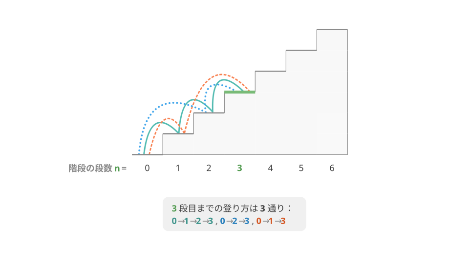
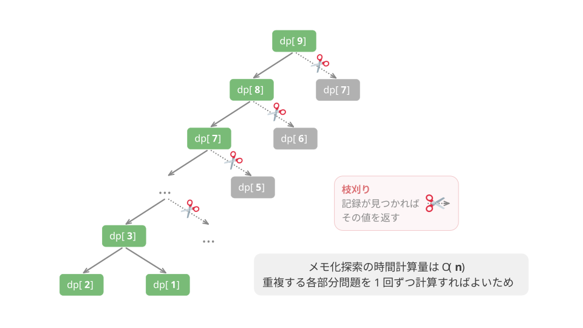
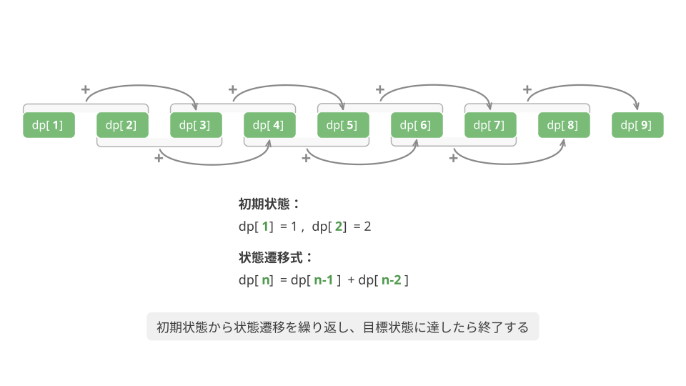

# 動的計画法入門

<u>動的計画法（dynamic programming）</u>は、アルゴリズム設計の重要な手法です。問題をより小さな部分問題に分解し、その解を保存して重複計算を避けることで、計算時間を大幅に短縮します。

この節では代表的な例題を取り上げます。まずバックトラックによる全探索で解き、部分問題の重複を確かめてから、より効率のよい動的計画法を段階的に導きます。

!!! question "階段の登り方"

    $n$ 段の階段を、1 歩で $1$ 段または $2$ 段登れます。最上段までの登り方は何通りありますか。

下図のように、$3$ 段の階段では最上段までの登り方は $3$ 通りあります。



目標は登り方を数えることなので、**バックトラックですべての可能性を列挙できます**。地面から出発し、毎回 $1$ 段か $2$ 段かを選ぶと考えましょう。最上段に着くたびに通り数に $1$ を加え、最上段を越えたらその分岐を打ち切ります。コードは次のとおりです。

```src
[file]{climbing_stairs_backtrack}-[class]{}-[func]{climbing_stairs_backtrack}
```

## 方法 1：全探索

バックトラックでは通常、問題を明示的に分解しません。問題を解くことを一連の選択と捉え、選択肢を試しながら枝刈りし、可能な解をすべて探索します。

今度は問題を分解する観点から考えましょう。$i$ 段目までの登り方を $dp[i]$ 通りとすると、元の問題は $dp[i]$ であり、次の部分問題が含まれます。

$$
dp[i-1], dp[i-2], \dots, dp[2], dp[1]
$$

1 歩で登れるのは $1$ 段か $2$ 段なので、$i$ 段目に着く直前にいたのは $i - 1$ 段目か $i - 2$ 段目です。つまり、$i$ 段目に進めるのは $i -1$ 段目か $i - 2$ 段目からだけです。

ここから大切な関係がわかります。**$i - 1$ 段目までの登り方の数と $i - 2$ 段目までの登り方の数の和は、$i$ 段目までの登り方の数に等しくなります**。式で表すと次のようになります。

$$
dp[i] = dp[i-1] + dp[i-2]
$$

つまり階段の問題では、部分問題の間に漸化式が成り立ち、**部分問題の解から元の問題の解を構成できます**。下図にこの関係を示します。


漸化式を使うと全探索で解けます。$dp[n]$ から出発し、**大きな問題をより小さい 2 つの問題の解の和に再帰的に分解して**、最小の部分問題 $dp[1]$、$dp[2]$ で値を返します。これらの解はすでにわかっており、$dp[1] = 1$、$dp[2] = 2$ です。これは $1$ 段目、$2$ 段目までの登り方がそれぞれ $1$ 通り、$2$ 通りあることを表します。

次のコードは、標準的なバックトラックと同じ深さ優先探索ですが、より簡潔に書けます。

```src
[file]{climbing_stairs_dfs}-[class]{}-[func]{climbing_stairs_dfs}
```

下図は全探索でできる再帰木です。問題 $dp[n]$ では木の深さが $n$、時間計算量が $O(2^n)$ です。指数オーダーでは計算量が爆発的に増えるので、少し大きな $n$ を入力するだけで長時間待たされます。


上図から、**時間計算量が指数オーダーになる原因は部分問題の重複にある**とわかります。たとえば $dp[9]$ は $dp[8]$ と $dp[7]$ に、$dp[8]$ は $dp[7]$ と $dp[6]$ に分解され、どちらにも部分問題 $dp[7]$ が含まれます。

さらに小さな部分問題にも同じように重複が現れ、分解するたびに繰り返されます。計算資源の大半は、こうした部分問題の再計算に費やされます。

## 方法 2：メモ化探索

効率を上げるには、**重複する部分問題をそれぞれ 1 回だけ計算する**ようにしたいところです。そこで配列 `mem` に各部分問題の解を記録し、探索中に重複する部分問題を枝刈りします。

1. 初めて $dp[i]$ を計算したら、後で使えるように `mem[i]` に記録します。
2. 再び $dp[i]$ が必要になったら、`mem[i]` から結果を直接取得し、この部分問題の再計算を省けます。

コードは次のとおりです。

```src
[file]{climbing_stairs_dfs_mem}-[class]{}-[func]{climbing_stairs_dfs_mem}
```

下図のように、**メモ化すると、重複する部分問題を 1 回ずつ計算するだけで済み、時間計算量は $O(n)$ まで下がります**。大きな改善です。



## 方法 3：動的計画法

**メモ化探索はトップダウンの手法です**。元の問題（根ノード）から出発し、大きな部分問題を小さな部分問題に再帰的に分解して、解がわかっている最小の部分問題（葉ノード）に到達します。そこから再帰を戻りながら各段階の解を集め、元の問題の解を構成します。

逆に、**動的計画法はボトムアップの手法です**。最小の部分問題の解から出発し、反復によってより大きな部分問題の解を順に構成し、元の問題の解に到達します。

動的計画法では再帰を戻る過程がないので、再帰を使わずループだけで実装できます。次のコードでは、部分問題の解を保存する配列 `dp` を初期化します。これはメモ化探索の配列 `mem` と同じ記録の役割を果たします。

```src
[file]{climbing_stairs_dp}-[class]{}-[func]{climbing_stairs_dp}
```

下図はこのコードの実行過程を示しています。



バックトラックと同じく、動的計画法でも「状態」によって問題を解く過程のある段階を表します。各状態には部分問題と、それに対応する局所的な最適解があります。たとえば階段の問題では、現在いる段 $i$ を状態とします。

ここまでの内容をもとに、動的計画法でよく使う用語を整理しましょう。

- 配列 `dp` を<u>dp テーブル</u>と呼びます。$dp[i]$ は状態 $i$ に対応する部分問題の解を表します。
- 最小の部分問題に対応する状態（$1$ 段目と $2$ 段目）を<u>初期状態</u>と呼びます。
- 漸化式 $dp[i] = dp[i-1] + dp[i-2]$ を<u>状態遷移式</u>と呼びます。

## 使用メモリの削減

すでに気づいた方もいるでしょう。**$dp[i]$ は $dp[i-1]$ と $dp[i-2]$ だけで決まるため、すべての部分問題の解を配列 `dp` に保存する必要はありません**。2 つの変数を順次更新すれば十分です。コードは次のとおりです。

```src
[file]{climbing_stairs_dp}-[class]{}-[func]{climbing_stairs_dp_comp}
```

このコードでは配列 `dp` の領域が不要になり、空間計算量は $O(n)$ から $O(1)$ に下がります。

動的計画法では、現在の状態が直前の限られた数の状態だけに依存することがよくあります。その場合は必要な状態だけを残し、次元を減らしてメモリを節約できます。**この手法を「ローリング変数」または「ローリング配列」と呼びます**。
