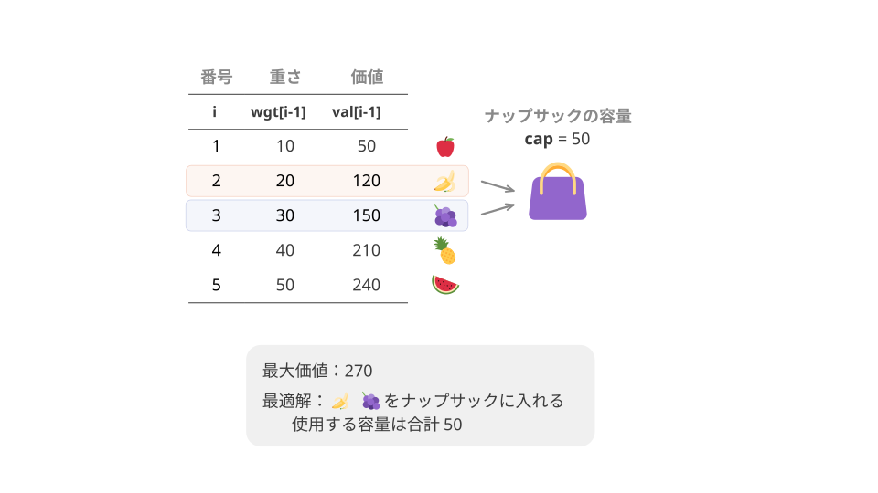
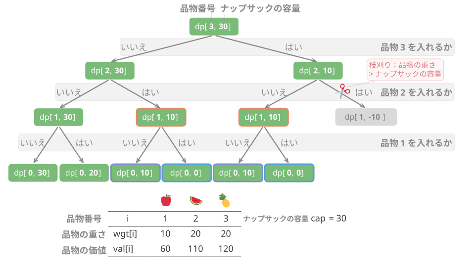
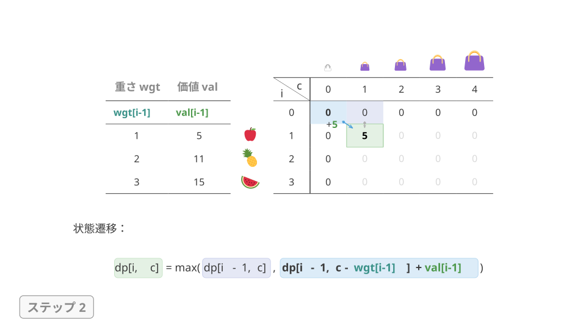
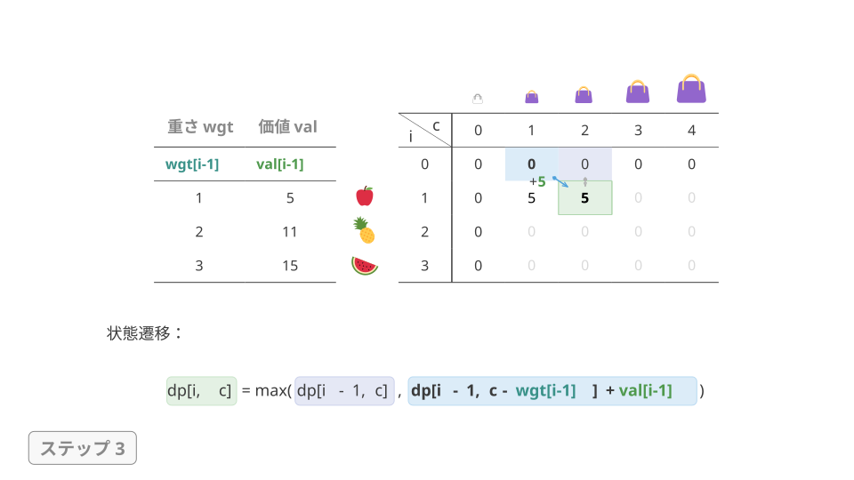
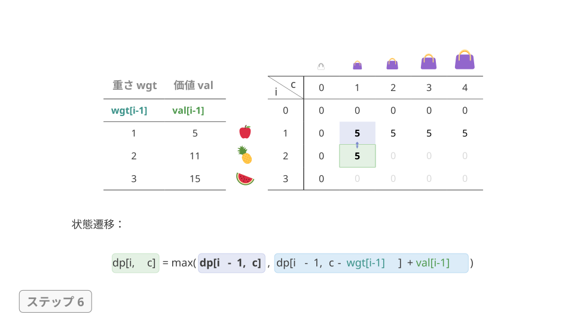
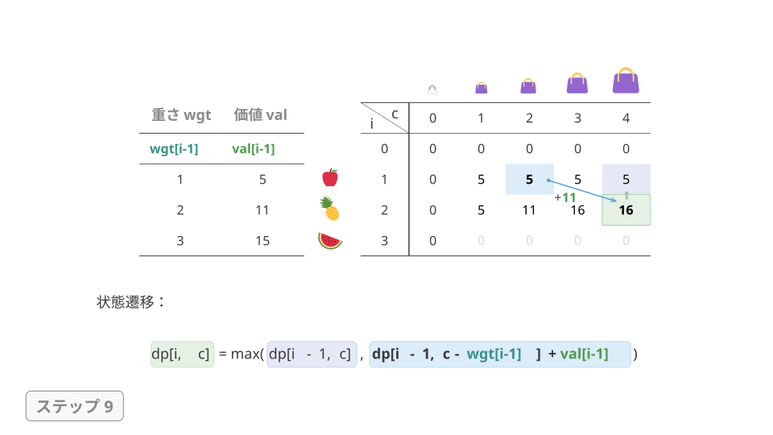
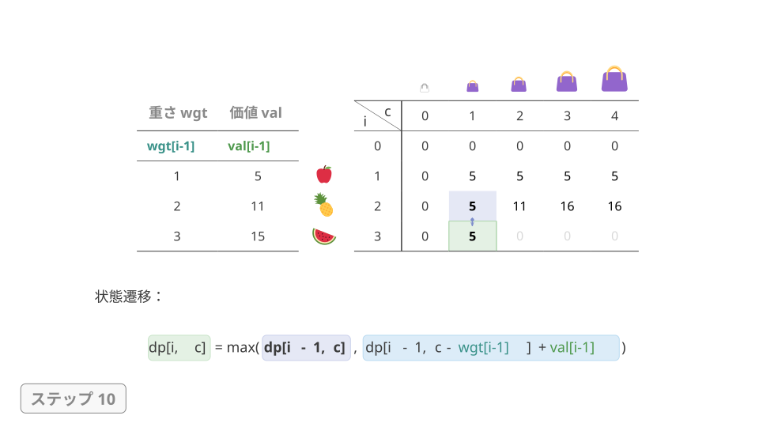
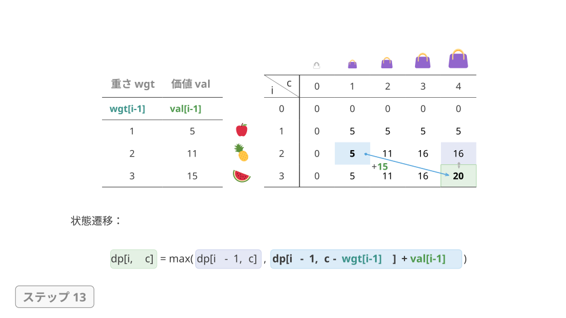
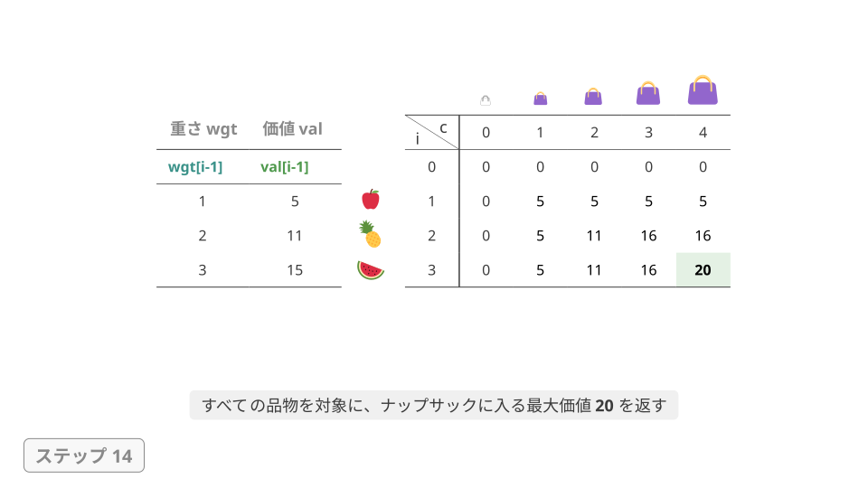
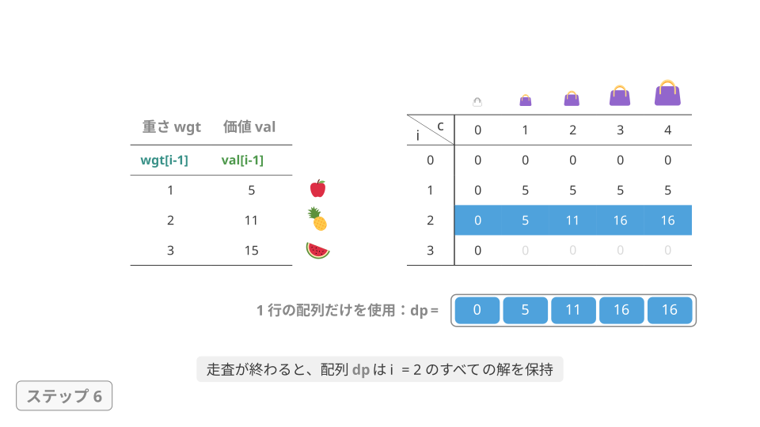

# 14.4 &nbsp; 0-1 ナップサック問題

ナップサック問題は動的計画法で最もよく見られる形式の問題で、入門に適しています。0-1 ナップサック問題、個数制限なしナップサック問題、個数制限付きナップサック問題など、多くの変種があります。

この節ではまず、最も一般的な 0-1 ナップサック問題を解きます。

!!! question "問題"

    $n$ 個の品物と容量 $cap$ のナップサックがあります。$i$ 番目の品物の重さは $wgt[i-1]$、価値は $val[i-1]$ です。各品物は 1 回だけ選べます。容量を超えずに入れられる品物の価値の合計の最大値を求めてください。

図 14-17 では品物番号 $i$ は $1$ から、配列の添字は $0$ から始まります。そのため、品物 $i$ の重さは $wgt[i-1]$、価値は $val[i-1]$ です。

{ class="animation-figure" }

<p align="center"> 図 14-17 &nbsp; 例：0-1 ナップサック問題のデータ </p>

0-1 ナップサック問題では、$n$ 回にわたって選択を行うと考えられます。各品物には入れない、入れるという 2 つの選択肢があるので、この問題は決定木で表せます。

目標は「容量を超えずに入る品物の価値の合計の最大値」を求めることなので、動的計画法に適している可能性が高いと考えられます。

**手順 1：各段階の選択を考え、状態を定義して $dp$ テーブルを作る**

品物をナップサックに入れなければ空き容量は変わらず、入れればその分だけ減ります。そこで、現在の品物番号 $i$ とナップサックの容量 $c$ を状態とし、$[i, c]$ と表します。

状態 $[i, c]$ の部分問題は、**最初の $i$ 個の品物から選んで容量 $c$ のナップサックに入れられる最大価値**を求めることで、解を $dp[i, c]$ と書きます。

求めるのは $dp[n, cap]$ なので、大きさ $(n+1) \times (cap+1)$ の 2 次元の $dp$ テーブルが必要です。

**手順 2：最適部分構造を見つけ、状態遷移式を導く**

品物 $i$ について選択を終えると、最初の $i-1$ 個の品物を対象とする部分問題が残ります。選択には次の 2 通りがあります。

- **品物 $i$ を入れない場合**：容量は変わらず、状態は $[i-1, c]$ になります。
- **品物 $i$ を入れる場合**：空き容量は $wgt[i-1]$ 減り、価値は $val[i-1]$ 増え、状態は $[i-1, c-wgt[i-1]]$ になります。

ここに最適部分構造があります。**最大価値 $dp[i, c]$ は、品物 $i$ を入れない場合と品物 $i$ を入れる場合のうち、価値が大きい方です**。したがって状態遷移式は次のようになります。

$$
dp[i, c] = \max(dp[i-1, c], dp[i-1, c - wgt[i-1]] + val[i-1])
$$

ただし、現在の品物の重さ $wgt[i - 1]$ が空き容量 $c$ を超える場合は、入れないという選択しかありません。

**手順 3：境界条件と状態遷移の順序を決める**

品物がない場合も容量が $0$ の場合も、最大価値は $0$ です。つまり、先頭列 $dp[i, 0]$ と先頭行 $dp[0, c]$ はいずれも $0$ です。

現在の状態 $[i, c]$ には、上の状態 $[i-1, c]$ と左上の状態 $[i-1, c-wgt[i-1]]$ から遷移します。そのため二重ループで $dp$ テーブル全体を先頭から順に走査できます。

ここまでの考察をもとに、全探索、メモ化探索、動的計画法の順に実装します。

### 1. &nbsp; 方法 1：全探索

探索のコードは次の要素で構成されます。

- **再帰関数の引数**：状態 $[i, c]$ です。
- **戻り値**：部分問題の解 $dp[i, c]$ です。
- **終了条件**：品物番号が範囲外（$i = 0$）になるか、空き容量が $0$ になったら、再帰を終了して価値 $0$ を返します。
- **枝刈り**：品物の重さが空き容量を超えたら、ナップサックに入れない選択だけを調べます。

=== "Python"

    ```python title="knapsack.py"
    def knapsack_dfs(wgt: list[int], val: list[int], i: int, c: int) -> int:
        """0-1 ナップサック問題：全探索"""
        # 全品物の選択を終えたか、空き容量がなければ、価値 0 を返す
        if i == 0 or c == 0:
            return 0
        # 容量を超える場合は、入れない選択しかできない
        if wgt[i - 1] > c:
            return knapsack_dfs(wgt, val, i - 1, c)
        # 品物 i を入れない場合と入れる場合の最大価値を求める
        no = knapsack_dfs(wgt, val, i - 1, c)
        yes = knapsack_dfs(wgt, val, i - 1, c - wgt[i - 1]) + val[i - 1]
        # 2 通りのうち価値が大きい方を返す
        return max(no, yes)
    ```

=== "C++"

    ```cpp title="knapsack.cpp"
    /* 0-1 ナップサック問題：全探索 */
    int knapsackDFS(vector<int> &wgt, vector<int> &val, int i, int c) {
        // 全品物の選択を終えたか、空き容量がなければ、価値 0 を返す
        if (i == 0 || c == 0) {
            return 0;
        }
        // 容量を超える場合は、入れない選択しかできない
        if (wgt[i - 1] > c) {
            return knapsackDFS(wgt, val, i - 1, c);
        }
        // 品物 i を入れない場合と入れる場合の最大価値を求める
        int no = knapsackDFS(wgt, val, i - 1, c);
        int yes = knapsackDFS(wgt, val, i - 1, c - wgt[i - 1]) + val[i - 1];
        // 2 通りのうち価値が大きい方を返す
        return max(no, yes);
    }
    ```

=== "Java"

    ```java title="knapsack.java"
    /* 0-1 ナップサック問題：全探索 */
    int knapsackDFS(int[] wgt, int[] val, int i, int c) {
        // 全品物の選択を終えたか、空き容量がなければ、価値 0 を返す
        if (i == 0 || c == 0) {
            return 0;
        }
        // 容量を超える場合は、入れない選択しかできない
        if (wgt[i - 1] > c) {
            return knapsackDFS(wgt, val, i - 1, c);
        }
        // 品物 i を入れない場合と入れる場合の最大価値を求める
        int no = knapsackDFS(wgt, val, i - 1, c);
        int yes = knapsackDFS(wgt, val, i - 1, c - wgt[i - 1]) + val[i - 1];
        // 2 通りのうち価値が大きい方を返す
        return Math.max(no, yes);
    }
    ```

=== "C#"

    ```csharp title="knapsack.cs"
    /* 0-1 ナップサック問題：全探索 */
    int KnapsackDFS(int[] weight, int[] val, int i, int c) {
        // 全品物の選択を終えたか、空き容量がなければ、価値 0 を返す
        if (i == 0 || c == 0) {
            return 0;
        }
        // 容量を超える場合は、入れない選択しかできない
        if (weight[i - 1] > c) {
            return KnapsackDFS(weight, val, i - 1, c);
        }
        // 品物 i を入れない場合と入れる場合の最大価値を求める
        int no = KnapsackDFS(weight, val, i - 1, c);
        int yes = KnapsackDFS(weight, val, i - 1, c - weight[i - 1]) + val[i - 1];
        // 2 通りのうち価値が大きい方を返す
        return Math.Max(no, yes);
    }
    ```

=== "Go"

    ```go title="knapsack.go"
    /* 0-1 ナップサック問題：全探索 */
    func knapsackDFS(wgt, val []int, i, c int) int {
        // 全品物の選択を終えたか、空き容量がなければ、価値 0 を返す
        if i == 0 || c == 0 {
            return 0
        }
        // 容量を超える場合は、入れない選択しかできない
        if wgt[i-1] > c {
            return knapsackDFS(wgt, val, i-1, c)
        }
        // 品物 i を入れない場合と入れる場合の最大価値を求める
        no := knapsackDFS(wgt, val, i-1, c)
        yes := knapsackDFS(wgt, val, i-1, c-wgt[i-1]) + val[i-1]
        // 2 通りのうち価値が大きい方を返す
        return int(math.Max(float64(no), float64(yes)))
    }
    ```

=== "Swift"

    ```swift title="knapsack.swift"
    /* 0-1 ナップサック問題：全探索 */
    func knapsackDFS(wgt: [Int], val: [Int], i: Int, c: Int) -> Int {
        // 全品物の選択を終えたか、空き容量がなければ、価値 0 を返す
        if i == 0 || c == 0 {
            return 0
        }
        // 容量を超える場合は、入れない選択しかできない
        if wgt[i - 1] > c {
            return knapsackDFS(wgt: wgt, val: val, i: i - 1, c: c)
        }
        // 品物 i を入れない場合と入れる場合の最大価値を求める
        let no = knapsackDFS(wgt: wgt, val: val, i: i - 1, c: c)
        let yes = knapsackDFS(wgt: wgt, val: val, i: i - 1, c: c - wgt[i - 1]) + val[i - 1]
        // 2 通りのうち価値が大きい方を返す
        return max(no, yes)
    }
    ```

=== "JS"

    ```javascript title="knapsack.js"
    /* 0-1 ナップサック問題：全探索 */
    function knapsackDFS(wgt, val, i, c) {
        // 全品物の選択を終えたか、空き容量がなければ、価値 0 を返す
        if (i === 0 || c === 0) {
            return 0;
        }
        // 容量を超える場合は、入れない選択しかできない
        if (wgt[i - 1] > c) {
            return knapsackDFS(wgt, val, i - 1, c);
        }
        // 品物 i を入れない場合と入れる場合の最大価値を求める
        const no = knapsackDFS(wgt, val, i - 1, c);
        const yes = knapsackDFS(wgt, val, i - 1, c - wgt[i - 1]) + val[i - 1];
        // 2 通りのうち価値が大きい方を返す
        return Math.max(no, yes);
    }
    ```

=== "TS"

    ```typescript title="knapsack.ts"
    /* 0-1 ナップサック問題：全探索 */
    function knapsackDFS(
        wgt: Array<number>,
        val: Array<number>,
        i: number,
        c: number
    ): number {
        // 全品物の選択を終えたか、空き容量がなければ、価値 0 を返す
        if (i === 0 || c === 0) {
            return 0;
        }
        // 容量を超える場合は、入れない選択しかできない
        if (wgt[i - 1] > c) {
            return knapsackDFS(wgt, val, i - 1, c);
        }
        // 品物 i を入れない場合と入れる場合の最大価値を求める
        const no = knapsackDFS(wgt, val, i - 1, c);
        const yes = knapsackDFS(wgt, val, i - 1, c - wgt[i - 1]) + val[i - 1];
        // 2 通りのうち価値が大きい方を返す
        return Math.max(no, yes);
    }
    ```

=== "Dart"

    ```dart title="knapsack.dart"
    /* 0-1 ナップサック問題：全探索 */
    int knapsackDFS(List<int> wgt, List<int> val, int i, int c) {
      // 全品物の選択を終えたか、空き容量がなければ、価値 0 を返す
      if (i == 0 || c == 0) {
        return 0;
      }
      // 容量を超える場合は、入れない選択しかできない
      if (wgt[i - 1] > c) {
        return knapsackDFS(wgt, val, i - 1, c);
      }
      // 品物 i を入れない場合と入れる場合の最大価値を求める
      int no = knapsackDFS(wgt, val, i - 1, c);
      int yes = knapsackDFS(wgt, val, i - 1, c - wgt[i - 1]) + val[i - 1];
      // 2 通りのうち価値が大きい方を返す
      return max(no, yes);
    }
    ```

=== "Rust"

    ```rust title="knapsack.rs"
    /* 0-1 ナップサック問題：全探索 */
    fn knapsack_dfs(wgt: &[i32], val: &[i32], i: usize, c: usize) -> i32 {
        // 全品物の選択を終えたか、空き容量がなければ、価値 0 を返す
        if i == 0 || c == 0 {
            return 0;
        }
        // 容量を超える場合は、入れない選択しかできない
        if wgt[i - 1] > c as i32 {
            return knapsack_dfs(wgt, val, i - 1, c);
        }
        // 品物 i を入れない場合と入れる場合の最大価値を求める
        let no = knapsack_dfs(wgt, val, i - 1, c);
        let yes = knapsack_dfs(wgt, val, i - 1, c - wgt[i - 1] as usize) + val[i - 1];
        // 2 通りのうち価値が大きい方を返す
        std::cmp::max(no, yes)
    }
    ```

=== "C"

    ```c title="knapsack.c"
    /* 0-1 ナップサック問題：全探索 */
    int knapsackDFS(int wgt[], int val[], int i, int c) {
        // 全品物の選択を終えたか、空き容量がなければ、価値 0 を返す
        if (i == 0 || c == 0) {
            return 0;
        }
        // 容量を超える場合は、入れない選択しかできない
        if (wgt[i - 1] > c) {
            return knapsackDFS(wgt, val, i - 1, c);
        }
        // 品物 i を入れない場合と入れる場合の最大価値を求める
        int no = knapsackDFS(wgt, val, i - 1, c);
        int yes = knapsackDFS(wgt, val, i - 1, c - wgt[i - 1]) + val[i - 1];
        // 2 通りのうち価値が大きい方を返す
        return myMax(no, yes);
    }
    ```

=== "Kotlin"

    ```kotlin title="knapsack.kt"
    /* 0-1 ナップサック問題：全探索 */
    fun knapsackDFS(
        wgt: IntArray,
        _val: IntArray,
        i: Int,
        c: Int
    ): Int {
        // 全品物の選択を終えたか、空き容量がなければ、価値 0 を返す
        if (i == 0 || c == 0) {
            return 0
        }
        // 容量を超える場合は、入れない選択しかできない
        if (wgt[i - 1] > c) {
            return knapsackDFS(wgt, _val, i - 1, c)
        }
        // 品物 i を入れない場合と入れる場合の最大価値を求める
        val no = knapsackDFS(wgt, _val, i - 1, c)
        val yes = knapsackDFS(wgt, _val, i - 1, c - wgt[i - 1]) + _val[i - 1]
        // 2 通りのうち価値が大きい方を返す
        return max(no, yes)
    }
    ```

=== "Ruby"

    ```ruby title="knapsack.rb"
    ### 0-1 ナップサック問題：全探索 ###
    def knapsack_dfs(wgt, val, i, c)
      # 全品物の選択を終えたか、空き容量がなければ、価値 0 を返す
      return 0 if i == 0 || c == 0
      # 容量を超える場合は、入れない選択しかできない
      return knapsack_dfs(wgt, val, i - 1, c) if wgt[i - 1] > c
      # 品物 i を入れない場合と入れる場合の最大価値を求める
      no = knapsack_dfs(wgt, val, i - 1, c)
      yes = knapsack_dfs(wgt, val, i - 1, c - wgt[i - 1]) + val[i - 1]
      # 2 通りのうち価値が大きい方を返す
      [no, yes].max
    end
    ```

??? pythontutor "実行の様子を見る"

    <div style="height: 549px; width: 100%;"><iframe class="pythontutor-iframe" title="実行の様子を見る" src="https://pythontutor.com/iframe-embed.html#code=def%20knapsack_dfs%28wgt%3A%20list%5Bint%5D,%20val%3A%20list%5Bint%5D,%20i%3A%20int,%20c%3A%20int%29%20-%3E%20int%3A%0A%20%20%20%20%22%22%220-1%20%E3%83%8A%E3%83%83%E3%83%97%E3%82%B5%E3%83%83%E3%82%AF%E5%95%8F%E9%A1%8C%EF%BC%9A%E5%85%A8%E6%8E%A2%E7%B4%A2%22%22%22%0A%20%20%20%20%23%20%E5%85%A8%E5%93%81%E7%89%A9%E3%81%AE%E9%81%B8%E6%8A%9E%E3%82%92%E7%B5%82%E3%81%88%E3%81%9F%E3%81%8B%E3%80%81%E7%A9%BA%E3%81%8D%E5%AE%B9%E9%87%8F%E3%81%8C%E3%81%AA%E3%81%91%E3%82%8C%E3%81%B0%E3%80%81%E4%BE%A1%E5%80%A4%200%20%E3%82%92%E8%BF%94%E3%81%99%0A%20%20%20%20if%20i%20%3D%3D%200%20or%20c%20%3D%3D%200%3A%0A%20%20%20%20%20%20%20%20return%200%0A%20%20%20%20%23%20%E5%AE%B9%E9%87%8F%E3%82%92%E8%B6%85%E3%81%88%E3%82%8B%E5%A0%B4%E5%90%88%E3%81%AF%E3%80%81%E5%85%A5%E3%82%8C%E3%81%AA%E3%81%84%E9%81%B8%E6%8A%9E%E3%81%97%E3%81%8B%E3%81%A7%E3%81%8D%E3%81%AA%E3%81%84%0A%20%20%20%20if%20wgt%5Bi%20-%201%5D%20%3E%20c%3A%0A%20%20%20%20%20%20%20%20return%20knapsack_dfs%28wgt,%20val,%20i%20-%201,%20c%29%0A%20%20%20%20%23%20%E5%93%81%E7%89%A9%20i%20%E3%82%92%E5%85%A5%E3%82%8C%E3%81%AA%E3%81%84%E5%A0%B4%E5%90%88%E3%81%A8%E5%85%A5%E3%82%8C%E3%82%8B%E5%A0%B4%E5%90%88%E3%81%AE%E6%9C%80%E5%A4%A7%E4%BE%A1%E5%80%A4%E3%82%92%E6%B1%82%E3%82%81%E3%82%8B%0A%20%20%20%20no%20%3D%20knapsack_dfs%28wgt,%20val,%20i%20-%201,%20c%29%0A%20%20%20%20yes%20%3D%20knapsack_dfs%28wgt,%20val,%20i%20-%201,%20c%20-%20wgt%5Bi%20-%201%5D%29%20%2B%20val%5Bi%20-%201%5D%0A%20%20%20%20%23%202%20%E9%80%9A%E3%82%8A%E3%81%AE%E3%81%86%E3%81%A1%E4%BE%A1%E5%80%A4%E3%81%8C%E5%A4%A7%E3%81%8D%E3%81%84%E6%96%B9%E3%82%92%E8%BF%94%E3%81%99%0A%20%20%20%20return%20max%28no,%20yes%29%0A%0A%0A%22%22%22Driver%20Code%22%22%22%0Aif%20__name__%20%3D%3D%20%22__main__%22%3A%0A%20%20%20%20wgt%20%3D%20%5B10,%2020,%2030,%2040,%2050%5D%0A%20%20%20%20val%20%3D%20%5B50,%20120,%20150,%20210,%20240%5D%0A%20%20%20%20cap%20%3D%2050%0A%20%20%20%20n%20%3D%20len%28wgt%29%0A%0A%20%20%20%20%23%20%E5%85%A8%E6%8E%A2%E7%B4%A2%0A%20%20%20%20res%20%3D%20knapsack_dfs%28wgt,%20val,%20n,%20cap%29%0A%20%20%20%20print%28f%22%E5%AE%B9%E9%87%8F%E5%86%85%E3%81%A7%E3%83%8A%E3%83%83%E3%83%97%E3%82%B5%E3%83%83%E3%82%AF%E3%81%AB%E5%85%A5%E3%82%8B%E5%93%81%E7%89%A9%E3%81%AE%E6%9C%80%E5%A4%A7%E4%BE%A1%E5%80%A4%E3%81%AF%20%7Bres%7D%22%29&codeDivHeight=472&codeDivWidth=350&cumulative=false&curInstr=7&heapPrimitives=nevernest&origin=opt-frontend.js&py=311&rawInputLstJSON=%5B%5D&textReferences=false"> </iframe></div>
    <div style="margin-top: 5px;"><a href="https://pythontutor.com/iframe-embed.html#code=def%20knapsack_dfs%28wgt%3A%20list%5Bint%5D,%20val%3A%20list%5Bint%5D,%20i%3A%20int,%20c%3A%20int%29%20-%3E%20int%3A%0A%20%20%20%20%22%22%220-1%20%E3%83%8A%E3%83%83%E3%83%97%E3%82%B5%E3%83%83%E3%82%AF%E5%95%8F%E9%A1%8C%EF%BC%9A%E5%85%A8%E6%8E%A2%E7%B4%A2%22%22%22%0A%20%20%20%20%23%20%E5%85%A8%E5%93%81%E7%89%A9%E3%81%AE%E9%81%B8%E6%8A%9E%E3%82%92%E7%B5%82%E3%81%88%E3%81%9F%E3%81%8B%E3%80%81%E7%A9%BA%E3%81%8D%E5%AE%B9%E9%87%8F%E3%81%8C%E3%81%AA%E3%81%91%E3%82%8C%E3%81%B0%E3%80%81%E4%BE%A1%E5%80%A4%200%20%E3%82%92%E8%BF%94%E3%81%99%0A%20%20%20%20if%20i%20%3D%3D%200%20or%20c%20%3D%3D%200%3A%0A%20%20%20%20%20%20%20%20return%200%0A%20%20%20%20%23%20%E5%AE%B9%E9%87%8F%E3%82%92%E8%B6%85%E3%81%88%E3%82%8B%E5%A0%B4%E5%90%88%E3%81%AF%E3%80%81%E5%85%A5%E3%82%8C%E3%81%AA%E3%81%84%E9%81%B8%E6%8A%9E%E3%81%97%E3%81%8B%E3%81%A7%E3%81%8D%E3%81%AA%E3%81%84%0A%20%20%20%20if%20wgt%5Bi%20-%201%5D%20%3E%20c%3A%0A%20%20%20%20%20%20%20%20return%20knapsack_dfs%28wgt,%20val,%20i%20-%201,%20c%29%0A%20%20%20%20%23%20%E5%93%81%E7%89%A9%20i%20%E3%82%92%E5%85%A5%E3%82%8C%E3%81%AA%E3%81%84%E5%A0%B4%E5%90%88%E3%81%A8%E5%85%A5%E3%82%8C%E3%82%8B%E5%A0%B4%E5%90%88%E3%81%AE%E6%9C%80%E5%A4%A7%E4%BE%A1%E5%80%A4%E3%82%92%E6%B1%82%E3%82%81%E3%82%8B%0A%20%20%20%20no%20%3D%20knapsack_dfs%28wgt,%20val,%20i%20-%201,%20c%29%0A%20%20%20%20yes%20%3D%20knapsack_dfs%28wgt,%20val,%20i%20-%201,%20c%20-%20wgt%5Bi%20-%201%5D%29%20%2B%20val%5Bi%20-%201%5D%0A%20%20%20%20%23%202%20%E9%80%9A%E3%82%8A%E3%81%AE%E3%81%86%E3%81%A1%E4%BE%A1%E5%80%A4%E3%81%8C%E5%A4%A7%E3%81%8D%E3%81%84%E6%96%B9%E3%82%92%E8%BF%94%E3%81%99%0A%20%20%20%20return%20max%28no,%20yes%29%0A%0A%0A%22%22%22Driver%20Code%22%22%22%0Aif%20__name__%20%3D%3D%20%22__main__%22%3A%0A%20%20%20%20wgt%20%3D%20%5B10,%2020,%2030,%2040,%2050%5D%0A%20%20%20%20val%20%3D%20%5B50,%20120,%20150,%20210,%20240%5D%0A%20%20%20%20cap%20%3D%2050%0A%20%20%20%20n%20%3D%20len%28wgt%29%0A%0A%20%20%20%20%23%20%E5%85%A8%E6%8E%A2%E7%B4%A2%0A%20%20%20%20res%20%3D%20knapsack_dfs%28wgt,%20val,%20n,%20cap%29%0A%20%20%20%20print%28f%22%E5%AE%B9%E9%87%8F%E5%86%85%E3%81%A7%E3%83%8A%E3%83%83%E3%83%97%E3%82%B5%E3%83%83%E3%82%AF%E3%81%AB%E5%85%A5%E3%82%8B%E5%93%81%E7%89%A9%E3%81%AE%E6%9C%80%E5%A4%A7%E4%BE%A1%E5%80%A4%E3%81%AF%20%7Bres%7D%22%29&codeDivHeight=800&codeDivWidth=600&cumulative=false&curInstr=7&heapPrimitives=nevernest&origin=opt-frontend.js&py=311&rawInputLstJSON=%5B%5D&textReferences=false" target="_blank" rel="noopener noreferrer">全画面で表示 ></a></div>

図 14-18 のように、品物ごとに選ばない場合と選ぶ場合に分岐するので、時間計算量は $O(2^n)$ です。

再帰木には $dp[1, 10]$ などの重複する部分問題が見つかります。品物が多く容量が大きい場合、特に同じ重さの品物が多いと、重複する部分問題が大幅に増えます。

{ class="animation-figure" }

<p align="center"> 図 14-18 &nbsp; 全探索の再帰木（0-1 ナップサック問題） </p>

### 2. &nbsp; 方法 2：メモ化探索

重複する部分問題を 1 回ずつだけ計算するために、メモ用配列 `mem` に解を記録します。`mem[i][c]` が $dp[i, c]$ に対応します。

メモ化すると、**時間計算量は部分問題の数で決まり**、$O(n \times cap)$ となります。実装は次のとおりです。

=== "Python"

    ```python title="knapsack.py"
    def knapsack_dfs_mem(
        wgt: list[int], val: list[int], mem: list[list[int]], i: int, c: int
    ) -> int:
        """0-1 ナップサック問題：メモ化探索"""
        # 全品物の選択を終えたか、空き容量がなければ、価値 0 を返す
        if i == 0 or c == 0:
            return 0
        # 記録済みなら、その値を返す
        if mem[i][c] != -1:
            return mem[i][c]
        # 容量を超える場合は、入れない選択しかできない
        if wgt[i - 1] > c:
            return knapsack_dfs_mem(wgt, val, mem, i - 1, c)
        # 品物 i を入れない場合と入れる場合の最大価値を求める
        no = knapsack_dfs_mem(wgt, val, mem, i - 1, c)
        yes = knapsack_dfs_mem(wgt, val, mem, i - 1, c - wgt[i - 1]) + val[i - 1]
        # 2 通りのうち大きい方の価値を記録して返す
        mem[i][c] = max(no, yes)
        return mem[i][c]
    ```

=== "C++"

    ```cpp title="knapsack.cpp"
    /* 0-1 ナップサック問題：メモ化探索 */
    int knapsackDFSMem(vector<int> &wgt, vector<int> &val, vector<vector<int>> &mem, int i, int c) {
        // 全品物の選択を終えたか、空き容量がなければ、価値 0 を返す
        if (i == 0 || c == 0) {
            return 0;
        }
        // 記録済みなら、その値を返す
        if (mem[i][c] != -1) {
            return mem[i][c];
        }
        // 容量を超える場合は、入れない選択しかできない
        if (wgt[i - 1] > c) {
            return knapsackDFSMem(wgt, val, mem, i - 1, c);
        }
        // 品物 i を入れない場合と入れる場合の最大価値を求める
        int no = knapsackDFSMem(wgt, val, mem, i - 1, c);
        int yes = knapsackDFSMem(wgt, val, mem, i - 1, c - wgt[i - 1]) + val[i - 1];
        // 2 通りのうち大きい方の価値を記録して返す
        mem[i][c] = max(no, yes);
        return mem[i][c];
    }
    ```

=== "Java"

    ```java title="knapsack.java"
    /* 0-1 ナップサック問題：メモ化探索 */
    int knapsackDFSMem(int[] wgt, int[] val, int[][] mem, int i, int c) {
        // 全品物の選択を終えたか、空き容量がなければ、価値 0 を返す
        if (i == 0 || c == 0) {
            return 0;
        }
        // 記録済みなら、その値を返す
        if (mem[i][c] != -1) {
            return mem[i][c];
        }
        // 容量を超える場合は、入れない選択しかできない
        if (wgt[i - 1] > c) {
            return knapsackDFSMem(wgt, val, mem, i - 1, c);
        }
        // 品物 i を入れない場合と入れる場合の最大価値を求める
        int no = knapsackDFSMem(wgt, val, mem, i - 1, c);
        int yes = knapsackDFSMem(wgt, val, mem, i - 1, c - wgt[i - 1]) + val[i - 1];
        // 2 通りのうち大きい方の価値を記録して返す
        mem[i][c] = Math.max(no, yes);
        return mem[i][c];
    }
    ```

=== "C#"

    ```csharp title="knapsack.cs"
    /* 0-1 ナップサック問題：メモ化探索 */
    int KnapsackDFSMem(int[] weight, int[] val, int[][] mem, int i, int c) {
        // 全品物の選択を終えたか、空き容量がなければ、価値 0 を返す
        if (i == 0 || c == 0) {
            return 0;
        }
        // 記録済みなら、その値を返す
        if (mem[i][c] != -1) {
            return mem[i][c];
        }
        // 容量を超える場合は、入れない選択しかできない
        if (weight[i - 1] > c) {
            return KnapsackDFSMem(weight, val, mem, i - 1, c);
        }
        // 品物 i を入れない場合と入れる場合の最大価値を求める
        int no = KnapsackDFSMem(weight, val, mem, i - 1, c);
        int yes = KnapsackDFSMem(weight, val, mem, i - 1, c - weight[i - 1]) + val[i - 1];
        // 2 通りのうち大きい方の価値を記録して返す
        mem[i][c] = Math.Max(no, yes);
        return mem[i][c];
    }
    ```

=== "Go"

    ```go title="knapsack.go"
    /* 0-1 ナップサック問題：メモ化探索 */
    func knapsackDFSMem(wgt, val []int, mem [][]int, i, c int) int {
        // 全品物の選択を終えたか、空き容量がなければ、価値 0 を返す
        if i == 0 || c == 0 {
            return 0
        }
        // 記録済みなら、その値を返す
        if mem[i][c] != -1 {
            return mem[i][c]
        }
        // 容量を超える場合は、入れない選択しかできない
        if wgt[i-1] > c {
            return knapsackDFSMem(wgt, val, mem, i-1, c)
        }
        // 品物 i を入れない場合と入れる場合の最大価値を求める
        no := knapsackDFSMem(wgt, val, mem, i-1, c)
        yes := knapsackDFSMem(wgt, val, mem, i-1, c-wgt[i-1]) + val[i-1]
        // 2 通りのうち価値が大きい方を返す
        mem[i][c] = int(math.Max(float64(no), float64(yes)))
        return mem[i][c]
    }
    ```

=== "Swift"

    ```swift title="knapsack.swift"
    /* 0-1 ナップサック問題：メモ化探索 */
    func knapsackDFSMem(wgt: [Int], val: [Int], mem: inout [[Int]], i: Int, c: Int) -> Int {
        // 全品物の選択を終えたか、空き容量がなければ、価値 0 を返す
        if i == 0 || c == 0 {
            return 0
        }
        // 記録済みなら、その値を返す
        if mem[i][c] != -1 {
            return mem[i][c]
        }
        // 容量を超える場合は、入れない選択しかできない
        if wgt[i - 1] > c {
            return knapsackDFSMem(wgt: wgt, val: val, mem: &mem, i: i - 1, c: c)
        }
        // 品物 i を入れない場合と入れる場合の最大価値を求める
        let no = knapsackDFSMem(wgt: wgt, val: val, mem: &mem, i: i - 1, c: c)
        let yes = knapsackDFSMem(wgt: wgt, val: val, mem: &mem, i: i - 1, c: c - wgt[i - 1]) + val[i - 1]
        // 2 通りのうち大きい方の価値を記録して返す
        mem[i][c] = max(no, yes)
        return mem[i][c]
    }
    ```

=== "JS"

    ```javascript title="knapsack.js"
    /* 0-1 ナップサック問題：メモ化探索 */
    function knapsackDFSMem(wgt, val, mem, i, c) {
        // 全品物の選択を終えたか、空き容量がなければ、価値 0 を返す
        if (i === 0 || c === 0) {
            return 0;
        }
        // 記録済みなら、その値を返す
        if (mem[i][c] !== -1) {
            return mem[i][c];
        }
        // 容量を超える場合は、入れない選択しかできない
        if (wgt[i - 1] > c) {
            return knapsackDFSMem(wgt, val, mem, i - 1, c);
        }
        // 品物 i を入れない場合と入れる場合の最大価値を求める
        const no = knapsackDFSMem(wgt, val, mem, i - 1, c);
        const yes =
            knapsackDFSMem(wgt, val, mem, i - 1, c - wgt[i - 1]) + val[i - 1];
        // 2 通りのうち大きい方の価値を記録して返す
        mem[i][c] = Math.max(no, yes);
        return mem[i][c];
    }
    ```

=== "TS"

    ```typescript title="knapsack.ts"
    /* 0-1 ナップサック問題：メモ化探索 */
    function knapsackDFSMem(
        wgt: Array<number>,
        val: Array<number>,
        mem: Array<Array<number>>,
        i: number,
        c: number
    ): number {
        // 全品物の選択を終えたか、空き容量がなければ、価値 0 を返す
        if (i === 0 || c === 0) {
            return 0;
        }
        // 記録済みなら、その値を返す
        if (mem[i][c] !== -1) {
            return mem[i][c];
        }
        // 容量を超える場合は、入れない選択しかできない
        if (wgt[i - 1] > c) {
            return knapsackDFSMem(wgt, val, mem, i - 1, c);
        }
        // 品物 i を入れない場合と入れる場合の最大価値を求める
        const no = knapsackDFSMem(wgt, val, mem, i - 1, c);
        const yes =
            knapsackDFSMem(wgt, val, mem, i - 1, c - wgt[i - 1]) + val[i - 1];
        // 2 通りのうち大きい方の価値を記録して返す
        mem[i][c] = Math.max(no, yes);
        return mem[i][c];
    }
    ```

=== "Dart"

    ```dart title="knapsack.dart"
    /* 0-1 ナップサック問題：メモ化探索 */
    int knapsackDFSMem(
      List<int> wgt,
      List<int> val,
      List<List<int>> mem,
      int i,
      int c,
    ) {
      // 全品物の選択を終えたか、空き容量がなければ、価値 0 を返す
      if (i == 0 || c == 0) {
        return 0;
      }
      // 記録済みなら、その値を返す
      if (mem[i][c] != -1) {
        return mem[i][c];
      }
      // 容量を超える場合は、入れない選択しかできない
      if (wgt[i - 1] > c) {
        return knapsackDFSMem(wgt, val, mem, i - 1, c);
      }
      // 品物 i を入れない場合と入れる場合の最大価値を求める
      int no = knapsackDFSMem(wgt, val, mem, i - 1, c);
      int yes = knapsackDFSMem(wgt, val, mem, i - 1, c - wgt[i - 1]) + val[i - 1];
      // 2 通りのうち大きい方の価値を記録して返す
      mem[i][c] = max(no, yes);
      return mem[i][c];
    }
    ```

=== "Rust"

    ```rust title="knapsack.rs"
    /* 0-1 ナップサック問題：メモ化探索 */
    fn knapsack_dfs_mem(wgt: &[i32], val: &[i32], mem: &mut Vec<Vec<i32>>, i: usize, c: usize) -> i32 {
        // 全品物の選択を終えたか、空き容量がなければ、価値 0 を返す
        if i == 0 || c == 0 {
            return 0;
        }
        // 記録済みなら、その値を返す
        if mem[i][c] != -1 {
            return mem[i][c];
        }
        // 容量を超える場合は、入れない選択しかできない
        if wgt[i - 1] > c as i32 {
            return knapsack_dfs_mem(wgt, val, mem, i - 1, c);
        }
        // 品物 i を入れない場合と入れる場合の最大価値を求める
        let no = knapsack_dfs_mem(wgt, val, mem, i - 1, c);
        let yes = knapsack_dfs_mem(wgt, val, mem, i - 1, c - wgt[i - 1] as usize) + val[i - 1];
        // 2 通りのうち大きい方の価値を記録して返す
        mem[i][c] = std::cmp::max(no, yes);
        mem[i][c]
    }
    ```

=== "C"

    ```c title="knapsack.c"
    /* 0-1 ナップサック問題：メモ化探索 */
    int knapsackDFSMem(int wgt[], int val[], int memCols, int **mem, int i, int c) {
        // 全品物の選択を終えたか、空き容量がなければ、価値 0 を返す
        if (i == 0 || c == 0) {
            return 0;
        }
        // 記録済みなら、その値を返す
        if (mem[i][c] != -1) {
            return mem[i][c];
        }
        // 容量を超える場合は、入れない選択しかできない
        if (wgt[i - 1] > c) {
            return knapsackDFSMem(wgt, val, memCols, mem, i - 1, c);
        }
        // 品物 i を入れない場合と入れる場合の最大価値を求める
        int no = knapsackDFSMem(wgt, val, memCols, mem, i - 1, c);
        int yes = knapsackDFSMem(wgt, val, memCols, mem, i - 1, c - wgt[i - 1]) + val[i - 1];
        // 2 通りのうち大きい方の価値を記録して返す
        mem[i][c] = myMax(no, yes);
        return mem[i][c];
    }
    ```

=== "Kotlin"

    ```kotlin title="knapsack.kt"
    /* 0-1 ナップサック問題：メモ化探索 */
    fun knapsackDFSMem(
        wgt: IntArray,
        _val: IntArray,
        mem: Array<IntArray>,
        i: Int,
        c: Int
    ): Int {
        // 全品物の選択を終えたか、空き容量がなければ、価値 0 を返す
        if (i == 0 || c == 0) {
            return 0
        }
        // 記録済みなら、その値を返す
        if (mem[i][c] != -1) {
            return mem[i][c]
        }
        // 容量を超える場合は、入れない選択しかできない
        if (wgt[i - 1] > c) {
            return knapsackDFSMem(wgt, _val, mem, i - 1, c)
        }
        // 品物 i を入れない場合と入れる場合の最大価値を求める
        val no = knapsackDFSMem(wgt, _val, mem, i - 1, c)
        val yes = knapsackDFSMem(wgt, _val, mem, i - 1, c - wgt[i - 1]) + _val[i - 1]
        // 2 通りのうち大きい方の価値を記録して返す
        mem[i][c] = max(no, yes)
        return mem[i][c]
    }
    ```

=== "Ruby"

    ```ruby title="knapsack.rb"
    ### 0-1 ナップサック問題：メモ化探索 ###
    def knapsack_dfs_mem(wgt, val, mem, i, c)
      # 全品物の選択を終えたか、空き容量がなければ、価値 0 を返す
      return 0 if i == 0 || c == 0
      # 記録済みなら、その値を返す
      return mem[i][c] if mem[i][c] != -1
      # 容量を超える場合は、入れない選択しかできない
      return knapsack_dfs_mem(wgt, val, mem, i - 1, c) if wgt[i - 1] > c
      # 品物 i を入れない場合と入れる場合の最大価値を求める
      no = knapsack_dfs_mem(wgt, val, mem, i - 1, c)
      yes = knapsack_dfs_mem(wgt, val, mem, i - 1, c - wgt[i - 1]) + val[i - 1]
      # 2 通りのうち大きい方の価値を記録して返す
      mem[i][c] = [no, yes].max
    end
    ```

??? pythontutor "実行の様子を見る"

    <div style="height: 549px; width: 100%;"><iframe class="pythontutor-iframe" title="実行の様子を見る" src="https://pythontutor.com/iframe-embed.html#code=def%20knapsack_dfs_mem%28%0A%20%20%20%20wgt%3A%20list%5Bint%5D,%20val%3A%20list%5Bint%5D,%20mem%3A%20list%5Blist%5Bint%5D%5D,%20i%3A%20int,%20c%3A%20int%0A%29%20-%3E%20int%3A%0A%20%20%20%20%22%22%220-1%20%E3%83%8A%E3%83%83%E3%83%97%E3%82%B5%E3%83%83%E3%82%AF%E5%95%8F%E9%A1%8C%EF%BC%9A%E3%83%A1%E3%83%A2%E5%8C%96%E6%8E%A2%E7%B4%A2%22%22%22%0A%20%20%20%20%23%20%E5%85%A8%E5%93%81%E7%89%A9%E3%81%AE%E9%81%B8%E6%8A%9E%E3%82%92%E7%B5%82%E3%81%88%E3%81%9F%E3%81%8B%E3%80%81%E7%A9%BA%E3%81%8D%E5%AE%B9%E9%87%8F%E3%81%8C%E3%81%AA%E3%81%91%E3%82%8C%E3%81%B0%E3%80%81%E4%BE%A1%E5%80%A4%200%20%E3%82%92%E8%BF%94%E3%81%99%0A%20%20%20%20if%20i%20%3D%3D%200%20or%20c%20%3D%3D%200%3A%0A%20%20%20%20%20%20%20%20return%200%0A%20%20%20%20%23%20%E8%A8%98%E9%8C%B2%E6%B8%88%E3%81%BF%E3%81%AA%E3%82%89%E3%80%81%E3%81%9D%E3%81%AE%E5%80%A4%E3%82%92%E8%BF%94%E3%81%99%0A%20%20%20%20if%20mem%5Bi%5D%5Bc%5D%20%21%3D%20-1%3A%0A%20%20%20%20%20%20%20%20return%20mem%5Bi%5D%5Bc%5D%0A%20%20%20%20%23%20%E5%AE%B9%E9%87%8F%E3%82%92%E8%B6%85%E3%81%88%E3%82%8B%E5%A0%B4%E5%90%88%E3%81%AF%E3%80%81%E5%85%A5%E3%82%8C%E3%81%AA%E3%81%84%E9%81%B8%E6%8A%9E%E3%81%97%E3%81%8B%E3%81%A7%E3%81%8D%E3%81%AA%E3%81%84%0A%20%20%20%20if%20wgt%5Bi%20-%201%5D%20%3E%20c%3A%0A%20%20%20%20%20%20%20%20return%20knapsack_dfs_mem%28wgt,%20val,%20mem,%20i%20-%201,%20c%29%0A%20%20%20%20%23%20%E5%93%81%E7%89%A9%20i%20%E3%82%92%E5%85%A5%E3%82%8C%E3%81%AA%E3%81%84%E5%A0%B4%E5%90%88%E3%81%A8%E5%85%A5%E3%82%8C%E3%82%8B%E5%A0%B4%E5%90%88%E3%81%AE%E6%9C%80%E5%A4%A7%E4%BE%A1%E5%80%A4%E3%82%92%E6%B1%82%E3%82%81%E3%82%8B%0A%20%20%20%20no%20%3D%20knapsack_dfs_mem%28wgt,%20val,%20mem,%20i%20-%201,%20c%29%0A%20%20%20%20yes%20%3D%20knapsack_dfs_mem%28wgt,%20val,%20mem,%20i%20-%201,%20c%20-%20wgt%5Bi%20-%201%5D%29%20%2B%20val%5Bi%20-%201%5D%0A%20%20%20%20%23%202%20%E9%80%9A%E3%82%8A%E3%81%AE%E3%81%86%E3%81%A1%E5%A4%A7%E3%81%8D%E3%81%84%E6%96%B9%E3%81%AE%E4%BE%A1%E5%80%A4%E3%82%92%E8%A8%98%E9%8C%B2%E3%81%97%E3%81%A6%E8%BF%94%E3%81%99%0A%20%20%20%20mem%5Bi%5D%5Bc%5D%20%3D%20max%28no,%20yes%29%0A%20%20%20%20return%20mem%5Bi%5D%5Bc%5D%0A%0A%0A%22%22%22Driver%20Code%22%22%22%0Aif%20__name__%20%3D%3D%20%22__main__%22%3A%0A%20%20%20%20wgt%20%3D%20%5B10,%2020,%2030,%2040,%2050%5D%0A%20%20%20%20val%20%3D%20%5B50,%20120,%20150,%20210,%20240%5D%0A%20%20%20%20cap%20%3D%2050%0A%20%20%20%20n%20%3D%20len%28wgt%29%0A%0A%20%20%20%20%23%20%E3%83%A1%E3%83%A2%E5%8C%96%E6%8E%A2%E7%B4%A2%0A%20%20%20%20mem%20%3D%20%5B%5B-1%5D%20%2A%20%28cap%20%2B%201%29%20for%20_%20in%20range%28n%20%2B%201%29%5D%0A%20%20%20%20res%20%3D%20knapsack_dfs_mem%28wgt,%20val,%20mem,%20n,%20cap%29%0A%20%20%20%20print%28f%22%E5%AE%B9%E9%87%8F%E5%86%85%E3%81%A7%E3%83%8A%E3%83%83%E3%83%97%E3%82%B5%E3%83%83%E3%82%AF%E3%81%AB%E5%85%A5%E3%82%8B%E5%93%81%E7%89%A9%E3%81%AE%E6%9C%80%E5%A4%A7%E4%BE%A1%E5%80%A4%E3%81%AF%20%7Bres%7D%22%29&codeDivHeight=472&codeDivWidth=350&cumulative=false&curInstr=20&heapPrimitives=nevernest&origin=opt-frontend.js&py=311&rawInputLstJSON=%5B%5D&textReferences=false"> </iframe></div>
    <div style="margin-top: 5px;"><a href="https://pythontutor.com/iframe-embed.html#code=def%20knapsack_dfs_mem%28%0A%20%20%20%20wgt%3A%20list%5Bint%5D,%20val%3A%20list%5Bint%5D,%20mem%3A%20list%5Blist%5Bint%5D%5D,%20i%3A%20int,%20c%3A%20int%0A%29%20-%3E%20int%3A%0A%20%20%20%20%22%22%220-1%20%E3%83%8A%E3%83%83%E3%83%97%E3%82%B5%E3%83%83%E3%82%AF%E5%95%8F%E9%A1%8C%EF%BC%9A%E3%83%A1%E3%83%A2%E5%8C%96%E6%8E%A2%E7%B4%A2%22%22%22%0A%20%20%20%20%23%20%E5%85%A8%E5%93%81%E7%89%A9%E3%81%AE%E9%81%B8%E6%8A%9E%E3%82%92%E7%B5%82%E3%81%88%E3%81%9F%E3%81%8B%E3%80%81%E7%A9%BA%E3%81%8D%E5%AE%B9%E9%87%8F%E3%81%8C%E3%81%AA%E3%81%91%E3%82%8C%E3%81%B0%E3%80%81%E4%BE%A1%E5%80%A4%200%20%E3%82%92%E8%BF%94%E3%81%99%0A%20%20%20%20if%20i%20%3D%3D%200%20or%20c%20%3D%3D%200%3A%0A%20%20%20%20%20%20%20%20return%200%0A%20%20%20%20%23%20%E8%A8%98%E9%8C%B2%E6%B8%88%E3%81%BF%E3%81%AA%E3%82%89%E3%80%81%E3%81%9D%E3%81%AE%E5%80%A4%E3%82%92%E8%BF%94%E3%81%99%0A%20%20%20%20if%20mem%5Bi%5D%5Bc%5D%20%21%3D%20-1%3A%0A%20%20%20%20%20%20%20%20return%20mem%5Bi%5D%5Bc%5D%0A%20%20%20%20%23%20%E5%AE%B9%E9%87%8F%E3%82%92%E8%B6%85%E3%81%88%E3%82%8B%E5%A0%B4%E5%90%88%E3%81%AF%E3%80%81%E5%85%A5%E3%82%8C%E3%81%AA%E3%81%84%E9%81%B8%E6%8A%9E%E3%81%97%E3%81%8B%E3%81%A7%E3%81%8D%E3%81%AA%E3%81%84%0A%20%20%20%20if%20wgt%5Bi%20-%201%5D%20%3E%20c%3A%0A%20%20%20%20%20%20%20%20return%20knapsack_dfs_mem%28wgt,%20val,%20mem,%20i%20-%201,%20c%29%0A%20%20%20%20%23%20%E5%93%81%E7%89%A9%20i%20%E3%82%92%E5%85%A5%E3%82%8C%E3%81%AA%E3%81%84%E5%A0%B4%E5%90%88%E3%81%A8%E5%85%A5%E3%82%8C%E3%82%8B%E5%A0%B4%E5%90%88%E3%81%AE%E6%9C%80%E5%A4%A7%E4%BE%A1%E5%80%A4%E3%82%92%E6%B1%82%E3%82%81%E3%82%8B%0A%20%20%20%20no%20%3D%20knapsack_dfs_mem%28wgt,%20val,%20mem,%20i%20-%201,%20c%29%0A%20%20%20%20yes%20%3D%20knapsack_dfs_mem%28wgt,%20val,%20mem,%20i%20-%201,%20c%20-%20wgt%5Bi%20-%201%5D%29%20%2B%20val%5Bi%20-%201%5D%0A%20%20%20%20%23%202%20%E9%80%9A%E3%82%8A%E3%81%AE%E3%81%86%E3%81%A1%E5%A4%A7%E3%81%8D%E3%81%84%E6%96%B9%E3%81%AE%E4%BE%A1%E5%80%A4%E3%82%92%E8%A8%98%E9%8C%B2%E3%81%97%E3%81%A6%E8%BF%94%E3%81%99%0A%20%20%20%20mem%5Bi%5D%5Bc%5D%20%3D%20max%28no,%20yes%29%0A%20%20%20%20return%20mem%5Bi%5D%5Bc%5D%0A%0A%0A%22%22%22Driver%20Code%22%22%22%0Aif%20__name__%20%3D%3D%20%22__main__%22%3A%0A%20%20%20%20wgt%20%3D%20%5B10,%2020,%2030,%2040,%2050%5D%0A%20%20%20%20val%20%3D%20%5B50,%20120,%20150,%20210,%20240%5D%0A%20%20%20%20cap%20%3D%2050%0A%20%20%20%20n%20%3D%20len%28wgt%29%0A%0A%20%20%20%20%23%20%E3%83%A1%E3%83%A2%E5%8C%96%E6%8E%A2%E7%B4%A2%0A%20%20%20%20mem%20%3D%20%5B%5B-1%5D%20%2A%20%28cap%20%2B%201%29%20for%20_%20in%20range%28n%20%2B%201%29%5D%0A%20%20%20%20res%20%3D%20knapsack_dfs_mem%28wgt,%20val,%20mem,%20n,%20cap%29%0A%20%20%20%20print%28f%22%E5%AE%B9%E9%87%8F%E5%86%85%E3%81%A7%E3%83%8A%E3%83%83%E3%83%97%E3%82%B5%E3%83%83%E3%82%AF%E3%81%AB%E5%85%A5%E3%82%8B%E5%93%81%E7%89%A9%E3%81%AE%E6%9C%80%E5%A4%A7%E4%BE%A1%E5%80%A4%E3%81%AF%20%7Bres%7D%22%29&codeDivHeight=800&codeDivWidth=600&cumulative=false&curInstr=20&heapPrimitives=nevernest&origin=opt-frontend.js&py=311&rawInputLstJSON=%5B%5D&textReferences=false" target="_blank" rel="noopener noreferrer">全画面で表示 ></a></div>

図 14-19 はメモ化探索で枝刈りされる分岐を示しています。

{ class="animation-figure" }

<p align="center"> 図 14-19 &nbsp; メモ化探索の再帰木（0-1 ナップサック問題） </p>

### 3. &nbsp; 方法 3：動的計画法

動的計画法では、状態遷移を繰り返しながら $dp$ テーブルを埋めていきます。コードは次のとおりです。

=== "Python"

    ```python title="knapsack.py"
    def knapsack_dp(wgt: list[int], val: list[int], cap: int) -> int:
        """0-1 ナップサック問題：動的計画法"""
        n = len(wgt)
        # dp テーブルを初期化する
        dp = [[0] * (cap + 1) for _ in range(n + 1)]
        # 状態遷移
        for i in range(1, n + 1):
            for c in range(1, cap + 1):
                if wgt[i - 1] > c:
                    # 容量を超える場合は品物 i を選ばない
                    dp[i][c] = dp[i - 1][c]
                else:
                    # 品物 i を選ばない場合と選ぶ場合の大きい方を取る
                    dp[i][c] = max(dp[i - 1][c], dp[i - 1][c - wgt[i - 1]] + val[i - 1])
        return dp[n][cap]
    ```

=== "C++"

    ```cpp title="knapsack.cpp"
    /* 0-1 ナップサック問題：動的計画法 */
    int knapsackDP(vector<int> &wgt, vector<int> &val, int cap) {
        int n = wgt.size();
        // dp テーブルを初期化する
        vector<vector<int>> dp(n + 1, vector<int>(cap + 1, 0));
        // 状態遷移
        for (int i = 1; i <= n; i++) {
            for (int c = 1; c <= cap; c++) {
                if (wgt[i - 1] > c) {
                    // 容量を超える場合は品物 i を選ばない
                    dp[i][c] = dp[i - 1][c];
                } else {
                    // 品物 i を選ばない場合と選ぶ場合の大きい方を取る
                    dp[i][c] = max(dp[i - 1][c], dp[i - 1][c - wgt[i - 1]] + val[i - 1]);
                }
            }
        }
        return dp[n][cap];
    }
    ```

=== "Java"

    ```java title="knapsack.java"
    /* 0-1 ナップサック問題：動的計画法 */
    int knapsackDP(int[] wgt, int[] val, int cap) {
        int n = wgt.length;
        // dp テーブルを初期化する
        int[][] dp = new int[n + 1][cap + 1];
        // 状態遷移
        for (int i = 1; i <= n; i++) {
            for (int c = 1; c <= cap; c++) {
                if (wgt[i - 1] > c) {
                    // 容量を超える場合は品物 i を選ばない
                    dp[i][c] = dp[i - 1][c];
                } else {
                    // 品物 i を選ばない場合と選ぶ場合の大きい方を取る
                    dp[i][c] = Math.max(dp[i - 1][c], dp[i - 1][c - wgt[i - 1]] + val[i - 1]);
                }
            }
        }
        return dp[n][cap];
    }
    ```

=== "C#"

    ```csharp title="knapsack.cs"
    /* 0-1 ナップサック問題：動的計画法 */
    int KnapsackDP(int[] weight, int[] val, int cap) {
        int n = weight.Length;
        // dp テーブルを初期化する
        int[,] dp = new int[n + 1, cap + 1];
        // 状態遷移
        for (int i = 1; i <= n; i++) {
            for (int c = 1; c <= cap; c++) {
                if (weight[i - 1] > c) {
                    // 容量を超える場合は品物 i を選ばない
                    dp[i, c] = dp[i - 1, c];
                } else {
                    // 品物 i を選ばない場合と選ぶ場合の大きい方を取る
                    dp[i, c] = Math.Max(dp[i - 1, c - weight[i - 1]] + val[i - 1], dp[i - 1, c]);
                }
            }
        }
        return dp[n, cap];
    }
    ```

=== "Go"

    ```go title="knapsack.go"
    /* 0-1 ナップサック問題：動的計画法 */
    func knapsackDP(wgt, val []int, cap int) int {
        n := len(wgt)
        // dp テーブルを初期化する
        dp := make([][]int, n+1)
        for i := 0; i <= n; i++ {
            dp[i] = make([]int, cap+1)
        }
        // 状態遷移
        for i := 1; i <= n; i++ {
            for c := 1; c <= cap; c++ {
                if wgt[i-1] > c {
                    // 容量を超える場合は品物 i を選ばない
                    dp[i][c] = dp[i-1][c]
                } else {
                    // 品物 i を選ばない場合と選ぶ場合の大きい方を取る
                    dp[i][c] = int(math.Max(float64(dp[i-1][c]), float64(dp[i-1][c-wgt[i-1]]+val[i-1])))
                }
            }
        }
        return dp[n][cap]
    }
    ```

=== "Swift"

    ```swift title="knapsack.swift"
    /* 0-1 ナップサック問題：動的計画法 */
    func knapsackDP(wgt: [Int], val: [Int], cap: Int) -> Int {
        let n = wgt.count
        // dp テーブルを初期化する
        var dp = Array(repeating: Array(repeating: 0, count: cap + 1), count: n + 1)
        // 状態遷移
        for i in 1 ... n {
            for c in 1 ... cap {
                if wgt[i - 1] > c {
                    // 容量を超える場合は品物 i を選ばない
                    dp[i][c] = dp[i - 1][c]
                } else {
                    // 品物 i を選ばない場合と選ぶ場合の大きい方を取る
                    dp[i][c] = max(dp[i - 1][c], dp[i - 1][c - wgt[i - 1]] + val[i - 1])
                }
            }
        }
        return dp[n][cap]
    }
    ```

=== "JS"

    ```javascript title="knapsack.js"
    /* 0-1 ナップサック問題：動的計画法 */
    function knapsackDP(wgt, val, cap) {
        const n = wgt.length;
        // dp テーブルを初期化する
        const dp = Array(n + 1)
            .fill(0)
            .map(() => Array(cap + 1).fill(0));
        // 状態遷移
        for (let i = 1; i <= n; i++) {
            for (let c = 1; c <= cap; c++) {
                if (wgt[i - 1] > c) {
                    // 容量を超える場合は品物 i を選ばない
                    dp[i][c] = dp[i - 1][c];
                } else {
                    // 品物 i を選ばない場合と選ぶ場合の大きい方を取る
                    dp[i][c] = Math.max(
                        dp[i - 1][c],
                        dp[i - 1][c - wgt[i - 1]] + val[i - 1]
                    );
                }
            }
        }
        return dp[n][cap];
    }
    ```

=== "TS"

    ```typescript title="knapsack.ts"
    /* 0-1 ナップサック問題：動的計画法 */
    function knapsackDP(
        wgt: Array<number>,
        val: Array<number>,
        cap: number
    ): number {
        const n = wgt.length;
        // dp テーブルを初期化する
        const dp = Array.from({ length: n + 1 }, () =>
            Array.from({ length: cap + 1 }, () => 0)
        );
        // 状態遷移
        for (let i = 1; i <= n; i++) {
            for (let c = 1; c <= cap; c++) {
                if (wgt[i - 1] > c) {
                    // 容量を超える場合は品物 i を選ばない
                    dp[i][c] = dp[i - 1][c];
                } else {
                    // 品物 i を選ばない場合と選ぶ場合の大きい方を取る
                    dp[i][c] = Math.max(
                        dp[i - 1][c],
                        dp[i - 1][c - wgt[i - 1]] + val[i - 1]
                    );
                }
            }
        }
        return dp[n][cap];
    }
    ```

=== "Dart"

    ```dart title="knapsack.dart"
    /* 0-1 ナップサック問題：動的計画法 */
    int knapsackDP(List<int> wgt, List<int> val, int cap) {
      int n = wgt.length;
      // dp テーブルを初期化する
      List<List<int>> dp = List.generate(n + 1, (index) => List.filled(cap + 1, 0));
      // 状態遷移
      for (int i = 1; i <= n; i++) {
        for (int c = 1; c <= cap; c++) {
          if (wgt[i - 1] > c) {
            // 容量を超える場合は品物 i を選ばない
            dp[i][c] = dp[i - 1][c];
          } else {
            // 品物 i を選ばない場合と選ぶ場合の大きい方を取る
            dp[i][c] = max(dp[i - 1][c], dp[i - 1][c - wgt[i - 1]] + val[i - 1]);
          }
        }
      }
      return dp[n][cap];
    }
    ```

=== "Rust"

    ```rust title="knapsack.rs"
    /* 0-1 ナップサック問題：動的計画法 */
    fn knapsack_dp(wgt: &[i32], val: &[i32], cap: usize) -> i32 {
        let n = wgt.len();
        // dp テーブルを初期化する
        let mut dp = vec![vec![0; cap + 1]; n + 1];
        // 状態遷移
        for i in 1..=n {
            for c in 1..=cap {
                if wgt[i - 1] > c as i32 {
                    // 容量を超える場合は品物 i を選ばない
                    dp[i][c] = dp[i - 1][c];
                } else {
                    // 品物 i を選ばない場合と選ぶ場合の大きい方を取る
                    dp[i][c] = std::cmp::max(
                        dp[i - 1][c],
                        dp[i - 1][c - wgt[i - 1] as usize] + val[i - 1],
                    );
                }
            }
        }
        dp[n][cap]
    }
    ```

=== "C"

    ```c title="knapsack.c"
    /* 0-1 ナップサック問題：動的計画法 */
    int knapsackDP(int wgt[], int val[], int cap, int wgtSize) {
        int n = wgtSize;
        // dp テーブルを初期化する
        int **dp = malloc((n + 1) * sizeof(int *));
        for (int i = 0; i <= n; i++) {
            dp[i] = calloc(cap + 1, sizeof(int));
        }
        // 状態遷移
        for (int i = 1; i <= n; i++) {
            for (int c = 1; c <= cap; c++) {
                if (wgt[i - 1] > c) {
                    // 容量を超える場合は品物 i を選ばない
                    dp[i][c] = dp[i - 1][c];
                } else {
                    // 品物 i を選ばない場合と選ぶ場合の大きい方を取る
                    dp[i][c] = myMax(dp[i - 1][c], dp[i - 1][c - wgt[i - 1]] + val[i - 1]);
                }
            }
        }
        int res = dp[n][cap];
        // メモリを解放する
        for (int i = 0; i <= n; i++) {
            free(dp[i]);
        }
        return res;
    }
    ```

=== "Kotlin"

    ```kotlin title="knapsack.kt"
    /* 0-1 ナップサック問題：動的計画法 */
    fun knapsackDP(wgt: IntArray, _val: IntArray, cap: Int): Int {
        val n = wgt.size
        // dp テーブルを初期化する
        val dp = Array(n + 1) { IntArray(cap + 1) }
        // 状態遷移
        for (i in 1..n) {
            for (c in 1..cap) {
                if (wgt[i - 1] > c) {
                    // 容量を超える場合は品物 i を選ばない
                    dp[i][c] = dp[i - 1][c]
                } else {
                    // 品物 i を選ばない場合と選ぶ場合の大きい方を取る
                    dp[i][c] = max(dp[i - 1][c], dp[i - 1][c - wgt[i - 1]] + _val[i - 1])
                }
            }
        }
        return dp[n][cap]
    }
    ```

=== "Ruby"

    ```ruby title="knapsack.rb"
    ### 0-1 ナップサック問題：動的計画法 ###
    def knapsack_dp(wgt, val, cap)
      n = wgt.length
      # dp テーブルを初期化する
      dp = Array.new(n + 1) { Array.new(cap + 1, 0) }
      # 状態遷移
      for i in 1...(n + 1)
        for c in 1...(cap + 1)
          if wgt[i - 1] > c
            # 容量を超える場合は品物 i を選ばない
            dp[i][c] = dp[i - 1][c]
          else
            # 品物 i を選ばない場合と選ぶ場合の大きい方を取る
            dp[i][c] = [dp[i - 1][c], dp[i - 1][c - wgt[i - 1]] + val[i - 1]].max
          end
        end
      end
      dp[n][cap]
    end
    ```

??? pythontutor "実行の様子を見る"

    <div style="height: 549px; width: 100%;"><iframe class="pythontutor-iframe" title="実行の様子を見る" src="https://pythontutor.com/iframe-embed.html#code=def%20knapsack_dp%28wgt%3A%20list%5Bint%5D,%20val%3A%20list%5Bint%5D,%20cap%3A%20int%29%20-%3E%20int%3A%0A%20%20%20%20%22%22%220-1%20%E3%83%8A%E3%83%83%E3%83%97%E3%82%B5%E3%83%83%E3%82%AF%E5%95%8F%E9%A1%8C%EF%BC%9A%E5%8B%95%E7%9A%84%E8%A8%88%E7%94%BB%E6%B3%95%22%22%22%0A%20%20%20%20n%20%3D%20len%28wgt%29%0A%20%20%20%20%23%20dp%20%E3%83%86%E3%83%BC%E3%83%96%E3%83%AB%E3%82%92%E5%88%9D%E6%9C%9F%E5%8C%96%E3%81%99%E3%82%8B%0A%20%20%20%20dp%20%3D%20%5B%5B0%5D%20%2A%20%28cap%20%2B%201%29%20for%20_%20in%20range%28n%20%2B%201%29%5D%0A%20%20%20%20%23%20%E7%8A%B6%E6%85%8B%E9%81%B7%E7%A7%BB%0A%20%20%20%20for%20i%20in%20range%281,%20n%20%2B%201%29%3A%0A%20%20%20%20%20%20%20%20for%20c%20in%20range%281,%20cap%20%2B%201%29%3A%0A%20%20%20%20%20%20%20%20%20%20%20%20if%20wgt%5Bi%20-%201%5D%20%3E%20c%3A%0A%20%20%20%20%20%20%20%20%20%20%20%20%20%20%20%20%23%20%E5%AE%B9%E9%87%8F%E3%82%92%E8%B6%85%E3%81%88%E3%82%8B%E5%A0%B4%E5%90%88%E3%81%AF%E5%93%81%E7%89%A9%20i%20%E3%82%92%E9%81%B8%E3%81%B0%E3%81%AA%E3%81%84%0A%20%20%20%20%20%20%20%20%20%20%20%20%20%20%20%20dp%5Bi%5D%5Bc%5D%20%3D%20dp%5Bi%20-%201%5D%5Bc%5D%0A%20%20%20%20%20%20%20%20%20%20%20%20else%3A%0A%20%20%20%20%20%20%20%20%20%20%20%20%20%20%20%20%23%20%E5%93%81%E7%89%A9%20i%20%E3%82%92%E9%81%B8%E3%81%B0%E3%81%AA%E3%81%84%E5%A0%B4%E5%90%88%E3%81%A8%E9%81%B8%E3%81%B6%E5%A0%B4%E5%90%88%E3%81%AE%E5%A4%A7%E3%81%8D%E3%81%84%E6%96%B9%E3%82%92%E5%8F%96%E3%82%8B%0A%20%20%20%20%20%20%20%20%20%20%20%20%20%20%20%20dp%5Bi%5D%5Bc%5D%20%3D%20max%28dp%5Bi%20-%201%5D%5Bc%5D,%20dp%5Bi%20-%201%5D%5Bc%20-%20wgt%5Bi%20-%201%5D%5D%20%2B%20val%5Bi%20-%201%5D%29%0A%20%20%20%20return%20dp%5Bn%5D%5Bcap%5D%0A%0A%0A%22%22%22Driver%20Code%22%22%22%0Aif%20__name__%20%3D%3D%20%22__main__%22%3A%0A%20%20%20%20wgt%20%3D%20%5B10,%2020,%2030,%2040,%2050%5D%0A%20%20%20%20val%20%3D%20%5B50,%20120,%20150,%20210,%20240%5D%0A%20%20%20%20cap%20%3D%2050%0A%20%20%20%20n%20%3D%20len%28wgt%29%0A%0A%20%20%20%20%23%20%E5%8B%95%E7%9A%84%E8%A8%88%E7%94%BB%E6%B3%95%0A%20%20%20%20res%20%3D%20knapsack_dp%28wgt,%20val,%20cap%29%0A%20%20%20%20print%28f%22%E5%AE%B9%E9%87%8F%E5%86%85%E3%81%A7%E3%83%8A%E3%83%83%E3%83%97%E3%82%B5%E3%83%83%E3%82%AF%E3%81%AB%E5%85%A5%E3%82%8B%E5%93%81%E7%89%A9%E3%81%AE%E6%9C%80%E5%A4%A7%E4%BE%A1%E5%80%A4%E3%81%AF%20%7Bres%7D%22%29&codeDivHeight=472&codeDivWidth=350&cumulative=false&curInstr=7&heapPrimitives=nevernest&origin=opt-frontend.js&py=311&rawInputLstJSON=%5B%5D&textReferences=false"> </iframe></div>
    <div style="margin-top: 5px;"><a href="https://pythontutor.com/iframe-embed.html#code=def%20knapsack_dp%28wgt%3A%20list%5Bint%5D,%20val%3A%20list%5Bint%5D,%20cap%3A%20int%29%20-%3E%20int%3A%0A%20%20%20%20%22%22%220-1%20%E3%83%8A%E3%83%83%E3%83%97%E3%82%B5%E3%83%83%E3%82%AF%E5%95%8F%E9%A1%8C%EF%BC%9A%E5%8B%95%E7%9A%84%E8%A8%88%E7%94%BB%E6%B3%95%22%22%22%0A%20%20%20%20n%20%3D%20len%28wgt%29%0A%20%20%20%20%23%20dp%20%E3%83%86%E3%83%BC%E3%83%96%E3%83%AB%E3%82%92%E5%88%9D%E6%9C%9F%E5%8C%96%E3%81%99%E3%82%8B%0A%20%20%20%20dp%20%3D%20%5B%5B0%5D%20%2A%20%28cap%20%2B%201%29%20for%20_%20in%20range%28n%20%2B%201%29%5D%0A%20%20%20%20%23%20%E7%8A%B6%E6%85%8B%E9%81%B7%E7%A7%BB%0A%20%20%20%20for%20i%20in%20range%281,%20n%20%2B%201%29%3A%0A%20%20%20%20%20%20%20%20for%20c%20in%20range%281,%20cap%20%2B%201%29%3A%0A%20%20%20%20%20%20%20%20%20%20%20%20if%20wgt%5Bi%20-%201%5D%20%3E%20c%3A%0A%20%20%20%20%20%20%20%20%20%20%20%20%20%20%20%20%23%20%E5%AE%B9%E9%87%8F%E3%82%92%E8%B6%85%E3%81%88%E3%82%8B%E5%A0%B4%E5%90%88%E3%81%AF%E5%93%81%E7%89%A9%20i%20%E3%82%92%E9%81%B8%E3%81%B0%E3%81%AA%E3%81%84%0A%20%20%20%20%20%20%20%20%20%20%20%20%20%20%20%20dp%5Bi%5D%5Bc%5D%20%3D%20dp%5Bi%20-%201%5D%5Bc%5D%0A%20%20%20%20%20%20%20%20%20%20%20%20else%3A%0A%20%20%20%20%20%20%20%20%20%20%20%20%20%20%20%20%23%20%E5%93%81%E7%89%A9%20i%20%E3%82%92%E9%81%B8%E3%81%B0%E3%81%AA%E3%81%84%E5%A0%B4%E5%90%88%E3%81%A8%E9%81%B8%E3%81%B6%E5%A0%B4%E5%90%88%E3%81%AE%E5%A4%A7%E3%81%8D%E3%81%84%E6%96%B9%E3%82%92%E5%8F%96%E3%82%8B%0A%20%20%20%20%20%20%20%20%20%20%20%20%20%20%20%20dp%5Bi%5D%5Bc%5D%20%3D%20max%28dp%5Bi%20-%201%5D%5Bc%5D,%20dp%5Bi%20-%201%5D%5Bc%20-%20wgt%5Bi%20-%201%5D%5D%20%2B%20val%5Bi%20-%201%5D%29%0A%20%20%20%20return%20dp%5Bn%5D%5Bcap%5D%0A%0A%0A%22%22%22Driver%20Code%22%22%22%0Aif%20__name__%20%3D%3D%20%22__main__%22%3A%0A%20%20%20%20wgt%20%3D%20%5B10,%2020,%2030,%2040,%2050%5D%0A%20%20%20%20val%20%3D%20%5B50,%20120,%20150,%20210,%20240%5D%0A%20%20%20%20cap%20%3D%2050%0A%20%20%20%20n%20%3D%20len%28wgt%29%0A%0A%20%20%20%20%23%20%E5%8B%95%E7%9A%84%E8%A8%88%E7%94%BB%E6%B3%95%0A%20%20%20%20res%20%3D%20knapsack_dp%28wgt,%20val,%20cap%29%0A%20%20%20%20print%28f%22%E5%AE%B9%E9%87%8F%E5%86%85%E3%81%A7%E3%83%8A%E3%83%83%E3%83%97%E3%82%B5%E3%83%83%E3%82%AF%E3%81%AB%E5%85%A5%E3%82%8B%E5%93%81%E7%89%A9%E3%81%AE%E6%9C%80%E5%A4%A7%E4%BE%A1%E5%80%A4%E3%81%AF%20%7Bres%7D%22%29&codeDivHeight=800&codeDivWidth=600&cumulative=false&curInstr=7&heapPrimitives=nevernest&origin=opt-frontend.js&py=311&rawInputLstJSON=%5B%5D&textReferences=false" target="_blank" rel="noopener noreferrer">全画面で表示 ></a></div>

図 14-20 のように、時間計算量と空間計算量はともに配列 `dp` の大きさで決まり、$O(n \times cap)$ です。

=== "<1>"
    { class="animation-figure" }

=== "<2>"
    { class="animation-figure" }

=== "<3>"
    { class="animation-figure" }

=== "<4>"
    { class="animation-figure" }

=== "<5>"
    { class="animation-figure" }

=== "<6>"
    { class="animation-figure" }

=== "<7>"
    { class="animation-figure" }

=== "<8>"
    { class="animation-figure" }

=== "<9>"
    { class="animation-figure" }

=== "<10>"
    { class="animation-figure" }

=== "<11>"
    { class="animation-figure" }

=== "<12>"
    { class="animation-figure" }

=== "<13>"
    { class="animation-figure" }

=== "<14>"
    { class="animation-figure" }

<p align="center"> 図 14-20 &nbsp; 動的計画法で 0-1 ナップサック問題を解く手順 </p>

### 4. &nbsp; 使用メモリの削減

各状態は 1 行前の状態だけに依存します。そこで 2 つの配列を交互に使えば、空間計算量を $O(n \times cap)$ から $O(cap)$ に減らせます。

配列を 1 つだけにできるでしょうか。各状態は真上か左上のマスから求められます。配列が 1 つなら、$i$ 行目の走査を始める時点では、その配列にはまだ $i-1$ 行目の状態が入っています。

- 容量の昇順に更新すると、$dp[i, c]$ の計算に必要な前の行の値 $dp[i-1, c-wgt[i-1]]$ が、すでに今の行の値で上書きされている場合があります。そのため、同じ品物を複数回数えてしまうことがあります。
- 降順に走査すれば、必要な値が上書きされず、正しく状態を更新できます。

図 14-21 は、配列 1 つで $i = 1$ 行目から $i = 2$ 行目に移る過程を示します。昇順と降順の走査の違いを考えてみてください。

=== "<1>"
    { class="animation-figure" }

=== "<2>"
    { class="animation-figure" }

=== "<3>"
    { class="animation-figure" }

=== "<4>"
    { class="animation-figure" }

=== "<5>"
    { class="animation-figure" }

=== "<6>"
    { class="animation-figure" }

<p align="center"> 図 14-21 &nbsp; 使用メモリを削減した 0-1 ナップサック問題の動的計画法 </p>

実装では、配列 `dp` の第 1 の次元 $i$ を取り除き、内側のループを降順に変えるだけです。

=== "Python"

    ```python title="knapsack.py"
    def knapsack_dp_comp(wgt: list[int], val: list[int], cap: int) -> int:
        """0-1 ナップサック問題：使用メモリを削減した動的計画法"""
        n = len(wgt)
        # dp テーブルを初期化する
        dp = [0] * (cap + 1)
        # 状態遷移
        for i in range(1, n + 1):
            # 逆順に走査する
            for c in range(cap, 0, -1):
                if wgt[i - 1] > c:
                    # 容量を超える場合は品物 i を選ばない
                    dp[c] = dp[c]
                else:
                    # 品物 i を選ばない場合と選ぶ場合の大きい方を取る
                    dp[c] = max(dp[c], dp[c - wgt[i - 1]] + val[i - 1])
        return dp[cap]
    ```

=== "C++"

    ```cpp title="knapsack.cpp"
    /* 0-1 ナップサック問題：使用メモリを削減した動的計画法 */
    int knapsackDPComp(vector<int> &wgt, vector<int> &val, int cap) {
        int n = wgt.size();
        // dp テーブルを初期化する
        vector<int> dp(cap + 1, 0);
        // 状態遷移
        for (int i = 1; i <= n; i++) {
            // 逆順に走査する
            for (int c = cap; c >= 1; c--) {
                if (wgt[i - 1] <= c) {
                    // 品物 i を選ばない場合と選ぶ場合の大きい方を取る
                    dp[c] = max(dp[c], dp[c - wgt[i - 1]] + val[i - 1]);
                }
            }
        }
        return dp[cap];
    }
    ```

=== "Java"

    ```java title="knapsack.java"
    /* 0-1 ナップサック問題：使用メモリを削減した動的計画法 */
    int knapsackDPComp(int[] wgt, int[] val, int cap) {
        int n = wgt.length;
        // dp テーブルを初期化する
        int[] dp = new int[cap + 1];
        // 状態遷移
        for (int i = 1; i <= n; i++) {
            // 逆順に走査する
            for (int c = cap; c >= 1; c--) {
                if (wgt[i - 1] <= c) {
                    // 品物 i を選ばない場合と選ぶ場合の大きい方を取る
                    dp[c] = Math.max(dp[c], dp[c - wgt[i - 1]] + val[i - 1]);
                }
            }
        }
        return dp[cap];
    }
    ```

=== "C#"

    ```csharp title="knapsack.cs"
    /* 0-1 ナップサック問題：使用メモリを削減した動的計画法 */
    int KnapsackDPComp(int[] weight, int[] val, int cap) {
        int n = weight.Length;
        // dp テーブルを初期化する
        int[] dp = new int[cap + 1];
        // 状態遷移
        for (int i = 1; i <= n; i++) {
            // 逆順に走査する
            for (int c = cap; c > 0; c--) {
                if (weight[i - 1] > c) {
                    // 容量を超える場合は品物 i を選ばない
                    dp[c] = dp[c];
                } else {
                    // 品物 i を選ばない場合と選ぶ場合の大きい方を取る
                    dp[c] = Math.Max(dp[c], dp[c - weight[i - 1]] + val[i - 1]);
                }
            }
        }
        return dp[cap];
    }
    ```

=== "Go"

    ```go title="knapsack.go"
    /* 0-1 ナップサック問題：使用メモリを削減した動的計画法 */
    func knapsackDPComp(wgt, val []int, cap int) int {
        n := len(wgt)
        // dp テーブルを初期化する
        dp := make([]int, cap+1)
        // 状態遷移
        for i := 1; i <= n; i++ {
            // 逆順に走査する
            for c := cap; c >= 1; c-- {
                if wgt[i-1] <= c {
                    // 品物 i を選ばない場合と選ぶ場合の大きい方を取る
                    dp[c] = int(math.Max(float64(dp[c]), float64(dp[c-wgt[i-1]]+val[i-1])))
                }
            }
        }
        return dp[cap]
    }
    ```

=== "Swift"

    ```swift title="knapsack.swift"
    /* 0-1 ナップサック問題：使用メモリを削減した動的計画法 */
    func knapsackDPComp(wgt: [Int], val: [Int], cap: Int) -> Int {
        let n = wgt.count
        // dp テーブルを初期化する
        var dp = Array(repeating: 0, count: cap + 1)
        // 状態遷移
        for i in 1 ... n {
            // 逆順に走査する
            for c in (1 ... cap).reversed() {
                if wgt[i - 1] <= c {
                    // 品物 i を選ばない場合と選ぶ場合の大きい方を取る
                    dp[c] = max(dp[c], dp[c - wgt[i - 1]] + val[i - 1])
                }
            }
        }
        return dp[cap]
    }
    ```

=== "JS"

    ```javascript title="knapsack.js"
    /* 0-1 ナップサック問題：使用メモリを削減した動的計画法 */
    function knapsackDPComp(wgt, val, cap) {
        const n = wgt.length;
        // dp テーブルを初期化する
        const dp = Array(cap + 1).fill(0);
        // 状態遷移
        for (let i = 1; i <= n; i++) {
            // 逆順に走査する
            for (let c = cap; c >= 1; c--) {
                if (wgt[i - 1] <= c) {
                    // 品物 i を選ばない場合と選ぶ場合の大きい方を取る
                    dp[c] = Math.max(dp[c], dp[c - wgt[i - 1]] + val[i - 1]);
                }
            }
        }
        return dp[cap];
    }
    ```

=== "TS"

    ```typescript title="knapsack.ts"
    /* 0-1 ナップサック問題：使用メモリを削減した動的計画法 */
    function knapsackDPComp(
        wgt: Array<number>,
        val: Array<number>,
        cap: number
    ): number {
        const n = wgt.length;
        // dp テーブルを初期化する
        const dp = Array(cap + 1).fill(0);
        // 状態遷移
        for (let i = 1; i <= n; i++) {
            // 逆順に走査する
            for (let c = cap; c >= 1; c--) {
                if (wgt[i - 1] <= c) {
                    // 品物 i を選ばない場合と選ぶ場合の大きい方を取る
                    dp[c] = Math.max(dp[c], dp[c - wgt[i - 1]] + val[i - 1]);
                }
            }
        }
        return dp[cap];
    }
    ```

=== "Dart"

    ```dart title="knapsack.dart"
    /* 0-1 ナップサック問題：使用メモリを削減した動的計画法 */
    int knapsackDPComp(List<int> wgt, List<int> val, int cap) {
      int n = wgt.length;
      // dp テーブルを初期化する
      List<int> dp = List.filled(cap + 1, 0);
      // 状態遷移
      for (int i = 1; i <= n; i++) {
        // 逆順に走査する
        for (int c = cap; c >= 1; c--) {
          if (wgt[i - 1] <= c) {
            // 品物 i を選ばない場合と選ぶ場合の大きい方を取る
            dp[c] = max(dp[c], dp[c - wgt[i - 1]] + val[i - 1]);
          }
        }
      }
      return dp[cap];
    }
    ```

=== "Rust"

    ```rust title="knapsack.rs"
    /* 0-1 ナップサック問題：使用メモリを削減した動的計画法 */
    fn knapsack_dp_comp(wgt: &[i32], val: &[i32], cap: usize) -> i32 {
        let n = wgt.len();
        // dp テーブルを初期化する
        let mut dp = vec![0; cap + 1];
        // 状態遷移
        for i in 1..=n {
            // 逆順に走査する
            for c in (1..=cap).rev() {
                if wgt[i - 1] <= c as i32 {
                    // 品物 i を選ばない場合と選ぶ場合の大きい方を取る
                    dp[c] = std::cmp::max(dp[c], dp[c - wgt[i - 1] as usize] + val[i - 1]);
                }
            }
        }
        dp[cap]
    }
    ```

=== "C"

    ```c title="knapsack.c"
    /* 0-1 ナップサック問題：使用メモリを削減した動的計画法 */
    int knapsackDPComp(int wgt[], int val[], int cap, int wgtSize) {
        int n = wgtSize;
        // dp テーブルを初期化する
        int *dp = calloc(cap + 1, sizeof(int));
        // 状態遷移
        for (int i = 1; i <= n; i++) {
            // 逆順に走査する
            for (int c = cap; c >= 1; c--) {
                if (wgt[i - 1] <= c) {
                    // 品物 i を選ばない場合と選ぶ場合の大きい方を取る
                    dp[c] = myMax(dp[c], dp[c - wgt[i - 1]] + val[i - 1]);
                }
            }
        }
        int res = dp[cap];
        // メモリを解放する
        free(dp);
        return res;
    }
    ```

=== "Kotlin"

    ```kotlin title="knapsack.kt"
    /* 0-1 ナップサック問題：使用メモリを削減した動的計画法 */
    fun knapsackDPComp(wgt: IntArray, _val: IntArray, cap: Int): Int {
        val n = wgt.size
        // dp テーブルを初期化する
        val dp = IntArray(cap + 1)
        // 状態遷移
        for (i in 1..n) {
            // 逆順に走査する
            for (c in cap downTo 1) {
                if (wgt[i - 1] <= c) {
                    // 品物 i を選ばない場合と選ぶ場合の大きい方を取る
                    dp[c] = max(dp[c], dp[c - wgt[i - 1]] + _val[i - 1])
                }
            }
        }
        return dp[cap]
    }
    ```

=== "Ruby"

    ```ruby title="knapsack.rb"
    ### 0-1 ナップサック問題：使用メモリを削減した動的計画法 ###
    def knapsack_dp_comp(wgt, val, cap)
      n = wgt.length
      # dp テーブルを初期化する
      dp = Array.new(cap + 1, 0)
      # 状態遷移
      for i in 1...(n + 1)
        # 逆順に走査する
        for c in cap.downto(1)
          if wgt[i - 1] > c
            # 容量を超える場合は品物 i を選ばない
            dp[c] = dp[c]
          else
            # 品物 i を選ばない場合と選ぶ場合の大きい方を取る
            dp[c] = [dp[c], dp[c - wgt[i - 1]] + val[i - 1]].max
          end
        end
      end
      dp[cap]
    end
    ```

??? pythontutor "実行の様子を見る"

    <div style="height: 549px; width: 100%;"><iframe class="pythontutor-iframe" title="実行の様子を見る" src="https://pythontutor.com/iframe-embed.html#code=def%20knapsack_dp_comp%28wgt%3A%20list%5Bint%5D,%20val%3A%20list%5Bint%5D,%20cap%3A%20int%29%20-%3E%20int%3A%0A%20%20%20%20%22%22%220-1%20%E3%83%8A%E3%83%83%E3%83%97%E3%82%B5%E3%83%83%E3%82%AF%E5%95%8F%E9%A1%8C%EF%BC%9A%E4%BD%BF%E7%94%A8%E3%83%A1%E3%83%A2%E3%83%AA%E3%82%92%E5%89%8A%E6%B8%9B%E3%81%97%E3%81%9F%E5%8B%95%E7%9A%84%E8%A8%88%E7%94%BB%E6%B3%95%22%22%22%0A%20%20%20%20n%20%3D%20len%28wgt%29%0A%20%20%20%20%23%20dp%20%E3%83%86%E3%83%BC%E3%83%96%E3%83%AB%E3%82%92%E5%88%9D%E6%9C%9F%E5%8C%96%E3%81%99%E3%82%8B%0A%20%20%20%20dp%20%3D%20%5B0%5D%20%2A%20%28cap%20%2B%201%29%0A%20%20%20%20%23%20%E7%8A%B6%E6%85%8B%E9%81%B7%E7%A7%BB%0A%20%20%20%20for%20i%20in%20range%281,%20n%20%2B%201%29%3A%0A%20%20%20%20%20%20%20%20%23%20%E9%80%86%E9%A0%86%E3%81%AB%E8%B5%B0%E6%9F%BB%E3%81%99%E3%82%8B%0A%20%20%20%20%20%20%20%20for%20c%20in%20range%28cap,%200,%20-1%29%3A%0A%20%20%20%20%20%20%20%20%20%20%20%20if%20wgt%5Bi%20-%201%5D%20%3E%20c%3A%0A%20%20%20%20%20%20%20%20%20%20%20%20%20%20%20%20%23%20%E5%AE%B9%E9%87%8F%E3%82%92%E8%B6%85%E3%81%88%E3%82%8B%E5%A0%B4%E5%90%88%E3%81%AF%E5%93%81%E7%89%A9%20i%20%E3%82%92%E9%81%B8%E3%81%B0%E3%81%AA%E3%81%84%0A%20%20%20%20%20%20%20%20%20%20%20%20%20%20%20%20dp%5Bc%5D%20%3D%20dp%5Bc%5D%0A%20%20%20%20%20%20%20%20%20%20%20%20else%3A%0A%20%20%20%20%20%20%20%20%20%20%20%20%20%20%20%20%23%20%E5%93%81%E7%89%A9%20i%20%E3%82%92%E9%81%B8%E3%81%B0%E3%81%AA%E3%81%84%E5%A0%B4%E5%90%88%E3%81%A8%E9%81%B8%E3%81%B6%E5%A0%B4%E5%90%88%E3%81%AE%E5%A4%A7%E3%81%8D%E3%81%84%E6%96%B9%E3%82%92%E5%8F%96%E3%82%8B%0A%20%20%20%20%20%20%20%20%20%20%20%20%20%20%20%20dp%5Bc%5D%20%3D%20max%28dp%5Bc%5D,%20dp%5Bc%20-%20wgt%5Bi%20-%201%5D%5D%20%2B%20val%5Bi%20-%201%5D%29%0A%20%20%20%20return%20dp%5Bcap%5D%0A%0A%0A%22%22%22Driver%20Code%22%22%22%0Aif%20__name__%20%3D%3D%20%22__main__%22%3A%0A%20%20%20%20wgt%20%3D%20%5B10,%2020,%2030,%2040,%2050%5D%0A%20%20%20%20val%20%3D%20%5B50,%20120,%20150,%20210,%20240%5D%0A%20%20%20%20cap%20%3D%2050%0A%20%20%20%20n%20%3D%20len%28wgt%29%0A%0A%20%20%20%20%23%20%E4%BD%BF%E7%94%A8%E3%83%A1%E3%83%A2%E3%83%AA%E3%82%92%E5%89%8A%E6%B8%9B%E3%81%97%E3%81%9F%E5%8B%95%E7%9A%84%E8%A8%88%E7%94%BB%E6%B3%95%0A%20%20%20%20res%20%3D%20knapsack_dp_comp%28wgt,%20val,%20cap%29%0A%20%20%20%20print%28f%22%E5%AE%B9%E9%87%8F%E5%86%85%E3%81%A7%E3%83%8A%E3%83%83%E3%83%97%E3%82%B5%E3%83%83%E3%82%AF%E3%81%AB%E5%85%A5%E3%82%8B%E5%93%81%E7%89%A9%E3%81%AE%E6%9C%80%E5%A4%A7%E4%BE%A1%E5%80%A4%E3%81%AF%20%7Bres%7D%22%29&codeDivHeight=472&codeDivWidth=350&cumulative=false&curInstr=7&heapPrimitives=nevernest&origin=opt-frontend.js&py=311&rawInputLstJSON=%5B%5D&textReferences=false"> </iframe></div>
    <div style="margin-top: 5px;"><a href="https://pythontutor.com/iframe-embed.html#code=def%20knapsack_dp_comp%28wgt%3A%20list%5Bint%5D,%20val%3A%20list%5Bint%5D,%20cap%3A%20int%29%20-%3E%20int%3A%0A%20%20%20%20%22%22%220-1%20%E3%83%8A%E3%83%83%E3%83%97%E3%82%B5%E3%83%83%E3%82%AF%E5%95%8F%E9%A1%8C%EF%BC%9A%E4%BD%BF%E7%94%A8%E3%83%A1%E3%83%A2%E3%83%AA%E3%82%92%E5%89%8A%E6%B8%9B%E3%81%97%E3%81%9F%E5%8B%95%E7%9A%84%E8%A8%88%E7%94%BB%E6%B3%95%22%22%22%0A%20%20%20%20n%20%3D%20len%28wgt%29%0A%20%20%20%20%23%20dp%20%E3%83%86%E3%83%BC%E3%83%96%E3%83%AB%E3%82%92%E5%88%9D%E6%9C%9F%E5%8C%96%E3%81%99%E3%82%8B%0A%20%20%20%20dp%20%3D%20%5B0%5D%20%2A%20%28cap%20%2B%201%29%0A%20%20%20%20%23%20%E7%8A%B6%E6%85%8B%E9%81%B7%E7%A7%BB%0A%20%20%20%20for%20i%20in%20range%281,%20n%20%2B%201%29%3A%0A%20%20%20%20%20%20%20%20%23%20%E9%80%86%E9%A0%86%E3%81%AB%E8%B5%B0%E6%9F%BB%E3%81%99%E3%82%8B%0A%20%20%20%20%20%20%20%20for%20c%20in%20range%28cap,%200,%20-1%29%3A%0A%20%20%20%20%20%20%20%20%20%20%20%20if%20wgt%5Bi%20-%201%5D%20%3E%20c%3A%0A%20%20%20%20%20%20%20%20%20%20%20%20%20%20%20%20%23%20%E5%AE%B9%E9%87%8F%E3%82%92%E8%B6%85%E3%81%88%E3%82%8B%E5%A0%B4%E5%90%88%E3%81%AF%E5%93%81%E7%89%A9%20i%20%E3%82%92%E9%81%B8%E3%81%B0%E3%81%AA%E3%81%84%0A%20%20%20%20%20%20%20%20%20%20%20%20%20%20%20%20dp%5Bc%5D%20%3D%20dp%5Bc%5D%0A%20%20%20%20%20%20%20%20%20%20%20%20else%3A%0A%20%20%20%20%20%20%20%20%20%20%20%20%20%20%20%20%23%20%E5%93%81%E7%89%A9%20i%20%E3%82%92%E9%81%B8%E3%81%B0%E3%81%AA%E3%81%84%E5%A0%B4%E5%90%88%E3%81%A8%E9%81%B8%E3%81%B6%E5%A0%B4%E5%90%88%E3%81%AE%E5%A4%A7%E3%81%8D%E3%81%84%E6%96%B9%E3%82%92%E5%8F%96%E3%82%8B%0A%20%20%20%20%20%20%20%20%20%20%20%20%20%20%20%20dp%5Bc%5D%20%3D%20max%28dp%5Bc%5D,%20dp%5Bc%20-%20wgt%5Bi%20-%201%5D%5D%20%2B%20val%5Bi%20-%201%5D%29%0A%20%20%20%20return%20dp%5Bcap%5D%0A%0A%0A%22%22%22Driver%20Code%22%22%22%0Aif%20__name__%20%3D%3D%20%22__main__%22%3A%0A%20%20%20%20wgt%20%3D%20%5B10,%2020,%2030,%2040,%2050%5D%0A%20%20%20%20val%20%3D%20%5B50,%20120,%20150,%20210,%20240%5D%0A%20%20%20%20cap%20%3D%2050%0A%20%20%20%20n%20%3D%20len%28wgt%29%0A%0A%20%20%20%20%23%20%E4%BD%BF%E7%94%A8%E3%83%A1%E3%83%A2%E3%83%AA%E3%82%92%E5%89%8A%E6%B8%9B%E3%81%97%E3%81%9F%E5%8B%95%E7%9A%84%E8%A8%88%E7%94%BB%E6%B3%95%0A%20%20%20%20res%20%3D%20knapsack_dp_comp%28wgt,%20val,%20cap%29%0A%20%20%20%20print%28f%22%E5%AE%B9%E9%87%8F%E5%86%85%E3%81%A7%E3%83%8A%E3%83%83%E3%83%97%E3%82%B5%E3%83%83%E3%82%AF%E3%81%AB%E5%85%A5%E3%82%8B%E5%93%81%E7%89%A9%E3%81%AE%E6%9C%80%E5%A4%A7%E4%BE%A1%E5%80%A4%E3%81%AF%20%7Bres%7D%22%29&codeDivHeight=800&codeDivWidth=600&cumulative=false&curInstr=7&heapPrimitives=nevernest&origin=opt-frontend.js&py=311&rawInputLstJSON=%5B%5D&textReferences=false" target="_blank" rel="noopener noreferrer">全画面で表示 ></a></div>
