# 0-1 ナップサック問題

ナップサック問題は動的計画法で最もよく見られる形式の問題で、入門に適しています。0-1 ナップサック問題、個数制限なしナップサック問題、個数制限付きナップサック問題など、多くの変種があります。

この節ではまず、最も一般的な 0-1 ナップサック問題を解きます。

!!! question

    $n$ 個の品物と容量 $cap$ のナップサックがあります。$i$ 番目の品物の重さは $wgt[i-1]$、価値は $val[i-1]$ です。各品物は 1 回だけ選べます。容量を超えずに入れられる品物の価値の合計の最大値を求めてください。

下図では品物番号 $i$ は $1$ から、配列の添字は $0$ から始まります。そのため、品物 $i$ の重さは $wgt[i-1]$、価値は $val[i-1]$ です。


0-1 ナップサック問題では、$n$ 回にわたって選択を行うと考えられます。各品物には入れない、入れるという 2 つの選択肢があるので、この問題は決定木で表せます。

目標は「容量を超えずに入る品物の価値の合計の最大値」を求めることなので、動的計画法に適している可能性が高いと考えられます。

**手順 1：各段階の選択を考え、状態を定義して $dp$ テーブルを作る**

品物をナップサックに入れなければ空き容量は変わらず、入れればその分だけ減ります。そこで、現在の品物番号 $i$ とナップサックの容量 $c$ を状態とし、$[i, c]$ と表します。

状態 $[i, c]$ の部分問題は、**最初の $i$ 個の品物から選んで容量 $c$ のナップサックに入れられる最大価値**を求めることで、解を $dp[i, c]$ と書きます。

求めるのは $dp[n, cap]$ なので、大きさ $(n+1) \times (cap+1)$ の 2 次元の $dp$ テーブルが必要です。

**手順 2：最適部分構造を見つけ、状態遷移式を導く**

品物 $i$ について選択を終えると、最初の $i-1$ 個の品物を対象とする部分問題が残ります。選択には次の 2 通りがあります。

- **品物 $i$ を入れない場合**：容量は変わらず、状態は $[i-1, c]$ になります。
- **品物 $i$ を入れる場合**：空き容量は $wgt[i-1]$ 減り、価値は $val[i-1]$ 増え、状態は $[i-1, c-wgt[i-1]]$ になります。

ここに最適部分構造があります。**最大価値 $dp[i, c]$ は、品物 $i$ を入れない場合と品物 $i$ を入れる場合のうち、価値が大きい方です**。したがって状態遷移式は次のようになります。

$$
dp[i, c] = \max(dp[i-1, c], dp[i-1, c - wgt[i-1]] + val[i-1])
$$

ただし、現在の品物の重さ $wgt[i - 1]$ が空き容量 $c$ を超える場合は、入れないという選択しかありません。

**手順 3：境界条件と状態遷移の順序を決める**

品物がない場合も容量が $0$ の場合も、最大価値は $0$ です。つまり、先頭列 $dp[i, 0]$ と先頭行 $dp[0, c]$ はいずれも $0$ です。

現在の状態 $[i, c]$ には、上の状態 $[i-1, c]$ と左上の状態 $[i-1, c-wgt[i-1]]$ から遷移します。そのため二重ループで $dp$ テーブル全体を先頭から順に走査できます。

ここまでの考察をもとに、全探索、メモ化探索、動的計画法の順に実装します。

### 方法 1：全探索

探索のコードは次の要素で構成されます。

- **再帰関数の引数**：状態 $[i, c]$ です。
- **戻り値**：部分問題の解 $dp[i, c]$ です。
- **終了条件**：品物番号が範囲外（$i = 0$）になるか、空き容量が $0$ になったら、再帰を終了して価値 $0$ を返します。
- **枝刈り**：品物の重さが空き容量を超えたら、ナップサックに入れない選択だけを調べます。

```src
[file]{knapsack}-[class]{}-[func]{knapsack_dfs}
```

下図のように、品物ごとに選ばない場合と選ぶ場合に分岐するので、時間計算量は $O(2^n)$ です。

再帰木には $dp[1, 10]$ などの重複する部分問題が見つかります。品物が多く容量が大きい場合、特に同じ重さの品物が多いと、重複する部分問題が大幅に増えます。


### 方法 2：メモ化探索

重複する部分問題を 1 回ずつだけ計算するために、メモ用配列 `mem` に解を記録します。`mem[i][c]` が $dp[i, c]$ に対応します。

メモ化すると、**時間計算量は部分問題の数で決まり**、$O(n \times cap)$ となります。実装は次のとおりです。

```src
[file]{knapsack}-[class]{}-[func]{knapsack_dfs_mem}
```

下図はメモ化探索で枝刈りされる分岐を示しています。

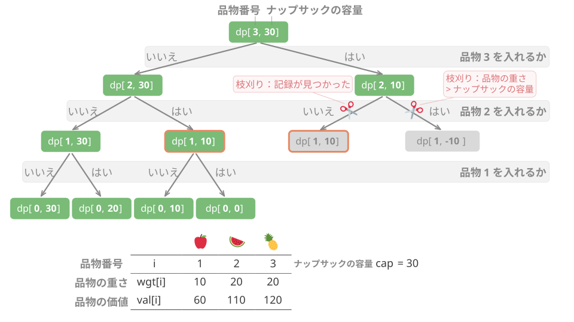

### 方法 3：動的計画法

動的計画法では、状態遷移を繰り返しながら $dp$ テーブルを埋めていきます。コードは次のとおりです。

```src
[file]{knapsack}-[class]{}-[func]{knapsack_dp}
```

下図のように、時間計算量と空間計算量はともに配列 `dp` の大きさで決まり、$O(n \times cap)$ です。

=== "<1>"
    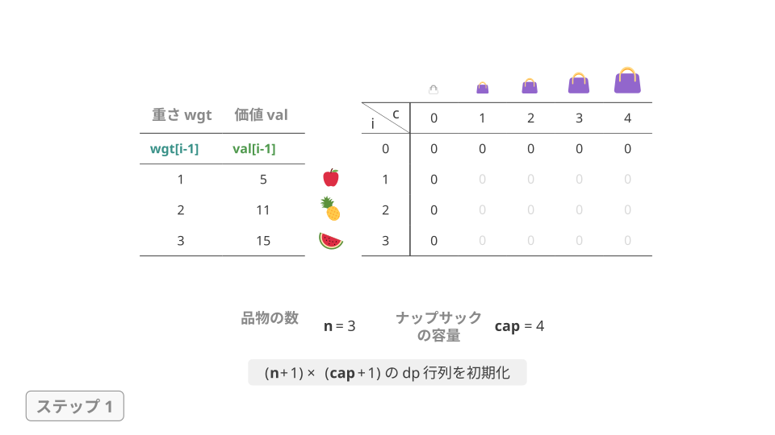

=== "<2>"
    

=== "<3>"
    

=== "<4>"
    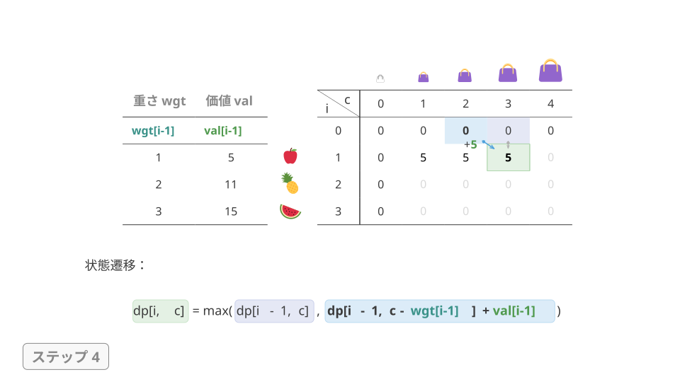

=== "<5>"
    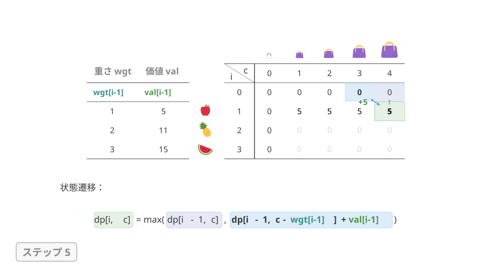

=== "<6>"
    

=== "<7>"
    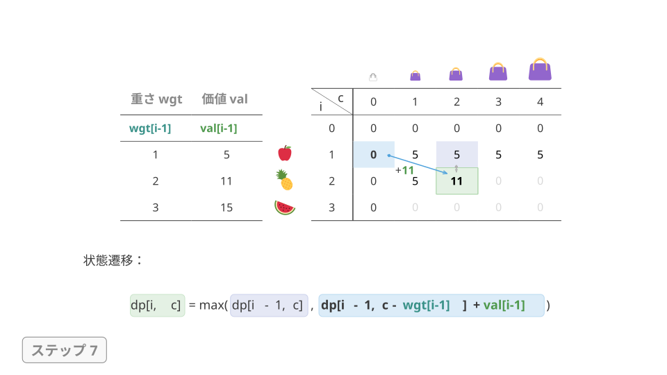

=== "<8>"
    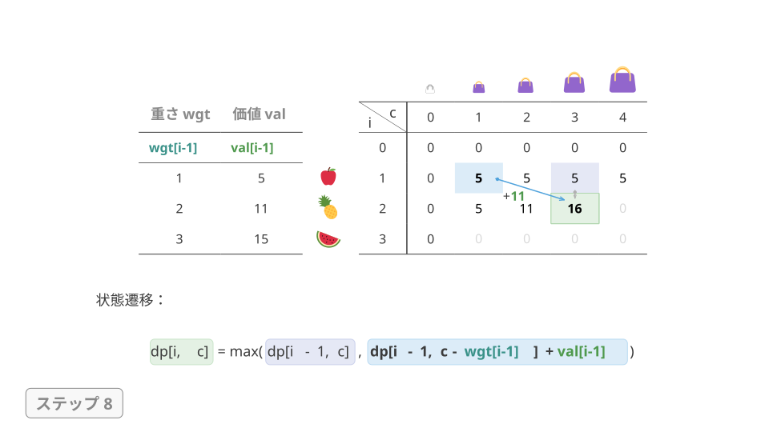

=== "<9>"
    

=== "<10>"
    

=== "<11>"
    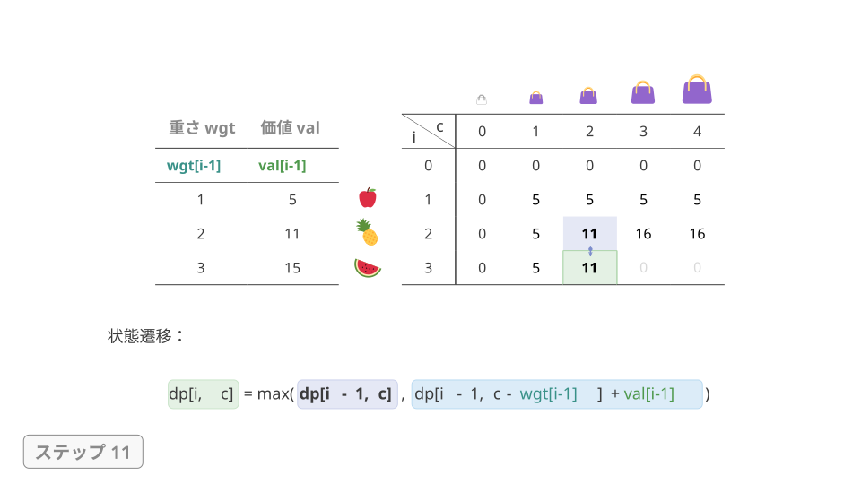

=== "<12>"
    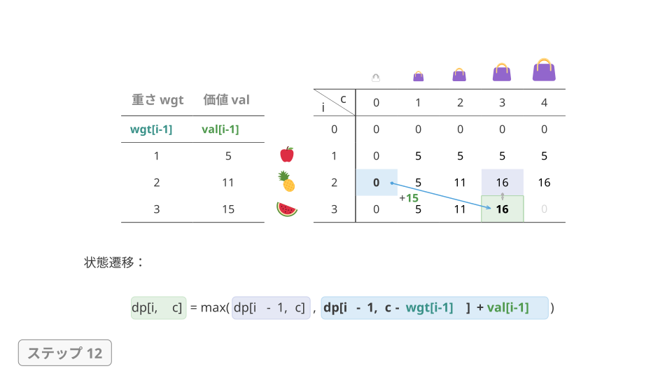

=== "<13>"
    

=== "<14>"
    

### 使用メモリの削減

各状態は 1 行前の状態だけに依存します。そこで 2 つの配列を交互に使えば、空間計算量を $O(n \times cap)$ から $O(cap)$ に減らせます。

配列を 1 つだけにできるでしょうか。各状態は真上か左上のマスから求められます。配列が 1 つなら、$i$ 行目の走査を始める時点では、その配列にはまだ $i-1$ 行目の状態が入っています。

- 容量の昇順に更新すると、$dp[i, c]$ の計算に必要な前の行の値 $dp[i-1, c-wgt[i-1]]$ が、すでに今の行の値で上書きされている場合があります。そのため、同じ品物を複数回数えてしまうことがあります。
- 降順に走査すれば、必要な値が上書きされず、正しく状態を更新できます。

下図は、配列 1 つで $i = 1$ 行目から $i = 2$ 行目に移る過程を示します。昇順と降順の走査の違いを考えてみてください。

=== "<1>"
    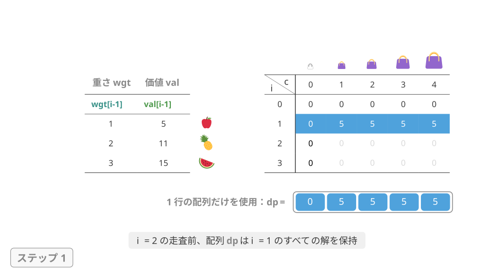

=== "<2>"
    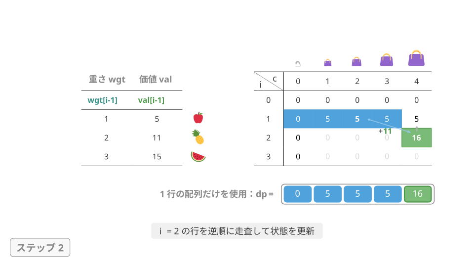

=== "<3>"
    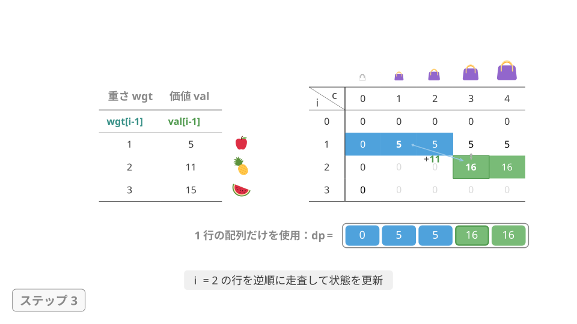

=== "<4>"
    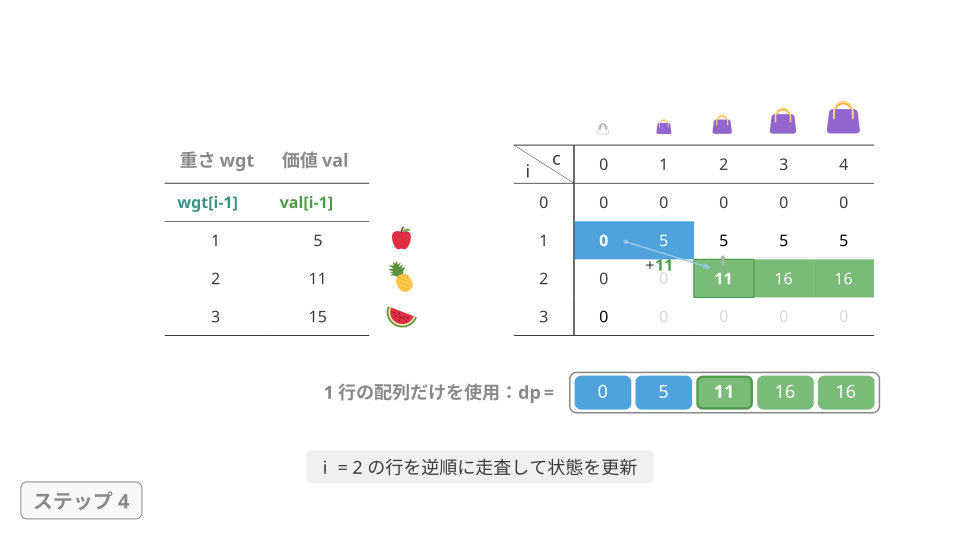

=== "<5>"
    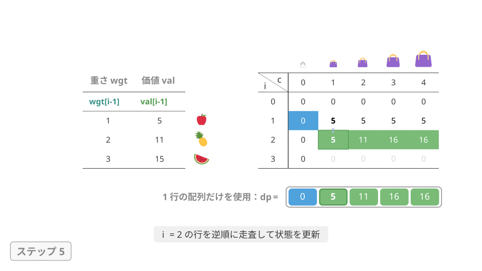

=== "<6>"
    

実装では、配列 `dp` の第 1 の次元 $i$ を取り除き、内側のループを降順に変えるだけです。

```src
[file]{knapsack}-[class]{}-[func]{knapsack_dp_comp}
```
