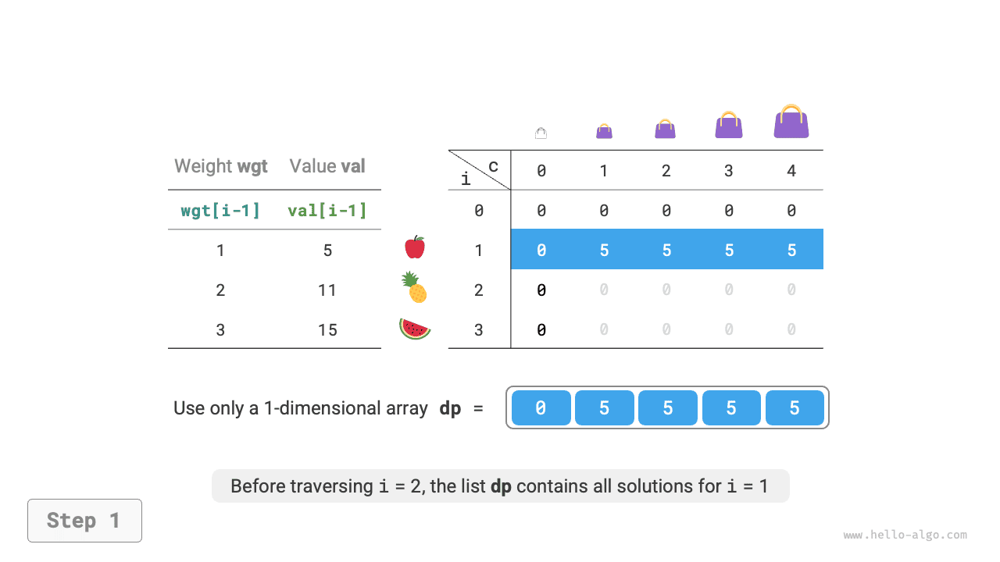

# 0-1 ナップサック問題

ナップサック問題は動的計画法の入門に適しており、最もよく登場する問題の形式です。0-1 ナップサック問題、個数制限なしナップサック問題、個数制限付きナップサック問題など、多くの変種があります。

この節では、まず最も一般的な 0-1 ナップサック問題を解きます。

!!! question

    $n$ 個の品物があり、$i$ 番目の重さは $wgt[i-1]$、価値は $val[i-1]$ です。容量 $cap$ のナップサックがあり、各品物は 1 回だけ選べます。容量の制限内で入れられる品物の最大価値を求めてください。

下図のように、品物の番号 $i$ は $1$ から始まり、配列のインデックスは $0$ から始まるので、品物 $i$ の重さと価値は $wgt[i-1]$ と $val[i-1]$ に対応します。


0-1 ナップサック問題は、$n$ 回の選択からなる過程と捉えられます。各品物について、入れないか入れるかの二つを選ぶため、決定木モデルに当てはまります。

目標が「容量の制限内で入れられる品物の最大価値」を求めることなので、動的計画法の問題である可能性が高いと考えられます。

**第 1 段階：各回の選択を考えて状態を定義し、$dp$ テーブルを作る**

各品物を入れなければ容量は変わらず、入れれば容量が減ります。そこで状態を、現在の品物の番号 $i$ とナップサックの容量 $c$ からなる $[i, c]$ と定義します。

状態 $[i, c]$ に対応する部分問題は、**最初の $i$ 個の品物を使い、容量 $c$ のナップサックで得られる最大価値**で、その解を $dp[i, c]$ とします。

求めるのは $dp[n, cap]$ なので、$(n+1) \times (cap+1)$ の二次元の $dp$ テーブルが必要です。

**第 2 段階：最適部分構造を見つけ、状態遷移式を導く**

品物 $i$ をどうするか決めると、残るのは最初の $i-1$ 個に関する部分問題です。次の二つの場合に分かれます。

- **品物 $i$ を入れない**：容量は変わらず、状態は $[i-1, c]$ になります。
- **品物 $i$ を入れる**：容量は $wgt[i-1]$ 減り、価値は $val[i-1]$ 増え、状態は $[i-1, c-wgt[i-1]]$ になります。

ここから最適部分構造がわかります。**最大価値 $dp[i, c]$ は、品物 $i$ を入れない場合と品物 $i$ を入れる場合のうち、大きい方の価値です**。したがって、状態遷移式は次のようになります。

$$
dp[i, c] = \max(dp[i-1, c], dp[i-1, c - wgt[i-1]] + val[i-1])
$$

現在の品物の重さ $wgt[i - 1]$ が残り容量 $c$ を超える場合は、入れない方しか選べないことに注意してください。

**第 3 段階：境界条件と状態遷移の順序を決める**

品物がない場合、または容量が $0$ の場合、最大価値は $0$ です。つまり、先頭列 $dp[i, 0]$ と先頭行 $dp[0, c]$ はすべて $0$ です。

現在の状態 $[i, c]$ は、上の状態 $[i-1, c]$ と左上の状態 $[i-1, c-wgt[i-1]]$ から遷移するため、二重ループで $dp$ テーブル全体を順方向に走査すれば十分です。

以上の分析に基づき、全探索、メモ化探索、動的計画法を順に実装します。

### 方法 1：全探索

探索のコードには、次の要素があります。

- **再帰の引数**：状態 $[i, c]$ です。
- **戻り値**：部分問題の解 $dp[i, c]$ です。
- **終了条件**：品物の番号が範囲外の $i = 0$ になった場合、または残り容量が $0$ になった場合は、再帰を終了して価値 $0$ を返します。
- **枝刈り**：現在の品物の重さが残り容量を超える場合は、入れない方だけを選びます。

```src
[file]{knapsack}-[class]{}-[func]{knapsack_dfs}
```

下図のように、各品物から「選ばない」「選ぶ」の二つの探索分岐が生じるため、時間計算量は $O(2^n)$ です。

再帰木には、$dp[1, 10]$ などの重複した部分問題があります。品物が多く、容量が大きく、特に同じ重さの品物が多いと、重複する部分問題の数は大幅に増えます。


### 方法 2：メモ化探索

重複した部分問題を 1 回だけ計算するため、記録用リスト `mem` に解を保存します。`mem[i][c]` は $dp[i, c]$ に対応します。

メモ化すると、**時間計算量は部分問題の数で決まり**、$O(n \times cap)$ になります。実装は次のとおりです。

```src
[file]{knapsack}-[class]{}-[func]{knapsack_dfs_mem}
```

下図に、メモ化探索で枝刈りされる探索分岐を示します。


### 方法 3：動的計画法

動的計画法は、本質的には状態遷移によって $dp$ テーブルを埋める過程です。コードを次に示します。

```src
[file]{knapsack}-[class]{}-[func]{knapsack_dp}
```

下図のように、時間計算量と空間計算量は、どちらも配列 `dp` の大きさで決まり、$O(n \times cap)$ です。

=== "<1>"
    

=== "<2>"
    

=== "<3>"
    

=== "<4>"
    

=== "<5>"
    

=== "<6>"
    

=== "<7>"
    

=== "<8>"
    

=== "<9>"
    

=== "<10>"
    

=== "<11>"
    

=== "<12>"
    

=== "<13>"
    

=== "<14>"
    

### 空間の最適化

各状態は一つ前の行の状態だけに依存するため、二つの配列を交互に使えば、空間計算量を $O(n \times cap)$ から $O(cap)$ に下げられます。

さらに、配列を一つだけにできるでしょうか。各状態は真上か左上のマスから遷移します。配列が一つなら、$i$ 行目の走査を始める時点では、まだ $i-1$ 行目の状態が入っています。

- 順方向に走査すると、$dp[i, j]$ を計算する時点で、左上の $dp[i-1, 1]$ ~ $dp[i-1, j-1]$ がすでに上書きされている可能性があり、正しく状態遷移できません。
- 逆方向に走査すれば、必要な値は上書きされず、正しく状態遷移できます。

下図に、配列一つで $i = 1$ 行目から $i = 2$ 行目へ移る過程を示します。順方向と逆方向の違いを考えてみてください。

=== "<1>"
    

=== "<2>"
    

=== "<3>"
    

=== "<4>"
    

=== "<5>"
    

=== "<6>"
    

実装では、配列 `dp` の第 1 次元 $i$ を取り除き、内側のループを逆順にするだけです。

```src
[file]{knapsack}-[class]{}-[func]{knapsack_dp_comp}
```
