# 個数制限なしナップサック問題

この節では、もう 1 つの代表的なナップサック問題である個数制限なしナップサック問題を解き、次にその特別な場合である硬貨の両替を扱います。

## 個数制限なしナップサック問題

!!! question

    $n$ 種類の品物があり、$i$ 番目の品物の重さは $wgt[i-1]$、価値は $val[i-1]$ です。容量 $cap$ のナップサックがあり、**同じ品物を繰り返し選べます**。容量内に入る品物の価値の合計の最大値を求めてください。下図に例を示します。

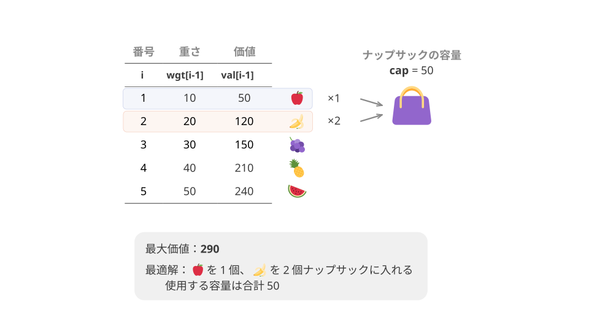

### 動的計画法の考え方

個数制限なしナップサック問題は 0-1 ナップサック問題とよく似ており、**違いは各品物を選ぶ回数に制限がないことだけです**。

- 0-1 ナップサック問題では各品物は 1 個しかないため、品物 $i$ を入れた後は最初の $i-1$ 個からしか選べません。
- 個数制限なしナップサック問題では各種類の品物がいくつでもあるので、品物 $i$ を入れた後も、**引き続き最初の $i$ 種類から選べます**。

個数制限なしの場合、状態 $[i, c]$ の変化には次の 2 通りがあります。

- **品物 $i$ を入れない場合**：0-1 ナップサック問題と同じく、$[i-1, c]$ に移ります。
- **品物 $i$ を入れる場合**：0-1 ナップサック問題とは異なり、$[i, c-wgt[i-1]]$ に移ります。

したがって、状態遷移式は次のようになります。

$$
dp[i, c] = \max(dp[i-1, c], dp[i, c - wgt[i-1]] + val[i-1])
$$

### 実装

両方のコードを比べると、状態遷移の 1 か所が $i-1$ から $i$ に変わるだけで、それ以外はすべて同じです。

```src
[file]{unbounded_knapsack}-[class]{}-[func]{unbounded_knapsack_dp}
```

### 使用メモリの削減

現在の状態は左と上の状態から求めるので、**使用メモリを削減した後は、$dp$ テーブルの各行を昇順に走査します**。

この走査順序は 0-1 ナップサック問題とはちょうど逆です。下図で違いを確かめてみてください。

=== "<1>"
    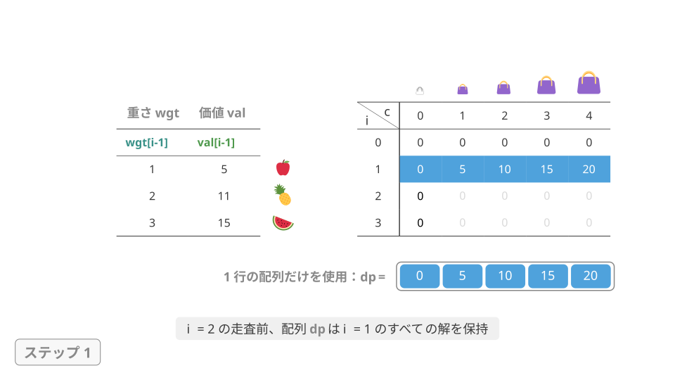

=== "<2>"
    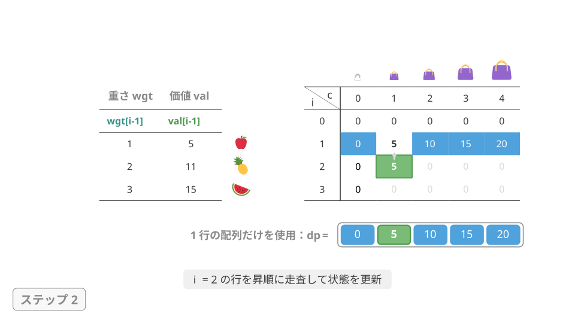

=== "<3>"
    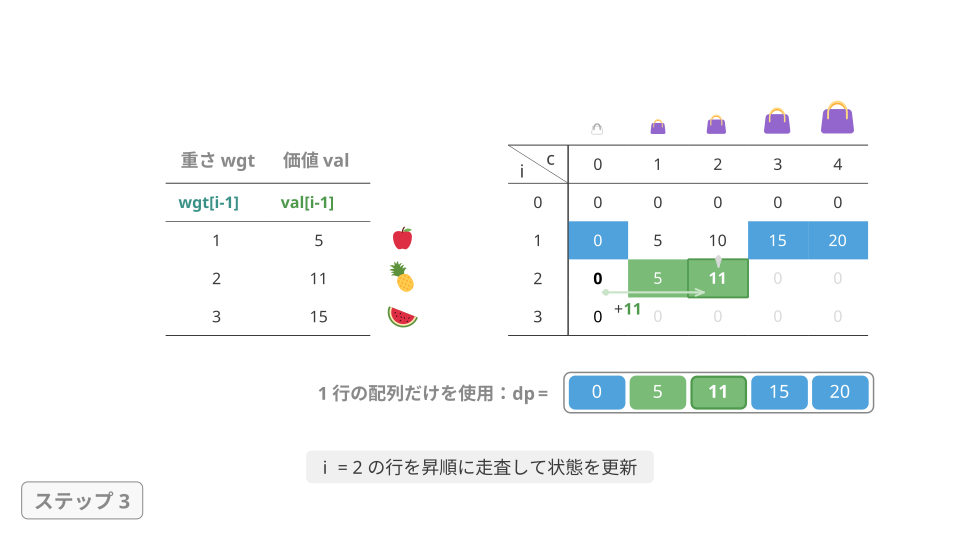

=== "<4>"
    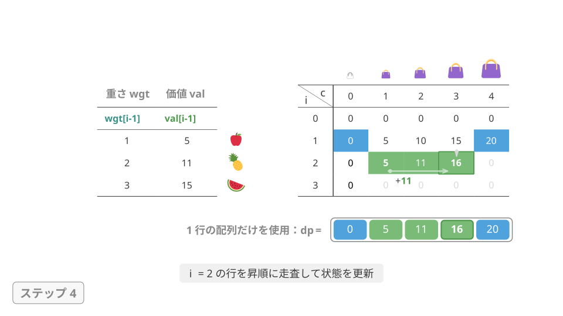

=== "<5>"
    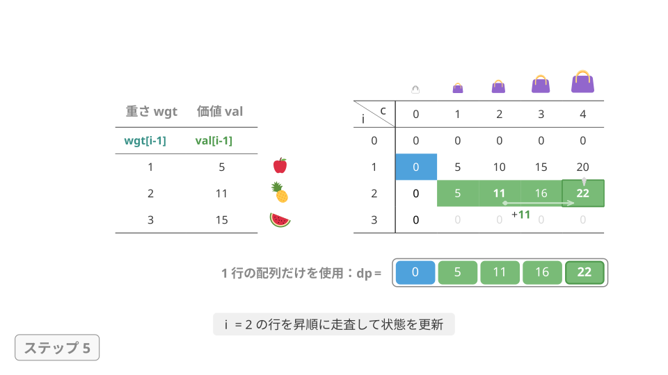

=== "<6>"
    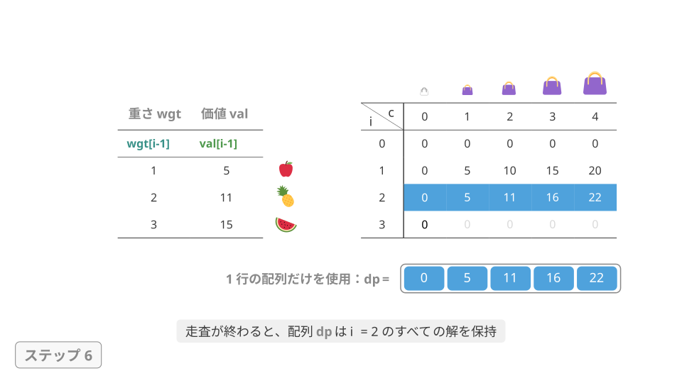

実装は簡単で、配列 `dp` の第 1 の次元を取り除くだけです。

```src
[file]{unbounded_knapsack}-[class]{}-[func]{unbounded_knapsack_dp_comp}
```

## 硬貨の両替問題

ナップサック問題は、動的計画法で解く一群の問題の代表例です。硬貨の両替問題をはじめ、多くの変種があります。

!!! question

    $n$ 種類の硬貨があり、$i$ 番目の額面は $coins[i - 1]$、目標金額は $amt$ です。**各種類の硬貨を何枚でも使える**とき、目標金額を作るのに必要な硬貨の最少枚数を求めてください。目標金額を作れない場合は $-1$ を返してください。下図に例を示します。

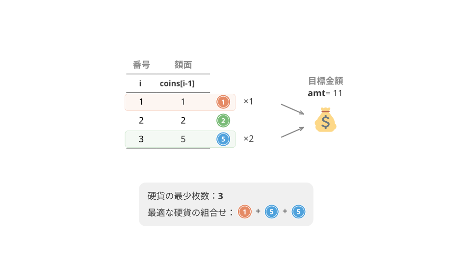

### 動的計画法の考え方

**硬貨の両替は個数制限なしナップサック問題の特別な場合とみなせます**。両者には次の対応関係と違いがあります。

- 2 つの問題は互いに読み替えられます。「品物」は「硬貨」、「品物の重さ」は「硬貨の額面」、「ナップサックの容量」は「目標金額」に対応します。
- 最適化の向きは逆です。個数制限なしナップサック問題では品物の価値を最大にし、硬貨の両替問題では硬貨の枚数を最小にします。
- 個数制限なしナップサック問題では容量を「超えない」解を求め、硬貨の両替では目標金額を「ちょうど」作る解を求めます。

**手順 1：各段階の選択を考え、状態を定義して $dp$ テーブルを作る**

状態 $[i, a]$ の部分問題は、**最初の $i$ 種類の硬貨で金額 $a$ を作るのに必要な最少枚数**を求めることで、解を $dp[i, a]$ と書きます。

2 次元の $dp$ テーブルの大きさは $(n+1) \times (amt+1)$ です。

**手順 2：最適部分構造を見つけ、状態遷移式を導く**

この問題と個数制限なしナップサック問題の状態遷移式には、次の 2 つの違いがあります。

- 最小値を求めるので、演算子 $\max()$ を $\min()$ に変えます。
- 最適化する対象は品物の価値ではなく硬貨の枚数なので、硬貨を選んだら $+1$ とすれば十分です。

$$
dp[i, a] = \min(dp[i-1, a], dp[i, a - coins[i-1]] + 1)
$$

**手順 3：境界条件と状態遷移の順序を決める**

目標金額が $0$ なら、必要な硬貨の最少枚数は $0$ です。したがって先頭列の $dp[i, 0]$ はすべて $0$ になります。

硬貨がなければ、**$> 0$ のどの目標金額も作れない**ため、無効な解になります。状態遷移式の $\min()$ 関数で無効な解を判別して除外できるよう、これらを $+ \infty$ で表し、先頭行の正の金額に対応する $dp[0, a]$ をすべて $+ \infty$ にします。

### 実装

多くのプログラミング言語には $+ \infty$ を表す整数変数がないため、代わりに整数型 `int` の最大値を使うことになります。しかし、そうすると状態遷移式の $+ 1$ でオーバーフローするおそれがあります。

そこで、無効な解は $amt + 1$ で表します。$amt$ を作るのに使う硬貨は多くても $amt$ 枚だからです。最後に $dp[n, amt]$ が $amt + 1$ に等しいかを調べ、等しければ目標金額を作れないことを示す $-1$ を返します。コードは次のとおりです。

```src
[file]{coin_change}-[class]{}-[func]{coin_change_dp}
```

下図は硬貨の両替を動的計画法で解く過程です。個数制限なしナップサック問題の手順とよく似ています。

=== "<1>"
    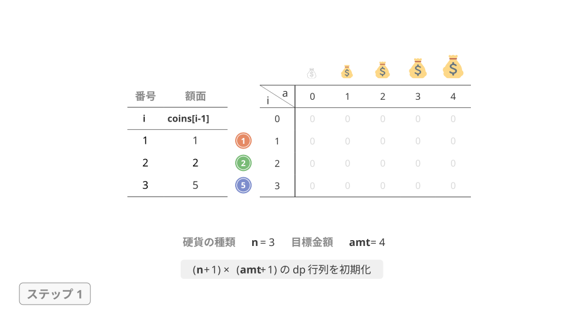

=== "<2>"
    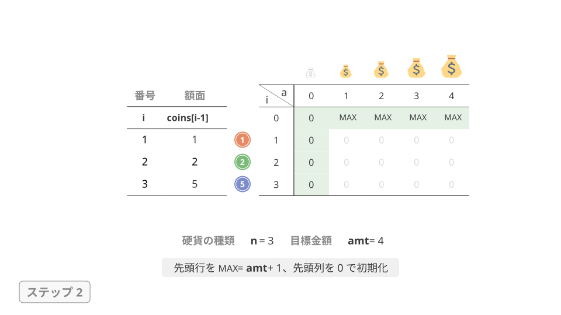

=== "<3>"
    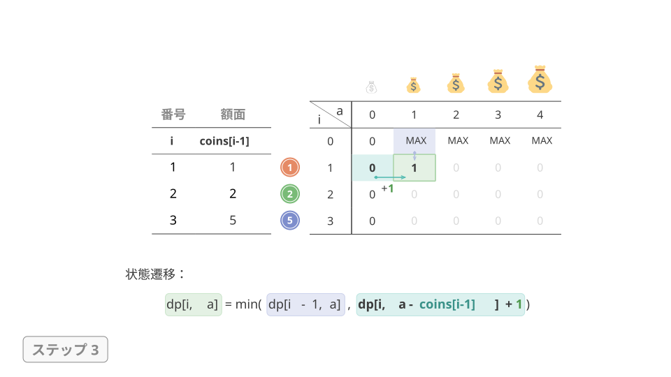

=== "<4>"
    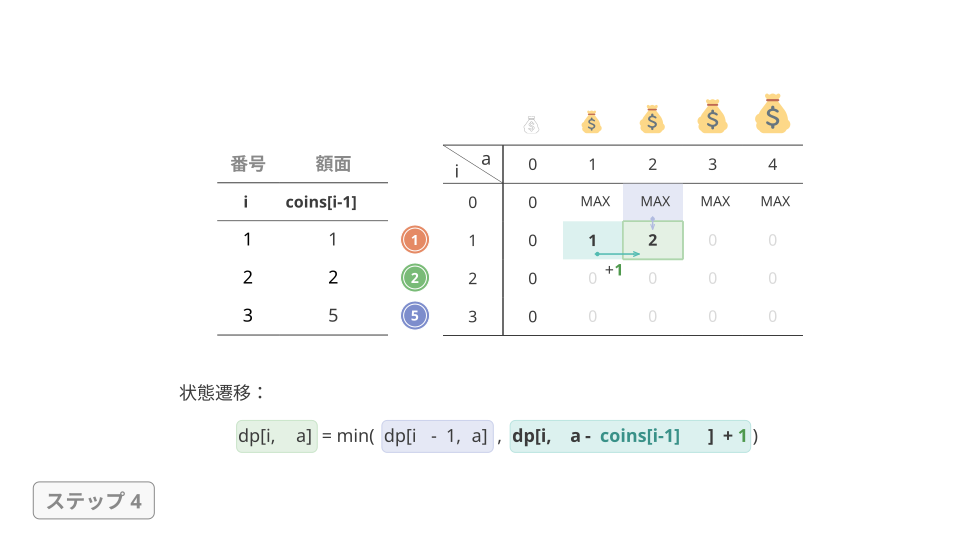

=== "<5>"
    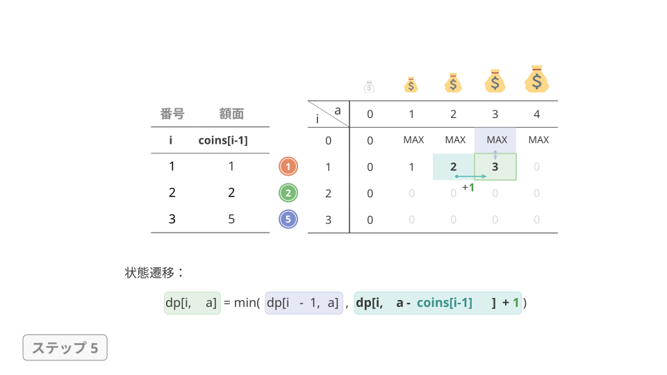

=== "<6>"
    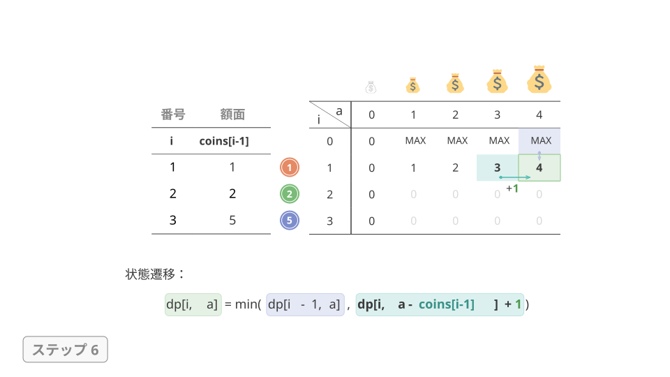

=== "<7>"
    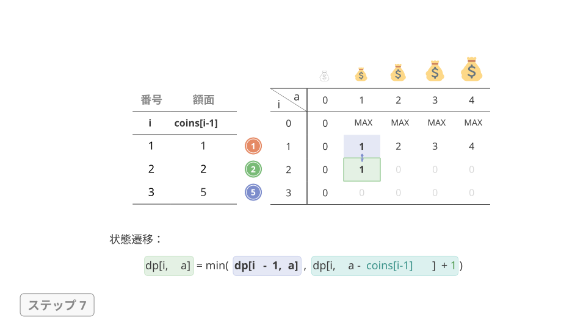

=== "<8>"
    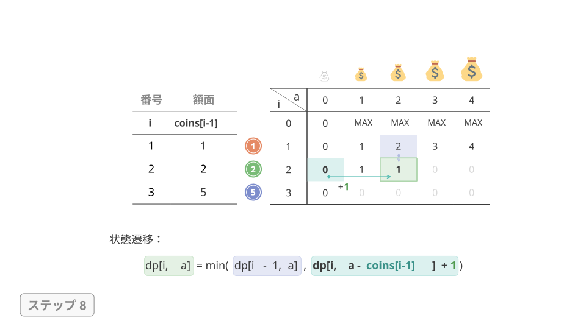

=== "<9>"
    

=== "<10>"
    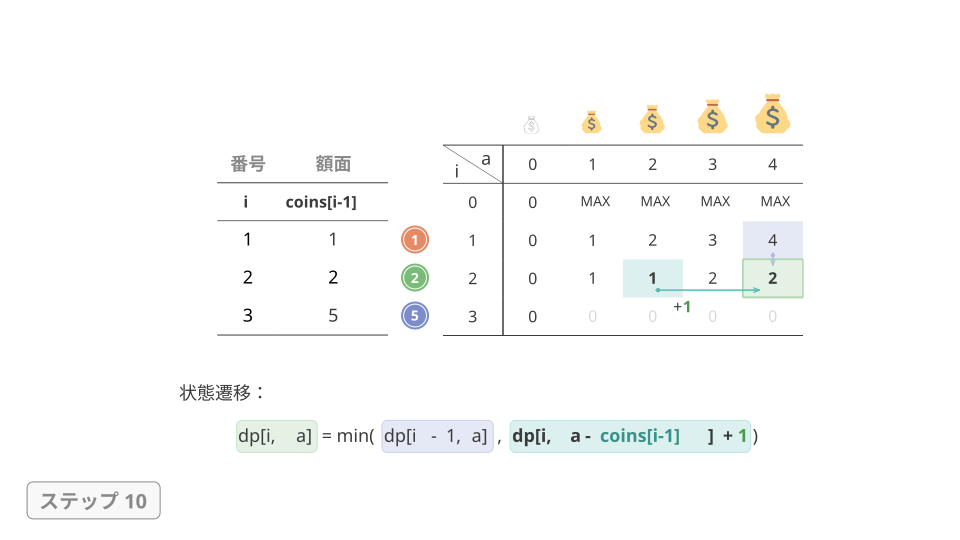

=== "<11>"
    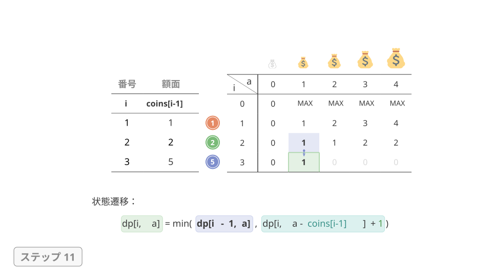

=== "<12>"
    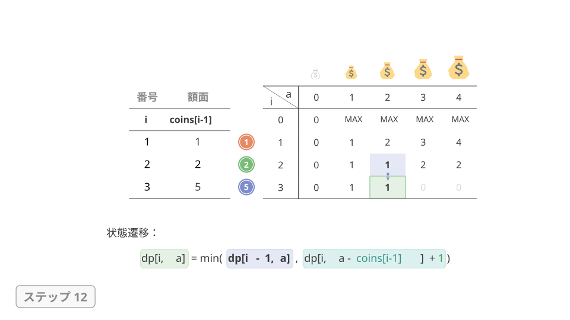

=== "<13>"
    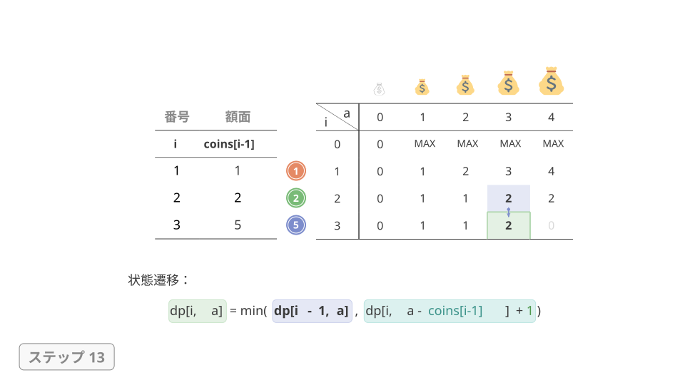

=== "<14>"
    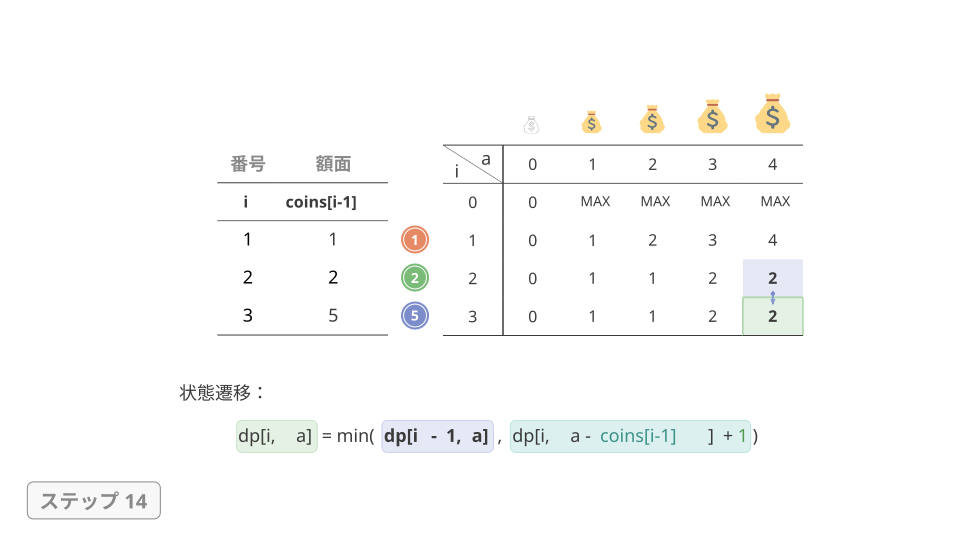

=== "<15>"
    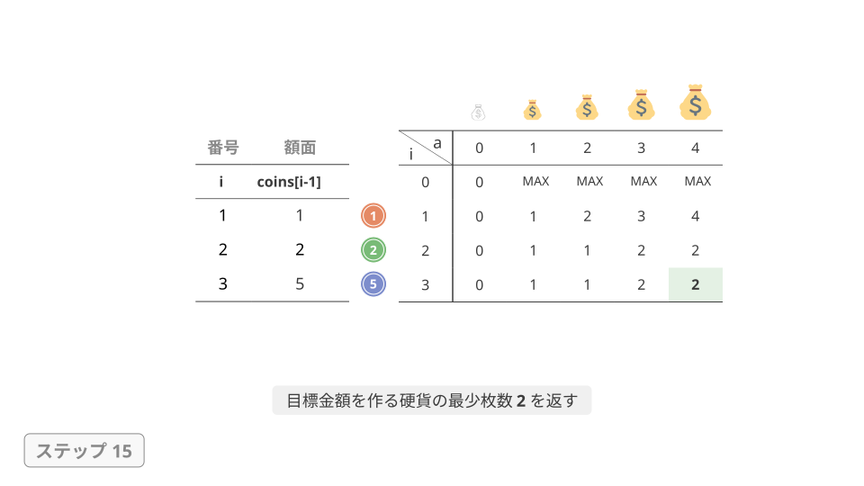

### 使用メモリの削減

硬貨の両替でも、個数制限なしナップサック問題と同じ方法で使用メモリを削減できます。

```src
[file]{coin_change}-[class]{}-[func]{coin_change_dp_comp}
```

## 硬貨の両替問題 II

!!! question

    $n$ 種類の硬貨があり、$i$ 番目の額面は $coins[i - 1]$、目標金額は $amt$ です。各硬貨は何枚でも使えます。**目標金額を作れる硬貨の組合せが何通りあるか求めてください**。下図に例を示します。

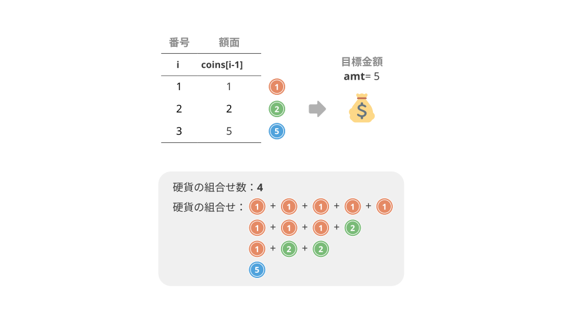

### 動的計画法の考え方

前の問題と異なり、今回は組合せ数を求めます。そのため、部分問題は**最初の $i$ 種類の硬貨で金額 $a$ を作れる組合せ数**になります。$dp$ テーブルは引き続き大きさ $(n+1) \times (amt + 1)$ の 2 次元行列です。

現在の状態の組合せ数は、今の種類の硬貨を使わない場合と使う場合の組合せ数を足したものです。状態遷移式は次のとおりです。

$$
dp[i, a] = dp[i-1, a] + dp[i, a - coins[i-1]]
$$

目標金額が $0$ なら、硬貨を 1 枚も選ばずに作れるので、先頭列の $dp[i, 0]$ はすべて $1$ で初期化します。硬貨がなければ $>0$ のどの目標金額も作れないので、先頭行で正の金額に対応する $dp[0, a]$ はすべて $0$ です。

### 実装

```src
[file]{coin_change_ii}-[class]{}-[func]{coin_change_ii_dp}
```

### 使用メモリの削減

使用メモリの削減方法も同じで、硬貨の種類を表す次元を取り除けば十分です。

```src
[file]{coin_change_ii}-[class]{}-[func]{coin_change_ii_dp_comp}
```
