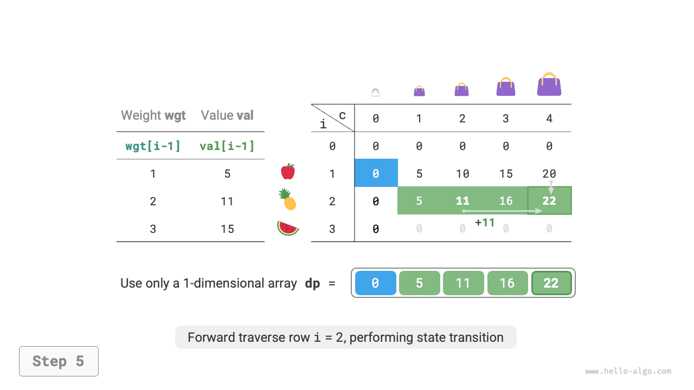
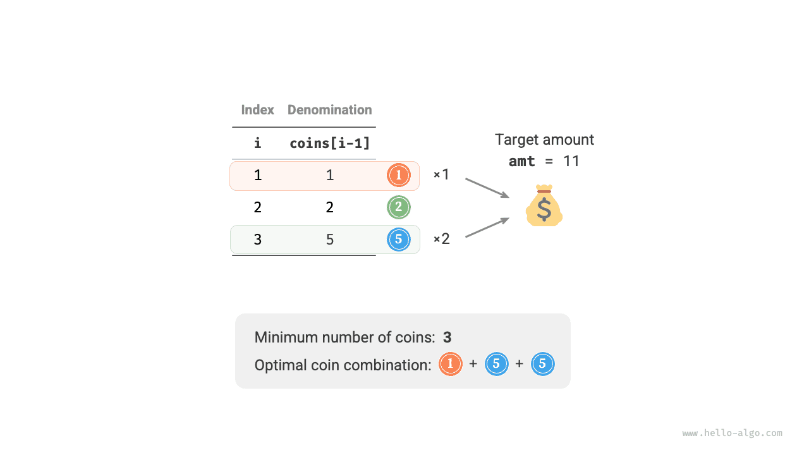
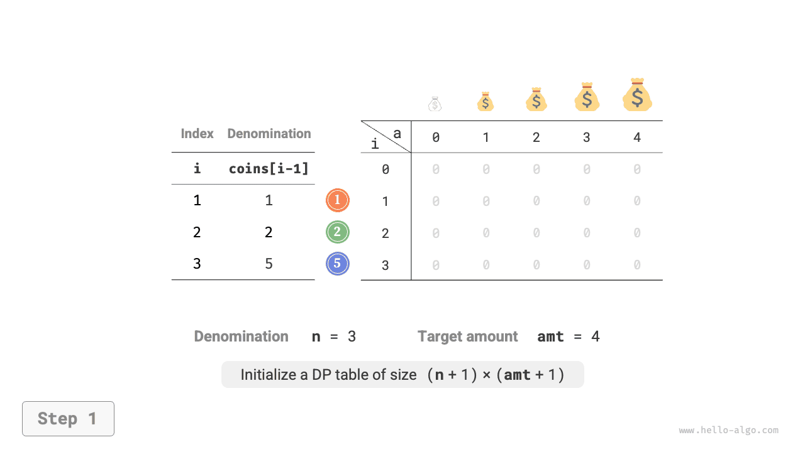
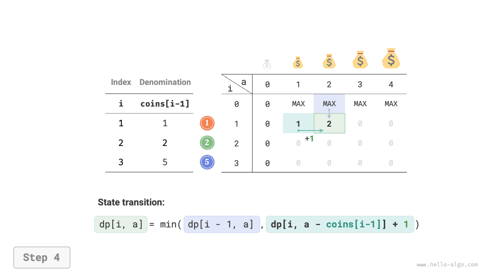
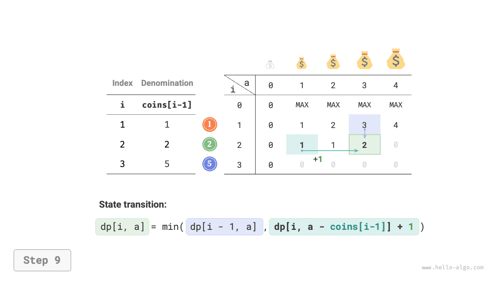
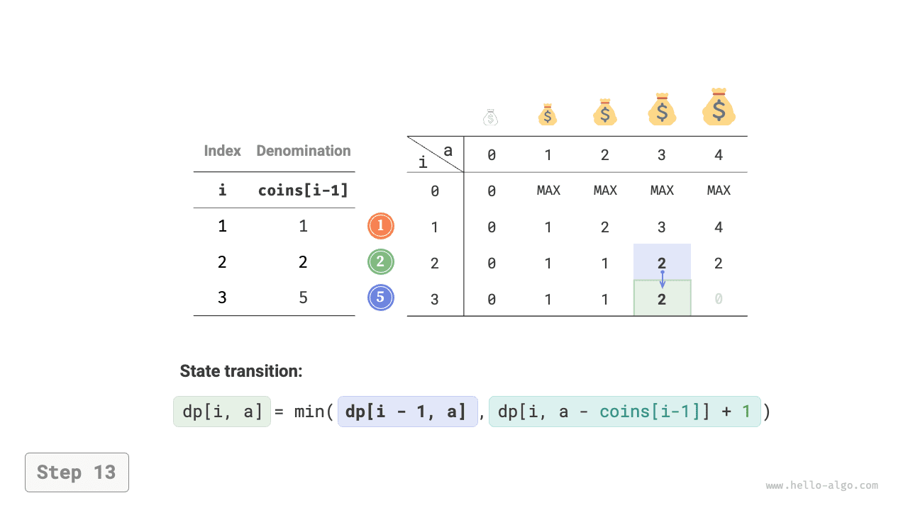

# 個数制限なしナップサック問題

この節では、もう一つの代表的なナップサック問題である、個数制限なしナップサック問題を解きます。その後、その特殊な場合である硬貨の両替問題を学びます。

## 個数制限なしナップサック問題

!!! question

    $n$ 個の品物があり、$i$ 番目の重さは $wgt[i-1]$、価値は $val[i-1]$ です。容量 $cap$ のナップサックがあり、**各品物は繰り返し選べます**。容量の制限内で入れられる品物の最大価値を求めてください。例を下図に示します。


### 動的計画法の考え方

個数制限なしナップサック問題は 0-1 ナップサック問題によく似ており、**違いは品物を選ぶ回数に制限がないことだけです**。

- 0-1 ナップサック問題では各品物が 1 個しかないため、品物 $i$ を入れた後は、最初の $i-1$ 個からしか選べません。
- 個数制限なしナップサック問題では各種類の品物が無限にあるため、品物 $i$ を入れた後も、**最初の $i$ 個から選べます**。

個数制限なしの場合、状態 $[i, c]$ の変化は次の二つに分かれます。

- **品物 $i$ を入れない**：0-1 ナップサック問題と同様に、$[i-1, c]$ に移ります。
- **品物 $i$ を入れる**：0-1 ナップサック問題とは異なり、$[i, c-wgt[i-1]]$ に移ります。

したがって、状態遷移式は次のようになります。

$$
dp[i, c] = \max(dp[i-1, c], dp[i, c - wgt[i-1]] + val[i-1])
$$

### コードの実装

二つの問題のコードを比べると、状態遷移の 1 か所が $i-1$ から $i$ に変わるだけで、ほかはまったく同じです。

```src
[file]{unbounded_knapsack}-[class]{}-[func]{unbounded_knapsack_dp}
```

### 空間の最適化

現在の状態は左と上の状態から遷移するため、**空間最適化後は $dp$ テーブルの各行を順方向に走査する必要があります**。

この順序は 0-1 ナップサック問題と逆です。下図で違いを確認してください。

=== "<1>"
    

=== "<2>"
    

=== "<3>"
    

=== "<4>"
    

=== "<5>"
    

=== "<6>"
    

実装は簡単で、配列 `dp` の第 1 次元を取り除くだけです。

```src
[file]{unbounded_knapsack}-[class]{}-[func]{unbounded_knapsack_dp_comp}
```

## 硬貨の両替問題

ナップサック問題は、動的計画法の大きな一群を代表する問題であり、硬貨の両替問題など、多くの変種があります。

!!! question

    $n$ 種類の硬貨があり、$i$ 番目の額面は $coins[i - 1]$、目標金額は $amt$ です。**各種類の硬貨は繰り返し選べます**。目標金額を作るための硬貨の最小枚数を求めてください。作れない場合は $-1$ を返します。例を下図に示します。



### 動的計画法の考え方

**硬貨の両替は、個数制限なしナップサック問題の特殊な場合と捉えられます**。両者には次の対応と違いがあります。

- 二つの問題は互いに変換でき、「品物」が「硬貨」、「品物の重さ」が「硬貨の額面」、「ナップサックの容量」が「目標金額」に対応します。
- 最適化の目標は逆で、ナップサック問題では価値を最大にし、両替問題では硬貨の枚数を最小にします。
- ナップサック問題では容量を「超えない」解を求めますが、両替問題では目標金額に「ちょうど一致する」解を求めます。

**第 1 段階：各回の選択を考えて状態を定義し、$dp$ テーブルを作る**

状態 $[i, a]$ に対応する部分問題は、**最初の $i$ 種類の硬貨で金額 $a$ を作るための最小枚数**で、その解を $dp[i, a]$ とします。

二次元の $dp$ テーブルの大きさは $(n+1) \times (amt+1)$ です。

**第 2 段階：最適部分構造を見つけ、状態遷移式を導く**

この問題の状態遷移式は、個数制限なしナップサック問題と次の 2 点が異なります。

- 最小値を求めるので、演算子 $\max()$ を $\min()$ に変えます。
- 最適化するのは品物の価値ではなく硬貨の枚数なので、硬貨を選んだときは $+1$ します。

$$
dp[i, a] = \min(dp[i-1, a], dp[i, a - coins[i-1]] + 1)
$$

**第 3 段階：境界条件と状態遷移の順序を決める**

目標金額が $0$ なら、必要な硬貨の最小枚数は $0$ です。したがって、先頭列の $dp[i, 0]$ はすべて $0$ です。

硬貨がなければ、**$> 0$ のどの目標金額も作れず**、無効な解になります。状態遷移式の $\min()$ が無効な解を識別して除外できるよう、$+ \infty$ で表します。つまり、先頭行の $dp[0, a]$ をすべて $+ \infty$ とします。

### コードの実装

多くのプログラミング言語では $+ \infty$ を表す変数がなく、整数型 `int` の最大値で代用する必要があります。しかし、それでは状態遷移式の $+ 1$ でオーバーフローする可能性があります。

そこで、無効な解を $amt + 1$ で表します。金額 $amt$ を作るための硬貨の枚数は、最大でも $amt$ だからです。最後に $dp[n, amt]$ が $amt + 1$ かを調べ、そうなら目標金額を作れないことを示す $-1$ を返します。コードは次のとおりです。

```src
[file]{coin_change}-[class]{}-[func]{coin_change_dp}
```

下図に、硬貨の両替を動的計画法で解く流れを示します。個数制限なしナップサック問題によく似ています。

=== "<1>"
    

=== "<2>"
    

=== "<3>"
    

=== "<4>"
    

=== "<5>"
    

=== "<6>"
    

=== "<7>"
    

=== "<8>"
    

=== "<9>"
    

=== "<10>"
    

=== "<11>"
    

=== "<12>"
    

=== "<13>"
    

=== "<14>"
    

=== "<15>"
    

### 空間の最適化

硬貨の両替の空間最適化は、個数制限なしナップサック問題と同じ方法で行えます。

```src
[file]{coin_change}-[class]{}-[func]{coin_change_dp_comp}
```

## 硬貨の両替問題 II

!!! question

    $n$ 種類の硬貨があり、$i$ 番目の額面は $coins[i - 1]$、目標金額は $amt$ です。各種類の硬貨は繰り返し選べます。**目標金額を作る硬貨の組み合わせは何通りありますか**。例を下図に示します。


### 動的計画法の考え方

前の問題と異なり、目標は組み合わせの数を求めることです。部分問題は、**最初の $i$ 種類の硬貨で金額 $a$ を作る組み合わせの数**になります。$dp$ テーブルは引き続き、$(n+1) \times (amt + 1)$ の二次元行列です。

現在の状態の組み合わせの数は、現在の硬貨を選ばない場合と選ぶ場合の数の和です。状態遷移式は次のとおりです。

$$
dp[i, a] = dp[i-1, a] + dp[i, a - coins[i-1]]
$$

目標金額が $0$ なら、何も選ばずに作れるので、先頭列の $dp[i, 0]$ はすべて $1$ で初期化します。硬貨がなければ $>0$ の金額は作れないので、先頭行の $dp[0, a]$ はすべて $0$ です。

### コードの実装

```src
[file]{coin_change_ii}-[class]{}-[func]{coin_change_ii_dp}
```

### 空間の最適化

空間最適化も同じで、硬貨の次元を取り除けば実現できます。

```src
[file]{coin_change_ii}-[class]{}-[func]{coin_change_ii_dp_comp}
```
