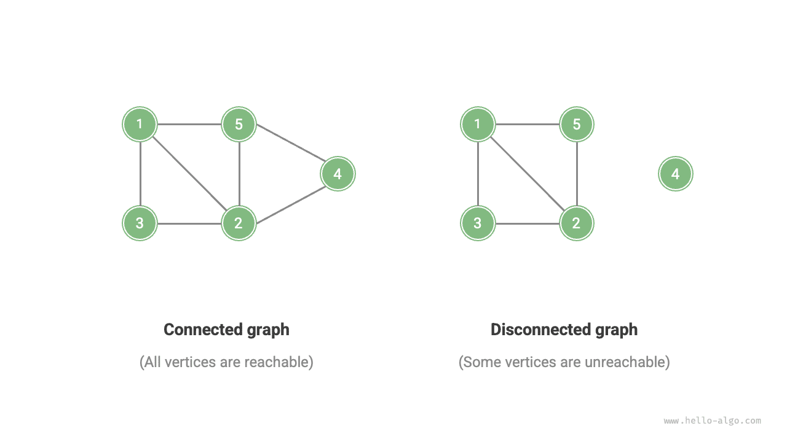
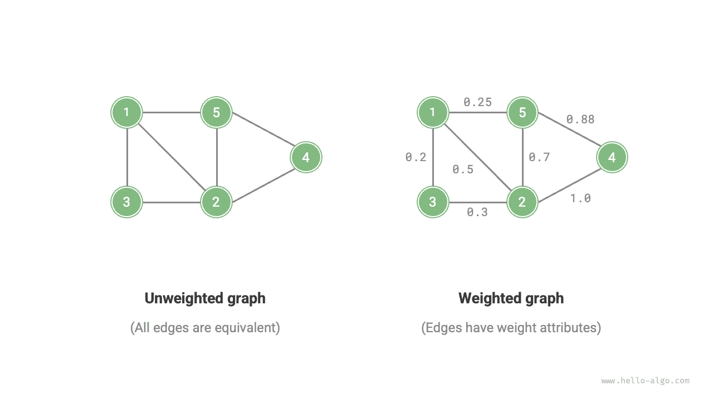
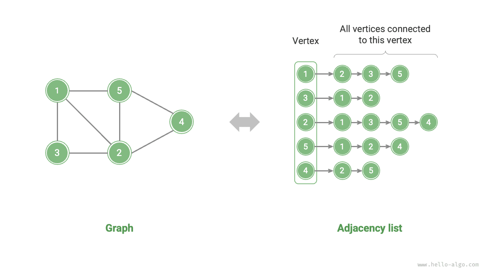

# 9.1 &nbsp; グラフ

<u>グラフ（graph）</u>は、<u>頂点（vertex）</u>と<u>辺（edge）</u>からなる非線形データ構造です。グラフ $G$ は、頂点の集合 $V$ と辺の集合 $E$ をまとめたものとして抽象的に表せます。次の例は、5 個の頂点と 7 本の辺を持つグラフです。

$$
\begin{aligned}
V & = \{ 1, 2, 3, 4, 5 \} \newline
E & = \{ (1,2), (1,3), (1,5), (2,3), (2,4), (2,5), (4,5) \} \newline
G & = \{ V, E \} \newline
\end{aligned}
$$

頂点をノード、辺をノード同士をつなぐ参照（ポインタ）と考えると、グラフは連結リストを拡張したデータ構造として捉えられます。図 9-1 のように、**線形の関係（連結リスト）や分割統治の関係（木）よりも、ネットワークの関係（グラフ）は自由度が高く**、その分複雑になります。

{ class="animation-figure" }

 図 9-1 &nbsp; 連結リスト、木、グラフの関係 

## 9.1.1 &nbsp; グラフの主な種類と用語

辺に向きがあるかどうかによって、図 9-2 のように<u>無向グラフ（undirected graph）</u>と<u>有向グラフ（directed graph）</u>に分けられます。

- 無向グラフの辺は、2 頂点間の「双方向」のつながりを表します。WeChat や QQ の「友達関係」がその例です。
- 有向グラフの辺には向きがあります。つまり、$A \rightarrow B$ と $A \leftarrow B$ の二つの向きの辺は互いに独立しています。Weibo や Douyin の「フォローする」「フォローされる」という関係がその例です。

{ class="animation-figure" }

 図 9-2 &nbsp; 有向グラフと無向グラフ 

すべての頂点がつながっているかどうかによって、図 9-3 のように<u>連結グラフ（connected graph）</u>と<u>非連結グラフ（disconnected graph）</u>に分けられます。

- 連結グラフでは、ある頂点から出発して、ほかのどの頂点にも到達できます。
- 非連結グラフでは、ある頂点から出発したとき、到達できない頂点が少なくとも一つあります。

{ class="animation-figure" }

 図 9-3 &nbsp; 連結グラフと非連結グラフ 

辺に「重み」という変数を加えると、図 9-4 の<u>重み付きグラフ（weighted graph）</u>になります。たとえば『王者荣耀』などのモバイルゲームでは、一緒に遊んだ時間からプレイヤー間の「親密度」を計算します。この親密度のネットワークは、重み付きグラフで表せます。

{ class="animation-figure" }

 図 9-4 &nbsp; 重み付きグラフと重みなしグラフ 

グラフでは、次の用語をよく使います。

- <u>隣接（adjacency）</u>：2 頂点の間に辺があるとき、これらの頂点は「隣接している」といいます。図 9-4 では、頂点 1 に隣接するのは頂点 2、3、5 です。
- <u>経路（path）</u>：頂点 A から頂点 B までに通る辺の列を、A から B への「経路」といいます。図 9-4 の辺の列 1-5-2-4 は、頂点 1 から頂点 4 への経路の一つです。
- <u>次数（degree）</u>：ある頂点が持つ辺の本数です。有向グラフでは、<u>入次数（in-degree）</u>はその頂点に入る辺の本数、<u>出次数（out-degree）</u>はその頂点から出る辺の本数を表します。

## 9.1.2 &nbsp; グラフの表現

グラフの代表的な表現方法には、「隣接行列」と「隣接リスト」があります。以下では無向グラフを例に説明します。

### 1. &nbsp; 隣接行列

グラフの頂点数を $n$ とします。<u>隣接行列（adjacency matrix）</u>は、$n \times n$ の行列でグラフを表します。各行（列）が一つの頂点に対応し、行列の要素が辺を表します。2 頂点間に辺があるかどうかを $1$ または $0$ で示します。

図 9-5 のように、隣接行列を $M$、頂点のリストを $V$ とすると、行列の要素 $M[i, j] = 1$ は頂点 $V[i]$ から頂点 $V[j]$ への辺があることを表し、$M[i, j] = 0$ は辺がないことを表します。

{ class="animation-figure" }

 図 9-5 &nbsp; 隣接行列によるグラフの表現 

隣接行列には、次の特徴があります。

- 単純グラフでは頂点を自分自身につなげられないため、隣接行列の主対角線上の要素は意味を持ちません。
- 無向グラフでは両方向の辺が同じものを表すため、隣接行列は主対角線について対称です。
- 隣接行列の要素 $1$ と $0$ を重みに置き換えると、重み付きグラフを表せます。

隣接行列でグラフを表すと、行列の要素に直接アクセスして辺を取得できるため、辺の追加・削除・検索・更新は効率が高く、時間計算量はいずれも $O(1)$ です。ただし、行列の空間計算量は $O(n^2)$ で、メモリを多く使います。

### 2. &nbsp; 隣接リスト

<u>隣接リスト（adjacency list）</u>は、$n$ 個の連結リストでグラフを表し、連結リストのノードが頂点を表します。$i$ 番目の連結リストは頂点 $i$ に対応し、その頂点に隣接するすべての頂点（その頂点につながる頂点）を格納します。図 9-6 に、隣接リストで格納したグラフの例を示します。

{ class="animation-figure" }

 図 9-6 &nbsp; 隣接リストによるグラフの表現 

隣接リストは実際に存在する辺だけを保存します。通常、辺の総数は $n^2$ よりはるかに少ないため、空間を節約できます。ただし、辺を探すには連結リストを走査する必要があり、時間効率は隣接行列より低くなります。

図 9-6 を見ると、**隣接リストの構造はハッシュテーブルの「チェイン法」によく似ているため、同じような方法で効率を改善できます**。たとえば、連結リストが長い場合は AVL 木や赤黒木に変換し、時間計算量を $O(n)$ から $O(\log n)$ に改善できます。ハッシュテーブルに変換すれば、時間計算量を $O(1)$ にできます。

## 9.1.3 &nbsp; グラフの主な用途

表 9-1 のように、多くの現実のシステムをグラフでモデル化でき、それらに関する問題をグラフ上の計算問題に帰着できます。

 表 9-1 &nbsp; 日常生活に見られるグラフ 

|          | 頂点 | 辺                   | グラフ上の計算問題   |
| -------- | ---- | -------------------- | ------------ |
| ソーシャルネットワーク | ユーザー | 友達関係             | 友達候補の推薦 |
| 地下鉄の路線 | 駅 | 駅同士の接続       | 最短経路の推薦 |
| 太陽系   | 天体 | 天体間の万有引力 | 惑星の軌道計算 |

