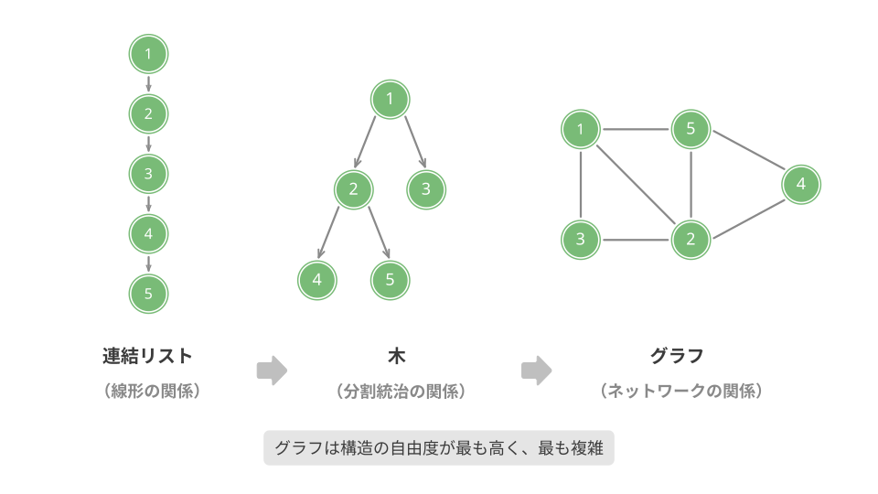
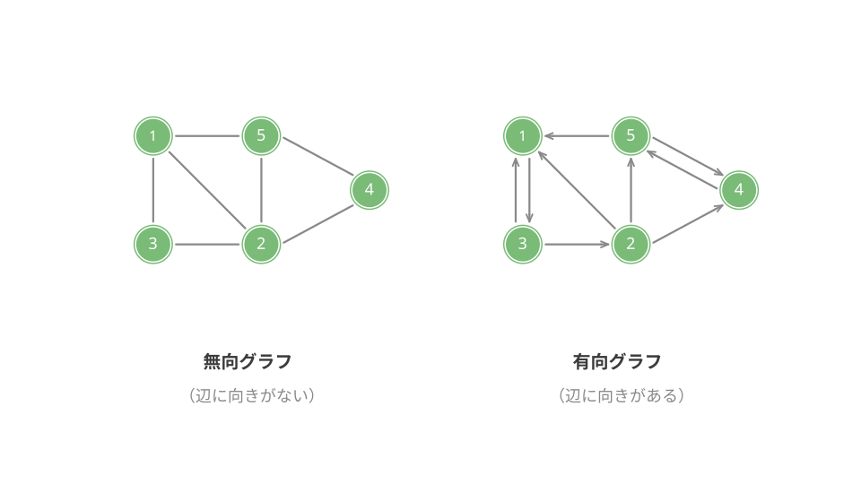
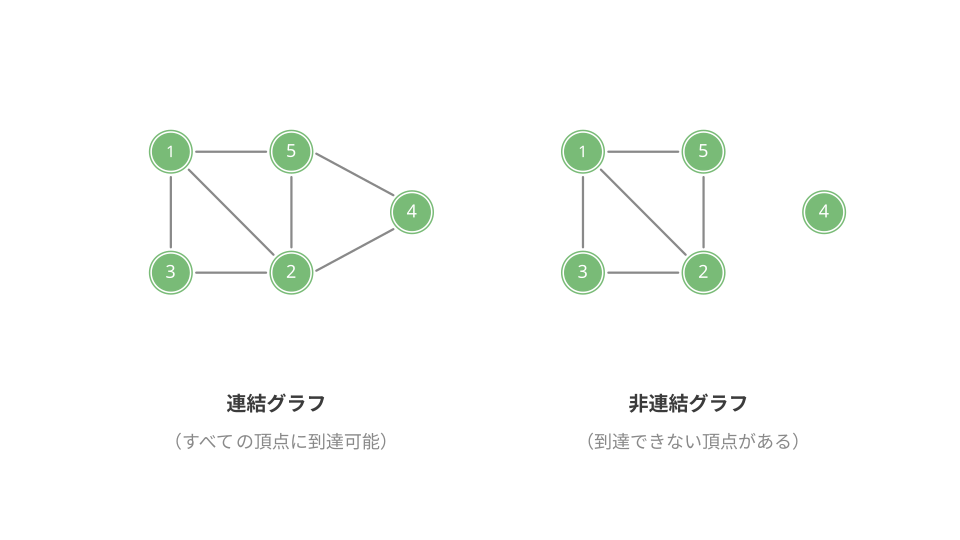
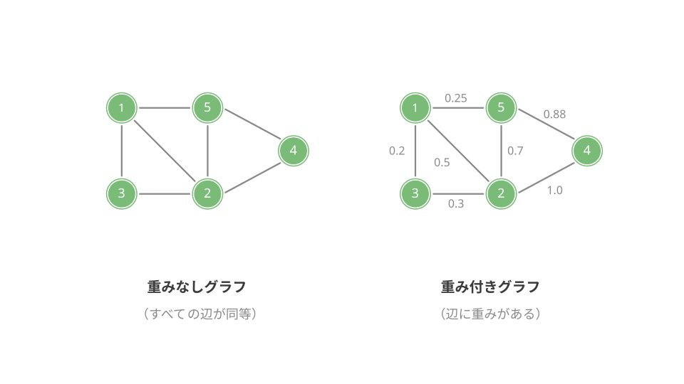
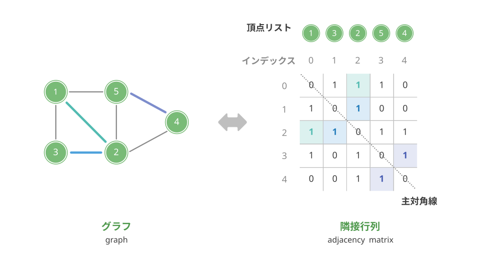
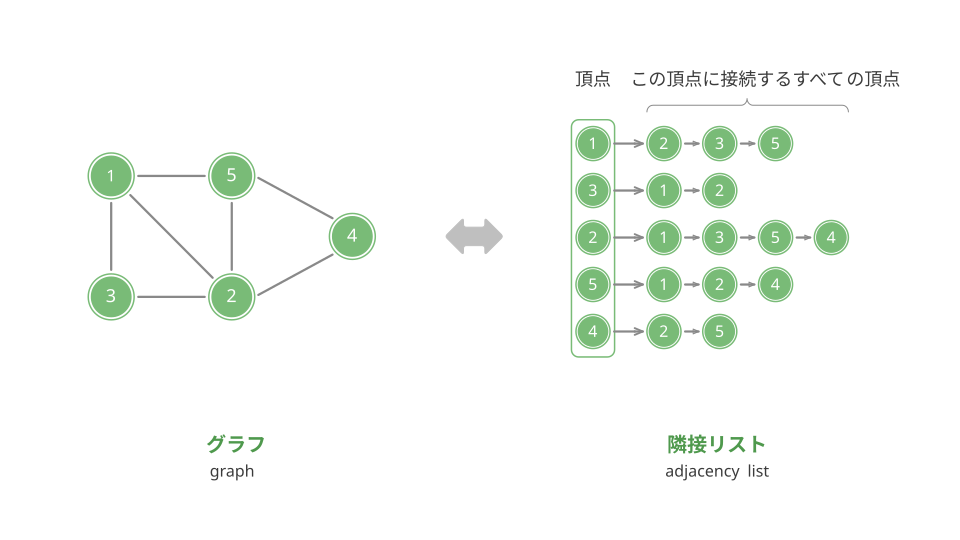

# 9.1 &nbsp; グラフ

<u>グラフ（graph）</u>は、<u>頂点（vertex）</u>と<u>辺（edge）</u>からなる非線形データ構造です。グラフ $G$ は、頂点の集合 $V$ と辺の集合 $E$ の組として抽象的に表せます。次の例は、5 個の頂点と 7 本の辺をもつグラフです。

$$
\begin{aligned}
V & = \{ 1, 2, 3, 4, 5 \} \newline
E & = \{ (1,2), (1,3), (1,5), (2,3), (2,4), (2,5), (4,5) \} \newline
G & = \{ V, E \} \newline
\end{aligned}
$$

頂点をノード、辺をノード同士をつなぐ参照（ポインタ）と考えると、グラフは連結リストを拡張したデータ構造と見なせます。図 9-1 のように、**ネットワーク状の関係（グラフ）は、線形の関係（連結リスト）や分割統治の関係（木）より自由度が高く**、その分だけ複雑になります。

{ class="animation-figure" }

 図 9-1 &nbsp; 連結リスト、木、グラフの関係 

## 9.1.1 &nbsp; グラフの主な種類と用語

辺に向きがあるかどうかで、グラフは図 9-2 のように<u>無向グラフ（undirected graph）</u>と<u>有向グラフ（directed graph）</u>に分けられます。

- 無向グラフの辺は、2 頂点間の双方向のつながりを表します。たとえば WeChat や QQ の友達関係がこれに当たります。
- 有向グラフの辺には向きがあり、$A \rightarrow B$ と $A \leftarrow B$ は互いに独立した辺です。たとえば Weibo や Douyin で「フォローする」関係と「フォローされる」関係は別々です。

{ class="animation-figure" }

 図 9-2 &nbsp; 有向グラフと無向グラフ 

すべての頂点がつながっているかどうかで、グラフは図 9-3 のように<u>連結グラフ（connected graph）</u>と<u>非連結グラフ（disconnected graph）</u>に分けられます。

- 連結グラフでは、ある頂点から出発して他のどの頂点にも到達できます。
- 非連結グラフでは、ある頂点から出発したとき、到達できない頂点が少なくとも 1 つあります。

{ class="animation-figure" }

 図 9-3 &nbsp; 連結グラフと非連結グラフ 

辺に「重み」という変数を加えると、図 9-4 のような<u>重み付きグラフ（weighted graph）</u>になります。たとえば『王者栄耀』などのモバイルゲームでは、一緒にプレイした時間に基づいてプレイヤー同士の「親密度」を計算します。この親密度のネットワークは重み付きグラフで表せます。

{ class="animation-figure" }

 図 9-4 &nbsp; 重み付きグラフと重みなしグラフ 

グラフでよく使う用語をいくつか紹介します。

- <u>隣接（adjacency）</u>：2 頂点の間に辺があるとき、この 2 頂点は「隣接する」といいます。図 9-4 で頂点 1 に隣接するのは頂点 2、3、5 です。
- <u>経路（path）</u>：頂点 A から頂点 B までにたどる辺の列を、A から B への「経路」といいます。図 9-4 では 1-5-2-4 とたどる辺の列が、頂点 1 から頂点 4 への経路の一例です。
- <u>次数（degree）</u>：ある頂点に接続する辺の本数です。有向グラフでは、その頂点に入る辺の本数を<u>入次数（in-degree）</u>、その頂点から出る辺の本数を<u>出次数（out-degree）</u>といいます。

## 9.1.2 &nbsp; グラフの表現

グラフの代表的な表現方法は「隣接行列」と「隣接リスト」です。以下では無向グラフを例に説明します。

### 1. &nbsp; 隣接行列

グラフの頂点数を $n$ とします。<u>隣接行列（adjacency matrix）</u>では、大きさ $n \times n$ の行列でグラフを表します。各行と各列がそれぞれ 1 つの頂点に対応し、行列の各要素が辺を表します。2 頂点間に辺があるかどうかを $1$ または $0$ で示します。

図 9-5 で隣接行列を $M$、頂点リストを $V$ とすると、$M[i, j] = 1$ は頂点 $V[i]$ と頂点 $V[j]$ の間に辺があることを表し、反対に $M[i, j] = 0$ は両者の間に辺がないことを表します。

{ class="animation-figure" }

 図 9-5 &nbsp; 隣接行列によるグラフの表現 

隣接行列には次の性質があります。

- 単純グラフでは頂点を自分自身と結べないため、隣接行列の主対角線の要素は辺を表す役割をもちません。
- 無向グラフでは辺はどちらの向きでも同等なので、隣接行列は主対角線に関して対称です。
- 隣接行列の要素 $1$ と $0$ を重みに置き換えれば、重み付きグラフを表せます。

隣接行列では行列の要素に直接アクセスして辺を参照できるので、辺の追加、削除、検索、更新はいずれも効率がよく、時間計算量は $O(1)$ です。一方、行列の空間計算量は $O(n^2)$ で、多くのメモリを使います。

### 2. &nbsp; 隣接リスト

<u>隣接リスト（adjacency list）</u>は $n$ 本の連結リストでグラフを表し、リスト内のノードが頂点を表します。$i$ 番目のリストが頂点 $i$ に対応し、その頂点のすべての隣接頂点（辺で直接つながっている頂点）を格納します。図 9-6 は、隣接リストでグラフを格納した例です。

{ class="animation-figure" }

 図 9-6 &nbsp; 隣接リストによるグラフの表現 

隣接リストは実際に存在する辺だけを格納します。通常、辺の総数は $n^2$ よりはるかに少ないので、必要な記憶領域を節約できます。一方、辺を探すには連結リストを走査する必要があり、検索にかかる時間では隣接行列に劣ります。

図 9-6 の**隣接リストの構造は、ハッシュテーブルの「チェイン法」とよく似ているため、同じような方法で効率を改善できます**。たとえば長い連結リストを AVL 木や赤黒木に置き換えれば、時間計算量を $O(n)$ から $O(\log n)$ に改善できます。ハッシュテーブルに置き換えれば $O(1)$ にまで減らせます。

## 9.1.3 &nbsp; グラフの主な用途

表 9-1 のように、実世界の多くのシステムはグラフとしてモデル化でき、そこで解きたい問題をグラフ上の計算に帰着できます。

 表 9-1 &nbsp; 日常で見られるグラフ 

|          | 頂点 | 辺                   | グラフ上で解く問題   |
| -------- | ---- | -------------------- | ------------ |
| ソーシャルネットワーク | ユーザー | 友達関係             | 友達候補の推薦 |
| 地下鉄路線 | 駅 | 駅間の接続       | 最短経路の案内 |
| 太陽系   | 天体 | 天体間に働く万有引力 | 惑星軌道の計算 |

