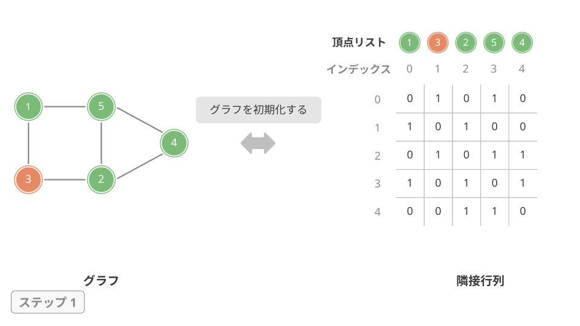
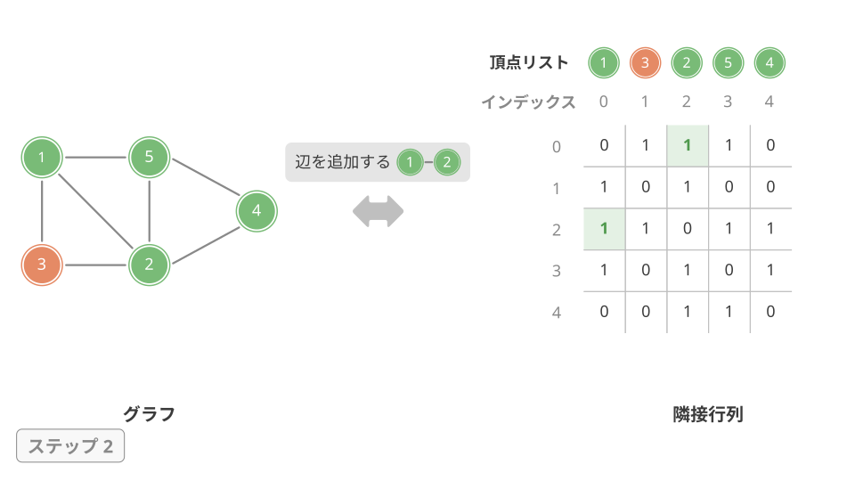
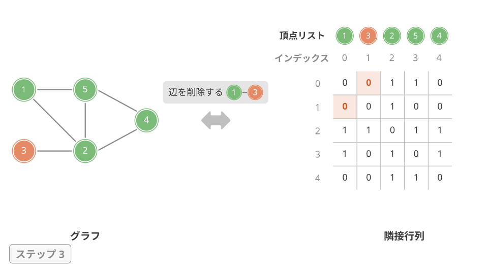
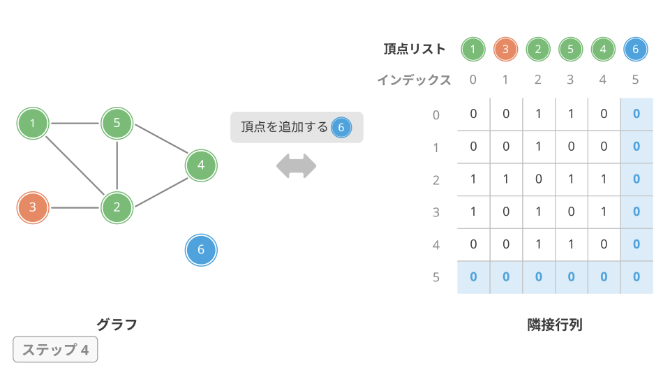
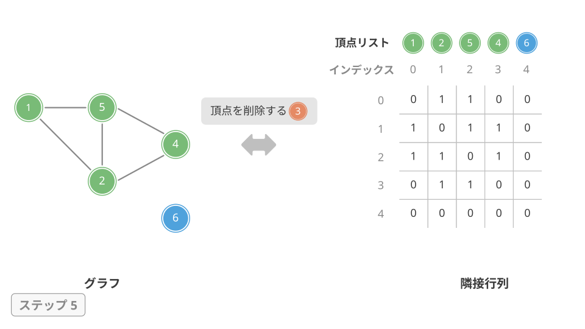
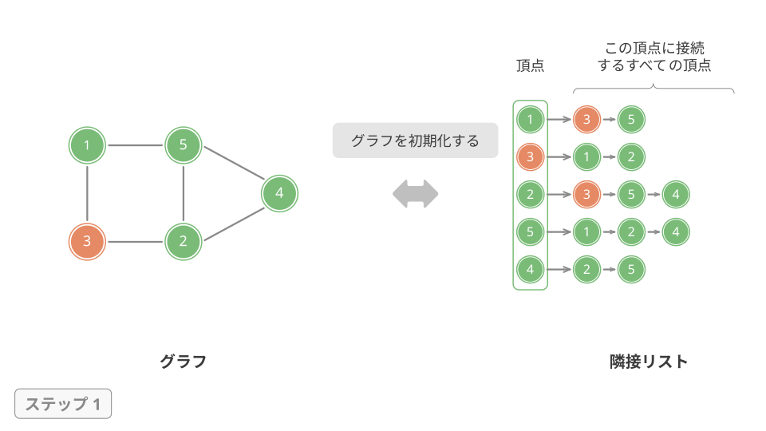
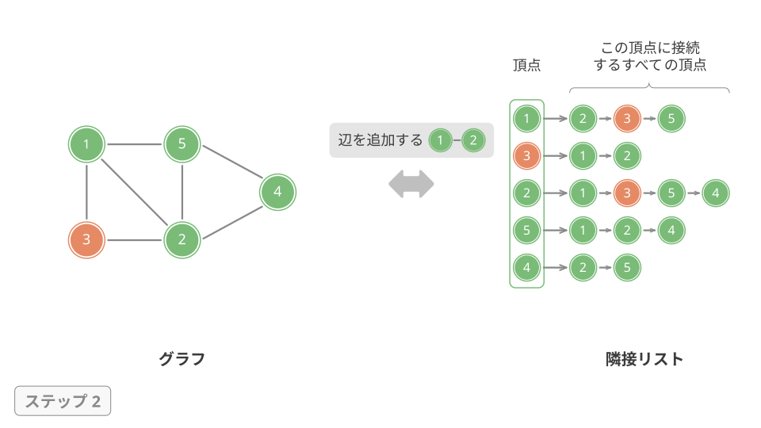
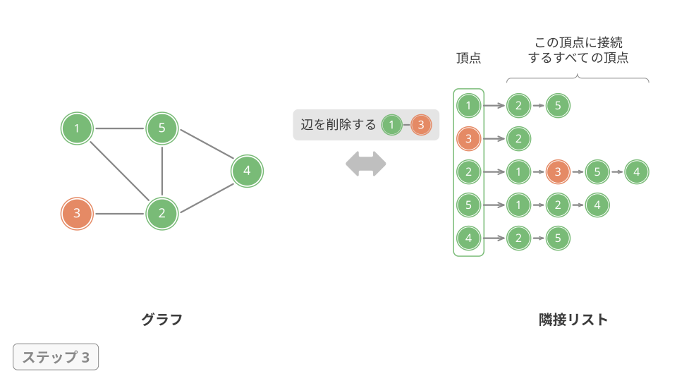
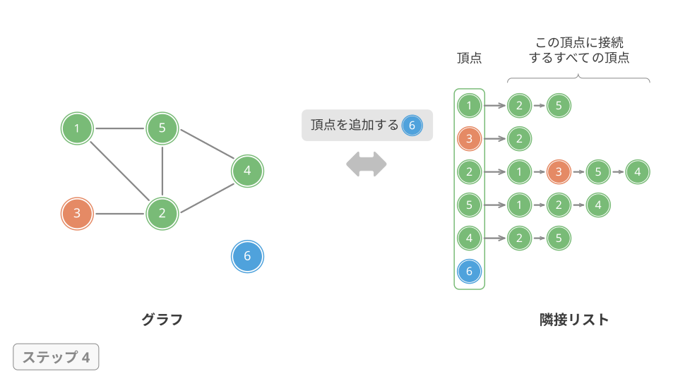
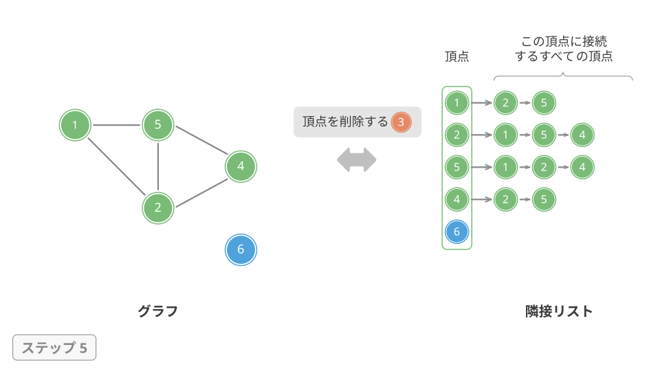

# グラフの基本操作

グラフの基本操作は「辺」に対する操作と「頂点」に対する操作に分けられます。実装方法は、隣接行列と隣接リストのどちらで表すかによって異なります。

## 隣接行列による実装

頂点数が $n$ の無向グラフでは、各操作を下図のように実装できます。

- **辺の追加・削除**：隣接行列で指定した辺に対応する要素を直接書き換えるだけなので、所要時間は $O(1)$ です。無向グラフなので、両方向に対応する要素を同時に更新します。
- **頂点の追加**：隣接行列の末尾に行と列を 1 つずつ追加し、新しい要素をすべて $0$ で埋めます。所要時間は $O(n)$ です。
- **頂点の削除**：隣接行列から行と列を 1 つずつ削除します。先頭の行と列を削除するのが最悪の場合で、$(n-1)^2$ 個の要素を左上に詰めるため、$O(n^2)$ 時間かかります。
- **初期化**：$n$ 個の頂点を受け取り、$O(n)$ 時間で長さ $n$ の頂点リスト `vertices` を初期化します。大きさ $n \times n$ の隣接行列 `adjMat` の初期化には $O(n^2)$ 時間かかります。

=== "<1>"
    

=== "<2>"
    

=== "<3>"
    

=== "<4>"
    

=== "<5>"
    

隣接行列でグラフを表すコードは次のとおりです。

```src
[file]{graph_adjacency_matrix}-[class]{graph_adj_mat}-[func]{}
```

## 隣接リストによる実装

無向グラフの頂点数を $n$、辺の総数を $m$ とすると、各操作は下図のように実装できます。

- **辺の追加**：頂点に対応するリストの末尾に辺を追加するだけで、所要時間は $O(1)$ です。無向グラフなので、両方向に対応する辺を追加します。
- **辺の削除**：頂点に対応するリストから指定した辺を探して削除します。所要時間は $O(m)$ です。無向グラフでは両方向に対応する辺を削除します。
- **頂点の追加**：隣接リストに連結リストを 1 本追加し、新しい頂点をその先頭ノードとします。所要時間は $O(1)$ です。
- **頂点の削除**：隣接リスト全体を走査し、指定した頂点につながる辺をすべて削除します。所要時間は $O(n + m)$ です。
- **初期化**：隣接リストに $n$ 個の頂点と $2m$ 個の辺の項目を作ります。所要時間は $O(n + m)$ です。

=== "<1>"
    

=== "<2>"
    

=== "<3>"
    

=== "<4>"
    

=== "<5>"
    

以下は隣接リストの実装です。上図と比べると、実際のコードには次の違いがあります。

- 頂点の追加・削除をしやすくし、コードを簡潔にするため、連結リストの代わりにリスト（動的配列）を使います。
- 隣接リストをハッシュテーブルに格納します。`key` は頂点のインスタンス、`value` はその隣接頂点のリスト（連結リスト）です。

また、隣接リストでは `Vertex` クラスで頂点を表します。隣接行列のようにリストのインデックスで頂点を区別すると、インデックス $i$ の頂点を削除するたびに、隣接リスト全体を走査して $i$ より大きいインデックスをすべて $1$ ずつ減らす必要があり、非効率です。各頂点が固有の `Vertex` インスタンスであれば、ある頂点を削除しても他の頂点を変更せずに済みます。

```src
[file]{graph_adjacency_list}-[class]{graph_adj_list}-[func]{}
```

## 効率の比較

頂点数を $n$、辺数を $m$ としたときの、隣接行列と隣接リストの時間効率と空間効率を下の表で比べます。「隣接リスト（連結リスト）」はここでの実装に対応し、「隣接リスト（ハッシュテーブル）」はすべての連結リストをハッシュテーブルに置き換えた実装を指します。

<p align="center"> 表 <id> &nbsp; 隣接行列と隣接リストの比較 </p>

|              | 隣接行列 | 隣接リスト（連結リスト） | 隣接リスト（ハッシュテーブル） |
| ------------ | -------- | -------------- | ---------------- |
| 隣接の判定 | $O(1)$   | $O(n)$         | $O(1)$           |
| 辺を追加する       | $O(1)$   | $O(1)$         | $O(1)$           |
| 辺を削除する       | $O(1)$   | $O(n)$         | $O(1)$           |
| 頂点を追加する     | $O(n)$   | $O(1)$         | $O(1)$           |
| 頂点を削除する     | $O(n^2)$ | $O(n + m)$     | $O(n)$           |
| メモリ使用量 | $O(n^2)$ | $O(n + m)$     | $O(n + m)$       |

上の表からは、隣接リスト（ハッシュテーブル）が時間効率と空間効率の両面で最良に見えます。しかし実際には、隣接行列での辺の操作は配列の参照または代入 1 回で済むため、さらに効率的です。全体として、隣接行列は空間を使って時間を節約し、隣接リストは時間をかけて空間を節約する方法だといえます。
