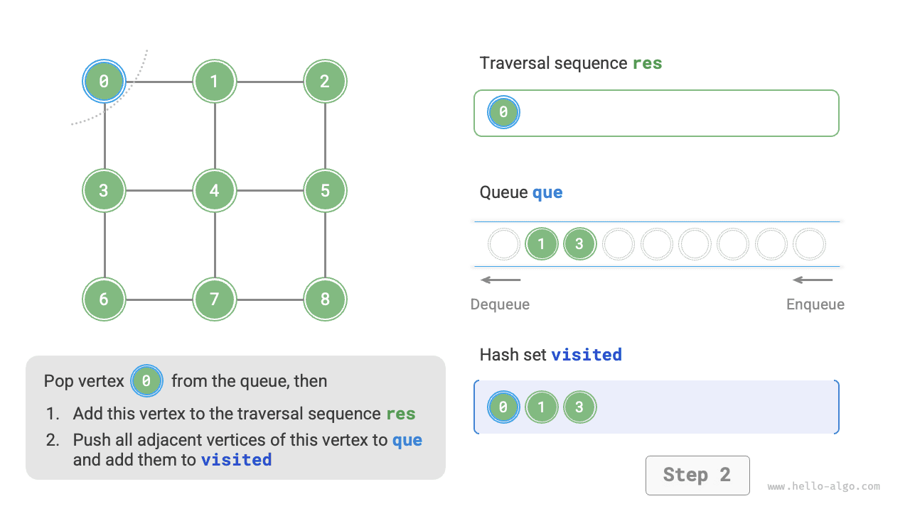
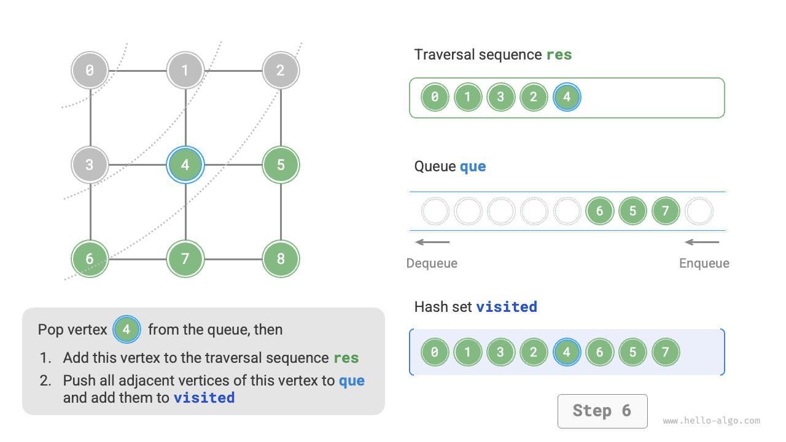
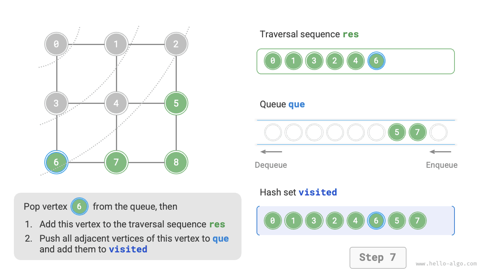
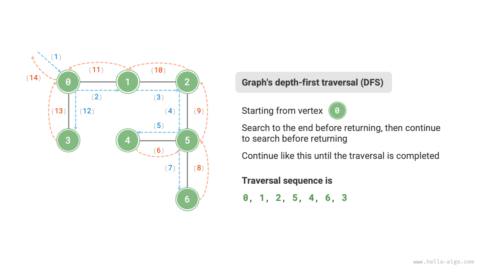
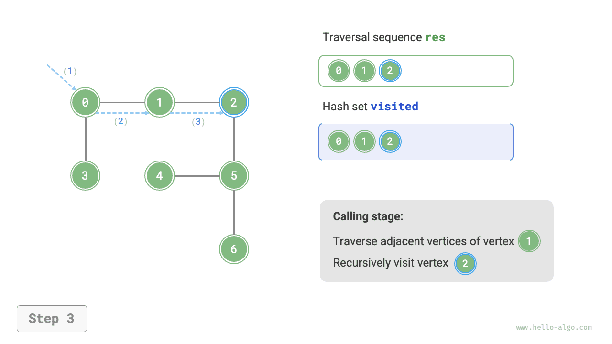
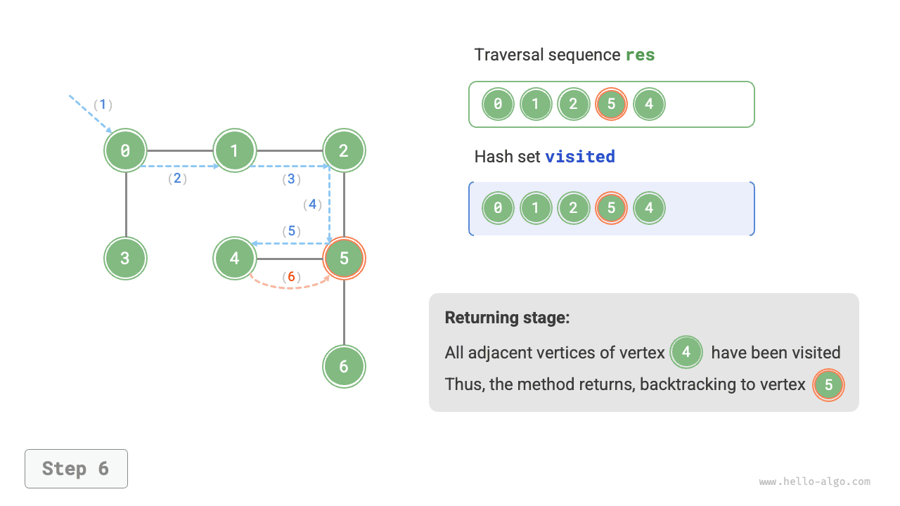
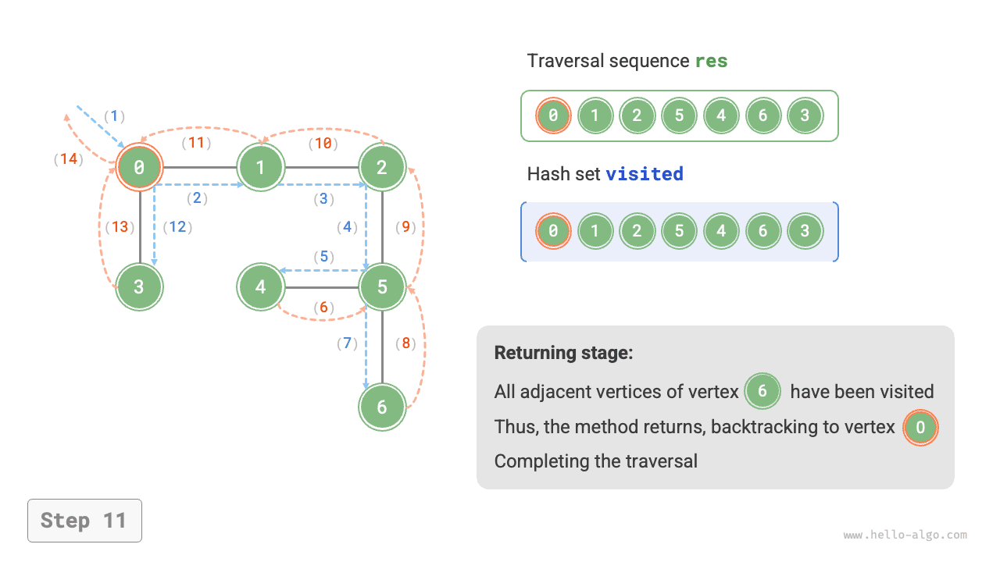

# グラフの走査

木は「一対多」の関係を表しますが、グラフは自由度が高く、任意の「多対多」の関係を表せます。そのため、木はグラフの特殊な場合と考えられます。当然、**木の走査も、グラフの走査の特殊な場合です**。

グラフも木も、走査には探索アルゴリズムを使います。グラフの走査方法も、<u>幅優先走査</u>と<u>深さ優先走査</u>の二つに分けられます。

## 幅優先走査

**幅優先走査は、あるノードから始め、距離の近い頂点から優先して訪問し、層ごとに外側へ広がっていく走査方法です**。下図のように、左上の頂点から始めて、その頂点に隣接するすべての頂点を訪問します。続いて次の頂点に隣接するすべての頂点を訪問し、これをすべての頂点に到達するまで繰り返します。


### アルゴリズムの実装

BFS は通常、次のコードのようにキューで実装します。キューの「先入れ先出し」という性質は、BFS の「近いところから遠いところへ」という考え方に合っています。

1. 走査を始める頂点 `startVet` をキューに入れ、ループを開始します。
2. 各反復で、キューの先頭の頂点を取り出して訪問を記録し、その頂点に隣接するすべての頂点をキューの末尾に入れます。
3. 手順 `2.` を繰り返し、すべての頂点を訪問したら終了します。

同じ頂点を繰り返し訪問しないよう、ハッシュ集合 `visited` に訪問済みのノードを記録します。

!!! tip

    ハッシュ集合は、`key` だけを保存し、`value` を保存しないハッシュテーブルと考えられます。`key` の追加・削除・検索・更新を時間計算量 $O(1)$ で行えます。`key` が重複しない性質を活かし、データの重複除去などによく使われます。

```src
[file]{graph_bfs}-[class]{}-[func]{graph_bfs}
```

コードだけでは抽象的なので、下図と照らし合わせると理解が深まります。

=== "<1>"
    

=== "<2>"
    

=== "<3>"
    

=== "<4>"
    

=== "<5>"
    

=== "<6>"
    

=== "<7>"
    

=== "<8>"
    

=== "<9>"
    

=== "<10>"
    

=== "<11>"
    

!!! question "幅優先走査の順序は一意ですか？"

    一意ではありません。幅優先走査で必要なのは「近いところから遠いところへ」という順序だけで、**同じ距離にある複数の頂点は、どの順に訪問してもかまいません**。上図では、頂点 $1$ と $3$ の訪問順を入れ替えられますし、頂点 $2$、$4$、$6$ も任意の順に訪問できます。

### 計算量の解析

**時間計算量**：すべての頂点を 1 回ずつキューに入れて取り出すため、$O(|V|)$ 時間かかります。隣接する頂点を走査する際は、無向グラフなので、すべての辺を $2$ 回ずつ調べ、$O(2|E|)$ 時間かかります。全体では $O(|V| + |E|)$ 時間です。

**空間計算量**：リスト `res`、ハッシュ集合 `visited`、キュー `que` が保持する頂点数は最大 $|V|$ なので、$O(|V|)$ の空間を使います。

## 深さ優先走査

**深さ優先走査は、まず進めるところまで進み、行き止まりになったら引き返す走査方法です**。下図のように、左上の頂点から出発し、現在の頂点に隣接する頂点の一つを訪問して、行き止まりまで進んだら戻ります。別の方向でも同じように進んで戻る操作を繰り返し、すべての頂点を走査します。



### アルゴリズムの実装

この「行き止まりまで進んでから戻る」というアルゴリズムの形は、通常、再帰で実装します。幅優先走査と同様に、深さ優先走査でもハッシュ集合 `visited` に訪問済みの頂点を記録し、重複して訪問するのを防ぎます。

```src
[file]{graph_dfs}-[class]{}-[func]{graph_dfs}
```

深さ優先走査のアルゴリズムの流れを下図に示します。

- **直線の破線は、下へ進む再帰呼び出しを表し**、新しい再帰メソッドを呼び出して、新しい頂点を訪問することを示します。
- **曲線の破線は、上へ戻る動きを表し**、再帰メソッドから戻り、そのメソッドを呼び出した位置に復帰することを示します。

理解を深めるため、下図とコードを照らし合わせ、各再帰メソッドがいつ呼ばれ、いつ戻るかを含めた DFS 全体の流れを、頭の中でたどるか、紙に描いてみてください。

=== "<1>"
    

=== "<2>"
    

=== "<3>"
    

=== "<4>"
    

=== "<5>"
    

=== "<6>"
    

=== "<7>"
    

=== "<8>"
    

=== "<9>"
    

=== "<10>"
    

=== "<11>"
    

!!! question "深さ優先走査の順序は一意ですか？"

    幅優先走査と同様に、深さ優先走査の順序も一意ではありません。ある頂点からどの方向を先に探索してもよく、隣接する頂点の順序を任意に入れ替えても、深さ優先走査であることは変わりません。
    
    木の走査を例にすると、「根 $\rightarrow$ 左 $\rightarrow$ 右」「左 $\rightarrow$ 根 $\rightarrow$ 右」「左 $\rightarrow$ 右 $\rightarrow$ 根」は、それぞれ行きがけ順、通りがけ順、帰りがけ順の走査です。訪問の優先順位は異なりますが、いずれも深さ優先走査です。

### 計算量の解析

**時間計算量**：すべての頂点を $1$ 回ずつ訪問するのに $O(|V|)$ 時間、すべての辺を $2$ 回ずつ調べるのに $O(2|E|)$ 時間かかります。全体では $O(|V| + |E|)$ 時間です。

**空間計算量**：リスト `res` とハッシュ集合 `visited` の頂点数は最大 $|V|$、再帰の深さも最大 $|V|$ なので、$O(|V|)$ の空間を使います。
