# 9.3 &nbsp; グラフの探索

木が表すのは「一対多」の関係ですが、グラフにはさらに自由度があり、任意の「多対多」の関係を表せます。このため木はグラフの特殊な場合と見なせます。同じように、**木の探索もグラフの探索の特殊な場合です**。

グラフでも木でも、すべての頂点を訪問するには探索アルゴリズムを使います。グラフの探索も、<u>幅優先探索</u>と<u>深さ優先探索</u>の 2 種類に分けられます。

## 9.3.1 &nbsp; 幅優先探索

**幅優先探索では、ある頂点から出発し、常に始点に近い頂点を優先して訪問しながら、外側へ 1 層ずつ探索範囲を広げます**。図 9-9 では左上の頂点から出発し、まずその隣接頂点をすべて調べ、次の頂点についても隣接頂点をすべて調べます。これを全頂点の訪問が終わるまで繰り返します。

{ class="animation-figure" }

<p align="center"> 図 9-9 &nbsp; グラフの幅優先探索 </p>

### 1. &nbsp; アルゴリズムの実装

BFS は通常、次のコードのようにキューを使って実装します。先に入ったものが先に出るキューの「先入れ先出し」という性質は、BFS で近い頂点から遠い頂点へと訪問する考え方に対応します。

1. 探索の始点 `startVet` をキューに入れ、ループを開始します。
2. 各反復ではキューの先頭から頂点を取り出して訪問を記録し、その頂点の隣接頂点をすべてキューの末尾に追加します。
3. 全頂点の訪問が終わるまで、手順 `2.` を繰り返します。

同じ頂点を繰り返し訪問しないように、ハッシュ集合 `visited` を使って訪問済みの頂点を記録します。

!!! tip "ヒント"

    ハッシュ集合は、`key` だけを格納して `value` をもたないハッシュテーブルと考えられます。`key` の追加、削除、検索、更新を $O(1)$ の時間計算量で行えます。`key` が重複しない性質を生かし、データの重複を取り除くときなどに使います。

=== "Python"

    ```python title="graph_bfs.py"
    def graph_bfs(graph: GraphAdjList, start_vet: Vertex) -> list[Vertex]:
        """幅優先探索"""
        # 指定した頂点の隣接頂点をすべて取得できるよう、グラフを隣接リストで表す
        # 頂点の訪問順
        res = []
        # 訪問済みの頂点を記録するハッシュ集合
        visited = set[Vertex]([start_vet])
        # BFS にキューを使う
        que = deque[Vertex]([start_vet])
        # 頂点 vet から開始し、すべての頂点を訪問するまで繰り返す
        while len(que) > 0:
            vet = que.popleft()  # キューの先頭から頂点を取り出す
            res.append(vet)  # 訪問した頂点を記録する
            # この頂点の隣接頂点をすべて調べる
            for adj_vet in graph.adj_list[vet]:
                if adj_vet in visited:
                    continue  # 訪問済みの頂点を飛ばす
                que.append(adj_vet)  # 未訪問の頂点だけをキューに追加する
                visited.add(adj_vet)  # この頂点を訪問済みにする
        # 頂点を訪問順に返す
        return res
    ```

=== "C++"

    ```cpp title="graph_bfs.cpp"
    /* 幅優先探索 */
    // 指定した頂点の隣接頂点をすべて取得できるよう、グラフを隣接リストで表す
    vector<Vertex *> graphBFS(GraphAdjList &graph, Vertex *startVet) {
        // 頂点の訪問順
        vector<Vertex *> res;
        // 訪問済みの頂点を記録するハッシュ集合
        unordered_set<Vertex *> visited = {startVet};
        // BFS にキューを使う
        queue<Vertex *> que;
        que.push(startVet);
        // 頂点 vet から開始し、すべての頂点を訪問するまで繰り返す
        while (!que.empty()) {
            Vertex *vet = que.front();
            que.pop();          // キューの先頭から頂点を取り出す
            res.push_back(vet); // 訪問した頂点を記録する
            // この頂点の隣接頂点をすべて調べる
            for (auto adjVet : graph.adjList[vet]) {
                if (visited.count(adjVet))
                    continue;            // 訪問済みの頂点を飛ばす
                que.push(adjVet);        // 未訪問の頂点だけをキューに追加する
                visited.emplace(adjVet); // この頂点を訪問済みにする
            }
        }
        // 頂点を訪問順に返す
        return res;
    }
    ```

=== "Java"

    ```java title="graph_bfs.java"
    /* 幅優先探索 */
    // 指定した頂点の隣接頂点をすべて取得できるよう、グラフを隣接リストで表す
    List<Vertex> graphBFS(GraphAdjList graph, Vertex startVet) {
        // 頂点の訪問順
        List<Vertex> res = new ArrayList<>();
        // 訪問済みの頂点を記録するハッシュ集合
        Set<Vertex> visited = new HashSet<>();
        visited.add(startVet);
        // BFS にキューを使う
        Queue<Vertex> que = new LinkedList<>();
        que.offer(startVet);
        // 頂点 vet から開始し、すべての頂点を訪問するまで繰り返す
        while (!que.isEmpty()) {
            Vertex vet = que.poll(); // キューの先頭から頂点を取り出す
            res.add(vet);            // 訪問した頂点を記録する
            // この頂点の隣接頂点をすべて調べる
            for (Vertex adjVet : graph.adjList.get(vet)) {
                if (visited.contains(adjVet))
                    continue;        // 訪問済みの頂点を飛ばす
                que.offer(adjVet);   // 未訪問の頂点だけをキューに追加する
                visited.add(adjVet); // この頂点を訪問済みにする
            }
        }
        // 頂点を訪問順に返す
        return res;
    }
    ```

=== "C#"

    ```csharp title="graph_bfs.cs"
    /* 幅優先探索 */
    // 指定した頂点の隣接頂点をすべて取得できるよう、グラフを隣接リストで表す
    List<Vertex> GraphBFS(GraphAdjList graph, Vertex startVet) {
        // 頂点の訪問順
        List<Vertex> res = [];
        // 訪問済みの頂点を記録するハッシュ集合
        HashSet<Vertex> visited = [startVet];
        // BFS にキューを使う
        Queue<Vertex> que = new();
        que.Enqueue(startVet);
        // 頂点 vet から開始し、すべての頂点を訪問するまで繰り返す
        while (que.Count > 0) {
            Vertex vet = que.Dequeue(); // キューの先頭から頂点を取り出す
            res.Add(vet);               // 訪問した頂点を記録する
            foreach (Vertex adjVet in graph.adjList[vet]) {
                if (visited.Contains(adjVet)) {
                    continue;          // 訪問済みの頂点を飛ばす
                }
                que.Enqueue(adjVet);   // 未訪問の頂点だけをキューに追加する
                visited.Add(adjVet);   // この頂点を訪問済みにする
            }
        }

        // 頂点を訪問順に返す
        return res;
    }
    ```

=== "Go"

    ```go title="graph_bfs.go"
    /* 幅優先探索 */
    // 指定した頂点の隣接頂点をすべて取得できるよう、グラフを隣接リストで表す
    func graphBFS(g *graphAdjList, startVet Vertex) []Vertex {
        // 頂点の訪問順
        res := make([]Vertex, 0)
        // 訪問済みの頂点を記録するハッシュ集合
        visited := make(map[Vertex]struct{})
        visited[startVet] = struct{}{}
        // BFS に使うキューをスライスで表す
        queue := make([]Vertex, 0)
        queue = append(queue, startVet)
        // 頂点 vet から開始し、すべての頂点を訪問するまで繰り返す
        for len(queue) > 0 {
            // キューの先頭から頂点を取り出す
            vet := queue[0]
            queue = queue[1:]
            // 訪問した頂点を記録する
            res = append(res, vet)
            // この頂点の隣接頂点をすべて調べる
            for _, adjVet := range g.adjList[vet] {
                _, isExist := visited[adjVet]
                // 未訪問の頂点だけをキューに追加する
                if !isExist {
                    queue = append(queue, adjVet)
                    visited[adjVet] = struct{}{}
                }
            }
        }
        // 頂点を訪問順に返す
        return res
    }
    ```

=== "Swift"

    ```swift title="graph_bfs.swift"
    /* 幅優先探索 */
    // 指定した頂点の隣接頂点をすべて取得できるよう、グラフを隣接リストで表す
    func graphBFS(graph: GraphAdjList, startVet: Vertex) -> [Vertex] {
        // 頂点の訪問順
        var res: [Vertex] = []
        // 訪問済みの頂点を記録するハッシュ集合
        var visited: Set<Vertex> = [startVet]
        // BFS にキューを使う
        var que: [Vertex] = [startVet]
        // 頂点 vet から開始し、すべての頂点を訪問するまで繰り返す
        while !que.isEmpty {
            let vet = que.removeFirst() // キューの先頭から頂点を取り出す
            res.append(vet) // 訪問した頂点を記録する
            // この頂点の隣接頂点をすべて調べる
            for adjVet in graph.adjList[vet] ?? [] {
                if visited.contains(adjVet) {
                    continue // 訪問済みの頂点を飛ばす
                }
                que.append(adjVet) // 未訪問の頂点だけをキューに追加する
                visited.insert(adjVet) // この頂点を訪問済みにする
            }
        }
        // 頂点を訪問順に返す
        return res
    }
    ```

=== "JS"

    ```javascript title="graph_bfs.js"
    /* 幅優先探索 */
    // 指定した頂点の隣接頂点をすべて取得できるよう、グラフを隣接リストで表す
    function graphBFS(graph, startVet) {
        // 頂点の訪問順
        const res = [];
        // 訪問済みの頂点を記録するハッシュ集合
        const visited = new Set();
        visited.add(startVet);
        // BFS にキューを使う
        const que = [startVet];
        // 頂点 vet から開始し、すべての頂点を訪問するまで繰り返す
        while (que.length) {
            const vet = que.shift(); // キューの先頭から頂点を取り出す
            res.push(vet); // 訪問した頂点を記録する
            // この頂点の隣接頂点をすべて調べる
            for (const adjVet of graph.adjList.get(vet) ?? []) {
                if (visited.has(adjVet)) {
                    continue; // 訪問済みの頂点を飛ばす
                }
                que.push(adjVet); // 未訪問の頂点だけをキューに追加する
                visited.add(adjVet); // この頂点を訪問済みにする
            }
        }
        // 頂点を訪問順に返す
        return res;
    }
    ```

=== "TS"

    ```typescript title="graph_bfs.ts"
    /* 幅優先探索 */
    // 指定した頂点の隣接頂点をすべて取得できるよう、グラフを隣接リストで表す
    function graphBFS(graph: GraphAdjList, startVet: Vertex): Vertex[] {
        // 頂点の訪問順
        const res: Vertex[] = [];
        // 訪問済みの頂点を記録するハッシュ集合
        const visited: Set<Vertex> = new Set();
        visited.add(startVet);
        // BFS にキューを使う
        const que = [startVet];
        // 頂点 vet から開始し、すべての頂点を訪問するまで繰り返す
        while (que.length) {
            const vet = que.shift(); // キューの先頭から頂点を取り出す
            res.push(vet); // 訪問した頂点を記録する
            // この頂点の隣接頂点をすべて調べる
            for (const adjVet of graph.adjList.get(vet) ?? []) {
                if (visited.has(adjVet)) {
                    continue; // 訪問済みの頂点を飛ばす
                }
                que.push(adjVet); // 未訪問の頂点だけをキューに追加する
                visited.add(adjVet); // この頂点を訪問済みにする
            }
        }
        // 頂点を訪問順に返す
        return res;
    }
    ```

=== "Dart"

    ```dart title="graph_bfs.dart"
    /* 幅優先探索 */
    List<Vertex> graphBFS(GraphAdjList graph, Vertex startVet) {
      // 指定した頂点の隣接頂点をすべて取得できるよう、グラフを隣接リストで表す
      // 頂点の訪問順
      List<Vertex> res = [];
      // 訪問済みの頂点を記録するハッシュ集合
      Set<Vertex> visited = {};
      visited.add(startVet);
      // BFS にキューを使う
      Queue<Vertex> que = Queue();
      que.add(startVet);
      // 頂点 vet から開始し、すべての頂点を訪問するまで繰り返す
      while (que.isNotEmpty) {
        Vertex vet = que.removeFirst(); // キューの先頭から頂点を取り出す
        res.add(vet); // 訪問した頂点を記録する
        // この頂点の隣接頂点をすべて調べる
        for (Vertex adjVet in graph.adjList[vet]!) {
          if (visited.contains(adjVet)) {
            continue; // 訪問済みの頂点を飛ばす
          }
          que.add(adjVet); // 未訪問の頂点だけをキューに追加する
          visited.add(adjVet); // この頂点を訪問済みにする
        }
      }
      // 頂点を訪問順に返す
      return res;
    }
    ```

=== "Rust"

    ```rust title="graph_bfs.rs"
    /* 幅優先探索 */
    // 指定した頂点の隣接頂点をすべて取得できるよう、グラフを隣接リストで表す
    fn graph_bfs(graph: GraphAdjList, start_vet: Vertex) -> Vec<Vertex> {
        // 頂点の訪問順
        let mut res = vec![];
        // 訪問済みの頂点を記録するハッシュ集合
        let mut visited = HashSet::new();
        visited.insert(start_vet);
        // BFS にキューを使う
        let mut que = VecDeque::new();
        que.push_back(start_vet);
        // 頂点 vet から開始し、すべての頂点を訪問するまで繰り返す
        while let Some(vet) = que.pop_front() {
            res.push(vet); // 訪問した頂点を記録する

            // この頂点の隣接頂点をすべて調べる
            if let Some(adj_vets) = graph.adj_list.get(&vet) {
                for &adj_vet in adj_vets {
                    if visited.contains(&adj_vet) {
                        continue; // 訪問済みの頂点を飛ばす
                    }
                    que.push_back(adj_vet); // 未訪問の頂点だけをキューに追加する
                    visited.insert(adj_vet); // この頂点を訪問済みにする
                }
            }
        }
        // 頂点を訪問順に返す
        res
    }
    ```

=== "C"

    ```c title="graph_bfs.c"
    /* ノードを格納するキューの構造体 */
    typedef struct {
        Vertex *vertices[MAX_SIZE];
        int front, rear, size;
    } Queue;

    /* コンストラクタ */
    Queue *newQueue() {
        Queue *q = (Queue *)malloc(sizeof(Queue));
        q->front = q->rear = q->size = 0;
        return q;
    }

    /* キューが空か判定する */
    int isEmpty(Queue *q) {
        return q->size == 0;
    }

    /* キューに追加する */
    void enqueue(Queue *q, Vertex *vet) {
        q->vertices[q->rear] = vet;
        q->rear = (q->rear + 1) % MAX_SIZE;
        q->size++;
    }

    /* キューから取り出す */
    Vertex *dequeue(Queue *q) {
        Vertex *vet = q->vertices[q->front];
        q->front = (q->front + 1) % MAX_SIZE;
        q->size--;
        return vet;
    }

    /* 頂点が訪問済みか調べる */
    int isVisited(Vertex **visited, int size, Vertex *vet) {
        // ノードを順に探すため、O(n) 時間かかる
        for (int i = 0; i < size; i++) {
            if (visited[i] == vet)
                return 1;
        }
        return 0;
    }

    /* 幅優先探索 */
    // 指定した頂点の隣接頂点をすべて取得できるよう、グラフを隣接リストで表す
    void graphBFS(GraphAdjList *graph, Vertex *startVet, Vertex **res, int *resSize, Vertex **visited, int *visitedSize) {
        // BFS にキューを使う
        Queue *queue = newQueue();
        enqueue(queue, startVet);
        visited[(*visitedSize)++] = startVet;
        // 頂点 vet から開始し、すべての頂点を訪問するまで繰り返す
        while (!isEmpty(queue)) {
            Vertex *vet = dequeue(queue); // キューの先頭から頂点を取り出す
            res[(*resSize)++] = vet;      // 訪問した頂点を記録する
            // この頂点の隣接頂点をすべて調べる
            AdjListNode *node = findNode(graph, vet);
            while (node != NULL) {
                // 訪問済みの頂点を飛ばす
                if (!isVisited(visited, *visitedSize, node->vertex)) {
                    enqueue(queue, node->vertex);             // 未訪問の頂点だけをキューに追加する
                    visited[(*visitedSize)++] = node->vertex; // この頂点を訪問済みにする
                }
                node = node->next;
            }
        }
        // メモリを解放する
        free(queue);
    }
    ```

=== "Kotlin"

    ```kotlin title="graph_bfs.kt"
    /* 幅優先探索 */
    // 指定した頂点の隣接頂点をすべて取得できるよう、グラフを隣接リストで表す
    fun graphBFS(graph: GraphAdjList, startVet: Vertex): MutableList<Vertex?> {
        // 頂点の訪問順
        val res = mutableListOf<Vertex?>()
        // 訪問済みの頂点を記録するハッシュ集合
        val visited = HashSet<Vertex>()
        visited.add(startVet)
        // BFS にキューを使う
        val que = LinkedList<Vertex>()
        que.offer(startVet)
        // 頂点 vet から開始し、すべての頂点を訪問するまで繰り返す
        while (!que.isEmpty()) {
            val vet = que.poll() // キューの先頭から頂点を取り出す
            res.add(vet)         // 訪問した頂点を記録する
            // この頂点の隣接頂点をすべて調べる
            for (adjVet in graph.adjList[vet]!!) {
                if (visited.contains(adjVet))
                    continue        // 訪問済みの頂点を飛ばす
                que.offer(adjVet)   // 未訪問の頂点だけをキューに追加する
                visited.add(adjVet) // この頂点を訪問済みにする
            }
        }
        // 頂点を訪問順に返す
        return res
    }
    ```

=== "Ruby"

    ```ruby title="graph_bfs.rb"
    ### 幅優先探索 ###
    def graph_bfs(graph, start_vet)
      # 指定した頂点の隣接頂点をすべて取得できるよう、グラフを隣接リストで表す
      # 頂点の訪問順
      res = []
      # 訪問済みの頂点を記録するハッシュ集合
      visited = Set.new([start_vet])
      # BFS にキューを使う
      que = [start_vet]
      # 頂点 vet から開始し、すべての頂点を訪問するまで繰り返す
      while que.length > 0
        vet = que.shift # キューの先頭から頂点を取り出す
        res << vet # 訪問した頂点を記録する
        # この頂点の隣接頂点をすべて調べる
        for adj_vet in graph.adj_list[vet]
          next if visited.include?(adj_vet) # 訪問済みの頂点を飛ばす
          que << adj_vet # 未訪問の頂点だけをキューに追加する
          visited.add(adj_vet) # この頂点を訪問済みにする
        end
      end
      # 頂点を訪問順に返す
      res
    end
    ```

??? pythontutor "実行の様子を見る"

    <div style="height: 549px; width: 100%;"><iframe class="pythontutor-iframe" title="実行の様子を見る" src="https://pythontutor.com/iframe-embed.html#code=from%20collections%20import%20deque%0A%0Aclass%20Vertex%3A%0A%20%20%22%22%22%E9%A0%82%E7%82%B9%E3%82%AF%E3%83%A9%E3%82%B9%22%22%22%0A%20%20def%20__init__%28self,%20val%3A%20int%29%3A%0A%20%20%20%20self.val%20%3D%20val%0A%0Adef%20vals_to_vets%28vals%3A%20list%5Bint%5D%29%20-%3E%20list%5B%22Vertex%22%5D%3A%0A%20%20%22%22%22%E5%80%A4%E3%81%AE%E3%83%AA%E3%82%B9%E3%83%88%20vals%20%E3%82%92%E5%8F%97%E3%81%91%E5%8F%96%E3%82%8A%E3%80%81%E9%A0%82%E7%82%B9%E3%81%AE%E3%83%AA%E3%82%B9%E3%83%88%20vets%20%E3%82%92%E8%BF%94%E3%81%99%22%22%22%0A%20%20return%20%5BVertex%28val%29%20for%20val%20in%20vals%5D%0A%0Aclass%20GraphAdjList%3A%0A%20%20%22%22%22%E9%9A%A3%E6%8E%A5%E3%83%AA%E3%82%B9%E3%83%88%E3%81%A7%E7%84%A1%E5%90%91%E3%82%B0%E3%83%A9%E3%83%95%E3%82%92%E8%A1%A8%E3%81%99%E3%82%AF%E3%83%A9%E3%82%B9%22%22%22%0A%0A%20%20def%20__init__%28self,%20edges%3A%20list%5Blist%5BVertex%5D%5D%29%3A%0A%20%20%20%20%22%22%22%E3%82%B3%E3%83%B3%E3%82%B9%E3%83%88%E3%83%A9%E3%82%AF%E3%82%BF%22%22%22%0A%20%20%20%20self.adj_list%20%3D%20dict%5BVertex,%20list%5BVertex%5D%5D%28%29%0A%20%20%20%20for%20edge%20in%20edges%3A%0A%20%20%20%20%20%20self.add_vertex%28edge%5B0%5D%29%0A%20%20%20%20%20%20self.add_vertex%28edge%5B1%5D%29%0A%20%20%20%20%20%20self.add_edge%28edge%5B0%5D,%20edge%5B1%5D%29%0A%0A%20%20def%20add_edge%28self,%20vet1%3A%20Vertex,%20vet2%3A%20Vertex%29%3A%0A%20%20%20%20%22%22%22%E8%BE%BA%E3%82%92%E8%BF%BD%E5%8A%A0%E3%81%99%E3%82%8B%22%22%22%0A%20%20%20%20if%20vet1%20not%20in%20self.adj_list%20or%20vet2%20not%20in%20self.adj_list%20or%20vet1%20%3D%3D%20vet2%3A%0A%20%20%20%20%20%20raise%20ValueError%28%29%0A%20%20%20%20self.adj_list%5Bvet1%5D.append%28vet2%29%0A%20%20%20%20self.adj_list%5Bvet2%5D.append%28vet1%29%0A%0A%20%20def%20add_vertex%28self,%20vet%3A%20Vertex%29%3A%0A%20%20%20%20%22%22%22%E9%A0%82%E7%82%B9%E3%82%92%E8%BF%BD%E5%8A%A0%E3%81%99%E3%82%8B%22%22%22%0A%20%20%20%20if%20vet%20in%20self.adj_list%3A%0A%20%20%20%20%20%20return%0A%20%20%20%20self.adj_list%5Bvet%5D%20%3D%20%5B%5D%0A%0A%0Adef%20graph_bfs%28graph%3A%20GraphAdjList,%20start_vet%3A%20Vertex%29%20-%3E%20list%5BVertex%5D%3A%0A%20%20%22%22%22%E5%B9%85%E5%84%AA%E5%85%88%E6%8E%A2%E7%B4%A2%22%22%22%0A%20%20%23%20%E9%A0%82%E7%82%B9%E3%81%AE%E8%A8%AA%E5%95%8F%E9%A0%86%0A%20%20res%20%3D%20%5B%5D%0A%20%20%23%20%E8%A8%AA%E5%95%8F%E6%B8%88%E3%81%BF%E3%81%AE%E9%A0%82%E7%82%B9%E3%82%92%E8%A8%98%E9%8C%B2%E3%81%99%E3%82%8B%E3%83%8F%E3%83%83%E3%82%B7%E3%83%A5%E3%83%86%E3%83%BC%E3%83%96%E3%83%AB%0A%20%20visited%20%3D%20set%5BVertex%5D%28%5Bstart_vet%5D%29%0A%20%20%23%20BFS%20%E3%81%AB%E3%82%AD%E3%83%A5%E3%83%BC%E3%82%92%E4%BD%BF%E3%81%86%0A%20%20que%20%3D%20deque%5BVertex%5D%28%5Bstart_vet%5D%29%0A%20%20%23%20%E9%A0%82%E7%82%B9%20vet%20%E3%81%8B%E3%82%89%E9%96%8B%E5%A7%8B%E3%81%97%E3%80%81%E3%81%99%E3%81%B9%E3%81%A6%E3%81%AE%E9%A0%82%E7%82%B9%E3%82%92%E8%A8%AA%E5%95%8F%E3%81%99%E3%82%8B%E3%81%BE%E3%81%A7%E7%B9%B0%E3%82%8A%E8%BF%94%E3%81%99%0A%20%20while%20len%28que%29%20%3E%200%3A%0A%20%20%20%20vet%20%3D%20que.popleft%28%29%20%20%23%20%E3%82%AD%E3%83%A5%E3%83%BC%E3%81%AE%E5%85%88%E9%A0%AD%E3%81%8B%E3%82%89%E9%A0%82%E7%82%B9%E3%82%92%E5%8F%96%E3%82%8A%E5%87%BA%E3%81%99%0A%20%20%20%20res.append%28vet%29%20%20%23%20%E8%A8%AA%E5%95%8F%E3%81%97%E3%81%9F%E9%A0%82%E7%82%B9%E3%82%92%E8%A8%98%E9%8C%B2%E3%81%99%E3%82%8B%0A%20%20%20%20%23%20%E3%81%93%E3%81%AE%E9%A0%82%E7%82%B9%E3%81%AE%E9%9A%A3%E6%8E%A5%E9%A0%82%E7%82%B9%E3%82%92%E3%81%99%E3%81%B9%E3%81%A6%E8%AA%BF%E3%81%B9%E3%82%8B%0A%20%20%20%20for%20adj_vet%20in%20graph.adj_list%5Bvet%5D%3A%0A%20%20%20%20%20%20if%20adj_vet%20in%20visited%3A%0A%20%20%20%20%20%20%20%20continue%20%20%23%20%E8%A8%AA%E5%95%8F%E6%B8%88%E3%81%BF%E3%81%AE%E9%A0%82%E7%82%B9%E3%82%92%E9%A3%9B%E3%81%B0%E3%81%99%0A%20%20%20%20%20%20que.append%28adj_vet%29%20%20%23%20%E6%9C%AA%E8%A8%AA%E5%95%8F%E3%81%AE%E9%A0%82%E7%82%B9%E3%81%A0%E3%81%91%E3%82%92%E3%82%AD%E3%83%A5%E3%83%BC%E3%81%AB%E8%BF%BD%E5%8A%A0%E3%81%99%E3%82%8B%0A%20%20%20%20%20%20visited.add%28adj_vet%29%20%20%23%20%E3%81%93%E3%81%AE%E9%A0%82%E7%82%B9%E3%82%92%E8%A8%AA%E5%95%8F%E6%B8%88%E3%81%BF%E3%81%AB%E3%81%99%E3%82%8B%0A%20%20%23%20%E9%A0%82%E7%82%B9%E3%82%92%E8%A8%AA%E5%95%8F%E9%A0%86%E3%81%AB%E8%BF%94%E3%81%99%0A%20%20return%20res%0A%0A%22%22%22Driver%20Code%22%22%22%0Aif%20__name__%20%3D%3D%20%22__main__%22%3A%0A%20%20%23%20%E7%84%A1%E5%90%91%E3%82%B0%E3%83%A9%E3%83%95%E3%82%92%E5%88%9D%E6%9C%9F%E5%8C%96%E3%81%99%E3%82%8B%0A%20%20v%20%3D%20vals_to_vets%28%5B0,%201,%202,%203,%204%5D%29%0A%20%20edges%20%3D%20%5B%0A%20%20%20%20%5Bv%5B0%5D,%20v%5B1%5D%5D,%0A%20%20%20%20%5Bv%5B0%5D,%20v%5B3%5D%5D,%0A%20%20%20%20%5Bv%5B1%5D,%20v%5B2%5D%5D,%0A%20%20%20%20%5Bv%5B1%5D,%20v%5B4%5D%5D,%0A%20%20%20%20%5Bv%5B3%5D,%20v%5B4%5D%5D,%0A%20%20%5D%0A%20%20graph%20%3D%20GraphAdjList%28edges%29%0A%20%20del%20edges%0A%0A%20%20%23%20%E5%B9%85%E5%84%AA%E5%85%88%E6%8E%A2%E7%B4%A2%0A%20%20res%20%3D%20graph_bfs%28graph,%20v%5B0%5D%29&codeDivHeight=472&codeDivWidth=350&cumulative=false&curInstr=131&heapPrimitives=nevernest&origin=opt-frontend.js&py=311&rawInputLstJSON=%5B%5D&textReferences=false"> </iframe></div>
    <div style="margin-top: 5px;"><a href="https://pythontutor.com/iframe-embed.html#code=from%20collections%20import%20deque%0A%0Aclass%20Vertex%3A%0A%20%20%22%22%22%E9%A0%82%E7%82%B9%E3%82%AF%E3%83%A9%E3%82%B9%22%22%22%0A%20%20def%20__init__%28self,%20val%3A%20int%29%3A%0A%20%20%20%20self.val%20%3D%20val%0A%0Adef%20vals_to_vets%28vals%3A%20list%5Bint%5D%29%20-%3E%20list%5B%22Vertex%22%5D%3A%0A%20%20%22%22%22%E5%80%A4%E3%81%AE%E3%83%AA%E3%82%B9%E3%83%88%20vals%20%E3%82%92%E5%8F%97%E3%81%91%E5%8F%96%E3%82%8A%E3%80%81%E9%A0%82%E7%82%B9%E3%81%AE%E3%83%AA%E3%82%B9%E3%83%88%20vets%20%E3%82%92%E8%BF%94%E3%81%99%22%22%22%0A%20%20return%20%5BVertex%28val%29%20for%20val%20in%20vals%5D%0A%0Aclass%20GraphAdjList%3A%0A%20%20%22%22%22%E9%9A%A3%E6%8E%A5%E3%83%AA%E3%82%B9%E3%83%88%E3%81%A7%E7%84%A1%E5%90%91%E3%82%B0%E3%83%A9%E3%83%95%E3%82%92%E8%A1%A8%E3%81%99%E3%82%AF%E3%83%A9%E3%82%B9%22%22%22%0A%0A%20%20def%20__init__%28self,%20edges%3A%20list%5Blist%5BVertex%5D%5D%29%3A%0A%20%20%20%20%22%22%22%E3%82%B3%E3%83%B3%E3%82%B9%E3%83%88%E3%83%A9%E3%82%AF%E3%82%BF%22%22%22%0A%20%20%20%20self.adj_list%20%3D%20dict%5BVertex,%20list%5BVertex%5D%5D%28%29%0A%20%20%20%20for%20edge%20in%20edges%3A%0A%20%20%20%20%20%20self.add_vertex%28edge%5B0%5D%29%0A%20%20%20%20%20%20self.add_vertex%28edge%5B1%5D%29%0A%20%20%20%20%20%20self.add_edge%28edge%5B0%5D,%20edge%5B1%5D%29%0A%0A%20%20def%20add_edge%28self,%20vet1%3A%20Vertex,%20vet2%3A%20Vertex%29%3A%0A%20%20%20%20%22%22%22%E8%BE%BA%E3%82%92%E8%BF%BD%E5%8A%A0%E3%81%99%E3%82%8B%22%22%22%0A%20%20%20%20if%20vet1%20not%20in%20self.adj_list%20or%20vet2%20not%20in%20self.adj_list%20or%20vet1%20%3D%3D%20vet2%3A%0A%20%20%20%20%20%20raise%20ValueError%28%29%0A%20%20%20%20self.adj_list%5Bvet1%5D.append%28vet2%29%0A%20%20%20%20self.adj_list%5Bvet2%5D.append%28vet1%29%0A%0A%20%20def%20add_vertex%28self,%20vet%3A%20Vertex%29%3A%0A%20%20%20%20%22%22%22%E9%A0%82%E7%82%B9%E3%82%92%E8%BF%BD%E5%8A%A0%E3%81%99%E3%82%8B%22%22%22%0A%20%20%20%20if%20vet%20in%20self.adj_list%3A%0A%20%20%20%20%20%20return%0A%20%20%20%20self.adj_list%5Bvet%5D%20%3D%20%5B%5D%0A%0A%0Adef%20graph_bfs%28graph%3A%20GraphAdjList,%20start_vet%3A%20Vertex%29%20-%3E%20list%5BVertex%5D%3A%0A%20%20%22%22%22%E5%B9%85%E5%84%AA%E5%85%88%E6%8E%A2%E7%B4%A2%22%22%22%0A%20%20%23%20%E9%A0%82%E7%82%B9%E3%81%AE%E8%A8%AA%E5%95%8F%E9%A0%86%0A%20%20res%20%3D%20%5B%5D%0A%20%20%23%20%E8%A8%AA%E5%95%8F%E6%B8%88%E3%81%BF%E3%81%AE%E9%A0%82%E7%82%B9%E3%82%92%E8%A8%98%E9%8C%B2%E3%81%99%E3%82%8B%E3%83%8F%E3%83%83%E3%82%B7%E3%83%A5%E3%83%86%E3%83%BC%E3%83%96%E3%83%AB%0A%20%20visited%20%3D%20set%5BVertex%5D%28%5Bstart_vet%5D%29%0A%20%20%23%20BFS%20%E3%81%AB%E3%82%AD%E3%83%A5%E3%83%BC%E3%82%92%E4%BD%BF%E3%81%86%0A%20%20que%20%3D%20deque%5BVertex%5D%28%5Bstart_vet%5D%29%0A%20%20%23%20%E9%A0%82%E7%82%B9%20vet%20%E3%81%8B%E3%82%89%E9%96%8B%E5%A7%8B%E3%81%97%E3%80%81%E3%81%99%E3%81%B9%E3%81%A6%E3%81%AE%E9%A0%82%E7%82%B9%E3%82%92%E8%A8%AA%E5%95%8F%E3%81%99%E3%82%8B%E3%81%BE%E3%81%A7%E7%B9%B0%E3%82%8A%E8%BF%94%E3%81%99%0A%20%20while%20len%28que%29%20%3E%200%3A%0A%20%20%20%20vet%20%3D%20que.popleft%28%29%20%20%23%20%E3%82%AD%E3%83%A5%E3%83%BC%E3%81%AE%E5%85%88%E9%A0%AD%E3%81%8B%E3%82%89%E9%A0%82%E7%82%B9%E3%82%92%E5%8F%96%E3%82%8A%E5%87%BA%E3%81%99%0A%20%20%20%20res.append%28vet%29%20%20%23%20%E8%A8%AA%E5%95%8F%E3%81%97%E3%81%9F%E9%A0%82%E7%82%B9%E3%82%92%E8%A8%98%E9%8C%B2%E3%81%99%E3%82%8B%0A%20%20%20%20%23%20%E3%81%93%E3%81%AE%E9%A0%82%E7%82%B9%E3%81%AE%E9%9A%A3%E6%8E%A5%E9%A0%82%E7%82%B9%E3%82%92%E3%81%99%E3%81%B9%E3%81%A6%E8%AA%BF%E3%81%B9%E3%82%8B%0A%20%20%20%20for%20adj_vet%20in%20graph.adj_list%5Bvet%5D%3A%0A%20%20%20%20%20%20if%20adj_vet%20in%20visited%3A%0A%20%20%20%20%20%20%20%20continue%20%20%23%20%E8%A8%AA%E5%95%8F%E6%B8%88%E3%81%BF%E3%81%AE%E9%A0%82%E7%82%B9%E3%82%92%E9%A3%9B%E3%81%B0%E3%81%99%0A%20%20%20%20%20%20que.append%28adj_vet%29%20%20%23%20%E6%9C%AA%E8%A8%AA%E5%95%8F%E3%81%AE%E9%A0%82%E7%82%B9%E3%81%A0%E3%81%91%E3%82%92%E3%82%AD%E3%83%A5%E3%83%BC%E3%81%AB%E8%BF%BD%E5%8A%A0%E3%81%99%E3%82%8B%0A%20%20%20%20%20%20visited.add%28adj_vet%29%20%20%23%20%E3%81%93%E3%81%AE%E9%A0%82%E7%82%B9%E3%82%92%E8%A8%AA%E5%95%8F%E6%B8%88%E3%81%BF%E3%81%AB%E3%81%99%E3%82%8B%0A%20%20%23%20%E9%A0%82%E7%82%B9%E3%82%92%E8%A8%AA%E5%95%8F%E9%A0%86%E3%81%AB%E8%BF%94%E3%81%99%0A%20%20return%20res%0A%0A%22%22%22Driver%20Code%22%22%22%0Aif%20__name__%20%3D%3D%20%22__main__%22%3A%0A%20%20%23%20%E7%84%A1%E5%90%91%E3%82%B0%E3%83%A9%E3%83%95%E3%82%92%E5%88%9D%E6%9C%9F%E5%8C%96%E3%81%99%E3%82%8B%0A%20%20v%20%3D%20vals_to_vets%28%5B0,%201,%202,%203,%204%5D%29%0A%20%20edges%20%3D%20%5B%0A%20%20%20%20%5Bv%5B0%5D,%20v%5B1%5D%5D,%0A%20%20%20%20%5Bv%5B0%5D,%20v%5B3%5D%5D,%0A%20%20%20%20%5Bv%5B1%5D,%20v%5B2%5D%5D,%0A%20%20%20%20%5Bv%5B1%5D,%20v%5B4%5D%5D,%0A%20%20%20%20%5Bv%5B3%5D,%20v%5B4%5D%5D,%0A%20%20%5D%0A%20%20graph%20%3D%20GraphAdjList%28edges%29%0A%20%20del%20edges%0A%0A%20%20%23%20%E5%B9%85%E5%84%AA%E5%85%88%E6%8E%A2%E7%B4%A2%0A%20%20res%20%3D%20graph_bfs%28graph,%20v%5B0%5D%29&codeDivHeight=800&codeDivWidth=600&cumulative=false&curInstr=131&heapPrimitives=nevernest&origin=opt-frontend.js&py=311&rawInputLstJSON=%5B%5D&textReferences=false" target="_blank" rel="noopener noreferrer">全画面で表示 ></a></div>

コードだけでは動作を思い描きにくいので、図 9-10 と照らし合わせてみましょう。

=== "<1>"
    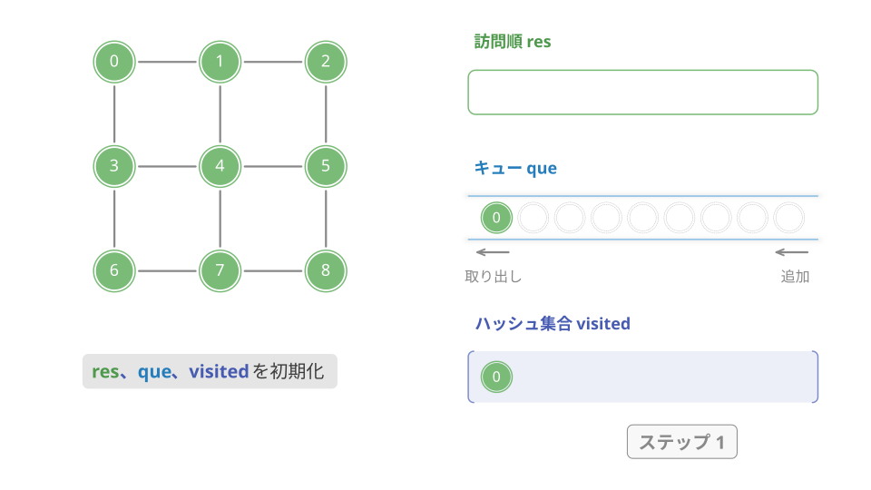{ class="animation-figure" }

=== "<2>"
    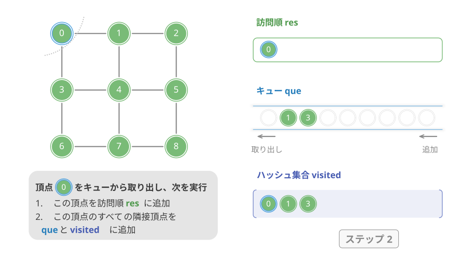{ class="animation-figure" }

=== "<3>"
    { class="animation-figure" }

=== "<4>"
    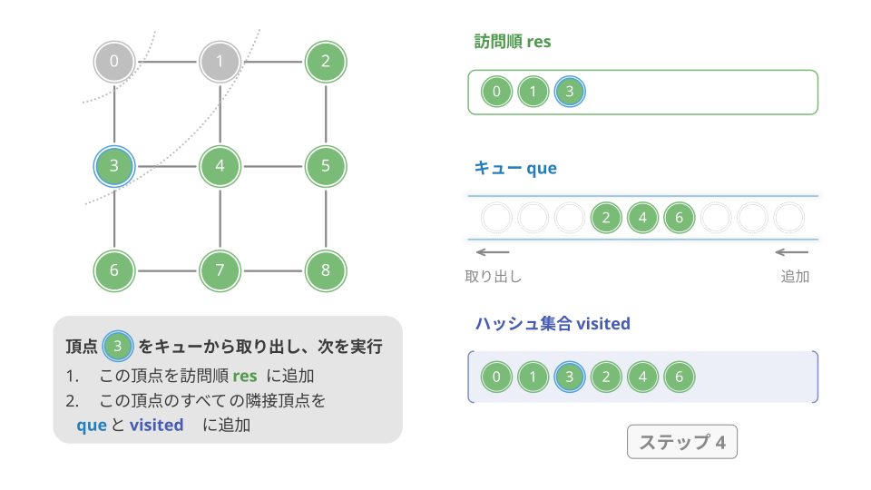{ class="animation-figure" }

=== "<5>"
    { class="animation-figure" }

=== "<6>"
    { class="animation-figure" }

=== "<7>"
    { class="animation-figure" }

=== "<8>"
    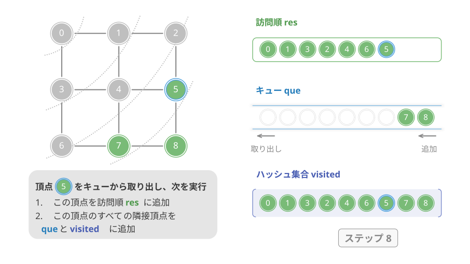{ class="animation-figure" }

=== "<9>"
    { class="animation-figure" }

=== "<10>"
    { class="animation-figure" }

=== "<11>"
    { class="animation-figure" }

<p align="center"> 図 9-10 &nbsp; グラフの幅優先探索の手順 </p>

!!! question "幅優先探索の訪問順は一意ですか。"

    一意ではありません。幅優先探索で必要なのは、始点から近い順に訪問することだけで、**同じ距離にある頂点同士の訪問順は任意に入れ替えられます**。図 9-10 では、頂点 $1$ と $3$ の訪問順を交換でき、頂点 $2$、$4$、$6$ の訪問順も自由に入れ替えられます。

### 2. &nbsp; 計算量の分析

**時間計算量**：各頂点をキューに 1 回ずつ入れて取り出すのに $O(|V|)$ 時間かかります。隣接頂点を調べるとき、無向グラフではすべての辺を $2$ 回ずつ調べるので、$O(2|E|)$ 時間かかります。全体の所要時間は $O(|V| + |E|)$ です。

**空間計算量**：リスト `res`、ハッシュ集合 `visited`、キュー `que` に入る頂点数はいずれも最大 $|V|$ なので、使用する空間は $O(|V|)$ です。

## 9.3.2 &nbsp; 深さ優先探索

**深さ優先探索では、まず進めるところまで進み、行き止まりに来たら引き返します**。図 9-11 では左上の頂点から出発し、現在の頂点の隣接頂点を 1 つ選んで進みます。行き止まりで戻り、また進めるところまで進んで戻る操作を、すべての頂点を訪問するまで繰り返します。

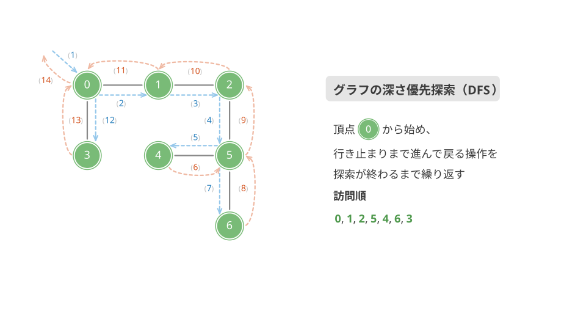{ class="animation-figure" }

<p align="center"> 図 9-11 &nbsp; グラフの深さ優先探索 </p>

### 1. &nbsp; アルゴリズムの実装

この「行き止まりまで進んで戻る」という手順は通常、再帰で実装します。幅優先探索と同様に、深さ優先探索でもハッシュ集合 `visited` に訪問済みの頂点を記録し、重複する訪問を避けます。

=== "Python"

    ```python title="graph_dfs.py"
    def dfs(graph: GraphAdjList, visited: set[Vertex], res: list[Vertex], vet: Vertex):
        """深さ優先探索の補助関数"""
        res.append(vet)  # 訪問した頂点を記録する
        visited.add(vet)  # この頂点を訪問済みにする
        # この頂点の隣接頂点をすべて調べる
        for adjVet in graph.adj_list[vet]:
            if adjVet in visited:
                continue  # 訪問済みの頂点を飛ばす
            # 隣接頂点を再帰的に訪問する
            dfs(graph, visited, res, adjVet)

    def graph_dfs(graph: GraphAdjList, start_vet: Vertex) -> list[Vertex]:
        """深さ優先探索"""
        # 指定した頂点の隣接頂点をすべて取得できるよう、グラフを隣接リストで表す
        # 頂点の訪問順
        res = []
        # 訪問済みの頂点を記録するハッシュ集合
        visited = set[Vertex]()
        dfs(graph, visited, res, start_vet)
        return res
    ```

=== "C++"

    ```cpp title="graph_dfs.cpp"
    /* 深さ優先探索の補助関数 */
    void dfs(GraphAdjList &graph, unordered_set<Vertex *> &visited, vector<Vertex *> &res, Vertex *vet) {
        res.push_back(vet);   // 訪問した頂点を記録する
        visited.emplace(vet); // この頂点を訪問済みにする
        // この頂点の隣接頂点をすべて調べる
        for (Vertex *adjVet : graph.adjList[vet]) {
            if (visited.count(adjVet))
                continue; // 訪問済みの頂点を飛ばす
            // 隣接頂点を再帰的に訪問する
            dfs(graph, visited, res, adjVet);
        }
    }

    /* 深さ優先探索 */
    // 指定した頂点の隣接頂点をすべて取得できるよう、グラフを隣接リストで表す
    vector<Vertex *> graphDFS(GraphAdjList &graph, Vertex *startVet) {
        // 頂点の訪問順
        vector<Vertex *> res;
        // 訪問済みの頂点を記録するハッシュ集合
        unordered_set<Vertex *> visited;
        dfs(graph, visited, res, startVet);
        return res;
    }
    ```

=== "Java"

    ```java title="graph_dfs.java"
    /* 深さ優先探索の補助関数 */
    void dfs(GraphAdjList graph, Set<Vertex> visited, List<Vertex> res, Vertex vet) {
        res.add(vet);     // 訪問した頂点を記録する
        visited.add(vet); // この頂点を訪問済みにする
        // この頂点の隣接頂点をすべて調べる
        for (Vertex adjVet : graph.adjList.get(vet)) {
            if (visited.contains(adjVet))
                continue; // 訪問済みの頂点を飛ばす
            // 隣接頂点を再帰的に訪問する
            dfs(graph, visited, res, adjVet);
        }
    }

    /* 深さ優先探索 */
    // 指定した頂点の隣接頂点をすべて取得できるよう、グラフを隣接リストで表す
    List<Vertex> graphDFS(GraphAdjList graph, Vertex startVet) {
        // 頂点の訪問順
        List<Vertex> res = new ArrayList<>();
        // 訪問済みの頂点を記録するハッシュ集合
        Set<Vertex> visited = new HashSet<>();
        dfs(graph, visited, res, startVet);
        return res;
    }
    ```

=== "C#"

    ```csharp title="graph_dfs.cs"
    /* 深さ優先探索の補助関数 */
    void DFS(GraphAdjList graph, HashSet<Vertex> visited, List<Vertex> res, Vertex vet) {
        res.Add(vet);     // 訪問した頂点を記録する
        visited.Add(vet); // この頂点を訪問済みにする
        // この頂点の隣接頂点をすべて調べる
        foreach (Vertex adjVet in graph.adjList[vet]) {
            if (visited.Contains(adjVet)) {
                continue; // 訪問済みの頂点を飛ばす                             
            }
            // 隣接頂点を再帰的に訪問する
            DFS(graph, visited, res, adjVet);
        }
    }

    /* 深さ優先探索 */
    // 指定した頂点の隣接頂点をすべて取得できるよう、グラフを隣接リストで表す
    List<Vertex> GraphDFS(GraphAdjList graph, Vertex startVet) {
        // 頂点の訪問順
        List<Vertex> res = [];
        // 訪問済みの頂点を記録するハッシュ集合
        HashSet<Vertex> visited = [];
        DFS(graph, visited, res, startVet);
        return res;
    }
    ```

=== "Go"

    ```go title="graph_dfs.go"
    /* 深さ優先探索の補助関数 */
    func dfs(g *graphAdjList, visited map[Vertex]struct{}, res *[]Vertex, vet Vertex) {
        // append は新しい参照を返すため、元の変数に新しいスライスの参照を代入し直す
        *res = append(*res, vet)
        visited[vet] = struct{}{}
        // この頂点の隣接頂点をすべて調べる
        for _, adjVet := range g.adjList[vet] {
            _, isExist := visited[adjVet]
            // 隣接頂点を再帰的に訪問する
            if !isExist {
                dfs(g, visited, res, adjVet)
            }
        }
    }

    /* 深さ優先探索 */
    // 指定した頂点の隣接頂点をすべて取得できるよう、グラフを隣接リストで表す
    func graphDFS(g *graphAdjList, startVet Vertex) []Vertex {
        // 頂点の訪問順
        res := make([]Vertex, 0)
        // 訪問済みの頂点を記録するハッシュ集合
        visited := make(map[Vertex]struct{})
        dfs(g, visited, &res, startVet)
        // 頂点を訪問順に返す
        return res
    }
    ```

=== "Swift"

    ```swift title="graph_dfs.swift"
    /* 深さ優先探索の補助関数 */
    func dfs(graph: GraphAdjList, visited: inout Set<Vertex>, res: inout [Vertex], vet: Vertex) {
        res.append(vet) // 訪問した頂点を記録する
        visited.insert(vet) // この頂点を訪問済みにする
        // この頂点の隣接頂点をすべて調べる
        for adjVet in graph.adjList[vet] ?? [] {
            if visited.contains(adjVet) {
                continue // 訪問済みの頂点を飛ばす
            }
            // 隣接頂点を再帰的に訪問する
            dfs(graph: graph, visited: &visited, res: &res, vet: adjVet)
        }
    }

    /* 深さ優先探索 */
    // 指定した頂点の隣接頂点をすべて取得できるよう、グラフを隣接リストで表す
    func graphDFS(graph: GraphAdjList, startVet: Vertex) -> [Vertex] {
        // 頂点の訪問順
        var res: [Vertex] = []
        // 訪問済みの頂点を記録するハッシュ集合
        var visited: Set<Vertex> = []
        dfs(graph: graph, visited: &visited, res: &res, vet: startVet)
        return res
    }
    ```

=== "JS"

    ```javascript title="graph_dfs.js"
    /* 深さ優先探索 */
    // 指定した頂点の隣接頂点をすべて取得できるよう、グラフを隣接リストで表す
    function dfs(graph, visited, res, vet) {
        res.push(vet); // 訪問した頂点を記録する
        visited.add(vet); // この頂点を訪問済みにする
        // この頂点の隣接頂点をすべて調べる
        for (const adjVet of graph.adjList.get(vet)) {
            if (visited.has(adjVet)) {
                continue; // 訪問済みの頂点を飛ばす
            }
            // 隣接頂点を再帰的に訪問する
            dfs(graph, visited, res, adjVet);
        }
    }

    /* 深さ優先探索 */
    // 指定した頂点の隣接頂点をすべて取得できるよう、グラフを隣接リストで表す
    function graphDFS(graph, startVet) {
        // 頂点の訪問順
        const res = [];
        // 訪問済みの頂点を記録するハッシュ集合
        const visited = new Set();
        dfs(graph, visited, res, startVet);
        return res;
    }
    ```

=== "TS"

    ```typescript title="graph_dfs.ts"
    /* 深さ優先探索の補助関数 */
    function dfs(
        graph: GraphAdjList,
        visited: Set<Vertex>,
        res: Vertex[],
        vet: Vertex
    ): void {
        res.push(vet); // 訪問した頂点を記録する
        visited.add(vet); // この頂点を訪問済みにする
        // この頂点の隣接頂点をすべて調べる
        for (const adjVet of graph.adjList.get(vet)) {
            if (visited.has(adjVet)) {
                continue; // 訪問済みの頂点を飛ばす
            }
            // 隣接頂点を再帰的に訪問する
            dfs(graph, visited, res, adjVet);
        }
    }

    /* 深さ優先探索 */
    // 指定した頂点の隣接頂点をすべて取得できるよう、グラフを隣接リストで表す
    function graphDFS(graph: GraphAdjList, startVet: Vertex): Vertex[] {
        // 頂点の訪問順
        const res: Vertex[] = [];
        // 訪問済みの頂点を記録するハッシュ集合
        const visited: Set<Vertex> = new Set();
        dfs(graph, visited, res, startVet);
        return res;
    }
    ```

=== "Dart"

    ```dart title="graph_dfs.dart"
    /* 深さ優先探索の補助関数 */
    void dfs(
      GraphAdjList graph,
      Set<Vertex> visited,
      List<Vertex> res,
      Vertex vet,
    ) {
      res.add(vet); // 訪問した頂点を記録する
      visited.add(vet); // この頂点を訪問済みにする
      // この頂点の隣接頂点をすべて調べる
      for (Vertex adjVet in graph.adjList[vet]!) {
        if (visited.contains(adjVet)) {
          continue; // 訪問済みの頂点を飛ばす
        }
        // 隣接頂点を再帰的に訪問する
        dfs(graph, visited, res, adjVet);
      }
    }

    /* 深さ優先探索 */
    List<Vertex> graphDFS(GraphAdjList graph, Vertex startVet) {
      // 頂点の訪問順
      List<Vertex> res = [];
      // 訪問済みの頂点を記録するハッシュ集合
      Set<Vertex> visited = {};
      dfs(graph, visited, res, startVet);
      return res;
    }
    ```

=== "Rust"

    ```rust title="graph_dfs.rs"
    /* 深さ優先探索の補助関数 */
    fn dfs(graph: &GraphAdjList, visited: &mut HashSet<Vertex>, res: &mut Vec<Vertex>, vet: Vertex) {
        res.push(vet); // 訪問した頂点を記録する
        visited.insert(vet); // この頂点を訪問済みにする
                             // この頂点の隣接頂点をすべて調べる
        if let Some(adj_vets) = graph.adj_list.get(&vet) {
            for &adj_vet in adj_vets {
                if visited.contains(&adj_vet) {
                    continue; // 訪問済みの頂点を飛ばす
                }
                // 隣接頂点を再帰的に訪問する
                dfs(graph, visited, res, adj_vet);
            }
        }
    }

    /* 深さ優先探索 */
    // 指定した頂点の隣接頂点をすべて取得できるよう、グラフを隣接リストで表す
    fn graph_dfs(graph: GraphAdjList, start_vet: Vertex) -> Vec<Vertex> {
        // 頂点の訪問順
        let mut res = vec![];
        // 訪問済みの頂点を記録するハッシュ集合
        let mut visited = HashSet::new();
        dfs(&graph, &mut visited, &mut res, start_vet);

        res
    }
    ```

=== "C"

    ```c title="graph_dfs.c"
    /* 頂点が訪問済みか調べる */
    int isVisited(Vertex **res, int size, Vertex *vet) {
        // ノードを順に探すため、O(n) 時間かかる
        for (int i = 0; i < size; i++) {
            if (res[i] == vet) {
                return 1;
            }
        }
        return 0;
    }

    /* 深さ優先探索の補助関数 */
    void dfs(GraphAdjList *graph, Vertex **res, int *resSize, Vertex *vet) {
        // 訪問した頂点を記録する
        res[(*resSize)++] = vet;
        // この頂点の隣接頂点をすべて調べる
        AdjListNode *node = findNode(graph, vet);
        while (node != NULL) {
            // 訪問済みの頂点を飛ばす
            if (!isVisited(res, *resSize, node->vertex)) {
                // 隣接頂点を再帰的に訪問する
                dfs(graph, res, resSize, node->vertex);
            }
            node = node->next;
        }
    }

    /* 深さ優先探索 */
    // 指定した頂点の隣接頂点をすべて取得できるよう、グラフを隣接リストで表す
    void graphDFS(GraphAdjList *graph, Vertex *startVet, Vertex **res, int *resSize) {
        dfs(graph, res, resSize, startVet);
    }
    ```

=== "Kotlin"

    ```kotlin title="graph_dfs.kt"
    /* 深さ優先探索の補助関数 */
    fun dfs(
        graph: GraphAdjList,
        visited: MutableSet<Vertex?>,
        res: MutableList<Vertex?>,
        vet: Vertex?
    ) {
        res.add(vet)     // 訪問した頂点を記録する
        visited.add(vet) // この頂点を訪問済みにする
        // この頂点の隣接頂点をすべて調べる
        for (adjVet in graph.adjList[vet]!!) {
            if (visited.contains(adjVet))
                continue  // 訪問済みの頂点を飛ばす
            // 隣接頂点を再帰的に訪問する
            dfs(graph, visited, res, adjVet)
        }
    }

    /* 深さ優先探索 */
    // 指定した頂点の隣接頂点をすべて取得できるよう、グラフを隣接リストで表す
    fun graphDFS(graph: GraphAdjList, startVet: Vertex?): MutableList<Vertex?> {
        // 頂点の訪問順
        val res = mutableListOf<Vertex?>()
        // 訪問済みの頂点を記録するハッシュ集合
        val visited = HashSet<Vertex?>()
        dfs(graph, visited, res, startVet)
        return res
    }
    ```

=== "Ruby"

    ```ruby title="graph_dfs.rb"
    ### 深さ優先探索の補助関数 ###
    def dfs(graph, visited, res, vet)
      res << vet # 訪問した頂点を記録する
      visited.add(vet) # この頂点を訪問済みにする
      # この頂点の隣接頂点をすべて調べる
      for adj_vet in graph.adj_list[vet]
        next if visited.include?(adj_vet) # 訪問済みの頂点を飛ばす
        # 隣接頂点を再帰的に訪問する
        dfs(graph, visited, res, adj_vet)
      end
    end

    ### 深さ優先探索 ###
    def graph_dfs(graph, start_vet)
      # 指定した頂点の隣接頂点をすべて取得できるよう、グラフを隣接リストで表す
      # 頂点の訪問順
      res = []
      # 訪問済みの頂点を記録するハッシュ集合
      visited = Set.new
      dfs(graph, visited, res, start_vet)
      res
    end
    ```

??? pythontutor "実行の様子を見る"

    <div style="height: 549px; width: 100%;"><iframe class="pythontutor-iframe" title="実行の様子を見る" src="https://pythontutor.com/iframe-embed.html#code=class%20Vertex%3A%0A%20%20%20%20%22%22%22%E9%A0%82%E7%82%B9%E3%82%AF%E3%83%A9%E3%82%B9%22%22%22%0A%20%20%20%20def%20__init__%28self,%20val%3A%20int%29%3A%0A%20%20%20%20%20%20%20%20self.val%20%3D%20val%0A%0Adef%20vals_to_vets%28vals%3A%20list%5Bint%5D%29%20-%3E%20list%5B%22Vertex%22%5D%3A%0A%20%20%20%20%22%22%22%E5%80%A4%E3%81%AE%E3%83%AA%E3%82%B9%E3%83%88%20vals%20%E3%82%92%E5%8F%97%E3%81%91%E5%8F%96%E3%82%8A%E3%80%81%E9%A0%82%E7%82%B9%E3%81%AE%E3%83%AA%E3%82%B9%E3%83%88%20vets%20%E3%82%92%E8%BF%94%E3%81%99%22%22%22%0A%20%20%20%20return%20%5BVertex%28val%29%20for%20val%20in%20vals%5D%0A%0Aclass%20GraphAdjList%3A%0A%20%20%20%20%22%22%22%E9%9A%A3%E6%8E%A5%E3%83%AA%E3%82%B9%E3%83%88%E3%81%A7%E7%84%A1%E5%90%91%E3%82%B0%E3%83%A9%E3%83%95%E3%82%92%E8%A1%A8%E3%81%99%E3%82%AF%E3%83%A9%E3%82%B9%22%22%22%0A%0A%20%20%20%20def%20__init__%28self,%20edges%3A%20list%5Blist%5BVertex%5D%5D%29%3A%0A%20%20%20%20%20%20%20%20%22%22%22%E3%82%B3%E3%83%B3%E3%82%B9%E3%83%88%E3%83%A9%E3%82%AF%E3%82%BF%22%22%22%0A%20%20%20%20%20%20%20%20self.adj_list%20%3D%20dict%5BVertex,%20list%5BVertex%5D%5D%28%29%0A%20%20%20%20%20%20%20%20for%20edge%20in%20edges%3A%0A%20%20%20%20%20%20%20%20%20%20%20%20self.add_vertex%28edge%5B0%5D%29%0A%20%20%20%20%20%20%20%20%20%20%20%20self.add_vertex%28edge%5B1%5D%29%0A%20%20%20%20%20%20%20%20%20%20%20%20self.add_edge%28edge%5B0%5D,%20edge%5B1%5D%29%0A%0A%20%20%20%20def%20add_edge%28self,%20vet1%3A%20Vertex,%20vet2%3A%20Vertex%29%3A%0A%20%20%20%20%20%20%20%20%22%22%22%E8%BE%BA%E3%82%92%E8%BF%BD%E5%8A%A0%E3%81%99%E3%82%8B%22%22%22%0A%20%20%20%20%20%20%20%20if%20vet1%20not%20in%20self.adj_list%20or%20vet2%20not%20in%20self.adj_list%20or%20vet1%20%3D%3D%20vet2%3A%0A%20%20%20%20%20%20%20%20%20%20%20%20raise%20ValueError%28%29%0A%20%20%20%20%20%20%20%20self.adj_list%5Bvet1%5D.append%28vet2%29%0A%20%20%20%20%20%20%20%20self.adj_list%5Bvet2%5D.append%28vet1%29%0A%0A%20%20%20%20def%20add_vertex%28self,%20vet%3A%20Vertex%29%3A%0A%20%20%20%20%20%20%20%20%22%22%22%E9%A0%82%E7%82%B9%E3%82%92%E8%BF%BD%E5%8A%A0%E3%81%99%E3%82%8B%22%22%22%0A%20%20%20%20%20%20%20%20if%20vet%20in%20self.adj_list%3A%0A%20%20%20%20%20%20%20%20%20%20%20%20return%0A%20%20%20%20%20%20%20%20self.adj_list%5Bvet%5D%20%3D%20%5B%5D%0A%0A%0Adef%20dfs%28graph%3A%20GraphAdjList,%20visited%3A%20set%5BVertex%5D,%20res%3A%20list%5BVertex%5D,%20vet%3A%20Vertex%29%3A%0A%20%20%20%20%22%22%22%E6%B7%B1%E3%81%95%E5%84%AA%E5%85%88%E6%8E%A2%E7%B4%A2%E3%81%AE%E8%A3%9C%E5%8A%A9%E9%96%A2%E6%95%B0%22%22%22%0A%20%20%20%20res.append%28vet%29%20%20%23%20%E8%A8%AA%E5%95%8F%E3%81%97%E3%81%9F%E9%A0%82%E7%82%B9%E3%82%92%E8%A8%98%E9%8C%B2%E3%81%99%E3%82%8B%0A%20%20%20%20visited.add%28vet%29%20%20%23%20%E3%81%93%E3%81%AE%E9%A0%82%E7%82%B9%E3%82%92%E8%A8%AA%E5%95%8F%E6%B8%88%E3%81%BF%E3%81%AB%E3%81%99%E3%82%8B%0A%20%20%20%20%23%20%E3%81%93%E3%81%AE%E9%A0%82%E7%82%B9%E3%81%AE%E9%9A%A3%E6%8E%A5%E9%A0%82%E7%82%B9%E3%82%92%E3%81%99%E3%81%B9%E3%81%A6%E8%AA%BF%E3%81%B9%E3%82%8B%0A%20%20%20%20for%20adjVet%20in%20graph.adj_list%5Bvet%5D%3A%0A%20%20%20%20%20%20%20%20if%20adjVet%20in%20visited%3A%0A%20%20%20%20%20%20%20%20%20%20%20%20continue%20%20%23%20%E8%A8%AA%E5%95%8F%E6%B8%88%E3%81%BF%E3%81%AE%E9%A0%82%E7%82%B9%E3%82%92%E9%A3%9B%E3%81%B0%E3%81%99%0A%20%20%20%20%20%20%20%20%23%20%E9%9A%A3%E6%8E%A5%E9%A0%82%E7%82%B9%E3%82%92%E5%86%8D%E5%B8%B0%E7%9A%84%E3%81%AB%E8%A8%AA%E5%95%8F%E3%81%99%E3%82%8B%0A%20%20%20%20%20%20%20%20dfs%28graph,%20visited,%20res,%20adjVet%29%0A%0A%0Adef%20graph_dfs%28graph%3A%20GraphAdjList,%20start_vet%3A%20Vertex%29%20-%3E%20list%5BVertex%5D%3A%0A%20%20%20%20%22%22%22%E6%B7%B1%E3%81%95%E5%84%AA%E5%85%88%E6%8E%A2%E7%B4%A2%22%22%22%0A%20%20%20%20%23%20%E6%8C%87%E5%AE%9A%E3%81%97%E3%81%9F%E9%A0%82%E7%82%B9%E3%81%AE%E9%9A%A3%E6%8E%A5%E9%A0%82%E7%82%B9%E3%82%92%E3%81%99%E3%81%B9%E3%81%A6%E5%8F%96%E5%BE%97%E3%81%A7%E3%81%8D%E3%82%8B%E3%82%88%E3%81%86%E3%80%81%E3%82%B0%E3%83%A9%E3%83%95%E3%82%92%E9%9A%A3%E6%8E%A5%E3%83%AA%E3%82%B9%E3%83%88%E3%81%A7%E8%A1%A8%E3%81%99%0A%20%20%20%20%23%20%E9%A0%82%E7%82%B9%E3%81%AE%E8%A8%AA%E5%95%8F%E9%A0%86%0A%20%20%20%20res%20%3D%20%5B%5D%0A%20%20%20%20%23%20%E8%A8%AA%E5%95%8F%E6%B8%88%E3%81%BF%E3%81%AE%E9%A0%82%E7%82%B9%E3%82%92%E8%A8%98%E9%8C%B2%E3%81%99%E3%82%8B%E3%83%8F%E3%83%83%E3%82%B7%E3%83%A5%E3%83%86%E3%83%BC%E3%83%96%E3%83%AB%0A%20%20%20%20visited%20%3D%20set%5BVertex%5D%28%29%0A%20%20%20%20dfs%28graph,%20visited,%20res,%20start_vet%29%0A%20%20%20%20return%20res%0A%0A%0A%22%22%22Driver%20Code%22%22%22%0Aif%20__name__%20%3D%3D%20%22__main__%22%3A%0A%20%20%20%20%23%20%E7%84%A1%E5%90%91%E3%82%B0%E3%83%A9%E3%83%95%E3%82%92%E5%88%9D%E6%9C%9F%E5%8C%96%E3%81%99%E3%82%8B%0A%20%20%20%20v%20%3D%20vals_to_vets%28%5B0,%201,%202,%203,%204%5D%29%0A%20%20%20%20edges%20%3D%20%5B%0A%20%20%20%20%20%20%20%20%5Bv%5B0%5D,%20v%5B1%5D%5D,%0A%20%20%20%20%20%20%20%20%5Bv%5B0%5D,%20v%5B3%5D%5D,%0A%20%20%20%20%20%20%20%20%5Bv%5B1%5D,%20v%5B2%5D%5D,%0A%20%20%20%20%20%20%20%20%5Bv%5B1%5D,%20v%5B4%5D%5D,%0A%20%20%20%20%20%20%20%20%5Bv%5B3%5D,%20v%5B4%5D%5D,%0A%20%20%20%20%5D%0A%20%20%20%20graph%20%3D%20GraphAdjList%28edges%29%0A%0A%20%20%20%20%23%20%E6%B7%B1%E3%81%95%E5%84%AA%E5%85%88%E6%8E%A2%E7%B4%A2%0A%20%20%20%20res%20%3D%20graph_dfs%28graph,%20v%5B0%5D%29&codeDivHeight=472&codeDivWidth=350&cumulative=false&curInstr=130&heapPrimitives=nevernest&origin=opt-frontend.js&py=311&rawInputLstJSON=%5B%5D&textReferences=false"> </iframe></div>
    <div style="margin-top: 5px;"><a href="https://pythontutor.com/iframe-embed.html#code=class%20Vertex%3A%0A%20%20%20%20%22%22%22%E9%A0%82%E7%82%B9%E3%82%AF%E3%83%A9%E3%82%B9%22%22%22%0A%20%20%20%20def%20__init__%28self,%20val%3A%20int%29%3A%0A%20%20%20%20%20%20%20%20self.val%20%3D%20val%0A%0Adef%20vals_to_vets%28vals%3A%20list%5Bint%5D%29%20-%3E%20list%5B%22Vertex%22%5D%3A%0A%20%20%20%20%22%22%22%E5%80%A4%E3%81%AE%E3%83%AA%E3%82%B9%E3%83%88%20vals%20%E3%82%92%E5%8F%97%E3%81%91%E5%8F%96%E3%82%8A%E3%80%81%E9%A0%82%E7%82%B9%E3%81%AE%E3%83%AA%E3%82%B9%E3%83%88%20vets%20%E3%82%92%E8%BF%94%E3%81%99%22%22%22%0A%20%20%20%20return%20%5BVertex%28val%29%20for%20val%20in%20vals%5D%0A%0Aclass%20GraphAdjList%3A%0A%20%20%20%20%22%22%22%E9%9A%A3%E6%8E%A5%E3%83%AA%E3%82%B9%E3%83%88%E3%81%A7%E7%84%A1%E5%90%91%E3%82%B0%E3%83%A9%E3%83%95%E3%82%92%E8%A1%A8%E3%81%99%E3%82%AF%E3%83%A9%E3%82%B9%22%22%22%0A%0A%20%20%20%20def%20__init__%28self,%20edges%3A%20list%5Blist%5BVertex%5D%5D%29%3A%0A%20%20%20%20%20%20%20%20%22%22%22%E3%82%B3%E3%83%B3%E3%82%B9%E3%83%88%E3%83%A9%E3%82%AF%E3%82%BF%22%22%22%0A%20%20%20%20%20%20%20%20self.adj_list%20%3D%20dict%5BVertex,%20list%5BVertex%5D%5D%28%29%0A%20%20%20%20%20%20%20%20for%20edge%20in%20edges%3A%0A%20%20%20%20%20%20%20%20%20%20%20%20self.add_vertex%28edge%5B0%5D%29%0A%20%20%20%20%20%20%20%20%20%20%20%20self.add_vertex%28edge%5B1%5D%29%0A%20%20%20%20%20%20%20%20%20%20%20%20self.add_edge%28edge%5B0%5D,%20edge%5B1%5D%29%0A%0A%20%20%20%20def%20add_edge%28self,%20vet1%3A%20Vertex,%20vet2%3A%20Vertex%29%3A%0A%20%20%20%20%20%20%20%20%22%22%22%E8%BE%BA%E3%82%92%E8%BF%BD%E5%8A%A0%E3%81%99%E3%82%8B%22%22%22%0A%20%20%20%20%20%20%20%20if%20vet1%20not%20in%20self.adj_list%20or%20vet2%20not%20in%20self.adj_list%20or%20vet1%20%3D%3D%20vet2%3A%0A%20%20%20%20%20%20%20%20%20%20%20%20raise%20ValueError%28%29%0A%20%20%20%20%20%20%20%20self.adj_list%5Bvet1%5D.append%28vet2%29%0A%20%20%20%20%20%20%20%20self.adj_list%5Bvet2%5D.append%28vet1%29%0A%0A%20%20%20%20def%20add_vertex%28self,%20vet%3A%20Vertex%29%3A%0A%20%20%20%20%20%20%20%20%22%22%22%E9%A0%82%E7%82%B9%E3%82%92%E8%BF%BD%E5%8A%A0%E3%81%99%E3%82%8B%22%22%22%0A%20%20%20%20%20%20%20%20if%20vet%20in%20self.adj_list%3A%0A%20%20%20%20%20%20%20%20%20%20%20%20return%0A%20%20%20%20%20%20%20%20self.adj_list%5Bvet%5D%20%3D%20%5B%5D%0A%0A%0Adef%20dfs%28graph%3A%20GraphAdjList,%20visited%3A%20set%5BVertex%5D,%20res%3A%20list%5BVertex%5D,%20vet%3A%20Vertex%29%3A%0A%20%20%20%20%22%22%22%E6%B7%B1%E3%81%95%E5%84%AA%E5%85%88%E6%8E%A2%E7%B4%A2%E3%81%AE%E8%A3%9C%E5%8A%A9%E9%96%A2%E6%95%B0%22%22%22%0A%20%20%20%20res.append%28vet%29%20%20%23%20%E8%A8%AA%E5%95%8F%E3%81%97%E3%81%9F%E9%A0%82%E7%82%B9%E3%82%92%E8%A8%98%E9%8C%B2%E3%81%99%E3%82%8B%0A%20%20%20%20visited.add%28vet%29%20%20%23%20%E3%81%93%E3%81%AE%E9%A0%82%E7%82%B9%E3%82%92%E8%A8%AA%E5%95%8F%E6%B8%88%E3%81%BF%E3%81%AB%E3%81%99%E3%82%8B%0A%20%20%20%20%23%20%E3%81%93%E3%81%AE%E9%A0%82%E7%82%B9%E3%81%AE%E9%9A%A3%E6%8E%A5%E9%A0%82%E7%82%B9%E3%82%92%E3%81%99%E3%81%B9%E3%81%A6%E8%AA%BF%E3%81%B9%E3%82%8B%0A%20%20%20%20for%20adjVet%20in%20graph.adj_list%5Bvet%5D%3A%0A%20%20%20%20%20%20%20%20if%20adjVet%20in%20visited%3A%0A%20%20%20%20%20%20%20%20%20%20%20%20continue%20%20%23%20%E8%A8%AA%E5%95%8F%E6%B8%88%E3%81%BF%E3%81%AE%E9%A0%82%E7%82%B9%E3%82%92%E9%A3%9B%E3%81%B0%E3%81%99%0A%20%20%20%20%20%20%20%20%23%20%E9%9A%A3%E6%8E%A5%E9%A0%82%E7%82%B9%E3%82%92%E5%86%8D%E5%B8%B0%E7%9A%84%E3%81%AB%E8%A8%AA%E5%95%8F%E3%81%99%E3%82%8B%0A%20%20%20%20%20%20%20%20dfs%28graph,%20visited,%20res,%20adjVet%29%0A%0A%0Adef%20graph_dfs%28graph%3A%20GraphAdjList,%20start_vet%3A%20Vertex%29%20-%3E%20list%5BVertex%5D%3A%0A%20%20%20%20%22%22%22%E6%B7%B1%E3%81%95%E5%84%AA%E5%85%88%E6%8E%A2%E7%B4%A2%22%22%22%0A%20%20%20%20%23%20%E6%8C%87%E5%AE%9A%E3%81%97%E3%81%9F%E9%A0%82%E7%82%B9%E3%81%AE%E9%9A%A3%E6%8E%A5%E9%A0%82%E7%82%B9%E3%82%92%E3%81%99%E3%81%B9%E3%81%A6%E5%8F%96%E5%BE%97%E3%81%A7%E3%81%8D%E3%82%8B%E3%82%88%E3%81%86%E3%80%81%E3%82%B0%E3%83%A9%E3%83%95%E3%82%92%E9%9A%A3%E6%8E%A5%E3%83%AA%E3%82%B9%E3%83%88%E3%81%A7%E8%A1%A8%E3%81%99%0A%20%20%20%20%23%20%E9%A0%82%E7%82%B9%E3%81%AE%E8%A8%AA%E5%95%8F%E9%A0%86%0A%20%20%20%20res%20%3D%20%5B%5D%0A%20%20%20%20%23%20%E8%A8%AA%E5%95%8F%E6%B8%88%E3%81%BF%E3%81%AE%E9%A0%82%E7%82%B9%E3%82%92%E8%A8%98%E9%8C%B2%E3%81%99%E3%82%8B%E3%83%8F%E3%83%83%E3%82%B7%E3%83%A5%E3%83%86%E3%83%BC%E3%83%96%E3%83%AB%0A%20%20%20%20visited%20%3D%20set%5BVertex%5D%28%29%0A%20%20%20%20dfs%28graph,%20visited,%20res,%20start_vet%29%0A%20%20%20%20return%20res%0A%0A%0A%22%22%22Driver%20Code%22%22%22%0Aif%20__name__%20%3D%3D%20%22__main__%22%3A%0A%20%20%20%20%23%20%E7%84%A1%E5%90%91%E3%82%B0%E3%83%A9%E3%83%95%E3%82%92%E5%88%9D%E6%9C%9F%E5%8C%96%E3%81%99%E3%82%8B%0A%20%20%20%20v%20%3D%20vals_to_vets%28%5B0,%201,%202,%203,%204%5D%29%0A%20%20%20%20edges%20%3D%20%5B%0A%20%20%20%20%20%20%20%20%5Bv%5B0%5D,%20v%5B1%5D%5D,%0A%20%20%20%20%20%20%20%20%5Bv%5B0%5D,%20v%5B3%5D%5D,%0A%20%20%20%20%20%20%20%20%5Bv%5B1%5D,%20v%5B2%5D%5D,%0A%20%20%20%20%20%20%20%20%5Bv%5B1%5D,%20v%5B4%5D%5D,%0A%20%20%20%20%20%20%20%20%5Bv%5B3%5D,%20v%5B4%5D%5D,%0A%20%20%20%20%5D%0A%20%20%20%20graph%20%3D%20GraphAdjList%28edges%29%0A%0A%20%20%20%20%23%20%E6%B7%B1%E3%81%95%E5%84%AA%E5%85%88%E6%8E%A2%E7%B4%A2%0A%20%20%20%20res%20%3D%20graph_dfs%28graph,%20v%5B0%5D%29&codeDivHeight=800&codeDivWidth=600&cumulative=false&curInstr=130&heapPrimitives=nevernest&origin=opt-frontend.js&py=311&rawInputLstJSON=%5B%5D&textReferences=false" target="_blank" rel="noopener noreferrer">全画面で表示 ></a></div>

深さ優先探索の流れを図 9-12 に示します。

- **直線の破線は再帰を 1 段深めること**を表し、新しい再帰呼び出しで次の頂点を訪問します。
- **曲線の破線は呼び出し元に戻ること**を表します。現在の再帰呼び出しが終了し、その呼び出しを行った箇所に戻ります。

図 9-12 とコードを見比べながら、DFS の過程全体を頭の中で、あるいは紙に描いてたどってみましょう。各再帰呼び出しがいつ始まり、いつ戻るかにも注目してください。

=== "<1>"
    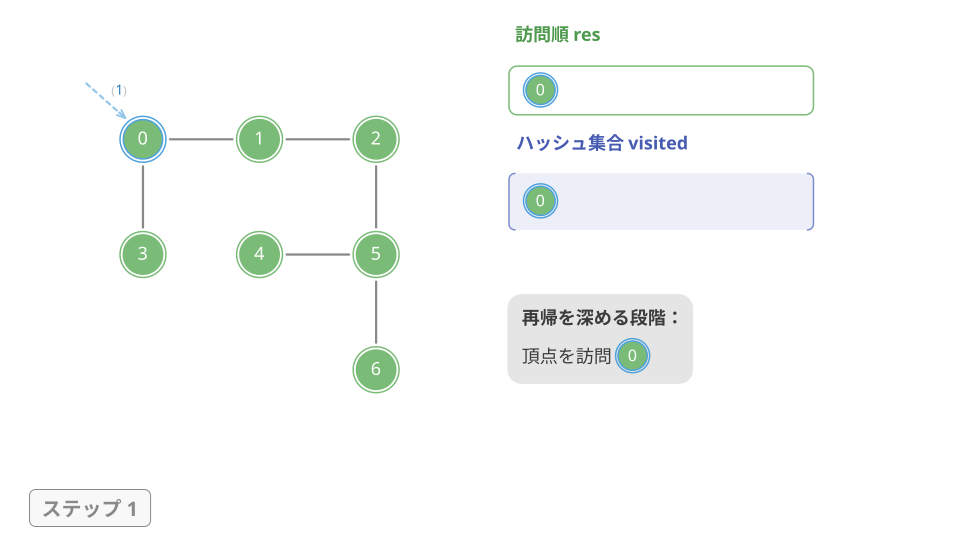{ class="animation-figure" }

=== "<2>"
    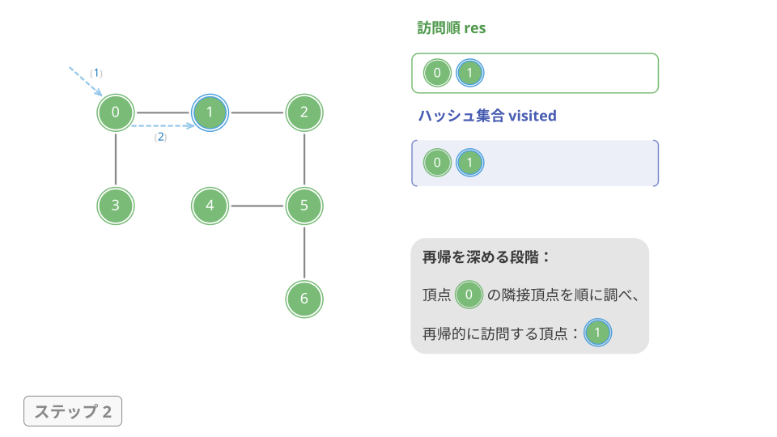{ class="animation-figure" }

=== "<3>"
    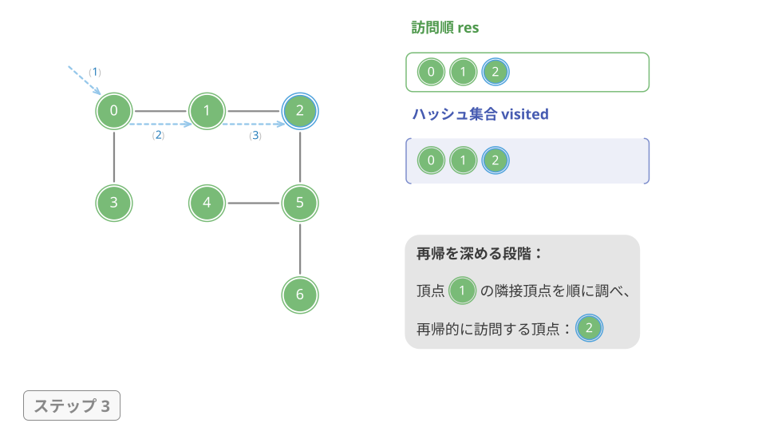{ class="animation-figure" }

=== "<4>"
    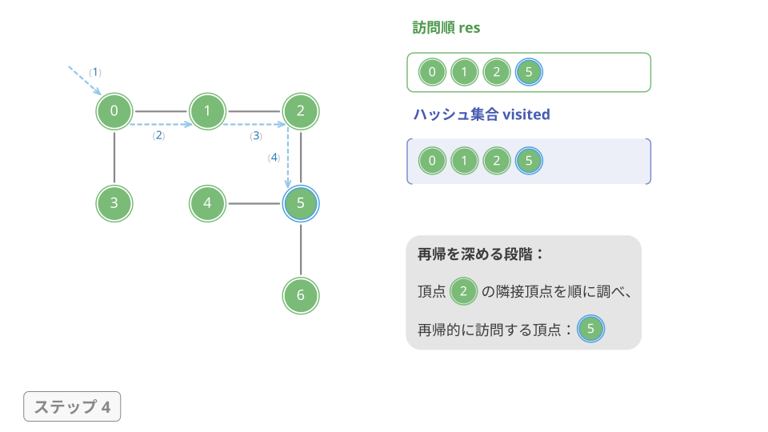{ class="animation-figure" }

=== "<5>"
    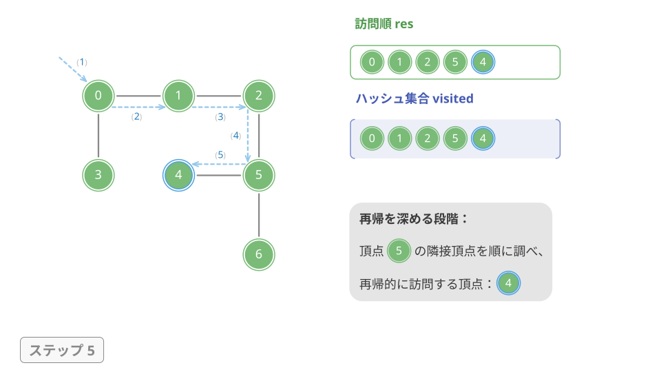{ class="animation-figure" }

=== "<6>"
    { class="animation-figure" }

=== "<7>"
    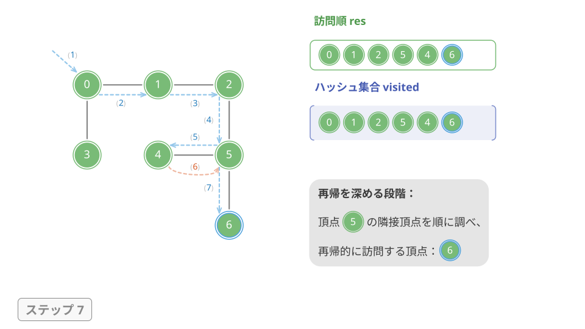{ class="animation-figure" }

=== "<8>"
    { class="animation-figure" }

=== "<9>"
    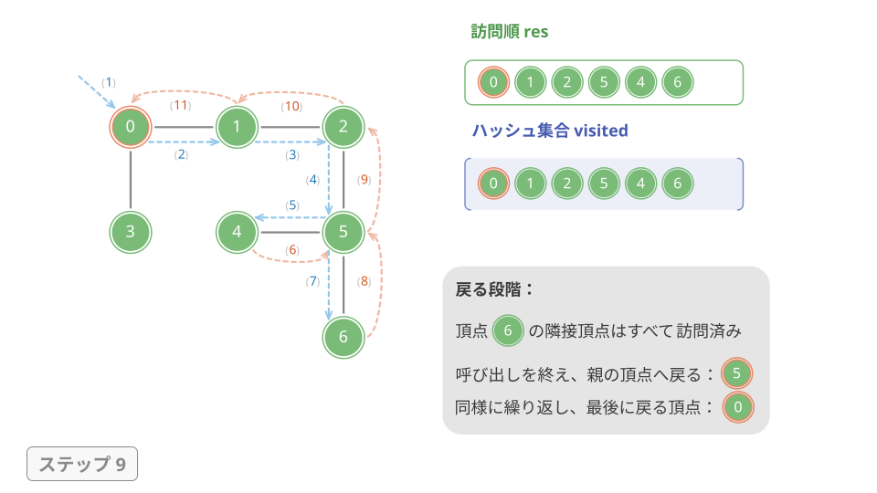{ class="animation-figure" }

=== "<10>"
    { class="animation-figure" }

=== "<11>"
    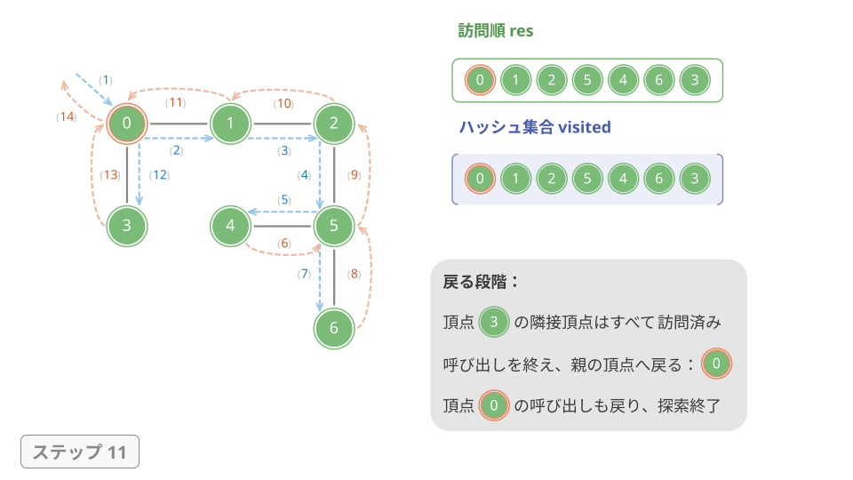{ class="animation-figure" }

<p align="center"> 図 9-12 &nbsp; グラフの深さ優先探索の手順 </p>

!!! question "深さ優先探索の訪問順は一意ですか。"

    幅優先探索と同様に、深さ優先探索の訪問順も一意ではありません。ある頂点から次にどの方向を探索してもよく、隣接頂点を調べる順序を入れ替えても深さ優先探索です。
    
    木の探索を例にすると、「根 $\rightarrow$ 左 $\rightarrow$ 右」「左 $\rightarrow$ 根 $\rightarrow$ 右」「左 $\rightarrow$ 右 $\rightarrow$ 根」は、それぞれ行きがけ順、通りがけ順、帰りがけ順に対応します。どこを先に訪問するかは違っても、3 つとも深さ優先探索です。

### 2. &nbsp; 計算量の分析

**時間計算量**：各頂点を $1$ 回ずつ訪問するのに $O(|V|)$ 時間、各辺を $2$ 回ずつ調べるのに $O(2|E|)$ 時間かかります。全体の所要時間は $O(|V| + |E|)$ です。

**空間計算量**：リスト `res` とハッシュ集合 `visited` の頂点数はいずれも最大 $|V|$ で、再帰の深さは最大 $|V|$ なので、使用する空間は $O(|V|)$ です。
