# グラフの探索

木が表すのは「一対多」の関係ですが、グラフにはさらに自由度があり、任意の「多対多」の関係を表せます。このため木はグラフの特殊な場合と見なせます。同じように、**木の探索もグラフの探索の特殊な場合です**。

グラフでも木でも、すべての頂点を訪問するには探索アルゴリズムを使います。グラフの探索も、<u>幅優先探索</u>と<u>深さ優先探索</u>の 2 種類に分けられます。

## 幅優先探索

**幅優先探索では、ある頂点から出発し、常に始点に近い頂点を優先して訪問しながら、外側へ 1 層ずつ探索範囲を広げます**。下図では左上の頂点から出発し、まずその隣接頂点をすべて調べ、次の頂点についても隣接頂点をすべて調べます。これを全頂点の訪問が終わるまで繰り返します。

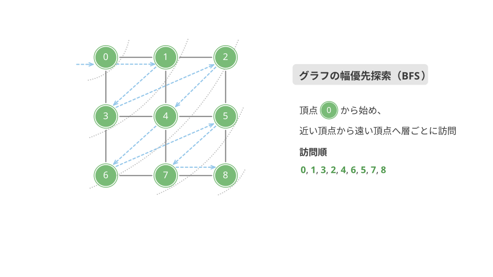

### アルゴリズムの実装

BFS は通常、次のコードのようにキューを使って実装します。先に入ったものが先に出るキューの「先入れ先出し」という性質は、BFS で近い頂点から遠い頂点へと訪問する考え方に対応します。

1. 探索の始点 `startVet` をキューに入れ、ループを開始します。
2. 各反復ではキューの先頭から頂点を取り出して訪問を記録し、その頂点の隣接頂点をすべてキューの末尾に追加します。
3. 全頂点の訪問が終わるまで、手順 `2.` を繰り返します。

同じ頂点を繰り返し訪問しないように、ハッシュ集合 `visited` を使って訪問済みの頂点を記録します。

!!! tip

    ハッシュ集合は、`key` だけを格納して `value` をもたないハッシュテーブルと考えられます。`key` の追加、削除、検索、更新を $O(1)$ の時間計算量で行えます。`key` が重複しない性質を生かし、データの重複を取り除くときなどに使います。

```src
[file]{graph_bfs}-[class]{}-[func]{graph_bfs}
```

コードだけでは動作を思い描きにくいので、下図と照らし合わせてみましょう。

=== "<1>"
    

=== "<2>"
    

=== "<3>"
    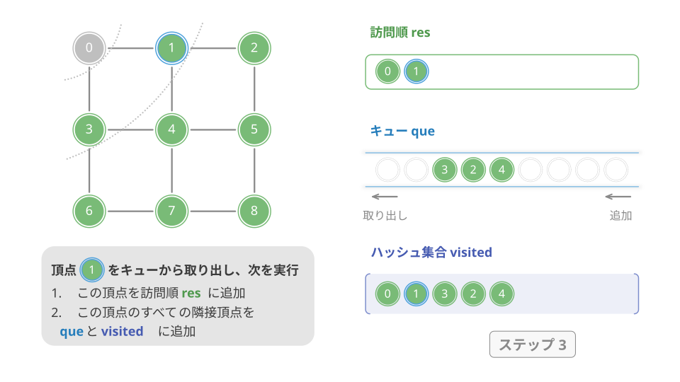

=== "<4>"
    

=== "<5>"
    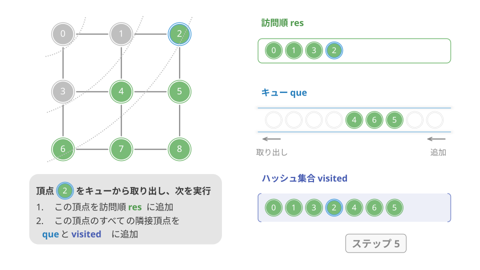

=== "<6>"
    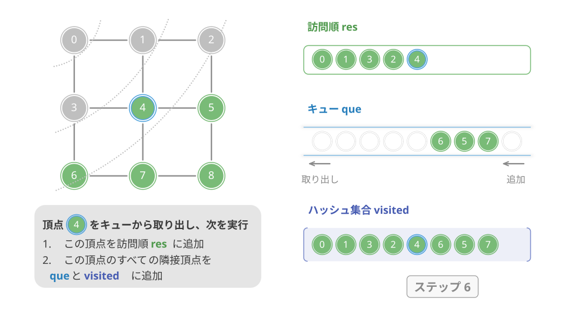

=== "<7>"
    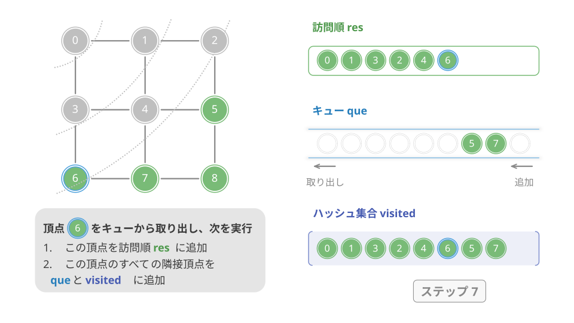

=== "<8>"
    

=== "<9>"
    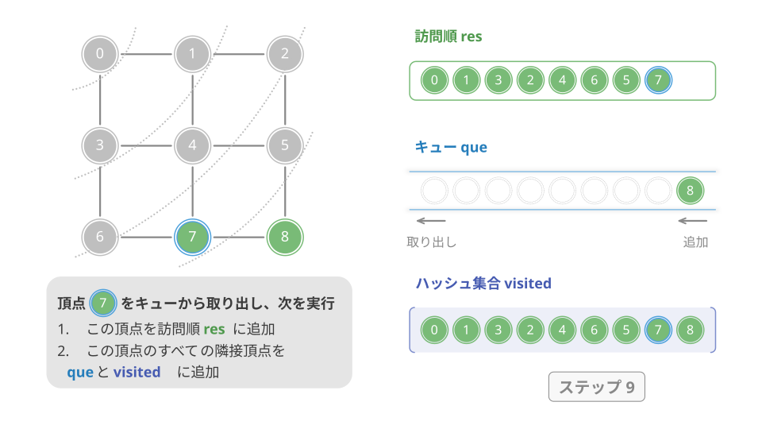

=== "<10>"
    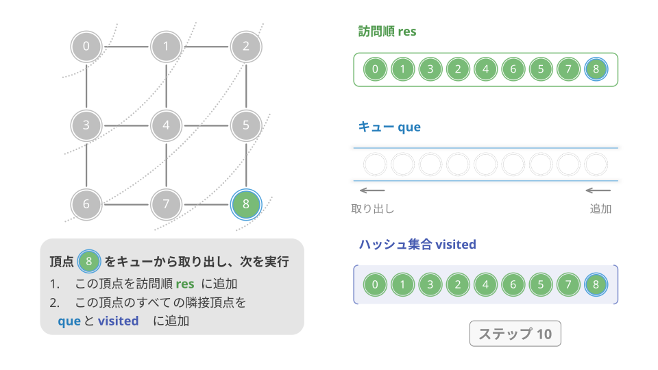

=== "<11>"
    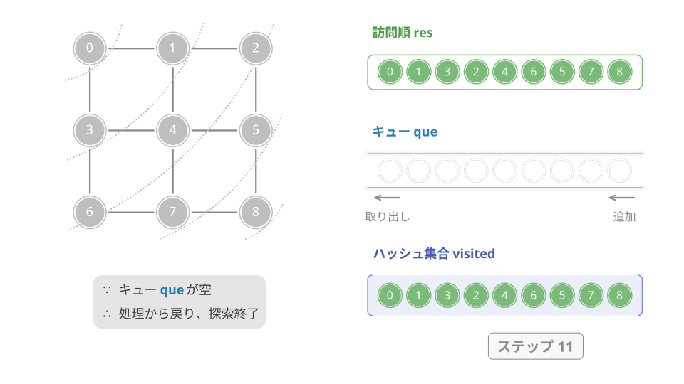

!!! question "幅優先探索の訪問順は一意ですか。"

    一意ではありません。幅優先探索で必要なのは、始点から近い順に訪問することだけで、**同じ距離にある頂点同士の訪問順は任意に入れ替えられます**。上図では、頂点 $1$ と $3$ の訪問順を交換でき、頂点 $2$、$4$、$6$ の訪問順も自由に入れ替えられます。

### 計算量の分析

**時間計算量**：各頂点をキューに 1 回ずつ入れて取り出すのに $O(|V|)$ 時間かかります。隣接頂点を調べるとき、無向グラフではすべての辺を $2$ 回ずつ調べるので、$O(2|E|)$ 時間かかります。全体の所要時間は $O(|V| + |E|)$ です。

**空間計算量**：リスト `res`、ハッシュ集合 `visited`、キュー `que` に入る頂点数はいずれも最大 $|V|$ なので、使用する空間は $O(|V|)$ です。

## 深さ優先探索

**深さ優先探索では、まず進めるところまで進み、行き止まりに来たら引き返します**。下図では左上の頂点から出発し、現在の頂点の隣接頂点を 1 つ選んで進みます。行き止まりで戻り、また進めるところまで進んで戻る操作を、すべての頂点を訪問するまで繰り返します。


### アルゴリズムの実装

この「行き止まりまで進んで戻る」という手順は通常、再帰で実装します。幅優先探索と同様に、深さ優先探索でもハッシュ集合 `visited` に訪問済みの頂点を記録し、重複する訪問を避けます。

```src
[file]{graph_dfs}-[class]{}-[func]{graph_dfs}
```

深さ優先探索の流れを下図に示します。

- **直線の破線は再帰を 1 段深めること**を表し、新しい再帰呼び出しで次の頂点を訪問します。
- **曲線の破線は呼び出し元に戻ること**を表します。現在の再帰呼び出しが終了し、その呼び出しを行った箇所に戻ります。

下図とコードを見比べながら、DFS の過程全体を頭の中で、あるいは紙に描いてたどってみましょう。各再帰呼び出しがいつ始まり、いつ戻るかにも注目してください。

=== "<1>"
    

=== "<2>"
    

=== "<3>"
    

=== "<4>"
    

=== "<5>"
    

=== "<6>"
    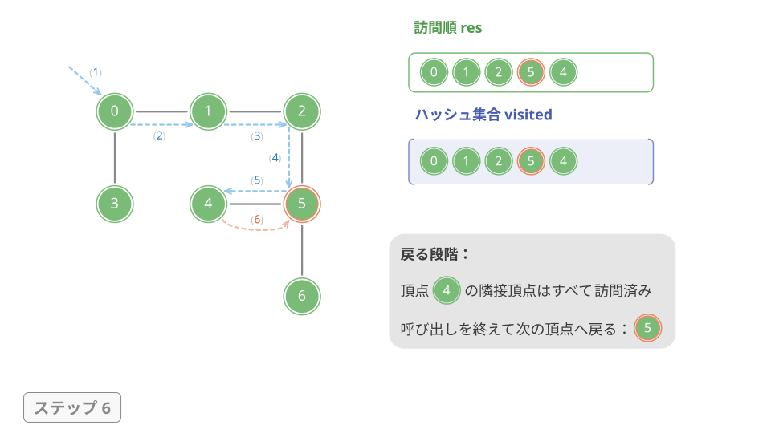

=== "<7>"
    

=== "<8>"
    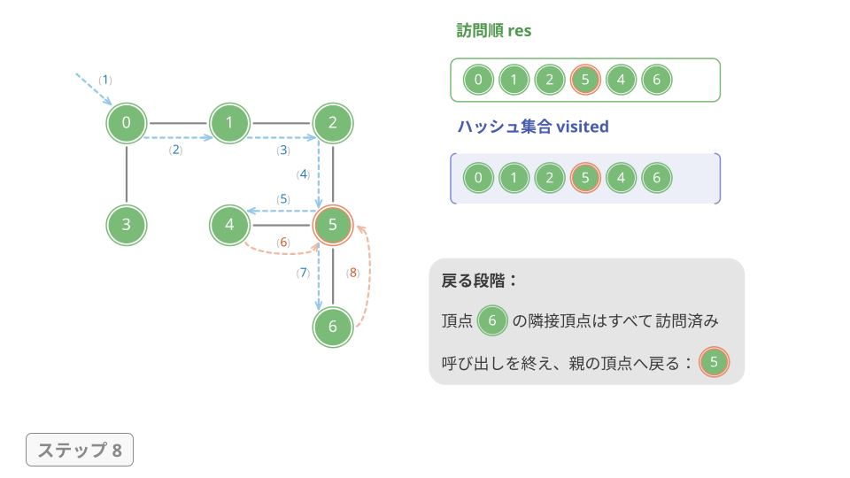

=== "<9>"
    

=== "<10>"
    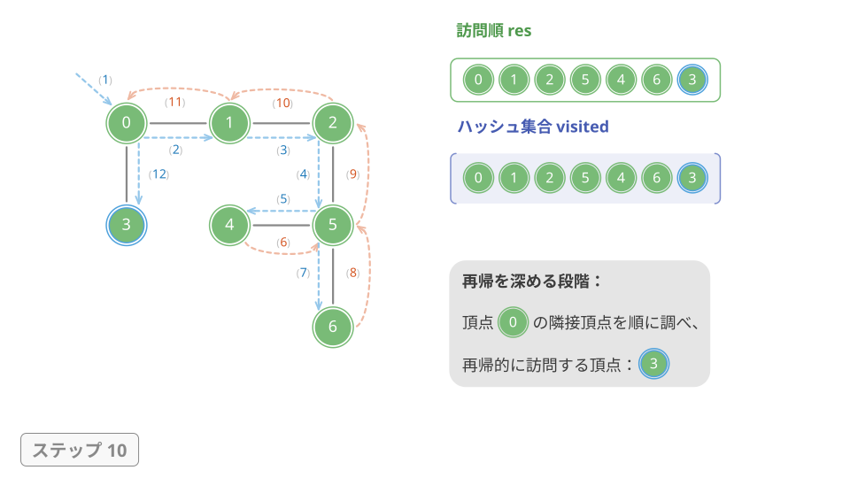

=== "<11>"
    

!!! question "深さ優先探索の訪問順は一意ですか。"

    幅優先探索と同様に、深さ優先探索の訪問順も一意ではありません。ある頂点から次にどの方向を探索してもよく、隣接頂点を調べる順序を入れ替えても深さ優先探索です。
    
    木の探索を例にすると、「根 $\rightarrow$ 左 $\rightarrow$ 右」「左 $\rightarrow$ 根 $\rightarrow$ 右」「左 $\rightarrow$ 右 $\rightarrow$ 根」は、それぞれ行きがけ順、通りがけ順、帰りがけ順に対応します。どこを先に訪問するかは違っても、3 つとも深さ優先探索です。

### 計算量の分析

**時間計算量**：各頂点を $1$ 回ずつ訪問するのに $O(|V|)$ 時間、各辺を $2$ 回ずつ調べるのに $O(2|E|)$ 時間かかります。全体の所要時間は $O(|V| + |E|)$ です。

**空間計算量**：リスト `res` とハッシュ集合 `visited` の頂点数はいずれも最大 $|V|$ で、再帰の深さは最大 $|V|$ なので、使用する空間は $O(|V|)$ です。
