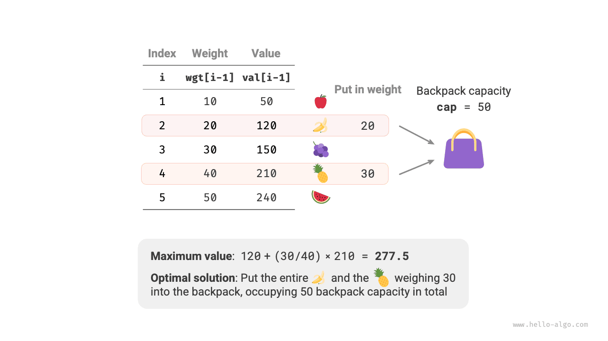
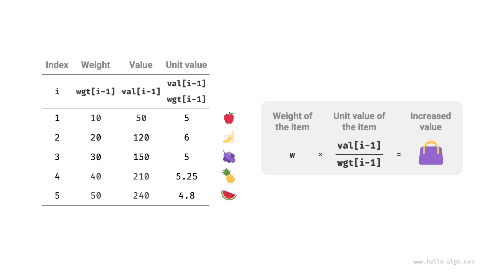

# 15.2 &nbsp; 分割可能ナップサック問題

!!! question "問題"

    $n$ 個の品物があり、$i$ 番目の品物の重さは $wgt[i-1]$、価値は $val[i-1]$ です。容量 $cap$ のナップサックに入れる品物を選びます。各品物は 1 回だけ選べますが、**品物の一部だけを選ぶこともでき、その価値は選んだ重さの割合で計算します**。容量の制限内で得られる品物の最大価値を求めてください。例を図 15-3 に示します。

{ class="animation-figure" }

<p align="center"> 図 15-3 &nbsp; 分割可能ナップサック問題のデータ例 </p>

分割可能ナップサック問題は、全体として 0-1 ナップサック問題によく似ています。状態は現在の品物 $i$ と容量 $c$ で表し、容量の制限内で得られる最大価値を求めます。

違いは、品物の一部だけを選べることです。図 15-4 のように、**品物を自由に分割し、重さの割合に応じて価値を計算できます**。

1. 品物 $i$ の単位重さ当たりの価値は $val[i-1] / wgt[i-1]$ で、これを単位価値と呼びます。
2. 品物 $i$ のうち重さ $w$ の部分を入れると、ナップサック内の価値は $w \times val[i-1] / wgt[i-1]$ 増えます。

{ class="animation-figure" }

<p align="center"> 図 15-4 &nbsp; 品物の単位重さ当たりの価値 </p>

### 1. &nbsp; 貪欲戦略を決める

ナップサック内の品物の総価値を最大にすることは、**本質的には単位重さ当たりの価値を最大にすることです**。ここから、図 15-5 の貪欲戦略を導けます。

1. 品物を単位価値の高い順にソートします。
2. すべての品物を順に調べ、**毎回、単位価値が最も高い品物を貪欲に選びます**。
3. ナップサックの残り容量が足りなければ、現在の品物の一部を使っていっぱいにします。

{ class="animation-figure" }

<p align="center"> 図 15-5 &nbsp; 分割可能ナップサック問題の貪欲戦略 </p>

### 2. &nbsp; コードの実装

品物を単位価値でソートしやすいよう、品物のクラス `Item` を作ります。貪欲な選択を繰り返し、ナップサックがいっぱいになったらループを抜け、解を返します。

=== "Python"

    ```python title="fractional_knapsack.py"
    class Item:
        """品物"""

        def __init__(self, w: int, v: int):
            self.w = w  # 品物の重さ
            self.v = v  # 品物の価値

    def fractional_knapsack(wgt: list[int], val: list[int], cap: int) -> int:
        """分割可能ナップサック問題：貪欲法"""
        # 重さと価値の 2 つの属性を持つ品物のリストを作成する
        items = [Item(w, v) for w, v in zip(wgt, val)]
        # 単位重さ当たりの価値 item.v / item.w の降順にソートする
        items.sort(key=lambda item: item.v / item.w, reverse=True)
        # 貪欲な選択を繰り返す
        res = 0
        for item in items:
            if item.w <= cap:
                # 残り容量が十分なら、現在の品物を丸ごとナップサックに入れる
                res += item.v
                cap -= item.w
            else:
                # 残り容量が不足している場合、現在の品物の一部をナップサックに入れる
                res += (item.v / item.w) * cap
                # 残り容量がないため、ループを終了する
                break
        return res
    ```

=== "C++"

    ```cpp title="fractional_knapsack.cpp"
    /* 品物 */
    class Item {
      public:
        int w; // 品物の重さ
        int v; // 品物の価値

        Item(int w, int v) : w(w), v(v) {
        }
    };

    /* 分割可能ナップサック問題：貪欲法 */
    double fractionalKnapsack(vector<int> &wgt, vector<int> &val, int cap) {
        // 重さと価値の 2 つの属性を持つ品物のリストを作成する
        vector<Item> items;
        for (int i = 0; i < wgt.size(); i++) {
            items.push_back(Item(wgt[i], val[i]));
        }
        // 単位重さ当たりの価値 item.v / item.w の降順にソートする
        sort(items.begin(), items.end(), [](Item &a, Item &b) { return (double)a.v / a.w > (double)b.v / b.w; });
        // 貪欲な選択を繰り返す
        double res = 0;
        for (auto &item : items) {
            if (item.w <= cap) {
                // 残り容量が十分なら、現在の品物を丸ごとナップサックに入れる
                res += item.v;
                cap -= item.w;
            } else {
                // 残り容量が不足している場合、現在の品物の一部をナップサックに入れる
                res += (double)item.v / item.w * cap;
                // 残り容量がないため、ループを終了する
                break;
            }
        }
        return res;
    }
    ```

=== "Java"

    ```java title="fractional_knapsack.java"
    /* 品物 */
    class Item {
        int w; // 品物の重さ
        int v; // 品物の価値

        public Item(int w, int v) {
            this.w = w;
            this.v = v;
        }
    }

    /* 分割可能ナップサック問題：貪欲法 */
    double fractionalKnapsack(int[] wgt, int[] val, int cap) {
        // 重さと価値の 2 つの属性を持つ品物のリストを作成する
        Item[] items = new Item[wgt.length];
        for (int i = 0; i < wgt.length; i++) {
            items[i] = new Item(wgt[i], val[i]);
        }
        // 単位重さ当たりの価値 item.v / item.w の降順にソートする
        Arrays.sort(items, Comparator.comparingDouble(item -> -((double) item.v / item.w)));
        // 貪欲な選択を繰り返す
        double res = 0;
        for (Item item : items) {
            if (item.w <= cap) {
                // 残り容量が十分なら、現在の品物を丸ごとナップサックに入れる
                res += item.v;
                cap -= item.w;
            } else {
                // 残り容量が不足している場合、現在の品物の一部をナップサックに入れる
                res += (double) item.v / item.w * cap;
                // 残り容量がないため、ループを終了する
                break;
            }
        }
        return res;
    }
    ```

=== "C#"

    ```csharp title="fractional_knapsack.cs"
    /* 品物 */
    class Item(int w, int v) {
        public int w = w; // 品物の重さ
        public int v = v; // 品物の価値
    }

    /* 分割可能ナップサック問題：貪欲法 */
    double FractionalKnapsack(int[] wgt, int[] val, int cap) {
        // 重さと価値の 2 つの属性を持つ品物のリストを作成する
        Item[] items = new Item[wgt.Length];
        for (int i = 0; i < wgt.Length; i++) {
            items[i] = new Item(wgt[i], val[i]);
        }
        // 単位重さ当たりの価値 item.v / item.w の降順にソートする
        Array.Sort(items, (x, y) => (y.v / y.w).CompareTo(x.v / x.w));
        // 貪欲な選択を繰り返す
        double res = 0;
        foreach (Item item in items) {
            if (item.w <= cap) {
                // 残り容量が十分なら、現在の品物を丸ごとナップサックに入れる
                res += item.v;
                cap -= item.w;
            } else {
                // 残り容量が不足している場合、現在の品物の一部をナップサックに入れる
                res += (double)item.v / item.w * cap;
                // 残り容量がないため、ループを終了する
                break;
            }
        }
        return res;
    }
    ```

=== "Go"

    ```go title="fractional_knapsack.go"
    /* 品物 */
    type Item struct {
        w int // 品物の重さ
        v int // 品物の価値
    }

    /* 分割可能ナップサック問題：貪欲法 */
    func fractionalKnapsack(wgt []int, val []int, cap int) float64 {
        // 重さと価値の 2 つの属性を持つ品物のリストを作成する
        items := make([]Item, len(wgt))
        for i := 0; i < len(wgt); i++ {
            items[i] = Item{wgt[i], val[i]}
        }
        // 単位重さ当たりの価値 item.v / item.w の降順にソートする
        sort.Slice(items, func(i, j int) bool {
            return float64(items[i].v)/float64(items[i].w) > float64(items[j].v)/float64(items[j].w)
        })
        // 貪欲な選択を繰り返す
        res := 0.0
        for _, item := range items {
            if item.w <= cap {
                // 残り容量が十分なら、現在の品物を丸ごとナップサックに入れる
                res += float64(item.v)
                cap -= item.w
            } else {
                // 残り容量が不足している場合、現在の品物の一部をナップサックに入れる
                res += float64(item.v) / float64(item.w) * float64(cap)
                // 残り容量がないため、ループを終了する
                break
            }
        }
        return res
    }
    ```

=== "Swift"

    ```swift title="fractional_knapsack.swift"
    /* 品物 */
    class Item {
        var w: Int // 品物の重さ
        var v: Int // 品物の価値

        init(w: Int, v: Int) {
            self.w = w
            self.v = v
        }
    }

    /* 分割可能ナップサック問題：貪欲法 */
    func fractionalKnapsack(wgt: [Int], val: [Int], cap: Int) -> Double {
        // 重さと価値の 2 つの属性を持つ品物のリストを作成する
        var items = zip(wgt, val).map { Item(w: $0, v: $1) }
        // 単位重さ当たりの価値 item.v / item.w の降順にソートする
        items.sort { -(Double($0.v) / Double($0.w)) < -(Double($1.v) / Double($1.w)) }
        // 貪欲な選択を繰り返す
        var res = 0.0
        var cap = cap
        for item in items {
            if item.w <= cap {
                // 残り容量が十分なら、現在の品物を丸ごとナップサックに入れる
                res += Double(item.v)
                cap -= item.w
            } else {
                // 残り容量が不足している場合、現在の品物の一部をナップサックに入れる
                res += Double(item.v) / Double(item.w) * Double(cap)
                // 残り容量がないため、ループを終了する
                break
            }
        }
        return res
    }
    ```

=== "JS"

    ```javascript title="fractional_knapsack.js"
    /* 品物 */
    class Item {
        constructor(w, v) {
            this.w = w; // 品物の重さ
            this.v = v; // 品物の価値
        }
    }

    /* 分割可能ナップサック問題：貪欲法 */
    function fractionalKnapsack(wgt, val, cap) {
        // 重さと価値の 2 つの属性を持つ品物のリストを作成する
        const items = wgt.map((w, i) => new Item(w, val[i]));
        // 単位重さ当たりの価値 item.v / item.w の降順にソートする
        items.sort((a, b) => b.v / b.w - a.v / a.w);
        // 貪欲な選択を繰り返す
        let res = 0;
        for (const item of items) {
            if (item.w <= cap) {
                // 残り容量が十分なら、現在の品物を丸ごとナップサックに入れる
                res += item.v;
                cap -= item.w;
            } else {
                // 残り容量が不足している場合、現在の品物の一部をナップサックに入れる
                res += (item.v / item.w) * cap;
                // 残り容量がないため、ループを終了する
                break;
            }
        }
        return res;
    }
    ```

=== "TS"

    ```typescript title="fractional_knapsack.ts"
    /* 品物 */
    class Item {
        w: number; // 品物の重さ
        v: number; // 品物の価値

        constructor(w: number, v: number) {
            this.w = w;
            this.v = v;
        }
    }

    /* 分割可能ナップサック問題：貪欲法 */
    function fractionalKnapsack(wgt: number[], val: number[], cap: number): number {
        // 重さと価値の 2 つの属性を持つ品物のリストを作成する
        const items: Item[] = wgt.map((w, i) => new Item(w, val[i]));
        // 単位重さ当たりの価値 item.v / item.w の降順にソートする
        items.sort((a, b) => b.v / b.w - a.v / a.w);
        // 貪欲な選択を繰り返す
        let res = 0;
        for (const item of items) {
            if (item.w <= cap) {
                // 残り容量が十分なら、現在の品物を丸ごとナップサックに入れる
                res += item.v;
                cap -= item.w;
            } else {
                // 残り容量が不足している場合、現在の品物の一部をナップサックに入れる
                res += (item.v / item.w) * cap;
                // 残り容量がないため、ループを終了する
                break;
            }
        }
        return res;
    }
    ```

=== "Dart"

    ```dart title="fractional_knapsack.dart"
    /* 品物 */
    class Item {
      int w; // 品物の重さ
      int v; // 品物の価値

      Item(this.w, this.v);
    }

    /* 分割可能ナップサック問題：貪欲法 */
    double fractionalKnapsack(List<int> wgt, List<int> val, int cap) {
      // 重さと価値の 2 つの属性を持つ品物のリストを作成する
      List<Item> items = List.generate(wgt.length, (i) => Item(wgt[i], val[i]));
      // 単位重さ当たりの価値 item.v / item.w の降順にソートする
      items.sort((a, b) => (b.v / b.w).compareTo(a.v / a.w));
      // 貪欲な選択を繰り返す
      double res = 0;
      for (Item item in items) {
        if (item.w <= cap) {
          // 残り容量が十分なら、現在の品物を丸ごとナップサックに入れる
          res += item.v;
          cap -= item.w;
        } else {
          // 残り容量が不足している場合、現在の品物の一部をナップサックに入れる
          res += item.v / item.w * cap;
          // 残り容量がないため、ループを終了する
          break;
        }
      }
      return res;
    }
    ```

=== "Rust"

    ```rust title="fractional_knapsack.rs"
    /* 品物 */
    struct Item {
        w: i32, // 品物の重さ
        v: i32, // 品物の価値
    }

    impl Item {
        fn new(w: i32, v: i32) -> Self {
            Self { w, v }
        }
    }

    /* 分割可能ナップサック問題：貪欲法 */
    fn fractional_knapsack(wgt: &[i32], val: &[i32], mut cap: i32) -> f64 {
        // 重さと価値の 2 つの属性を持つ品物のリストを作成する
        let mut items = wgt
            .iter()
            .zip(val.iter())
            .map(|(&w, &v)| Item::new(w, v))
            .collect::<Vec<Item>>();
        // 単位重さ当たりの価値 item.v / item.w の降順にソートする
        items.sort_by(|a, b| {
            (b.v as f64 / b.w as f64)
                .partial_cmp(&(a.v as f64 / a.w as f64))
                .unwrap()
        });
        // 貪欲な選択を繰り返す
        let mut res = 0.0;
        for item in &items {
            if item.w <= cap {
                // 残り容量が十分なら、現在の品物を丸ごとナップサックに入れる
                res += item.v as f64;
                cap -= item.w;
            } else {
                // 残り容量が不足している場合、現在の品物の一部をナップサックに入れる
                res += item.v as f64 / item.w as f64 * cap as f64;
                // 残り容量がないため、ループを終了する
                break;
            }
        }
        res
    }
    ```

=== "C"

    ```c title="fractional_knapsack.c"
    /* 品物 */
    typedef struct {
        int w; // 品物の重さ
        int v; // 品物の価値
    } Item;

    /* 分割可能ナップサック問題：貪欲法 */
    float fractionalKnapsack(int wgt[], int val[], int itemCount, int cap) {
        // 重さと価値の 2 つの属性を持つ品物のリストを作成する
        Item *items = malloc(sizeof(Item) * itemCount);
        for (int i = 0; i < itemCount; i++) {
            items[i] = (Item){.w = wgt[i], .v = val[i]};
        }
        // 単位重さ当たりの価値 item.v / item.w の降順にソートする
        qsort(items, (size_t)itemCount, sizeof(Item), sortByValueDensity);
        // 貪欲な選択を繰り返す
        float res = 0.0;
        for (int i = 0; i < itemCount; i++) {
            if (items[i].w <= cap) {
                // 残り容量が十分なら、現在の品物を丸ごとナップサックに入れる
                res += items[i].v;
                cap -= items[i].w;
            } else {
                // 残り容量が不足している場合、現在の品物の一部をナップサックに入れる
                res += (float)cap / items[i].w * items[i].v;
                cap = 0;
                break;
            }
        }
        free(items);
        return res;
    }
    ```

=== "Kotlin"

    ```kotlin title="fractional_knapsack.kt"
    /* 品物 */
    class Item(
        val w: Int, // 品物
        val v: Int  // 品物の価値
    )

    /* 分割可能ナップサック問題：貪欲法 */
    fun fractionalKnapsack(wgt: IntArray, _val: IntArray, c: Int): Double {
        // 重さと価値の 2 つの属性を持つ品物のリストを作成する
        var cap = c
        val items = arrayOfNulls<Item>(wgt.size)
        for (i in wgt.indices) {
            items[i] = Item(wgt[i], _val[i])
        }
        // 単位重さ当たりの価値 item.v / item.w の降順にソートする
        items.sortBy { item: Item? -> -(item!!.v.toDouble() / item.w) }
        // 貪欲な選択を繰り返す
        var res = 0.0
        for (item in items) {
            if (item!!.w <= cap) {
                // 残り容量が十分なら、現在の品物を丸ごとナップサックに入れる
                res += item.v
                cap -= item.w
            } else {
                // 残り容量が不足している場合、現在の品物の一部をナップサックに入れる
                res += item.v.toDouble() / item.w * cap
                // 残り容量がないため、ループを終了する
                break
            }
        }
        return res
    }
    ```

=== "Ruby"

    ```ruby title="fractional_knapsack.rb"
    ### 品物 ###
    class Item
      attr_accessor :w # 品物の重さ
      attr_accessor :v # 品物の価値

      def initialize(w, v)
        @w = w
        @v = v
      end
    end

    ### 分割可能ナップサック問題：貪欲法 ###
    def fractional_knapsack(wgt, val, cap)
      # 重さと価値の 2 つの属性を持つ品物のリストを作成する
      items = wgt.each_with_index.map { |w, i| Item.new(w, val[i]) }
      # 単位重さ当たりの価値 item.v / item.w の降順にソートする
      items.sort! { |a, b| (b.v.to_f / b.w) <=> (a.v.to_f / a.w) }
      # 貪欲な選択を繰り返す
      res = 0
      for item in items
        if item.w <= cap
          # 残り容量が十分なら、現在の品物を丸ごとナップサックに入れる
          res += item.v
          cap -= item.w
        else
          # 残り容量が不足している場合、現在の品物の一部をナップサックに入れる
          res += (item.v.to_f / item.w) * cap
          # 残り容量がないため、ループを終了する
          break
        end
      end
      res
    end
    ```

??? pythontutor "実行の可視化"

    <div style="height: 549px; width: 100%;"><iframe class="pythontutor-iframe" title="実行の可視化" src="https://pythontutor.com/iframe-embed.html#code=class%20Item%3A%0A%20%20%20%20%22%22%22%E5%93%81%E7%89%A9%22%22%22%0A%20%20%20%20def%20__init__%28self,%20w%3A%20int,%20v%3A%20int%29%3A%0A%20%20%20%20%20%20%20%20self.w%20%3D%20w%20%20%23%20%E5%93%81%E7%89%A9%E3%81%AE%E9%87%8D%E3%81%95%0A%20%20%20%20%20%20%20%20self.v%20%3D%20v%20%20%23%20%E5%93%81%E7%89%A9%E3%81%AE%E4%BE%A1%E5%80%A4%0A%0Adef%20fractional_knapsack%28wgt%3A%20list%5Bint%5D,%20val%3A%20list%5Bint%5D,%20cap%3A%20int%29%20-%3E%20int%3A%0A%20%20%20%20%22%22%22%E5%88%86%E5%89%B2%E5%8F%AF%E8%83%BD%E3%83%8A%E3%83%83%E3%83%97%E3%82%B5%E3%83%83%E3%82%AF%E5%95%8F%E9%A1%8C%EF%BC%9A%E8%B2%AA%E6%AC%B2%E6%B3%95%22%22%22%0A%20%20%20%20%23%20%E9%87%8D%E3%81%95%E3%81%A8%E4%BE%A1%E5%80%A4%E3%81%AE%202%20%E3%81%A4%E3%81%AE%E5%B1%9E%E6%80%A7%E3%82%92%E6%8C%81%E3%81%A4%E5%93%81%E7%89%A9%E3%81%AE%E3%83%AA%E3%82%B9%E3%83%88%E3%82%92%E4%BD%9C%E6%88%90%E3%81%99%E3%82%8B%0A%20%20%20%20items%20%3D%20%5BItem%28w,%20v%29%20for%20w,%20v%20in%20zip%28wgt,%20val%29%5D%0A%20%20%20%20%23%20%E5%8D%98%E4%BD%8D%E9%87%8D%E3%81%95%E5%BD%93%E3%81%9F%E3%82%8A%E3%81%AE%E4%BE%A1%E5%80%A4%20item.v%20/%20item.w%20%E3%81%AE%E9%99%8D%E9%A0%86%E3%81%AB%E3%82%BD%E3%83%BC%E3%83%88%E3%81%99%E3%82%8B%0A%20%20%20%20items.sort%28key%3Dlambda%20item%3A%20item.v%20/%20item.w,%20reverse%3DTrue%29%0A%20%20%20%20%23%20%E8%B2%AA%E6%AC%B2%E3%81%AA%E9%81%B8%E6%8A%9E%E3%82%92%E7%B9%B0%E3%82%8A%E8%BF%94%E3%81%99%0A%20%20%20%20res%20%3D%200%0A%20%20%20%20for%20item%20in%20items%3A%0A%20%20%20%20%20%20%20%20if%20item.w%20%3C%3D%20cap%3A%0A%20%20%20%20%20%20%20%20%20%20%20%20%23%20%E6%AE%8B%E3%82%8A%E5%AE%B9%E9%87%8F%E3%81%8C%E5%8D%81%E5%88%86%E3%81%AA%E3%82%89%E3%80%81%E7%8F%BE%E5%9C%A8%E3%81%AE%E5%93%81%E7%89%A9%E3%82%92%E4%B8%B8%E3%81%94%E3%81%A8%E3%83%8A%E3%83%83%E3%83%97%E3%82%B5%E3%83%83%E3%82%AF%E3%81%AB%E5%85%A5%E3%82%8C%E3%82%8B%0A%20%20%20%20%20%20%20%20%20%20%20%20res%20%2B%3D%20item.v%0A%20%20%20%20%20%20%20%20%20%20%20%20cap%20-%3D%20item.w%0A%20%20%20%20%20%20%20%20else%3A%0A%20%20%20%20%20%20%20%20%20%20%20%20%23%20%E6%AE%8B%E3%82%8A%E5%AE%B9%E9%87%8F%E3%81%8C%E4%B8%8D%E8%B6%B3%E3%81%97%E3%81%A6%E3%81%84%E3%82%8B%E5%A0%B4%E5%90%88%E3%80%81%E7%8F%BE%E5%9C%A8%E3%81%AE%E5%93%81%E7%89%A9%E3%81%AE%E4%B8%80%E9%83%A8%E3%82%92%E3%83%8A%E3%83%83%E3%83%97%E3%82%B5%E3%83%83%E3%82%AF%E3%81%AB%E5%85%A5%E3%82%8C%E3%82%8B%0A%20%20%20%20%20%20%20%20%20%20%20%20res%20%2B%3D%20%28item.v%20/%20item.w%29%20%2A%20cap%0A%20%20%20%20%20%20%20%20%20%20%20%20%23%20%E6%AE%8B%E3%82%8A%E5%AE%B9%E9%87%8F%E3%81%8C%E3%81%AA%E3%81%84%E3%81%9F%E3%82%81%E3%80%81%E3%83%AB%E3%83%BC%E3%83%97%E3%82%92%E7%B5%82%E4%BA%86%E3%81%99%E3%82%8B%0A%20%20%20%20%20%20%20%20%20%20%20%20break%0A%20%20%20%20return%20res%0A%0A%22%22%22%E5%AE%9F%E8%A1%8C%E7%94%A8%E3%82%B3%E3%83%BC%E3%83%89%22%22%22%0Aif%20__name__%20%3D%3D%20%22__main__%22%3A%0A%20%20%20%20wgt%20%3D%20%5B10,%2020,%2030,%2040,%2050%5D%0A%20%20%20%20val%20%3D%20%5B50,%20120,%20150,%20210,%20240%5D%0A%20%20%20%20cap%20%3D%2050%0A%20%20%20%20n%20%3D%20len%28wgt%29%0A%0A%20%20%20%20%23%20%E8%B2%AA%E6%AC%B2%E3%82%A2%E3%83%AB%E3%82%B4%E3%83%AA%E3%82%BA%E3%83%A0%0A%20%20%20%20res%20%3D%20fractional_knapsack%28wgt,%20val,%20cap%29%0A%20%20%20%20print%28f%22%E3%83%8A%E3%83%83%E3%83%97%E3%82%B5%E3%83%83%E3%82%AF%E3%81%AE%E5%AE%B9%E9%87%8F%E3%82%92%E8%B6%85%E3%81%88%E3%81%AA%E3%81%84%E5%93%81%E7%89%A9%E3%81%AE%E6%9C%80%E5%A4%A7%E4%BE%A1%E5%80%A4%E3%81%AF%20%7Bres%7D%22%29&codeDivHeight=472&codeDivWidth=350&cumulative=false&curInstr=8&heapPrimitives=nevernest&origin=opt-frontend.js&py=311&rawInputLstJSON=%5B%5D&textReferences=false"> </iframe></div>
    <div style="margin-top: 5px;"><a href="https://pythontutor.com/iframe-embed.html#code=class%20Item%3A%0A%20%20%20%20%22%22%22%E5%93%81%E7%89%A9%22%22%22%0A%20%20%20%20def%20__init__%28self,%20w%3A%20int,%20v%3A%20int%29%3A%0A%20%20%20%20%20%20%20%20self.w%20%3D%20w%20%20%23%20%E5%93%81%E7%89%A9%E3%81%AE%E9%87%8D%E3%81%95%0A%20%20%20%20%20%20%20%20self.v%20%3D%20v%20%20%23%20%E5%93%81%E7%89%A9%E3%81%AE%E4%BE%A1%E5%80%A4%0A%0Adef%20fractional_knapsack%28wgt%3A%20list%5Bint%5D,%20val%3A%20list%5Bint%5D,%20cap%3A%20int%29%20-%3E%20int%3A%0A%20%20%20%20%22%22%22%E5%88%86%E5%89%B2%E5%8F%AF%E8%83%BD%E3%83%8A%E3%83%83%E3%83%97%E3%82%B5%E3%83%83%E3%82%AF%E5%95%8F%E9%A1%8C%EF%BC%9A%E8%B2%AA%E6%AC%B2%E6%B3%95%22%22%22%0A%20%20%20%20%23%20%E9%87%8D%E3%81%95%E3%81%A8%E4%BE%A1%E5%80%A4%E3%81%AE%202%20%E3%81%A4%E3%81%AE%E5%B1%9E%E6%80%A7%E3%82%92%E6%8C%81%E3%81%A4%E5%93%81%E7%89%A9%E3%81%AE%E3%83%AA%E3%82%B9%E3%83%88%E3%82%92%E4%BD%9C%E6%88%90%E3%81%99%E3%82%8B%0A%20%20%20%20items%20%3D%20%5BItem%28w,%20v%29%20for%20w,%20v%20in%20zip%28wgt,%20val%29%5D%0A%20%20%20%20%23%20%E5%8D%98%E4%BD%8D%E9%87%8D%E3%81%95%E5%BD%93%E3%81%9F%E3%82%8A%E3%81%AE%E4%BE%A1%E5%80%A4%20item.v%20/%20item.w%20%E3%81%AE%E9%99%8D%E9%A0%86%E3%81%AB%E3%82%BD%E3%83%BC%E3%83%88%E3%81%99%E3%82%8B%0A%20%20%20%20items.sort%28key%3Dlambda%20item%3A%20item.v%20/%20item.w,%20reverse%3DTrue%29%0A%20%20%20%20%23%20%E8%B2%AA%E6%AC%B2%E3%81%AA%E9%81%B8%E6%8A%9E%E3%82%92%E7%B9%B0%E3%82%8A%E8%BF%94%E3%81%99%0A%20%20%20%20res%20%3D%200%0A%20%20%20%20for%20item%20in%20items%3A%0A%20%20%20%20%20%20%20%20if%20item.w%20%3C%3D%20cap%3A%0A%20%20%20%20%20%20%20%20%20%20%20%20%23%20%E6%AE%8B%E3%82%8A%E5%AE%B9%E9%87%8F%E3%81%8C%E5%8D%81%E5%88%86%E3%81%AA%E3%82%89%E3%80%81%E7%8F%BE%E5%9C%A8%E3%81%AE%E5%93%81%E7%89%A9%E3%82%92%E4%B8%B8%E3%81%94%E3%81%A8%E3%83%8A%E3%83%83%E3%83%97%E3%82%B5%E3%83%83%E3%82%AF%E3%81%AB%E5%85%A5%E3%82%8C%E3%82%8B%0A%20%20%20%20%20%20%20%20%20%20%20%20res%20%2B%3D%20item.v%0A%20%20%20%20%20%20%20%20%20%20%20%20cap%20-%3D%20item.w%0A%20%20%20%20%20%20%20%20else%3A%0A%20%20%20%20%20%20%20%20%20%20%20%20%23%20%E6%AE%8B%E3%82%8A%E5%AE%B9%E9%87%8F%E3%81%8C%E4%B8%8D%E8%B6%B3%E3%81%97%E3%81%A6%E3%81%84%E3%82%8B%E5%A0%B4%E5%90%88%E3%80%81%E7%8F%BE%E5%9C%A8%E3%81%AE%E5%93%81%E7%89%A9%E3%81%AE%E4%B8%80%E9%83%A8%E3%82%92%E3%83%8A%E3%83%83%E3%83%97%E3%82%B5%E3%83%83%E3%82%AF%E3%81%AB%E5%85%A5%E3%82%8C%E3%82%8B%0A%20%20%20%20%20%20%20%20%20%20%20%20res%20%2B%3D%20%28item.v%20/%20item.w%29%20%2A%20cap%0A%20%20%20%20%20%20%20%20%20%20%20%20%23%20%E6%AE%8B%E3%82%8A%E5%AE%B9%E9%87%8F%E3%81%8C%E3%81%AA%E3%81%84%E3%81%9F%E3%82%81%E3%80%81%E3%83%AB%E3%83%BC%E3%83%97%E3%82%92%E7%B5%82%E4%BA%86%E3%81%99%E3%82%8B%0A%20%20%20%20%20%20%20%20%20%20%20%20break%0A%20%20%20%20return%20res%0A%0A%22%22%22%E5%AE%9F%E8%A1%8C%E7%94%A8%E3%82%B3%E3%83%BC%E3%83%89%22%22%22%0Aif%20__name__%20%3D%3D%20%22__main__%22%3A%0A%20%20%20%20wgt%20%3D%20%5B10,%2020,%2030,%2040,%2050%5D%0A%20%20%20%20val%20%3D%20%5B50,%20120,%20150,%20210,%20240%5D%0A%20%20%20%20cap%20%3D%2050%0A%20%20%20%20n%20%3D%20len%28wgt%29%0A%0A%20%20%20%20%23%20%E8%B2%AA%E6%AC%B2%E3%82%A2%E3%83%AB%E3%82%B4%E3%83%AA%E3%82%BA%E3%83%A0%0A%20%20%20%20res%20%3D%20fractional_knapsack%28wgt,%20val,%20cap%29%0A%20%20%20%20print%28f%22%E3%83%8A%E3%83%83%E3%83%97%E3%82%B5%E3%83%83%E3%82%AF%E3%81%AE%E5%AE%B9%E9%87%8F%E3%82%92%E8%B6%85%E3%81%88%E3%81%AA%E3%81%84%E5%93%81%E7%89%A9%E3%81%AE%E6%9C%80%E5%A4%A7%E4%BE%A1%E5%80%A4%E3%81%AF%20%7Bres%7D%22%29&codeDivHeight=800&codeDivWidth=600&cumulative=false&curInstr=8&heapPrimitives=nevernest&origin=opt-frontend.js&py=311&rawInputLstJSON=%5B%5D&textReferences=false" target="_blank" rel="noopener noreferrer">全画面で表示 ></a></div>

組み込みソートの時間計算量は通常 $O(n \log n)$ です。空間計算量は通常 $O(\log n)$ または $O(n)$ で、言語ごとの実装に依存します。

ソート以外では、最悪の場合、品物のリスト全体を走査するため、**時間計算量は $O(n)$ です**。ここで $n$ は品物の数です。

`Item` オブジェクトのリストを初期化するため、**空間計算量は $O(n)$ です**。

### 3. &nbsp; 正しさの証明

背理法を使います。品物 $x$ の単位価値が最も高いとします。あるアルゴリズムで最大価値 `res` が得られたものの、その解には品物 $x$ が含まれていないと仮定します。

ここで、ナップサックから任意の品物を単位重さだけ取り出し、同じ重さの品物 $x$ に置き換えます。$x$ の単位価値が最も高いので、置き換え後の総価値は必ず `res` より大きくなります。**これは `res` が最適解であることに矛盾するため、最適解には品物 $x$ が含まれていなければなりません**。

解に含まれるほかの品物についても、同じ矛盾を導けます。つまり、**単位価値の高い品物を選ぶ方が常に有利であり**、貪欲戦略は有効です。

図 15-6 のように、品物の重さを横軸、単位価値を縦軸とすると、分割可能ナップサック問題は「横軸の区間が限られた中で、囲まれる面積を最大にする問題」に置き換えられます。このたとえから、貪欲戦略が有効な理由を幾何学的に理解できます。

{ class="animation-figure" }

<p align="center"> 図 15-6 &nbsp; 分割可能ナップサック問題の幾何学的表現 </p>
