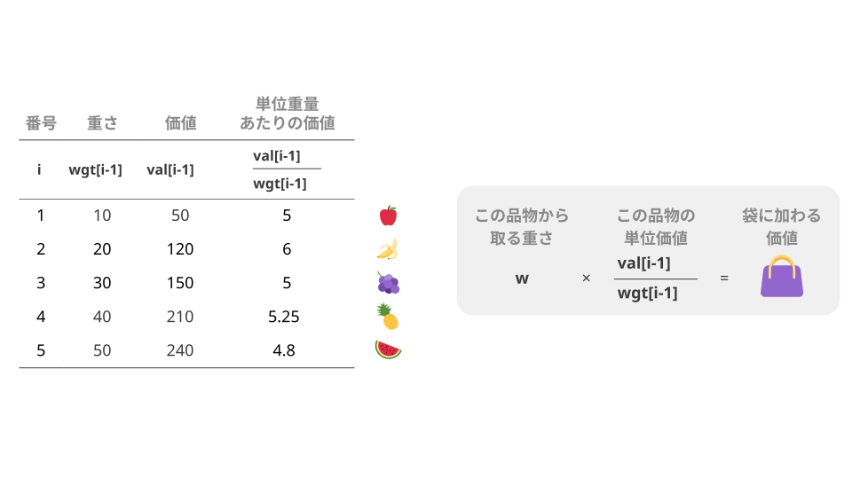
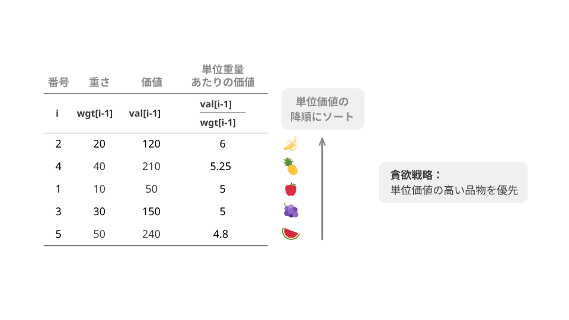

# 分割可能ナップサック問題

!!! question

    $n$ 個の品物と容量 $cap$ のナップサックがあります。$i$ 番目の品物の重さは $wgt[i-1]$、価値は $val[i-1]$ です。各品物を選べるのは 1 回だけですが、**品物の一部だけを選ぶことができ、得られる価値は選んだ重さの割合に比例します**。容量内でナップサックに入る品物の合計価値の最大値を求めてください。次の図に例を示します。


分割可能ナップサック問題は、全体として 0-1 ナップサック問題によく似ています。状態には現在の品物 $i$ と容量 $c$ が含まれ、目標は限られた容量で最大の価値を得ることです。

違いは、品物の一部だけを選べる点です。次の図のように、**品物を好きな大きさに分けて、選んだ重さの割合からその価値を計算できます**。

1. 品物 $i$ の重さ 1 単位あたりの価値は $val[i-1] / wgt[i-1]$ です。これを単位価値と呼びます。
2. 品物 $i$ のうち重さ $w$ の分を入れると、ナップサック内の価値は $w \times val[i-1] / wgt[i-1]$ だけ増えます。



### 貪欲戦略の決め方

ナップサック内の品物の合計価値を最大にすることは、**つまるところ、重さ 1 単位あたりに得られる価値を最大にすることです**。ここから、次の図に示す貪欲戦略が導けます。

1. 品物を単位価値の高い順にソートします。
2. 品物を順に調べ、**各回で、残っている品物のうち単位価値が最も高いものを選びます**。
3. 残り容量が足りなければ、今の品物の一部でナップサックをいっぱいにします。



### コードによる実装

単位価値で品物をソートできるように、品物を表すクラス `Item` を作ります。貪欲選択を繰り返し、ナップサックがいっぱいになったらループを抜けて解を返します。

```src
[file]{fractional_knapsack}-[class]{}-[func]{fractional_knapsack}
```

組み込みソートの時間計算量は通常 $O(n \log n)$、空間計算量は通常 $O(\log n)$ または $O(n)$ です。具体的な値はプログラミング言語の実装によって異なります。

ソート以外の処理では、最悪の場合、品物のリスト全体を走査するので、**時間計算量は $O(n)$ です**。ここで $n$ は品物の数です。

`Item` オブジェクトのリストを作るので、**空間計算量は $O(n)$ です**。

### 正しさの証明

背理法で示します。品物 $x$ の単位価値が最も高いとします。あるアルゴリズムが求めた最大価値が `res` で、その解には品物 $x$ が含まれないと仮定します。

ナップサックから任意の品物を重さ 1 単位分取り出し、同じ重さの品物 $x$ と交換します。品物 $x$ の単位価値が最も高いので、交換後の合計価値は必ず `res` より大きくなります。**これは `res` が最適解であることに矛盾するため、最適解には必ず品物 $x$ が含まれます**。

この解に含まれるほかの品物についても、同様に矛盾を導けます。つまり、**単位価値の高い品物を選ぶほうが常に有利であり**、この貪欲戦略が有効だとわかります。

次の図のように、横軸に品物の重さ、縦軸に単位価値を取ると、分割可能ナップサック問題を「横軸の限られた区間で囲める最大の面積を求める問題」として捉えられます。この見方をすると、貪欲戦略が有効な理由を幾何学的に理解できます。


