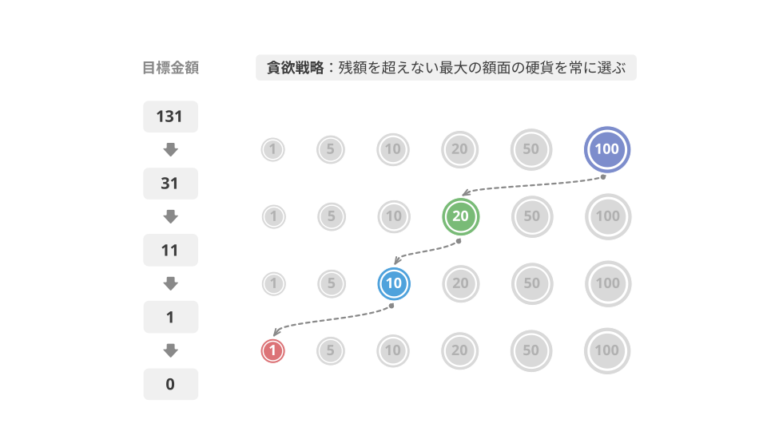
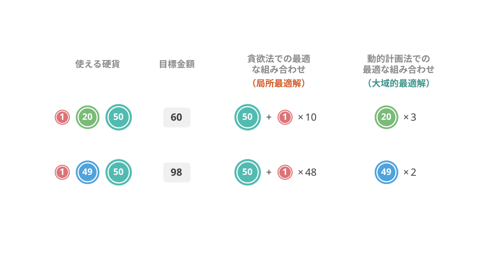

# 15.1 &nbsp; 貪欲法

<u>貪欲法（greedy algorithm）</u>は、最適化問題を解く代表的な手法です。意思決定の各段階で、その場で最もよく見える選択をします。このような局所的に最適な選択の積み重ねで、大域的な最適解を得ることを目指します。貪欲法は簡潔で効率がよく、実際のさまざまな問題に広く使われています。

貪欲法も動的計画法も、最適化問題によく使われます。どちらも最適部分構造を利用するなど共通点がありますが、解を求める仕組みは異なります。

- 動的計画法は、それまでの段階におけるすべての選択を踏まえて現在の選択を検討し、以前に解いた部分問題の解から現在の部分問題の解を組み立てます。
- 貪欲法は過去の選択を見直さず、前に進みながら貪欲な選択を繰り返します。こうして問題を少しずつ小さくし、最後まで解きます。

まず「硬貨の両替」を例に、貪欲法の仕組みを見てみましょう。「個数制限なしナップサック問題」の節で取り上げた、おなじみの問題です。

!!! question "問題"

    $n$ 種類の硬貨があり、$i$ 番目の額面は $coins[i - 1]$、目標金額は $amt$ です。同じ硬貨を何度でも選べるとき、目標金額を作るのに必要な最少枚数を求めてください。作れない場合は $-1$ を返してください。

この問題で使う貪欲戦略を図 15-1 に示します。目標金額から始め、**残額を超えず、残額に最も近い額面の硬貨を選びます**。目標金額に達するまで、この選択を繰り返します。

{ class="animation-figure" }

<p align="center"> 図 15-1 &nbsp; 硬貨の両替の貪欲戦略 </p>

実装は次のとおりです。

=== "Python"

    ```python title="coin_change_greedy.py"
    def coin_change_greedy(coins: list[int], amt: int) -> int:
        """硬貨の両替（貪欲法）"""
        # リスト coins はソート済みとする
        i = len(coins) - 1
        count = 0
        # 残額がなくなるまで貪欲選択を繰り返す
        while amt > 0:
            # 残額以下で額面が最大の硬貨を探す
            while i > 0 and coins[i] > amt:
                i -= 1
            # coins[i] を選ぶ
            amt -= coins[i]
            count += 1
        # 解が見つからなければ -1 を返す
        return count if amt == 0 else -1
    ```

=== "C++"

    ```cpp title="coin_change_greedy.cpp"
    /* 硬貨の両替（貪欲法） */
    int coinChangeGreedy(vector<int> &coins, int amt) {
        // リスト coins はソート済みとする
        int i = coins.size() - 1;
        int count = 0;
        // 残額がなくなるまで貪欲選択を繰り返す
        while (amt > 0) {
            // 残額以下で額面が最大の硬貨を探す
            while (i > 0 && coins[i] > amt) {
                i--;
            }
            // coins[i] を選ぶ
            amt -= coins[i];
            count++;
        }
        // 解が見つからなければ -1 を返す
        return amt == 0 ? count : -1;
    }
    ```

=== "Java"

    ```java title="coin_change_greedy.java"
    /* 硬貨の両替（貪欲法） */
    int coinChangeGreedy(int[] coins, int amt) {
        // リスト coins はソート済みとする
        int i = coins.length - 1;
        int count = 0;
        // 残額がなくなるまで貪欲選択を繰り返す
        while (amt > 0) {
            // 残額以下で額面が最大の硬貨を探す
            while (i > 0 && coins[i] > amt) {
                i--;
            }
            // coins[i] を選ぶ
            amt -= coins[i];
            count++;
        }
        // 解が見つからなければ -1 を返す
        return amt == 0 ? count : -1;
    }
    ```

=== "C#"

    ```csharp title="coin_change_greedy.cs"
    /* 硬貨の両替（貪欲法） */
    int CoinChangeGreedy(int[] coins, int amt) {
        // リスト coins はソート済みとする
        int i = coins.Length - 1;
        int count = 0;
        // 残額がなくなるまで貪欲選択を繰り返す
        while (amt > 0) {
            // 残額以下で額面が最大の硬貨を探す
            while (i > 0 && coins[i] > amt) {
                i--;
            }
            // coins[i] を選ぶ
            amt -= coins[i];
            count++;
        }
        // 解が見つからなければ -1 を返す
        return amt == 0 ? count : -1;
    }
    ```

=== "Go"

    ```go title="coin_change_greedy.go"
    /* 硬貨の両替（貪欲法） */
    func coinChangeGreedy(coins []int, amt int) int {
        // リスト coins はソート済みとする
        i := len(coins) - 1
        count := 0
        // 残額がなくなるまで貪欲選択を繰り返す
        for amt > 0 {
            // 残額以下で額面が最大の硬貨を探す
            for i > 0 && coins[i] > amt {
                i--
            }
            // coins[i] を選ぶ
            amt -= coins[i]
            count++
        }
        // 解が見つからなければ -1 を返す
        if amt != 0 {
            return -1
        }
        return count
    }
    ```

=== "Swift"

    ```swift title="coin_change_greedy.swift"
    /* 硬貨の両替（貪欲法） */
    func coinChangeGreedy(coins: [Int], amt: Int) -> Int {
        // リスト coins はソート済みとする
        var i = coins.count - 1
        var count = 0
        var amt = amt
        // 残額がなくなるまで貪欲選択を繰り返す
        while amt > 0 {
            // 残額以下で額面が最大の硬貨を探す
            while i > 0 && coins[i] > amt {
                i -= 1
            }
            // coins[i] を選ぶ
            amt -= coins[i]
            count += 1
        }
        // 解が見つからなければ -1 を返す
        return amt == 0 ? count : -1
    }
    ```

=== "JS"

    ```javascript title="coin_change_greedy.js"
    /* 硬貨の両替（貪欲法） */
    function coinChangeGreedy(coins, amt) {
        // 配列 coins はソート済みとする
        let i = coins.length - 1;
        let count = 0;
        // 残額がなくなるまで貪欲選択を繰り返す
        while (amt > 0) {
            // 残額以下で額面が最大の硬貨を探す
            while (i > 0 && coins[i] > amt) {
                i--;
            }
            // coins[i] を選ぶ
            amt -= coins[i];
            count++;
        }
        // 解が見つからなければ -1 を返す
        return amt === 0 ? count : -1;
    }
    ```

=== "TS"

    ```typescript title="coin_change_greedy.ts"
    /* 硬貨の両替（貪欲法） */
    function coinChangeGreedy(coins: number[], amt: number): number {
        // 配列 coins はソート済みとする
        let i = coins.length - 1;
        let count = 0;
        // 残額がなくなるまで貪欲選択を繰り返す
        while (amt > 0) {
            // 残額以下で額面が最大の硬貨を探す
            while (i > 0 && coins[i] > amt) {
                i--;
            }
            // coins[i] を選ぶ
            amt -= coins[i];
            count++;
        }
        // 解が見つからなければ -1 を返す
        return amt === 0 ? count : -1;
    }
    ```

=== "Dart"

    ```dart title="coin_change_greedy.dart"
    /* 硬貨の両替（貪欲法） */
    int coinChangeGreedy(List<int> coins, int amt) {
      // リスト coins はソート済みとする
      int i = coins.length - 1;
      int count = 0;
      // 残額がなくなるまで貪欲選択を繰り返す
      while (amt > 0) {
        // 残額以下で額面が最大の硬貨を探す
        while (i > 0 && coins[i] > amt) {
          i--;
        }
        // coins[i] を選ぶ
        amt -= coins[i];
        count++;
      }
      // 解が見つからなければ -1 を返す
      return amt == 0 ? count : -1;
    }
    ```

=== "Rust"

    ```rust title="coin_change_greedy.rs"
    /* 硬貨の両替（貪欲法） */
    fn coin_change_greedy(coins: &[i32], mut amt: i32) -> i32 {
        // リスト coins はソート済みとする
        let mut i = coins.len() - 1;
        let mut count = 0;
        // 残額がなくなるまで貪欲選択を繰り返す
        while amt > 0 {
            // 残額以下で額面が最大の硬貨を探す
            while i > 0 && coins[i] > amt {
                i -= 1;
            }
            // coins[i] を選ぶ
            amt -= coins[i];
            count += 1;
        }
        // 解が見つからなければ -1 を返す
        if amt == 0 {
            count
        } else {
            -1
        }
    }
    ```

=== "C"

    ```c title="coin_change_greedy.c"
    /* 硬貨の両替（貪欲法） */
    int coinChangeGreedy(int *coins, int size, int amt) {
        // リスト coins はソート済みとする
        int i = size - 1;
        int count = 0;
        // 残額がなくなるまで貪欲選択を繰り返す
        while (amt > 0) {
            // 残額以下で額面が最大の硬貨を探す
            while (i > 0 && coins[i] > amt) {
                i--;
            }
            // coins[i] を選ぶ
            amt -= coins[i];
            count++;
        }
        // 解が見つからなければ -1 を返す
        return amt == 0 ? count : -1;
    }
    ```

=== "Kotlin"

    ```kotlin title="coin_change_greedy.kt"
    /* 硬貨の両替（貪欲法） */
    fun coinChangeGreedy(coins: IntArray, amt: Int): Int {
        // リスト coins はソート済みとする
        var am = amt
        var i = coins.size - 1
        var count = 0
        // 残額がなくなるまで貪欲選択を繰り返す
        while (am > 0) {
            // 残額以下で額面が最大の硬貨を探す
            while (i > 0 && coins[i] > am) {
                i--
            }
            // coins[i] を選ぶ
            am -= coins[i]
            count++
        }
        // 解が見つからなければ -1 を返す
        return if (am == 0) count else -1
    }
    ```

=== "Ruby"

    ```ruby title="coin_change_greedy.rb"
    ### 硬貨の両替（貪欲法） ###
    def coin_change_greedy(coins, amt)
      # リスト coins はソート済みとする
      i = coins.length - 1
      count = 0
      # 残額がなくなるまで貪欲選択を繰り返す
      while amt > 0
        # 残額以下で額面が最大の硬貨を探す
        while i > 0 && coins[i] > amt
          i -= 1
        end
        # coins[i] を選ぶ
        amt -= coins[i]
        count += 1
      end
      # 解が見つからなければ -1 を返す
      amt == 0 ? count : -1
    end
    ```

??? pythontutor "実行の様子を見る"

    <div style="height: 549px; width: 100%;"><iframe class="pythontutor-iframe" title="実行の様子を見る" src="https://pythontutor.com/iframe-embed.html#code=def%20coin_change_greedy%28coins%3A%20list%5Bint%5D,%20amt%3A%20int%29%20-%3E%20int%3A%0A%20%20%20%20%22%22%22%E7%A1%AC%E8%B2%A8%E3%81%AE%E4%B8%A1%E6%9B%BF%EF%BC%88%E8%B2%AA%E6%AC%B2%E6%B3%95%EF%BC%89%22%22%22%0A%20%20%20%20%23%20%E3%83%AA%E3%82%B9%E3%83%88%20coins%20%E3%81%AF%E3%82%BD%E3%83%BC%E3%83%88%E6%B8%88%E3%81%BF%E3%81%A8%E3%81%99%E3%82%8B%0A%20%20%20%20i%20%3D%20len%28coins%29%20-%201%0A%20%20%20%20count%20%3D%200%0A%20%20%20%20%23%20%E6%AE%8B%E9%A1%8D%E3%81%8C%E3%81%AA%E3%81%8F%E3%81%AA%E3%82%8B%E3%81%BE%E3%81%A7%E8%B2%AA%E6%AC%B2%E9%81%B8%E6%8A%9E%E3%82%92%E7%B9%B0%E3%82%8A%E8%BF%94%E3%81%99%0A%20%20%20%20while%20amt%20%3E%200%3A%0A%20%20%20%20%20%20%20%20%23%20%E6%AE%8B%E9%A1%8D%E4%BB%A5%E4%B8%8B%E3%81%A7%E9%A1%8D%E9%9D%A2%E3%81%8C%E6%9C%80%E5%A4%A7%E3%81%AE%E7%A1%AC%E8%B2%A8%E3%82%92%E6%8E%A2%E3%81%99%0A%20%20%20%20%20%20%20%20while%20i%20%3E%200%20and%20coins%5Bi%5D%20%3E%20amt%3A%0A%20%20%20%20%20%20%20%20%20%20%20%20i%20-%3D%201%0A%20%20%20%20%20%20%20%20%23%20coins%5Bi%5D%20%E3%82%92%E9%81%B8%E3%81%B6%0A%20%20%20%20%20%20%20%20amt%20-%3D%20coins%5Bi%5D%0A%20%20%20%20%20%20%20%20count%20%2B%3D%201%0A%20%20%20%20%23%20%E8%A7%A3%E3%81%8C%E8%A6%8B%E3%81%A4%E3%81%8B%E3%82%89%E3%81%AA%E3%81%91%E3%82%8C%E3%81%B0%20-1%20%E3%82%92%E8%BF%94%E3%81%99%0A%20%20%20%20return%20count%20if%20amt%20%3D%3D%200%20else%20-1%0A%0A%0A%22%22%22Driver%20Code%22%22%22%0Aif%20__name__%20%3D%3D%20%22__main__%22%3A%0A%20%20%20%20%23%20%E8%B2%AA%E6%AC%B2%E6%B3%95%E3%81%A7%E5%A4%A7%E5%9F%9F%E7%9A%84%E6%9C%80%E9%81%A9%E8%A7%A3%E3%81%8C%E5%BF%85%E3%81%9A%E6%B1%82%E3%81%BE%E3%82%8B%E4%BE%8B%0A%20%20%20%20coins%20%3D%20%5B1,%205,%2010,%2020,%2050,%20100%5D%0A%20%20%20%20amt%20%3D%20186%0A%20%20%20%20res%20%3D%20coin_change_greedy%28coins,%20amt%29%0A%20%20%20%20print%28f%22%5Cncoins%20%3D%20%7Bcoins%7D,%20amt%20%3D%20%7Bamt%7D%22%29%0A%20%20%20%20print%28f%22%E9%87%91%E9%A1%8D%20%7Bamt%7D%20%E3%82%92%E4%BD%9C%E3%82%8B%E3%81%AE%E3%81%AB%E5%BF%85%E8%A6%81%E3%81%AA%E7%A1%AC%E8%B2%A8%E3%81%AE%E6%9C%80%E5%B0%91%E6%9E%9A%E6%95%B0%E3%81%AF%20%7Bres%7D%22%29%0A%0A%20%20%20%20%23%20%E8%B2%AA%E6%AC%B2%E6%B3%95%E3%81%A7%E3%81%AF%E5%A4%A7%E5%9F%9F%E7%9A%84%E6%9C%80%E9%81%A9%E8%A7%A3%E3%82%92%E4%BF%9D%E8%A8%BC%E3%81%A7%E3%81%8D%E3%81%AA%E3%81%84%E4%BE%8B%0A%20%20%20%20coins%20%3D%20%5B1,%2020,%2050%5D%0A%20%20%20%20amt%20%3D%2060%0A%20%20%20%20res%20%3D%20coin_change_greedy%28coins,%20amt%29%0A%20%20%20%20print%28f%22%5Cncoins%20%3D%20%7Bcoins%7D,%20amt%20%3D%20%7Bamt%7D%22%29%0A%20%20%20%20print%28f%22%E9%87%91%E9%A1%8D%20%7Bamt%7D%20%E3%82%92%E4%BD%9C%E3%82%8B%E3%81%AE%E3%81%AB%E5%BF%85%E8%A6%81%E3%81%AA%E7%A1%AC%E8%B2%A8%E3%81%AE%E6%9C%80%E5%B0%91%E6%9E%9A%E6%95%B0%E3%81%AF%20%7Bres%7D%22%29%0A%20%20%20%20print%28f%22%E5%AE%9F%E9%9A%9B%E3%81%AE%E6%9C%80%E5%B0%91%E6%9E%9A%E6%95%B0%E3%81%AF%203%20%E6%9E%9A%EF%BC%8820%20%2B%2020%20%2B%2020%EF%BC%89%22%29&codeDivHeight=472&codeDivWidth=350&cumulative=false&curInstr=5&heapPrimitives=nevernest&origin=opt-frontend.js&py=311&rawInputLstJSON=%5B%5D&textReferences=false"> </iframe></div>
    <div style="margin-top: 5px;"><a href="https://pythontutor.com/iframe-embed.html#code=def%20coin_change_greedy%28coins%3A%20list%5Bint%5D,%20amt%3A%20int%29%20-%3E%20int%3A%0A%20%20%20%20%22%22%22%E7%A1%AC%E8%B2%A8%E3%81%AE%E4%B8%A1%E6%9B%BF%EF%BC%88%E8%B2%AA%E6%AC%B2%E6%B3%95%EF%BC%89%22%22%22%0A%20%20%20%20%23%20%E3%83%AA%E3%82%B9%E3%83%88%20coins%20%E3%81%AF%E3%82%BD%E3%83%BC%E3%83%88%E6%B8%88%E3%81%BF%E3%81%A8%E3%81%99%E3%82%8B%0A%20%20%20%20i%20%3D%20len%28coins%29%20-%201%0A%20%20%20%20count%20%3D%200%0A%20%20%20%20%23%20%E6%AE%8B%E9%A1%8D%E3%81%8C%E3%81%AA%E3%81%8F%E3%81%AA%E3%82%8B%E3%81%BE%E3%81%A7%E8%B2%AA%E6%AC%B2%E9%81%B8%E6%8A%9E%E3%82%92%E7%B9%B0%E3%82%8A%E8%BF%94%E3%81%99%0A%20%20%20%20while%20amt%20%3E%200%3A%0A%20%20%20%20%20%20%20%20%23%20%E6%AE%8B%E9%A1%8D%E4%BB%A5%E4%B8%8B%E3%81%A7%E9%A1%8D%E9%9D%A2%E3%81%8C%E6%9C%80%E5%A4%A7%E3%81%AE%E7%A1%AC%E8%B2%A8%E3%82%92%E6%8E%A2%E3%81%99%0A%20%20%20%20%20%20%20%20while%20i%20%3E%200%20and%20coins%5Bi%5D%20%3E%20amt%3A%0A%20%20%20%20%20%20%20%20%20%20%20%20i%20-%3D%201%0A%20%20%20%20%20%20%20%20%23%20coins%5Bi%5D%20%E3%82%92%E9%81%B8%E3%81%B6%0A%20%20%20%20%20%20%20%20amt%20-%3D%20coins%5Bi%5D%0A%20%20%20%20%20%20%20%20count%20%2B%3D%201%0A%20%20%20%20%23%20%E8%A7%A3%E3%81%8C%E8%A6%8B%E3%81%A4%E3%81%8B%E3%82%89%E3%81%AA%E3%81%91%E3%82%8C%E3%81%B0%20-1%20%E3%82%92%E8%BF%94%E3%81%99%0A%20%20%20%20return%20count%20if%20amt%20%3D%3D%200%20else%20-1%0A%0A%0A%22%22%22Driver%20Code%22%22%22%0Aif%20__name__%20%3D%3D%20%22__main__%22%3A%0A%20%20%20%20%23%20%E8%B2%AA%E6%AC%B2%E6%B3%95%E3%81%A7%E5%A4%A7%E5%9F%9F%E7%9A%84%E6%9C%80%E9%81%A9%E8%A7%A3%E3%81%8C%E5%BF%85%E3%81%9A%E6%B1%82%E3%81%BE%E3%82%8B%E4%BE%8B%0A%20%20%20%20coins%20%3D%20%5B1,%205,%2010,%2020,%2050,%20100%5D%0A%20%20%20%20amt%20%3D%20186%0A%20%20%20%20res%20%3D%20coin_change_greedy%28coins,%20amt%29%0A%20%20%20%20print%28f%22%5Cncoins%20%3D%20%7Bcoins%7D,%20amt%20%3D%20%7Bamt%7D%22%29%0A%20%20%20%20print%28f%22%E9%87%91%E9%A1%8D%20%7Bamt%7D%20%E3%82%92%E4%BD%9C%E3%82%8B%E3%81%AE%E3%81%AB%E5%BF%85%E8%A6%81%E3%81%AA%E7%A1%AC%E8%B2%A8%E3%81%AE%E6%9C%80%E5%B0%91%E6%9E%9A%E6%95%B0%E3%81%AF%20%7Bres%7D%22%29%0A%0A%20%20%20%20%23%20%E8%B2%AA%E6%AC%B2%E6%B3%95%E3%81%A7%E3%81%AF%E5%A4%A7%E5%9F%9F%E7%9A%84%E6%9C%80%E9%81%A9%E8%A7%A3%E3%82%92%E4%BF%9D%E8%A8%BC%E3%81%A7%E3%81%8D%E3%81%AA%E3%81%84%E4%BE%8B%0A%20%20%20%20coins%20%3D%20%5B1,%2020,%2050%5D%0A%20%20%20%20amt%20%3D%2060%0A%20%20%20%20res%20%3D%20coin_change_greedy%28coins,%20amt%29%0A%20%20%20%20print%28f%22%5Cncoins%20%3D%20%7Bcoins%7D,%20amt%20%3D%20%7Bamt%7D%22%29%0A%20%20%20%20print%28f%22%E9%87%91%E9%A1%8D%20%7Bamt%7D%20%E3%82%92%E4%BD%9C%E3%82%8B%E3%81%AE%E3%81%AB%E5%BF%85%E8%A6%81%E3%81%AA%E7%A1%AC%E8%B2%A8%E3%81%AE%E6%9C%80%E5%B0%91%E6%9E%9A%E6%95%B0%E3%81%AF%20%7Bres%7D%22%29%0A%20%20%20%20print%28f%22%E5%AE%9F%E9%9A%9B%E3%81%AE%E6%9C%80%E5%B0%91%E6%9E%9A%E6%95%B0%E3%81%AF%203%20%E6%9E%9A%EF%BC%8820%20%2B%2020%20%2B%2020%EF%BC%89%22%29&codeDivHeight=800&codeDivWidth=600&cumulative=false&curInstr=5&heapPrimitives=nevernest&origin=opt-frontend.js&py=311&rawInputLstJSON=%5B%5D&textReferences=false" target="_blank" rel="noopener noreferrer">全画面で表示 ></a></div>

「なんてすっきりしているんだろう！」と思うかもしれません。貪欲法なら、わずか 10 行ほどのコードで硬貨の両替問題が解けます。

## 15.1.1 &nbsp; 貪欲法の利点と限界

**貪欲法は手順がわかりやすく、実装が簡単なうえ、多くの場合は効率にも優れています**。上のコードで、硬貨の最小の額面を $\min(coins)$ とすると、貪欲選択の回数は最大 $amt / \min(coins)$ 回で、時間計算量は $O(amt / \min(coins))$ です。動的計画法の時間計算量 $O(n \times amt)$ と比べて一桁小さくなります。

ただし、**額面の組み合わせによっては、貪欲法では最適解が見つかりません**。図 15-2 に 2 つの例を示します。

- **最適解が得られる例 $coins = [1, 5, 10, 20, 50, 100]$**。この額面の組み合わせなら、どのような $amt$ に対しても貪欲法で最適解が得られます。
- **反例 $coins = [1, 20, 50]$**。$amt = 60$ とすると、貪欲法で得られる組み合わせは $50 + 1 \times 10$ で、合計 $11$ 枚です。一方、動的計画法なら最適解 $20 + 20 + 20$ が見つかり、わずか $3$ 枚で済みます。
- **反例 $coins = [1, 49, 50]$**。$amt = 98$ とすると、貪欲法で得られる組み合わせは $50 + 1 \times 48$ で、合計 $49$ 枚です。一方、動的計画法なら最適解 $49 + 49$ が見つかり、わずか $2$ 枚で済みます。

{ class="animation-figure" }

<p align="center"> 図 15-2 &nbsp; 貪欲法では最適解が得られない例 </p>

つまり硬貨の両替問題では、貪欲法で大域的最適解が得られる保証はなく、最適解から大きく外れることもあります。この問題には動的計画法のほうが適しています。

一般に、貪欲法が役立つ場面は次の 2 つに分けられます。

1. **最適解が保証される場合**。貪欲法はバックトラック法や動的計画法より効率がよいことが多く、たいていは最善の選択です。
2. **最適解に近い解を求められる場合**。この場合も貪欲法を使えます。複雑な問題の多くは大域的最適解を見つけるのが非常に難しく、最適解に及ばなくても、よい解を効率よく得られることには価値があります。

## 15.1.2 &nbsp; 貪欲法が使える問題の性質

では、どのような問題が貪欲法に向いているのでしょうか。言い換えると、どのような場合に貪欲法で最適解が保証されるのでしょうか。

貪欲法を使える条件は動的計画法よりも厳しく、主に次の 2 つの性質に注目します。

- **貪欲選択性**。局所的に最適な選択から常に大域的最適解に到達できる場合に限り、貪欲法で最適解を保証できます。
- **最適部分構造**。元の問題の最適解が、部分問題の最適解を含むという性質です。

最適部分構造は「動的計画法」の章で説明したので、ここでは詳しく取り上げません。最適部分構造がすぐには見えない問題でも、貪欲法で解ける場合があります。

ここでは、主に貪欲選択性の判定方法を考えます。性質の説明自体は簡単そうですが、**実際には、多くの問題で貪欲選択性を証明するのは容易ではありません**。

例えば硬貨の両替問題では、反例を挙げて貪欲選択性が成り立たないことを示すのは簡単ですが、成り立つことを示すのは難しくなります。**額面の組み合わせがどのような条件を満たせば貪欲法で解けるのでしょうか**。直感やいくつかの例に基づく曖昧な答えなら出せても、厳密な数学的証明を与えるのはなかなか困難です。

!!! quote "引用"

    ある論文では、与えられた額面の組み合わせについて、任意の金額に対して貪欲法で最適解が得られるかを判定する、時間計算量 $O(n^3)$ のアルゴリズムが示されています。

    Pearson, D. A polynomial-time algorithm for the change-making problem[J]. Operations Research Letters, 2005, 33(3): 231-234.

## 15.1.3 &nbsp; 貪欲法で問題を解く手順

貪欲法で問題を解く過程は、おおむね次の 3 ステップに分けられます。

1. **問題を分析する**。状態の定義、最適化の目標、制約条件などを整理し、問題の性質を理解します。このステップはバックトラック法や動的計画法にも共通します。
2. **貪欲戦略を決める**。各ステップで何を基準に選ぶかを決めます。この戦略によって各ステップで問題が小さくなり、最終的に問題全体を解けます。
3. **正しさを証明する**。通常、問題が貪欲選択性と最適部分構造を持つことを示す必要があります。帰納法や背理法などの数学的証明を使うことがあります。

貪欲戦略を決めることが解法の中心ですが、次のような理由から、実際には簡単にいかないことがあります。

- **適切な貪欲戦略は問題によって大きく異なります**。多くの問題では戦略がわかりやすく、少し考えて試せば見つかります。一方、複雑な問題では戦略が見えにくいこともあり、問題を解いた経験とアルゴリズムを考える力が問われます。
- **一見正しそうな貪欲戦略には注意が必要です**。自信を持って戦略を設計し、コードを書いて提出しても、一部のテストケースに通らないことがあります。設計した戦略が「一部の場合にしか正しくない」ためです。先ほどの硬貨の両替が典型例です。

正しさを保証するには、貪欲戦略を数学的に厳密に証明する必要があります。**通常は背理法や数学的帰納法を使います**。

もっとも、正しさの証明も容易とは限りません。手がかりがないときは、テストケースを使ってコードをデバッグし、少しずつ貪欲戦略を修正して確かめることがよくあります。

## 15.1.4 &nbsp; 貪欲法を使う代表的な問題

貪欲法は、貪欲選択性と最適部分構造を持つ最適化問題によく使われます。代表的な問題をいくつか挙げます。

- **硬貨の両替問題**。額面の組み合わせによっては、貪欲法で常に最適解が得られます。
- **区間スケジューリング問題**。それぞれ実行時間帯が決まっている仕事の中から、できるだけ多くの仕事をこなすことが目標です。毎回、終了時刻が最も早い仕事を選ぶ貪欲法で最適解が得られます。
- **分割可能ナップサック問題**。品物の集合と積載量が与えられます。積載量を超えずに合計価値が最大になるように品物を選びます。毎回、重さに対する価値の比（価値 / 重さ）が最も高い品物を選ぶと、場合によっては貪欲法で最適解が得られます。
- **株式売買問題**。一連の過去の株価が与えられます。何度でも売買できますが、すでに株を持っているときは、それを売るまで次の株は買えません。目標は利益を最大にすることです。
- **ハフマン符号**。ハフマン符号は可逆データ圧縮に使う貪欲アルゴリズムです。ハフマン木を作るとき、出現頻度が最も低い 2 つのノードを毎回併合すると、完成した木の重み付き経路長（符号長）が最小になります。
- **ダイクストラ法**。すべての辺の重みが非負のグラフで、与えられた始点からほかの各頂点までの最短経路を求める貪欲アルゴリズムです。
