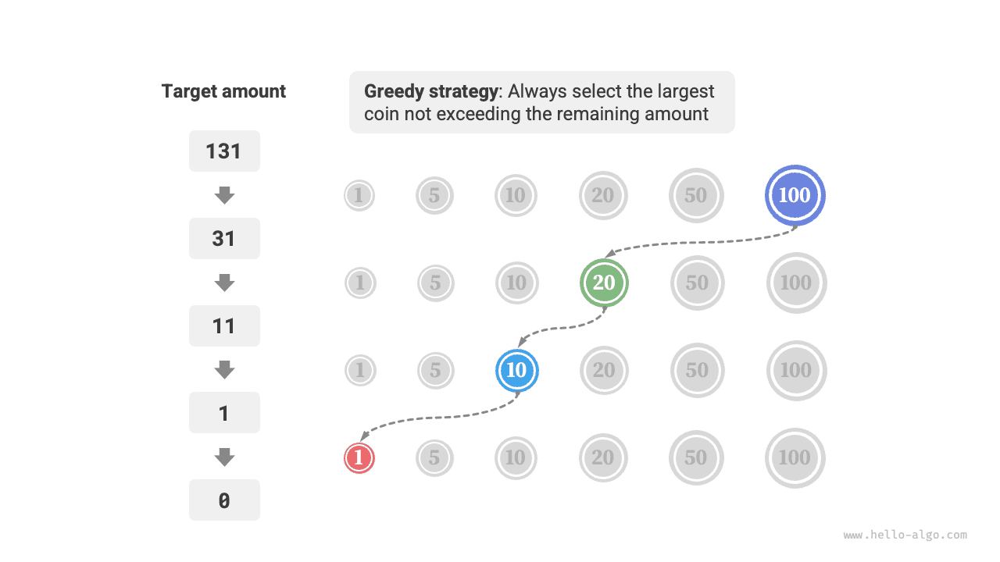

# 貪欲アルゴリズム

<u>貪欲アルゴリズム（greedy algorithm）</u>は、最適化問題を解くためによく使われるアルゴリズムです。各段階で、その時点で最もよいと思われる選択、つまり局所的に最適な判断を貪欲に行い、全体の最適解を目指します。簡潔で効率的なため、さまざまな実際の問題に広く使われています。

貪欲アルゴリズムと動的計画法は、どちらも最適化問題でよく使われます。最適部分構造を利用する点などは似ていますが、動作原理は異なります。

- 動的計画法は、それまでの段階のすべての判断を踏まえて現在の判断を考え、過去の部分問題の解から現在の部分問題の解を組み立てます。
- 貪欲アルゴリズムは過去の判断を振り返らず、前に進みながら貪欲な選択を続け、問題の範囲を縮めて解決に至ります。

まず「硬貨の両替」を例に、貪欲アルゴリズムの仕組みを見てみましょう。「個数制限なしナップサック問題」の節で取り上げたので、覚えているかもしれません。

!!! question

    $n$ 種類の硬貨があり、$i$ 番目の硬貨の額面は $coins[i - 1]$ です。目標金額は $amt$ で、各種類の硬貨は繰り返し選べます。目標金額を作るために必要な硬貨の最小枚数を求めてください。作れない場合は $-1$ を返します。

この問題で使う貪欲戦略を下図に示します。目標金額に対し、**それを超えない範囲で最も近い額面の硬貨を貪欲に選び**、目標金額を作るまで繰り返します。



実装は次のとおりです。

```src
[file]{coin_change_greedy}-[class]{}-[func]{coin_change_greedy}
```

「なんてすっきりしたコードだろう！」と思うかもしれません。貪欲アルゴリズムなら、わずか 10 行ほどで硬貨の両替問題を解けます。

## 貪欲アルゴリズムの利点と制約

**貪欲アルゴリズムは操作が直接的で実装が簡単なうえ、通常は効率も高くなります**。上のコードで最小の額面を $\min(coins)$ とすると、貪欲な選択は最大 $amt / \min(coins)$ 回繰り返されるため、時間計算量は $O(amt / \min(coins))$ です。これは、動的計画法の時間計算量 $O(n \times amt)$ より一つのオーダー分小さくなっています。

ただし、**硬貨の額面の組み合わせによっては、貪欲アルゴリズムで最適解を見つけられません**。下図に二つの例を示します。

- **うまくいく例 $coins = [1, 5, 10, 20, 50, 100]$**：この硬貨の組み合わせでは、どのような $amt$ に対しても、貪欲アルゴリズムで最適解を見つけられます。
- **反例 $coins = [1, 20, 50]$**：$amt = 60$ とすると、貪欲アルゴリズムが得るのは $50 + 1 \times 10$ で、硬貨は計 $11$ 枚です。一方、動的計画法なら最適解 $20 + 20 + 20$ が見つかり、$3$ 枚で済みます。
- **反例 $coins = [1, 49, 50]$**：$amt = 98$ とすると、貪欲アルゴリズムが得るのは $50 + 1 \times 48$ で、硬貨は計 $49$ 枚です。一方、動的計画法なら最適解 $49 + 49$ が見つかり、$2$ 枚で済みます。


つまり、硬貨の両替問題では、貪欲アルゴリズムで全体の最適解を得られる保証はなく、非常に悪い解を得る可能性もあります。この問題には動的計画法の方が適しています。

一般に、貪欲アルゴリズムが適するのは次の二つの場合です。

1. **最適解を得られる保証がある場合**：バックトラッキングや動的計画法より効率的であることが多く、貪欲アルゴリズムが最良の選択になりやすい場合です。
2. **最適解に近い解を得られる場合**：この場合にも貪欲アルゴリズムを使えます。複雑な問題では全体の最適解を探すのが非常に難しく、最適には及ばなくてもよい解を効率的に得られれば、十分に有用です。

## 貪欲アルゴリズムの性質

では、どのような問題が貪欲アルゴリズムに適しているのでしょうか。言い換えると、どのような場合に最適解を得られる保証があるのでしょうか。

動的計画法と比べると、貪欲アルゴリズムを使える条件は厳しく、主に次の二つの性質に注目します。

- **貪欲選択性**：局所的に最適な選択が常に全体の最適解につながる場合に限り、貪欲アルゴリズムで最適解を得られることが保証されます。
- **最適部分構造**：元の問題の最適解の中に、部分問題の最適解が含まれています。

最適部分構造は「動的計画法」の章で説明したため、ここでは繰り返しません。なお、最適部分構造が明らかでなくても、貪欲アルゴリズムで解ける問題があります。

ここでは主に、貪欲選択性をどう判断するかを考えます。定義は簡単に見えますが、**多くの問題で貪欲選択性を証明するのは容易ではありません**。

たとえば硬貨の両替問題では、反例を挙げて貪欲選択性を否定するのは簡単ですが、成り立つことを証明するのは難しくなります。**どのような条件を満たす硬貨の組み合わせなら、貪欲アルゴリズムで解けるのでしょうか**。直感や具体例から曖昧な答えを出せても、厳密に数学的証明を与えるのは難しいものです。

!!! quote

    ある論文では、硬貨の組み合わせが、任意の金額に対して貪欲アルゴリズムで最適解を求められるかどうかを判定する、時間計算量 $O(n^3)$ のアルゴリズムが示されています。

    Pearson, D. A polynomial-time algorithm for the change-making problem[J]. Operations Research Letters, 2005, 33(3): 231-234.

## 貪欲アルゴリズムで問題を解く手順

貪欲法で問題を解く流れは、大きく次の 3 段階に分けられます。

1. **問題の分析**：状態の定義、最適化の目標、制約条件など、問題の性質を整理して理解します。これはバックトラッキングや動的計画法でも行う段階です。
2. **貪欲戦略の決定**：各段階でどのように貪欲な選択をするかを決めます。その戦略によって問題を少しずつ小さくし、最終的に全体を解決します。
3. **正しさの証明**：通常は、貪欲選択性と最適部分構造が成り立つことを示す必要があります。帰納法や背理法などの数学的証明が必要になることがあります。

貪欲戦略を決めることが解法の中心ですが、必ずしも容易ではありません。主な理由は次のとおりです。

- **問題によって貪欲戦略が大きく異なります**。少し考えて試せば戦略が見つかる問題も多い一方、複雑な問題では戦略が見えにくいこともあります。そのような場合は、問題を解いた経験やアルゴリズムの力が問われます。
- **一見正しそうでも誤った貪欲戦略があります**。自信を持って戦略を立て、コードを書いて提出しても、一部のテストに通らないことがあります。戦略が「一部の場合にしか正しくない」ためです。先ほどの硬貨の両替は、その典型例です。

正しさを保証するには、貪欲戦略を厳密に数学的に証明する必要があり、**通常は背理法や数学的帰納法を使います**。

ただし、正しさの証明自体も難しいことがあります。糸口がつかめない場合は、テストケースを使ってコードをデバッグし、貪欲戦略を少しずつ修正・検証していくことが多いです。

## 貪欲アルゴリズムの代表的な問題

貪欲アルゴリズムは、貪欲選択性と最適部分構造を持つ最適化問題でよく使われます。代表的な問題を次に挙げます。

- **硬貨の両替問題**：特定の硬貨の組み合わせでは、貪欲アルゴリズムで常に最適解を得られます。
- **区間スケジューリング問題**：それぞれ一定の時間区間で行う複数の作業があり、できるだけ多くを完了したいとします。毎回、終了時刻が最も早い作業を選べば、貪欲アルゴリズムで最適解を得られます。
- **分割可能ナップサック問題**：品物の集合と積載可能な重さが与えられ、総重量が制限を超えず、総価値が最大になるよう品物を選びます。毎回、価値と重さの比（価値 / 重さ）が最も高い品物を選ぶと、場合によっては貪欲アルゴリズムで最適解を得られます。
- **株式の売買問題**：株価の履歴が与えられ、売買を何度も行えます。ただし、株式を保有している間は、売るまで次の購入はできません。利益を最大にすることが目標です。
- **ハフマン符号化**：可逆データ圧縮に使う貪欲アルゴリズムです。出現頻度が最も低い二つのノードを毎回統合してハフマン木を作ると、重み付き経路長（符号長）が最小になります。
- **Dijkstra 法**：すべての辺の重みが非負のグラフで、指定した始点からほかの各頂点への最短経路を求める貪欲アルゴリズムです。
