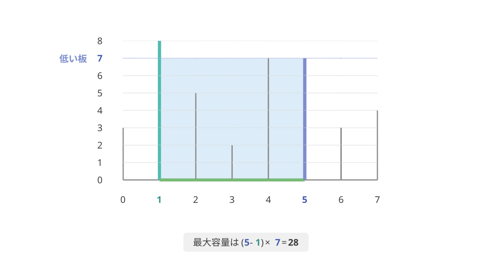
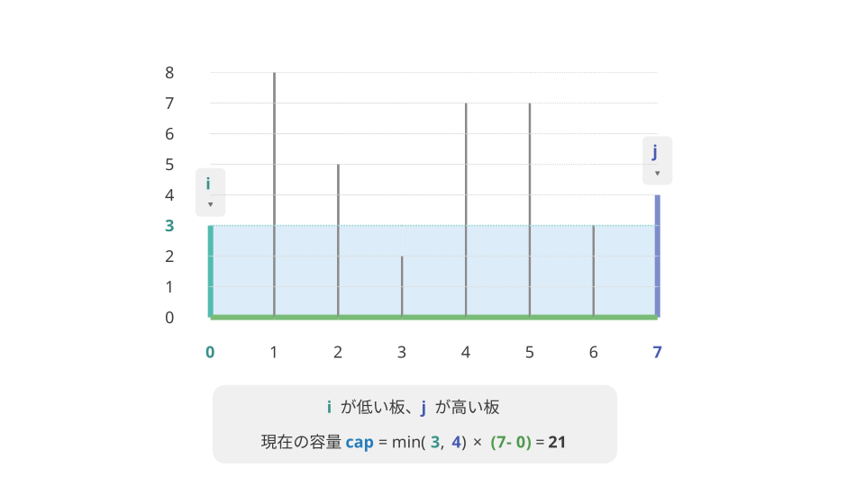
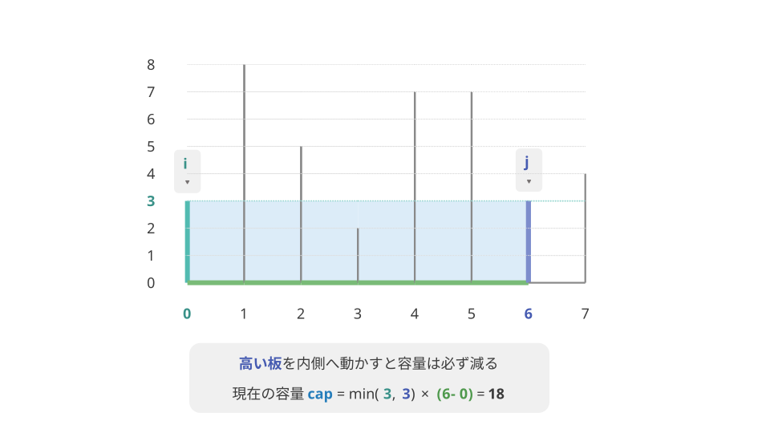
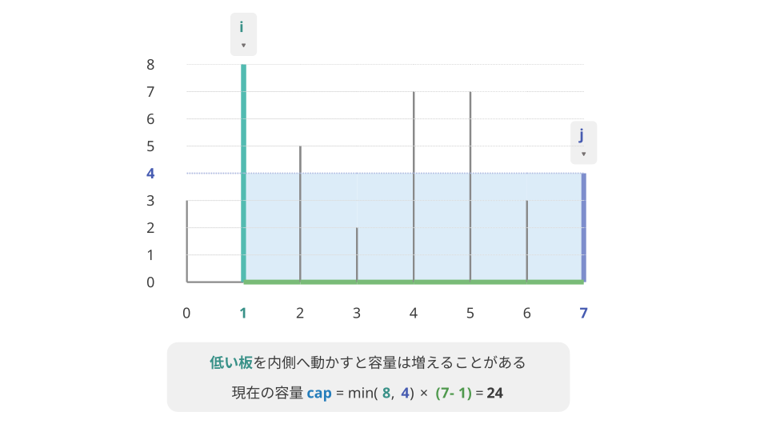
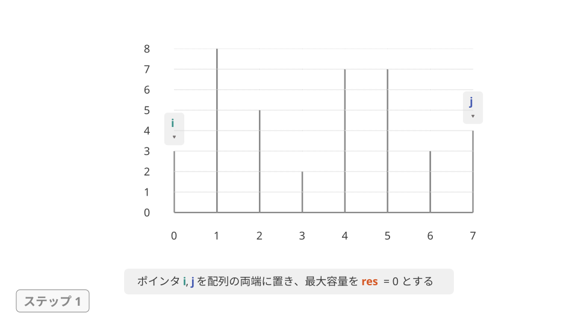
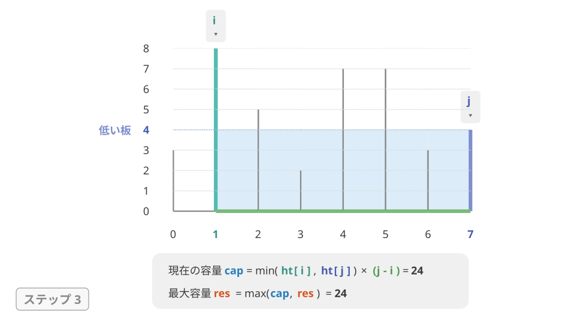
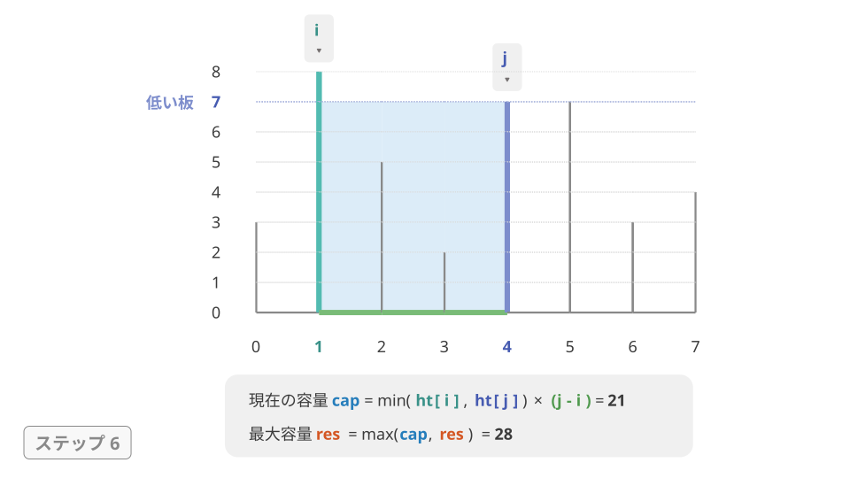
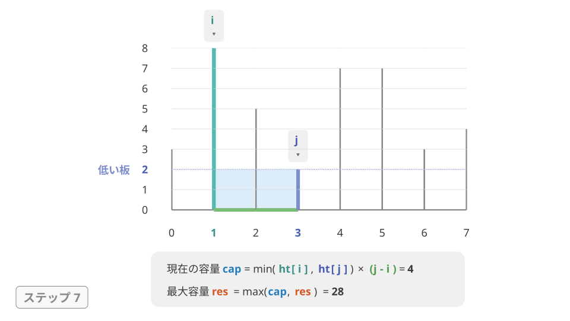
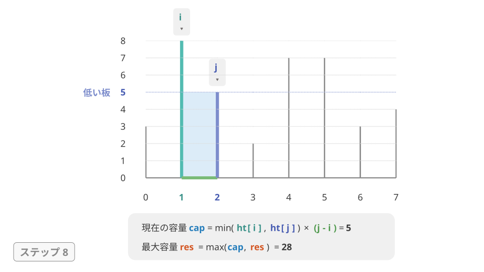
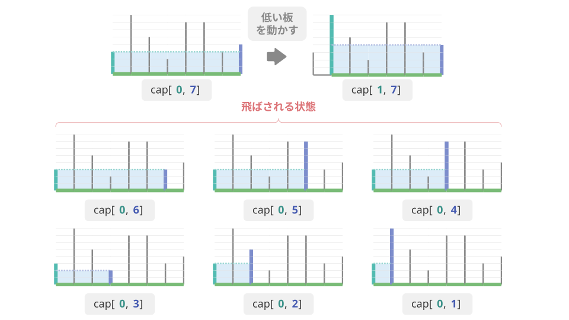

# 最大容量問題

!!! question

    配列 $ht$ が与えられ、各要素は垂直な仕切り板の高さを表します。配列から任意の 2 枚を選ぶと、その間の空間と合わせて 1 つの容器になります。
    
    容器の容量は高さと幅の積（面積）です。高さは低いほうの板で決まり、幅は 2 枚の板の配列インデックスの差です。
    
    容量が最大になるように配列から 2 枚の板を選び、その最大容量を返してください。次の図に例を示します。



どの 2 枚の板でも容器を作れるので、**この問題の状態は 2 枚の板のインデックスで表し、$[i, j]$ と書きます**。

容量は高さと幅の積です。高さは低い板で決まり、幅は 2 枚の板の配列インデックスの差です。容量を $cap[i, j]$ と表すと、次の式が得られます。

$$
cap[i, j] = \min(ht[i], ht[j]) \times (j - i)
$$

配列の長さを $n$ とすると、2 枚の板の組み合わせ（状態の総数）は $C_n^2 = \frac{n(n - 1)}{2}$ 通りです。最も直接的な方法は、**すべての状態を列挙して**最大容量を求めることです。時間計算量は $O(n^2)$ です。

### 貪欲戦略の決め方

もっと効率のよい解き方があります。次の図のように、インデックスが $i < j$、高さが $ht[i] < ht[j]$ を満たす状態 $[i, j]$ を選びます。つまり $i$ が低い板、$j$ が高い板です。



次の図のように、**高い板 $j$ を低い板 $i$ に近づけると、容量は必ず小さくなります**。

高い板 $j$ を動かすと、幅 $j-i$ は必ず狭くなります。一方、高さは低い板で決まるため、変わらない（$i$ が依然として低い板）か、小さくなる（移動後の $j$ が低い板になる）かのどちらかです。



逆に考えると、**容量が大きくなる可能性があるのは、低い板 $i$ を内側へ動かしたときだけです**。幅は必ず狭くなりますが、**高さは大きくなる可能性がある**からです（移動後の $i$ の板は元の板より高いかもしれません）。実際、次の図では低い板を動かすと面積が増えています。



ここから、この問題の貪欲戦略を導けます。まず 2 本のポインタを容器の両端に置きます。毎回、低い板のポインタを内側へ動かし、2 本のポインタが出会うまで繰り返します。

次の図は、この貪欲戦略を実行する過程を示しています。

1. 初期状態では、ポインタ $i$ と $j$ を配列の両端に置きます。
2. 現在の状態の容量 $cap[i, j]$ を計算し、最大容量を更新します。
3. 板 $i$ と板 $j$ の高さを比べ、低いほうのポインタを内側へ 1 つ動かします。
4. ステップ `2.` と `3.` を繰り返し、$i$ と $j$ が出会ったら終了します。

=== "<1>"
    

=== "<2>"
    

=== "<3>"
    

=== "<4>"
    

=== "<5>"
    

=== "<6>"
    

=== "<7>"
    

=== "<8>"
    

=== "<9>"
    

### コードによる実装

ループは最大 $n$ 回なので、**時間計算量は $O(n)$ です**。

変数 $i$、$j$、$res$ が使う追加領域は一定なので、**空間計算量は $O(1)$ です**。

```src
[file]{max_capacity}-[class]{}-[func]{max_capacity}
```

### 正しさの証明

貪欲法が全列挙より速いのは、各回の貪欲選択でいくつかの状態を「飛ばす」ためです。

例えば状態 $cap[i, j]$ で、$i$ が低い板、$j$ が高い板だとします。貪欲に低い板 $i$ を内側へ 1 つ動かすと、次の図の状態を「飛ばす」ことになります。**つまり、この先これらの状態の容量を調べる機会はありません**。

$$
cap[i, i+1], cap[i, i+2], \dots, cap[i, j-2], cap[i, j-1]
$$



図をよく見ると、**飛ばされるのは、高い板 $j$ だけを内側に動かして得られるすべての状態です**。高い板を内側に動かすと容量が必ず小さくなることは、すでに示しました。つまり、飛ばされる状態はいずれも最適解にはなり得ず、**飛ばしても最適解を見落としません**。

以上から、低い板を動かす操作は「安全」であり、この貪欲戦略が有効だとわかります。
