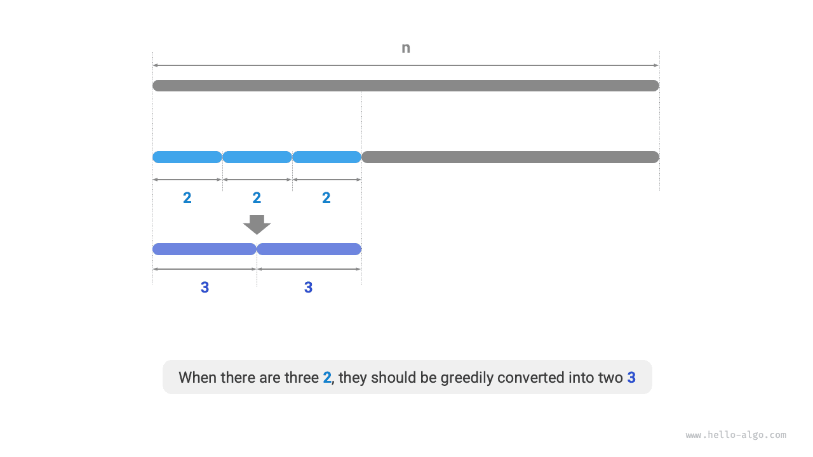

# 整数を分割して積を最大にする問題

!!! question

    正の整数 $n$ を、少なくとも二つの正の整数の和に分けます。分割後のすべての整数の積の最大値を求めてください。下図に例を示します。


$n$ を $m$ 個の整数に分け、それぞれを積の因数とします。$i$ 番目の因数を $n_i$ とすると、次の式が成り立ちます。

$$
n = \sum_{i=1}^{m}n_i
$$

この問題の目標は、すべての整数の因数の積を最大にすることです。すなわち、

$$
\max(\prod_{i=1}^{m}n_i)
$$

考えるべきことは、分割数 $m$ をいくつにし、それぞれの $n_i$ をいくつにするかです。

### 貪欲戦略を決める

経験上、二つの整数の積は、その和より大きくなることがよくあります。$n$ から因数 $2$ を切り出すと、積は $2(n-2)$ です。これを $n$ と比較します。

$$
\begin{aligned}
2(n-2) & \geq n \newline
2n - n - 4 & \geq 0 \newline
n & \geq 4
\end{aligned}
$$

下図のように、$n \geq 4$ なら $2$ を切り出すことで積が大きくなります。**つまり、$4$ 以上の整数は分割すべきだとわかります**。

**貪欲戦略 1**：分割結果に $\geq 4$ の因数が含まれるなら、それをさらに分割します。最終的に残る因数は、$1$、$2$、$3$ の 3 種類だけにします。


次に、どの因数が最もよいかを考えます。$1$、$2$、$3$ の中では、明らかに $1$ が最も不利です。常に $1 \times (n-1) < n$ なので、$1$ を切り出すと、かえって積が小さくなるためです。

下図のように、$n = 6$ では $3 \times 3 > 2 \times 2 \times 2$ です。**つまり、$2$ より $3$ に分ける方が有利です**。

**貪欲戦略 2**：分割結果の $2$ は、多くても二つにします。三つの $2$ は常に二つの $3$ に置き換えられ、その方が積が大きくなるためです。



以上から、次の貪欲戦略が導けます。

1. 入力された整数 $n$ から因数 $3$ を繰り返し切り出し、余りが $0$、$1$、$2$ のいずれかになるまで続けます。
2. 余りが $0$ なら、$n$ は $3$ の倍数なので、何もしません。
3. 余りが $2$ なら、それ以上分割せずに残します。
4. 余りが $1$ なら、$2 \times 2 > 1 \times 3$ なので、最後の $3$ と余りの $1$ を、二つの $2$ に置き換えます。

### コードの実装

下図のように、ループで整数を分割する必要はありません。切り捨ての整数除算で $3$ の個数 $a$ を求め、剰余演算で余り $b$ を求めると、次の関係が成り立ちます。

$$
n = 3 a + b
$$

境界の場合 $n \leq 3$ では、必ず $1$ を一つ切り出す必要があり、積は $1 \times (n - 1)$ になります。

```src
[file]{max_product_cutting}-[class]{}-[func]{max_product_cutting}
```


**時間計算量は、プログラミング言語の累乗演算の実装によって決まります**。Python を例にすると、よく使われる累乗の計算方法には三つあります。

- 演算子 `**` と関数 `pow()` の時間計算量は、どちらも $O(\log⁡ a)$ です。
- 関数 `math.pow()` は内部で C 標準ライブラリの `pow()` を呼び出します。浮動小数点の累乗を計算し、時間計算量は $O(1)$ です。

変数 $a$ と $b$ が使う追加の空間は一定なので、**空間計算量は $O(1)$ です**。

### 正しさの証明

背理法を使い、$n \geq 4$ の場合だけを考えます。

1. **すべての因数は $\leq 3$**：最適な分割に $\geq 4$ の因数 $x$ が含まれると仮定します。これをさらに $2(x-2)$ に分けると、積を大きくする（または等しく保つ）ことができます。これは仮定に矛盾します。
2. **分割結果に $1$ は含まれない**：最適な分割に因数 $1$ が含まれると仮定します。それを別の因数に足してまとめれば、積を大きくできます。これは仮定に矛盾します。
3. **分割結果の $2$ は多くても二つ**：最適な分割に三つの $2$ が含まれると仮定します。これを二つの $3$ に置き換えると、積が大きくなります。これは仮定に矛盾します。
