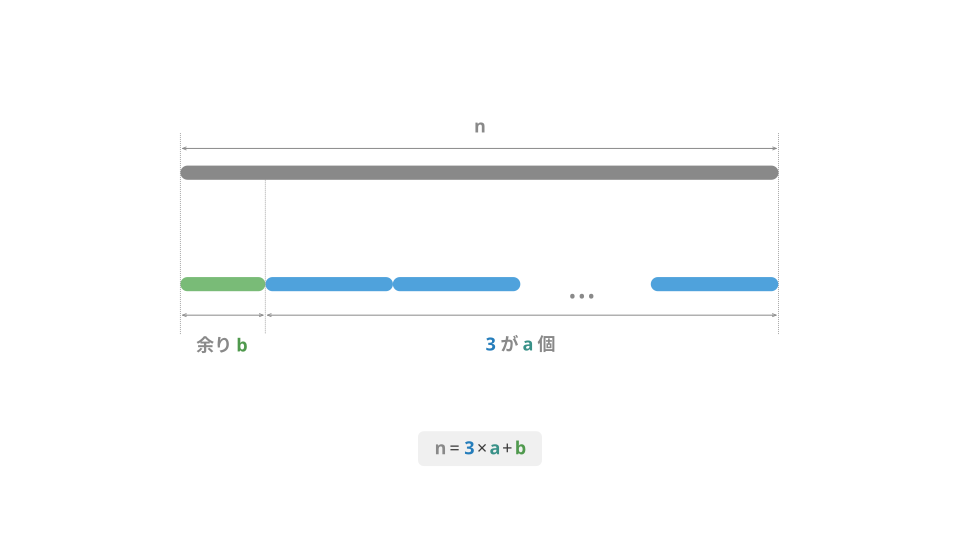

# 整数分割の最大積問題

!!! question

    正の整数 $n$ が与えられます。次の図のように、これを少なくとも 2 つの正の整数の和に分けたとき、それらすべての積が最大でいくつになるかを求めてください。


$n$ を $m$ 個の整数の因子に分け、$i$ 番目の因子を $n_i$ と書くと、次の式が成り立ちます。

$$
n = \sum_{i=1}^{m}n_i
$$

この問題の目標は、すべての整数の因子の積を最大にすることです。式で表すと次のようになります。

$$
\max(\prod_{i=1}^{m}n_i)
$$

考えるべきことは、分割する個数 $m$ と、それぞれの $n_i$ の値をいくつにすればよいかです。

### 貪欲戦略の決め方

経験上、2 つの整数を掛けると、足したときより大きくなることがよくあります。$n$ から因子 $2$ を切り出すと、積は $2(n-2)$ です。この積を $n$ と比べてみましょう。

$$
\begin{aligned}
2(n-2) & \geq n \newline
2n - n - 4 & \geq 0 \newline
n & \geq 4
\end{aligned}
$$

次の図のように、$n \geq 4$ のとき、$2$ を 1 つ切り出すと積が大きくなります。**したがって、$4$ 以上の整数はすべて分割すべきです**。

**貪欲戦略 1**。分割した中に $\geq 4$ の因子があれば、さらに分割します。最終的に残す因子は $1$、$2$、$3$ の 3 種類だけで十分です。


次に、どの因子が最も有利かを考えます。$1$、$2$、$3$ の中で、最も不利なのは明らかに $1$ です。常に $1 \times (n-1) < n$ が成り立つので、$1$ を切り出すとかえって積が小さくなるからです。

次の図のように、$n = 6$ のとき $3 \times 3 > 2 \times 2 \times 2$ です。**つまり、$2$ を切り出すより $3$ を切り出すほうが有利です**。

**貪欲戦略 2**。分割後に残す $2$ は高々 2 個です。$2$ が 3 個あれば、必ず 2 個の $3$ に置き換えて、積をより大きくできるからです。


以上をまとめると、次の貪欲戦略が得られます。

1. 入力の整数 $n$ から因子 $3$ を繰り返し切り出し、余りが $0$、$1$、$2$ のいずれかになるまで続けます。
2. 余りが $0$ なら、$n$ は $3$ の倍数なので、そのままにします。
3. 余りが $2$ なら、それ以上分けずにそのまま残します。
4. 余りが $1$ なら、$2 \times 2 > 1 \times 3$ が成り立つので、最後の $3$ と余りの $1$ を 2 個の $2$ に置き換えます。

### コードによる実装

次の図のように、整数をループで分割する必要はありません。切り捨て除算で $3$ の個数 $a$ を、剰余演算で余り $b$ を求めると、次の関係が成り立ちます。

$$
n = 3 a + b
$$

境界条件 $n \leq 3$ の場合は、必ず $1$ を 1 つ切り出す必要があることに注意してください。積は $1 \times (n - 1)$ です。

```src
[file]{max_product_cutting}-[class]{}-[func]{max_product_cutting}
```



**時間計算量は、使用する言語がべき乗をどう実装しているかによって決まります**。例えば Python には、よく使われるべき乗の計算方法が 3 つあります。

- 演算子 `**` と関数 `pow()` の時間計算量は、いずれも $O(\log⁡ a)$ です。
- 関数 `math.pow()` は内部で C 言語のライブラリ関数 `pow()` を呼び出し、浮動小数点数のべき乗を計算します。時間計算量は $O(1)$ です。

変数 $a$ と $b$ が使う追加領域は一定なので、**空間計算量は $O(1)$ です**。

### 正しさの証明

背理法を使い、$n \geq 4$ の場合だけを考えます。

1. **すべての因子が $\leq 3$ を満たす**。最適な分け方に $\geq 4$ の因子 $x$ があると仮定します。これをさらに分けて積を $2(x-2)$ とすれば、元より大きい（または等しい）積が得られます。これは仮定に矛盾します。
2. **分割後の因子に $1$ を含まない**。最適な分け方に因子 $1$ があると仮定します。それをほかの因子の一つに足してまとめると、必ずより大きな積が得られます。これは仮定に矛盾します。
3. **分割後に含まれる $2$ は高々 2 個**。最適な分け方に $2$ が 3 個含まれると仮定します。これらは必ず 2 個の $3$ に置き換えられ、積が大きくなります。これは仮定に矛盾します。
