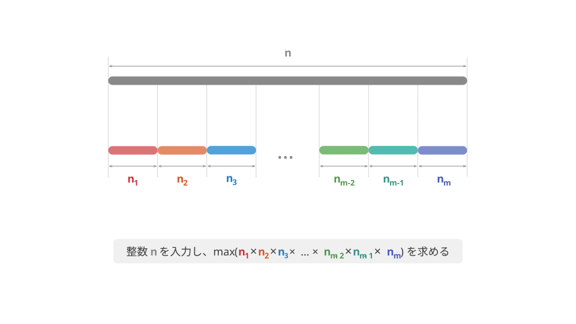
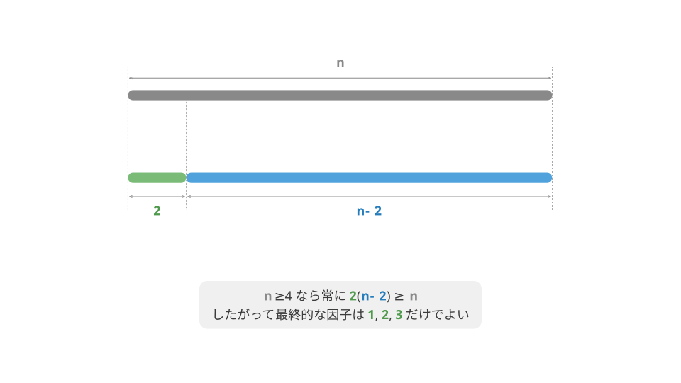
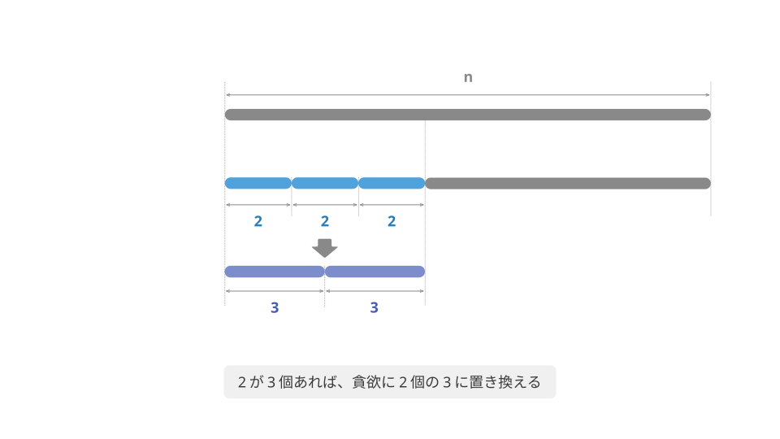

# 15.4 &nbsp; 整数分割の最大積問題

!!! question "問題"

    正の整数 $n$ が与えられます。図 15-13 のように、これを少なくとも 2 つの正の整数の和に分けたとき、それらすべての積が最大でいくつになるかを求めてください。

{ class="animation-figure" }

<p align="center"> 図 15-13 &nbsp; 整数分割の積を最大にする問題の定義 </p>

$n$ を $m$ 個の整数の因子に分け、$i$ 番目の因子を $n_i$ と書くと、次の式が成り立ちます。

$$
n = \sum_{i=1}^{m}n_i
$$

この問題の目標は、すべての整数の因子の積を最大にすることです。式で表すと次のようになります。

$$
\max(\prod_{i=1}^{m}n_i)
$$

考えるべきことは、分割する個数 $m$ と、それぞれの $n_i$ の値をいくつにすればよいかです。

### 1. &nbsp; 貪欲戦略の決め方

経験上、2 つの整数を掛けると、足したときより大きくなることがよくあります。$n$ から因子 $2$ を切り出すと、積は $2(n-2)$ です。この積を $n$ と比べてみましょう。

$$
\begin{aligned}
2(n-2) & \geq n \newline
2n - n - 4 & \geq 0 \newline
n & \geq 4
\end{aligned}
$$

図 15-14 のように、$n \geq 4$ のとき、$2$ を 1 つ切り出すと積が大きくなります。**したがって、$4$ 以上の整数はすべて分割すべきです**。

**貪欲戦略 1**。分割した中に $\geq 4$ の因子があれば、さらに分割します。最終的に残す因子は $1$、$2$、$3$ の 3 種類だけで十分です。

{ class="animation-figure" }

<p align="center"> 図 15-14 &nbsp; 分割すると積が大きくなる </p>

次に、どの因子が最も有利かを考えます。$1$、$2$、$3$ の中で、最も不利なのは明らかに $1$ です。常に $1 \times (n-1) < n$ が成り立つので、$1$ を切り出すとかえって積が小さくなるからです。

図 15-15 のように、$n = 6$ のとき $3 \times 3 > 2 \times 2 \times 2$ です。**つまり、$2$ を切り出すより $3$ を切り出すほうが有利です**。

**貪欲戦略 2**。分割後に残す $2$ は高々 2 個です。$2$ が 3 個あれば、必ず 2 個の $3$ に置き換えて、積をより大きくできるからです。

{ class="animation-figure" }

<p align="center"> 図 15-15 &nbsp; 最適な分割に使う因子 </p>

以上をまとめると、次の貪欲戦略が得られます。

1. 入力の整数 $n$ から因子 $3$ を繰り返し切り出し、余りが $0$、$1$、$2$ のいずれかになるまで続けます。
2. 余りが $0$ なら、$n$ は $3$ の倍数なので、そのままにします。
3. 余りが $2$ なら、それ以上分けずにそのまま残します。
4. 余りが $1$ なら、$2 \times 2 > 1 \times 3$ が成り立つので、最後の $3$ と余りの $1$ を 2 個の $2$ に置き換えます。

### 2. &nbsp; コードによる実装

図 15-16 のように、整数をループで分割する必要はありません。切り捨て除算で $3$ の個数 $a$ を、剰余演算で余り $b$ を求めると、次の関係が成り立ちます。

$$
n = 3 a + b
$$

境界条件 $n \leq 3$ の場合は、必ず $1$ を 1 つ切り出す必要があることに注意してください。積は $1 \times (n - 1)$ です。

=== "Python"

    ```python title="max_product_cutting.py"
    def max_product_cutting(n: int) -> int:
        """整数分割の最大積（貪欲法）"""
        # n <= 3 の場合は必ず 1 を切り出す
        if n <= 3:
            return 1 * (n - 1)
        # 貪欲に 3 を切り出す。a は 3 の個数、b は余り
        a, b = n // 3, n % 3
        if b == 1:
            # 余りが 1 なら、1 * 3 の組を 2 * 2 に置き換える
            return int(math.pow(3, a - 1)) * 2 * 2
        if b == 2:
            # 余りが 2 なら、そのままにする
            return int(math.pow(3, a)) * 2
        # 余りが 0 なら、そのままにする
        return int(math.pow(3, a))
    ```

=== "C++"

    ```cpp title="max_product_cutting.cpp"
    /* 整数分割の最大積（貪欲法） */
    int maxProductCutting(int n) {
        // n <= 3 の場合は必ず 1 を切り出す
        if (n <= 3) {
            return 1 * (n - 1);
        }
        // 貪欲に 3 を切り出す。a は 3 の個数、b は余り
        int a = n / 3;
        int b = n % 3;
        if (b == 1) {
            // 余りが 1 なら、1 * 3 の組を 2 * 2 に置き換える
            return (int)pow(3, a - 1) * 2 * 2;
        }
        if (b == 2) {
            // 余りが 2 なら、そのままにする
            return (int)pow(3, a) * 2;
        }
        // 余りが 0 なら、そのままにする
        return (int)pow(3, a);
    }
    ```

=== "Java"

    ```java title="max_product_cutting.java"
    /* 整数分割の最大積（貪欲法） */
    int maxProductCutting(int n) {
        // n <= 3 の場合は必ず 1 を切り出す
        if (n <= 3) {
            return 1 * (n - 1);
        }
        // 貪欲に 3 を切り出す。a は 3 の個数、b は余り
        int a = n / 3;
        int b = n % 3;
        if (b == 1) {
            // 余りが 1 なら、1 * 3 の組を 2 * 2 に置き換える
            return (int) Math.pow(3, a - 1) * 2 * 2;
        }
        if (b == 2) {
            // 余りが 2 なら、そのままにする
            return (int) Math.pow(3, a) * 2;
        }
        // 余りが 0 なら、そのままにする
        return (int) Math.pow(3, a);
    }
    ```

=== "C#"

    ```csharp title="max_product_cutting.cs"
    /* 整数分割の最大積（貪欲法） */
    int MaxProductCutting(int n) {
        // n <= 3 の場合は必ず 1 を切り出す
        if (n <= 3) {
            return 1 * (n - 1);
        }
        // 貪欲に 3 を切り出す。a は 3 の個数、b は余り
        int a = n / 3;
        int b = n % 3;
        if (b == 1) {
            // 余りが 1 なら、1 * 3 の組を 2 * 2 に置き換える
            return (int)Math.Pow(3, a - 1) * 2 * 2;
        }
        if (b == 2) {
            // 余りが 2 なら、そのままにする
            return (int)Math.Pow(3, a) * 2;
        }
        // 余りが 0 なら、そのままにする
        return (int)Math.Pow(3, a);
    }
    ```

=== "Go"

    ```go title="max_product_cutting.go"
    /* 整数分割の最大積（貪欲法） */
    func maxProductCutting(n int) int {
        // n <= 3 の場合は必ず 1 を切り出す
        if n <= 3 {
            return 1 * (n - 1)
        }
        // 貪欲に 3 を切り出す。a は 3 の個数、b は余り
        a := n / 3
        b := n % 3
        if b == 1 {
            // 余りが 1 なら、1 * 3 の組を 2 * 2 に置き換える
            return int(math.Pow(3, float64(a-1))) * 2 * 2
        }
        if b == 2 {
            // 余りが 2 なら、そのままにする
            return int(math.Pow(3, float64(a))) * 2
        }
        // 余りが 0 なら、そのままにする
        return int(math.Pow(3, float64(a)))
    }
    ```

=== "Swift"

    ```swift title="max_product_cutting.swift"
    /* 整数分割の最大積（貪欲法） */
    func maxProductCutting(n: Int) -> Int {
        // n <= 3 の場合は必ず 1 を切り出す
        if n <= 3 {
            return 1 * (n - 1)
        }
        // 貪欲に 3 を切り出す。a は 3 の個数、b は余り
        let a = n / 3
        let b = n % 3
        if b == 1 {
            // 余りが 1 なら、1 * 3 の組を 2 * 2 に置き換える
            return pow(3, a - 1) * 2 * 2
        }
        if b == 2 {
            // 余りが 2 なら、そのままにする
            return pow(3, a) * 2
        }
        // 余りが 0 なら、そのままにする
        return pow(3, a)
    }
    ```

=== "JS"

    ```javascript title="max_product_cutting.js"
    /* 整数分割の最大積（貪欲法） */
    function maxProductCutting(n) {
        // n <= 3 の場合は必ず 1 を切り出す
        if (n <= 3) {
            return 1 * (n - 1);
        }
        // 貪欲に 3 を切り出す。a は 3 の個数、b は余り
        let a = Math.floor(n / 3);
        let b = n % 3;
        if (b === 1) {
            // 余りが 1 なら、1 * 3 の組を 2 * 2 に置き換える
            return Math.pow(3, a - 1) * 2 * 2;
        }
        if (b === 2) {
            // 余りが 2 なら、そのままにする
            return Math.pow(3, a) * 2;
        }
        // 余りが 0 なら、そのままにする
        return Math.pow(3, a);
    }
    ```

=== "TS"

    ```typescript title="max_product_cutting.ts"
    /* 整数分割の最大積（貪欲法） */
    function maxProductCutting(n: number): number {
        // n <= 3 の場合は必ず 1 を切り出す
        if (n <= 3) {
            return 1 * (n - 1);
        }
        // 貪欲に 3 を切り出す。a は 3 の個数、b は余り
        let a: number = Math.floor(n / 3);
        let b: number = n % 3;
        if (b === 1) {
            // 余りが 1 なら、1 * 3 の組を 2 * 2 に置き換える
            return Math.pow(3, a - 1) * 2 * 2;
        }
        if (b === 2) {
            // 余りが 2 なら、そのままにする
            return Math.pow(3, a) * 2;
        }
        // 余りが 0 なら、そのままにする
        return Math.pow(3, a);
    }
    ```

=== "Dart"

    ```dart title="max_product_cutting.dart"
    /* 整数分割の最大積（貪欲法） */
    int maxProductCutting(int n) {
      // n <= 3 の場合は必ず 1 を切り出す
      if (n <= 3) {
        return 1 * (n - 1);
      }
      // 貪欲に 3 を切り出す。a は 3 の個数、b は余り
      int a = n ~/ 3;
      int b = n % 3;
      if (b == 1) {
        // 余りが 1 なら、1 * 3 の組を 2 * 2 に置き換える
        return (pow(3, a - 1) * 2 * 2).toInt();
      }
      if (b == 2) {
        // 余りが 2 なら、そのままにする
        return (pow(3, a) * 2).toInt();
      }
      // 余りが 0 なら、そのままにする
      return pow(3, a).toInt();
    }
    ```

=== "Rust"

    ```rust title="max_product_cutting.rs"
    /* 整数分割の最大積（貪欲法） */
    fn max_product_cutting(n: i32) -> i32 {
        // n <= 3 の場合は必ず 1 を切り出す
        if n <= 3 {
            return 1 * (n - 1);
        }
        // 貪欲に 3 を切り出す。a は 3 の個数、b は余り
        let a = n / 3;
        let b = n % 3;
        if b == 1 {
            // 余りが 1 なら、1 * 3 の組を 2 * 2 に置き換える
            3_i32.pow(a as u32 - 1) * 2 * 2
        } else if b == 2 {
            // 余りが 2 なら、そのままにする
            3_i32.pow(a as u32) * 2
        } else {
            // 余りが 0 なら、そのままにする
            3_i32.pow(a as u32)
        }
    }
    ```

=== "C"

    ```c title="max_product_cutting.c"
    /* 整数分割の最大積（貪欲法） */
    int maxProductCutting(int n) {
        // n <= 3 の場合は必ず 1 を切り出す
        if (n <= 3) {
            return 1 * (n - 1);
        }
        // 貪欲に 3 を切り出す。a は 3 の個数、b は余り
        int a = n / 3;
        int b = n % 3;
        if (b == 1) {
            // 余りが 1 なら、1 * 3 の組を 2 * 2 に置き換える
            return pow(3, a - 1) * 2 * 2;
        }
        if (b == 2) {
            // 余りが 2 なら、そのままにする
            return pow(3, a) * 2;
        }
        // 余りが 0 なら、そのままにする
        return pow(3, a);
    }
    ```

=== "Kotlin"

    ```kotlin title="max_product_cutting.kt"
    /* 整数分割の最大積（貪欲法） */
    fun maxProductCutting(n: Int): Int {
        // n <= 3 の場合は必ず 1 を切り出す
        if (n <= 3) {
            return 1 * (n - 1)
        }
        // 貪欲に 3 を切り出す。a は 3 の個数、b は余り
        val a = n / 3
        val b = n % 3
        if (b == 1) {
            // 余りが 1 なら、1 * 3 の組を 2 * 2 に置き換える
            return 3.0.pow((a - 1)).toInt() * 2 * 2
        }
        if (b == 2) {
            // 余りが 2 なら、そのままにする
            return 3.0.pow(a).toInt() * 2
        }
        // 余りが 0 なら、そのままにする
        return 3.0.pow(a).toInt()
    }
    ```

=== "Ruby"

    ```ruby title="max_product_cutting.rb"
    ### 整数分割の最大積（貪欲法） ###
    def max_product_cutting(n)
      # n <= 3 の場合は必ず 1 を切り出す
      return 1 * (n - 1) if n <= 3
      # 貪欲に 3 を切り出す。a は 3 の個数、b は余り
      a, b = n / 3, n % 3
      # 余りが 1 なら、1 * 3 の組を 2 * 2 に置き換える
      return (3.pow(a - 1) * 2 * 2).to_i if b == 1
      # 余りが 2 なら、そのままにする
      return (3.pow(a) * 2).to_i if b == 2
      # 余りが 0 なら、そのままにする
      3.pow(a).to_i
    end
    ```

??? pythontutor "実行の様子を見る"

    <div style="height: 549px; width: 100%;"><iframe class="pythontutor-iframe" title="実行の様子を見る" src="https://pythontutor.com/iframe-embed.html#code=import%20math%0A%0Adef%20max_product_cutting%28n%3A%20int%29%20-%3E%20int%3A%0A%20%20%20%20%22%22%22%E6%95%B4%E6%95%B0%E5%88%86%E5%89%B2%E3%81%AE%E6%9C%80%E5%A4%A7%E7%A9%8D%EF%BC%88%E8%B2%AA%E6%AC%B2%E6%B3%95%EF%BC%89%22%22%22%0A%20%20%20%20%23%20n%20%3C%3D%203%20%E3%81%AE%E5%A0%B4%E5%90%88%E3%81%AF%E5%BF%85%E3%81%9A%201%20%E3%82%92%E5%88%87%E3%82%8A%E5%87%BA%E3%81%99%0A%20%20%20%20if%20n%20%3C%3D%203%3A%0A%20%20%20%20%20%20%20%20return%201%20%2A%20%28n%20-%201%29%0A%20%20%20%20%23%20%E8%B2%AA%E6%AC%B2%E3%81%AB%203%20%E3%82%92%E5%88%87%E3%82%8A%E5%87%BA%E3%81%99%E3%80%82a%20%E3%81%AF%203%20%E3%81%AE%E5%80%8B%E6%95%B0%E3%80%81b%20%E3%81%AF%E4%BD%99%E3%82%8A%0A%20%20%20%20a,%20b%20%3D%20n%20//%203,%20n%20%25%203%0A%20%20%20%20if%20b%20%3D%3D%201%3A%0A%20%20%20%20%20%20%20%20%23%20%E4%BD%99%E3%82%8A%E3%81%8C%201%20%E3%81%AA%E3%82%89%E3%80%811%20%2A%203%20%E3%81%AE%E7%B5%84%E3%82%92%202%20%2A%202%20%E3%81%AB%E7%BD%AE%E3%81%8D%E6%8F%9B%E3%81%88%E3%82%8B%0A%20%20%20%20%20%20%20%20return%20int%28math.pow%283,%20a%20-%201%29%29%20%2A%202%20%2A%202%0A%20%20%20%20if%20b%20%3D%3D%202%3A%0A%20%20%20%20%20%20%20%20%23%20%E4%BD%99%E3%82%8A%E3%81%8C%202%20%E3%81%AA%E3%82%89%E3%80%81%E3%81%9D%E3%81%AE%E3%81%BE%E3%81%BE%E3%81%AB%E3%81%99%E3%82%8B%0A%20%20%20%20%20%20%20%20return%20int%28math.pow%283,%20a%29%29%20%2A%202%0A%20%20%20%20%23%20%E4%BD%99%E3%82%8A%E3%81%8C%200%20%E3%81%AA%E3%82%89%E3%80%81%E3%81%9D%E3%81%AE%E3%81%BE%E3%81%BE%E3%81%AB%E3%81%99%E3%82%8B%0A%20%20%20%20return%20int%28math.pow%283,%20a%29%29%0A%0A%22%22%22Driver%20Code%22%22%22%0Aif%20__name__%20%3D%3D%20%22__main__%22%3A%0A%20%20%20%20n%20%3D%2058%0A%0A%20%20%20%20%23%20%E8%B2%AA%E6%AC%B2%E6%B3%95%0A%20%20%20%20res%20%3D%20max_product_cutting%28n%29%0A%20%20%20%20print%28f%22%E5%88%86%E5%89%B2%E5%BE%8C%E3%81%AE%E7%A9%8D%E3%81%AE%E6%9C%80%E5%A4%A7%E5%80%A4%E3%81%AF%20%7Bres%7D%22%29&codeDivHeight=472&codeDivWidth=350&cumulative=false&curInstr=5&heapPrimitives=nevernest&origin=opt-frontend.js&py=311&rawInputLstJSON=%5B%5D&textReferences=false"> </iframe></div>
    <div style="margin-top: 5px;"><a href="https://pythontutor.com/iframe-embed.html#code=import%20math%0A%0Adef%20max_product_cutting%28n%3A%20int%29%20-%3E%20int%3A%0A%20%20%20%20%22%22%22%E6%95%B4%E6%95%B0%E5%88%86%E5%89%B2%E3%81%AE%E6%9C%80%E5%A4%A7%E7%A9%8D%EF%BC%88%E8%B2%AA%E6%AC%B2%E6%B3%95%EF%BC%89%22%22%22%0A%20%20%20%20%23%20n%20%3C%3D%203%20%E3%81%AE%E5%A0%B4%E5%90%88%E3%81%AF%E5%BF%85%E3%81%9A%201%20%E3%82%92%E5%88%87%E3%82%8A%E5%87%BA%E3%81%99%0A%20%20%20%20if%20n%20%3C%3D%203%3A%0A%20%20%20%20%20%20%20%20return%201%20%2A%20%28n%20-%201%29%0A%20%20%20%20%23%20%E8%B2%AA%E6%AC%B2%E3%81%AB%203%20%E3%82%92%E5%88%87%E3%82%8A%E5%87%BA%E3%81%99%E3%80%82a%20%E3%81%AF%203%20%E3%81%AE%E5%80%8B%E6%95%B0%E3%80%81b%20%E3%81%AF%E4%BD%99%E3%82%8A%0A%20%20%20%20a,%20b%20%3D%20n%20//%203,%20n%20%25%203%0A%20%20%20%20if%20b%20%3D%3D%201%3A%0A%20%20%20%20%20%20%20%20%23%20%E4%BD%99%E3%82%8A%E3%81%8C%201%20%E3%81%AA%E3%82%89%E3%80%811%20%2A%203%20%E3%81%AE%E7%B5%84%E3%82%92%202%20%2A%202%20%E3%81%AB%E7%BD%AE%E3%81%8D%E6%8F%9B%E3%81%88%E3%82%8B%0A%20%20%20%20%20%20%20%20return%20int%28math.pow%283,%20a%20-%201%29%29%20%2A%202%20%2A%202%0A%20%20%20%20if%20b%20%3D%3D%202%3A%0A%20%20%20%20%20%20%20%20%23%20%E4%BD%99%E3%82%8A%E3%81%8C%202%20%E3%81%AA%E3%82%89%E3%80%81%E3%81%9D%E3%81%AE%E3%81%BE%E3%81%BE%E3%81%AB%E3%81%99%E3%82%8B%0A%20%20%20%20%20%20%20%20return%20int%28math.pow%283,%20a%29%29%20%2A%202%0A%20%20%20%20%23%20%E4%BD%99%E3%82%8A%E3%81%8C%200%20%E3%81%AA%E3%82%89%E3%80%81%E3%81%9D%E3%81%AE%E3%81%BE%E3%81%BE%E3%81%AB%E3%81%99%E3%82%8B%0A%20%20%20%20return%20int%28math.pow%283,%20a%29%29%0A%0A%22%22%22Driver%20Code%22%22%22%0Aif%20__name__%20%3D%3D%20%22__main__%22%3A%0A%20%20%20%20n%20%3D%2058%0A%0A%20%20%20%20%23%20%E8%B2%AA%E6%AC%B2%E6%B3%95%0A%20%20%20%20res%20%3D%20max_product_cutting%28n%29%0A%20%20%20%20print%28f%22%E5%88%86%E5%89%B2%E5%BE%8C%E3%81%AE%E7%A9%8D%E3%81%AE%E6%9C%80%E5%A4%A7%E5%80%A4%E3%81%AF%20%7Bres%7D%22%29&codeDivHeight=800&codeDivWidth=600&cumulative=false&curInstr=5&heapPrimitives=nevernest&origin=opt-frontend.js&py=311&rawInputLstJSON=%5B%5D&textReferences=false" target="_blank" rel="noopener noreferrer">全画面で表示 ></a></div>

{ class="animation-figure" }

<p align="center"> 図 15-16 &nbsp; 整数分割の最大積の計算方法 </p>

**時間計算量は、使用する言語がべき乗をどう実装しているかによって決まります**。例えば Python には、よく使われるべき乗の計算方法が 3 つあります。

- 演算子 `**` と関数 `pow()` の時間計算量は、いずれも $O(\log⁡ a)$ です。
- 関数 `math.pow()` は内部で C 言語のライブラリ関数 `pow()` を呼び出し、浮動小数点数のべき乗を計算します。時間計算量は $O(1)$ です。

変数 $a$ と $b$ が使う追加領域は一定なので、**空間計算量は $O(1)$ です**。

### 3. &nbsp; 正しさの証明

背理法を使い、$n \geq 4$ の場合だけを考えます。

1. **すべての因子が $\leq 3$ を満たす**。最適な分け方に $\geq 4$ の因子 $x$ があると仮定します。これをさらに分けて積を $2(x-2)$ とすれば、元より大きい（または等しい）積が得られます。これは仮定に矛盾します。
2. **分割後の因子に $1$ を含まない**。最適な分け方に因子 $1$ があると仮定します。それをほかの因子の一つに足してまとめると、必ずより大きな積が得られます。これは仮定に矛盾します。
3. **分割後に含まれる $2$ は高々 2 個**。最適な分け方に $2$ が 3 個含まれると仮定します。これらは必ず 2 個の $3$ に置き換えられ、積が大きくなります。これは仮定に矛盾します。
