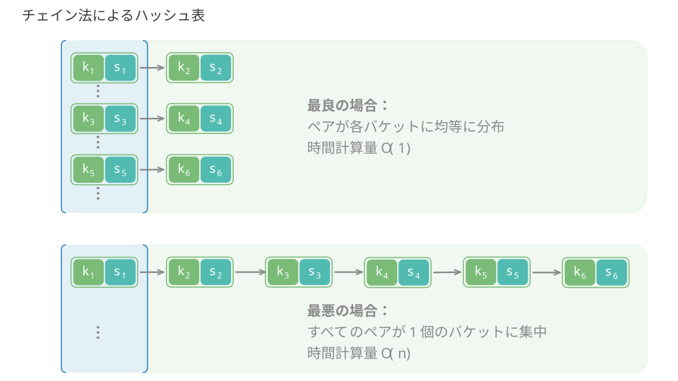

# ハッシュアルゴリズム

前の二節では、ハッシュテーブルの仕組みと衝突への対処方法を紹介しました。ただし、オープンアドレス法もチェイン法も、**衝突時に正しく動作することを保証するだけで、衝突の発生自体を減らすことはできません**。

衝突が頻繁すぎると、性能は急激に悪化します。下図のチェイン法では、理想的にはペアが各バケットへ均等に分布し、最高の照会効率を得られます。最悪の場合はすべて同じバケットに入り、時間計算量が $O(n)$ に悪化します。



**ペアの分布を決めるのはハッシュ関数です**。計算手順を思い出すと、まずハッシュ値を求め、配列の長さで剰余を取ります。

```shell
index = hash(key) % capacity
```

この式で容量 `capacity` が固定なら、**ハッシュアルゴリズム `hash()` が出力値を決め**、ひいてはハッシュテーブル内のペアの分布を決めます。

したがって、衝突の確率を減らすには、`hash()` の設計に注目すべきです。

## ハッシュアルゴリズムの目標

速く安定したハッシュテーブルを実現するため、ハッシュアルゴリズムには次の特徴が必要です。

- **決定性**：同じ入力には常に同じ出力を返す必要があります。これにより、ハッシュテーブルの信頼性を確保できます。
- **高い効率**：ハッシュ値を十分速く計算できる必要があります。計算負荷が小さいほど、実用性が高まります。
- **均等な分布**：ペアがテーブル全体に均等に分布する必要があります。均等なほど、衝突の確率が低くなります。

ハッシュアルゴリズムは、ハッシュテーブル以外の分野でも広く使われています。

- **パスワードの保存**：安全性を守るため、通常はパスワードを平文で直接保存せず、ハッシュ値を保存します。入力されたパスワードのハッシュ値を計算し、保存済みの値と比較します。一致すれば、正しいパスワードと見なします。
- **データの完全性の確認**：送信側はデータのハッシュ値を計算して一緒に送り、受信側は受け取ったデータのハッシュ値を再計算して、届いた値と比較できます。一致すれば、データは完全であると見なします。

暗号分野では、ハッシュ値から元のパスワードを推測するなどの逆解析を防ぐため、より高い安全性が必要です。

- **一方向性**：ハッシュ値から入力データに関する情報を逆算できないことです。
- **衝突耐性**：異なる二つの入力で同じハッシュ値になるものを見つけることが、極めて困難であることです。
- **雪崩効果**：入力のわずかな変化が、出力の大きく予測できない変化を引き起こすことです。

**均等な分布と衝突耐性は、独立した概念です**。分布が均等でも、衝突耐性があるとは限りません。例えば、ランダムな `key` に対する `key % 100` は均等な出力を生みます。しかし単純すぎるため、下二桁が等しい `key` はすべて同じ出力になります。そのため、ハッシュ値から使える `key` を容易に逆算し、パスワードを破れます。

## ハッシュアルゴリズムの設計

設計には多くの要因を考慮する必要があり、複雑な問題です。ただし、要件が厳しくない場面では、単純なアルゴリズムも設計できます。

- **加算ハッシュ**：入力の各文字の ASCII コードを足し、その合計をハッシュ値にします。
- **乗算ハッシュ**：乗算による非相関性を利用し、毎回定数を掛けながら各文字の ASCII コードをハッシュ値に累積します。
- **排他的論理和ハッシュ**：入力の各要素を XOR 演算で一つのハッシュ値に累積します。
- **回転ハッシュ**：各文字の ASCII コードを累積する前に、毎回ハッシュ値のビットを回転させます。

```src
[file]{simple_hash}-[class]{}-[func]{rot_hash}
```

どの方法も最後に大きな素数 $1000000007$ で剰余を取り、値を適切な範囲に収めています。なぜ素数を法とすることを強調するのでしょうか。合成数を法とすると、どのような欠点があるのでしょうか。興味深い問いです。

先に結論を述べると、**大きな素数を法とすることで、ハッシュ値の分布をできるだけ均等にできます**。素数はほかの数と公約数を持たないため、剰余による周期的なパターンを減らし、衝突を避けられるからです。

例えば、合成数 $9$ を法に選ぶと、$3$ で割り切れるため、$3$ で割り切れる `key` はすべて $0$、$3$、$6$ の三つに写されます。

$$
\begin{aligned}
\text{modulus} & = 9 \newline
\text{key} & = \{ 0, 3, 6, 9, 12, 15, 18, 21, 24, 27, 30, 33, \dots \} \newline
\text{hash} & = \{ 0, 3, 6, 0, 3, 6, 0, 3, 6, 0, 3, 6,\dots \}
\end{aligned}
$$

入力 `key` がちょうどこのような等差数列なら、ハッシュ値が集中し、衝突が増えます。`modulus` を素数 $13$ に置き換えると、`key` と `modulus` の間に公約数がないため、出力の均等性は大幅に向上します。

$$
\begin{aligned}
\text{modulus} & = 13 \newline
\text{key} & = \{ 0, 3, 6, 9, 12, 15, 18, 21, 24, 27, 30, 33, \dots \} \newline
\text{hash} & = \{ 0, 3, 6, 9, 12, 2, 5, 8, 11, 1, 4, 7, \dots \}
\end{aligned}
$$

`key` がランダムかつ一様に分布すると保証できるなら、法は素数でも合成数でもよく、どちらも均等なハッシュ値を出力します。一方、`key` の分布に何らかの周期性があると、合成数ではクラスタリングが起きやすくなります。

したがって、通常は法に素数を選び、できれば十分大きくすることで、周期的なパターンをできるだけ取り除き、アルゴリズムの頑健性を高めます。

## 主なハッシュアルゴリズム

ここまでの単純なアルゴリズムは脆弱で、設計目標には遠く及びません。例えば、加算と XOR は交換法則を満たすため、同じ文字を異なる順序で並べた文字列を区別できません。これは衝突を増やし、安全性の問題も引き起こす可能性があります。

実際には、MD5、SHA-1、SHA-2、SHA-3 などの標準的なアルゴリズムをよく使います。任意の長さの入力を、固定長のハッシュ値へ写せます。

この約一世紀、ハッシュアルゴリズムは改良と最適化を重ねてきました。性能向上に取り組む研究者がいる一方、安全性の問題を探す研究者やハッカーもいます。実用でよく使われるものを下表に示します。

- MD5 と SHA-1 への攻撃は何度も成功しているため、各種のセキュリティ用途では使用されなくなっています。
- SHA-2 系列の SHA-256 は最も安全なハッシュアルゴリズムの一つで、攻撃の成功例がまだないため、各種のセキュリティ用途やプロトコルでよく使われています。
- SHA-3 は SHA-2 より実装の負担が小さく、計算効率が高いものの、現時点での普及度は SHA-2 系列に及びません。

<p align="center"> 表 <id> &nbsp; 主なハッシュアルゴリズム </p>

|          | MD5                            | SHA-1            | SHA-2                        | SHA-3               |
| -------- | ------------------------------ | ---------------- | ---------------------------- | ------------------- |
| 登場年 | 1992                           | 1995             | 2002                         | 2008                |
| 出力長 | 128 bit                        | 160 bit          | 256/512 bit                  | 224/256/384/512 bit |
| ハッシュ衝突 | 比較的多い                           | 比較的多い             | 非常に少ない                         | 非常に少ない                |
| 安全性 | 低い、攻撃の成功例あり               | 低い、攻撃の成功例あり | 高い                           | 高い                  |
| 用途     | 使用中止、データの完全性の確認には引き続き使用 | 使用中止         | 暗号資産の取引検証、電子署名など | SHA-2 の代替に使用可能    |

## データ構造のハッシュ値

ハッシュテーブルの `key` には、整数、小数、文字列などを使えます。言語は通常、これらの型に組み込みのハッシュアルゴリズムを用意し、バケットのインデックスの計算に使います。Python では、`hash()` でさまざまな型のハッシュ値を求められます。

- 整数と真偽値のハッシュ値は、その値自体です。
- 浮動小数点数と文字列の計算はやや複雑なので、興味があれば調べてみてください。
- タプルは各要素をハッシュ化し、それらを組み合わせて一つのハッシュ値にします。
- オブジェクトはメモリアドレスに基づいてハッシュ値を生成します。ハッシュメソッドをオーバーライドすれば、内容に基づく生成も可能です。

!!! tip

    組み込みのハッシュ値計算関数の定義や方法は、言語ごとに異なります。

```snippet
builtin_hash
```

??? pythontutor "実行の可視化"

    @tutor builtin_hash_tutor

多くの言語では、**不変オブジェクトだけがハッシュテーブルの `key` になれます**。リスト（動的配列）を `key` にすると、内容の変化とともにハッシュ値も変わり、元の `value` を照会できなくなります。

連結リストのノードなど、自分で定義したオブジェクトは、メンバー変数が可変でもハッシュ化できます。**通常、ハッシュ値がメモリアドレスに基づくためです**。内容が変わってもアドレスが変わらなければ、ハッシュ値は変わりません。

異なるコンソールで実行すると、出力されるハッシュ値が異なることに気付くかもしれません。**Python インタープリタは起動のたびに、文字列のハッシュ関数へランダムなソルト（salt）を加えるためです**。これにより HashDoS 攻撃を効果的に防ぎ、安全性を高めます。
