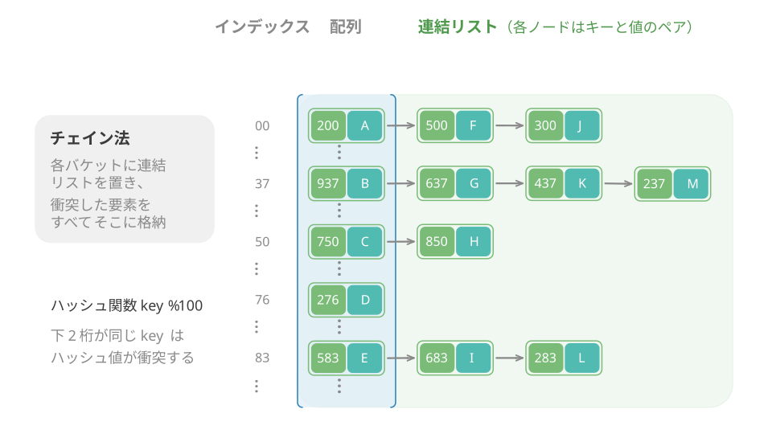
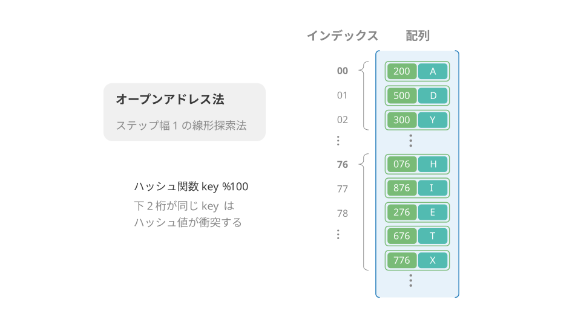
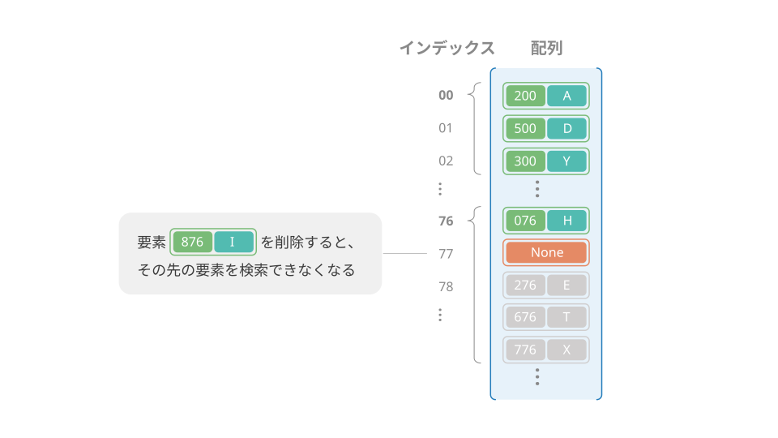

# ハッシュ衝突

前節で見たように、**通常、ハッシュ関数の入力の範囲は出力の範囲よりはるかに広い**ため、理論上、衝突は避けられません。例えば、すべての整数を入力とし、出力を配列の容量に収まるインデックスに限れば、必ず複数の整数が同じバケットに対応します。

衝突によって誤った検索結果が返ると、ハッシュ表の実用性は大きく損なわれます。衝突に出会うたびに、衝突がなくなるまで表を拡張する方法もあります。単純で効果はありますが、拡張のたびに大量のデータを移し、ハッシュ値を計算し直すので非効率です。効率を高めるには、次の方針が考えられます。

1. ハッシュ表のデータ構造を改良し、**衝突しても正しく動作するようにします**。
2. 拡張は必要なとき、つまり衝突が多くなったときだけ行います。

ハッシュ表の構造を改良する代表的な方法は、「チェイン法」と「オープンアドレス法」です。

## チェイン法

これまでのハッシュ表では、各バケットには 1 組のキーと値しか格納できませんでした。<u>チェイン法（separate chaining）</u>では、単一の要素を置いていたところに連結リストを置きます。キーと値のペアをノードとし、衝突したペアをすべて同じリストに格納します。下図はチェイン法を使ったハッシュ表の例です。



チェイン法を使うと、ハッシュ表の操作は次のように変わります。

- **要素の検索**：入力された `key` からハッシュ関数でバケットのインデックスを求め、リストの先頭ノードにアクセスします。そこからリストをたどり、`key` を比較して目的のペアを探します。
- **要素の追加**：ハッシュ関数を使ってリストの先頭ノードにアクセスし、ノード（キーと値のペア）をリストに追加します。
- **要素の削除**：ハッシュ関数の結果を使ってリストの先頭にアクセスし、リストをたどって目的のノードを見つけ、削除します。

チェイン法には次の制約があります。

- **使用するメモリが増える**：連結リストではノードを指すポインタが必要なので、配列よりも多くのメモリを使います。
- **検索効率が下がる**：目的の要素を見つけるためにリストを先頭から順にたどる必要があります。

次のコードはチェイン法によるハッシュ表の簡単な実装です。次の 2 点に注目してください。

- コードを簡潔にするため、連結リストの代わりにリスト（動的配列）を使います。この実装ではハッシュ表（配列）が複数のバケットを持ち、各バケットが 1 つのリストになっています。
- この実装には表を拡張するメソッドがあります。負荷率が $\frac{2}{3}$ を超えると、容量を元の $2$ 倍にします。

```src
[file]{hash_map_chaining}-[class]{hash_map_chaining}-[func]{}
```

リストが長くなると、検索に $O(n)$ かかり、効率が悪くなります。**この場合は、連結リストを「AVL 木」や「赤黒木」に変換する**ことで、検索の時間計算量を $O(\log n)$ に改善できます。

## オープンアドレス法

<u>オープンアドレス法（open addressing）</u>では、データ構造を追加せず、複数の格納先候補を順に調べて衝突を処理します。代表的な探索方法には、線形探索法、二次探索法、複数のハッシュ関数を使う方法があります。

ここでは線形探索法を例に、オープンアドレス法によるハッシュ表の仕組みを見ていきます。

### 線形探索法

線形探索法では、一定のステップ幅で順に格納先を調べます。通常のハッシュ表とは操作が少し異なります。

- **要素の挿入**：ハッシュ関数でバケットのインデックスを計算します。すでに要素が入っていれば、衝突した位置から一定のステップ幅（通常は $1$）で順に先を調べ、最初に見つけた空のバケットに要素を挿入します。
- **要素の検索**：衝突したら、挿入時と同じ幅で順に先を調べます。目的の要素を見つけたら `value` を返します。空のバケットに出会った場合は、その要素は表にないので `None` を返します。

下図は、オープンアドレス法（線形探索法）を使った表にペアがどう分布するかを示しています。このハッシュ関数では、下 2 桁が同じ `key` はすべて同じバケットに対応します。線形探索の結果、それらのペアはそのバケットと、それに続く下のバケットに順に格納されます。



ただし、**線形探索法では「クラスタリング」が起きやすい**という問題があります。配列内で使用中の位置が長く連続するほど、その区間で衝突が起きやすくなります。すると使用中の区間がさらに伸びるという悪循環が生じ、最終的には追加、削除、検索、更新の効率が下がります。

ここで注意したいのは、**オープンアドレス法の表では要素をそのまま削除できない**ことです。削除によって配列内に空のバケット `None` ができると、検索時の線形探索はそこで終了します。下図のように、その先にある要素に到達できなくなり、存在しないと誤って判断するおそれがあります。



この問題には<u>遅延削除（lazy deletion）</u>を使えます。要素を表から直接取り除かず、**定数 `TOMBSTONE` を置いてバケットに印を付けます**。`None` と `TOMBSTONE` はどちらも空のバケットを表し、新しいペアを格納できます。ただし、線形探索中に `TOMBSTONE` に出会った場合は、その先にもペアがあるかもしれないので探索を続けます。

一方で、**遅延削除はハッシュ表の性能低下を早めることがあります**。削除のたびにマーカーが 1 つ生じます。`TOMBSTONE` が増えると、線形探索で目的の要素にたどり着くまでに複数の `TOMBSTONE` を通り過ぎることがあり、探索時間も長くなります。

そこで、線形探索中に最初に出会った `TOMBSTONE` のインデックスを記録し、見つけた目的の要素とその `TOMBSTONE` の位置を入れ替える方法が考えられます。こうすれば、要素を検索または追加するたびに、その要素を本来の位置（探索の開始位置）に近いバケットに移せるため、検索効率が上がります。

次のコードは、遅延削除を取り入れたオープンアドレス法（線形探索法）のハッシュ表です。容量を十分に生かすため、表を「循環配列」とみなし、配列の末尾を越えたら先頭に戻って探索を続けます。

```src
[file]{hash_map_open_addressing}-[class]{hash_map_open_addressing}-[func]{}
```

### 二次探索法

二次探索法も、線形探索法と同じく代表的なオープンアドレス法です。衝突したときは、一定の幅で進む代わりに、探索回数の 2 乗、つまり $1, 4, 9, \dots$ マス分ずらした位置を調べます。

二次探索法の主な利点は次のとおりです。

- 探索回数の 2 乗だけ位置をずらすことで、線形探索法で起きるクラスタリングを和らげます。
- より遠くの空き位置も探すため、データが均等に分布しやすくなります。

ただし、二次探索法にも弱点があります。

- 特定の位置がほかよりも埋まりやすく、クラスタリングが依然として起こります。
- 探索位置のずれが 2 乗で増えるため、表のすべての位置を調べられるとは限りません。空のバケットがあっても、そこに到達できない場合があります。

### 複数のハッシュ関数による探索

この方法は名前のとおり、複数のハッシュ関数 $f_1(x)$、$f_2(x)$、$f_3(x)$、$\dots$ を使って格納先を探します。

- **要素の挿入**：ハッシュ関数 $f_1(x)$ で衝突したら $f_2(x)$ を試します。同様に次の関数を順に試し、空き位置を見つけたら要素を挿入します。
- **要素の検索**：挿入時と同じ順序でハッシュ関数を試し、目的の要素が見つかったら返します。空き位置に出会った場合や、すべての関数を試しても見つからなかった場合は、その要素は表にないので `None` を返します。

線形探索法に比べてクラスタリングが起きにくい一方、複数のハッシュ関数を使う分だけ計算量が増えます。

!!! tip

    オープンアドレス法では、線形探索法、二次探索法、複数のハッシュ関数による探索のいずれにも、要素をそのまま削除できないという共通の問題があります。

## プログラミング言語ごとの実装

ハッシュ表の実装方法は言語によって異なります。いくつか例を見てみましょう。

- Python はオープンアドレス法を採用しています。辞書 `dict` は疑似乱数を使って探索します。
- Java はチェイン法を採用しています。JDK 1.8 以降の `HashMap` では、内部配列の長さが 64 以上で連結リストの長さが 8 に達すると、リストを赤黒木に変換して検索性能を高めます。
- Go 1.24 以降では、組み込みの `map` は既定で Swiss Table に基づくオープンアドレス法を使います。Go 1.23 以前ではチェイン法を使い、各バケットに最大 8 組のペアを格納し、収まりきらない場合はオーバーフローバケットをつなぎます。
