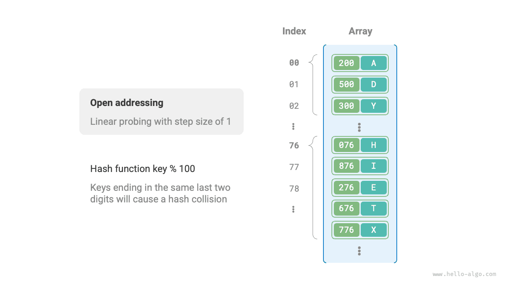

# 6.2 &nbsp; ハッシュ衝突

前節で述べたように、**通常、ハッシュ関数の入力空間は出力空間よりはるかに大きいため**、理論上、ハッシュ衝突は避けられません。例えば、入力がすべての整数で、出力の範囲が配列の容量なら、複数の整数が同じバケットのインデックスに写されることは必然です。

ハッシュ衝突は誤った照会結果を生み、ハッシュテーブルの利用に重大な影響を与えます。衝突するたびに、解消するまで容量を拡張すれば、この問題を解決できます。単純で強引ながら有効ですが、多くのデータの移動とハッシュ値の計算が必要なため、効率が低すぎます。効率を高めるには、次の戦略を使えます。

1. データ構造を改良して、**ハッシュ衝突が起きても正しく動作できるようにします**。
2. 必要な場合、つまり衝突が多くなった場合だけ容量を拡張します。

主な構造の改良方法には、「チェイン法」と「オープンアドレス法」があります。

## 6.2.1 &nbsp; チェイン法

元のハッシュテーブルでは、各バケットに一つのペアしか格納できません。<u>チェイン法（separate chaining）</u>では、単一の要素を連結リストに置き換え、キーと値のペアをノードとして、衝突したペアをすべて同じリストに格納します。図 6-5 にその例を示します。

{ class="animation-figure" }

<p align="center"> 図 6-5 &nbsp; チェイン法のハッシュテーブル </p>

チェイン法では、操作が次のように変わります。

- **要素の照会**：`key` を入力し、ハッシュ関数でバケットのインデックスを求め、リストの先頭ノードにアクセスします。その後、リストを走査して `key` を比較し、目的のペアを探します。
- **要素の追加**：ハッシュ関数でリストの先頭ノードにアクセスし、ノード、つまりキーと値のペアをリストに追加します。
- **要素の削除**：ハッシュ関数の結果に基づいてリストの先頭にアクセスし、走査して目的のノードを見つけ、削除します。

チェイン法には、次の制約があります。

- **使用領域が増える**：連結リストはノードのポインタを含むため、配列よりメモリを多く使います。
- **照会の効率が下がる**：目的の要素を探すために、リストを線形に走査する必要があります。

以下は単純な実装です。次の二点に注意してください。

- コードを簡単にするため、連結リストの代わりにリスト（動的配列）を使います。この場合、ハッシュテーブルの配列は複数のバケットを持ち、各バケットが一つのリストになります。
- 容量拡張の処理も含めています。負荷率が $\frac{2}{3}$ を超えると、容量を元の $2$ 倍にします。

=== "Python"

    ```python title="hash_map_chaining.py"
    class HashMapChaining:
        """チェイン法のハッシュテーブル"""

        def __init__(self):
            """コンストラクタ"""
            self.size = 0  # キーと値のペアの数
            self.capacity = 4  # ハッシュテーブルの容量
            self.load_thres = 2.0 / 3.0  # 容量の拡張を開始する負荷率のしきい値
            self.extend_ratio = 2  # 容量の拡張倍率
            self.buckets = [[] for _ in range(self.capacity)]  # バケット配列

        def hash_func(self, key: int) -> int:
            """ハッシュ関数"""
            return key % self.capacity

        def load_factor(self) -> float:
            """負荷率"""
            return self.size / self.capacity

        def get(self, key: int) -> str | None:
            """取得操作"""
            index = self.hash_func(key)
            bucket = self.buckets[index]
            # バケットを走査し、key が見つかったら対応する val を返す
            for pair in bucket:
                if pair.key == key:
                    return pair.val
            # key が見つからなかった場合、None を返す
            return None

        def put(self, key: int, val: str):
            """追加操作"""
            # 負荷率がしきい値を超えた場合、容量を拡張する
            if self.load_factor() > self.load_thres:
                self.extend()
            index = self.hash_func(key)
            bucket = self.buckets[index]
            # バケットを走査し、指定された key が見つかったら、対応する val を更新して戻る
            for pair in bucket:
                if pair.key == key:
                    pair.val = val
                    return
            # key が存在しない場合、キーと値のペアを末尾に追加する
            pair = Pair(key, val)
            bucket.append(pair)
            self.size += 1

        def remove(self, key: int):
            """削除操作"""
            index = self.hash_func(key)
            bucket = self.buckets[index]
            # バケットを走査し、キーと値のペアを削除する
            for pair in bucket:
                if pair.key == key:
                    bucket.remove(pair)
                    self.size -= 1
                    break

        def extend(self):
            """ハッシュテーブルの容量を拡張する"""
            # 元のハッシュテーブルを一時保存する
            buckets = self.buckets
            # 拡張後の新しいハッシュテーブルを初期化する
            self.capacity *= self.extend_ratio
            self.buckets = [[] for _ in range(self.capacity)]
            self.size = 0
            # キーと値のペアを元のハッシュテーブルから新しいハッシュテーブルに移す
            for bucket in buckets:
                for pair in bucket:
                    self.put(pair.key, pair.val)

        def print(self):
            """ハッシュテーブルを表示する"""
            for bucket in self.buckets:
                res = []
                for pair in bucket:
                    res.append(str(pair.key) + " -> " + pair.val)
                print(res)
    ```

=== "C++"

    ```cpp title="hash_map_chaining.cpp"
    /* チェイン法のハッシュテーブル */
    class HashMapChaining {
      private:
        int size;                       // キーと値のペアの数
        int capacity;                   // ハッシュテーブルの容量
        double loadThres;               // 容量の拡張を開始する負荷率のしきい値
        int extendRatio;                // 容量の拡張倍率
        vector<vector<Pair *>> buckets; // バケット配列

      public:
        /* コンストラクタ */
        HashMapChaining() : size(0), capacity(4), loadThres(2.0 / 3.0), extendRatio(2) {
            buckets.resize(capacity);
        }

        /* デストラクタ */
        ~HashMapChaining() {
            for (auto &bucket : buckets) {
                for (Pair *pair : bucket) {
                    // メモリを解放する
                    delete pair;
                }
            }
        }

        /* ハッシュ関数 */
        int hashFunc(int key) {
            return key % capacity;
        }

        /* 負荷率 */
        double loadFactor() {
            return (double)size / (double)capacity;
        }

        /* 取得操作 */
        string get(int key) {
            int index = hashFunc(key);
            // バケットを走査し、key が見つかったら対応する val を返す
            for (Pair *pair : buckets[index]) {
                if (pair->key == key) {
                    return pair->val;
                }
            }
            // key が見つからなかった場合、空文字列を返す
            return "";
        }

        /* 追加操作 */
        void put(int key, string val) {
            // 負荷率がしきい値を超えた場合、容量を拡張する
            if (loadFactor() > loadThres) {
                extend();
            }
            int index = hashFunc(key);
            // バケットを走査し、指定された key が見つかったら、対応する val を更新して戻る
            for (Pair *pair : buckets[index]) {
                if (pair->key == key) {
                    pair->val = val;
                    return;
                }
            }
            // key が存在しない場合、キーと値のペアを末尾に追加する
            buckets[index].push_back(new Pair(key, val));
            size++;
        }

        /* 削除操作 */
        void remove(int key) {
            int index = hashFunc(key);
            auto &bucket = buckets[index];
            // バケットを走査し、キーと値のペアを削除する
            for (int i = 0; i < bucket.size(); i++) {
                if (bucket[i]->key == key) {
                    Pair *tmp = bucket[i];
                    bucket.erase(bucket.begin() + i); // キーと値のペアを削除する
                    delete tmp;                       // メモリを解放する
                    size--;
                    return;
                }
            }
        }

        /* ハッシュテーブルの容量を拡張する */
        void extend() {
            // 元のハッシュテーブルを一時保存する
            vector<vector<Pair *>> bucketsTmp = buckets;
            // 拡張後の新しいハッシュテーブルを初期化する
            capacity *= extendRatio;
            buckets.clear();
            buckets.resize(capacity);
            size = 0;
            // キーと値のペアを元のハッシュテーブルから新しいハッシュテーブルに移す
            for (auto &bucket : bucketsTmp) {
                for (Pair *pair : bucket) {
                    put(pair->key, pair->val);
                    // メモリを解放する
                    delete pair;
                }
            }
        }

        /* ハッシュテーブルを表示する */
        void print() {
            for (auto &bucket : buckets) {
                cout << "[";
                for (Pair *pair : bucket) {
                    cout << pair->key << " -> " << pair->val << ", ";
                }
                cout << "]\n";
            }
        }
    };
    ```

=== "Java"

    ```java title="hash_map_chaining.java"
    /* チェイン法のハッシュテーブル */
    class HashMapChaining {
        int size; // キーと値のペアの数
        int capacity; // ハッシュテーブルの容量
        double loadThres; // 容量の拡張を開始する負荷率のしきい値
        int extendRatio; // 容量の拡張倍率
        List<List<Pair>> buckets; // バケット配列

        /* コンストラクタ */
        public HashMapChaining() {
            size = 0;
            capacity = 4;
            loadThres = 2.0 / 3.0;
            extendRatio = 2;
            buckets = new ArrayList<>(capacity);
            for (int i = 0; i < capacity; i++) {
                buckets.add(new ArrayList<>());
            }
        }

        /* ハッシュ関数 */
        int hashFunc(int key) {
            return key % capacity;
        }

        /* 負荷率 */
        double loadFactor() {
            return (double) size / capacity;
        }

        /* 取得操作 */
        String get(int key) {
            int index = hashFunc(key);
            List<Pair> bucket = buckets.get(index);
            // バケットを走査し、key が見つかったら対応する val を返す
            for (Pair pair : bucket) {
                if (pair.key == key) {
                    return pair.val;
                }
            }
            // key が見つからなかった場合、null を返す
            return null;
        }

        /* 追加操作 */
        void put(int key, String val) {
            // 負荷率がしきい値を超えた場合、容量を拡張する
            if (loadFactor() > loadThres) {
                extend();
            }
            int index = hashFunc(key);
            List<Pair> bucket = buckets.get(index);
            // バケットを走査し、指定された key が見つかったら、対応する val を更新して戻る
            for (Pair pair : bucket) {
                if (pair.key == key) {
                    pair.val = val;
                    return;
                }
            }
            // key が存在しない場合、キーと値のペアを末尾に追加する
            Pair pair = new Pair(key, val);
            bucket.add(pair);
            size++;
        }

        /* 削除操作 */
        void remove(int key) {
            int index = hashFunc(key);
            List<Pair> bucket = buckets.get(index);
            // バケットを走査し、キーと値のペアを削除する
            for (Pair pair : bucket) {
                if (pair.key == key) {
                    bucket.remove(pair);
                    size--;
                    break;
                }
            }
        }

        /* ハッシュテーブルの容量を拡張する */
        void extend() {
            // 元のハッシュテーブルを一時保存する
            List<List<Pair>> bucketsTmp = buckets;
            // 拡張後の新しいハッシュテーブルを初期化する
            capacity *= extendRatio;
            buckets = new ArrayList<>(capacity);
            for (int i = 0; i < capacity; i++) {
                buckets.add(new ArrayList<>());
            }
            size = 0;
            // キーと値のペアを元のハッシュテーブルから新しいハッシュテーブルに移す
            for (List<Pair> bucket : bucketsTmp) {
                for (Pair pair : bucket) {
                    put(pair.key, pair.val);
                }
            }
        }

        /* ハッシュテーブルを表示する */
        void print() {
            for (List<Pair> bucket : buckets) {
                List<String> res = new ArrayList<>();
                for (Pair pair : bucket) {
                    res.add(pair.key + " -> " + pair.val);
                }
                System.out.println(res);
            }
        }
    }
    ```

=== "C#"

    ```csharp title="hash_map_chaining.cs"
    /* チェイン法のハッシュテーブル */
    class HashMapChaining {
        int size; // キーと値のペアの数
        int capacity; // ハッシュテーブルの容量
        double loadThres; // 容量の拡張を開始する負荷率のしきい値
        int extendRatio; // 容量の拡張倍率
        List<List<Pair>> buckets; // バケット配列

        /* コンストラクタ */
        public HashMapChaining() {
            size = 0;
            capacity = 4;
            loadThres = 2.0 / 3.0;
            extendRatio = 2;
            buckets = new List<List<Pair>>(capacity);
            for (int i = 0; i < capacity; i++) {
                buckets.Add([]);
            }
        }

        /* ハッシュ関数 */
        int HashFunc(int key) {
            return key % capacity;
        }

        /* 負荷率 */
        double LoadFactor() {
            return (double)size / capacity;
        }

        /* 取得操作 */
        public string? Get(int key) {
            int index = HashFunc(key);
            // バケットを走査し、key が見つかったら対応する val を返す
            foreach (Pair pair in buckets[index]) {
                if (pair.key == key) {
                    return pair.val;
                }
            }
            // key が見つからなかった場合、null を返す
            return null;
        }

        /* 追加操作 */
        public void Put(int key, string val) {
            // 負荷率がしきい値を超えた場合、容量を拡張する
            if (LoadFactor() > loadThres) {
                Extend();
            }
            int index = HashFunc(key);
            // バケットを走査し、指定された key が見つかったら、対応する val を更新して戻る
            foreach (Pair pair in buckets[index]) {
                if (pair.key == key) {
                    pair.val = val;
                    return;
                }
            }
            // key が存在しない場合、キーと値のペアを末尾に追加する
            buckets[index].Add(new Pair(key, val));
            size++;
        }

        /* 削除操作 */
        public void Remove(int key) {
            int index = HashFunc(key);
            // バケットを走査し、キーと値のペアを削除する
            foreach (Pair pair in buckets[index].ToList()) {
                if (pair.key == key) {
                    buckets[index].Remove(pair);
                    size--;
                    break;
                }
            }
        }

        /* ハッシュテーブルの容量を拡張する */
        void Extend() {
            // 元のハッシュテーブルを一時保存する
            List<List<Pair>> bucketsTmp = buckets;
            // 拡張後の新しいハッシュテーブルを初期化する
            capacity *= extendRatio;
            buckets = new List<List<Pair>>(capacity);
            for (int i = 0; i < capacity; i++) {
                buckets.Add([]);
            }
            size = 0;
            // キーと値のペアを元のハッシュテーブルから新しいハッシュテーブルに移す
            foreach (List<Pair> bucket in bucketsTmp) {
                foreach (Pair pair in bucket) {
                    Put(pair.key, pair.val);
                }
            }
        }

        /* ハッシュテーブルを表示する */
        public void Print() {
            foreach (List<Pair> bucket in buckets) {
                List<string> res = [];
                foreach (Pair pair in bucket) {
                    res.Add(pair.key + " -> " + pair.val);
                }
                foreach (string kv in res) {
                    Console.WriteLine(kv);
                }
            }
        }
    }
    ```

=== "Go"

    ```go title="hash_map_chaining.go"
    /* チェイン法のハッシュテーブル */
    type hashMapChaining struct {
        size        int      // キーと値のペアの数
        capacity    int      // ハッシュテーブルの容量
        loadThres   float64  // 容量の拡張を開始する負荷率のしきい値
        extendRatio int      // 容量の拡張倍率
        buckets     [][]pair // バケット配列
    }

    /* コンストラクタ */
    func newHashMapChaining() *hashMapChaining {
        buckets := make([][]pair, 4)
        for i := 0; i < 4; i++ {
            buckets[i] = make([]pair, 0)
        }
        return &hashMapChaining{
            size:        0,
            capacity:    4,
            loadThres:   2.0 / 3.0,
            extendRatio: 2,
            buckets:     buckets,
        }
    }

    /* ハッシュ関数 */
    func (m *hashMapChaining) hashFunc(key int) int {
        return key % m.capacity
    }

    /* 負荷率 */
    func (m *hashMapChaining) loadFactor() float64 {
        return float64(m.size) / float64(m.capacity)
    }

    /* 取得操作 */
    func (m *hashMapChaining) get(key int) string {
        idx := m.hashFunc(key)
        bucket := m.buckets[idx]
        // バケットを走査し、key が見つかったら対応する val を返す
        for _, p := range bucket {
            if p.key == key {
                return p.val
            }
        }
        // key が見つからなかった場合、空文字列を返す
        return ""
    }

    /* 追加操作 */
    func (m *hashMapChaining) put(key int, val string) {
        // 負荷率がしきい値を超えた場合、容量を拡張する
        if m.loadFactor() > m.loadThres {
            m.extend()
        }
        idx := m.hashFunc(key)
        // バケットを走査し、指定された key が見つかったら、対応する val を更新して戻る
        for i := range m.buckets[idx] {
            if m.buckets[idx][i].key == key {
                m.buckets[idx][i].val = val
                return
            }
        }
        // key が存在しない場合、キーと値のペアを末尾に追加する
        p := pair{
            key: key,
            val: val,
        }
        m.buckets[idx] = append(m.buckets[idx], p)
        m.size += 1
    }

    /* 削除操作 */
    func (m *hashMapChaining) remove(key int) {
        idx := m.hashFunc(key)
        // バケットを走査し、キーと値のペアを削除する
        for i, p := range m.buckets[idx] {
            if p.key == key {
                // スライスから削除する
                m.buckets[idx] = append(m.buckets[idx][:i], m.buckets[idx][i+1:]...)
                m.size -= 1
                break
            }
        }
    }

    /* ハッシュテーブルの容量を拡張する */
    func (m *hashMapChaining) extend() {
        // 元のハッシュテーブルを一時保存する
        tmpBuckets := make([][]pair, len(m.buckets))
        for i := 0; i < len(m.buckets); i++ {
            tmpBuckets[i] = make([]pair, len(m.buckets[i]))
            copy(tmpBuckets[i], m.buckets[i])
        }
        // 拡張後の新しいハッシュテーブルを初期化する
        m.capacity *= m.extendRatio
        m.buckets = make([][]pair, m.capacity)
        for i := 0; i < m.capacity; i++ {
            m.buckets[i] = make([]pair, 0)
        }
        m.size = 0
        // キーと値のペアを元のハッシュテーブルから新しいハッシュテーブルに移す
        for _, bucket := range tmpBuckets {
            for _, p := range bucket {
                m.put(p.key, p.val)
            }
        }
    }

    /* ハッシュテーブルを表示する */
    func (m *hashMapChaining) print() {
        var builder strings.Builder

        for _, bucket := range m.buckets {
            builder.WriteString("[")
            for _, p := range bucket {
                builder.WriteString(strconv.Itoa(p.key) + " -> " + p.val + " ")
            }
            builder.WriteString("]")
            fmt.Println(builder.String())
            builder.Reset()
        }
    }
    ```

=== "Swift"

    ```swift title="hash_map_chaining.swift"
    /* チェイン法のハッシュテーブル */
    class HashMapChaining {
        var size: Int // キーと値のペアの数
        var capacity: Int // ハッシュテーブルの容量
        var loadThres: Double // 容量の拡張を開始する負荷率のしきい値
        var extendRatio: Int // 容量の拡張倍率
        var buckets: [[Pair]] // バケット配列

        /* コンストラクタ */
        init() {
            size = 0
            capacity = 4
            loadThres = 2.0 / 3.0
            extendRatio = 2
            buckets = Array(repeating: [], count: capacity)
        }

        /* ハッシュ関数 */
        func hashFunc(key: Int) -> Int {
            key % capacity
        }

        /* 負荷率 */
        func loadFactor() -> Double {
            Double(size) / Double(capacity)
        }

        /* 取得操作 */
        func get(key: Int) -> String? {
            let index = hashFunc(key: key)
            let bucket = buckets[index]
            // バケットを走査し、key が見つかったら対応する val を返す
            for pair in bucket {
                if pair.key == key {
                    return pair.val
                }
            }
            // key が見つからなかった場合、nil を返す
            return nil
        }

        /* 追加操作 */
        func put(key: Int, val: String) {
            // 負荷率がしきい値を超えた場合、容量を拡張する
            if loadFactor() > loadThres {
                extend()
            }
            let index = hashFunc(key: key)
            let bucket = buckets[index]
            // バケットを走査し、指定された key が見つかったら、対応する val を更新して戻る
            for pair in bucket {
                if pair.key == key {
                    pair.val = val
                    return
                }
            }
            // key が存在しない場合、キーと値のペアを末尾に追加する
            let pair = Pair(key: key, val: val)
            buckets[index].append(pair)
            size += 1
        }

        /* 削除操作 */
        func remove(key: Int) {
            let index = hashFunc(key: key)
            let bucket = buckets[index]
            // バケットを走査し、キーと値のペアを削除する
            for (pairIndex, pair) in bucket.enumerated() {
                if pair.key == key {
                    buckets[index].remove(at: pairIndex)
                    size -= 1
                    break
                }
            }
        }

        /* ハッシュテーブルの容量を拡張する */
        func extend() {
            // 元のハッシュテーブルを一時保存する
            let bucketsTmp = buckets
            // 拡張後の新しいハッシュテーブルを初期化する
            capacity *= extendRatio
            buckets = Array(repeating: [], count: capacity)
            size = 0
            // キーと値のペアを元のハッシュテーブルから新しいハッシュテーブルに移す
            for bucket in bucketsTmp {
                for pair in bucket {
                    put(key: pair.key, val: pair.val)
                }
            }
        }

        /* ハッシュテーブルを表示する */
        func print() {
            for bucket in buckets {
                let res = bucket.map { "\($0.key) -> \($0.val)" }
                Swift.print(res)
            }
        }
    }
    ```

=== "JS"

    ```javascript title="hash_map_chaining.js"
    /* チェイン法のハッシュテーブル */
    class HashMapChaining {
        #size; // キーと値のペアの数
        #capacity; // ハッシュテーブルの容量
        #loadThres; // 容量の拡張を開始する負荷率のしきい値
        #extendRatio; // 容量の拡張倍率
        #buckets; // バケット配列

        /* コンストラクタ */
        constructor() {
            this.#size = 0;
            this.#capacity = 4;
            this.#loadThres = 2.0 / 3.0;
            this.#extendRatio = 2;
            this.#buckets = new Array(this.#capacity).fill(null).map((x) => []);
        }

        /* ハッシュ関数 */
        #hashFunc(key) {
            return key % this.#capacity;
        }

        /* 負荷率 */
        #loadFactor() {
            return this.#size / this.#capacity;
        }

        /* 取得操作 */
        get(key) {
            const index = this.#hashFunc(key);
            const bucket = this.#buckets[index];
            // バケットを走査し、key が見つかったら対応する val を返す
            for (const pair of bucket) {
                if (pair.key === key) {
                    return pair.val;
                }
            }
            // key が見つからなかった場合、null を返す
            return null;
        }

        /* 追加操作 */
        put(key, val) {
            // 負荷率がしきい値を超えた場合、容量を拡張する
            if (this.#loadFactor() > this.#loadThres) {
                this.#extend();
            }
            const index = this.#hashFunc(key);
            const bucket = this.#buckets[index];
            // バケットを走査し、指定された key が見つかったら、対応する val を更新して戻る
            for (const pair of bucket) {
                if (pair.key === key) {
                    pair.val = val;
                    return;
                }
            }
            // key が存在しない場合、キーと値のペアを末尾に追加する
            const pair = new Pair(key, val);
            bucket.push(pair);
            this.#size++;
        }

        /* 削除操作 */
        remove(key) {
            const index = this.#hashFunc(key);
            let bucket = this.#buckets[index];
            // バケットを走査し、キーと値のペアを削除する
            for (let i = 0; i < bucket.length; i++) {
                if (bucket[i].key === key) {
                    bucket.splice(i, 1);
                    this.#size--;
                    break;
                }
            }
        }

        /* ハッシュテーブルの容量を拡張する */
        #extend() {
            // 元のハッシュテーブルを一時保存する
            const bucketsTmp = this.#buckets;
            // 拡張後の新しいハッシュテーブルを初期化する
            this.#capacity *= this.#extendRatio;
            this.#buckets = new Array(this.#capacity).fill(null).map((x) => []);
            this.#size = 0;
            // キーと値のペアを元のハッシュテーブルから新しいハッシュテーブルに移す
            for (const bucket of bucketsTmp) {
                for (const pair of bucket) {
                    this.put(pair.key, pair.val);
                }
            }
        }

        /* ハッシュテーブルを表示する */
        print() {
            for (const bucket of this.#buckets) {
                let res = [];
                for (const pair of bucket) {
                    res.push(pair.key + ' -> ' + pair.val);
                }
                console.log(res);
            }
        }
    }
    ```

=== "TS"

    ```typescript title="hash_map_chaining.ts"
    /* チェイン法のハッシュテーブル */
    class HashMapChaining {
        #size: number; // キーと値のペアの数
        #capacity: number; // ハッシュテーブルの容量
        #loadThres: number; // 容量の拡張を開始する負荷率のしきい値
        #extendRatio: number; // 容量の拡張倍率
        #buckets: Pair[][]; // バケット配列

        /* コンストラクタ */
        constructor() {
            this.#size = 0;
            this.#capacity = 4;
            this.#loadThres = 2.0 / 3.0;
            this.#extendRatio = 2;
            this.#buckets = new Array(this.#capacity).fill(null).map((x) => []);
        }

        /* ハッシュ関数 */
        #hashFunc(key: number): number {
            return key % this.#capacity;
        }

        /* 負荷率 */
        #loadFactor(): number {
            return this.#size / this.#capacity;
        }

        /* 取得操作 */
        get(key: number): string | null {
            const index = this.#hashFunc(key);
            const bucket = this.#buckets[index];
            // バケットを走査し、key が見つかったら対応する val を返す
            for (const pair of bucket) {
                if (pair.key === key) {
                    return pair.val;
                }
            }
            // key が見つからなかった場合、null を返す
            return null;
        }

        /* 追加操作 */
        put(key: number, val: string): void {
            // 負荷率がしきい値を超えた場合、容量を拡張する
            if (this.#loadFactor() > this.#loadThres) {
                this.#extend();
            }
            const index = this.#hashFunc(key);
            const bucket = this.#buckets[index];
            // バケットを走査し、指定された key が見つかったら、対応する val を更新して戻る
            for (const pair of bucket) {
                if (pair.key === key) {
                    pair.val = val;
                    return;
                }
            }
            // key が存在しない場合、キーと値のペアを末尾に追加する
            const pair = new Pair(key, val);
            bucket.push(pair);
            this.#size++;
        }

        /* 削除操作 */
        remove(key: number): void {
            const index = this.#hashFunc(key);
            let bucket = this.#buckets[index];
            // バケットを走査し、キーと値のペアを削除する
            for (let i = 0; i < bucket.length; i++) {
                if (bucket[i].key === key) {
                    bucket.splice(i, 1);
                    this.#size--;
                    break;
                }
            }
        }

        /* ハッシュテーブルの容量を拡張する */
        #extend(): void {
            // 元のハッシュテーブルを一時保存する
            const bucketsTmp = this.#buckets;
            // 拡張後の新しいハッシュテーブルを初期化する
            this.#capacity *= this.#extendRatio;
            this.#buckets = new Array(this.#capacity).fill(null).map((x) => []);
            this.#size = 0;
            // キーと値のペアを元のハッシュテーブルから新しいハッシュテーブルに移す
            for (const bucket of bucketsTmp) {
                for (const pair of bucket) {
                    this.put(pair.key, pair.val);
                }
            }
        }

        /* ハッシュテーブルを表示する */
        print(): void {
            for (const bucket of this.#buckets) {
                let res = [];
                for (const pair of bucket) {
                    res.push(pair.key + ' -> ' + pair.val);
                }
                console.log(res);
            }
        }
    }
    ```

=== "Dart"

    ```dart title="hash_map_chaining.dart"
    /* チェイン法のハッシュテーブル */
    class HashMapChaining {
      late int size; // キーと値のペアの数
      late int capacity; // ハッシュテーブルの容量
      late double loadThres; // 容量の拡張を開始する負荷率のしきい値
      late int extendRatio; // 容量の拡張倍率
      late List<List<Pair>> buckets; // バケット配列

      /* コンストラクタ */
      HashMapChaining() {
        size = 0;
        capacity = 4;
        loadThres = 2.0 / 3.0;
        extendRatio = 2;
        buckets = List.generate(capacity, (_) => []);
      }

      /* ハッシュ関数 */
      int hashFunc(int key) {
        return key % capacity;
      }

      /* 負荷率 */
      double loadFactor() {
        return size / capacity;
      }

      /* 取得操作 */
      String? get(int key) {
        int index = hashFunc(key);
        List<Pair> bucket = buckets[index];
        // バケットを走査し、key が見つかったら対応する val を返す
        for (Pair pair in bucket) {
          if (pair.key == key) {
            return pair.val;
          }
        }
        // key が見つからなかった場合、null を返す
        return null;
      }

      /* 追加操作 */
      void put(int key, String val) {
        // 負荷率がしきい値を超えた場合、容量を拡張する
        if (loadFactor() > loadThres) {
          extend();
        }
        int index = hashFunc(key);
        List<Pair> bucket = buckets[index];
        // バケットを走査し、指定された key が見つかったら、対応する val を更新して戻る
        for (Pair pair in bucket) {
          if (pair.key == key) {
            pair.val = val;
            return;
          }
        }
        // key が存在しない場合、キーと値のペアを末尾に追加する
        Pair pair = Pair(key, val);
        bucket.add(pair);
        size++;
      }

      /* 削除操作 */
      void remove(int key) {
        int index = hashFunc(key);
        List<Pair> bucket = buckets[index];
        // バケットを走査し、キーと値のペアを削除する
        for (Pair pair in bucket) {
          if (pair.key == key) {
            bucket.remove(pair);
            size--;
            break;
          }
        }
      }

      /* ハッシュテーブルの容量を拡張する */
      void extend() {
        // 元のハッシュテーブルを一時保存する
        List<List<Pair>> bucketsTmp = buckets;
        // 拡張後の新しいハッシュテーブルを初期化する
        capacity *= extendRatio;
        buckets = List.generate(capacity, (_) => []);
        size = 0;
        // キーと値のペアを元のハッシュテーブルから新しいハッシュテーブルに移す
        for (List<Pair> bucket in bucketsTmp) {
          for (Pair pair in bucket) {
            put(pair.key, pair.val);
          }
        }
      }

      /* ハッシュテーブルを表示する */
      void printHashMap() {
        for (List<Pair> bucket in buckets) {
          List<String> res = [];
          for (Pair pair in bucket) {
            res.add("${pair.key} -> ${pair.val}");
          }
          print(res);
        }
      }
    }
    ```

=== "Rust"

    ```rust title="hash_map_chaining.rs"
    /* チェイン法のハッシュテーブル */
    struct HashMapChaining {
        size: usize,
        capacity: usize,
        load_thres: f32,
        extend_ratio: usize,
        buckets: Vec<Vec<Pair>>,
    }

    impl HashMapChaining {
        /* コンストラクタ */
        fn new() -> Self {
            Self {
                size: 0,
                capacity: 4,
                load_thres: 2.0 / 3.0,
                extend_ratio: 2,
                buckets: vec![vec![]; 4],
            }
        }

        /* ハッシュ関数 */
        fn hash_func(&self, key: i32) -> usize {
            key as usize % self.capacity
        }

        /* 負荷率 */
        fn load_factor(&self) -> f32 {
            self.size as f32 / self.capacity as f32
        }

        /* 削除操作 */
        fn remove(&mut self, key: i32) -> Option<String> {
            let index = self.hash_func(key);

            // バケットを走査し、キーと値のペアを削除する
            for (i, p) in self.buckets[index].iter_mut().enumerate() {
                if p.key == key {
                    let pair = self.buckets[index].remove(i);
                    self.size -= 1;
                    return Some(pair.val);
                }
            }

            // key が見つからなかった場合、None を返す
            None
        }

        /* ハッシュテーブルの容量を拡張する */
        fn extend(&mut self) {
            // 元のハッシュテーブルを一時保存する
            let buckets_tmp = std::mem::take(&mut self.buckets);

            // 拡張後の新しいハッシュテーブルを初期化する
            self.capacity *= self.extend_ratio;
            self.buckets = vec![Vec::new(); self.capacity as usize];
            self.size = 0;

            // キーと値のペアを元のハッシュテーブルから新しいハッシュテーブルに移す
            for bucket in buckets_tmp {
                for pair in bucket {
                    self.put(pair.key, pair.val);
                }
            }
        }

        /* ハッシュテーブルを表示する */
        fn print(&self) {
            for bucket in &self.buckets {
                let mut res = Vec::new();
                for pair in bucket {
                    res.push(format!("{} -> {}", pair.key, pair.val));
                }
                println!("{:?}", res);
            }
        }

        /* 追加操作 */
        fn put(&mut self, key: i32, val: String) {
            // 負荷率がしきい値を超えた場合、容量を拡張する
            if self.load_factor() > self.load_thres {
                self.extend();
            }

            let index = self.hash_func(key);

            // バケットを走査し、指定された key が見つかったら、対応する val を更新して戻る
            for pair in self.buckets[index].iter_mut() {
                if pair.key == key {
                    pair.val = val;
                    return;
                }
            }

            // key が存在しない場合、キーと値のペアを末尾に追加する
            let pair = Pair { key, val };
            self.buckets[index].push(pair);
            self.size += 1;
        }

        /* 取得操作 */
        fn get(&self, key: i32) -> Option<&str> {
            let index = self.hash_func(key);

            // バケットを走査し、key が見つかったら対応する val を返す
            for pair in self.buckets[index].iter() {
                if pair.key == key {
                    return Some(&pair.val);
                }
            }

            // key が見つからなかった場合、None を返す
            None
        }
    }
    ```

=== "C"

    ```c title="hash_map_chaining.c"
    /* 連結リストのノード */
    typedef struct Node {
        Pair *pair;
        struct Node *next;
    } Node;

    /* チェイン法のハッシュテーブル */
    typedef struct {
        int size;         // キーと値のペアの数
        int capacity;     // ハッシュテーブルの容量
        double loadThres; // 容量の拡張を開始する負荷率のしきい値
        int extendRatio;  // 容量の拡張倍率
        Node **buckets;   // バケット配列
    } HashMapChaining;

    /* コンストラクタ */
    HashMapChaining *newHashMapChaining() {
        HashMapChaining *hashMap = (HashMapChaining *)malloc(sizeof(HashMapChaining));
        hashMap->size = 0;
        hashMap->capacity = 4;
        hashMap->loadThres = 2.0 / 3.0;
        hashMap->extendRatio = 2;
        hashMap->buckets = (Node **)malloc(hashMap->capacity * sizeof(Node *));
        for (int i = 0; i < hashMap->capacity; i++) {
            hashMap->buckets[i] = NULL;
        }
        return hashMap;
    }

    /* デストラクタ */
    void delHashMapChaining(HashMapChaining *hashMap) {
        for (int i = 0; i < hashMap->capacity; i++) {
            Node *cur = hashMap->buckets[i];
            while (cur) {
                Node *tmp = cur;
                cur = cur->next;
                free(tmp->pair);
                free(tmp);
            }
        }
        free(hashMap->buckets);
        free(hashMap);
    }

    /* ハッシュ関数 */
    int hashFunc(HashMapChaining *hashMap, int key) {
        return key % hashMap->capacity;
    }

    /* 負荷率 */
    double loadFactor(HashMapChaining *hashMap) {
        return (double)hashMap->size / (double)hashMap->capacity;
    }

    /* 取得操作 */
    char *get(HashMapChaining *hashMap, int key) {
        int index = hashFunc(hashMap, key);
        // バケットを走査し、key が見つかったら対応する val を返す
        Node *cur = hashMap->buckets[index];
        while (cur) {
            if (cur->pair->key == key) {
                return cur->pair->val;
            }
            cur = cur->next;
        }
        return ""; // key が見つからなかった場合、空文字列を返す
    }

    /* 追加操作 */
    void put(HashMapChaining *hashMap, int key, const char *val) {
        // 負荷率がしきい値を超えた場合、容量を拡張する
        if (loadFactor(hashMap) > hashMap->loadThres) {
            extend(hashMap);
        }
        int index = hashFunc(hashMap, key);
        // バケットを走査し、指定された key が見つかったら、対応する val を更新して戻る
        Node *cur = hashMap->buckets[index];
        while (cur) {
            if (cur->pair->key == key) {
                strcpy(cur->pair->val, val); // 指定された key が見つかったら、対応する val を更新して戻る
                return;
            }
            cur = cur->next;
        }
        // key が存在しない場合、キーと値のペアを連結リストの先頭に追加する
        Pair *newPair = (Pair *)malloc(sizeof(Pair));
        newPair->key = key;
        strcpy(newPair->val, val);
        Node *newNode = (Node *)malloc(sizeof(Node));
        newNode->pair = newPair;
        newNode->next = hashMap->buckets[index];
        hashMap->buckets[index] = newNode;
        hashMap->size++;
    }

    /* ハッシュテーブルの容量を拡張する */
    void extend(HashMapChaining *hashMap) {
        // 元のハッシュテーブルを一時保存する
        int oldCapacity = hashMap->capacity;
        Node **oldBuckets = hashMap->buckets;
        // 拡張後の新しいハッシュテーブルを初期化する
        hashMap->capacity *= hashMap->extendRatio;
        hashMap->buckets = (Node **)malloc(hashMap->capacity * sizeof(Node *));
        for (int i = 0; i < hashMap->capacity; i++) {
            hashMap->buckets[i] = NULL;
        }
        hashMap->size = 0;
        // キーと値のペアを元のハッシュテーブルから新しいハッシュテーブルに移す
        for (int i = 0; i < oldCapacity; i++) {
            Node *cur = oldBuckets[i];
            while (cur) {
                put(hashMap, cur->pair->key, cur->pair->val);
                Node *temp = cur;
                cur = cur->next;
                // メモリを解放する
                free(temp->pair);
                free(temp);
            }
        }

        free(oldBuckets);
    }

    /* 削除操作 */
    void removeItem(HashMapChaining *hashMap, int key) {
        int index = hashFunc(hashMap, key);
        Node *cur = hashMap->buckets[index];
        Node *pre = NULL;
        while (cur) {
            if (cur->pair->key == key) {
                // キーと値のペアを削除する
                if (pre) {
                    pre->next = cur->next;
                } else {
                    hashMap->buckets[index] = cur->next;
                }
                // メモリを解放する
                free(cur->pair);
                free(cur);
                hashMap->size--;
                return;
            }
            pre = cur;
            cur = cur->next;
        }
    }

    /* ハッシュテーブルを表示する */
    void print(HashMapChaining *hashMap) {
        for (int i = 0; i < hashMap->capacity; i++) {
            Node *cur = hashMap->buckets[i];
            printf("[");
            while (cur) {
                printf("%d -> %s, ", cur->pair->key, cur->pair->val);
                cur = cur->next;
            }
            printf("]\n");
        }
    }
    ```

=== "Kotlin"

    ```kotlin title="hash_map_chaining.kt"
    /* チェイン法のハッシュテーブル */
    class HashMapChaining {
        var size: Int // キーと値のペアの数
        var capacity: Int // ハッシュテーブルの容量
        val loadThres: Double // 容量の拡張を開始する負荷率のしきい値
        val extendRatio: Int // 容量の拡張倍率
        var buckets: MutableList<MutableList<Pair>> // バケット配列

        /* コンストラクタ */
        init {
            size = 0
            capacity = 4
            loadThres = 2.0 / 3.0
            extendRatio = 2
            buckets = mutableListOf()
            for (i in 0..<capacity) {
                buckets.add(mutableListOf())
            }
        }

        /* ハッシュ関数 */
        fun hashFunc(key: Int): Int {
            return key % capacity
        }

        /* 負荷率 */
        fun loadFactor(): Double {
            return (size / capacity).toDouble()
        }

        /* 取得操作 */
        fun get(key: Int): String? {
            val index = hashFunc(key)
            val bucket = buckets[index]
            // バケットを走査し、key が見つかったら対応する val を返す
            for (pair in bucket) {
                if (pair.key == key) return pair._val
            }
            // key が見つからなかった場合、null を返す
            return null
        }

        /* 追加操作 */
        fun put(key: Int, _val: String) {
            // 負荷率がしきい値を超えた場合、容量を拡張する
            if (loadFactor() > loadThres) {
                extend()
            }
            val index = hashFunc(key)
            val bucket = buckets[index]
            // バケットを走査し、指定された key が見つかったら、対応する val を更新して戻る
            for (pair in bucket) {
                if (pair.key == key) {
                    pair._val = _val
                    return
                }
            }
            // key が存在しない場合、キーと値のペアを末尾に追加する
            val pair = Pair(key, _val)
            bucket.add(pair)
            size++
        }

        /* 削除操作 */
        fun remove(key: Int) {
            val index = hashFunc(key)
            val bucket = buckets[index]
            // バケットを走査し、キーと値のペアを削除する
            for (pair in bucket) {
                if (pair.key == key) {
                    bucket.remove(pair)
                    size--
                    break
                }
            }
        }

        /* ハッシュテーブルの容量を拡張する */
        fun extend() {
            // 元のハッシュテーブルを一時保存する
            val bucketsTmp = buckets
            // 拡張後の新しいハッシュテーブルを初期化する
            capacity *= extendRatio
            // mutablelist のサイズは固定ではない
            buckets = mutableListOf()
            for (i in 0..<capacity) {
                buckets.add(mutableListOf())
            }
            size = 0
            // キーと値のペアを元のハッシュテーブルから新しいハッシュテーブルに移す
            for (bucket in bucketsTmp) {
                for (pair in bucket) {
                    put(pair.key, pair._val)
                }
            }
        }

        /* ハッシュテーブルを表示する */
        fun print() {
            for (bucket in buckets) {
                val res = mutableListOf<String>()
                for (pair in bucket) {
                    val k = pair.key
                    val v = pair._val
                    res.add("$k -> $v")
                }
                println(res)
            }
        }
    }
    ```

=== "Ruby"

    ```ruby title="hash_map_chaining.rb"
    ### チェイン法のハッシュテーブル ###
    class HashMapChaining
      ### コンストラクタ ###
      def initialize
        @size = 0 # キーと値のペアの数
        @capacity = 4 # ハッシュテーブルの容量
        @load_thres = 2.0 / 3.0 # 容量の拡張を開始する負荷率のしきい値
        @extend_ratio = 2 # 容量の拡張倍率
        @buckets = Array.new(@capacity) { [] } # バケット配列
      end

      ### ハッシュ関数 ###
      def hash_func(key)
        key % @capacity
      end

      ### 負荷率 ###
      def load_factor
        @size / @capacity
      end

      ### 取得操作 ###
      def get(key)
        index = hash_func(key)
        bucket = @buckets[index]
        # バケットを走査し、key が見つかったら対応する val を返す
        for pair in bucket
          return pair.val if pair.key == key
        end
        # key が見つからなかった場合、nil を返す
        nil
      end

      ### 追加操作 ###
      def put(key, val)
        # 負荷率がしきい値を超えた場合、容量を拡張する
        extend if load_factor > @load_thres
        index = hash_func(key)
        bucket = @buckets[index]
        # バケットを走査し、指定された key が見つかったら、対応する val を更新して戻る
        for pair in bucket
          if pair.key == key
            pair.val = val
            return
          end
        end
        # key が存在しない場合、キーと値のペアを末尾に追加する
        pair = Pair.new(key, val)
        bucket << pair
        @size += 1
      end

      ### 削除操作 ###
      def remove(key)
        index = hash_func(key)
        bucket = @buckets[index]
        # バケットを走査し、キーと値のペアを削除する
        for pair in bucket
          if pair.key == key
            bucket.delete(pair)
            @size -= 1
            break
          end
        end
      end

      ### ハッシュテーブルの容量を拡張する ###
      def extend
        # 元のハッシュテーブルを一時保存する
        buckets = @buckets
        # 拡張後の新しいハッシュテーブルを初期化する
        @capacity *= @extend_ratio
        @buckets = Array.new(@capacity) { [] }
        @size = 0
        # キーと値のペアを元のハッシュテーブルから新しいハッシュテーブルに移す
        for bucket in buckets
          for pair in bucket
            put(pair.key, pair.val)
          end
        end
      end

      ### ハッシュテーブルを表示する ###
      def print
        for bucket in @buckets
          res = []
          for pair in bucket
            res << "#{pair.key} -> #{pair.val}"
          end
          pp res
        end
      end
    end
    ```

??? pythontutor "実行の可視化"

    <div style="height: 549px; width: 100%;"><iframe class="pythontutor-iframe" title="実行の可視化" src="https://pythontutor.com/iframe-embed.html#code=class%20Pair%3A%0A%20%20%22%22%22%E3%82%AD%E3%83%BC%E3%81%A8%E5%80%A4%E3%81%AE%E3%83%9A%E3%82%A2%22%22%22%0A%20%20def%20__init__%28self,%20key%3A%20int,%20val%3A%20str%29%3A%0A%20%20%20%20self.key%20%3D%20key%0A%20%20%20%20self.val%20%3D%20val%0A%0Aclass%20HashMapChaining%3A%0A%20%20%22%22%22%E3%83%81%E3%82%A7%E3%82%A4%E3%83%B3%E6%B3%95%E3%81%AE%E3%83%8F%E3%83%83%E3%82%B7%E3%83%A5%E3%83%86%E3%83%BC%E3%83%96%E3%83%AB%22%22%22%0A%0A%20%20def%20__init__%28self%29%3A%0A%20%20%20%20%22%22%22%E3%82%B3%E3%83%B3%E3%82%B9%E3%83%88%E3%83%A9%E3%82%AF%E3%82%BF%22%22%22%0A%20%20%20%20self.size%20%3D%200%0A%20%20%20%20self.capacity%20%3D%204%0A%20%20%20%20self.load_thres%20%3D%202.0%20/%203.0%0A%20%20%20%20self.extend_ratio%20%3D%202%0A%20%20%20%20self.buckets%20%3D%20%5B%5B%5D%20for%20_%20in%20range%28self.capacity%29%5D%0A%0A%20%20def%20hash_func%28self,%20key%3A%20int%29%20-%3E%20int%3A%0A%20%20%20%20%22%22%22%E3%83%8F%E3%83%83%E3%82%B7%E3%83%A5%E9%96%A2%E6%95%B0%22%22%22%0A%20%20%20%20return%20key%20%25%20self.capacity%0A%0A%20%20def%20load_factor%28self%29%20-%3E%20float%3A%0A%20%20%20%20%22%22%22%E8%B2%A0%E8%8D%B7%E7%8E%87%22%22%22%0A%20%20%20%20return%20self.size%20/%20self.capacity%0A%0A%20%20def%20get%28self,%20key%3A%20int%29%20-%3E%20str%20%7C%20None%3A%0A%20%20%20%20%22%22%22%E5%8F%96%E5%BE%97%E6%93%8D%E4%BD%9C%22%22%22%0A%20%20%20%20index%20%3D%20self.hash_func%28key%29%0A%20%20%20%20bucket%20%3D%20self.buckets%5Bindex%5D%0A%20%20%20%20for%20pair%20in%20bucket%3A%0A%20%20%20%20%20%20if%20pair.key%20%3D%3D%20key%3A%0A%20%20%20%20%20%20%20%20return%20pair.val%0A%20%20%20%20return%20None%0A%0A%20%20def%20put%28self,%20key%3A%20int,%20val%3A%20str%29%3A%0A%20%20%20%20%22%22%22%E8%BF%BD%E5%8A%A0%E6%93%8D%E4%BD%9C%22%22%22%0A%20%20%20%20if%20self.load_factor%28%29%20%3E%20self.load_thres%3A%0A%20%20%20%20%20%20self.extend%28%29%0A%20%20%20%20index%20%3D%20self.hash_func%28key%29%0A%20%20%20%20bucket%20%3D%20self.buckets%5Bindex%5D%0A%20%20%20%20for%20pair%20in%20bucket%3A%0A%20%20%20%20%20%20if%20pair.key%20%3D%3D%20key%3A%0A%20%20%20%20%20%20%20%20pair.val%20%3D%20val%0A%20%20%20%20%20%20%20%20return%0A%20%20%20%20pair%20%3D%20Pair%28key,%20val%29%0A%20%20%20%20bucket.append%28pair%29%0A%20%20%20%20self.size%20%2B%3D%201%0A%0A%20%20def%20remove%28self,%20key%3A%20int%29%3A%0A%20%20%20%20%22%22%22%E5%89%8A%E9%99%A4%E6%93%8D%E4%BD%9C%22%22%22%0A%20%20%20%20index%20%3D%20self.hash_func%28key%29%0A%20%20%20%20bucket%20%3D%20self.buckets%5Bindex%5D%0A%20%20%20%20for%20pair%20in%20bucket%3A%0A%20%20%20%20%20%20if%20pair.key%20%3D%3D%20key%3A%0A%20%20%20%20%20%20%20%20bucket.remove%28pair%29%0A%20%20%20%20%20%20%20%20self.size%20-%3D%201%0A%20%20%20%20%20%20%20%20break%0A%0A%20%20def%20extend%28self%29%3A%0A%20%20%20%20%22%22%22%E3%83%8F%E3%83%83%E3%82%B7%E3%83%A5%E3%83%86%E3%83%BC%E3%83%96%E3%83%AB%E3%81%AE%E5%AE%B9%E9%87%8F%E3%82%92%E6%8B%A1%E5%BC%B5%E3%81%99%E3%82%8B%22%22%22%0A%20%20%20%20buckets%20%3D%20self.buckets%0A%20%20%20%20self.capacity%20%2A%3D%20self.extend_ratio%0A%20%20%20%20self.buckets%20%3D%20%5B%5B%5D%20for%20_%20in%20range%28self.capacity%29%5D%0A%20%20%20%20self.size%20%3D%200%0A%20%20%20%20for%20bucket%20in%20buckets%3A%0A%20%20%20%20%20%20for%20pair%20in%20bucket%3A%0A%20%20%20%20%20%20%20%20self.put%28pair.key,%20pair.val%29%0A%0A%20%20def%20print%28self%29%3A%0A%20%20%20%20%22%22%22%E3%83%8F%E3%83%83%E3%82%B7%E3%83%A5%E3%83%86%E3%83%BC%E3%83%96%E3%83%AB%E3%82%92%E8%A1%A8%E7%A4%BA%E3%81%99%E3%82%8B%22%22%22%0A%20%20%20%20for%20bucket%20in%20self.buckets%3A%0A%20%20%20%20%20%20res%20%3D%20%5B%5D%0A%20%20%20%20%20%20for%20pair%20in%20bucket%3A%0A%20%20%20%20%20%20%20%20res.append%28str%28pair.key%29%20%2B%20%22%20-%3E%20%22%20%2B%20pair.val%29%0A%20%20%20%20%20%20print%28res%29%0A%0A%0A%22%22%22%E5%AE%9F%E8%A1%8C%E7%94%A8%E3%82%B3%E3%83%BC%E3%83%89%22%22%22%0Aif%20__name__%20%3D%3D%20%22__main__%22%3A%0A%20%20%23%20%E3%83%8F%E3%83%83%E3%82%B7%E3%83%A5%E3%83%86%E3%83%BC%E3%83%96%E3%83%AB%E3%82%92%E5%88%9D%E6%9C%9F%E5%8C%96%E3%81%99%E3%82%8B%0A%20%20hashmap%20%3D%20HashMapChaining%28%29%0A%0A%20%20%23%20%E8%BF%BD%E5%8A%A0%E6%93%8D%E4%BD%9C%0A%20%20hashmap.put%2812836,%20%22%E5%B0%8F%E5%93%88%22%29%0A%20%20hashmap.put%2815937,%20%22%E5%B0%8F%E5%95%B0%22%29%0A%20%20hashmap.put%2816750,%20%22%E5%B0%8F%E7%AE%97%22%29%0A%20%20hashmap.put%2813276,%20%22%E5%B0%8F%E6%B3%95%22%29%0A%20%20hashmap.put%2810583,%20%22%E5%B0%8F%E9%B8%AD%22%29%0A%0A%20%20%23%20%E5%8F%96%E5%BE%97%E6%93%8D%E4%BD%9C%0A%20%20name%20%3D%20hashmap.get%2813276%29%0A%0A%20%20%23%20%E5%89%8A%E9%99%A4%E6%93%8D%E4%BD%9C%0A%20%20hashmap.remove%2812836%29&codeDivHeight=472&codeDivWidth=350&cumulative=false&curInstr=4&heapPrimitives=nevernest&origin=opt-frontend.js&py=311&rawInputLstJSON=%5B%5D&textReferences=false"> </iframe></div>
    <div style="margin-top: 5px;"><a href="https://pythontutor.com/iframe-embed.html#code=class%20Pair%3A%0A%20%20%22%22%22%E3%82%AD%E3%83%BC%E3%81%A8%E5%80%A4%E3%81%AE%E3%83%9A%E3%82%A2%22%22%22%0A%20%20def%20__init__%28self,%20key%3A%20int,%20val%3A%20str%29%3A%0A%20%20%20%20self.key%20%3D%20key%0A%20%20%20%20self.val%20%3D%20val%0A%0Aclass%20HashMapChaining%3A%0A%20%20%22%22%22%E3%83%81%E3%82%A7%E3%82%A4%E3%83%B3%E6%B3%95%E3%81%AE%E3%83%8F%E3%83%83%E3%82%B7%E3%83%A5%E3%83%86%E3%83%BC%E3%83%96%E3%83%AB%22%22%22%0A%0A%20%20def%20__init__%28self%29%3A%0A%20%20%20%20%22%22%22%E3%82%B3%E3%83%B3%E3%82%B9%E3%83%88%E3%83%A9%E3%82%AF%E3%82%BF%22%22%22%0A%20%20%20%20self.size%20%3D%200%0A%20%20%20%20self.capacity%20%3D%204%0A%20%20%20%20self.load_thres%20%3D%202.0%20/%203.0%0A%20%20%20%20self.extend_ratio%20%3D%202%0A%20%20%20%20self.buckets%20%3D%20%5B%5B%5D%20for%20_%20in%20range%28self.capacity%29%5D%0A%0A%20%20def%20hash_func%28self,%20key%3A%20int%29%20-%3E%20int%3A%0A%20%20%20%20%22%22%22%E3%83%8F%E3%83%83%E3%82%B7%E3%83%A5%E9%96%A2%E6%95%B0%22%22%22%0A%20%20%20%20return%20key%20%25%20self.capacity%0A%0A%20%20def%20load_factor%28self%29%20-%3E%20float%3A%0A%20%20%20%20%22%22%22%E8%B2%A0%E8%8D%B7%E7%8E%87%22%22%22%0A%20%20%20%20return%20self.size%20/%20self.capacity%0A%0A%20%20def%20get%28self,%20key%3A%20int%29%20-%3E%20str%20%7C%20None%3A%0A%20%20%20%20%22%22%22%E5%8F%96%E5%BE%97%E6%93%8D%E4%BD%9C%22%22%22%0A%20%20%20%20index%20%3D%20self.hash_func%28key%29%0A%20%20%20%20bucket%20%3D%20self.buckets%5Bindex%5D%0A%20%20%20%20for%20pair%20in%20bucket%3A%0A%20%20%20%20%20%20if%20pair.key%20%3D%3D%20key%3A%0A%20%20%20%20%20%20%20%20return%20pair.val%0A%20%20%20%20return%20None%0A%0A%20%20def%20put%28self,%20key%3A%20int,%20val%3A%20str%29%3A%0A%20%20%20%20%22%22%22%E8%BF%BD%E5%8A%A0%E6%93%8D%E4%BD%9C%22%22%22%0A%20%20%20%20if%20self.load_factor%28%29%20%3E%20self.load_thres%3A%0A%20%20%20%20%20%20self.extend%28%29%0A%20%20%20%20index%20%3D%20self.hash_func%28key%29%0A%20%20%20%20bucket%20%3D%20self.buckets%5Bindex%5D%0A%20%20%20%20for%20pair%20in%20bucket%3A%0A%20%20%20%20%20%20if%20pair.key%20%3D%3D%20key%3A%0A%20%20%20%20%20%20%20%20pair.val%20%3D%20val%0A%20%20%20%20%20%20%20%20return%0A%20%20%20%20pair%20%3D%20Pair%28key,%20val%29%0A%20%20%20%20bucket.append%28pair%29%0A%20%20%20%20self.size%20%2B%3D%201%0A%0A%20%20def%20remove%28self,%20key%3A%20int%29%3A%0A%20%20%20%20%22%22%22%E5%89%8A%E9%99%A4%E6%93%8D%E4%BD%9C%22%22%22%0A%20%20%20%20index%20%3D%20self.hash_func%28key%29%0A%20%20%20%20bucket%20%3D%20self.buckets%5Bindex%5D%0A%20%20%20%20for%20pair%20in%20bucket%3A%0A%20%20%20%20%20%20if%20pair.key%20%3D%3D%20key%3A%0A%20%20%20%20%20%20%20%20bucket.remove%28pair%29%0A%20%20%20%20%20%20%20%20self.size%20-%3D%201%0A%20%20%20%20%20%20%20%20break%0A%0A%20%20def%20extend%28self%29%3A%0A%20%20%20%20%22%22%22%E3%83%8F%E3%83%83%E3%82%B7%E3%83%A5%E3%83%86%E3%83%BC%E3%83%96%E3%83%AB%E3%81%AE%E5%AE%B9%E9%87%8F%E3%82%92%E6%8B%A1%E5%BC%B5%E3%81%99%E3%82%8B%22%22%22%0A%20%20%20%20buckets%20%3D%20self.buckets%0A%20%20%20%20self.capacity%20%2A%3D%20self.extend_ratio%0A%20%20%20%20self.buckets%20%3D%20%5B%5B%5D%20for%20_%20in%20range%28self.capacity%29%5D%0A%20%20%20%20self.size%20%3D%200%0A%20%20%20%20for%20bucket%20in%20buckets%3A%0A%20%20%20%20%20%20for%20pair%20in%20bucket%3A%0A%20%20%20%20%20%20%20%20self.put%28pair.key,%20pair.val%29%0A%0A%20%20def%20print%28self%29%3A%0A%20%20%20%20%22%22%22%E3%83%8F%E3%83%83%E3%82%B7%E3%83%A5%E3%83%86%E3%83%BC%E3%83%96%E3%83%AB%E3%82%92%E8%A1%A8%E7%A4%BA%E3%81%99%E3%82%8B%22%22%22%0A%20%20%20%20for%20bucket%20in%20self.buckets%3A%0A%20%20%20%20%20%20res%20%3D%20%5B%5D%0A%20%20%20%20%20%20for%20pair%20in%20bucket%3A%0A%20%20%20%20%20%20%20%20res.append%28str%28pair.key%29%20%2B%20%22%20-%3E%20%22%20%2B%20pair.val%29%0A%20%20%20%20%20%20print%28res%29%0A%0A%0A%22%22%22%E5%AE%9F%E8%A1%8C%E7%94%A8%E3%82%B3%E3%83%BC%E3%83%89%22%22%22%0Aif%20__name__%20%3D%3D%20%22__main__%22%3A%0A%20%20%23%20%E3%83%8F%E3%83%83%E3%82%B7%E3%83%A5%E3%83%86%E3%83%BC%E3%83%96%E3%83%AB%E3%82%92%E5%88%9D%E6%9C%9F%E5%8C%96%E3%81%99%E3%82%8B%0A%20%20hashmap%20%3D%20HashMapChaining%28%29%0A%0A%20%20%23%20%E8%BF%BD%E5%8A%A0%E6%93%8D%E4%BD%9C%0A%20%20hashmap.put%2812836,%20%22%E5%B0%8F%E5%93%88%22%29%0A%20%20hashmap.put%2815937,%20%22%E5%B0%8F%E5%95%B0%22%29%0A%20%20hashmap.put%2816750,%20%22%E5%B0%8F%E7%AE%97%22%29%0A%20%20hashmap.put%2813276,%20%22%E5%B0%8F%E6%B3%95%22%29%0A%20%20hashmap.put%2810583,%20%22%E5%B0%8F%E9%B8%AD%22%29%0A%0A%20%20%23%20%E5%8F%96%E5%BE%97%E6%93%8D%E4%BD%9C%0A%20%20name%20%3D%20hashmap.get%2813276%29%0A%0A%20%20%23%20%E5%89%8A%E9%99%A4%E6%93%8D%E4%BD%9C%0A%20%20hashmap.remove%2812836%29&codeDivHeight=800&codeDivWidth=600&cumulative=false&curInstr=4&heapPrimitives=nevernest&origin=opt-frontend.js&py=311&rawInputLstJSON=%5B%5D&textReferences=false" target="_blank" rel="noopener noreferrer">全画面で表示 ></a></div>

連結リストが長い場合、$O(n)$ の照会は効率が悪くなります。**その場合、リストを AVL 木や赤黒木へ変換すれば**、照会の時間計算量を $O(\log n)$ に改善できます。

## 6.2.2 &nbsp; オープンアドレス法

<u>オープンアドレス法（open addressing）</u>は、追加のデータ構造を導入せず、複数回の探索で衝突に対処します。主な方法には線形探索法、平方探索法、複数のハッシュ関数を使う方法などがあります。

以下では線形探索法を例に、その仕組みを説明します。

### 1. &nbsp; 線形探索法

線形探索法は、一定の間隔で線形に探します。通常のハッシュテーブルとは操作が異なります。

- **要素の挿入**：ハッシュ関数でバケットのインデックスを求め、すでに要素があれば、衝突位置から後ろへ一定間隔（通常は $1$）で走査し、空のバケットを見つけて挿入します。
- **要素の探索**：衝突したら同じ間隔で後ろへ線形に走査し、目的の要素を見つけて `value` を返します。空のバケットに出会ったら、その要素は存在しないので `None` を返します。

図 6-6 は、オープンアドレス法（線形探索法）におけるペアの分布です。このハッシュ関数では、下二桁が等しい `key` は同じバケットに写されます。線形探索によって、そのバケットと後続のバケットへ順に格納されます。

{ class="animation-figure" }

<p align="center"> 図 6-6 &nbsp; オープンアドレス法（線形探索法）でのキーと値のペアの分布 </p>

ただし、**線形探索法では「クラスタリング」が起きやすくなります**。連続して使用中の場所が長くなるほど、そこで衝突する確率が高まり、さらに塊が成長するという悪循環が生じます。その結果、追加、削除、照会、更新の効率が悪化します。

**オープンアドレス法では、要素を直接削除できないことにも注意が必要です**。削除すると配列内に空のバケット `None` ができ、照会時の線形探索はそこで終了してしまいます。その先の要素に到達できなくなり、存在しないと誤判定する可能性があります。図 6-7 に示します。

{ class="animation-figure" }

<p align="center"> 図 6-7 &nbsp; オープンアドレス法で削除すると起きる照会の問題 </p>

この問題には、<u>遅延削除（lazy deletion）</u>を使えます。要素を直接取り除かず、**定数 `TOMBSTONE` でそのバケットに印を付けます**。`None` と `TOMBSTONE` はどちらも空のバケットを表し、新しいペアを置けます。ただし、`TOMBSTONE` の先にはペアがある可能性があるため、線形探索を続ける必要があります。

一方、**遅延削除は性能の悪化を早める可能性があります**。削除のたびに印が増え、`TOMBSTONE` が多くなると、目的の要素までいくつも飛び越える必要が生じ、探索時間が長くなるためです。

そこで、線形探索で最初に出会った `TOMBSTONE` のインデックスを記録し、見つかった目的の要素と位置を交換します。照会や追加のたびに、要素が理想の位置、つまり探索開始位置に近いバケットへ移るため、照会効率を改善できます。

以下は、遅延削除を備えたオープンアドレス法（線形探索法）の実装です。領域を十分に活用するため、ハッシュテーブルを循環配列と見なし、末尾を越えたら先頭に戻って走査を続けます。

=== "Python"

    ```python title="hash_map_open_addressing.py"
    class HashMapOpenAddressing:
        """オープンアドレス法のハッシュテーブル"""

        def __init__(self):
            """コンストラクタ"""
            self.size = 0  # キーと値のペアの数
            self.capacity = 4  # ハッシュテーブルの容量
            self.load_thres = 2.0 / 3.0  # 容量の拡張を開始する負荷率のしきい値
            self.extend_ratio = 2  # 容量の拡張倍率
            self.buckets: list[Pair | None] = [None] * self.capacity  # バケット配列
            self.TOMBSTONE = Pair(-1, "-1")  # 削除マーカー

        def hash_func(self, key: int) -> int:
            """ハッシュ関数"""
            return key % self.capacity

        def load_factor(self) -> float:
            """負荷率"""
            return self.size / self.capacity

        def find_bucket(self, key: int) -> int:
            """key に対応するバケットのインデックスを探索する"""
            index = self.hash_func(key)
            first_tombstone = -1
            # 線形探索法で探索し、空のバケットに到達したら終了する
            while self.buckets[index] is not None:
                # key が見つかった場合、対応するバケットのインデックスを返す
                if self.buckets[index].key == key:
                    # それ以前に削除マーカーが見つかっていれば、そのインデックスにキーと値のペアを移す
                    if first_tombstone != -1:
                        self.buckets[first_tombstone] = self.buckets[index]
                        self.buckets[index] = self.TOMBSTONE
                        return first_tombstone  # 移動後のバケットのインデックスを返す
                    return index  # バケットのインデックスを返す
                # 最初に見つかった削除マーカーを記録する
                if first_tombstone == -1 and self.buckets[index] is self.TOMBSTONE:
                    first_tombstone = index
                # バケットのインデックスを計算し、末尾を越えたら先頭に戻る
                index = (index + 1) % self.capacity
            # key が存在しない場合、追加位置のインデックスを返す
            return index if first_tombstone == -1 else first_tombstone

        def get(self, key: int) -> str:
            """取得操作"""
            # key に対応するバケットのインデックスを探索する
            index = self.find_bucket(key)
            # キーと値のペアが見つかった場合、対応する val を返す
            if self.buckets[index] not in [None, self.TOMBSTONE]:
                return self.buckets[index].val
            # キーと値のペアが存在しない場合、None を返す
            return None

        def put(self, key: int, val: str):
            """追加操作"""
            # 負荷率がしきい値を超えた場合、容量を拡張する
            if self.load_factor() > self.load_thres:
                self.extend()
            # key に対応するバケットのインデックスを探索する
            index = self.find_bucket(key)
            # キーと値のペアが見つかった場合、val を上書きして戻る
            if self.buckets[index] not in [None, self.TOMBSTONE]:
                self.buckets[index].val = val
                return
            # キーと値のペアが存在しない場合、そのペアを追加する
            self.buckets[index] = Pair(key, val)
            self.size += 1

        def remove(self, key: int):
            """削除操作"""
            # key に対応するバケットのインデックスを探索する
            index = self.find_bucket(key)
            # キーと値のペアが見つかった場合、削除マーカーで上書きする
            if self.buckets[index] not in [None, self.TOMBSTONE]:
                self.buckets[index] = self.TOMBSTONE
                self.size -= 1

        def extend(self):
            """ハッシュテーブルの容量を拡張する"""
            # 元のハッシュテーブルを一時保存する
            buckets_tmp = self.buckets
            # 拡張後の新しいハッシュテーブルを初期化する
            self.capacity *= self.extend_ratio
            self.buckets = [None] * self.capacity
            self.size = 0
            # キーと値のペアを元のハッシュテーブルから新しいハッシュテーブルに移す
            for pair in buckets_tmp:
                if pair not in [None, self.TOMBSTONE]:
                    self.put(pair.key, pair.val)

        def print(self):
            """ハッシュテーブルを表示する"""
            for pair in self.buckets:
                if pair is None:
                    print("None")
                elif pair is self.TOMBSTONE:
                    print("TOMBSTONE")
                else:
                    print(pair.key, "->", pair.val)
    ```

=== "C++"

    ```cpp title="hash_map_open_addressing.cpp"
    /* オープンアドレス法のハッシュテーブル */
    class HashMapOpenAddressing {
      private:
        int size;                             // キーと値のペアの数
        int capacity = 4;                     // ハッシュテーブルの容量
        const double loadThres = 2.0 / 3.0;     // 容量の拡張を開始する負荷率のしきい値
        const int extendRatio = 2;            // 容量の拡張倍率
        vector<Pair *> buckets;               // バケット配列
        Pair *TOMBSTONE = new Pair(-1, "-1"); // 削除マーカー

      public:
        /* コンストラクタ */
        HashMapOpenAddressing() : size(0), buckets(capacity, nullptr) {
        }

        /* デストラクタ */
        ~HashMapOpenAddressing() {
            for (Pair *pair : buckets) {
                if (pair != nullptr && pair != TOMBSTONE) {
                    delete pair;
                }
            }
            delete TOMBSTONE;
        }

        /* ハッシュ関数 */
        int hashFunc(int key) {
            return key % capacity;
        }

        /* 負荷率 */
        double loadFactor() {
            return (double)size / capacity;
        }

        /* key に対応するバケットのインデックスを探索する */
        int findBucket(int key) {
            int index = hashFunc(key);
            int firstTombstone = -1;
            // 線形探索法で探索し、空のバケットに到達したら終了する
            while (buckets[index] != nullptr) {
                // key が見つかった場合、対応するバケットのインデックスを返す
                if (buckets[index]->key == key) {
                    // それ以前に削除マーカーが見つかっていれば、そのインデックスにキーと値のペアを移す
                    if (firstTombstone != -1) {
                        buckets[firstTombstone] = buckets[index];
                        buckets[index] = TOMBSTONE;
                        return firstTombstone; // 移動後のバケットのインデックスを返す
                    }
                    return index; // バケットのインデックスを返す
                }
                // 最初に見つかった削除マーカーを記録する
                if (firstTombstone == -1 && buckets[index] == TOMBSTONE) {
                    firstTombstone = index;
                }
                // バケットのインデックスを計算し、末尾を越えたら先頭に戻る
                index = (index + 1) % capacity;
            }
            // key が存在しない場合、追加位置のインデックスを返す
            return firstTombstone == -1 ? index : firstTombstone;
        }

        /* 取得操作 */
        string get(int key) {
            // key に対応するバケットのインデックスを探索する
            int index = findBucket(key);
            // キーと値のペアが見つかった場合、対応する val を返す
            if (buckets[index] != nullptr && buckets[index] != TOMBSTONE) {
                return buckets[index]->val;
            }
            // キーと値のペアが存在しない場合、空文字列を返す
            return "";
        }

        /* 追加操作 */
        void put(int key, string val) {
            // 負荷率がしきい値を超えた場合、容量を拡張する
            if (loadFactor() > loadThres) {
                extend();
            }
            // key に対応するバケットのインデックスを探索する
            int index = findBucket(key);
            // キーと値のペアが見つかった場合、val を上書きして戻る
            if (buckets[index] != nullptr && buckets[index] != TOMBSTONE) {
                buckets[index]->val = val;
                return;
            }
            // キーと値のペアが存在しない場合、そのペアを追加する
            buckets[index] = new Pair(key, val);
            size++;
        }

        /* 削除操作 */
        void remove(int key) {
            // key に対応するバケットのインデックスを探索する
            int index = findBucket(key);
            // キーと値のペアが見つかった場合、削除マーカーで上書きする
            if (buckets[index] != nullptr && buckets[index] != TOMBSTONE) {
                delete buckets[index];
                buckets[index] = TOMBSTONE;
                size--;
            }
        }

        /* ハッシュテーブルの容量を拡張する */
        void extend() {
            // 元のハッシュテーブルを一時保存する
            vector<Pair *> bucketsTmp = buckets;
            // 拡張後の新しいハッシュテーブルを初期化する
            capacity *= extendRatio;
            buckets = vector<Pair *>(capacity, nullptr);
            size = 0;
            // キーと値のペアを元のハッシュテーブルから新しいハッシュテーブルに移す
            for (Pair *pair : bucketsTmp) {
                if (pair != nullptr && pair != TOMBSTONE) {
                    put(pair->key, pair->val);
                    delete pair;
                }
            }
        }

        /* ハッシュテーブルを表示する */
        void print() {
            for (Pair *pair : buckets) {
                if (pair == nullptr) {
                    cout << "nullptr" << endl;
                } else if (pair == TOMBSTONE) {
                    cout << "TOMBSTONE" << endl;
                } else {
                    cout << pair->key << " -> " << pair->val << endl;
                }
            }
        }
    };
    ```

=== "Java"

    ```java title="hash_map_open_addressing.java"
    /* オープンアドレス法のハッシュテーブル */
    class HashMapOpenAddressing {
        private int size; // キーと値のペアの数
        private int capacity = 4; // ハッシュテーブルの容量
        private final double loadThres = 2.0 / 3.0; // 容量の拡張を開始する負荷率のしきい値
        private final int extendRatio = 2; // 容量の拡張倍率
        private Pair[] buckets; // バケット配列
        private final Pair TOMBSTONE = new Pair(-1, "-1"); // 削除マーカー

        /* コンストラクタ */
        public HashMapOpenAddressing() {
            size = 0;
            buckets = new Pair[capacity];
        }

        /* ハッシュ関数 */
        private int hashFunc(int key) {
            return key % capacity;
        }

        /* 負荷率 */
        private double loadFactor() {
            return (double) size / capacity;
        }

        /* key に対応するバケットのインデックスを探索する */
        private int findBucket(int key) {
            int index = hashFunc(key);
            int firstTombstone = -1;
            // 線形探索法で探索し、空のバケットに到達したら終了する
            while (buckets[index] != null) {
                // key が見つかった場合、対応するバケットのインデックスを返す
                if (buckets[index].key == key) {
                    // それ以前に削除マーカーが見つかっていれば、そのインデックスにキーと値のペアを移す
                    if (firstTombstone != -1) {
                        buckets[firstTombstone] = buckets[index];
                        buckets[index] = TOMBSTONE;
                        return firstTombstone; // 移動後のバケットのインデックスを返す
                    }
                    return index; // バケットのインデックスを返す
                }
                // 最初に見つかった削除マーカーを記録する
                if (firstTombstone == -1 && buckets[index] == TOMBSTONE) {
                    firstTombstone = index;
                }
                // バケットのインデックスを計算し、末尾を越えたら先頭に戻る
                index = (index + 1) % capacity;
            }
            // key が存在しない場合、追加位置のインデックスを返す
            return firstTombstone == -1 ? index : firstTombstone;
        }

        /* 取得操作 */
        public String get(int key) {
            // key に対応するバケットのインデックスを探索する
            int index = findBucket(key);
            // キーと値のペアが見つかった場合、対応する val を返す
            if (buckets[index] != null && buckets[index] != TOMBSTONE) {
                return buckets[index].val;
            }
            // キーと値のペアが存在しない場合、null を返す
            return null;
        }

        /* 追加操作 */
        public void put(int key, String val) {
            // 負荷率がしきい値を超えた場合、容量を拡張する
            if (loadFactor() > loadThres) {
                extend();
            }
            // key に対応するバケットのインデックスを探索する
            int index = findBucket(key);
            // キーと値のペアが見つかった場合、val を上書きして戻る
            if (buckets[index] != null && buckets[index] != TOMBSTONE) {
                buckets[index].val = val;
                return;
            }
            // キーと値のペアが存在しない場合、そのペアを追加する
            buckets[index] = new Pair(key, val);
            size++;
        }

        /* 削除操作 */
        public void remove(int key) {
            // key に対応するバケットのインデックスを探索する
            int index = findBucket(key);
            // キーと値のペアが見つかった場合、削除マーカーで上書きする
            if (buckets[index] != null && buckets[index] != TOMBSTONE) {
                buckets[index] = TOMBSTONE;
                size--;
            }
        }

        /* ハッシュテーブルの容量を拡張する */
        private void extend() {
            // 元のハッシュテーブルを一時保存する
            Pair[] bucketsTmp = buckets;
            // 拡張後の新しいハッシュテーブルを初期化する
            capacity *= extendRatio;
            buckets = new Pair[capacity];
            size = 0;
            // キーと値のペアを元のハッシュテーブルから新しいハッシュテーブルに移す
            for (Pair pair : bucketsTmp) {
                if (pair != null && pair != TOMBSTONE) {
                    put(pair.key, pair.val);
                }
            }
        }

        /* ハッシュテーブルを表示する */
        public void print() {
            for (Pair pair : buckets) {
                if (pair == null) {
                    System.out.println("null");
                } else if (pair == TOMBSTONE) {
                    System.out.println("TOMBSTONE");
                } else {
                    System.out.println(pair.key + " -> " + pair.val);
                }
            }
        }
    }
    ```

=== "C#"

    ```csharp title="hash_map_open_addressing.cs"
    /* オープンアドレス法のハッシュテーブル */
    class HashMapOpenAddressing {
        int size; // キーと値のペアの数
        int capacity = 4; // ハッシュテーブルの容量
        double loadThres = 2.0 / 3.0; // 容量の拡張を開始する負荷率のしきい値
        int extendRatio = 2; // 容量の拡張倍率
        Pair[] buckets; // バケット配列
        Pair TOMBSTONE = new(-1, "-1"); // 削除マーカー

        /* コンストラクタ */
        public HashMapOpenAddressing() {
            size = 0;
            buckets = new Pair[capacity];
        }

        /* ハッシュ関数 */
        int HashFunc(int key) {
            return key % capacity;
        }

        /* 負荷率 */
        double LoadFactor() {
            return (double)size / capacity;
        }

        /* key に対応するバケットのインデックスを探索する */
        int FindBucket(int key) {
            int index = HashFunc(key);
            int firstTombstone = -1;
            // 線形探索法で探索し、空のバケットに到達したら終了する
            while (buckets[index] != null) {
                // key が見つかった場合、対応するバケットのインデックスを返す
                if (buckets[index].key == key) {
                    // それ以前に削除マーカーが見つかっていれば、そのインデックスにキーと値のペアを移す
                    if (firstTombstone != -1) {
                        buckets[firstTombstone] = buckets[index];
                        buckets[index] = TOMBSTONE;
                        return firstTombstone; // 移動後のバケットのインデックスを返す
                    }
                    return index; // バケットのインデックスを返す
                }
                // 最初に見つかった削除マーカーを記録する
                if (firstTombstone == -1 && buckets[index] == TOMBSTONE) {
                    firstTombstone = index;
                }
                // バケットのインデックスを計算し、末尾を越えたら先頭に戻る
                index = (index + 1) % capacity;
            }
            // key が存在しない場合、追加位置のインデックスを返す
            return firstTombstone == -1 ? index : firstTombstone;
        }

        /* 取得操作 */
        public string? Get(int key) {
            // key に対応するバケットのインデックスを探索する
            int index = FindBucket(key);
            // キーと値のペアが見つかった場合、対応する val を返す
            if (buckets[index] != null && buckets[index] != TOMBSTONE) {
                return buckets[index].val;
            }
            // キーと値のペアが存在しない場合、null を返す
            return null;
        }

        /* 追加操作 */
        public void Put(int key, string val) {
            // 負荷率がしきい値を超えた場合、容量を拡張する
            if (LoadFactor() > loadThres) {
                Extend();
            }
            // key に対応するバケットのインデックスを探索する
            int index = FindBucket(key);
            // キーと値のペアが見つかった場合、val を上書きして戻る
            if (buckets[index] != null && buckets[index] != TOMBSTONE) {
                buckets[index].val = val;
                return;
            }
            // キーと値のペアが存在しない場合、そのペアを追加する
            buckets[index] = new Pair(key, val);
            size++;
        }

        /* 削除操作 */
        public void Remove(int key) {
            // key に対応するバケットのインデックスを探索する
            int index = FindBucket(key);
            // キーと値のペアが見つかった場合、削除マーカーで上書きする
            if (buckets[index] != null && buckets[index] != TOMBSTONE) {
                buckets[index] = TOMBSTONE;
                size--;
            }
        }

        /* ハッシュテーブルの容量を拡張する */
        void Extend() {
            // 元のハッシュテーブルを一時保存する
            Pair[] bucketsTmp = buckets;
            // 拡張後の新しいハッシュテーブルを初期化する
            capacity *= extendRatio;
            buckets = new Pair[capacity];
            size = 0;
            // キーと値のペアを元のハッシュテーブルから新しいハッシュテーブルに移す
            foreach (Pair pair in bucketsTmp) {
                if (pair != null && pair != TOMBSTONE) {
                    Put(pair.key, pair.val);
                }
            }
        }

        /* ハッシュテーブルを表示する */
        public void Print() {
            foreach (Pair pair in buckets) {
                if (pair == null) {
                    Console.WriteLine("null");
                } else if (pair == TOMBSTONE) {
                    Console.WriteLine("TOMBSTONE");
                } else {
                    Console.WriteLine(pair.key + " -> " + pair.val);
                }
            }
        }
    }
    ```

=== "Go"

    ```go title="hash_map_open_addressing.go"
    /* オープンアドレス法のハッシュテーブル */
    type hashMapOpenAddressing struct {
        size        int     // キーと値のペアの数
        capacity    int     // ハッシュテーブルの容量
        loadThres   float64 // 容量の拡張を開始する負荷率のしきい値
        extendRatio int     // 容量の拡張倍率
        buckets     []*pair // バケット配列
        TOMBSTONE   *pair   // 削除マーカー
    }

    /* コンストラクタ */
    func newHashMapOpenAddressing() *hashMapOpenAddressing {
        return &hashMapOpenAddressing{
            size:        0,
            capacity:    4,
            loadThres:   2.0 / 3.0,
            extendRatio: 2,
            buckets:     make([]*pair, 4),
            TOMBSTONE:   &pair{-1, "-1"},
        }
    }

    /* ハッシュ関数 */
    func (h *hashMapOpenAddressing) hashFunc(key int) int {
        return key % h.capacity // キーからハッシュ値を計算する
    }

    /* 負荷率 */
    func (h *hashMapOpenAddressing) loadFactor() float64 {
        return float64(h.size) / float64(h.capacity) // 現在の負荷率を計算する
    }

    /* key に対応するバケットのインデックスを探索する */
    func (h *hashMapOpenAddressing) findBucket(key int) int {
        index := h.hashFunc(key) // 初期インデックスを取得する
        firstTombstone := -1     // 最初に見つかった TOMBSTONE の位置を記録する
        for h.buckets[index] != nil {
            if h.buckets[index].key == key {
                if firstTombstone != -1 {
                    // それ以前に削除マーカーが見つかっていれば、そのインデックスにキーと値のペアを移す
                    h.buckets[firstTombstone] = h.buckets[index]
                    h.buckets[index] = h.TOMBSTONE
                    return firstTombstone // 移動後のバケットのインデックスを返す
                }
                return index // 見つかったインデックスを返す
            }
            if firstTombstone == -1 && h.buckets[index] == h.TOMBSTONE {
                firstTombstone = index // 最初に見つかった削除マーカーの位置を記録する
            }
            index = (index + 1) % h.capacity // 線形探索法で探索し、末尾を越えたら先頭に戻る
        }
        // key が存在しない場合、追加位置のインデックスを返す
        if firstTombstone != -1 {
            return firstTombstone
        }
        return index
    }

    /* 取得操作 */
    func (h *hashMapOpenAddressing) get(key int) string {
        index := h.findBucket(key) // key に対応するバケットのインデックスを探索する
        if h.buckets[index] != nil && h.buckets[index] != h.TOMBSTONE {
            return h.buckets[index].val // キーと値のペアが見つかった場合、対応する val を返す
        }
        return "" // キーと値のペアが存在しない場合、"" を返す
    }

    /* 追加操作 */
    func (h *hashMapOpenAddressing) put(key int, val string) {
        if h.loadFactor() > h.loadThres {
            h.extend() // 負荷率がしきい値を超えた場合、容量を拡張する
        }
        index := h.findBucket(key) // key に対応するバケットのインデックスを探索する
        if h.buckets[index] == nil || h.buckets[index] == h.TOMBSTONE {
            h.buckets[index] = &pair{key, val} // キーと値のペアが存在しない場合、そのペアを追加する
            h.size++
        } else {
            h.buckets[index].val = val // キーと値のペアが見つかった場合、val を上書きする
        }
    }

    /* 削除操作 */
    func (h *hashMapOpenAddressing) remove(key int) {
        index := h.findBucket(key) // key に対応するバケットのインデックスを探索する
        if h.buckets[index] != nil && h.buckets[index] != h.TOMBSTONE {
            h.buckets[index] = h.TOMBSTONE // キーと値のペアが見つかった場合、削除マーカーで上書きする
            h.size--
        }
    }

    /* ハッシュテーブルの容量を拡張する */
    func (h *hashMapOpenAddressing) extend() {
        oldBuckets := h.buckets               // 元のハッシュテーブルを一時保存する
        h.capacity *= h.extendRatio           // 容量を更新する
        h.buckets = make([]*pair, h.capacity) // 拡張後の新しいハッシュテーブルを初期化する
        h.size = 0                            // サイズをリセットする
        // キーと値のペアを元のハッシュテーブルから新しいハッシュテーブルに移す
        for _, pair := range oldBuckets {
            if pair != nil && pair != h.TOMBSTONE {
                h.put(pair.key, pair.val)
            }
        }
    }

    /* ハッシュテーブルを表示する */
    func (h *hashMapOpenAddressing) print() {
        for _, pair := range h.buckets {
            if pair == nil {
                fmt.Println("nil")
            } else if pair == h.TOMBSTONE {
                fmt.Println("TOMBSTONE")
            } else {
                fmt.Printf("%d -> %s\n", pair.key, pair.val)
            }
        }
    }
    ```

=== "Swift"

    ```swift title="hash_map_open_addressing.swift"
    /* オープンアドレス法のハッシュテーブル */
    class HashMapOpenAddressing {
        var size: Int // キーと値のペアの数
        var capacity: Int // ハッシュテーブルの容量
        var loadThres: Double // 容量の拡張を開始する負荷率のしきい値
        var extendRatio: Int // 容量の拡張倍率
        var buckets: [Pair?] // バケット配列
        var TOMBSTONE: Pair // 削除マーカー

        /* コンストラクタ */
        init() {
            size = 0
            capacity = 4
            loadThres = 2.0 / 3.0
            extendRatio = 2
            buckets = Array(repeating: nil, count: capacity)
            TOMBSTONE = Pair(key: -1, val: "-1")
        }

        /* ハッシュ関数 */
        func hashFunc(key: Int) -> Int {
            key % capacity
        }

        /* 負荷率 */
        func loadFactor() -> Double {
            Double(size) / Double(capacity)
        }

        /* key に対応するバケットのインデックスを探索する */
        func findBucket(key: Int) -> Int {
            var index = hashFunc(key: key)
            var firstTombstone = -1
            // 線形探索法で探索し、空のバケットに到達したら終了する
            while buckets[index] != nil {
                // key が見つかった場合、対応するバケットのインデックスを返す
                if buckets[index]!.key == key {
                    // それ以前に削除マーカーが見つかっていれば、そのインデックスにキーと値のペアを移す
                    if firstTombstone != -1 {
                        buckets[firstTombstone] = buckets[index]
                        buckets[index] = TOMBSTONE
                        return firstTombstone // 移動後のバケットのインデックスを返す
                    }
                    return index // バケットのインデックスを返す
                }
                // 最初に見つかった削除マーカーを記録する
                if firstTombstone == -1 && buckets[index] == TOMBSTONE {
                    firstTombstone = index
                }
                // バケットのインデックスを計算し、末尾を越えたら先頭に戻る
                index = (index + 1) % capacity
            }
            // key が存在しない場合、追加位置のインデックスを返す
            return firstTombstone == -1 ? index : firstTombstone
        }

        /* 取得操作 */
        func get(key: Int) -> String? {
            // key に対応するバケットのインデックスを探索する
            let index = findBucket(key: key)
            // キーと値のペアが見つかった場合、対応する val を返す
            if buckets[index] != nil, buckets[index] != TOMBSTONE {
                return buckets[index]!.val
            }
            // キーと値のペアが存在しない場合、null を返す
            return nil
        }

        /* 追加操作 */
        func put(key: Int, val: String) {
            // 負荷率がしきい値を超えた場合、容量を拡張する
            if loadFactor() > loadThres {
                extend()
            }
            // key に対応するバケットのインデックスを探索する
            let index = findBucket(key: key)
            // キーと値のペアが見つかった場合、val を上書きして戻る
            if buckets[index] != nil, buckets[index] != TOMBSTONE {
                buckets[index]!.val = val
                return
            }
            // キーと値のペアが存在しない場合、そのペアを追加する
            buckets[index] = Pair(key: key, val: val)
            size += 1
        }

        /* 削除操作 */
        func remove(key: Int) {
            // key に対応するバケットのインデックスを探索する
            let index = findBucket(key: key)
            // キーと値のペアが見つかった場合、削除マーカーで上書きする
            if buckets[index] != nil, buckets[index] != TOMBSTONE {
                buckets[index] = TOMBSTONE
                size -= 1
            }
        }

        /* ハッシュテーブルの容量を拡張する */
        func extend() {
            // 元のハッシュテーブルを一時保存する
            let bucketsTmp = buckets
            // 拡張後の新しいハッシュテーブルを初期化する
            capacity *= extendRatio
            buckets = Array(repeating: nil, count: capacity)
            size = 0
            // キーと値のペアを元のハッシュテーブルから新しいハッシュテーブルに移す
            for pair in bucketsTmp {
                if let pair, pair != TOMBSTONE {
                    put(key: pair.key, val: pair.val)
                }
            }
        }

        /* ハッシュテーブルを表示する */
        func print() {
            for pair in buckets {
                if pair == nil {
                    Swift.print("null")
                } else if pair == TOMBSTONE {
                    Swift.print("TOMBSTONE")
                } else {
                    Swift.print("\(pair!.key) -> \(pair!.val)")
                }
            }
        }
    }
    ```

=== "JS"

    ```javascript title="hash_map_open_addressing.js"
    /* オープンアドレス法のハッシュテーブル */
    class HashMapOpenAddressing {
        #size; // キーと値のペアの数
        #capacity; // ハッシュテーブルの容量
        #loadThres; // 容量の拡張を開始する負荷率のしきい値
        #extendRatio; // 容量の拡張倍率
        #buckets; // バケット配列
        #TOMBSTONE; // 削除マーカー

        /* コンストラクタ */
        constructor() {
            this.#size = 0; // キーと値のペアの数
            this.#capacity = 4; // ハッシュテーブルの容量
            this.#loadThres = 2.0 / 3.0; // 容量の拡張を開始する負荷率のしきい値
            this.#extendRatio = 2; // 容量の拡張倍率
            this.#buckets = Array(this.#capacity).fill(null); // バケット配列
            this.#TOMBSTONE = new Pair(-1, '-1'); // 削除マーカー
        }

        /* ハッシュ関数 */
        #hashFunc(key) {
            return key % this.#capacity;
        }

        /* 負荷率 */
        #loadFactor() {
            return this.#size / this.#capacity;
        }

        /* key に対応するバケットのインデックスを探索する */
        #findBucket(key) {
            let index = this.#hashFunc(key);
            let firstTombstone = -1;
            // 線形探索法で探索し、空のバケットに到達したら終了する
            while (this.#buckets[index] !== null) {
                // key が見つかった場合、対応するバケットのインデックスを返す
                if (this.#buckets[index].key === key) {
                    // それ以前に削除マーカーが見つかっていれば、そのインデックスにキーと値のペアを移す
                    if (firstTombstone !== -1) {
                        this.#buckets[firstTombstone] = this.#buckets[index];
                        this.#buckets[index] = this.#TOMBSTONE;
                        return firstTombstone; // 移動後のバケットのインデックスを返す
                    }
                    return index; // バケットのインデックスを返す
                }
                // 最初に見つかった削除マーカーを記録する
                if (
                    firstTombstone === -1 &&
                    this.#buckets[index] === this.#TOMBSTONE
                ) {
                    firstTombstone = index;
                }
                // バケットのインデックスを計算し、末尾を越えたら先頭に戻る
                index = (index + 1) % this.#capacity;
            }
            // key が存在しない場合、追加位置のインデックスを返す
            return firstTombstone === -1 ? index : firstTombstone;
        }

        /* 取得操作 */
        get(key) {
            // key に対応するバケットのインデックスを探索する
            const index = this.#findBucket(key);
            // キーと値のペアが見つかった場合、対応する val を返す
            if (
                this.#buckets[index] !== null &&
                this.#buckets[index] !== this.#TOMBSTONE
            ) {
                return this.#buckets[index].val;
            }
            // キーと値のペアが存在しない場合、null を返す
            return null;
        }

        /* 追加操作 */
        put(key, val) {
            // 負荷率がしきい値を超えた場合、容量を拡張する
            if (this.#loadFactor() > this.#loadThres) {
                this.#extend();
            }
            // key に対応するバケットのインデックスを探索する
            const index = this.#findBucket(key);
            // キーと値のペアが見つかった場合、val を上書きして戻る
            if (
                this.#buckets[index] !== null &&
                this.#buckets[index] !== this.#TOMBSTONE
            ) {
                this.#buckets[index].val = val;
                return;
            }
            // キーと値のペアが存在しない場合、そのペアを追加する
            this.#buckets[index] = new Pair(key, val);
            this.#size++;
        }

        /* 削除操作 */
        remove(key) {
            // key に対応するバケットのインデックスを探索する
            const index = this.#findBucket(key);
            // キーと値のペアが見つかった場合、削除マーカーで上書きする
            if (
                this.#buckets[index] !== null &&
                this.#buckets[index] !== this.#TOMBSTONE
            ) {
                this.#buckets[index] = this.#TOMBSTONE;
                this.#size--;
            }
        }

        /* ハッシュテーブルの容量を拡張する */
        #extend() {
            // 元のハッシュテーブルを一時保存する
            const bucketsTmp = this.#buckets;
            // 拡張後の新しいハッシュテーブルを初期化する
            this.#capacity *= this.#extendRatio;
            this.#buckets = Array(this.#capacity).fill(null);
            this.#size = 0;
            // キーと値のペアを元のハッシュテーブルから新しいハッシュテーブルに移す
            for (const pair of bucketsTmp) {
                if (pair !== null && pair !== this.#TOMBSTONE) {
                    this.put(pair.key, pair.val);
                }
            }
        }

        /* ハッシュテーブルを表示する */
        print() {
            for (const pair of this.#buckets) {
                if (pair === null) {
                    console.log('null');
                } else if (pair === this.#TOMBSTONE) {
                    console.log('TOMBSTONE');
                } else {
                    console.log(pair.key + ' -> ' + pair.val);
                }
            }
        }
    }
    ```

=== "TS"

    ```typescript title="hash_map_open_addressing.ts"
    /* オープンアドレス法のハッシュテーブル */
    class HashMapOpenAddressing {
        private size: number; // キーと値のペアの数
        private capacity: number; // ハッシュテーブルの容量
        private loadThres: number; // 容量の拡張を開始する負荷率のしきい値
        private extendRatio: number; // 容量の拡張倍率
        private buckets: Array<Pair | null>; // バケット配列
        private TOMBSTONE: Pair; // 削除マーカー

        /* コンストラクタ */
        constructor() {
            this.size = 0; // キーと値のペアの数
            this.capacity = 4; // ハッシュテーブルの容量
            this.loadThres = 2.0 / 3.0; // 容量の拡張を開始する負荷率のしきい値
            this.extendRatio = 2; // 容量の拡張倍率
            this.buckets = Array(this.capacity).fill(null); // バケット配列
            this.TOMBSTONE = new Pair(-1, '-1'); // 削除マーカー
        }

        /* ハッシュ関数 */
        private hashFunc(key: number): number {
            return key % this.capacity;
        }

        /* 負荷率 */
        private loadFactor(): number {
            return this.size / this.capacity;
        }

        /* key に対応するバケットのインデックスを探索する */
        private findBucket(key: number): number {
            let index = this.hashFunc(key);
            let firstTombstone = -1;
            // 線形探索法で探索し、空のバケットに到達したら終了する
            while (this.buckets[index] !== null) {
                // key が見つかった場合、対応するバケットのインデックスを返す
                if (this.buckets[index]!.key === key) {
                    // それ以前に削除マーカーが見つかっていれば、そのインデックスにキーと値のペアを移す
                    if (firstTombstone !== -1) {
                        this.buckets[firstTombstone] = this.buckets[index];
                        this.buckets[index] = this.TOMBSTONE;
                        return firstTombstone; // 移動後のバケットのインデックスを返す
                    }
                    return index; // バケットのインデックスを返す
                }
                // 最初に見つかった削除マーカーを記録する
                if (
                    firstTombstone === -1 &&
                    this.buckets[index] === this.TOMBSTONE
                ) {
                    firstTombstone = index;
                }
                // バケットのインデックスを計算し、末尾を越えたら先頭に戻る
                index = (index + 1) % this.capacity;
            }
            // key が存在しない場合、追加位置のインデックスを返す
            return firstTombstone === -1 ? index : firstTombstone;
        }

        /* 取得操作 */
        get(key: number): string | null {
            // key に対応するバケットのインデックスを探索する
            const index = this.findBucket(key);
            // キーと値のペアが見つかった場合、対応する val を返す
            if (
                this.buckets[index] !== null &&
                this.buckets[index] !== this.TOMBSTONE
            ) {
                return this.buckets[index]!.val;
            }
            // キーと値のペアが存在しない場合、null を返す
            return null;
        }

        /* 追加操作 */
        put(key: number, val: string): void {
            // 負荷率がしきい値を超えた場合、容量を拡張する
            if (this.loadFactor() > this.loadThres) {
                this.extend();
            }
            // key に対応するバケットのインデックスを探索する
            const index = this.findBucket(key);
            // キーと値のペアが見つかった場合、val を上書きして戻る
            if (
                this.buckets[index] !== null &&
                this.buckets[index] !== this.TOMBSTONE
            ) {
                this.buckets[index]!.val = val;
                return;
            }
            // キーと値のペアが存在しない場合、そのペアを追加する
            this.buckets[index] = new Pair(key, val);
            this.size++;
        }

        /* 削除操作 */
        remove(key: number): void {
            // key に対応するバケットのインデックスを探索する
            const index = this.findBucket(key);
            // キーと値のペアが見つかった場合、削除マーカーで上書きする
            if (
                this.buckets[index] !== null &&
                this.buckets[index] !== this.TOMBSTONE
            ) {
                this.buckets[index] = this.TOMBSTONE;
                this.size--;
            }
        }

        /* ハッシュテーブルの容量を拡張する */
        private extend(): void {
            // 元のハッシュテーブルを一時保存する
            const bucketsTmp = this.buckets;
            // 拡張後の新しいハッシュテーブルを初期化する
            this.capacity *= this.extendRatio;
            this.buckets = Array(this.capacity).fill(null);
            this.size = 0;
            // キーと値のペアを元のハッシュテーブルから新しいハッシュテーブルに移す
            for (const pair of bucketsTmp) {
                if (pair !== null && pair !== this.TOMBSTONE) {
                    this.put(pair.key, pair.val);
                }
            }
        }

        /* ハッシュテーブルを表示する */
        print(): void {
            for (const pair of this.buckets) {
                if (pair === null) {
                    console.log('null');
                } else if (pair === this.TOMBSTONE) {
                    console.log('TOMBSTONE');
                } else {
                    console.log(pair.key + ' -> ' + pair.val);
                }
            }
        }
    }
    ```

=== "Dart"

    ```dart title="hash_map_open_addressing.dart"
    /* オープンアドレス法のハッシュテーブル */
    class HashMapOpenAddressing {
      late int _size; // キーと値のペアの数
      int _capacity = 4; // ハッシュテーブルの容量
      double _loadThres = 2.0 / 3.0; // 容量の拡張を開始する負荷率のしきい値
      int _extendRatio = 2; // 容量の拡張倍率
      late List<Pair?> _buckets; // バケット配列
      Pair _TOMBSTONE = Pair(-1, "-1"); // 削除マーカー

      /* コンストラクタ */
      HashMapOpenAddressing() {
        _size = 0;
        _buckets = List.generate(_capacity, (index) => null);
      }

      /* ハッシュ関数 */
      int hashFunc(int key) {
        return key % _capacity;
      }

      /* 負荷率 */
      double loadFactor() {
        return _size / _capacity;
      }

      /* key に対応するバケットのインデックスを探索する */
      int findBucket(int key) {
        int index = hashFunc(key);
        int firstTombstone = -1;
        // 線形探索法で探索し、空のバケットに到達したら終了する
        while (_buckets[index] != null) {
          // key が見つかった場合、対応するバケットのインデックスを返す
          if (_buckets[index]!.key == key) {
            // それ以前に削除マーカーが見つかっていれば、そのインデックスにキーと値のペアを移す
            if (firstTombstone != -1) {
              _buckets[firstTombstone] = _buckets[index];
              _buckets[index] = _TOMBSTONE;
              return firstTombstone; // 移動後のバケットのインデックスを返す
            }
            return index; // バケットのインデックスを返す
          }
          // 最初に見つかった削除マーカーを記録する
          if (firstTombstone == -1 && _buckets[index] == _TOMBSTONE) {
            firstTombstone = index;
          }
          // バケットのインデックスを計算し、末尾を越えたら先頭に戻る
          index = (index + 1) % _capacity;
        }
        // key が存在しない場合、追加位置のインデックスを返す
        return firstTombstone == -1 ? index : firstTombstone;
      }

      /* 取得操作 */
      String? get(int key) {
        // key に対応するバケットのインデックスを探索する
        int index = findBucket(key);
        // キーと値のペアが見つかった場合、対応する val を返す
        if (_buckets[index] != null && _buckets[index] != _TOMBSTONE) {
          return _buckets[index]!.val;
        }
        // キーと値のペアが存在しない場合、null を返す
        return null;
      }

      /* 追加操作 */
      void put(int key, String val) {
        // 負荷率がしきい値を超えた場合、容量を拡張する
        if (loadFactor() > _loadThres) {
          extend();
        }
        // key に対応するバケットのインデックスを探索する
        int index = findBucket(key);
        // キーと値のペアが見つかった場合、val を上書きして戻る
        if (_buckets[index] != null && _buckets[index] != _TOMBSTONE) {
          _buckets[index]!.val = val;
          return;
        }
        // キーと値のペアが存在しない場合、そのペアを追加する
        _buckets[index] = new Pair(key, val);
        _size++;
      }

      /* 削除操作 */
      void remove(int key) {
        // key に対応するバケットのインデックスを探索する
        int index = findBucket(key);
        // キーと値のペアが見つかった場合、削除マーカーで上書きする
        if (_buckets[index] != null && _buckets[index] != _TOMBSTONE) {
          _buckets[index] = _TOMBSTONE;
          _size--;
        }
      }

      /* ハッシュテーブルの容量を拡張する */
      void extend() {
        // 元のハッシュテーブルを一時保存する
        List<Pair?> bucketsTmp = _buckets;
        // 拡張後の新しいハッシュテーブルを初期化する
        _capacity *= _extendRatio;
        _buckets = List.generate(_capacity, (index) => null);
        _size = 0;
        // キーと値のペアを元のハッシュテーブルから新しいハッシュテーブルに移す
        for (Pair? pair in bucketsTmp) {
          if (pair != null && pair != _TOMBSTONE) {
            put(pair.key, pair.val);
          }
        }
      }

      /* ハッシュテーブルを表示する */
      void printHashMap() {
        for (Pair? pair in _buckets) {
          if (pair == null) {
            print("null");
          } else if (pair == _TOMBSTONE) {
            print("TOMBSTONE");
          } else {
            print("${pair.key} -> ${pair.val}");
          }
        }
      }
    }
    ```

=== "Rust"

    ```rust title="hash_map_open_addressing.rs"
    /* オープンアドレス法のハッシュテーブル */
    struct HashMapOpenAddressing {
        size: usize,                // キーと値のペアの数
        capacity: usize,            // ハッシュテーブルの容量
        load_thres: f64,            // 容量の拡張を開始する負荷率のしきい値
        extend_ratio: usize,        // 容量の拡張倍率
        buckets: Vec<Option<Pair>>, // バケット配列
        TOMBSTONE: Option<Pair>,    // 削除マーカー
    }

    impl HashMapOpenAddressing {
        /* コンストラクタ */
        fn new() -> Self {
            Self {
                size: 0,
                capacity: 4,
                load_thres: 2.0 / 3.0,
                extend_ratio: 2,
                buckets: vec![None; 4],
                TOMBSTONE: Some(Pair {
                    key: -1,
                    val: "-1".to_string(),
                }),
            }
        }

        /* ハッシュ関数 */
        fn hash_func(&self, key: i32) -> usize {
            (key % self.capacity as i32) as usize
        }

        /* 負荷率 */
        fn load_factor(&self) -> f64 {
            self.size as f64 / self.capacity as f64
        }

        /* key に対応するバケットのインデックスを探索する */
        fn find_bucket(&mut self, key: i32) -> usize {
            let mut index = self.hash_func(key);
            let mut first_tombstone = -1;
            // 線形探索法で探索し、空のバケットに到達したら終了する
            while self.buckets[index].is_some() {
                // key が見つかった場合、対応するバケットのインデックスを返す
                if self.buckets[index].as_ref().unwrap().key == key {
                    // それ以前に削除マーカーが見つかっていれば、そのインデックスにキーと値のペアを移す
                    if first_tombstone != -1 {
                        self.buckets[first_tombstone as usize] = self.buckets[index].take();
                        self.buckets[index] = self.TOMBSTONE.clone();
                        return first_tombstone as usize; // 移動後のバケットのインデックスを返す
                    }
                    return index; // バケットのインデックスを返す
                }
                // 最初に見つかった削除マーカーを記録する
                if first_tombstone == -1 && self.buckets[index] == self.TOMBSTONE {
                    first_tombstone = index as i32;
                }
                // バケットのインデックスを計算し、末尾を越えたら先頭に戻る
                index = (index + 1) % self.capacity;
            }
            // key が存在しない場合、追加位置のインデックスを返す
            if first_tombstone == -1 {
                index
            } else {
                first_tombstone as usize
            }
        }

        /* 取得操作 */
        fn get(&mut self, key: i32) -> Option<&str> {
            // key に対応するバケットのインデックスを探索する
            let index = self.find_bucket(key);
            // キーと値のペアが見つかった場合、対応する val を返す
            if self.buckets[index].is_some() && self.buckets[index] != self.TOMBSTONE {
                return self.buckets[index].as_ref().map(|pair| &pair.val as &str);
            }
            // キーと値のペアが存在しない場合、null を返す
            None
        }

        /* 追加操作 */
        fn put(&mut self, key: i32, val: String) {
            // 負荷率がしきい値を超えた場合、容量を拡張する
            if self.load_factor() > self.load_thres {
                self.extend();
            }
            // key に対応するバケットのインデックスを探索する
            let index = self.find_bucket(key);
            // キーと値のペアが見つかった場合、val を上書きして戻る
            if self.buckets[index].is_some() && self.buckets[index] != self.TOMBSTONE {
                self.buckets[index].as_mut().unwrap().val = val;
                return;
            }
            // キーと値のペアが存在しない場合、そのペアを追加する
            self.buckets[index] = Some(Pair { key, val });
            self.size += 1;
        }

        /* 削除操作 */
        fn remove(&mut self, key: i32) {
            // key に対応するバケットのインデックスを探索する
            let index = self.find_bucket(key);
            // キーと値のペアが見つかった場合、削除マーカーで上書きする
            if self.buckets[index].is_some() && self.buckets[index] != self.TOMBSTONE {
                self.buckets[index] = self.TOMBSTONE.clone();
                self.size -= 1;
            }
        }

        /* ハッシュテーブルの容量を拡張する */
        fn extend(&mut self) {
            // 元のハッシュテーブルを一時保存する
            let buckets_tmp = self.buckets.clone();
            // 拡張後の新しいハッシュテーブルを初期化する
            self.capacity *= self.extend_ratio;
            self.buckets = vec![None; self.capacity];
            self.size = 0;

            // キーと値のペアを元のハッシュテーブルから新しいハッシュテーブルに移す
            for pair in buckets_tmp {
                if pair.is_none() || pair == self.TOMBSTONE {
                    continue;
                }
                let pair = pair.unwrap();

                self.put(pair.key, pair.val);
            }
        }
        /* ハッシュテーブルを表示する */
        fn print(&self) {
            for pair in &self.buckets {
                if pair.is_none() {
                    println!("null");
                } else if pair == &self.TOMBSTONE {
                    println!("TOMBSTONE");
                } else {
                    let pair = pair.as_ref().unwrap();
                    println!("{} -> {}", pair.key, pair.val);
                }
            }
        }
    }
    ```

=== "C"

    ```c title="hash_map_open_addressing.c"
    /* オープンアドレス法のハッシュテーブル */
    typedef struct {
        int size;         // キーと値のペアの数
        int capacity;     // ハッシュテーブルの容量
        double loadThres; // 容量の拡張を開始する負荷率のしきい値
        int extendRatio;  // 容量の拡張倍率
        Pair **buckets;   // バケット配列
        Pair *TOMBSTONE;  // 削除マーカー
    } HashMapOpenAddressing;

    /* コンストラクタ */
    HashMapOpenAddressing *newHashMapOpenAddressing() {
        HashMapOpenAddressing *hashMap = (HashMapOpenAddressing *)malloc(sizeof(HashMapOpenAddressing));
        hashMap->size = 0;
        hashMap->capacity = 4;
        hashMap->loadThres = 2.0 / 3.0;
        hashMap->extendRatio = 2;
        hashMap->buckets = (Pair **)calloc(hashMap->capacity, sizeof(Pair *));
        hashMap->TOMBSTONE = (Pair *)malloc(sizeof(Pair));
        hashMap->TOMBSTONE->key = -1;
        hashMap->TOMBSTONE->val = "-1";

        return hashMap;
    }

    /* デストラクタ */
    void delHashMapOpenAddressing(HashMapOpenAddressing *hashMap) {
        for (int i = 0; i < hashMap->capacity; i++) {
            Pair *pair = hashMap->buckets[i];
            if (pair != NULL && pair != hashMap->TOMBSTONE) {
                free(pair->val);
                free(pair);
            }
        }
        free(hashMap->buckets);
        free(hashMap->TOMBSTONE);
        free(hashMap);
    }

    /* ハッシュ関数 */
    int hashFunc(HashMapOpenAddressing *hashMap, int key) {
        return key % hashMap->capacity;
    }

    /* 負荷率 */
    double loadFactor(HashMapOpenAddressing *hashMap) {
        return (double)hashMap->size / (double)hashMap->capacity;
    }

    /* key に対応するバケットのインデックスを探索する */
    int findBucket(HashMapOpenAddressing *hashMap, int key) {
        int index = hashFunc(hashMap, key);
        int firstTombstone = -1;
        // 線形探索法で探索し、空のバケットに到達したら終了する
        while (hashMap->buckets[index] != NULL) {
            // key が見つかった場合、対応するバケットのインデックスを返す
            if (hashMap->buckets[index]->key == key) {
                // それ以前に削除マーカーが見つかっていれば、そのインデックスにキーと値のペアを移す
                if (firstTombstone != -1) {
                    hashMap->buckets[firstTombstone] = hashMap->buckets[index];
                    hashMap->buckets[index] = hashMap->TOMBSTONE;
                    return firstTombstone; // 移動後のバケットのインデックスを返す
                }
                return index; // バケットのインデックスを返す
            }
            // 最初に見つかった削除マーカーを記録する
            if (firstTombstone == -1 && hashMap->buckets[index] == hashMap->TOMBSTONE) {
                firstTombstone = index;
            }
            // バケットのインデックスを計算し、末尾を越えたら先頭に戻る
            index = (index + 1) % hashMap->capacity;
        }
        // key が存在しない場合、追加位置のインデックスを返す
        return firstTombstone == -1 ? index : firstTombstone;
    }

    /* 取得操作 */
    char *get(HashMapOpenAddressing *hashMap, int key) {
        // key に対応するバケットのインデックスを探索する
        int index = findBucket(hashMap, key);
        // キーと値のペアが見つかった場合、対応する val を返す
        if (hashMap->buckets[index] != NULL && hashMap->buckets[index] != hashMap->TOMBSTONE) {
            return hashMap->buckets[index]->val;
        }
        // キーと値のペアが存在しない場合、空文字列を返す
        return "";
    }

    /* 追加操作 */
    void put(HashMapOpenAddressing *hashMap, int key, char *val) {
        // 負荷率がしきい値を超えた場合、容量を拡張する
        if (loadFactor(hashMap) > hashMap->loadThres) {
            extend(hashMap);
        }
        // key に対応するバケットのインデックスを探索する
        int index = findBucket(hashMap, key);
        // キーと値のペアが見つかった場合、val を上書きして戻る
        if (hashMap->buckets[index] != NULL && hashMap->buckets[index] != hashMap->TOMBSTONE) {
            free(hashMap->buckets[index]->val);
            hashMap->buckets[index]->val = (char *)malloc(sizeof(strlen(val) + 1));
            strcpy(hashMap->buckets[index]->val, val);
            hashMap->buckets[index]->val[strlen(val)] = '\0';
            return;
        }
        // キーと値のペアが存在しない場合、そのペアを追加する
        Pair *pair = (Pair *)malloc(sizeof(Pair));
        pair->key = key;
        pair->val = (char *)malloc(sizeof(strlen(val) + 1));
        strcpy(pair->val, val);
        pair->val[strlen(val)] = '\0';

        hashMap->buckets[index] = pair;
        hashMap->size++;
    }

    /* 削除操作 */
    void removeItem(HashMapOpenAddressing *hashMap, int key) {
        // key に対応するバケットのインデックスを探索する
        int index = findBucket(hashMap, key);
        // キーと値のペアが見つかった場合、削除マーカーで上書きする
        if (hashMap->buckets[index] != NULL && hashMap->buckets[index] != hashMap->TOMBSTONE) {
            Pair *pair = hashMap->buckets[index];
            free(pair->val);
            free(pair);
            hashMap->buckets[index] = hashMap->TOMBSTONE;
            hashMap->size--;
        }
    }

    /* ハッシュテーブルの容量を拡張する */
    void extend(HashMapOpenAddressing *hashMap) {
        // 元のハッシュテーブルを一時保存する
        Pair **bucketsTmp = hashMap->buckets;
        int oldCapacity = hashMap->capacity;
        // 拡張後の新しいハッシュテーブルを初期化する
        hashMap->capacity *= hashMap->extendRatio;
        hashMap->buckets = (Pair **)calloc(hashMap->capacity, sizeof(Pair *));
        hashMap->size = 0;
        // キーと値のペアを元のハッシュテーブルから新しいハッシュテーブルに移す
        for (int i = 0; i < oldCapacity; i++) {
            Pair *pair = bucketsTmp[i];
            if (pair != NULL && pair != hashMap->TOMBSTONE) {
                put(hashMap, pair->key, pair->val);
                free(pair->val);
                free(pair);
            }
        }
        free(bucketsTmp);
    }

    /* ハッシュテーブルを表示する */
    void print(HashMapOpenAddressing *hashMap) {
        for (int i = 0; i < hashMap->capacity; i++) {
            Pair *pair = hashMap->buckets[i];
            if (pair == NULL) {
                printf("NULL\n");
            } else if (pair == hashMap->TOMBSTONE) {
                printf("TOMBSTONE\n");
            } else {
                printf("%d -> %s\n", pair->key, pair->val);
            }
        }
    }
    ```

=== "Kotlin"

    ```kotlin title="hash_map_open_addressing.kt"
    /* オープンアドレス法のハッシュテーブル */
    class HashMapOpenAddressing {
        private var size: Int               // キーと値のペアの数
        private var capacity: Int           // ハッシュテーブルの容量
        private val loadThres: Double       // 容量の拡張を開始する負荷率のしきい値
        private val extendRatio: Int        // 容量の拡張倍率
        private var buckets: Array<Pair?>   // バケット配列
        private val TOMBSTONE: Pair         // 削除マーカー

        /* コンストラクタ */
        init {
            size = 0
            capacity = 4
            loadThres = 2.0 / 3.0
            extendRatio = 2
            buckets = arrayOfNulls(capacity)
            TOMBSTONE = Pair(-1, "-1")
        }

        /* ハッシュ関数 */
        fun hashFunc(key: Int): Int {
            return key % capacity
        }

        /* 負荷率 */
        fun loadFactor(): Double {
            return (size / capacity).toDouble()
        }

        /* key に対応するバケットのインデックスを探索する */
        fun findBucket(key: Int): Int {
            var index = hashFunc(key)
            var firstTombstone = -1
            // 線形探索法で探索し、空のバケットに到達したら終了する
            while (buckets[index] != null) {
                // key が見つかった場合、対応するバケットのインデックスを返す
                if (buckets[index]?.key == key) {
                    // それ以前に削除マーカーが見つかっていれば、そのインデックスにキーと値のペアを移す
                    if (firstTombstone != -1) {
                        buckets[firstTombstone] = buckets[index]
                        buckets[index] = TOMBSTONE
                        return firstTombstone // 移動後のバケットのインデックスを返す
                    }
                    return index // バケットのインデックスを返す
                }
                // 最初に見つかった削除マーカーを記録する
                if (firstTombstone == -1 && buckets[index] == TOMBSTONE) {
                    firstTombstone = index
                }
                // バケットのインデックスを計算し、末尾を越えたら先頭に戻る
                index = (index + 1) % capacity
            }
            // key が存在しない場合、追加位置のインデックスを返す
            return if (firstTombstone == -1) index else firstTombstone
        }

        /* 取得操作 */
        fun get(key: Int): String? {
            // key に対応するバケットのインデックスを探索する
            val index = findBucket(key)
            // キーと値のペアが見つかった場合、対応する val を返す
            if (buckets[index] != null && buckets[index] != TOMBSTONE) {
                return buckets[index]?._val
            }
            // キーと値のペアが存在しない場合、null を返す
            return null
        }

        /* 追加操作 */
        fun put(key: Int, _val: String) {
            // 負荷率がしきい値を超えた場合、容量を拡張する
            if (loadFactor() > loadThres) {
                extend()
            }
            // key に対応するバケットのインデックスを探索する
            val index = findBucket(key)
            // キーと値のペアが見つかった場合、val を上書きして戻る
            if (buckets[index] != null && buckets[index] != TOMBSTONE) {
                buckets[index]!!._val = _val
                return
            }
            // キーと値のペアが存在しない場合、そのペアを追加する
            buckets[index] = Pair(key, _val)
            size++
        }

        /* 削除操作 */
        fun remove(key: Int) {
            // key に対応するバケットのインデックスを探索する
            val index = findBucket(key)
            // キーと値のペアが見つかった場合、削除マーカーで上書きする
            if (buckets[index] != null && buckets[index] != TOMBSTONE) {
                buckets[index] = TOMBSTONE
                size--
            }
        }

        /* ハッシュテーブルの容量を拡張する */
        fun extend() {
            // 元のハッシュテーブルを一時保存する
            val bucketsTmp = buckets
            // 拡張後の新しいハッシュテーブルを初期化する
            capacity *= extendRatio
            buckets = arrayOfNulls(capacity)
            size = 0
            // キーと値のペアを元のハッシュテーブルから新しいハッシュテーブルに移す
            for (pair in bucketsTmp) {
                if (pair != null && pair != TOMBSTONE) {
                    put(pair.key, pair._val)
                }
            }
        }

        /* ハッシュテーブルを表示する */
        fun print() {
            for (pair in buckets) {
                if (pair == null) {
                    println("null")
                } else if (pair == TOMBSTONE) {
                    println("TOMESTOME")
                } else {
                    println("${pair.key} -> ${pair._val}")
                }
            }
        }
    }
    ```

=== "Ruby"

    ```ruby title="hash_map_open_addressing.rb"
    ### オープンアドレス法のハッシュテーブル ###
    class HashMapOpenAddressing
      TOMBSTONE = Pair.new(-1, '-1') # 削除マーカー

      ### コンストラクタ ###
      def initialize
        @size = 0 # キーと値のペアの数
        @capacity = 4 # ハッシュテーブルの容量
        @load_thres = 2.0 / 3.0 # 容量の拡張を開始する負荷率のしきい値
        @extend_ratio = 2 # 容量の拡張倍率
        @buckets = Array.new(@capacity) # バケット配列
      end

      ### ハッシュ関数 ###
      def hash_func(key)
        key % @capacity
      end

      ### 負荷率 ###
      def load_factor
        @size / @capacity
      end

      ### key に対応するバケットのインデックスを探索する ###
      def find_bucket(key)
        index = hash_func(key)
        first_tombstone = -1
        # 線形探索法で探索し、空のバケットに到達したら終了する
        while !@buckets[index].nil?
          # key が見つかった場合、対応するバケットのインデックスを返す
          if @buckets[index].key == key
            # それ以前に削除マーカーが見つかっていれば、そのインデックスにキーと値のペアを移す
            if first_tombstone != -1
              @buckets[first_tombstone] = @buckets[index]
              @buckets[index] = TOMBSTONE
              return first_tombstone # 移動後のバケットのインデックスを返す
            end
            return index # バケットのインデックスを返す
          end
          # 最初に見つかった削除マーカーを記録する
          first_tombstone = index if first_tombstone == -1 && @buckets[index] == TOMBSTONE
          # バケットのインデックスを計算し、末尾を越えたら先頭に戻る
          index = (index + 1) % @capacity
        end
        # key が存在しない場合、追加位置のインデックスを返す
        first_tombstone == -1 ? index : first_tombstone
      end

      ### 取得操作 ###
      def get(key)
        # key に対応するバケットのインデックスを探索する
        index = find_bucket(key)
        # キーと値のペアが見つかった場合、対応する val を返す
        return @buckets[index].val unless [nil, TOMBSTONE].include?(@buckets[index])
        # キーと値のペアが存在しない場合、nil を返す
        nil
      end

      ### 追加操作 ###
      def put(key, val)
        # 負荷率がしきい値を超えた場合、容量を拡張する
        extend if load_factor > @load_thres
        # key に対応するバケットのインデックスを探索する
        index = find_bucket(key)
        # キーと値のペアが見つかった場合、val を上書きして戻る
        unless [nil, TOMBSTONE].include?(@buckets[index])
          @buckets[index].val = val
          return
        end
        # キーと値のペアが存在しない場合、そのペアを追加する
        @buckets[index] = Pair.new(key, val)
        @size += 1
      end

      ### 削除操作 ###
      def remove(key)
        # key に対応するバケットのインデックスを探索する
        index = find_bucket(key)
        # キーと値のペアが見つかった場合、削除マーカーで上書きする
        unless [nil, TOMBSTONE].include?(@buckets[index])
          @buckets[index] = TOMBSTONE
          @size -= 1
        end
      end

      ### ハッシュテーブルの容量を拡張する ###
      def extend
        # 元のハッシュテーブルを一時保存する
        buckets_tmp = @buckets
        # 拡張後の新しいハッシュテーブルを初期化する
        @capacity *= @extend_ratio
        @buckets = Array.new(@capacity)
        @size = 0
        # キーと値のペアを元のハッシュテーブルから新しいハッシュテーブルに移す
        for pair in buckets_tmp
          put(pair.key, pair.val) unless [nil, TOMBSTONE].include?(pair)
        end
      end

      ### ハッシュテーブルを表示する ###
      def print
        for pair in @buckets
          if pair.nil?
            puts "Nil"
          elsif pair == TOMBSTONE
            puts "TOMBSTONE"
          else
            puts "#{pair.key} -> #{pair.val}"
          end
        end
      end
    end
    ```

### 2. &nbsp; 平方探索法

平方探索法も、線形探索法と同じくオープンアドレス法の代表的な戦略です。衝突時には一定の歩数ではなく、探索回数の二乗、つまり $1, 4, 9, \dots$ 歩を飛び越えます。

主な利点は次のとおりです。

- 探索回数の二乗の距離を飛び越えることで、線形探索法のクラスタリングを緩和しようとします。
- より大きな距離を飛び越えて空きを探すことで、データの分布を均等にしやすくなります。

ただし、完璧な方法ではありません。

- ほかより埋まりやすい場所があるという、クラスタリングは依然として生じます。
- 二乗で距離が増えるため、テーブル全体を探索できない場合があります。空のバケットがあっても、到達できない可能性があります。

### 3. &nbsp; 複数のハッシュ関数を使う方法

名前のとおり、複数のハッシュ関数 $f_1(x)$、$f_2(x)$、$f_3(x)$、$\dots$ を使って探索します。

- **要素の挿入**：$f_1(x)$ で衝突したら $f_2(x)$ を試し、空きが見つかるまで順に試して挿入します。
- **要素の探索**：挿入時と同じ順序でハッシュ関数を使い、目的の要素が見つかったら返します。空きに出会うか、すべての関数を試しても見つからなければ、存在しないので `None` を返します。

線形探索法よりクラスタリングは起きにくいものの、複数のハッシュ関数による追加の計算が必要です。

!!! tip "ヒント"

    線形探索法、平方探索法、複数のハッシュ関数を使う方法のいずれも、オープンアドレス法には「要素を直接削除できない」という問題があります。

## 6.2.3 &nbsp; プログラミング言語ごとの選択

言語ごとに異なる実装戦略が採用されています。いくつか例を挙げます。

- Python はオープンアドレス法を採用しています。辞書 `dict` は疑似乱数を使って探索します。
- Java はチェイン法を採用しています。JDK 1.8 以降では、`HashMap` 内の配列の長さが 64 に、連結リストの長さが 8 に達すると、リストを赤黒木へ変換して探索性能を高めます。
- Go 1.24 以降、組み込みの `map` はデフォルトで Swiss Table に基づくオープンアドレス法を使います。Go 1.23 以前はチェイン法で、各バケットに最大 8 ペアを格納し、容量を超えるとオーバーフローバケットをつなぎます。
