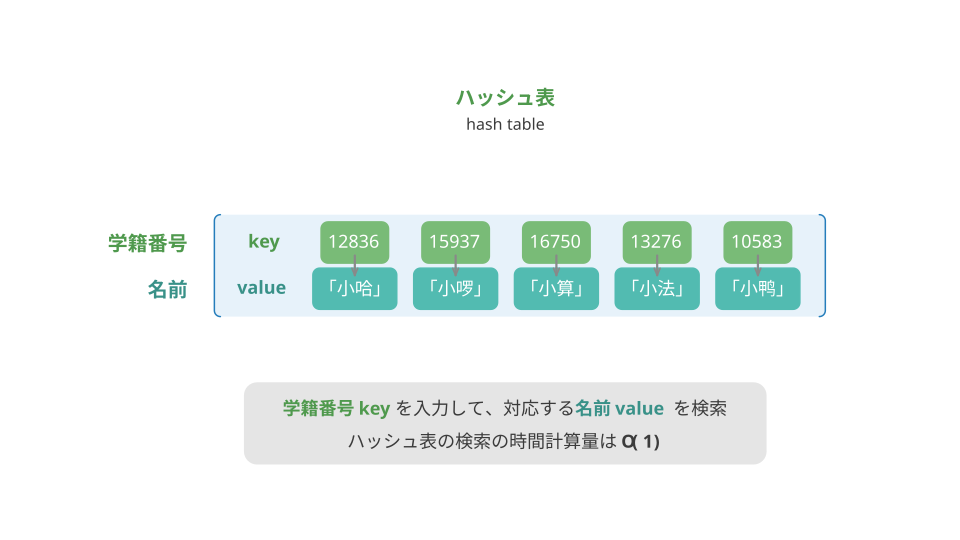

# ハッシュテーブル

<u>ハッシュテーブル（hash table）</u>は、<u>ハッシュ表</u>とも呼ばれます。キー `key` と値 `value` の対応を作り、要素を効率よく照会します。具体的には、キー `key` を入力すると、対応する値 `value` を $O(1)$ 時間で取得できます。

下図のように、$n$ 人の学生がおり、それぞれに名前と学籍番号があるとします。「学籍番号を入力すると対応する名前を返す」機能は、図のハッシュテーブルで実現できます。



配列や連結リストでも照会機能を実現できます。効率の比較を下表に示します。

- **要素の追加**：配列（連結リスト）の末尾に追加するだけなので、$O(1)$ 時間です。
- **要素の照会**：配列（連結リスト）が未整列なので、すべての要素を走査する必要があり、$O(n)$ 時間です。
- **要素の削除**：まず要素を探してから配列（連結リスト）から削除するため、$O(n)$ 時間です。

<p align="center"> 表 <id> &nbsp; 要素の照会効率の比較 </p>

|          | 配列   | 連結リスト   | ハッシュテーブル |
| -------- | ------ | ------ | ------ |
| 要素の探索 | $O(n)$ | $O(n)$ | $O(1)$ |
| 要素の追加 | $O(1)$ | $O(1)$ | $O(1)$ |
| 要素の削除 | $O(n)$ | $O(n)$ | $O(1)$ |

**ハッシュテーブルの追加、削除、照会、更新は、すべて時間計算量が $O(1)$** で、非常に効率的です。

## ハッシュテーブルの主な操作

主な操作には、初期化、照会、キーと値のペアの追加や削除などがあります。コード例を示します。

```snippet
hash_map_operations
```

??? pythontutor "実行の可視化"

    @tutor hash_map_operations_tutor

ハッシュテーブルの主な走査方法は、キーと値のペアの走査、キーだけの走査、値だけの走査の三つです。コード例を示します。

```snippet
hash_map_traversal
```

??? pythontutor "実行の可視化"

    @tutor hash_map_traversal_tutor

## ハッシュテーブルの単純な実装

まず最も単純な場合として、**一つの配列だけでハッシュテーブルを実装します**。配列内の各格納場所を<u>バケット（bucket）</u>と呼び、それぞれにキーと値のペアを一つ格納できます。照会とは、`key` に対応するバケットを探し、そこから `value` を取得する操作です。

では、`key` から対応するバケットをどう見つけるのでしょうか。<u>ハッシュ関数（hash function）</u>を使います。その役割は、大きな入力空間を小さな出力空間へ写すことです。ハッシュテーブルでは、入力空間はすべての `key`、出力空間はすべてのバケット、つまり配列のインデックスです。言い換えると、`key` を入力すれば、**そのペアが配列のどこに格納されるかをハッシュ関数で求められます**。

`key` を入力したとき、ハッシュ関数の計算は次の二段階に分かれます。

1. 何らかのハッシュアルゴリズム `hash()` でハッシュ値を求めます。
2. ハッシュ値をバケット数（配列の長さ）`capacity` で割った余りを取り、対応するバケット（配列のインデックス）`index` を得ます。

```shell
index = hash(key) % capacity
```

その後、`index` でハッシュテーブル内の対応するバケットにアクセスし、`value` を取得できます。

配列の長さを `capacity = 100`、ハッシュアルゴリズムを `hash(key) = key` とすると、ハッシュ関数は `key % 100` です。下図では、学籍番号を `key`、名前を `value` として、その仕組みを示しています。


以下は単純なハッシュテーブルの実装です。`key` と `value` をクラス `Pair` にまとめ、キーと値のペアを表しています。

```src
[file]{array_hash_map}-[class]{array_hash_map}-[func]{}
```

## ハッシュ衝突と容量拡張

本質的に、ハッシュ関数はすべての `key` からなる入力空間を、配列のすべてのインデックスからなる出力空間へ写します。入力空間は通常、出力空間よりはるかに大きいため、**理論上、複数の入力が同じ出力に対応する場合が必ずあります**。

上の例では、入力した `key` の下二桁が同じなら出力も同じです。例えば、学籍番号 12836 と 20336 の学生を照会すると、次のようになります。

```shell
12836 % 100 = 36
20336 % 100 = 36
```

下図では、二つの学籍番号が同じ名前を指しており、明らかに正しくありません。このように、複数の入力が同じ出力に対応することを<u>ハッシュ衝突（hash collision）</u>と呼びます。


容量 $n$ が大きいほど、複数の `key` が同じバケットに割り当てられる確率は低くなり、衝突が減ります。したがって、**ハッシュテーブルの容量を拡張して衝突を減らせます**。

下図では、拡張前にペア `(136, A)` と `(236, D)` が衝突していますが、拡張後には解消しています。


配列の容量拡張と同様に、すべてのペアを古いハッシュテーブルから新しいものへ移す必要があり、非常に時間がかかります。さらに、`capacity` が変わるため、すべてのペアの格納位置をハッシュ関数で再計算する必要があり、計算負荷が増えます。そのため、言語の実装では通常、十分な容量をあらかじめ確保して、頻繁な拡張を防ぎます。

<u>負荷率（load factor）</u>は重要な概念で、要素数をバケット数で割った値です。衝突の程度を測るために使い、**容量拡張を開始する条件にもよく用います**。例えば Java では、負荷率が $0.75$ を超えると、容量を元の $2$ 倍に拡張します。
