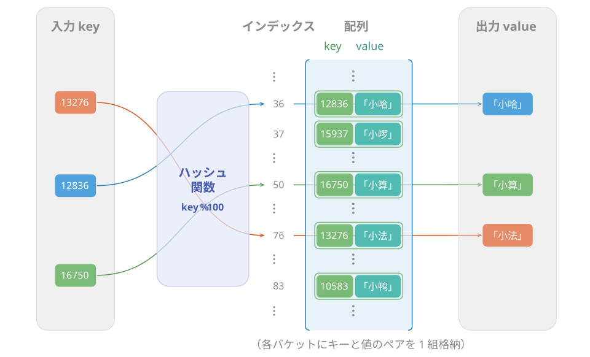
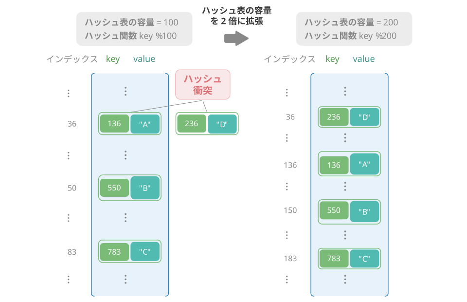

# ハッシュ表

<u>ハッシュ表（hash table）</u>は<u>ハッシュテーブル</u>とも呼ばれます。キー `key` と値 `value` を対応づけて、要素を効率よく検索するデータ構造です。具体的には、ハッシュ表にキー `key` を入力すると、$O(1)$ 時間で対応する値 `value` が得られます。

下図のように $n$ 人の学生がいて、それぞれに「名前」と「学籍番号」のデータがあるとします。学籍番号を入力すると対応する名前を返す検索機能は、図のようなハッシュ表で実現できます。


ハッシュ表のほかに、配列や連結リストでも検索機能を実装できます。効率の違いを次の表に示します。

- **要素の追加**：配列や連結リストの末尾に要素を加えるだけなので、かかる時間は $O(1)$ です。
- **要素の検索**：配列や連結リストの要素は整列されていないため、全要素を順に調べる必要があり、$O(n)$ 時間かかります。
- **要素の削除**：まず要素を探し、それから配列や連結リストから削除するので、$O(n)$ 時間かかります。

<p align="center"> 表 <id> &nbsp; 要素の検索効率の比較 </p>

|          | 配列   | 連結リスト   | ハッシュ表 |
| -------- | ------ | ------ | ------ |
| 要素の検索 | $O(n)$ | $O(n)$ | $O(1)$ |
| 要素の追加 | $O(1)$ | $O(1)$ | $O(1)$ |
| 要素の削除 | $O(n)$ | $O(n)$ | $O(1)$ |

表からわかるように、**ハッシュ表での追加、削除、検索、更新の時間計算量はいずれも $O(1)$** で、非常に効率的です。

## ハッシュ表の基本操作

ハッシュ表の基本操作には、初期化、検索、キーと値のペアの追加や削除などがあります。次のコードはその例です。

```snippet
hash_map_operations
```

??? pythontutor "実行の様子を見る"

    @tutor hash_map_operations_tutor

ハッシュ表を走査する方法には、キーと値のペアをたどる、キーだけをたどる、値だけをたどる、という 3 通りがよく使われます。次のコードを見てみましょう。

```snippet
hash_map_traversal
```

??? pythontutor "実行の様子を見る"

    @tutor hash_map_traversal_tutor

## ハッシュ表の簡単な実装

まず、**配列を 1 つだけ使ってハッシュ表を実装する**という最も簡単な場合を考えましょう。配列内の個々の格納場所を<u>バケット（bucket）</u>と呼び、それぞれにキーと値のペアを 1 組格納できます。したがって検索では、`key` に対応するバケットを見つけ、そこから `value` を取り出します。

`key` から対応するバケットを見つけるにはどうすればよいでしょうか。そこで使うのが<u>ハッシュ関数（hash function）</u>です。ハッシュ関数は、広い範囲の入力をより狭い範囲の出力に対応づけます。ハッシュ表では、入力の範囲はすべての `key`、出力の範囲はすべてのバケット（配列のインデックス）です。つまり、`key` を入力すると、**その `key` に対応するペアが配列のどこに格納されるかをハッシュ関数で求められます**。

`key` を入力したとき、ハッシュ関数は次の 2 段階で計算します。

1. ハッシュアルゴリズム `hash()` でハッシュ値を計算します。
2. ハッシュ値をバケット数（配列の長さ）`capacity` で割った余りを取ると、その `key` に対応するバケット（配列のインデックス）`index` が得られます。

```shell
index = hash(key) % capacity
```

あとは `index` を使って表の該当するバケットにアクセスすれば、`value` を取得できます。

配列の長さを `capacity = 100`、ハッシュアルゴリズムを `hash(key) = key` とすると、ハッシュ関数は `key % 100` です。下図は、学籍番号を `key`、名前を `value` とした例で、ハッシュ関数の仕組みを示しています。



次のコードは簡単なハッシュ表の実装です。キーと値のペアを表すため、`key` と `value` を 1 つのクラス `Pair` にまとめています。

```src
[file]{array_hash_map}-[class]{array_hash_map}-[func]{}
```

## ハッシュ衝突と表の拡張

ハッシュ関数は、すべての `key` からなる入力の集合を、配列のすべてのインデックスからなる出力の集合に対応づけます。多くの場合、入力の集合は出力の集合よりはるかに大きいため、**理論上、複数の入力が同じ出力に対応する場合が必ずあります**。

上の例のハッシュ関数では、入力 `key` の下 2 桁が同じなら出力も同じです。例えば、学籍番号が 12836 と 20336 の 2 人の学生を検索すると、次のようになります。

```shell
12836 % 100 = 36
20336 % 100 = 36
```

下図のように 2 つの学籍番号が同じ名前を指してしまい、正しく検索できません。このように複数の入力が同じ出力に対応することを<u>ハッシュ衝突（hash collision）</u>と呼びます。


ハッシュ表の容量 $n$ が大きいほど、複数の `key` が同じバケットに割り当てられる確率は低くなり、衝突は減ります。したがって、**ハッシュ表を拡張すれば、衝突を減らせます**。

下図では、拡張前にペア `(136, A)` と `(236, D)` が衝突していましたが、拡張後には衝突が解消されています。



配列の場合と同様に、ハッシュ表を拡張するときは元の表から新しい表へすべてのペアを移す必要があり、時間がかかります。さらに容量 `capacity` が変わるので、すべてのペアの格納位置をハッシュ関数で求め直す分だけ計算コストも増えます。そのため、プログラミング言語の実装では通常、十分な容量をあらかじめ確保し、頻繁な拡張を避けています。

<u>負荷率（load factor）</u>はハッシュ表の重要な指標です。表内の要素数をバケット数で割った値で、衝突の起きやすさを測るほか、**表を拡張するきっかけとしてもよく使われます**。例えば Java では、負荷率が $0.75$ を超えると、表の容量を元の $2$ 倍にします。
