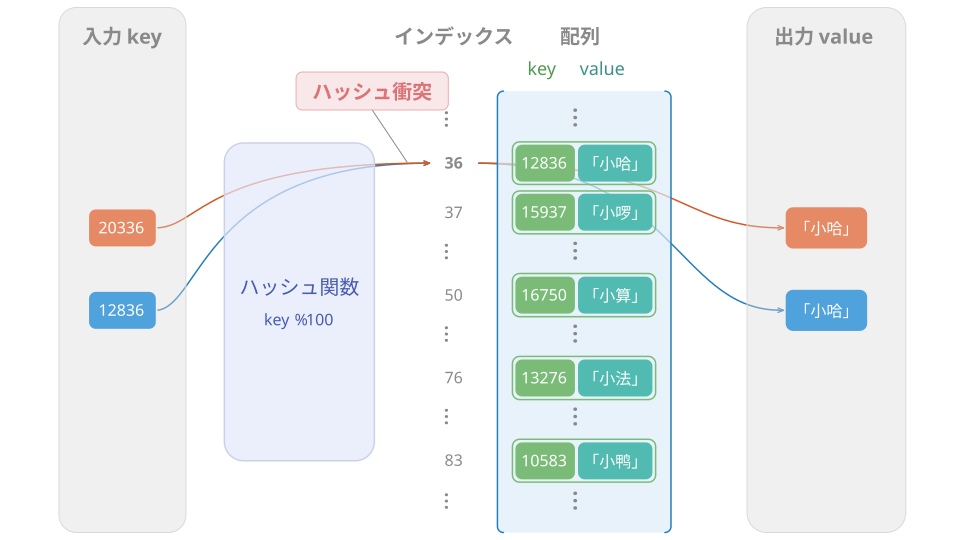

# 6.1 &nbsp; ハッシュ表

<u>ハッシュ表（hash table）</u>は<u>ハッシュテーブル</u>とも呼ばれます。キー `key` と値 `value` を対応づけて、要素を効率よく検索するデータ構造です。具体的には、ハッシュ表にキー `key` を入力すると、$O(1)$ 時間で対応する値 `value` が得られます。

図 6-1 のように $n$ 人の学生がいて、それぞれに「名前」と「学籍番号」のデータがあるとします。学籍番号を入力すると対応する名前を返す検索機能は、図のようなハッシュ表で実現できます。

{ class="animation-figure" }

<p align="center"> 図 6-1 &nbsp; ハッシュ表の抽象的な表現 </p>

ハッシュ表のほかに、配列や連結リストでも検索機能を実装できます。効率の違いを表 6-1 に示します。

- **要素の追加**：配列や連結リストの末尾に要素を加えるだけなので、かかる時間は $O(1)$ です。
- **要素の検索**：配列や連結リストの要素は整列されていないため、全要素を順に調べる必要があり、$O(n)$ 時間かかります。
- **要素の削除**：まず要素を探し、それから配列や連結リストから削除するので、$O(n)$ 時間かかります。

<p align="center"> 表 6-1 &nbsp; 要素の検索効率の比較 </p>

<div class="center-table" markdown>

|          | 配列   | 連結リスト   | ハッシュ表 |
| -------- | ------ | ------ | ------ |
| 要素の検索 | $O(n)$ | $O(n)$ | $O(1)$ |
| 要素の追加 | $O(1)$ | $O(1)$ | $O(1)$ |
| 要素の削除 | $O(n)$ | $O(n)$ | $O(1)$ |

</div>

表からわかるように、**ハッシュ表での追加、削除、検索、更新の時間計算量はいずれも $O(1)$** で、非常に効率的です。

## 6.1.1 &nbsp; ハッシュ表の基本操作

ハッシュ表の基本操作には、初期化、検索、キーと値のペアの追加や削除などがあります。次のコードはその例です。

=== "Python"

    ```python title="hash_map.py"
    # ハッシュ表を初期化する
    hmap = dict[int, str]()

    # 追加
    # ハッシュ表にペア (key, value) を追加する
    hmap[12836] = "小哈"
    hmap[15937] = "小啰"
    hmap[16750] = "小算"
    hmap[13276] = "小法"
    hmap[10583] = "小鸭"

    # 検索
    # ハッシュ表でキー key に対応する値 value を取得する
    name: str = hmap[15937]

    # 削除
    # ハッシュ表からペア (key, value) を削除する
    hmap.pop(10583)
    ```

=== "C++"

    ```cpp title="hash_map.cpp"
    /* ハッシュ表を初期化する */
    unordered_map<int, string> map;

    /* 追加 */
    // ハッシュ表にペア (key, value) を追加する
    map[12836] = "小哈";
    map[15937] = "小啰";
    map[16750] = "小算";
    map[13276] = "小法";
    map[10583] = "小鸭";

    /* 検索 */
    // ハッシュ表でキー key に対応する値 value を取得する
    string name = map[15937];

    /* 削除 */
    // ハッシュ表からペア (key, value) を削除する
    map.erase(10583);
    ```

=== "Java"

    ```java title="hash_map.java"
    /* ハッシュ表を初期化する */
    Map<Integer, String> map = new HashMap<>();

    /* 追加 */
    // ハッシュ表にペア (key, value) を追加する
    map.put(12836, "小哈");
    map.put(15937, "小啰");
    map.put(16750, "小算");
    map.put(13276, "小法");
    map.put(10583, "小鸭");

    /* 検索 */
    // ハッシュ表でキー key に対応する値 value を取得する
    String name = map.get(15937);

    /* 削除 */
    // ハッシュ表からペア (key, value) を削除する
    map.remove(10583);
    ```

=== "C#"

    ```csharp title="hash_map.cs"
    /* ハッシュ表を初期化する */
    Dictionary<int, string> map = new() {
        /* 追加 */
        // ハッシュ表にペア (key, value) を追加する
        { 12836, "小哈" },
        { 15937, "小啰" },
        { 16750, "小算" },
        { 13276, "小法" },
        { 10583, "小鸭" }
    };

    /* 検索 */
    // ハッシュ表でキー key に対応する値 value を取得する
    string name = map[15937];

    /* 削除 */
    // ハッシュ表からペア (key, value) を削除する
    map.Remove(10583);
    ```

=== "Go"

    ```go title="hash_map_test.go"
    /* ハッシュ表を初期化する */
    hmap := make(map[int]string)

    /* 追加 */
    // ハッシュ表にペア (key, value) を追加する
    hmap[12836] = "小哈"
    hmap[15937] = "小啰"
    hmap[16750] = "小算"
    hmap[13276] = "小法"
    hmap[10583] = "小鸭"

    /* 検索 */
    // ハッシュ表でキー key に対応する値 value を取得する
    name := hmap[15937]

    /* 削除 */
    // ハッシュ表からペア (key, value) を削除する
    delete(hmap, 10583)
    ```

=== "Swift"

    ```swift title="hash_map.swift"
    /* ハッシュ表を初期化する */
    var map: [Int: String] = [:]

    /* 追加 */
    // ハッシュ表にペア (key, value) を追加する
    map[12836] = "小哈"
    map[15937] = "小啰"
    map[16750] = "小算"
    map[13276] = "小法"
    map[10583] = "小鸭"

    /* 検索 */
    // ハッシュ表でキー key に対応する値 value を取得する
    let name = map[15937]!

    /* 削除 */
    // ハッシュ表からペア (key, value) を削除する
    map.removeValue(forKey: 10583)
    ```

=== "JS"

    ```javascript title="hash_map.js"
    /* ハッシュ表を初期化する */
    const map = new Map();

    /* 追加 */
    // ハッシュ表にペア (key, value) を追加する
    map.set(12836, '小哈');
    map.set(15937, '小啰');
    map.set(16750, '小算');
    map.set(13276, '小法');
    map.set(10583, '小鸭');

    /* 検索 */
    // ハッシュ表でキー key に対応する値 value を取得する
    let name = map.get(15937);

    /* 削除 */
    // ハッシュ表からペア (key, value) を削除する
    map.delete(10583);
    ```

=== "TS"

    ```typescript title="hash_map.ts"
    /* ハッシュ表を初期化する */
    const map = new Map<number, string>();

    /* 追加 */
    // ハッシュ表にペア (key, value) を追加する
    map.set(12836, '小哈');
    map.set(15937, '小啰');
    map.set(16750, '小算');
    map.set(13276, '小法');
    map.set(10583, '小鸭');

    /* 検索 */
    // ハッシュ表でキー key に対応する値 value を取得する
    let name = map.get(15937);

    /* 削除 */
    // ハッシュ表からペア (key, value) を削除する
    map.delete(10583);
    ```

=== "Dart"

    ```dart title="hash_map.dart"
    /* ハッシュ表を初期化する */
    final Map<int, String> map = {};

    /* 追加 */
    // ハッシュ表にペア (key, value) を追加する
    map[12836] = "小哈";
    map[15937] = "小啰";
    map[16750] = "小算";
    map[13276] = "小法";
    map[10583] = "小鸭";

    /* 検索 */
    // ハッシュ表でキー key に対応する値 value を取得する
    final String? name = map[15937];

    /* 削除 */
    // ハッシュ表からペア (key, value) を削除する
    map.remove(10583);
    ```

=== "Rust"

    ```rust title="hash_map.rs"
    use std::collections::HashMap;

    // ハッシュ表を初期化する
    let mut map = HashMap::new();

    // 追加
    // ハッシュ表にペア (key, value) を追加する
    map.insert(12836, "小哈");
    map.insert(15937, "小啰");
    map.insert(16750, "小算");
    map.insert(13276, "小法");
    map.insert(10583, "小鸭");

    // 検索
    // ハッシュ表でキー key に対応する値 value を取得する
    let name = map.get(&15937).copied().unwrap();

    // 削除
    // ハッシュ表からペア (key, value) を削除する
    _ = map.remove(&10583);
    ```

=== "C"

    ```c title="hash_map.c"
    // C には組み込みのハッシュ表がない
    ```

=== "Kotlin"

    ```kotlin title="hash_map.kt"
    /* ハッシュ表を初期化する */
    val map = HashMap<Int, String>()

    /* 追加 */
    // ハッシュ表にペア (key, value) を追加する
    map[12836] = "小哈"
    map[15937] = "小啰"
    map[16750] = "小算"
    map[13276] = "小法"
    map[10583] = "小鸭"

    /* 検索 */
    // ハッシュ表でキー key に対応する値 value を取得する
    val name = map[15937]

    /* 削除 */
    // ハッシュ表からペア (key, value) を削除する
    map.remove(10583)
    ```

=== "Ruby"

    ```ruby title="hash_map.rb"
    # ハッシュ表を初期化する
    hmap = {}

    # 追加
    # ハッシュ表にペア (key, value) を追加する
    hmap[12836] = "小哈"
    hmap[15937] = "小啰"
    hmap[16750] = "小算"
    hmap[13276] = "小法"
    hmap[10583] = "小鸭"

    # 検索
    # ハッシュ表でキー key に対応する値 value を取得する
    name = hmap[15937]

    # 削除
    # ハッシュ表からペア (key, value) を削除する
    hmap.delete(10583)
    ```

??? pythontutor "実行の様子を見る"

    <div style="height: 549px; width: 100%;"><iframe class="pythontutor-iframe" title="実行の様子を見る" src="https://pythontutor.com/iframe-embed.html#code=%22%22%22Driver%20Code%22%22%22%0Aif%20__name__%20%3D%3D%20%22__main__%22%3A%0A%20%20%20%20%23%20%E3%83%8F%E3%83%83%E3%82%B7%E3%83%A5%E3%83%86%E3%83%BC%E3%83%96%E3%83%AB%E3%82%92%E5%88%9D%E6%9C%9F%E5%8C%96%0A%20%20%20%20hmap%20%3D%20%7B%7D%0A%20%20%20%20%0A%20%20%20%20%23%20%E8%BF%BD%E5%8A%A0%0A%20%20%20%20%23%20%E3%83%8F%E3%83%83%E3%82%B7%E3%83%A5%E3%83%86%E3%83%BC%E3%83%96%E3%83%AB%E3%81%AB%E3%82%AD%E3%83%BC%E3%81%A8%E5%80%A4%E3%81%AE%E7%B5%84%20%28key,%20value%29%20%E3%82%92%E8%BF%BD%E5%8A%A0%0A%20%20%20%20hmap%5B12836%5D%20%3D%20%22%E3%82%B7%E3%83%A3%E3%82%AA%E3%83%8F%E3%83%BC%22%0A%20%20%20%20hmap%5B15937%5D%20%3D%20%22%E3%82%B7%E3%83%A3%E3%82%AA%E3%83%AB%E3%82%AA%22%0A%20%20%20%20hmap%5B16750%5D%20%3D%20%22%E3%82%B7%E3%83%A3%E3%82%AA%E3%82%B9%E3%82%A2%E3%83%B3%22%0A%20%20%20%20hmap%5B13276%5D%20%3D%20%22%E3%82%B7%E3%83%A3%E3%82%AA%E3%83%95%E3%82%A1%E3%83%BC%22%0A%20%20%20%20hmap%5B10583%5D%20%3D%20%22%E3%82%B7%E3%83%A3%E3%82%AA%E3%83%A4%E3%83%BC%22%0A%20%20%20%20%0A%20%20%20%20%23%20%E6%A4%9C%E7%B4%A2%0A%20%20%20%20%23%20%E3%82%AD%E3%83%BC%20key%20%E3%82%92%E6%8C%87%E5%AE%9A%E3%81%97%E3%81%A6%E3%83%8F%E3%83%83%E3%82%B7%E3%83%A5%E3%83%86%E3%83%BC%E3%83%96%E3%83%AB%E3%81%8B%E3%82%89%E5%80%A4%20value%20%E3%82%92%E5%8F%96%E5%BE%97%0A%20%20%20%20name%20%3D%20hmap%5B15937%5D%0A%20%20%20%20%0A%20%20%20%20%23%20%E5%89%8A%E9%99%A4%0A%20%20%20%20%23%20%E3%83%8F%E3%83%83%E3%82%B7%E3%83%A5%E3%83%86%E3%83%BC%E3%83%96%E3%83%AB%E3%81%8B%E3%82%89%E3%82%AD%E3%83%BC%E3%81%A8%E5%80%A4%E3%81%AE%E7%B5%84%20%28key,%20value%29%20%E3%82%92%E5%89%8A%E9%99%A4%0A%20%20%20%20hmap.pop%2810583%29&codeDivHeight=472&codeDivWidth=350&cumulative=false&curInstr=2&heapPrimitives=nevernest&origin=opt-frontend.js&py=311&rawInputLstJSON=%5B%5D&textReferences=false"> </iframe></div>
    <div style="margin-top: 5px;"><a href="https://pythontutor.com/iframe-embed.html#code=%22%22%22Driver%20Code%22%22%22%0Aif%20__name__%20%3D%3D%20%22__main__%22%3A%0A%20%20%20%20%23%20%E3%83%8F%E3%83%83%E3%82%B7%E3%83%A5%E3%83%86%E3%83%BC%E3%83%96%E3%83%AB%E3%82%92%E5%88%9D%E6%9C%9F%E5%8C%96%0A%20%20%20%20hmap%20%3D%20%7B%7D%0A%20%20%20%20%0A%20%20%20%20%23%20%E8%BF%BD%E5%8A%A0%0A%20%20%20%20%23%20%E3%83%8F%E3%83%83%E3%82%B7%E3%83%A5%E3%83%86%E3%83%BC%E3%83%96%E3%83%AB%E3%81%AB%E3%82%AD%E3%83%BC%E3%81%A8%E5%80%A4%E3%81%AE%E7%B5%84%20%28key,%20value%29%20%E3%82%92%E8%BF%BD%E5%8A%A0%0A%20%20%20%20hmap%5B12836%5D%20%3D%20%22%E3%82%B7%E3%83%A3%E3%82%AA%E3%83%8F%E3%83%BC%22%0A%20%20%20%20hmap%5B15937%5D%20%3D%20%22%E3%82%B7%E3%83%A3%E3%82%AA%E3%83%AB%E3%82%AA%22%0A%20%20%20%20hmap%5B16750%5D%20%3D%20%22%E3%82%B7%E3%83%A3%E3%82%AA%E3%82%B9%E3%82%A2%E3%83%B3%22%0A%20%20%20%20hmap%5B13276%5D%20%3D%20%22%E3%82%B7%E3%83%A3%E3%82%AA%E3%83%95%E3%82%A1%E3%83%BC%22%0A%20%20%20%20hmap%5B10583%5D%20%3D%20%22%E3%82%B7%E3%83%A3%E3%82%AA%E3%83%A4%E3%83%BC%22%0A%20%20%20%20%0A%20%20%20%20%23%20%E6%A4%9C%E7%B4%A2%0A%20%20%20%20%23%20%E3%82%AD%E3%83%BC%20key%20%E3%82%92%E6%8C%87%E5%AE%9A%E3%81%97%E3%81%A6%E3%83%8F%E3%83%83%E3%82%B7%E3%83%A5%E3%83%86%E3%83%BC%E3%83%96%E3%83%AB%E3%81%8B%E3%82%89%E5%80%A4%20value%20%E3%82%92%E5%8F%96%E5%BE%97%0A%20%20%20%20name%20%3D%20hmap%5B15937%5D%0A%20%20%20%20%0A%20%20%20%20%23%20%E5%89%8A%E9%99%A4%0A%20%20%20%20%23%20%E3%83%8F%E3%83%83%E3%82%B7%E3%83%A5%E3%83%86%E3%83%BC%E3%83%96%E3%83%AB%E3%81%8B%E3%82%89%E3%82%AD%E3%83%BC%E3%81%A8%E5%80%A4%E3%81%AE%E7%B5%84%20%28key,%20value%29%20%E3%82%92%E5%89%8A%E9%99%A4%0A%20%20%20%20hmap.pop%2810583%29&codeDivHeight=800&codeDivWidth=600&cumulative=false&curInstr=2&heapPrimitives=nevernest&origin=opt-frontend.js&py=311&rawInputLstJSON=%5B%5D&textReferences=false" target="_blank" rel="noopener noreferrer">全画面で表示 ></a></div>

ハッシュ表を走査する方法には、キーと値のペアをたどる、キーだけをたどる、値だけをたどる、という 3 通りがよく使われます。次のコードを見てみましょう。

=== "Python"

    ```python title="hash_map.py"
    # ハッシュ表を走査する
    # キーと値のペアを順に表示 key->value
    for key, value in hmap.items():
        print(key, "->", value)

    # キーだけを順に表示 key
    for key in hmap.keys():
        print(key)

    # 値だけを順に表示 value
    for val in hmap.values():
        print(val)
    ```

=== "C++"

    ```cpp title="hash_map.cpp"
    /* ハッシュ表を走査する */
    // キーと値のペアを順に表示 key->value
    for (auto kv : map) {
        cout << kv.first << " -> " << kv.second << endl;
    }

    // イテレータでペアを順に表示 key->value
    for (auto iter = map.begin(); iter != map.end(); iter++) {
        cout << iter->first << " -> " << iter->second << endl;
    }
    ```

=== "Java"

    ```java title="hash_map.java"
    /* ハッシュ表を走査する */
    // キーと値のペアを順に表示 key->value
    for (Map.Entry<Integer, String> kv : map.entrySet()) {
        System.out.println(kv.getKey() + " -> " + kv.getValue());
    }

    // キーだけを順に表示 key
    for (int key : map.keySet()) {
        System.out.println(key);
    }

    // 値だけを順に表示 value
    for (String val : map.values()) {
        System.out.println(val);
    }
    ```

=== "C#"

    ```csharp title="hash_map.cs"
    /* ハッシュ表を走査する */
    // キーと値のペアを順に表示 key->value
    foreach (var kv in map) {
        Console.WriteLine(kv.Key + " -> " + kv.Value);
    }

    // キーだけを順に表示 key
    foreach (int key in map.Keys) {
        Console.WriteLine(key);
    }

    // 値だけを順に表示 value
    foreach (string val in map.Values) {
        Console.WriteLine(val);
    }
    ```

=== "Go"

    ```go title="hash_map_test.go"
    /* ハッシュ表を走査する */
    // キーと値のペアを順に表示 key->value
    for key, value := range hmap {
        fmt.Println(key, "->", value)
    }

    // キーだけを順に表示 key
    for key := range hmap {
        fmt.Println(key)
    }

    // 値だけを順に表示 value
    for _, value := range hmap {
        fmt.Println(value)
    }
    ```

=== "Swift"

    ```swift title="hash_map.swift"
    /* ハッシュ表を走査する */
    // キーと値のペアを順に表示 key->value
    for (key, value) in map {
        print("\(key) -> \(value)")
    }

    // キーだけを順に表示 key
    for key in map.keys {
        print(key)
    }

    // 値だけを順に表示 value
    for value in map.values {
        print(value)
    }
    ```

=== "JS"

    ```javascript title="hash_map.js"
    /* ハッシュ表を走査する */
    // キーと値のペアを順に表示 key->value
    for (const [k, v] of map.entries()) {
        console.info(k + ' -> ' + v);
    }

    // キーだけを順に表示 key
    for (const k of map.keys()) {
        console.info(k);
    }

    // 値だけを順に表示 value
    for (const v of map.values()) {
        console.info(v);
    }
    ```

=== "TS"

    ```typescript title="hash_map.ts"
    /* ハッシュ表を走査する */
    // キーと値のペアを順に表示 key->value
    for (const [k, v] of map.entries()) {
        console.info(k + ' -> ' + v);
    }

    // キーだけを順に表示 key
    for (const k of map.keys()) {
        console.info(k);
    }

    // 値だけを順に表示 value
    for (const v of map.values()) {
        console.info(v);
    }
    ```

=== "Dart"

    ```dart title="hash_map.dart"
    /* ハッシュ表を走査する */
    // キーと値のペアを順に表示 key->value
    map.forEach((key, value) => print("$key -> $value"));

    // キーだけを順に表示 key
    map.keys.forEach((key) => print(key));

    // 値だけを順に表示 value
    map.values.forEach((value) => print(value));
    ```

=== "Rust"

    ```rust title="hash_map.rs"
    // ハッシュ表を走査する
    // キーと値のペアを順に表示 key->value
    for (key, value) in &map {
        println!("{key} -> {value}");
    }

    // キーだけを順に表示 key
    for key in map.keys() {
        println!("{key}");
    }

    // 値だけを順に表示 value
    for value in map.values() {
        println!("{value}");
    }
    ```

=== "C"

    ```c title="hash_map.c"
    // C には組み込みのハッシュ表がない
    ```

=== "Kotlin"

    ```kotlin title="hash_map.kt"
    /* ハッシュ表を走査する */
    // キーと値のペアを順に表示 key->value
    for ((key, value) in map) {
        println("$key -> $value")
    }

    // キーだけを順に表示 key
    for (key in map.keys) {
        println(key)
    }

    // 値だけを順に表示 value
    for (_val in map.values) {
        println(_val)
    }
    ```

=== "Ruby"

    ```ruby title="hash_map.rb"
    # ハッシュ表を走査する
    # キーと値のペアを順に表示 key->value
    hmap.entries.each { |key, value| puts "#{key} -> #{value}" }

    # キーだけを順に表示 key
    hmap.keys.each { |key| puts key }

    # 値だけを順に表示 value
    hmap.values.each { |val| puts val }
    ```

??? pythontutor "実行の様子を見る"

    <div style="height: 549px; width: 100%;"><iframe class="pythontutor-iframe" title="実行の様子を見る" src="https://pythontutor.com/iframe-embed.html#code=%22%22%22Driver%20Code%22%22%22%0Aif%20__name__%20%3D%3D%20%22__main__%22%3A%0A%20%20%20%20%23%20%E3%83%8F%E3%83%83%E3%82%B7%E3%83%A5%E3%83%86%E3%83%BC%E3%83%96%E3%83%AB%E3%82%92%E5%88%9D%E6%9C%9F%E5%8C%96%0A%20%20%20%20hmap%20%3D%20%7B%7D%0A%20%20%20%20%0A%20%20%20%20%23%20%E8%BF%BD%E5%8A%A0%0A%20%20%20%20%23%20%E3%83%8F%E3%83%83%E3%82%B7%E3%83%A5%E3%83%86%E3%83%BC%E3%83%96%E3%83%AB%E3%81%AB%E3%82%AD%E3%83%BC%E3%81%A8%E5%80%A4%E3%81%AE%E7%B5%84%20%28key,%20value%29%20%E3%82%92%E8%BF%BD%E5%8A%A0%0A%20%20%20%20hmap%5B12836%5D%20%3D%20%22%E3%82%B7%E3%83%A3%E3%82%AA%E3%83%8F%E3%83%BC%22%0A%20%20%20%20hmap%5B15937%5D%20%3D%20%22%E3%82%B7%E3%83%A3%E3%82%AA%E3%83%AB%E3%82%AA%22%0A%20%20%20%20hmap%5B16750%5D%20%3D%20%22%E3%82%B7%E3%83%A3%E3%82%AA%E3%82%B9%E3%82%A2%E3%83%B3%22%0A%20%20%20%20hmap%5B13276%5D%20%3D%20%22%E3%82%B7%E3%83%A3%E3%82%AA%E3%83%95%E3%82%A1%E3%83%BC%22%0A%20%20%20%20hmap%5B10583%5D%20%3D%20%22%E3%82%B7%E3%83%A3%E3%82%AA%E3%83%A4%E3%83%BC%22%0A%20%20%20%20%0A%20%20%20%20%23%20%E3%83%8F%E3%83%83%E3%82%B7%E3%83%A5%E3%83%86%E3%83%BC%E3%83%96%E3%83%AB%E3%81%AE%E8%A6%81%E7%B4%A0%E3%82%92%E9%A0%86%E3%81%AB%E3%81%9F%E3%81%A9%E3%82%8B%0A%20%20%20%20%23%20%E3%82%AD%E3%83%BC%E3%81%A8%E5%80%A4%E3%81%AE%E7%B5%84%20key-%3Evalue%20%E3%82%92%E9%A0%86%E3%81%AB%E3%81%9F%E3%81%A9%E3%82%8B%0A%20%20%20%20for%20key,%20value%20in%20hmap.items%28%29%3A%0A%20%20%20%20%20%20%20%20print%28key,%20%22-%3E%22,%20value%29%0A%20%20%20%20%23%20%E3%82%AD%E3%83%BC%20key%20%E3%81%A0%E3%81%91%E3%82%92%E9%A0%86%E3%81%AB%E3%81%9F%E3%81%A9%E3%82%8B%0A%20%20%20%20for%20key%20in%20hmap.keys%28%29%3A%0A%20%20%20%20%20%20%20%20print%28key%29%0A%20%20%20%20%23%20%E5%80%A4%20value%20%E3%81%A0%E3%81%91%E3%82%92%E9%A0%86%E3%81%AB%E3%81%9F%E3%81%A9%E3%82%8B%0A%20%20%20%20for%20val%20in%20hmap.values%28%29%3A%0A%20%20%20%20%20%20%20%20print%28val%29&codeDivHeight=472&codeDivWidth=350&cumulative=false&curInstr=8&heapPrimitives=nevernest&origin=opt-frontend.js&py=311&rawInputLstJSON=%5B%5D&textReferences=false"> </iframe></div>
    <div style="margin-top: 5px;"><a href="https://pythontutor.com/iframe-embed.html#code=%22%22%22Driver%20Code%22%22%22%0Aif%20__name__%20%3D%3D%20%22__main__%22%3A%0A%20%20%20%20%23%20%E3%83%8F%E3%83%83%E3%82%B7%E3%83%A5%E3%83%86%E3%83%BC%E3%83%96%E3%83%AB%E3%82%92%E5%88%9D%E6%9C%9F%E5%8C%96%0A%20%20%20%20hmap%20%3D%20%7B%7D%0A%20%20%20%20%0A%20%20%20%20%23%20%E8%BF%BD%E5%8A%A0%0A%20%20%20%20%23%20%E3%83%8F%E3%83%83%E3%82%B7%E3%83%A5%E3%83%86%E3%83%BC%E3%83%96%E3%83%AB%E3%81%AB%E3%82%AD%E3%83%BC%E3%81%A8%E5%80%A4%E3%81%AE%E7%B5%84%20%28key,%20value%29%20%E3%82%92%E8%BF%BD%E5%8A%A0%0A%20%20%20%20hmap%5B12836%5D%20%3D%20%22%E3%82%B7%E3%83%A3%E3%82%AA%E3%83%8F%E3%83%BC%22%0A%20%20%20%20hmap%5B15937%5D%20%3D%20%22%E3%82%B7%E3%83%A3%E3%82%AA%E3%83%AB%E3%82%AA%22%0A%20%20%20%20hmap%5B16750%5D%20%3D%20%22%E3%82%B7%E3%83%A3%E3%82%AA%E3%82%B9%E3%82%A2%E3%83%B3%22%0A%20%20%20%20hmap%5B13276%5D%20%3D%20%22%E3%82%B7%E3%83%A3%E3%82%AA%E3%83%95%E3%82%A1%E3%83%BC%22%0A%20%20%20%20hmap%5B10583%5D%20%3D%20%22%E3%82%B7%E3%83%A3%E3%82%AA%E3%83%A4%E3%83%BC%22%0A%20%20%20%20%0A%20%20%20%20%23%20%E3%83%8F%E3%83%83%E3%82%B7%E3%83%A5%E3%83%86%E3%83%BC%E3%83%96%E3%83%AB%E3%81%AE%E8%A6%81%E7%B4%A0%E3%82%92%E9%A0%86%E3%81%AB%E3%81%9F%E3%81%A9%E3%82%8B%0A%20%20%20%20%23%20%E3%82%AD%E3%83%BC%E3%81%A8%E5%80%A4%E3%81%AE%E7%B5%84%20key-%3Evalue%20%E3%82%92%E9%A0%86%E3%81%AB%E3%81%9F%E3%81%A9%E3%82%8B%0A%20%20%20%20for%20key,%20value%20in%20hmap.items%28%29%3A%0A%20%20%20%20%20%20%20%20print%28key,%20%22-%3E%22,%20value%29%0A%20%20%20%20%23%20%E3%82%AD%E3%83%BC%20key%20%E3%81%A0%E3%81%91%E3%82%92%E9%A0%86%E3%81%AB%E3%81%9F%E3%81%A9%E3%82%8B%0A%20%20%20%20for%20key%20in%20hmap.keys%28%29%3A%0A%20%20%20%20%20%20%20%20print%28key%29%0A%20%20%20%20%23%20%E5%80%A4%20value%20%E3%81%A0%E3%81%91%E3%82%92%E9%A0%86%E3%81%AB%E3%81%9F%E3%81%A9%E3%82%8B%0A%20%20%20%20for%20val%20in%20hmap.values%28%29%3A%0A%20%20%20%20%20%20%20%20print%28val%29&codeDivHeight=800&codeDivWidth=600&cumulative=false&curInstr=8&heapPrimitives=nevernest&origin=opt-frontend.js&py=311&rawInputLstJSON=%5B%5D&textReferences=false" target="_blank" rel="noopener noreferrer">全画面で表示 ></a></div>

## 6.1.2 &nbsp; ハッシュ表の簡単な実装

まず、**配列を 1 つだけ使ってハッシュ表を実装する**という最も簡単な場合を考えましょう。配列内の個々の格納場所を<u>バケット（bucket）</u>と呼び、それぞれにキーと値のペアを 1 組格納できます。したがって検索では、`key` に対応するバケットを見つけ、そこから `value` を取り出します。

`key` から対応するバケットを見つけるにはどうすればよいでしょうか。そこで使うのが<u>ハッシュ関数（hash function）</u>です。ハッシュ関数は、広い範囲の入力をより狭い範囲の出力に対応づけます。ハッシュ表では、入力の範囲はすべての `key`、出力の範囲はすべてのバケット（配列のインデックス）です。つまり、`key` を入力すると、**その `key` に対応するペアが配列のどこに格納されるかをハッシュ関数で求められます**。

`key` を入力したとき、ハッシュ関数は次の 2 段階で計算します。

1. ハッシュアルゴリズム `hash()` でハッシュ値を計算します。
2. ハッシュ値をバケット数（配列の長さ）`capacity` で割った余りを取ると、その `key` に対応するバケット（配列のインデックス）`index` が得られます。

```shell
index = hash(key) % capacity
```

あとは `index` を使って表の該当するバケットにアクセスすれば、`value` を取得できます。

配列の長さを `capacity = 100`、ハッシュアルゴリズムを `hash(key) = key` とすると、ハッシュ関数は `key % 100` です。図 6-2 は、学籍番号を `key`、名前を `value` とした例で、ハッシュ関数の仕組みを示しています。

{ class="animation-figure" }

<p align="center"> 図 6-2 &nbsp; ハッシュ関数の仕組み </p>

次のコードは簡単なハッシュ表の実装です。キーと値のペアを表すため、`key` と `value` を 1 つのクラス `Pair` にまとめています。

=== "Python"

    ```python title="array_hash_map.py"
    class Pair:
        """キーと値のペア"""

        def __init__(self, key: int, val: str):
            self.key = key
            self.val = val

    class ArrayHashMap:
        """配列で実装したハッシュ表"""

        def __init__(self):
            """コンストラクタ"""
            # 100 個のバケットを持つ配列を初期化する
            self.buckets: list[Pair | None] = [None] * 100

        def hash_func(self, key: int) -> int:
            """ハッシュ関数"""
            index = key % 100
            return index

        def get(self, key: int) -> str | None:
            """検索"""
            index: int = self.hash_func(key)
            pair: Pair = self.buckets[index]
            if pair is None:
                return None
            return pair.val

        def put(self, key: int, val: str):
            """追加と更新"""
            pair = Pair(key, val)
            index: int = self.hash_func(key)
            self.buckets[index] = pair

        def remove(self, key: int):
            """削除"""
            index: int = self.hash_func(key)
            # None を代入して削除する
            self.buckets[index] = None

        def entry_set(self) -> list[Pair]:
            """キーと値のペアをすべて取得する"""
            result: list[Pair] = []
            for pair in self.buckets:
                if pair is not None:
                    result.append(pair)
            return result

        def key_set(self) -> list[int]:
            """すべてのキーを取得する"""
            result = []
            for pair in self.buckets:
                if pair is not None:
                    result.append(pair.key)
            return result

        def value_set(self) -> list[str]:
            """すべての値を取得する"""
            result = []
            for pair in self.buckets:
                if pair is not None:
                    result.append(pair.val)
            return result

        def print(self):
            """ハッシュ表を表示する"""
            for pair in self.buckets:
                if pair is not None:
                    print(pair.key, "->", pair.val)
    ```

=== "C++"

    ```cpp title="array_hash_map.cpp"
    /* キーと値のペア */
    struct Pair {
      public:
        int key;
        string val;
        Pair(int key, string val) {
            this->key = key;
            this->val = val;
        }
    };

    /* 配列で実装したハッシュ表 */
    class ArrayHashMap {
      private:
        vector<Pair *> buckets;

      public:
        ArrayHashMap() {
            // 100 個のバケットを持つ配列を初期化する
            buckets = vector<Pair *>(100);
        }

        ~ArrayHashMap() {
            // メモリを解放する
            for (const auto &bucket : buckets) {
                delete bucket;
            }
            buckets.clear();
        }

        /* ハッシュ関数 */
        int hashFunc(int key) {
            int index = key % 100;
            return index;
        }

        /* 検索 */
        string get(int key) {
            int index = hashFunc(key);
            Pair *pair = buckets[index];
            if (pair == nullptr)
                return "";
            return pair->val;
        }

        /* 追加 */
        void put(int key, string val) {
            Pair *pair = new Pair(key, val);
            int index = hashFunc(key);
            buckets[index] = pair;
        }

        /* 削除 */
        void remove(int key) {
            int index = hashFunc(key);
            // メモリを解放し、ポインタを nullptr にする
            delete buckets[index];
            buckets[index] = nullptr;
        }

        /* キーと値のペアをすべて取得する */
        vector<Pair *> pairSet() {
            vector<Pair *> pairSet;
            for (Pair *pair : buckets) {
                if (pair != nullptr) {
                    pairSet.push_back(pair);
                }
            }
            return pairSet;
        }

        /* すべてのキーを取得する */
        vector<int> keySet() {
            vector<int> keySet;
            for (Pair *pair : buckets) {
                if (pair != nullptr) {
                    keySet.push_back(pair->key);
                }
            }
            return keySet;
        }

        /* すべての値を取得する */
        vector<string> valueSet() {
            vector<string> valueSet;
            for (Pair *pair : buckets) {
                if (pair != nullptr) {
                    valueSet.push_back(pair->val);
                }
            }
            return valueSet;
        }

        /* ハッシュ表を表示する */
        void print() {
            for (Pair *kv : pairSet()) {
                cout << kv->key << " -> " << kv->val << endl;
            }
        }
    };
    ```

=== "Java"

    ```java title="array_hash_map.java"
    /* キーと値のペア */
    class Pair {
        public int key;
        public String val;

        public Pair(int key, String val) {
            this.key = key;
            this.val = val;
        }
    }

    /* 配列で実装したハッシュ表 */
    class ArrayHashMap {
        private List<Pair> buckets;

        public ArrayHashMap() {
            // 100 個のバケットを持つ配列を初期化する
            buckets = new ArrayList<>();
            for (int i = 0; i < 100; i++) {
                buckets.add(null);
            }
        }

        /* ハッシュ関数 */
        private int hashFunc(int key) {
            int index = key % 100;
            return index;
        }

        /* 検索 */
        public String get(int key) {
            int index = hashFunc(key);
            Pair pair = buckets.get(index);
            if (pair == null)
                return null;
            return pair.val;
        }

        /* 追加 */
        public void put(int key, String val) {
            Pair pair = new Pair(key, val);
            int index = hashFunc(key);
            buckets.set(index, pair);
        }

        /* 削除 */
        public void remove(int key) {
            int index = hashFunc(key);
            // null を代入して削除する
            buckets.set(index, null);
        }

        /* キーと値のペアをすべて取得する */
        public List<Pair> pairSet() {
            List<Pair> pairSet = new ArrayList<>();
            for (Pair pair : buckets) {
                if (pair != null)
                    pairSet.add(pair);
            }
            return pairSet;
        }

        /* すべてのキーを取得する */
        public List<Integer> keySet() {
            List<Integer> keySet = new ArrayList<>();
            for (Pair pair : buckets) {
                if (pair != null)
                    keySet.add(pair.key);
            }
            return keySet;
        }

        /* すべての値を取得する */
        public List<String> valueSet() {
            List<String> valueSet = new ArrayList<>();
            for (Pair pair : buckets) {
                if (pair != null)
                    valueSet.add(pair.val);
            }
            return valueSet;
        }

        /* ハッシュ表を表示する */
        public void print() {
            for (Pair kv : pairSet()) {
                System.out.println(kv.key + " -> " + kv.val);
            }
        }
    }
    ```

=== "C#"

    ```csharp title="array_hash_map.cs"
    /* キーと値のペア int->string */
    class Pair(int key, string val) {
        public int key = key;
        public string val = val;
    }

    /* 配列で実装したハッシュ表 */
    class ArrayHashMap {
        List<Pair?> buckets;
        public ArrayHashMap() {
            // 100 個のバケットを持つ配列を初期化する
            buckets = [];
            for (int i = 0; i < 100; i++) {
                buckets.Add(null);
            }
        }

        /* ハッシュ関数 */
        int HashFunc(int key) {
            int index = key % 100;
            return index;
        }

        /* 検索 */
        public string? Get(int key) {
            int index = HashFunc(key);
            Pair? pair = buckets[index];
            if (pair == null) return null;
            return pair.val;
        }

        /* 追加 */
        public void Put(int key, string val) {
            Pair pair = new(key, val);
            int index = HashFunc(key);
            buckets[index] = pair;
        }

        /* 削除 */
        public void Remove(int key) {
            int index = HashFunc(key);
            // null を代入して削除する
            buckets[index] = null;
        }

        /* キーと値のペアをすべて取得する */
        public List<Pair> PairSet() {
            List<Pair> pairSet = [];
            foreach (Pair? pair in buckets) {
                if (pair != null)
                    pairSet.Add(pair);
            }
            return pairSet;
        }

        /* すべてのキーを取得する */
        public List<int> KeySet() {
            List<int> keySet = [];
            foreach (Pair? pair in buckets) {
                if (pair != null)
                    keySet.Add(pair.key);
            }
            return keySet;
        }

        /* すべての値を取得する */
        public List<string> ValueSet() {
            List<string> valueSet = [];
            foreach (Pair? pair in buckets) {
                if (pair != null)
                    valueSet.Add(pair.val);
            }
            return valueSet;
        }

        /* ハッシュ表を表示する */
        public void Print() {
            foreach (Pair kv in PairSet()) {
                Console.WriteLine(kv.key + " -> " + kv.val);
            }
        }
    }
    ```

=== "Go"

    ```go title="array_hash_map.go"
    /* キーと値のペア */
    type pair struct {
        key int
        val string
    }

    /* 配列で実装したハッシュ表 */
    type arrayHashMap struct {
        buckets []*pair
    }

    /* ハッシュ表を初期化する */
    func newArrayHashMap() *arrayHashMap {
        // 100 個のバケットを持つ配列を初期化する
        buckets := make([]*pair, 100)
        return &arrayHashMap{buckets: buckets}
    }

    /* ハッシュ関数 */
    func (a *arrayHashMap) hashFunc(key int) int {
        index := key % 100
        return index
    }

    /* 検索 */
    func (a *arrayHashMap) get(key int) string {
        index := a.hashFunc(key)
        pair := a.buckets[index]
        if pair == nil {
            return "Not Found"
        }
        return pair.val
    }

    /* 追加 */
    func (a *arrayHashMap) put(key int, val string) {
        pair := &pair{key: key, val: val}
        index := a.hashFunc(key)
        a.buckets[index] = pair
    }

    /* 削除 */
    func (a *arrayHashMap) remove(key int) {
        index := a.hashFunc(key)
        // nil を代入して削除する
        a.buckets[index] = nil
    }

    /* キーと値のペアをすべて取得する */
    func (a *arrayHashMap) pairSet() []*pair {
        var pairs []*pair
        for _, pair := range a.buckets {
            if pair != nil {
                pairs = append(pairs, pair)
            }
        }
        return pairs
    }

    /* すべてのキーを取得する */
    func (a *arrayHashMap) keySet() []int {
        var keys []int
        for _, pair := range a.buckets {
            if pair != nil {
                keys = append(keys, pair.key)
            }
        }
        return keys
    }

    /* すべての値を取得する */
    func (a *arrayHashMap) valueSet() []string {
        var values []string
        for _, pair := range a.buckets {
            if pair != nil {
                values = append(values, pair.val)
            }
        }
        return values
    }

    /* ハッシュ表を表示する */
    func (a *arrayHashMap) print() {
        for _, pair := range a.buckets {
            if pair != nil {
                fmt.Println(pair.key, "->", pair.val)
            }
        }
    }
    ```

=== "Swift"

    ```swift title="array_hash_map.swift"
    /* キーと値のペア */
    class Pair: Equatable {
        public var key: Int
        public var val: String

        public init(key: Int, val: String) {
            self.key = key
            self.val = val
        }

        public static func == (lhs: Pair, rhs: Pair) -> Bool {
            lhs.key == rhs.key && lhs.val == rhs.val
        }
    }

    /* 配列で実装したハッシュ表 */
    class ArrayHashMap {
        private var buckets: [Pair?]

        init() {
            // 100 個のバケットを持つ配列を初期化する
            buckets = Array(repeating: nil, count: 100)
        }

        /* ハッシュ関数 */
        private func hashFunc(key: Int) -> Int {
            let index = key % 100
            return index
        }

        /* 検索 */
        func get(key: Int) -> String? {
            let index = hashFunc(key: key)
            let pair = buckets[index]
            return pair?.val
        }

        /* 追加 */
        func put(key: Int, val: String) {
            let pair = Pair(key: key, val: val)
            let index = hashFunc(key: key)
            buckets[index] = pair
        }

        /* 削除 */
        func remove(key: Int) {
            let index = hashFunc(key: key)
            // nil を代入して削除する
            buckets[index] = nil
        }

        /* キーと値のペアをすべて取得する */
        func pairSet() -> [Pair] {
            buckets.compactMap { $0 }
        }

        /* すべてのキーを取得する */
        func keySet() -> [Int] {
            buckets.compactMap { $0?.key }
        }

        /* すべての値を取得する */
        func valueSet() -> [String] {
            buckets.compactMap { $0?.val }
        }

        /* ハッシュ表を表示する */
        func print() {
            for pair in pairSet() {
                Swift.print("\(pair.key) -> \(pair.val)")
            }
        }
    }
    ```

=== "JS"

    ```javascript title="array_hash_map.js"
    /* キーと値のペア Number -> String */
    class Pair {
        constructor(key, val) {
            this.key = key;
            this.val = val;
        }
    }

    /* 配列で実装したハッシュ表 */
    class ArrayHashMap {
        #buckets;
        constructor() {
            // 100 個のバケットを持つ配列を初期化する
            this.#buckets = new Array(100).fill(null);
        }

        /* ハッシュ関数 */
        #hashFunc(key) {
            return key % 100;
        }

        /* 検索 */
        get(key) {
            let index = this.#hashFunc(key);
            let pair = this.#buckets[index];
            if (pair === null) return null;
            return pair.val;
        }

        /* 追加 */
        set(key, val) {
            let index = this.#hashFunc(key);
            this.#buckets[index] = new Pair(key, val);
        }

        /* 削除 */
        delete(key) {
            let index = this.#hashFunc(key);
            // null を代入して削除する
            this.#buckets[index] = null;
        }

        /* キーと値のペアをすべて取得する */
        entries() {
            let arr = [];
            for (let i = 0; i < this.#buckets.length; i++) {
                if (this.#buckets[i]) {
                    arr.push(this.#buckets[i]);
                }
            }
            return arr;
        }

        /* すべてのキーを取得する */
        keys() {
            let arr = [];
            for (let i = 0; i < this.#buckets.length; i++) {
                if (this.#buckets[i]) {
                    arr.push(this.#buckets[i].key);
                }
            }
            return arr;
        }

        /* すべての値を取得する */
        values() {
            let arr = [];
            for (let i = 0; i < this.#buckets.length; i++) {
                if (this.#buckets[i]) {
                    arr.push(this.#buckets[i].val);
                }
            }
            return arr;
        }

        /* ハッシュ表を表示する */
        print() {
            let pairSet = this.entries();
            for (const pair of pairSet) {
                console.info(`${pair.key} -> ${pair.val}`);
            }
        }
    }
    ```

=== "TS"

    ```typescript title="array_hash_map.ts"
    /* キーと値のペア Number -> String */
    class Pair {
        public key: number;
        public val: string;

        constructor(key: number, val: string) {
            this.key = key;
            this.val = val;
        }
    }

    /* 配列で実装したハッシュ表 */
    class ArrayHashMap {
        private readonly buckets: (Pair | null)[];

        constructor() {
            // 100 個のバケットを持つ配列を初期化する
            this.buckets = new Array(100).fill(null);
        }

        /* ハッシュ関数 */
        private hashFunc(key: number): number {
            return key % 100;
        }

        /* 検索 */
        public get(key: number): string | null {
            let index = this.hashFunc(key);
            let pair = this.buckets[index];
            if (pair === null) return null;
            return pair.val;
        }

        /* 追加 */
        public set(key: number, val: string) {
            let index = this.hashFunc(key);
            this.buckets[index] = new Pair(key, val);
        }

        /* 削除 */
        public delete(key: number) {
            let index = this.hashFunc(key);
            // null を代入して削除する
            this.buckets[index] = null;
        }

        /* キーと値のペアをすべて取得する */
        public entries(): (Pair | null)[] {
            let arr: (Pair | null)[] = [];
            for (let i = 0; i < this.buckets.length; i++) {
                if (this.buckets[i]) {
                    arr.push(this.buckets[i]);
                }
            }
            return arr;
        }

        /* すべてのキーを取得する */
        public keys(): (number | undefined)[] {
            let arr: (number | undefined)[] = [];
            for (let i = 0; i < this.buckets.length; i++) {
                if (this.buckets[i]) {
                    arr.push(this.buckets[i].key);
                }
            }
            return arr;
        }

        /* すべての値を取得する */
        public values(): (string | undefined)[] {
            let arr: (string | undefined)[] = [];
            for (let i = 0; i < this.buckets.length; i++) {
                if (this.buckets[i]) {
                    arr.push(this.buckets[i].val);
                }
            }
            return arr;
        }

        /* ハッシュ表を表示する */
        public print() {
            let pairSet = this.entries();
            for (const pair of pairSet) {
                console.info(`${pair.key} -> ${pair.val}`);
            }
        }
    }
    ```

=== "Dart"

    ```dart title="array_hash_map.dart"
    /* キーと値のペア */
    class Pair {
      int key;
      String val;
      Pair(this.key, this.val);
    }

    /* 配列で実装したハッシュ表 */
    class ArrayHashMap {
      late List<Pair?> _buckets;

      ArrayHashMap() {
        // 100 個のバケットを持つ配列を初期化する
        _buckets = List.filled(100, null);
      }

      /* ハッシュ関数 */
      int _hashFunc(int key) {
        final int index = key % 100;
        return index;
      }

      /* 検索 */
      String? get(int key) {
        final int index = _hashFunc(key);
        final Pair? pair = _buckets[index];
        if (pair == null) {
          return null;
        }
        return pair.val;
      }

      /* 追加 */
      void put(int key, String val) {
        final Pair pair = Pair(key, val);
        final int index = _hashFunc(key);
        _buckets[index] = pair;
      }

      /* 削除 */
      void remove(int key) {
        final int index = _hashFunc(key);
        _buckets[index] = null;
      }

      /* キーと値のペアをすべて取得する */
      List<Pair> pairSet() {
        List<Pair> pairSet = [];
        for (final Pair? pair in _buckets) {
          if (pair != null) {
            pairSet.add(pair);
          }
        }
        return pairSet;
      }

      /* すべてのキーを取得する */
      List<int> keySet() {
        List<int> keySet = [];
        for (final Pair? pair in _buckets) {
          if (pair != null) {
            keySet.add(pair.key);
          }
        }
        return keySet;
      }

      /* すべての値を取得する */
      List<String> values() {
        List<String> valueSet = [];
        for (final Pair? pair in _buckets) {
          if (pair != null) {
            valueSet.add(pair.val);
          }
        }
        return valueSet;
      }

      /* ハッシュ表を表示する */
      void printHashMap() {
        for (final Pair kv in pairSet()) {
          print("${kv.key} -> ${kv.val}");
        }
      }
    }
    ```

=== "Rust"

    ```rust title="array_hash_map.rs"
    /* キーと値のペア */
    #[derive(Debug, Clone, PartialEq)]
    pub struct Pair {
        pub key: i32,
        pub val: String,
    }

    /* 配列で実装したハッシュ表 */
    pub struct ArrayHashMap {
        buckets: Vec<Option<Pair>>,
    }

    impl ArrayHashMap {
        pub fn new() -> ArrayHashMap {
            // 100 個のバケットを持つ配列を初期化する
            Self {
                buckets: vec![None; 100],
            }
        }

        /* ハッシュ関数 */
        fn hash_func(&self, key: i32) -> usize {
            key as usize % 100
        }

        /* 検索 */
        pub fn get(&self, key: i32) -> Option<&String> {
            let index = self.hash_func(key);
            self.buckets[index].as_ref().map(|pair| &pair.val)
        }

        /* 追加 */
        pub fn put(&mut self, key: i32, val: &str) {
            let index = self.hash_func(key);
            self.buckets[index] = Some(Pair {
                key,
                val: val.to_string(),
            });
        }

        /* 削除 */
        pub fn remove(&mut self, key: i32) {
            let index = self.hash_func(key);
            // None を代入して削除する
            self.buckets[index] = None;
        }

        /* キーと値のペアをすべて取得する */
        pub fn entry_set(&self) -> Vec<&Pair> {
            self.buckets
                .iter()
                .filter_map(|pair| pair.as_ref())
                .collect()
        }

        /* すべてのキーを取得する */
        pub fn key_set(&self) -> Vec<&i32> {
            self.buckets
                .iter()
                .filter_map(|pair| pair.as_ref().map(|pair| &pair.key))
                .collect()
        }

        /* すべての値を取得する */
        pub fn value_set(&self) -> Vec<&String> {
            self.buckets
                .iter()
                .filter_map(|pair| pair.as_ref().map(|pair| &pair.val))
                .collect()
        }

        /* ハッシュ表を表示する */
        pub fn print(&self) {
            for pair in self.entry_set() {
                println!("{} -> {}", pair.key, pair.val);
            }
        }
    }
    ```

=== "C"

    ```c title="array_hash_map.c"
    /* キーと値のペア int->string */
    typedef struct {
        int key;
        char *val;
    } Pair;

    /* 配列で実装したハッシュ表 */
    typedef struct {
        Pair *buckets[MAX_SIZE];
    } ArrayHashMap;

    /* コンストラクタ */
    ArrayHashMap *newArrayHashMap() {
        ArrayHashMap *hmap = malloc(sizeof(ArrayHashMap));
        for (int i=0; i < MAX_SIZE; i++) {
            hmap->buckets[i] = NULL;
        }
        return hmap;
    }

    /* デストラクタ */
    void delArrayHashMap(ArrayHashMap *hmap) {
        for (int i = 0; i < MAX_SIZE; i++) {
            if (hmap->buckets[i] != NULL) {
                free(hmap->buckets[i]->val);
                free(hmap->buckets[i]);
            }
        }
        free(hmap);
    }

    /* 追加 */
    void put(ArrayHashMap *hmap, const int key, const char *val) {
        Pair *pair = malloc(sizeof(Pair));
        pair->key = key;
        pair->val = malloc(strlen(val) + 1);
        strcpy(pair->val, val);

        int index = hashFunc(key);
        hmap->buckets[index] = pair;
    }

    /* 削除 */
    void removeItem(ArrayHashMap *hmap, const int key) {
        int index = hashFunc(key);
        free(hmap->buckets[index]->val);
        free(hmap->buckets[index]);
        hmap->buckets[index] = NULL;
    }

    /* キーと値のペアをすべて取得する */
    void pairSet(ArrayHashMap *hmap, MapSet *set) {
        Pair *entries;
        int i = 0, index = 0;
        int total = 0;
        /* 有効なペアの数を数える */
        for (i = 0; i < MAX_SIZE; i++) {
            if (hmap->buckets[i] != NULL) {
                total++;
            }
        }
        entries = malloc(sizeof(Pair) * total);
        for (i = 0; i < MAX_SIZE; i++) {
            if (hmap->buckets[i] != NULL) {
                entries[index].key = hmap->buckets[i]->key;
                entries[index].val = malloc(strlen(hmap->buckets[i]->val) + 1);
                strcpy(entries[index].val, hmap->buckets[i]->val);
                index++;
            }
        }
        set->set = entries;
        set->len = total;
    }

    /* すべてのキーを取得する */
    void keySet(ArrayHashMap *hmap, MapSet *set) {
        int *keys;
        int i = 0, index = 0;
        int total = 0;
        /* 有効なペアの数を数える */
        for (i = 0; i < MAX_SIZE; i++) {
            if (hmap->buckets[i] != NULL) {
                total++;
            }
        }
        keys = malloc(total * sizeof(int));
        for (i = 0; i < MAX_SIZE; i++) {
            if (hmap->buckets[i] != NULL) {
                keys[index] = hmap->buckets[i]->key;
                index++;
            }
        }
        set->set = keys;
        set->len = total;
    }

    /* すべての値を取得する */
    void valueSet(ArrayHashMap *hmap, MapSet *set) {
        char **vals;
        int i = 0, index = 0;
        int total = 0;
        /* 有効なペアの数を数える */
        for (i = 0; i < MAX_SIZE; i++) {
            if (hmap->buckets[i] != NULL) {
                total++;
            }
        }
        vals = malloc(total * sizeof(char *));
        for (i = 0; i < MAX_SIZE; i++) {
            if (hmap->buckets[i] != NULL) {
                vals[index] = hmap->buckets[i]->val;
                index++;
            }
        }
        set->set = vals;
        set->len = total;
    }

    /* ハッシュ表を表示する */
    void print(ArrayHashMap *hmap) {
        int i;
        MapSet set;
        pairSet(hmap, &set);
        Pair *entries = (Pair *)set.set;
        for (i = 0; i < set.len; i++) {
            printf("%d -> %s\n", entries[i].key, entries[i].val);
        }
        free(set.set);
    }
    ```

=== "Kotlin"

    ```kotlin title="array_hash_map.kt"
    /* キーと値のペア */
    class Pair(
        var key: Int,
        var _val: String
    )

    /* 配列で実装したハッシュ表 */
    class ArrayHashMap {
        // 100 個のバケットを持つ配列を初期化する
        private val buckets = arrayOfNulls<Pair>(100)

        /* ハッシュ関数 */
        fun hashFunc(key: Int): Int {
            val index = key % 100
            return index
        }

        /* 検索 */
        fun get(key: Int): String? {
            val index = hashFunc(key)
            val pair = buckets[index] ?: return null
            return pair._val
        }

        /* 追加 */
        fun put(key: Int, _val: String) {
            val pair = Pair(key, _val)
            val index = hashFunc(key)
            buckets[index] = pair
        }

        /* 削除 */
        fun remove(key: Int) {
            val index = hashFunc(key)
            // null を代入して削除する
            buckets[index] = null
        }

        /* キーと値のペアをすべて取得する */
        fun pairSet(): MutableList<Pair> {
            val pairSet = mutableListOf<Pair>()
            for (pair in buckets) {
                if (pair != null)
                    pairSet.add(pair)
            }
            return pairSet
        }

        /* すべてのキーを取得する */
        fun keySet(): MutableList<Int> {
            val keySet = mutableListOf<Int>()
            for (pair in buckets) {
                if (pair != null)
                    keySet.add(pair.key)
            }
            return keySet
        }

        /* すべての値を取得する */
        fun valueSet(): MutableList<String> {
            val valueSet = mutableListOf<String>()
            for (pair in buckets) {
                if (pair != null)
                    valueSet.add(pair._val)
            }
            return valueSet
        }

        /* ハッシュ表を表示する */
        fun print() {
            for (kv in pairSet()) {
                val key = kv.key
                val _val = kv._val
                println("$key -> $_val")
            }
        }
    }
    ```

=== "Ruby"

    ```ruby title="array_hash_map.rb"
    ### キーと値のペア ###
    class Pair
      attr_accessor :key, :val

      def initialize(key, val)
        @key = key
        @val = val
      end
    end

    ### 配列で実装したハッシュ表 ###
    class ArrayHashMap
      ### コンストラクタ ###
      def initialize
        # 100 個のバケットを持つ配列を初期化する
        @buckets = Array.new(100)
      end

      ### ハッシュ関数 ###
      def hash_func(key)
        index = key % 100
      end

      ### 検索 ###
      def get(key)
        index = hash_func(key)
        pair = @buckets[index]

        return if pair.nil?
        pair.val
      end

      ### 追加 ###
      def put(key, val)
        pair = Pair.new(key, val)
        index = hash_func(key)
        @buckets[index] = pair
      end

      ### 削除 ###
      def remove(key)
        index = hash_func(key)
        # nil を代入して削除する
        @buckets[index] = nil
      end

      ### キーと値のペアをすべて取得する ###
      def entry_set
        result = []
        @buckets.each { |pair| result << pair unless pair.nil? }
        result
      end

      ### すべてのキーを取得する ###
      def key_set
        result = []
        @buckets.each { |pair| result << pair.key unless pair.nil? }
        result
      end

      ### すべての値を取得する ###
      def value_set
        result = []
        @buckets.each { |pair| result << pair.val unless pair.nil? }
        result
      end

      ### ハッシュ表を表示する ###
      def print
        @buckets.each { |pair| puts "#{pair.key} -> #{pair.val}" unless pair.nil? }
      end
    end
    ```

??? pythontutor "実行の様子を見る"

    <div style="height: 549px; width: 100%;"><iframe class="pythontutor-iframe" title="実行の様子を見る" src="https://pythontutor.com/iframe-embed.html#code=class%20Pair%3A%0A%20%20%20%20%22%22%22%E3%82%AD%E3%83%BC%E3%81%A8%E5%80%A4%E3%81%AE%E7%B5%84%22%22%22%0A%20%20%20%20def%20__init__%28self,%20key%3A%20int,%20val%3A%20str%29%3A%0A%20%20%20%20%20%20%20%20self.key%20%3D%20key%0A%20%20%20%20%20%20%20%20self.val%20%3D%20val%0A%0A%0Aclass%20ArrayHashMap%3A%0A%20%20%20%20%22%22%22%E9%85%8D%E5%88%97%E3%81%AB%E3%82%88%E3%82%8B%E3%83%8F%E3%83%83%E3%82%B7%E3%83%A5%E8%A1%A8%22%22%22%0A%0A%20%20%20%20def%20__init__%28self%29%3A%0A%20%20%20%20%20%20%20%20%22%22%22%E5%88%9D%E6%9C%9F%E5%8C%96%22%22%22%0A%20%20%20%20%20%20%20%20%23%2020%20%E3%83%90%E3%82%B1%E3%83%83%E3%83%88%E3%81%AE%E9%85%8D%E5%88%97%E3%82%92%E5%88%9D%E6%9C%9F%E5%8C%96%0A%20%20%20%20%20%20%20%20self.buckets%3A%20list%5BPair%20%7C%20None%5D%20%3D%20%5BNone%5D%20%2A%2020%0A%0A%20%20%20%20def%20hash_func%28self,%20key%3A%20int%29%20-%3E%20int%3A%0A%20%20%20%20%20%20%20%20%22%22%22%E3%83%8F%E3%83%83%E3%82%B7%E3%83%A5%E9%96%A2%E6%95%B0%22%22%22%0A%20%20%20%20%20%20%20%20index%20%3D%20key%20%25%2020%0A%20%20%20%20%20%20%20%20return%20index%0A%0A%20%20%20%20def%20get%28self,%20key%3A%20int%29%20-%3E%20str%3A%0A%20%20%20%20%20%20%20%20%22%22%22%E6%A4%9C%E7%B4%A2%22%22%22%0A%20%20%20%20%20%20%20%20index%3A%20int%20%3D%20self.hash_func%28key%29%0A%20%20%20%20%20%20%20%20pair%3A%20Pair%20%3D%20self.buckets%5Bindex%5D%0A%20%20%20%20%20%20%20%20if%20pair%20is%20None%3A%0A%20%20%20%20%20%20%20%20%20%20%20%20return%20None%0A%20%20%20%20%20%20%20%20return%20pair.val%0A%0A%20%20%20%20def%20put%28self,%20key%3A%20int,%20val%3A%20str%29%3A%0A%20%20%20%20%20%20%20%20%22%22%22%E8%BF%BD%E5%8A%A0%22%22%22%0A%20%20%20%20%20%20%20%20pair%20%3D%20Pair%28key,%20val%29%0A%20%20%20%20%20%20%20%20index%3A%20int%20%3D%20self.hash_func%28key%29%0A%20%20%20%20%20%20%20%20self.buckets%5Bindex%5D%20%3D%20pair%0A%0A%20%20%20%20def%20remove%28self,%20key%3A%20int%29%3A%0A%20%20%20%20%20%20%20%20%22%22%22%E5%89%8A%E9%99%A4%22%22%22%0A%20%20%20%20%20%20%20%20index%3A%20int%20%3D%20self.hash_func%28key%29%0A%20%20%20%20%20%20%20%20%23%20None%20%E3%81%A7%E5%89%8A%E9%99%A4%0A%20%20%20%20%20%20%20%20self.buckets%5Bindex%5D%20%3D%20None%0A%0A%20%20%20%20def%20entry_set%28self%29%20-%3E%20list%5BPair%5D%3A%0A%20%20%20%20%20%20%20%20%22%22%22%E5%85%A8%E3%83%9A%E3%82%A2%E3%81%AE%E5%8F%96%E5%BE%97%22%22%22%0A%20%20%20%20%20%20%20%20result%3A%20list%5BPair%5D%20%3D%20%5B%5D%0A%20%20%20%20%20%20%20%20for%20pair%20in%20self.buckets%3A%0A%20%20%20%20%20%20%20%20%20%20%20%20if%20pair%20is%20not%20None%3A%0A%20%20%20%20%20%20%20%20%20%20%20%20%20%20%20%20result.append%28pair%29%0A%20%20%20%20%20%20%20%20return%20result%0A%0A%20%20%20%20def%20key_set%28self%29%20-%3E%20list%5Bint%5D%3A%0A%20%20%20%20%20%20%20%20%22%22%22%E5%85%A8%E3%82%AD%E3%83%BC%E3%81%AE%E5%8F%96%E5%BE%97%22%22%22%0A%20%20%20%20%20%20%20%20result%20%3D%20%5B%5D%0A%20%20%20%20%20%20%20%20for%20pair%20in%20self.buckets%3A%0A%20%20%20%20%20%20%20%20%20%20%20%20if%20pair%20is%20not%20None%3A%0A%20%20%20%20%20%20%20%20%20%20%20%20%20%20%20%20result.append%28pair.key%29%0A%20%20%20%20%20%20%20%20return%20result%0A%0A%20%20%20%20def%20value_set%28self%29%20-%3E%20list%5Bstr%5D%3A%0A%20%20%20%20%20%20%20%20%22%22%22%E5%85%A8%E5%80%A4%E3%81%AE%E5%8F%96%E5%BE%97%22%22%22%0A%20%20%20%20%20%20%20%20result%20%3D%20%5B%5D%0A%20%20%20%20%20%20%20%20for%20pair%20in%20self.buckets%3A%0A%20%20%20%20%20%20%20%20%20%20%20%20if%20pair%20is%20not%20None%3A%0A%20%20%20%20%20%20%20%20%20%20%20%20%20%20%20%20result.append%28pair.val%29%0A%20%20%20%20%20%20%20%20return%20result%0A%0A%20%20%20%20def%20print%28self%29%3A%0A%20%20%20%20%20%20%20%20%22%22%22%E8%A1%A8%E3%82%92%E8%A1%A8%E7%A4%BA%22%22%22%0A%20%20%20%20%20%20%20%20for%20pair%20in%20self.buckets%3A%0A%20%20%20%20%20%20%20%20%20%20%20%20if%20pair%20is%20not%20None%3A%0A%20%20%20%20%20%20%20%20%20%20%20%20%20%20%20%20print%28pair.key,%20%22-%3E%22,%20pair.val%29%0A%0A%0A%22%22%22Driver%20Code%22%22%22%0Aif%20__name__%20%3D%3D%20%22__main__%22%3A%0A%20%20%20%20%23%20%E8%A1%A8%E3%82%92%E5%88%9D%E6%9C%9F%E5%8C%96%0A%20%20%20%20hmap%20%3D%20ArrayHashMap%28%29%0A%0A%20%20%20%20%23%20%E8%BF%BD%E5%8A%A0%0A%20%20%20%20hmap.put%2812836,%20%22%E5%B0%8F%E5%93%88%22%29%0A%20%20%20%20hmap.put%2815937,%20%22%E5%B0%8F%E5%95%B0%22%29%0A%20%20%20%20hmap.put%2816750,%20%22%E5%B0%8F%E7%AE%97%22%29%0A%20%20%20%20hmap.put%2813276,%20%22%E5%B0%8F%E6%B3%95%22%29%0A%20%20%20%20hmap.put%2810583,%20%22%E5%B0%8F%E9%B8%AD%22%29%0A%0A%20%20%20%20%23%20%E6%A4%9C%E7%B4%A2%0A%20%20%20%20name%20%3D%20hmap.get%2815937%29%0A%0A%20%20%20%20%23%20%E5%89%8A%E9%99%A4%0A%20%20%20%20hmap.remove%2810583%29%0A%0A%20%20%20%20%23%20%E8%A1%A8%E3%81%AE%E8%B5%B0%E6%9F%BB%0A%20%20%20%20print%28%22%5Cn%E3%82%AD%E3%83%BC%E3%81%A8%E5%80%A4%E3%81%AE%E3%83%9A%E3%82%A2%E3%82%92%E9%A0%86%E3%81%AB%E8%A1%A8%E7%A4%BA%20Key-%3EValue%22%29%0A%20%20%20%20for%20pair%20in%20hmap.entry_set%28%29%3A%0A%20%20%20%20%20%20%20%20print%28pair.key,%20%22-%3E%22,%20pair.val%29&codeDivHeight=472&codeDivWidth=350&cumulative=false&curInstr=4&heapPrimitives=nevernest&origin=opt-frontend.js&py=311&rawInputLstJSON=%5B%5D&textReferences=false"> </iframe></div>
    <div style="margin-top: 5px;"><a href="https://pythontutor.com/iframe-embed.html#code=class%20Pair%3A%0A%20%20%20%20%22%22%22%E3%82%AD%E3%83%BC%E3%81%A8%E5%80%A4%E3%81%AE%E7%B5%84%22%22%22%0A%20%20%20%20def%20__init__%28self,%20key%3A%20int,%20val%3A%20str%29%3A%0A%20%20%20%20%20%20%20%20self.key%20%3D%20key%0A%20%20%20%20%20%20%20%20self.val%20%3D%20val%0A%0A%0Aclass%20ArrayHashMap%3A%0A%20%20%20%20%22%22%22%E9%85%8D%E5%88%97%E3%81%AB%E3%82%88%E3%82%8B%E3%83%8F%E3%83%83%E3%82%B7%E3%83%A5%E8%A1%A8%22%22%22%0A%0A%20%20%20%20def%20__init__%28self%29%3A%0A%20%20%20%20%20%20%20%20%22%22%22%E5%88%9D%E6%9C%9F%E5%8C%96%22%22%22%0A%20%20%20%20%20%20%20%20%23%2020%20%E3%83%90%E3%82%B1%E3%83%83%E3%83%88%E3%81%AE%E9%85%8D%E5%88%97%E3%82%92%E5%88%9D%E6%9C%9F%E5%8C%96%0A%20%20%20%20%20%20%20%20self.buckets%3A%20list%5BPair%20%7C%20None%5D%20%3D%20%5BNone%5D%20%2A%2020%0A%0A%20%20%20%20def%20hash_func%28self,%20key%3A%20int%29%20-%3E%20int%3A%0A%20%20%20%20%20%20%20%20%22%22%22%E3%83%8F%E3%83%83%E3%82%B7%E3%83%A5%E9%96%A2%E6%95%B0%22%22%22%0A%20%20%20%20%20%20%20%20index%20%3D%20key%20%25%2020%0A%20%20%20%20%20%20%20%20return%20index%0A%0A%20%20%20%20def%20get%28self,%20key%3A%20int%29%20-%3E%20str%3A%0A%20%20%20%20%20%20%20%20%22%22%22%E6%A4%9C%E7%B4%A2%22%22%22%0A%20%20%20%20%20%20%20%20index%3A%20int%20%3D%20self.hash_func%28key%29%0A%20%20%20%20%20%20%20%20pair%3A%20Pair%20%3D%20self.buckets%5Bindex%5D%0A%20%20%20%20%20%20%20%20if%20pair%20is%20None%3A%0A%20%20%20%20%20%20%20%20%20%20%20%20return%20None%0A%20%20%20%20%20%20%20%20return%20pair.val%0A%0A%20%20%20%20def%20put%28self,%20key%3A%20int,%20val%3A%20str%29%3A%0A%20%20%20%20%20%20%20%20%22%22%22%E8%BF%BD%E5%8A%A0%22%22%22%0A%20%20%20%20%20%20%20%20pair%20%3D%20Pair%28key,%20val%29%0A%20%20%20%20%20%20%20%20index%3A%20int%20%3D%20self.hash_func%28key%29%0A%20%20%20%20%20%20%20%20self.buckets%5Bindex%5D%20%3D%20pair%0A%0A%20%20%20%20def%20remove%28self,%20key%3A%20int%29%3A%0A%20%20%20%20%20%20%20%20%22%22%22%E5%89%8A%E9%99%A4%22%22%22%0A%20%20%20%20%20%20%20%20index%3A%20int%20%3D%20self.hash_func%28key%29%0A%20%20%20%20%20%20%20%20%23%20None%20%E3%81%A7%E5%89%8A%E9%99%A4%0A%20%20%20%20%20%20%20%20self.buckets%5Bindex%5D%20%3D%20None%0A%0A%20%20%20%20def%20entry_set%28self%29%20-%3E%20list%5BPair%5D%3A%0A%20%20%20%20%20%20%20%20%22%22%22%E5%85%A8%E3%83%9A%E3%82%A2%E3%81%AE%E5%8F%96%E5%BE%97%22%22%22%0A%20%20%20%20%20%20%20%20result%3A%20list%5BPair%5D%20%3D%20%5B%5D%0A%20%20%20%20%20%20%20%20for%20pair%20in%20self.buckets%3A%0A%20%20%20%20%20%20%20%20%20%20%20%20if%20pair%20is%20not%20None%3A%0A%20%20%20%20%20%20%20%20%20%20%20%20%20%20%20%20result.append%28pair%29%0A%20%20%20%20%20%20%20%20return%20result%0A%0A%20%20%20%20def%20key_set%28self%29%20-%3E%20list%5Bint%5D%3A%0A%20%20%20%20%20%20%20%20%22%22%22%E5%85%A8%E3%82%AD%E3%83%BC%E3%81%AE%E5%8F%96%E5%BE%97%22%22%22%0A%20%20%20%20%20%20%20%20result%20%3D%20%5B%5D%0A%20%20%20%20%20%20%20%20for%20pair%20in%20self.buckets%3A%0A%20%20%20%20%20%20%20%20%20%20%20%20if%20pair%20is%20not%20None%3A%0A%20%20%20%20%20%20%20%20%20%20%20%20%20%20%20%20result.append%28pair.key%29%0A%20%20%20%20%20%20%20%20return%20result%0A%0A%20%20%20%20def%20value_set%28self%29%20-%3E%20list%5Bstr%5D%3A%0A%20%20%20%20%20%20%20%20%22%22%22%E5%85%A8%E5%80%A4%E3%81%AE%E5%8F%96%E5%BE%97%22%22%22%0A%20%20%20%20%20%20%20%20result%20%3D%20%5B%5D%0A%20%20%20%20%20%20%20%20for%20pair%20in%20self.buckets%3A%0A%20%20%20%20%20%20%20%20%20%20%20%20if%20pair%20is%20not%20None%3A%0A%20%20%20%20%20%20%20%20%20%20%20%20%20%20%20%20result.append%28pair.val%29%0A%20%20%20%20%20%20%20%20return%20result%0A%0A%20%20%20%20def%20print%28self%29%3A%0A%20%20%20%20%20%20%20%20%22%22%22%E8%A1%A8%E3%82%92%E8%A1%A8%E7%A4%BA%22%22%22%0A%20%20%20%20%20%20%20%20for%20pair%20in%20self.buckets%3A%0A%20%20%20%20%20%20%20%20%20%20%20%20if%20pair%20is%20not%20None%3A%0A%20%20%20%20%20%20%20%20%20%20%20%20%20%20%20%20print%28pair.key,%20%22-%3E%22,%20pair.val%29%0A%0A%0A%22%22%22Driver%20Code%22%22%22%0Aif%20__name__%20%3D%3D%20%22__main__%22%3A%0A%20%20%20%20%23%20%E8%A1%A8%E3%82%92%E5%88%9D%E6%9C%9F%E5%8C%96%0A%20%20%20%20hmap%20%3D%20ArrayHashMap%28%29%0A%0A%20%20%20%20%23%20%E8%BF%BD%E5%8A%A0%0A%20%20%20%20hmap.put%2812836,%20%22%E5%B0%8F%E5%93%88%22%29%0A%20%20%20%20hmap.put%2815937,%20%22%E5%B0%8F%E5%95%B0%22%29%0A%20%20%20%20hmap.put%2816750,%20%22%E5%B0%8F%E7%AE%97%22%29%0A%20%20%20%20hmap.put%2813276,%20%22%E5%B0%8F%E6%B3%95%22%29%0A%20%20%20%20hmap.put%2810583,%20%22%E5%B0%8F%E9%B8%AD%22%29%0A%0A%20%20%20%20%23%20%E6%A4%9C%E7%B4%A2%0A%20%20%20%20name%20%3D%20hmap.get%2815937%29%0A%0A%20%20%20%20%23%20%E5%89%8A%E9%99%A4%0A%20%20%20%20hmap.remove%2810583%29%0A%0A%20%20%20%20%23%20%E8%A1%A8%E3%81%AE%E8%B5%B0%E6%9F%BB%0A%20%20%20%20print%28%22%5Cn%E3%82%AD%E3%83%BC%E3%81%A8%E5%80%A4%E3%81%AE%E3%83%9A%E3%82%A2%E3%82%92%E9%A0%86%E3%81%AB%E8%A1%A8%E7%A4%BA%20Key-%3EValue%22%29%0A%20%20%20%20for%20pair%20in%20hmap.entry_set%28%29%3A%0A%20%20%20%20%20%20%20%20print%28pair.key,%20%22-%3E%22,%20pair.val%29&codeDivHeight=800&codeDivWidth=600&cumulative=false&curInstr=4&heapPrimitives=nevernest&origin=opt-frontend.js&py=311&rawInputLstJSON=%5B%5D&textReferences=false" target="_blank" rel="noopener noreferrer">全画面で表示 ></a></div>

## 6.1.3 &nbsp; ハッシュ衝突と表の拡張

ハッシュ関数は、すべての `key` からなる入力の集合を、配列のすべてのインデックスからなる出力の集合に対応づけます。多くの場合、入力の集合は出力の集合よりはるかに大きいため、**理論上、複数の入力が同じ出力に対応する場合が必ずあります**。

上の例のハッシュ関数では、入力 `key` の下 2 桁が同じなら出力も同じです。例えば、学籍番号が 12836 と 20336 の 2 人の学生を検索すると、次のようになります。

```shell
12836 % 100 = 36
20336 % 100 = 36
```

図 6-3 のように 2 つの学籍番号が同じ名前を指してしまい、正しく検索できません。このように複数の入力が同じ出力に対応することを<u>ハッシュ衝突（hash collision）</u>と呼びます。

{ class="animation-figure" }

<p align="center"> 図 6-3 &nbsp; ハッシュ衝突の例 </p>

ハッシュ表の容量 $n$ が大きいほど、複数の `key` が同じバケットに割り当てられる確率は低くなり、衝突は減ります。したがって、**ハッシュ表を拡張すれば、衝突を減らせます**。

図 6-4 では、拡張前にペア `(136, A)` と `(236, D)` が衝突していましたが、拡張後には衝突が解消されています。

{ class="animation-figure" }

<p align="center"> 図 6-4 &nbsp; ハッシュ表の拡張 </p>

配列の場合と同様に、ハッシュ表を拡張するときは元の表から新しい表へすべてのペアを移す必要があり、時間がかかります。さらに容量 `capacity` が変わるので、すべてのペアの格納位置をハッシュ関数で求め直す分だけ計算コストも増えます。そのため、プログラミング言語の実装では通常、十分な容量をあらかじめ確保し、頻繁な拡張を避けています。

<u>負荷率（load factor）</u>はハッシュ表の重要な指標です。表内の要素数をバケット数で割った値で、衝突の起きやすさを測るほか、**表を拡張するきっかけとしてもよく使われます**。例えば Java では、負荷率が $0.75$ を超えると、表の容量を元の $2$ 倍にします。
