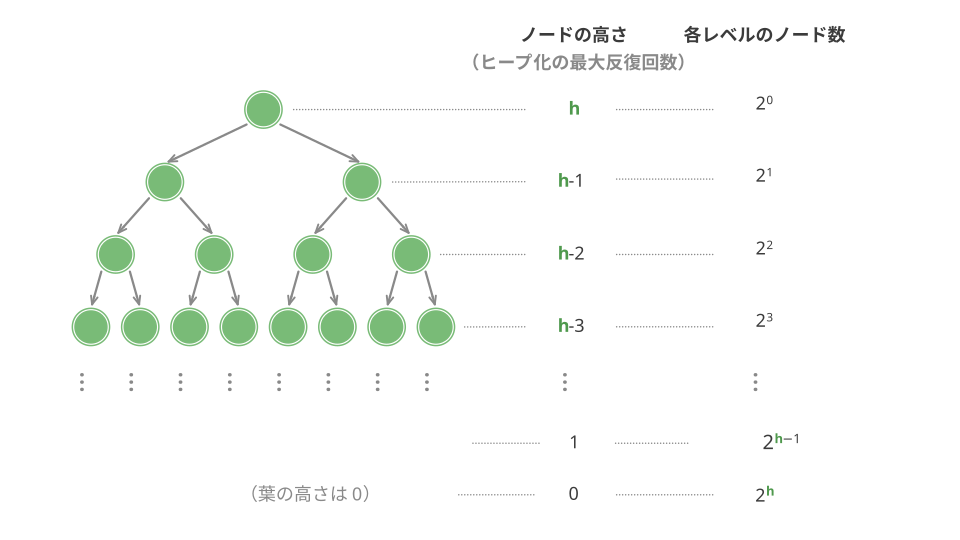

# ヒープの構築

リストの全要素を使ってヒープを作りたいことがあります。この操作を「ヒープの構築」といいます。

## 挿入を繰り返す方法

まず空のヒープを作り、リストを走査しながら各要素を順に挿入します。要素をヒープの末尾に追加し、その要素から上に向かってヒープ化します。

要素を 1 個挿入するたびにヒープの長さが 1 増えます。ノードは二分木に上から下の順に追加されるので、ヒープは「上から下へ」構築されます。

要素数を $n$ とすると、各要素の挿入には $O(\log{n})$ 時間かかるので、この方法でのヒープ構築の時間計算量は $O(n \log n)$ です。

## ノードを順にヒープ化する方法

実は、もっと効率よくヒープを構築できます。手順は次の 2 段階です。

1. リストの全要素を元の順序のままヒープに入れます。この段階ではヒープの条件はまだ保証されていません。
2. ヒープをレベル順の逆順にたどり、葉以外の各ノードから順に下に向かってヒープ化します。

**ノードを 1 つヒープ化するたびに、そのノードを根とする部分木がヒープの条件を満たします**。逆順にたどるので、ヒープは「下から上へ」構築されます。

逆順にたどるのは、現在のノードの下にある部分木がすでにヒープの条件を満たすことを保証するためです。この条件がそろって初めて、現在のノードのヒープ化が有効になります。

**葉には子がないので、それだけですでにヒープの条件を満たし、ヒープ化する必要がありません**。次のコードのように、葉でない最後のノードは、末尾のノードの親です。そこから逆順にたどってヒープ化します。

```src
[file]{my_heap}-[class]{max_heap}-[func]{__init__}
```

## 計算量の分析

ここで、2 番目の構築方法の時間計算量を求めてみましょう。

- 完全二分木のノード数を $n$ とすると、葉の数は $(n + 1) / 2$ です。ここで $/$ は商の小数点以下を切り捨てる除算です。したがって、ヒープ化が必要なノード数は $n / 2$ です。
- 下向きのヒープ化で各ノードが下がれるのは葉までなので、反復回数の最大値は二分木の高さ $\log n$ です。

この 2 つを掛ければ、ヒープ構築の時間計算量は $O(n \log n)$ と見積もれます。**しかし、この見積もりは正確ではありません。二分木では下のレベルほど上のレベルよりノードがはるかに多いことを考慮していないからです**。

そこで、より正確に計算してみましょう。計算を簡単にするため、ノード数 $n$、高さ $h$ で完璧二分木を仮定します。この仮定は計算結果の正しさに影響しません。



上図のように、ノードから下に向かってヒープ化するときの最大反復回数は葉までの距離、すなわち「ノードの高さ」に等しくなります。したがって、各レベルについて「ノード数 $\times$ ノードの高さ」を計算して足すと、**全ノードのヒープ化における反復回数の合計が得られます**。

$$
T(h) = 2^0h + 2^1(h-1) + 2^2(h-2) + \dots + 2^{(h-1)}\times1
$$

上式の整理には数列の知識を使います。まず $T(h)$ に $2$ を掛けると次の式になります。

$$
\begin{aligned}
T(h) & = 2^0h + 2^1(h-1) + 2^2(h-2) + \dots + 2^{h-1}\times1 \newline
2 T(h) & = 2^1h + 2^2(h-1) + 2^3(h-2) + \dots + 2^{h}\times1 \newline
\end{aligned}
$$

項をずらして差を取ります。下の式 $2 T(h)$ から上の式 $T(h)$ を引くと、次のようになります。

$$
2T(h) - T(h) = T(h) = -2^0h + 2^1 + 2^2 + \dots + 2^{h-1} + 2^h
$$

上式を見ると、$T(h)$ は等比数列の和を使って計算できます。和の公式を適用すると、時間計算量は次のようになります。

$$
\begin{aligned}
T(h) & = 2 \frac{1 - 2^h}{1 - 2} - h \newline
& = 2^{h+1} - h - 2 \newline
& = O(2^h)
\end{aligned}
$$

さらに、高さ $h$ で完璧二分木のノード数は $n = 2^{h+1} - 1$ なので、計算量は $O(2^h) = O(n)$ となります。以上から、**入力リストからのヒープ構築の時間計算量は $O(n)$ で、非常に効率的です**。
