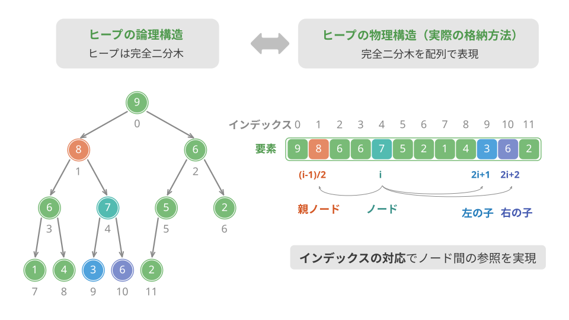
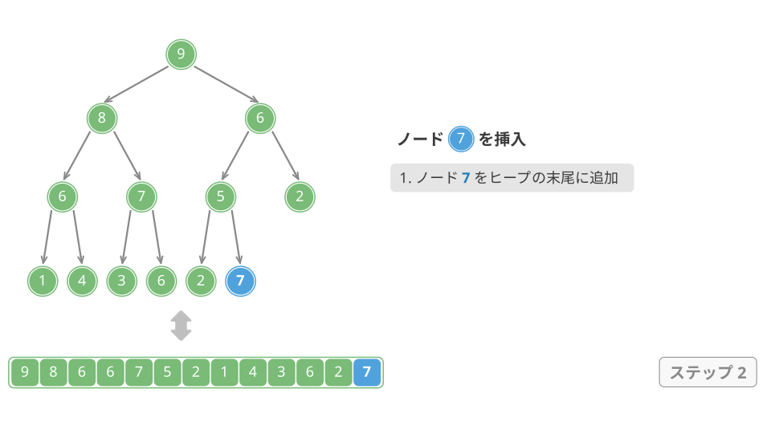
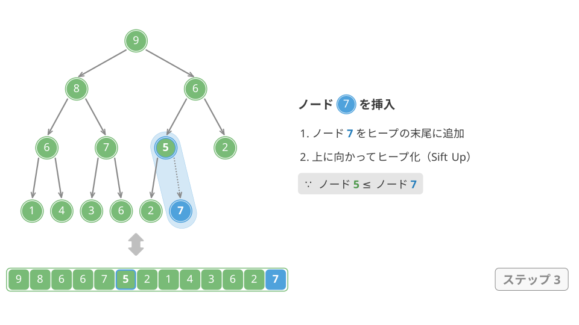
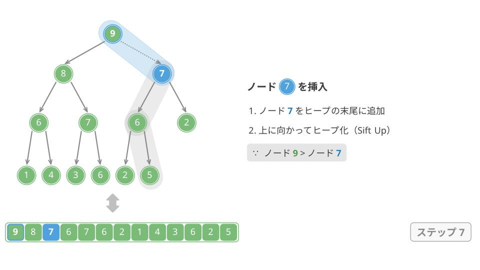
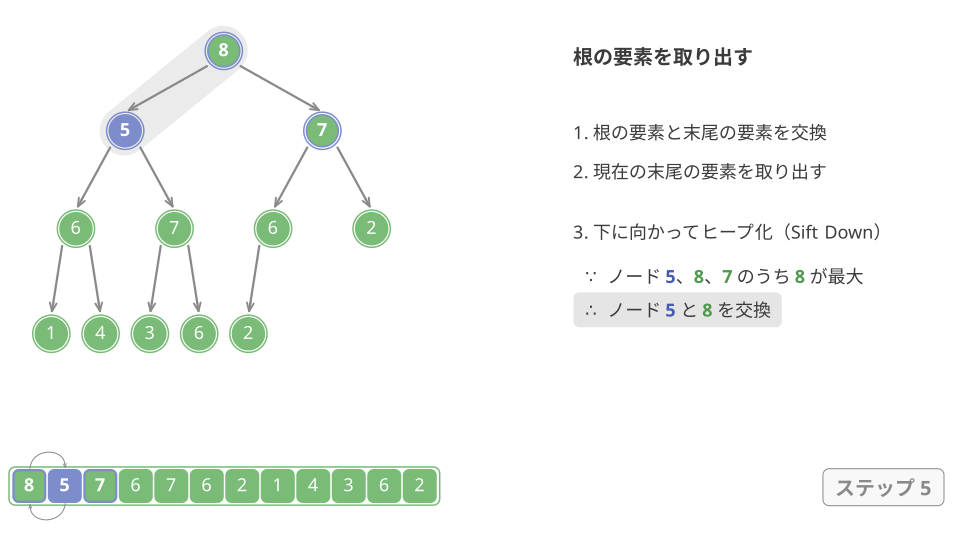
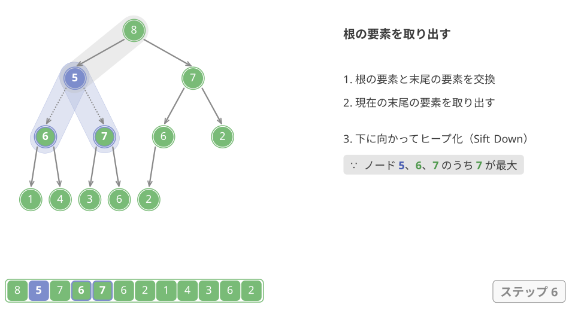
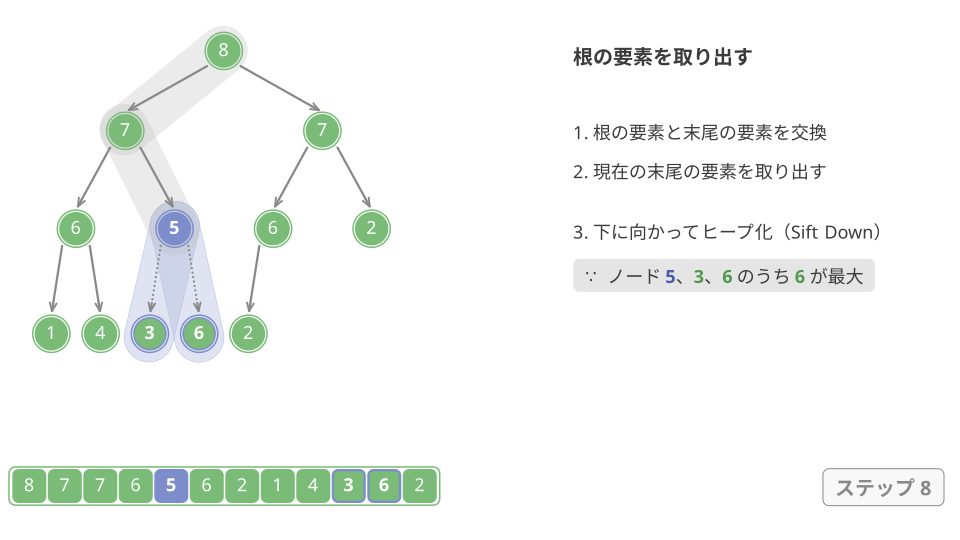
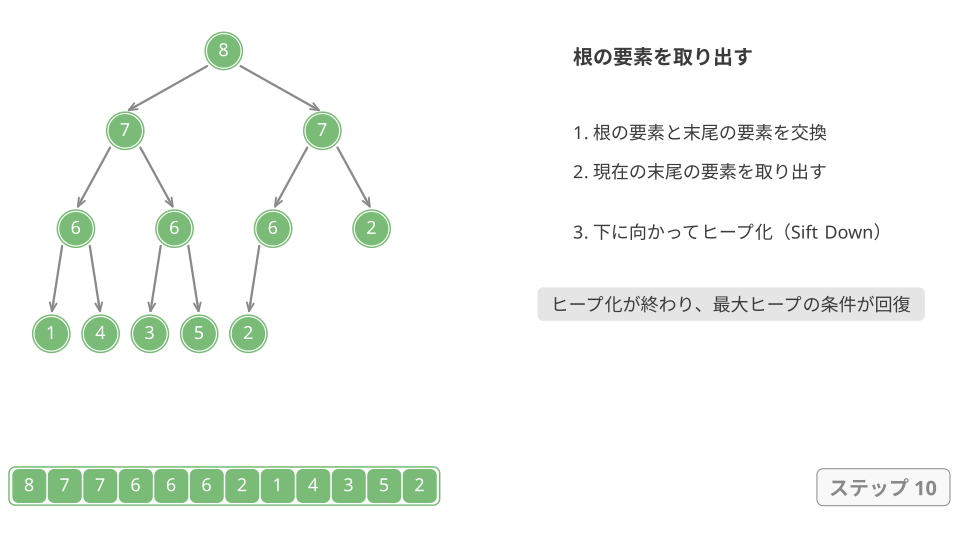

# ヒープ

<u>ヒープ（heap）</u>は特定の条件を満たす完全二分木で、下図のように主に 2 種類に分けられます。

- <u>最小ヒープ（min heap）</u>：どのノードでも「ノードの値 $\leq$ その子の値」が成り立ちます。
- <u>最大ヒープ（max heap）</u>：どのノードでも「ノードの値 $\geq$ その子の値」が成り立ちます。


ヒープは完全二分木の一種で、次の性質があります。

- 最下段ではノードが左から順に詰まり、他の段はすべて埋まっています。
- 二分木の根ノードを「ヒープの根」、最下段の最も右にあるノードを「ヒープの末尾」と呼びます。
- 最大ヒープ（最小ヒープ）では、根にある要素の値が最大（最小）です。

## ヒープの主な操作

多くのプログラミング言語が提供しているのは<u>優先度付きキュー（priority queue）</u>です。これは、優先度によって順序が決まるキューとして定義される抽象データ構造です。

**優先度付きキューの実装にはヒープがよく使われます。最大ヒープは、値が大きい要素から順に取り出す優先度付きキューに相当します**。使う側からは「優先度付きキュー」と「ヒープ」を同等のデータ構造と見なせます。そこで本書では両者を特に区別せず、まとめて「ヒープ」と呼びます。

ヒープの主な操作を下の表に示します。実際のメソッド名はプログラミング言語によって異なります。

<p align="center"> 表 <id> &nbsp; ヒープ操作の効率 </p>

| メソッド名      | 説明                                             | 時間計算量  |
| ----------- | ------------------------------------------------ | ----------- |
| `push()`    | 要素をヒープに挿入する                                         | $O(\log n)$ |
| `pop()`     | 根の要素を取り出す                                     | $O(\log n)$ |
| `peek()`    | 根の要素を参照する（最大ヒープなら最大値、最小ヒープなら最小値） | $O(1)$      |
| `size()`    | ヒープの要素数を取得する                                 | $O(1)$      |
| `isEmpty()` | ヒープが空か判定する                                   | $O(1)$      |

実際のアプリケーションでは、プログラミング言語が提供するヒープクラス（または優先度付きキューのクラス）をそのまま使えます。

ソートで昇順と降順を選ぶのと同様に、`flag` を設定したり `Comparator` を変更したりして、最小ヒープと最大ヒープを切り替えられます。次のコードを見てください。

```snippet
heap_operations
```

??? pythontutor "実行の様子を見る"

    @tutor heap_operations_tutor

## ヒープの実装

以下では最大ヒープを実装します。最小ヒープに変えるには、大小の判定をすべて逆にするだけです（たとえば $\geq$ を $\leq$ に置き換えます）。興味があれば実装してみてください。

### ヒープの格納と表現

「二分木」の章で見たように、完全二分木は配列表現に適しています。ヒープはまさに完全二分木なので、**ここでは配列に格納します**。

配列で二分木を表すとき、各要素はノードの値を、インデックスは木の中での位置を表します。**ノード間の参照は、インデックスを対応付ける計算式で実現します**。

下図のように、インデックス $i$ のノードの左の子はインデックス $2i + 1$、右の子は $2i + 2$、親は $(i - 1) / 2$（商の小数点以下を切り捨て）にあります。インデックスが範囲外なら、その位置は空でノードが存在しません。



インデックスの対応式を関数にまとめておくと、後から簡単に使えます。

```src
[file]{my_heap}-[class]{max_heap}-[func]{parent}
```

### ヒープの根の要素を参照する

ヒープの根の要素は二分木の根ノード、つまりリストの先頭要素です。

```src
[file]{my_heap}-[class]{max_heap}-[func]{peek}
```

### 要素をヒープに挿入する

要素 `val` をまずヒープの末尾に追加します。追加した `val` はヒープ内の他の要素より大きいかもしれず、ヒープの条件が崩れる可能性があります。**そこで、挿入したノードから根までの経路上にあるノードを調整する必要があります**。この操作を<u>ヒープ化（heapify）</u>と呼びます。

挿入したノードから始めて、**上に向かってヒープ化します**。下図のように、挿入したノードの値と親の値を比べ、挿入したノードのほうが大きければ交換します。この操作を繰り返し、下から上へ順にノードを調整します。根を越えるか、交換が不要なノードに達した時点で終了します。

=== "<1>"
    

=== "<2>"
    

=== "<3>"
    

=== "<4>"
    

=== "<5>"
    

=== "<6>"
    

=== "<7>"
    

=== "<8>"
    

=== "<9>"
    

ノード数を $n$ とすると、木の高さは $O(\log n)$ です。したがってヒープ化の反復回数は最大 $O(\log n)$ で、**ヒープへの挿入の時間計算量は $O(\log n)$ です**。コードは次のとおりです。

```src
[file]{my_heap}-[class]{max_heap}-[func]{sift_up}
```

### 根の要素を取り出す

ヒープの根の要素は二分木の根ノード、つまりリストの先頭要素です。リストの先頭を直接削除すると、木の全ノードのインデックスが変わり、その後でヒープ化して修復するのが難しくなります。インデックスの変化を最小限に抑えるため、次の手順を取ります。

1. 根の要素と末尾の要素を交換します（根ノードと最も右の葉を交換します）。
2. 交換した後、末尾の要素をリストから削除します（交換済みなので、実際に削除するのは元の根の要素です）。
3. 根ノードから始めて、**下に向かってヒープ化します**。

下図のように、**下向きのヒープ化では、上向きのヒープ化とは逆方向に進みます**。根の値と 2 つの子の値を比べ、大きいほうの子が根より大きければ交換します。同じ操作を繰り返し、葉を越えるか、交換が不要なノードに達したら終了します。

=== "<1>"
    

=== "<2>"
    

=== "<3>"
    

=== "<4>"
    

=== "<5>"
    

=== "<6>"
    

=== "<7>"
    

=== "<8>"
    

=== "<9>"
    

=== "<10>"
    

挿入と同じく、根の要素を取り出す操作の時間計算量も $O(\log n)$ です。コードは次のとおりです。

```src
[file]{my_heap}-[class]{max_heap}-[func]{sift_down}
```

## ヒープの主な用途

- **優先度付きキュー**：優先度付きキューの実装には、通常ヒープが第一の選択肢になります。挿入と取り出しはいずれも時間計算量が $O(\log n)$ で、ヒープの構築は $O(n)$ と、どの操作も効率的です。
- **ヒープソート**：データの集合からヒープを構築し、要素を繰り返し取り出せば、整列したデータが得られます。ただし、通常はもっと巧妙な方法でヒープソートを実装します。詳しくは「ヒープソート」の章を参照してください。
- **上位 $k$ 個の要素の取得**：古典的なアルゴリズム問題であり、ヒープの代表的な用途でもあります。たとえば Weibo の話題の検索として人気のニュース上位 10 件を選んだり、販売数上位 10 商品を選んだりする場合です。
