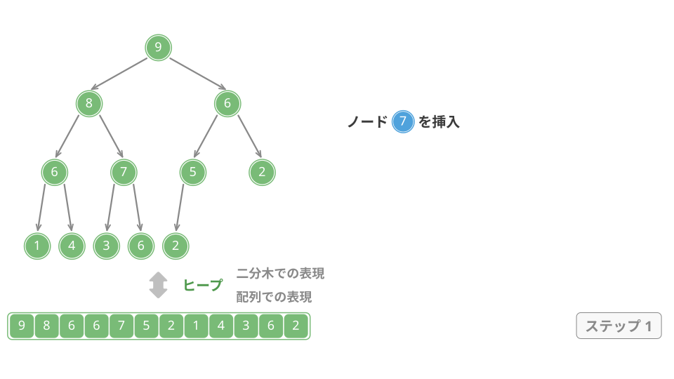
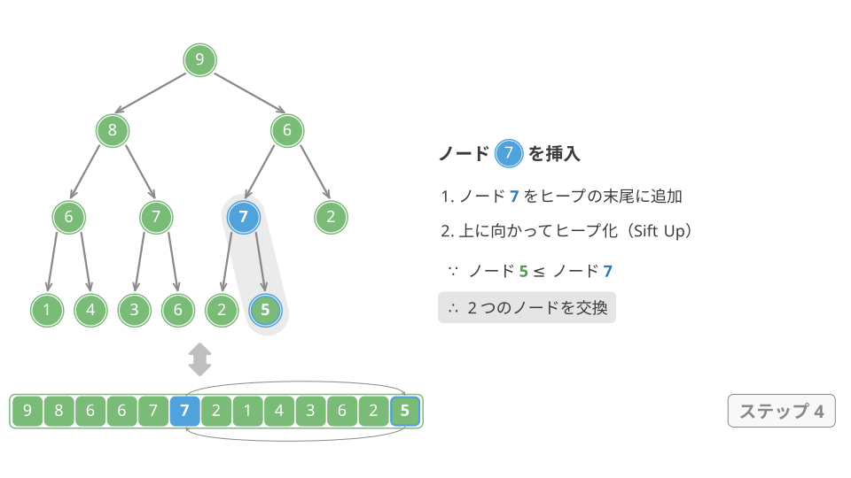
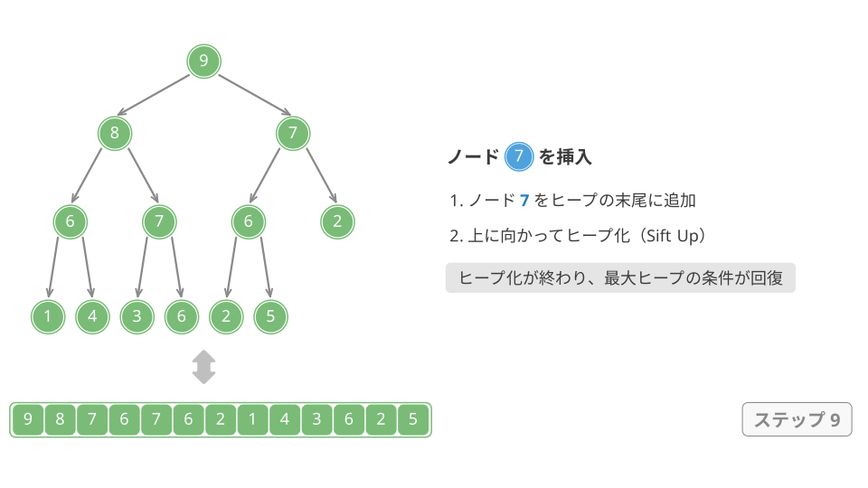
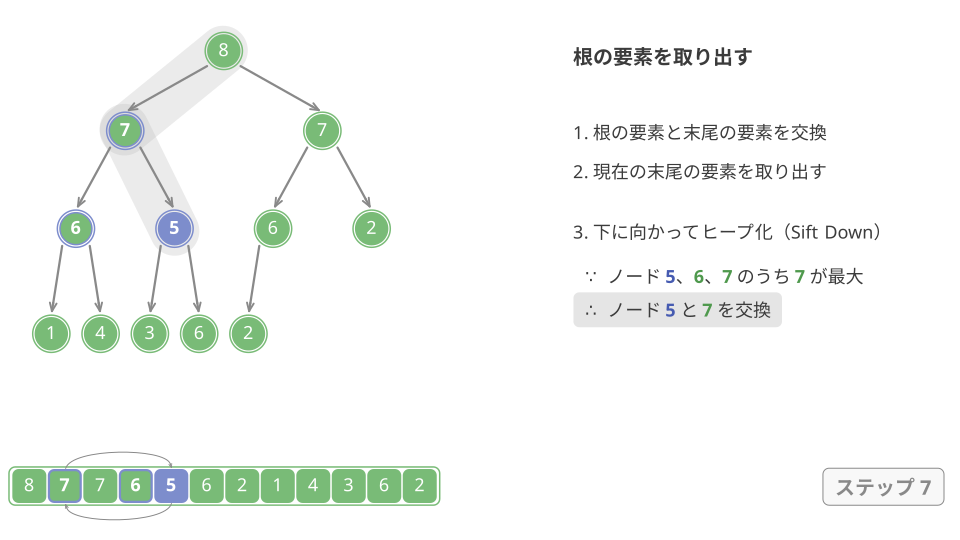

# ヒープ

<u>ヒープ（heap）</u>は特定の条件を満たす完全二分木です。下図のように、主に二種類に分かれます。

- <u>最小ヒープ（min heap）</u>：任意のノードの値が、その子の値以下（$\leq$）です。
- <u>最大ヒープ（max heap）</u>：任意のノードの値が、その子の値以上（$\geq$）です。


ヒープは完全二分木の特殊な場合なので、次の特徴を持ちます。

- 最下層のノードは左詰めで、ほかの層はすべて埋まっています。
- 根ノードを「ヒープの先頭」、最下層の一番右のノードを「ヒープの末尾」と呼びます。
- 最大ヒープ（最小ヒープ）では、先頭要素、つまり根ノードの値が最大（最小）です。

## ヒープの主な操作

多くのプログラミング言語が提供するのは、<u>優先度付きキュー（priority queue）</u>です。これは、優先度に基づいて順序付けられるキューとして定義される抽象データ構造です。

実際には、**ヒープは優先度付きキューの実装によく使われ、最大ヒープは大きい要素から順に取り出す優先度付きキューに相当します**。使う側からは、両者を同等のデータ構造と見なせます。そのため本書では特に区別せず、「ヒープ」と呼びます。

主な操作を下表に示します。メソッド名は言語によって異なります。

<p align="center"> 表 <id> &nbsp; ヒープの操作効率 </p>

| メソッド名      | 説明                                             | 時間計算量  |
| ----------- | ------------------------------------------------ | ----------- |
| `push()`    | 要素をヒープに挿入する                                         | $O(\log n)$ |
| `pop()`     | ヒープの先頭要素を取り出す                                     | $O(\log n)$ |
| `peek()`    | 先頭要素にアクセスする（最大／最小ヒープでは最大値／最小値） | $O(1)$      |
| `size()`    | ヒープの要素数を取得する                                 | $O(1)$      |
| `isEmpty()` | ヒープが空かどうかを判定する                                   | $O(1)$      |

実際には、言語が提供するヒープクラスや優先度付きキューのクラスをそのまま使えます。

ソートで昇順と降順を切り替えるように、`flag` の設定や `Comparator` の変更によって、最小ヒープと最大ヒープを切り替えられます。コードは次のとおりです。

```snippet
heap_operations
```

??? pythontutor "実行の可視化"

    @tutor heap_operations_tutor

## ヒープの実装

以下では最大ヒープを実装します。最小ヒープにするには、大小の判定をすべて逆にするだけです（例えば、$\geq$ を $\leq$ に置き換えます）。興味があれば実装してみてください。

### ヒープの格納と表現

「二分木」の章で、完全二分木は配列で表すのに適していると学びました。ヒープも完全二分木なので、**配列に格納します**。

配列で二分木を表すとき、要素はノードの値、インデックスは木の中での位置を表します。**ノードのポインタは、インデックスの対応式で実現します**。

下図のように、インデックス $i$ の左の子は $2i + 1$、右の子は $2i + 2$、親は $(i - 1) / 2$（切り捨ての整数除算）です。インデックスが範囲外なら、空のノード、またはノードが存在しないことを表します。


この対応式を関数にまとめておくと、後で使いやすくなります。

```src
[file]{my_heap}-[class]{max_heap}-[func]{parent}
```

### 先頭要素へのアクセス

先頭要素は二分木の根ノード、つまりリストの最初の要素です。

```src
[file]{my_heap}-[class]{max_heap}-[func]{peek}
```

### 要素の挿入

要素 `val` をまずヒープの末尾に追加します。`val` がほかの要素より大きい場合、ヒープの条件が崩れている可能性があるため、**挿入したノードから根までの経路上の各ノードを修復する必要があります**。この操作を<u>ヒープ化（heapify）</u>と呼びます。

挿入したノードから、**下から上へヒープ化します**。下図のように、挿入したノードと親の値を比較し、挿入したノードのほうが大きければ交換します。同じ操作を繰り返して下から上へ修復し、根を越えるか、交換が不要なノードに達したら終了します。

=== "<1>"
    

=== "<2>"
    

=== "<3>"
    

=== "<4>"
    

=== "<5>"
    

=== "<6>"
    

=== "<7>"
    

=== "<8>"
    

=== "<9>"
    

ノード総数を $n$ とすると、木の高さは $O(\log n)$ です。したがって、ヒープ化の反復は最大 $O(\log n)$ 回で、**挿入の時間計算量は $O(\log n)$** です。コードは次のとおりです。

```src
[file]{my_heap}-[class]{max_heap}-[func]{sift_up}
```

### 先頭要素の取り出し

先頭要素は二分木の根ノード、つまりリストの最初の要素です。これをリストから直接削除すると、すべてのノードのインデックスが変わり、その後のヒープ化による修復が難しくなります。インデックスの変化をできるだけ少なくするため、次の手順を使います。

1. ヒープの先頭と末尾、つまり根ノードと一番右の葉を交換します。
2. 交換後、末尾をリストから削除します（交換済みなので、実際に削除するのは元の先頭要素です）。
3. 根ノードから、**上から下へヒープ化します**。

下図のように、**上から下へのヒープ化は、下から上へのヒープ化とは逆方向の操作です**。根の値と二つの子の値を比較し、最大の子と根を交換します。これを繰り返し、葉を越えるか交換が不要なノードに達したら終了します。

=== "<1>"
    

=== "<2>"
    

=== "<3>"
    

=== "<4>"
    

=== "<5>"
    

=== "<6>"
    

=== "<7>"
    

=== "<8>"
    

=== "<9>"
    

=== "<10>"
    

挿入と同様に、先頭要素の取り出しの時間計算量も $O(\log n)$ です。コードは次のとおりです。

```src
[file]{my_heap}-[class]{max_heap}-[func]{sift_down}
```

## ヒープの主な用途

- **優先度付きキュー**：ヒープは、優先度付きキューの実装で通常最初に選ばれるデータ構造です。エンキューとデキューはともに $O(\log n)$、構築は $O(n)$ と、いずれも非常に効率的です。
- **ヒープソート**：データからヒープを作り、要素を取り出し続けると整列済みのデータを得られます。ただし、通常はさらにすっきりした方法で実装します。詳しくは「ヒープソート」の節を参照してください。
- **大きいほうから $k$ 個の要素の取得**：古典的なアルゴリズムの問題であり、代表的な用途でもあります。例えば、話題のニュース上位 10 件を微博のトレンドに選んだり、販売数上位 10 商品を選んだりします。
