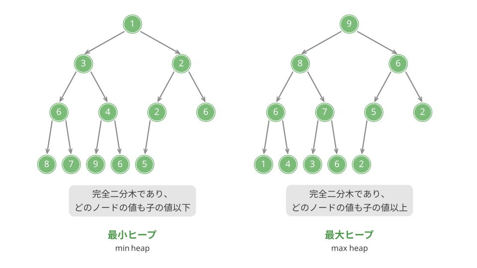
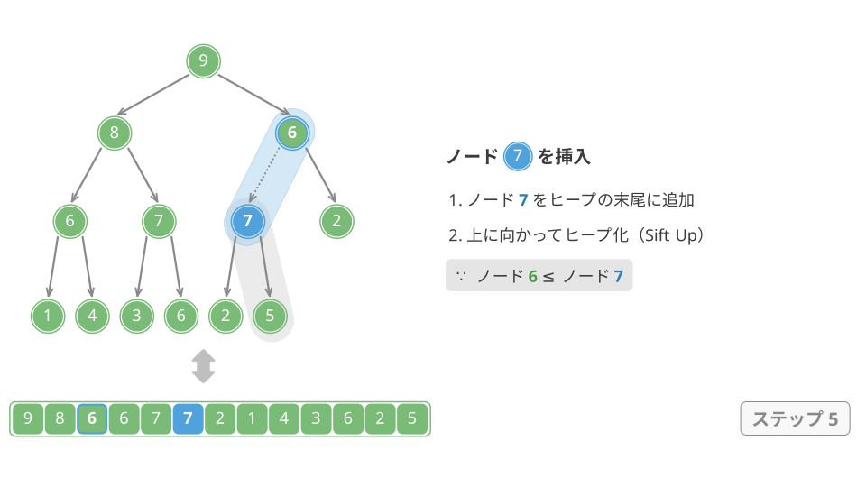
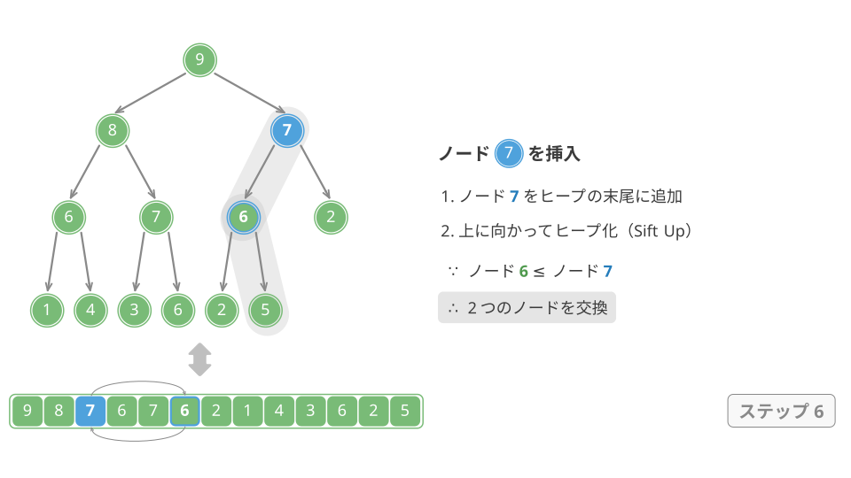
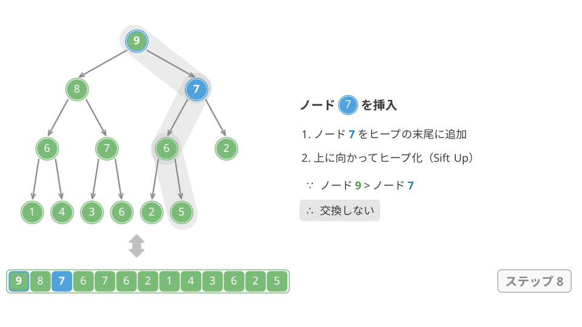
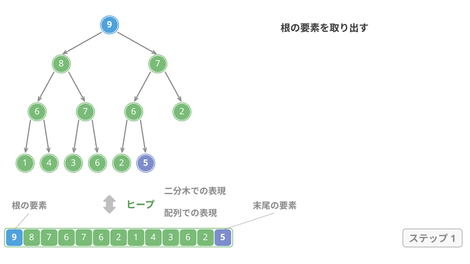
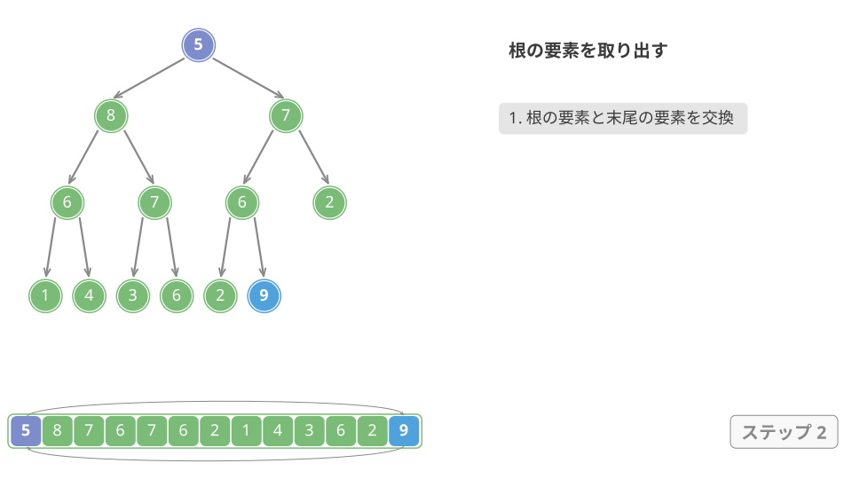
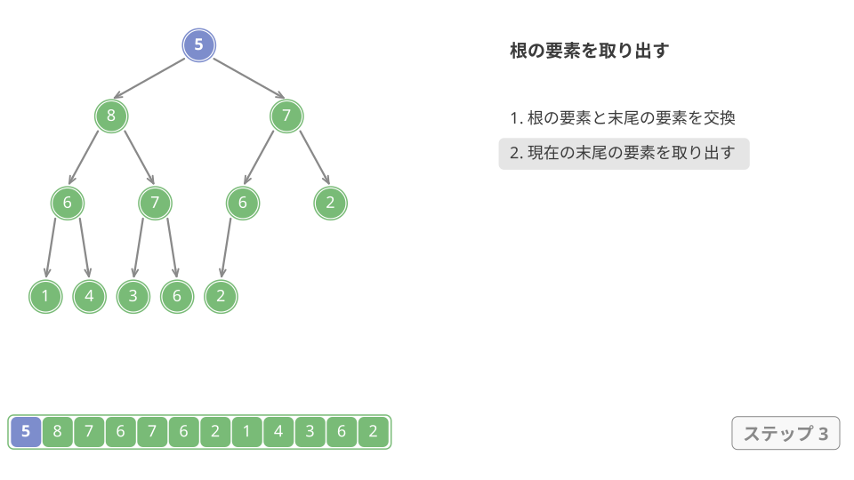
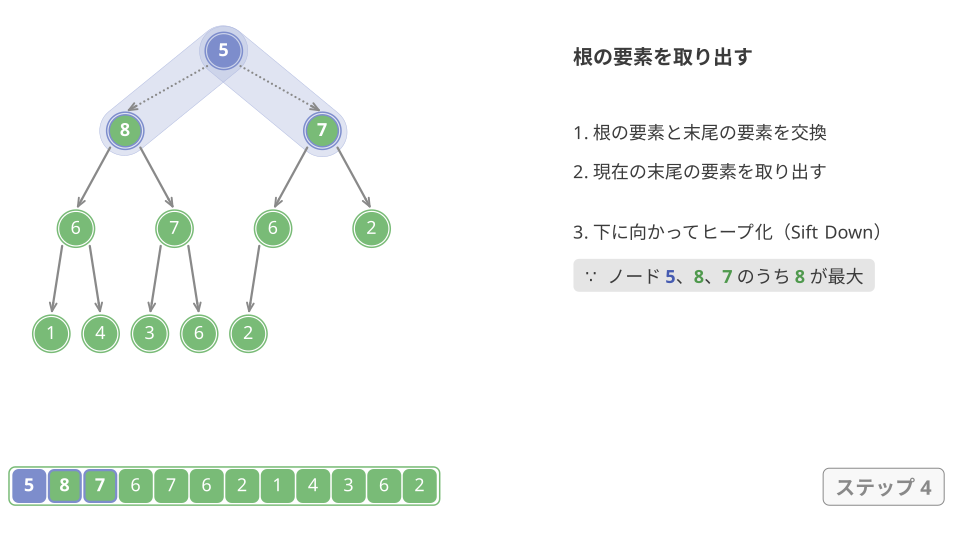
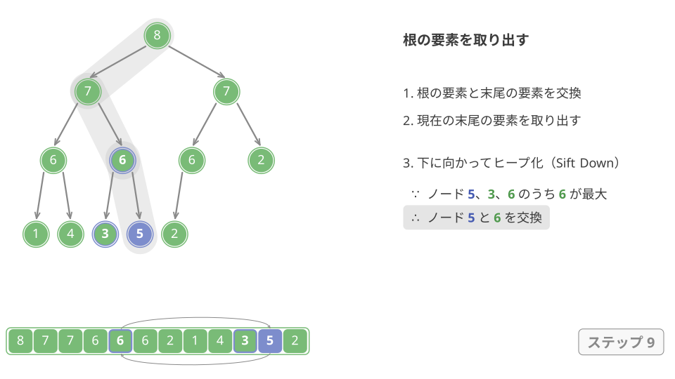

# 8.1 &nbsp; ヒープ

<u>ヒープ（heap）</u>は特定の条件を満たす完全二分木で、図 8-1 のように主に 2 種類に分けられます。

- <u>最小ヒープ（min heap）</u>：どのノードでも「ノードの値 $\leq$ その子の値」が成り立ちます。
- <u>最大ヒープ（max heap）</u>：どのノードでも「ノードの値 $\geq$ その子の値」が成り立ちます。

{ class="animation-figure" }

<p align="center"> 図 8-1 &nbsp; 最小ヒープと最大ヒープ </p>

ヒープは完全二分木の一種で、次の性質があります。

- 最下段ではノードが左から順に詰まり、他の段はすべて埋まっています。
- 二分木の根ノードを「ヒープの根」、最下段の最も右にあるノードを「ヒープの末尾」と呼びます。
- 最大ヒープ（最小ヒープ）では、根にある要素の値が最大（最小）です。

## 8.1.1 &nbsp; ヒープの主な操作

多くのプログラミング言語が提供しているのは<u>優先度付きキュー（priority queue）</u>です。これは、優先度によって順序が決まるキューとして定義される抽象データ構造です。

**優先度付きキューの実装にはヒープがよく使われます。最大ヒープは、値が大きい要素から順に取り出す優先度付きキューに相当します**。使う側からは「優先度付きキュー」と「ヒープ」を同等のデータ構造と見なせます。そこで本書では両者を特に区別せず、まとめて「ヒープ」と呼びます。

ヒープの主な操作を表 8-1 に示します。実際のメソッド名はプログラミング言語によって異なります。

<p align="center"> 表 8-1 &nbsp; ヒープ操作の効率 </p>

<div class="center-table" markdown>

| メソッド名      | 説明                                             | 時間計算量  |
| ----------- | ------------------------------------------------ | ----------- |
| `push()`    | 要素をヒープに挿入する                                         | $O(\log n)$ |
| `pop()`     | 根の要素を取り出す                                     | $O(\log n)$ |
| `peek()`    | 根の要素を参照する（最大ヒープなら最大値、最小ヒープなら最小値） | $O(1)$      |
| `size()`    | ヒープの要素数を取得する                                 | $O(1)$      |
| `isEmpty()` | ヒープが空か判定する                                   | $O(1)$      |

</div>

実際のアプリケーションでは、プログラミング言語が提供するヒープクラス（または優先度付きキューのクラス）をそのまま使えます。

ソートで昇順と降順を選ぶのと同様に、`flag` を設定したり `Comparator` を変更したりして、最小ヒープと最大ヒープを切り替えられます。次のコードを見てください。

=== "Python"

    ```python title="heap.py"
    # 最小ヒープを初期化する
    min_heap, flag = [], 1
    # 最大ヒープを初期化する
    max_heap, flag = [], -1

    # Python の heapq モジュールはデフォルトで最小ヒープを実装する
    # 挿入前に要素の符号を反転すると大小関係が逆になり、最大ヒープを実現できる
    # この例では flag = 1 が最小ヒープ、flag = -1 が最大ヒープに対応する

    # 要素をヒープに挿入する
    heapq.heappush(max_heap, flag * 1)
    heapq.heappush(max_heap, flag * 3)
    heapq.heappush(max_heap, flag * 2)
    heapq.heappush(max_heap, flag * 5)
    heapq.heappush(max_heap, flag * 4)

    # ヒープの根の要素を取得する
    peek: int = flag * max_heap[0]  # 5

    # 根の要素を取り出す
    # 取り出した要素は降順に並ぶ
    val = flag * heapq.heappop(max_heap)  # 5
    val = flag * heapq.heappop(max_heap)  # 4
    val = flag * heapq.heappop(max_heap)  # 3
    val = flag * heapq.heappop(max_heap)  # 2
    val = flag * heapq.heappop(max_heap)  # 1

    # ヒープのサイズを取得する
    size: int = len(max_heap)

    # ヒープが空か判定する
    is_empty: bool = not max_heap

    # 入力リストからヒープを構築する
    # 時間計算量は O(nlogn) ではなく O(n)
    min_heap: list[int] = [1, 3, 2, 5, 4]
    heapq.heapify(min_heap)
    ```

=== "C++"

    ```cpp title="heap.cpp"
    /* ヒープを初期化する */
    // 最小ヒープを初期化する
    priority_queue<int, vector<int>, greater<int>> minHeap;
    // 最大ヒープを初期化する
    priority_queue<int, vector<int>, less<int>> maxHeap;

    /* 要素をヒープに挿入する */
    maxHeap.push(1);
    maxHeap.push(3);
    maxHeap.push(2);
    maxHeap.push(5);
    maxHeap.push(4);

    /* ヒープの根の要素を取得する */
    int peek = maxHeap.top(); // 5

    /* 根の要素を取り出す */
    // 取り出した要素は降順に並ぶ
    maxHeap.pop(); // 5
    maxHeap.pop(); // 4
    maxHeap.pop(); // 3
    maxHeap.pop(); // 2
    maxHeap.pop(); // 1

    /* ヒープのサイズを取得する */
    int size = maxHeap.size();

    /* ヒープが空か判定する */
    bool isEmpty = maxHeap.empty();

    /* 入力リストからヒープを構築する */
    // 時間計算量は O(nlogn) ではなく O(n)
    vector<int> input{1, 3, 2, 5, 4};
    minHeap = priority_queue<int, vector<int>, greater<int>>(input.begin(), input.end());
    ```

=== "Java"

    ```java title="heap.java"
    /* ヒープを初期化する */
    // 最小ヒープを初期化する
    Queue<Integer> minHeap = new PriorityQueue<>();
    // 最大ヒープを初期化する（ラムダ式で Comparator を変更すればよい）
    Queue<Integer> maxHeap = new PriorityQueue<>((a, b) -> b - a);

    /* 要素をヒープに挿入する */
    maxHeap.offer(1);
    maxHeap.offer(3);
    maxHeap.offer(2);
    maxHeap.offer(5);
    maxHeap.offer(4);

    /* ヒープの根の要素を取得する */
    int peek = maxHeap.peek(); // 5

    /* 根の要素を取り出す */
    // 取り出した要素は降順に並ぶ
    peek = maxHeap.poll(); // 5
    peek = maxHeap.poll(); // 4
    peek = maxHeap.poll(); // 3
    peek = maxHeap.poll(); // 2
    peek = maxHeap.poll(); // 1

    /* ヒープのサイズを取得する */
    int size = maxHeap.size();

    /* ヒープが空か判定する */
    boolean isEmpty = maxHeap.isEmpty();

    /* 入力リストからヒープを構築する */
    // 時間計算量は O(nlogn) ではなく O(n)
    minHeap = new PriorityQueue<>(Arrays.asList(1, 3, 2, 5, 4));
    ```

=== "C#"

    ```csharp title="heap.cs"
    /* ヒープを初期化する */
    // 最小ヒープを初期化する
    PriorityQueue<int, int> minHeap = new();
    // 最大ヒープを初期化する（ラムダ式で Comparer を変更すればよい）
    PriorityQueue<int, int> maxHeap = new(Comparer<int>.Create((x, y) => y.CompareTo(x)));

    /* 要素をヒープに挿入する */
    maxHeap.Enqueue(1, 1);
    maxHeap.Enqueue(3, 3);
    maxHeap.Enqueue(2, 2);
    maxHeap.Enqueue(5, 5);
    maxHeap.Enqueue(4, 4);

    /* ヒープの根の要素を取得する */
    int peek = maxHeap.Peek(); // 5

    /* 根の要素を取り出す */
    // 取り出した要素は降順に並ぶ
    peek = maxHeap.Dequeue(); // 5
    peek = maxHeap.Dequeue(); // 4
    peek = maxHeap.Dequeue(); // 3
    peek = maxHeap.Dequeue(); // 2
    peek = maxHeap.Dequeue(); // 1

    /* ヒープのサイズを取得する */
    int size = maxHeap.Count;

    /* ヒープが空か判定する */
    bool isEmpty = maxHeap.Count == 0;

    /* 入力リストからヒープを構築する */
    // 時間計算量は O(nlogn) ではなく O(n)
    minHeap = new PriorityQueue<int, int>([(1, 1), (3, 3), (2, 2), (5, 5), (4, 4)]);
    ```

=== "Go"

    ```go title="heap.go"
    // Go では heap.Interface を実装して整数の最大ヒープを構築できる
    // heap.Interface の実装には sort.Interface の実装も必要
    type intHeap []any

    // Push は heap.Interface の関数で、要素をヒープに挿入する
    func (h *intHeap) Push(x any) {
        // Push と Pop はポインタレシーバを使う
        // スライスの要素だけでなく長さも変更するため
        *h = append(*h, x.(int))
    }

    // Pop は heap.Interface の関数で、スライスの末尾要素を取り出す（heap.Pop が根の要素を末尾に移動済み）
    func (h *intHeap) Pop() any {
        // 取り出す要素は末尾にある
        last := (*h)[len(*h)-1]
        *h = (*h)[:len(*h)-1]
        return last
    }

    // Len は sort.Interface の関数
    func (h *intHeap) Len() int {
        return len(*h)
    }

    // Less は sort.Interface の関数
    func (h *intHeap) Less(i, j int) bool {
        // 最小ヒープを実装する場合は小なり記号に変更する
        return (*h)[i].(int) > (*h)[j].(int)
    }

    // Swap は sort.Interface の関数
    func (h *intHeap) Swap(i, j int) {
        (*h)[i], (*h)[j] = (*h)[j], (*h)[i]
    }

    // Top はヒープの根の要素を取得する
    func (h *intHeap) Top() any {
        return (*h)[0]
    }

    func TestHeap(t *testing.T) {
        /* ヒープを初期化する */
        // 最大ヒープを初期化する
        maxHeap := &intHeap{}
        heap.Init(maxHeap)
        /* 要素をヒープに挿入する */
        // heap.Interface の関数を呼んで要素を追加する
        heap.Push(maxHeap, 1)
        heap.Push(maxHeap, 3)
        heap.Push(maxHeap, 2)
        heap.Push(maxHeap, 5)
        heap.Push(maxHeap, 4)

        /* ヒープの根の要素を取得する */
        top := maxHeap.Top()
        fmt.Printf("ヒープの根の要素：%d\n", top)

        /* 根の要素を取り出す */
        // heap.Interface の関数を呼んで要素を削除する
        fmt.Printf("取り出した要素：%d\n", heap.Pop(maxHeap)) // 5
        fmt.Printf("取り出した要素：%d\n", heap.Pop(maxHeap)) // 4
        fmt.Printf("取り出した要素：%d\n", heap.Pop(maxHeap)) // 3
        fmt.Printf("取り出した要素：%d\n", heap.Pop(maxHeap)) // 2
        fmt.Printf("取り出した要素：%d\n", heap.Pop(maxHeap)) // 1

        /* ヒープのサイズを取得する */
        size := len(*maxHeap)
        fmt.Printf("ヒープの要素数：%d\n", size)

        /* ヒープが空か判定する */
        isEmpty := len(*maxHeap) == 0
        fmt.Printf("ヒープは空か：%t\n", isEmpty)
    }
    ```

=== "Swift"

    ```swift title="heap.swift"
    import HeapModule

    /* ヒープを初期化する */
    // Swift の Heap 型は最大ヒープと最小ヒープの両方に対応し、利用には swift-collections パッケージが必要
    var heap = Heap<Int>()

    /* 要素をヒープに挿入する */
    heap.insert(1)
    heap.insert(3)
    heap.insert(2)
    heap.insert(5)
    heap.insert(4)

    /* ヒープの根の要素を取得する */
    var peek = heap.max()

    /* 根の要素を取り出す */
    peek = heap.removeMax() // 5
    peek = heap.removeMax() // 4
    peek = heap.removeMax() // 3
    peek = heap.removeMax() // 2
    peek = heap.removeMax() // 1

    /* ヒープのサイズを取得する */
    let size = heap.count

    /* ヒープが空か判定する */
    let isEmpty = heap.isEmpty

    /* 入力リストからヒープを構築する */
    // 時間計算量は O(nlogn) ではなく O(n)
    let heap2 = Heap([1, 3, 2, 5, 4])
    ```

=== "JS"

    ```javascript title="heap.js"
    // JavaScript には組み込みの Heap クラスがない
    ```

=== "TS"

    ```typescript title="heap.ts"
    // TypeScript には組み込みの Heap クラスがない
    ```

=== "Dart"

    ```dart title="heap.dart"
    // Dart には組み込みの Heap クラスがない
    ```

=== "Rust"

    ```rust title="heap.rs"
    use std::{cmp::Reverse, collections::BinaryHeap};

    /* ヒープを初期化する */
    // 最小ヒープを初期化する
    // Rust の BinaryHeap は最大ヒープ。最小ヒープでは要素を Reverse で包む
    #[allow(unused_assignments)]
    let mut min_heap = BinaryHeap::new();
    // 最大ヒープを初期化する
    let mut max_heap = BinaryHeap::new();

    /* 要素をヒープに挿入する */
    max_heap.push(1);
    max_heap.push(3);
    max_heap.push(2);
    max_heap.push(5);
    max_heap.push(4);

    /* ヒープの根の要素を取得する */
    let peek = max_heap.peek().unwrap(); // 5

    /* 根の要素を取り出す */
    // 取り出した要素は降順に並ぶ
    let peek = max_heap.pop().unwrap(); // 5
    let peek = max_heap.pop().unwrap(); // 4
    let peek = max_heap.pop().unwrap(); // 3
    let peek = max_heap.pop().unwrap(); // 2
    let peek = max_heap.pop().unwrap(); // 1

    /* ヒープのサイズを取得する */
    let size = max_heap.len();

    /* ヒープが空か判定する */
    let is_empty = max_heap.is_empty();

    /* 入力リストからヒープを構築する */
    // 時間計算量は O(nlogn) ではなく O(n)
    min_heap = BinaryHeap::from(vec![Reverse(1), Reverse(3), Reverse(2), Reverse(5), Reverse(4)]);
    ```

=== "C"

    ```c title="heap.c"
    // C には組み込みの Heap クラスがない
    ```

=== "Kotlin"

    ```kotlin title="heap.kt"
    /* ヒープを初期化する */
    // 最小ヒープを初期化する
    var minHeap = PriorityQueue<Int>()
    // 最大ヒープを初期化する（ラムダ式で Comparator を変更すればよい）
    val maxHeap = PriorityQueue { a: Int, b: Int -> b - a }

    /* 要素をヒープに挿入する */
    maxHeap.offer(1)
    maxHeap.offer(3)
    maxHeap.offer(2)
    maxHeap.offer(5)
    maxHeap.offer(4)

    /* ヒープの根の要素を取得する */
    var peek = maxHeap.peek() // 5

    /* 根の要素を取り出す */
    // 取り出した要素は降順に並ぶ
    peek = maxHeap.poll() // 5
    peek = maxHeap.poll() // 4
    peek = maxHeap.poll() // 3
    peek = maxHeap.poll() // 2
    peek = maxHeap.poll() // 1

    /* ヒープのサイズを取得する */
    val size = maxHeap.size

    /* ヒープが空か判定する */
    val isEmpty = maxHeap.isEmpty()

    /* 入力リストからヒープを構築する */
    // 時間計算量は O(nlogn) ではなく O(n)
    minHeap = PriorityQueue(mutableListOf<Int?>(1, 3, 2, 5, 4))
    ```

=== "Ruby"

    ```ruby title="heap.rb"
    # Ruby には組み込みの Heap クラスがない
    ```

??? pythontutor "実行の様子を見る"

    <div style="height: 549px; width: 100%;"><iframe class="pythontutor-iframe" title="実行の様子を見る" src="https://pythontutor.com/iframe-embed.html#code=import%20heapq%0A%0A%22%22%22Driver%20Code%22%22%22%0Aif%20__name__%20%3D%3D%20%22__main__%22%3A%0A%20%20%20%20%23%20%E6%9C%80%E5%B0%8F%E3%83%92%E3%83%BC%E3%83%97%E3%82%92%E5%88%9D%E6%9C%9F%E5%8C%96%0A%20%20%20%20min_heap,%20flag%20%3D%20%5B%5D,%201%0A%20%20%20%20%23%20%E6%9C%80%E5%A4%A7%E3%83%92%E3%83%BC%E3%83%97%E3%82%92%E5%88%9D%E6%9C%9F%E5%8C%96%0A%20%20%20%20max_heap,%20flag%20%3D%20%5B%5D,%20-1%0A%20%20%20%20%0A%20%20%20%20%23%20Python%20%E3%81%AE%20heapq%20%E3%83%A2%E3%82%B8%E3%83%A5%E3%83%BC%E3%83%AB%E3%81%AF%E6%A8%99%E6%BA%96%E3%81%A7%E6%9C%80%E5%B0%8F%E3%83%92%E3%83%BC%E3%83%97%E3%82%92%E5%AE%9F%E8%A3%85%E3%81%97%E3%81%A6%E3%81%84%E3%82%8B%0A%20%20%20%20%23%20%E5%90%84%E8%A6%81%E7%B4%A0%E3%81%AE%E7%AC%A6%E5%8F%B7%E3%82%92%E5%8F%8D%E8%BB%A2%E3%81%97%E3%81%A6%E3%81%8B%E3%82%89%E6%8C%BF%E5%85%A5%E3%81%99%E3%82%8B%E3%81%A8%E5%A4%A7%E5%B0%8F%E9%96%A2%E4%BF%82%E3%81%8C%E9%80%86%E3%81%AB%E3%81%AA%E3%82%8A%E3%80%81%E6%9C%80%E5%A4%A7%E3%83%92%E3%83%BC%E3%83%97%E3%82%92%E5%AE%9F%E7%8F%BE%E3%81%A7%E3%81%8D%E3%82%8B%0A%20%20%20%20%23%20%E3%81%93%E3%81%AE%E4%BE%8B%E3%81%A7%E3%81%AF%20flag%20%3D%201%20%E3%81%8C%E6%9C%80%E5%B0%8F%E3%83%92%E3%83%BC%E3%83%97%E3%80%81flag%20%3D%20-1%20%E3%81%8C%E6%9C%80%E5%A4%A7%E3%83%92%E3%83%BC%E3%83%97%E3%81%AB%E5%AF%BE%E5%BF%9C%E3%81%99%E3%82%8B%0A%20%20%20%20%0A%20%20%20%20%23%20%E3%83%92%E3%83%BC%E3%83%97%E3%81%AB%E8%A6%81%E7%B4%A0%E3%82%92%E6%8C%BF%E5%85%A5%0A%20%20%20%20heapq.heappush%28max_heap,%20flag%20%2A%201%29%0A%20%20%20%20heapq.heappush%28max_heap,%20flag%20%2A%203%29%0A%20%20%20%20heapq.heappush%28max_heap,%20flag%20%2A%202%29%0A%20%20%20%20heapq.heappush%28max_heap,%20flag%20%2A%205%29%0A%20%20%20%20heapq.heappush%28max_heap,%20flag%20%2A%204%29%0A%20%20%20%20%0A%20%20%20%20%23%20%E6%A0%B9%E3%81%AE%E8%A6%81%E7%B4%A0%E3%82%92%E5%8F%82%E7%85%A7%0A%20%20%20%20peek%20%3D%20flag%20%2A%20max_heap%5B0%5D%20%23%205%0A%20%20%20%20%0A%20%20%20%20%23%20%E6%A0%B9%E3%81%AE%E8%A6%81%E7%B4%A0%E3%82%92%E5%8F%96%E3%82%8A%E5%87%BA%E3%81%99%0A%20%20%20%20%23%20%E5%8F%96%E3%82%8A%E5%87%BA%E3%81%97%E3%81%9F%E8%A6%81%E7%B4%A0%E3%81%AF%E5%A4%A7%E3%81%8D%E3%81%84%E9%A0%86%E3%81%AB%E4%B8%A6%E3%81%B6%0A%20%20%20%20val%20%3D%20flag%20%2A%20heapq.heappop%28max_heap%29%20%23%205%0A%20%20%20%20val%20%3D%20flag%20%2A%20heapq.heappop%28max_heap%29%20%23%204%0A%20%20%20%20val%20%3D%20flag%20%2A%20heapq.heappop%28max_heap%29%20%23%203%0A%20%20%20%20val%20%3D%20flag%20%2A%20heapq.heappop%28max_heap%29%20%23%202%0A%20%20%20%20val%20%3D%20flag%20%2A%20heapq.heappop%28max_heap%29%20%23%201%0A%20%20%20%20%0A%20%20%20%20%23%20%E3%83%92%E3%83%BC%E3%83%97%E3%81%AE%E8%A6%81%E7%B4%A0%E6%95%B0%E3%82%92%E5%8F%96%E5%BE%97%0A%20%20%20%20size%20%3D%20len%28max_heap%29%0A%20%20%20%20%0A%20%20%20%20%23%20%E3%83%92%E3%83%BC%E3%83%97%E3%81%8C%E7%A9%BA%E3%81%8B%E3%81%A9%E3%81%86%E3%81%8B%E3%82%92%E5%88%A4%E5%AE%9A%0A%20%20%20%20is_empty%20%3D%20not%20max_heap%0A%20%20%20%20%0A%20%20%20%20%23%20%E4%B8%8E%E3%81%88%E3%82%89%E3%82%8C%E3%81%9F%E3%83%AA%E3%82%B9%E3%83%88%E3%81%8B%E3%82%89%E3%83%92%E3%83%BC%E3%83%97%E3%82%92%E6%A7%8B%E7%AF%89%0A%20%20%20%20%23%20%E6%99%82%E9%96%93%E8%A8%88%E7%AE%97%E9%87%8F%E3%81%AF%20O%28nlogn%29%20%E3%81%A7%E3%81%AF%E3%81%AA%E3%81%8F%20O%28n%29%0A%20%20%20%20min_heap%20%3D%20%5B1,%203,%202,%205,%204%5D%0A%20%20%20%20heapq.heapify%28min_heap%29&codeDivHeight=472&codeDivWidth=350&cumulative=false&curInstr=3&heapPrimitives=nevernest&origin=opt-frontend.js&py=311&rawInputLstJSON=%5B%5D&textReferences=false"> </iframe></div>
    <div style="margin-top: 5px;"><a href="https://pythontutor.com/iframe-embed.html#code=import%20heapq%0A%0A%22%22%22Driver%20Code%22%22%22%0Aif%20__name__%20%3D%3D%20%22__main__%22%3A%0A%20%20%20%20%23%20%E6%9C%80%E5%B0%8F%E3%83%92%E3%83%BC%E3%83%97%E3%82%92%E5%88%9D%E6%9C%9F%E5%8C%96%0A%20%20%20%20min_heap,%20flag%20%3D%20%5B%5D,%201%0A%20%20%20%20%23%20%E6%9C%80%E5%A4%A7%E3%83%92%E3%83%BC%E3%83%97%E3%82%92%E5%88%9D%E6%9C%9F%E5%8C%96%0A%20%20%20%20max_heap,%20flag%20%3D%20%5B%5D,%20-1%0A%20%20%20%20%0A%20%20%20%20%23%20Python%20%E3%81%AE%20heapq%20%E3%83%A2%E3%82%B8%E3%83%A5%E3%83%BC%E3%83%AB%E3%81%AF%E6%A8%99%E6%BA%96%E3%81%A7%E6%9C%80%E5%B0%8F%E3%83%92%E3%83%BC%E3%83%97%E3%82%92%E5%AE%9F%E8%A3%85%E3%81%97%E3%81%A6%E3%81%84%E3%82%8B%0A%20%20%20%20%23%20%E5%90%84%E8%A6%81%E7%B4%A0%E3%81%AE%E7%AC%A6%E5%8F%B7%E3%82%92%E5%8F%8D%E8%BB%A2%E3%81%97%E3%81%A6%E3%81%8B%E3%82%89%E6%8C%BF%E5%85%A5%E3%81%99%E3%82%8B%E3%81%A8%E5%A4%A7%E5%B0%8F%E9%96%A2%E4%BF%82%E3%81%8C%E9%80%86%E3%81%AB%E3%81%AA%E3%82%8A%E3%80%81%E6%9C%80%E5%A4%A7%E3%83%92%E3%83%BC%E3%83%97%E3%82%92%E5%AE%9F%E7%8F%BE%E3%81%A7%E3%81%8D%E3%82%8B%0A%20%20%20%20%23%20%E3%81%93%E3%81%AE%E4%BE%8B%E3%81%A7%E3%81%AF%20flag%20%3D%201%20%E3%81%8C%E6%9C%80%E5%B0%8F%E3%83%92%E3%83%BC%E3%83%97%E3%80%81flag%20%3D%20-1%20%E3%81%8C%E6%9C%80%E5%A4%A7%E3%83%92%E3%83%BC%E3%83%97%E3%81%AB%E5%AF%BE%E5%BF%9C%E3%81%99%E3%82%8B%0A%20%20%20%20%0A%20%20%20%20%23%20%E3%83%92%E3%83%BC%E3%83%97%E3%81%AB%E8%A6%81%E7%B4%A0%E3%82%92%E6%8C%BF%E5%85%A5%0A%20%20%20%20heapq.heappush%28max_heap,%20flag%20%2A%201%29%0A%20%20%20%20heapq.heappush%28max_heap,%20flag%20%2A%203%29%0A%20%20%20%20heapq.heappush%28max_heap,%20flag%20%2A%202%29%0A%20%20%20%20heapq.heappush%28max_heap,%20flag%20%2A%205%29%0A%20%20%20%20heapq.heappush%28max_heap,%20flag%20%2A%204%29%0A%20%20%20%20%0A%20%20%20%20%23%20%E6%A0%B9%E3%81%AE%E8%A6%81%E7%B4%A0%E3%82%92%E5%8F%82%E7%85%A7%0A%20%20%20%20peek%20%3D%20flag%20%2A%20max_heap%5B0%5D%20%23%205%0A%20%20%20%20%0A%20%20%20%20%23%20%E6%A0%B9%E3%81%AE%E8%A6%81%E7%B4%A0%E3%82%92%E5%8F%96%E3%82%8A%E5%87%BA%E3%81%99%0A%20%20%20%20%23%20%E5%8F%96%E3%82%8A%E5%87%BA%E3%81%97%E3%81%9F%E8%A6%81%E7%B4%A0%E3%81%AF%E5%A4%A7%E3%81%8D%E3%81%84%E9%A0%86%E3%81%AB%E4%B8%A6%E3%81%B6%0A%20%20%20%20val%20%3D%20flag%20%2A%20heapq.heappop%28max_heap%29%20%23%205%0A%20%20%20%20val%20%3D%20flag%20%2A%20heapq.heappop%28max_heap%29%20%23%204%0A%20%20%20%20val%20%3D%20flag%20%2A%20heapq.heappop%28max_heap%29%20%23%203%0A%20%20%20%20val%20%3D%20flag%20%2A%20heapq.heappop%28max_heap%29%20%23%202%0A%20%20%20%20val%20%3D%20flag%20%2A%20heapq.heappop%28max_heap%29%20%23%201%0A%20%20%20%20%0A%20%20%20%20%23%20%E3%83%92%E3%83%BC%E3%83%97%E3%81%AE%E8%A6%81%E7%B4%A0%E6%95%B0%E3%82%92%E5%8F%96%E5%BE%97%0A%20%20%20%20size%20%3D%20len%28max_heap%29%0A%20%20%20%20%0A%20%20%20%20%23%20%E3%83%92%E3%83%BC%E3%83%97%E3%81%8C%E7%A9%BA%E3%81%8B%E3%81%A9%E3%81%86%E3%81%8B%E3%82%92%E5%88%A4%E5%AE%9A%0A%20%20%20%20is_empty%20%3D%20not%20max_heap%0A%20%20%20%20%0A%20%20%20%20%23%20%E4%B8%8E%E3%81%88%E3%82%89%E3%82%8C%E3%81%9F%E3%83%AA%E3%82%B9%E3%83%88%E3%81%8B%E3%82%89%E3%83%92%E3%83%BC%E3%83%97%E3%82%92%E6%A7%8B%E7%AF%89%0A%20%20%20%20%23%20%E6%99%82%E9%96%93%E8%A8%88%E7%AE%97%E9%87%8F%E3%81%AF%20O%28nlogn%29%20%E3%81%A7%E3%81%AF%E3%81%AA%E3%81%8F%20O%28n%29%0A%20%20%20%20min_heap%20%3D%20%5B1,%203,%202,%205,%204%5D%0A%20%20%20%20heapq.heapify%28min_heap%29&codeDivHeight=800&codeDivWidth=600&cumulative=false&curInstr=3&heapPrimitives=nevernest&origin=opt-frontend.js&py=311&rawInputLstJSON=%5B%5D&textReferences=false" target="_blank" rel="noopener noreferrer">全画面で表示 ></a></div>

## 8.1.2 &nbsp; ヒープの実装

以下では最大ヒープを実装します。最小ヒープに変えるには、大小の判定をすべて逆にするだけです（たとえば $\geq$ を $\leq$ に置き換えます）。興味があれば実装してみてください。

### 1. &nbsp; ヒープの格納と表現

「二分木」の章で見たように、完全二分木は配列表現に適しています。ヒープはまさに完全二分木なので、**ここでは配列に格納します**。

配列で二分木を表すとき、各要素はノードの値を、インデックスは木の中での位置を表します。**ノード間の参照は、インデックスを対応付ける計算式で実現します**。

図 8-2 のように、インデックス $i$ のノードの左の子はインデックス $2i + 1$、右の子は $2i + 2$、親は $(i - 1) / 2$（商の小数点以下を切り捨て）にあります。インデックスが範囲外なら、その位置は空でノードが存在しません。

{ class="animation-figure" }

<p align="center"> 図 8-2 &nbsp; ヒープの表現と格納方法 </p>

インデックスの対応式を関数にまとめておくと、後から簡単に使えます。

=== "Python"

    ```python title="my_heap.py"
    def left(self, i: int) -> int:
        """左の子のインデックスを取得する"""
        return 2 * i + 1

    def right(self, i: int) -> int:
        """右の子のインデックスを取得する"""
        return 2 * i + 2

    def parent(self, i: int) -> int:
        """親のインデックスを取得する"""
        return (i - 1) // 2  # 商を負の無限大方向に切り捨てる
    ```

=== "C++"

    ```cpp title="my_heap.cpp"
    /* 左の子のインデックスを取得する */
    int left(int i) {
        return 2 * i + 1;
    }

    /* 右の子のインデックスを取得する */
    int right(int i) {
        return 2 * i + 2;
    }

    /* 親のインデックスを取得する */
    int parent(int i) {
        return (i - 1) / 2; // 商を 0 方向に丸める
    }
    ```

=== "Java"

    ```java title="my_heap.java"
    /* 左の子のインデックスを取得する */
    int left(int i) {
        return 2 * i + 1;
    }

    /* 右の子のインデックスを取得する */
    int right(int i) {
        return 2 * i + 2;
    }

    /* 親のインデックスを取得する */
    int parent(int i) {
        return (i - 1) / 2; // 商を 0 方向に丸める
    }
    ```

=== "C#"

    ```csharp title="my_heap.cs"
    /* 左の子のインデックスを取得する */
    int Left(int i) {
        return 2 * i + 1;
    }

    /* 右の子のインデックスを取得する */
    int Right(int i) {
        return 2 * i + 2;
    }

    /* 親のインデックスを取得する */
    int Parent(int i) {
        return (i - 1) / 2; // 商を 0 方向に丸める
    }
    ```

=== "Go"

    ```go title="my_heap.go"
    /* 左の子のインデックスを取得する */
    func (h *maxHeap) left(i int) int {
        return 2*i + 1
    }

    /* 右の子のインデックスを取得する */
    func (h *maxHeap) right(i int) int {
        return 2*i + 2
    }

    /* 親のインデックスを取得する */
    func (h *maxHeap) parent(i int) int {
        // 商を 0 方向に丸める
        return (i - 1) / 2
    }
    ```

=== "Swift"

    ```swift title="my_heap.swift"
    /* 左の子のインデックスを取得する */
    func left(i: Int) -> Int {
        2 * i + 1
    }

    /* 右の子のインデックスを取得する */
    func right(i: Int) -> Int {
        2 * i + 2
    }

    /* 親のインデックスを取得する */
    func parent(i: Int) -> Int {
        (i - 1) / 2 // 商を 0 方向に丸める
    }
    ```

=== "JS"

    ```javascript title="my_heap.js"
    /* 左の子のインデックスを取得する */
    #left(i) {
        return 2 * i + 1;
    }

    /* 右の子のインデックスを取得する */
    #right(i) {
        return 2 * i + 2;
    }

    /* 親のインデックスを取得する */
    #parent(i) {
        return Math.floor((i - 1) / 2); // 商を負の無限大方向に切り捨てる
    }
    ```

=== "TS"

    ```typescript title="my_heap.ts"
    /* 左の子のインデックスを取得する */
    left(i: number): number {
        return 2 * i + 1;
    }

    /* 右の子のインデックスを取得する */
    right(i: number): number {
        return 2 * i + 2;
    }

    /* 親のインデックスを取得する */
    parent(i: number): number {
        return Math.floor((i - 1) / 2); // 商を負の無限大方向に切り捨てる
    }
    ```

=== "Dart"

    ```dart title="my_heap.dart"
    /* 左の子のインデックスを取得する */
    int _left(int i) {
      return 2 * i + 1;
    }

    /* 右の子のインデックスを取得する */
    int _right(int i) {
      return 2 * i + 2;
    }

    /* 親のインデックスを取得する */
    int _parent(int i) {
      return (i - 1) ~/ 2; // 商を 0 方向に丸める
    }
    ```

=== "Rust"

    ```rust title="my_heap.rs"
    /* 左の子のインデックスを取得する */
    fn left(i: usize) -> usize {
        2 * i + 1
    }

    /* 右の子のインデックスを取得する */
    fn right(i: usize) -> usize {
        2 * i + 2
    }

    /* 親のインデックスを取得する */
    fn parent(i: usize) -> usize {
        (i - 1) / 2 // 商を 0 方向に丸める
    }
    ```

=== "C"

    ```c title="my_heap.c"
    /* 左の子のインデックスを取得する */
    int left(MaxHeap *maxHeap, int i) {
        return 2 * i + 1;
    }

    /* 右の子のインデックスを取得する */
    int right(MaxHeap *maxHeap, int i) {
        return 2 * i + 2;
    }

    /* 親のインデックスを取得する */
    int parent(MaxHeap *maxHeap, int i) {
        return (i - 1) / 2; // 小数点以下を切り捨てる
    }
    ```

=== "Kotlin"

    ```kotlin title="my_heap.kt"
    /* 左の子のインデックスを取得する */
    fun left(i: Int): Int {
        return 2 * i + 1
    }

    /* 右の子のインデックスを取得する */
    fun right(i: Int): Int {
        return 2 * i + 2
    }

    /* 親のインデックスを取得する */
    fun parent(i: Int): Int {
        return (i - 1) / 2 // 商を 0 方向に丸める
    }
    ```

=== "Ruby"

    ```ruby title="my_heap.rb"
    ### 左の子のインデックスを取得する ###
    def left(i)
      2 * i + 1
    end

    ### 右の子のインデックスを取得する ###
    def right(i)
      2 * i + 2
    end

    ### 親のインデックスを取得する ###
    def parent(i)
      (i - 1) / 2     # 商を負の無限大方向に切り捨てる
    end
    ```

### 2. &nbsp; ヒープの根の要素を参照する

ヒープの根の要素は二分木の根ノード、つまりリストの先頭要素です。

=== "Python"

    ```python title="my_heap.py"
    def peek(self) -> int:
        """ヒープの根の要素を参照する"""
        return self.max_heap[0]
    ```

=== "C++"

    ```cpp title="my_heap.cpp"
    /* ヒープの根の要素を参照する */
    int peek() {
        return maxHeap[0];
    }
    ```

=== "Java"

    ```java title="my_heap.java"
    /* ヒープの根の要素を参照する */
    int peek() {
        return maxHeap.get(0);
    }
    ```

=== "C#"

    ```csharp title="my_heap.cs"
    /* ヒープの根の要素を参照する */
    int Peek() {
        return maxHeap[0];
    }
    ```

=== "Go"

    ```go title="my_heap.go"
    /* ヒープの根の要素を参照する */
    func (h *maxHeap) peek() any {
        return h.data[0]
    }
    ```

=== "Swift"

    ```swift title="my_heap.swift"
    /* ヒープの根の要素を参照する */
    func peek() -> Int {
        maxHeap[0]
    }
    ```

=== "JS"

    ```javascript title="my_heap.js"
    /* ヒープの根の要素を参照する */
    peek() {
        return this.#maxHeap[0];
    }
    ```

=== "TS"

    ```typescript title="my_heap.ts"
    /* ヒープの根の要素を参照する */
    peek(): number {
        return this.maxHeap[0];
    }
    ```

=== "Dart"

    ```dart title="my_heap.dart"
    /* ヒープの根の要素を参照する */
    int peek() {
      return _maxHeap[0];
    }
    ```

=== "Rust"

    ```rust title="my_heap.rs"
    /* ヒープの根の要素を参照する */
    fn peek(&self) -> Option<i32> {
        self.max_heap.first().copied()
    }
    ```

=== "C"

    ```c title="my_heap.c"
    /* ヒープの根の要素を参照する */
    int peek(MaxHeap *maxHeap) {
        return maxHeap->data[0];
    }
    ```

=== "Kotlin"

    ```kotlin title="my_heap.kt"
    /* ヒープの根の要素を参照する */
    fun peek(): Int {
        return maxHeap[0]
    }
    ```

=== "Ruby"

    ```ruby title="my_heap.rb"
    ### ヒープの根の要素を参照する ###
    def peek
      @max_heap[0]
    end
    ```

??? pythontutor "実行の様子を見る"

    <div style="height: 549px; width: 100%;"><iframe class="pythontutor-iframe" title="実行の様子を見る" src="https://pythontutor.com/iframe-embed.html#code=class%20MaxHeap%3A%0A%20%20%20%20%22%22%22%E6%9C%80%E5%A4%A7%E3%83%92%E3%83%BC%E3%83%97%22%22%22%0A%0A%20%20%20%20def%20__init__%28self,%20nums%3A%20list%5Bint%5D%29%3A%0A%20%20%20%20%20%20%20%20%22%22%22%E3%82%B3%E3%83%B3%E3%82%B9%E3%83%88%E3%83%A9%E3%82%AF%E3%82%BF%22%22%22%0A%20%20%20%20%20%20%20%20%23%20%E3%83%AA%E3%82%B9%E3%83%88%E3%81%AE%E8%A6%81%E7%B4%A0%E3%82%92%E3%81%9D%E3%81%AE%E3%81%BE%E3%81%BE%E3%83%92%E3%83%BC%E3%83%97%E3%81%AB%E8%BF%BD%E5%8A%A0%E3%81%99%E3%82%8B%0A%20%20%20%20%20%20%20%20self.max_heap%20%3D%20nums%0A%0A%20%20%20%20def%20left%28self,%20i%3A%20int%29%20-%3E%20int%3A%0A%20%20%20%20%20%20%20%20%22%22%22%E5%B7%A6%E3%81%AE%E5%AD%90%E3%81%AE%E3%82%A4%E3%83%B3%E3%83%87%E3%83%83%E3%82%AF%E3%82%B9%E3%82%92%E5%8F%96%E5%BE%97%E3%81%99%E3%82%8B%22%22%22%0A%20%20%20%20%20%20%20%20return%202%20%2A%20i%20%2B%201%0A%0A%20%20%20%20def%20right%28self,%20i%3A%20int%29%20-%3E%20int%3A%0A%20%20%20%20%20%20%20%20%22%22%22%E5%8F%B3%E3%81%AE%E5%AD%90%E3%81%AE%E3%82%A4%E3%83%B3%E3%83%87%E3%83%83%E3%82%AF%E3%82%B9%E3%82%92%E5%8F%96%E5%BE%97%E3%81%99%E3%82%8B%22%22%22%0A%20%20%20%20%20%20%20%20return%202%20%2A%20i%20%2B%202%0A%0A%20%20%20%20def%20parent%28self,%20i%3A%20int%29%20-%3E%20int%3A%0A%20%20%20%20%20%20%20%20%22%22%22%E8%A6%AA%E3%81%AE%E3%82%A4%E3%83%B3%E3%83%87%E3%83%83%E3%82%AF%E3%82%B9%E3%82%92%E5%8F%96%E5%BE%97%E3%81%99%E3%82%8B%22%22%22%0A%20%20%20%20%20%20%20%20return%20%28i%20-%201%29%20//%202%20%20%23%20%E5%95%86%E3%82%92%E8%B2%A0%E3%81%AE%E7%84%A1%E9%99%90%E5%A4%A7%E6%96%B9%E5%90%91%E3%81%AB%E5%88%87%E3%82%8A%E6%8D%A8%E3%81%A6%E3%82%8B%0A%0A%20%20%20%20def%20size%28self%29%20-%3E%20int%3A%0A%20%20%20%20%20%20%20%20%22%22%22%E3%83%92%E3%83%BC%E3%83%97%E3%81%AE%E3%82%B5%E3%82%A4%E3%82%BA%E3%82%92%E5%8F%96%E5%BE%97%E3%81%99%E3%82%8B%22%22%22%0A%20%20%20%20%20%20%20%20return%20len%28self.max_heap%29%0A%0A%20%20%20%20def%20is_empty%28self%29%20-%3E%20bool%3A%0A%20%20%20%20%20%20%20%20%22%22%22%E3%83%92%E3%83%BC%E3%83%97%E3%81%8C%E7%A9%BA%E3%81%8B%E5%88%A4%E5%AE%9A%E3%81%99%E3%82%8B%22%22%22%0A%20%20%20%20%20%20%20%20return%20self.size%28%29%20%3D%3D%200%0A%0A%20%20%20%20def%20peek%28self%29%20-%3E%20int%3A%0A%20%20%20%20%20%20%20%20%22%22%22%E3%83%92%E3%83%BC%E3%83%97%E3%81%AE%E6%A0%B9%E3%81%AE%E8%A6%81%E7%B4%A0%E3%82%92%E5%8F%82%E7%85%A7%E3%81%99%E3%82%8B%22%22%22%0A%20%20%20%20%20%20%20%20return%20self.max_heap%5B0%5D%0A%0A%0A%22%22%22Driver%20Code%22%22%22%0Aif%20__name__%20%3D%3D%20%22__main__%22%3A%0A%20%20%20%20%23%20%E6%9C%80%E5%A4%A7%E3%83%92%E3%83%BC%E3%83%97%E3%82%92%E5%88%9D%E6%9C%9F%E5%8C%96%E3%81%99%E3%82%8B%0A%20%20%20%20%23%20%E5%85%A5%E5%8A%9B%E9%85%8D%E5%88%97%E3%81%AF%E3%81%99%E3%81%A7%E3%81%AB%E3%83%92%E3%83%BC%E3%83%97%E3%81%AE%E6%9D%A1%E4%BB%B6%E3%82%92%E6%BA%80%E3%81%9F%E3%81%97%E3%81%A6%E3%81%84%E3%82%8B%20%0A%20%20%20%20max_heap%20%3D%20MaxHeap%28%5B9,%208,%206,%206,%207,%205,%202,%201,%204,%203,%206,%202%5D%29%0A%0A%20%20%20%20%23%20%E3%83%92%E3%83%BC%E3%83%97%E3%81%AE%E6%A0%B9%E3%81%AE%E8%A6%81%E7%B4%A0%E3%82%92%E5%8F%96%E5%BE%97%E3%81%99%E3%82%8B%0A%20%20%20%20peek%20%3D%20max_heap.peek%28%29%0A%20%20%20%20print%28f%22%5Cn%E3%83%92%E3%83%BC%E3%83%97%E3%81%AE%E6%A0%B9%E3%81%AE%E8%A6%81%E7%B4%A0%EF%BC%9A%7Bpeek%7D%22%29&codeDivHeight=472&codeDivWidth=350&cumulative=false&curInstr=7&heapPrimitives=nevernest&origin=opt-frontend.js&py=311&rawInputLstJSON=%5B%5D&textReferences=false"> </iframe></div>
    <div style="margin-top: 5px;"><a href="https://pythontutor.com/iframe-embed.html#code=class%20MaxHeap%3A%0A%20%20%20%20%22%22%22%E6%9C%80%E5%A4%A7%E3%83%92%E3%83%BC%E3%83%97%22%22%22%0A%0A%20%20%20%20def%20__init__%28self,%20nums%3A%20list%5Bint%5D%29%3A%0A%20%20%20%20%20%20%20%20%22%22%22%E3%82%B3%E3%83%B3%E3%82%B9%E3%83%88%E3%83%A9%E3%82%AF%E3%82%BF%22%22%22%0A%20%20%20%20%20%20%20%20%23%20%E3%83%AA%E3%82%B9%E3%83%88%E3%81%AE%E8%A6%81%E7%B4%A0%E3%82%92%E3%81%9D%E3%81%AE%E3%81%BE%E3%81%BE%E3%83%92%E3%83%BC%E3%83%97%E3%81%AB%E8%BF%BD%E5%8A%A0%E3%81%99%E3%82%8B%0A%20%20%20%20%20%20%20%20self.max_heap%20%3D%20nums%0A%0A%20%20%20%20def%20left%28self,%20i%3A%20int%29%20-%3E%20int%3A%0A%20%20%20%20%20%20%20%20%22%22%22%E5%B7%A6%E3%81%AE%E5%AD%90%E3%81%AE%E3%82%A4%E3%83%B3%E3%83%87%E3%83%83%E3%82%AF%E3%82%B9%E3%82%92%E5%8F%96%E5%BE%97%E3%81%99%E3%82%8B%22%22%22%0A%20%20%20%20%20%20%20%20return%202%20%2A%20i%20%2B%201%0A%0A%20%20%20%20def%20right%28self,%20i%3A%20int%29%20-%3E%20int%3A%0A%20%20%20%20%20%20%20%20%22%22%22%E5%8F%B3%E3%81%AE%E5%AD%90%E3%81%AE%E3%82%A4%E3%83%B3%E3%83%87%E3%83%83%E3%82%AF%E3%82%B9%E3%82%92%E5%8F%96%E5%BE%97%E3%81%99%E3%82%8B%22%22%22%0A%20%20%20%20%20%20%20%20return%202%20%2A%20i%20%2B%202%0A%0A%20%20%20%20def%20parent%28self,%20i%3A%20int%29%20-%3E%20int%3A%0A%20%20%20%20%20%20%20%20%22%22%22%E8%A6%AA%E3%81%AE%E3%82%A4%E3%83%B3%E3%83%87%E3%83%83%E3%82%AF%E3%82%B9%E3%82%92%E5%8F%96%E5%BE%97%E3%81%99%E3%82%8B%22%22%22%0A%20%20%20%20%20%20%20%20return%20%28i%20-%201%29%20//%202%20%20%23%20%E5%95%86%E3%82%92%E8%B2%A0%E3%81%AE%E7%84%A1%E9%99%90%E5%A4%A7%E6%96%B9%E5%90%91%E3%81%AB%E5%88%87%E3%82%8A%E6%8D%A8%E3%81%A6%E3%82%8B%0A%0A%20%20%20%20def%20size%28self%29%20-%3E%20int%3A%0A%20%20%20%20%20%20%20%20%22%22%22%E3%83%92%E3%83%BC%E3%83%97%E3%81%AE%E3%82%B5%E3%82%A4%E3%82%BA%E3%82%92%E5%8F%96%E5%BE%97%E3%81%99%E3%82%8B%22%22%22%0A%20%20%20%20%20%20%20%20return%20len%28self.max_heap%29%0A%0A%20%20%20%20def%20is_empty%28self%29%20-%3E%20bool%3A%0A%20%20%20%20%20%20%20%20%22%22%22%E3%83%92%E3%83%BC%E3%83%97%E3%81%8C%E7%A9%BA%E3%81%8B%E5%88%A4%E5%AE%9A%E3%81%99%E3%82%8B%22%22%22%0A%20%20%20%20%20%20%20%20return%20self.size%28%29%20%3D%3D%200%0A%0A%20%20%20%20def%20peek%28self%29%20-%3E%20int%3A%0A%20%20%20%20%20%20%20%20%22%22%22%E3%83%92%E3%83%BC%E3%83%97%E3%81%AE%E6%A0%B9%E3%81%AE%E8%A6%81%E7%B4%A0%E3%82%92%E5%8F%82%E7%85%A7%E3%81%99%E3%82%8B%22%22%22%0A%20%20%20%20%20%20%20%20return%20self.max_heap%5B0%5D%0A%0A%0A%22%22%22Driver%20Code%22%22%22%0Aif%20__name__%20%3D%3D%20%22__main__%22%3A%0A%20%20%20%20%23%20%E6%9C%80%E5%A4%A7%E3%83%92%E3%83%BC%E3%83%97%E3%82%92%E5%88%9D%E6%9C%9F%E5%8C%96%E3%81%99%E3%82%8B%0A%20%20%20%20%23%20%E5%85%A5%E5%8A%9B%E9%85%8D%E5%88%97%E3%81%AF%E3%81%99%E3%81%A7%E3%81%AB%E3%83%92%E3%83%BC%E3%83%97%E3%81%AE%E6%9D%A1%E4%BB%B6%E3%82%92%E6%BA%80%E3%81%9F%E3%81%97%E3%81%A6%E3%81%84%E3%82%8B%20%0A%20%20%20%20max_heap%20%3D%20MaxHeap%28%5B9,%208,%206,%206,%207,%205,%202,%201,%204,%203,%206,%202%5D%29%0A%0A%20%20%20%20%23%20%E3%83%92%E3%83%BC%E3%83%97%E3%81%AE%E6%A0%B9%E3%81%AE%E8%A6%81%E7%B4%A0%E3%82%92%E5%8F%96%E5%BE%97%E3%81%99%E3%82%8B%0A%20%20%20%20peek%20%3D%20max_heap.peek%28%29%0A%20%20%20%20print%28f%22%5Cn%E3%83%92%E3%83%BC%E3%83%97%E3%81%AE%E6%A0%B9%E3%81%AE%E8%A6%81%E7%B4%A0%EF%BC%9A%7Bpeek%7D%22%29&codeDivHeight=800&codeDivWidth=600&cumulative=false&curInstr=7&heapPrimitives=nevernest&origin=opt-frontend.js&py=311&rawInputLstJSON=%5B%5D&textReferences=false" target="_blank" rel="noopener noreferrer">全画面で表示 ></a></div>

### 3. &nbsp; 要素をヒープに挿入する

要素 `val` をまずヒープの末尾に追加します。追加した `val` はヒープ内の他の要素より大きいかもしれず、ヒープの条件が崩れる可能性があります。**そこで、挿入したノードから根までの経路上にあるノードを調整する必要があります**。この操作を<u>ヒープ化（heapify）</u>と呼びます。

挿入したノードから始めて、**上に向かってヒープ化します**。図 8-3 のように、挿入したノードの値と親の値を比べ、挿入したノードのほうが大きければ交換します。この操作を繰り返し、下から上へ順にノードを調整します。根を越えるか、交換が不要なノードに達した時点で終了します。

=== "<1>"
    { class="animation-figure" }

=== "<2>"
    { class="animation-figure" }

=== "<3>"
    { class="animation-figure" }

=== "<4>"
    { class="animation-figure" }

=== "<5>"
    { class="animation-figure" }

=== "<6>"
    { class="animation-figure" }

=== "<7>"
    { class="animation-figure" }

=== "<8>"
    { class="animation-figure" }

=== "<9>"
    { class="animation-figure" }

<p align="center"> 図 8-3 &nbsp; ヒープに要素を挿入する手順 </p>

ノード数を $n$ とすると、木の高さは $O(\log n)$ です。したがってヒープ化の反復回数は最大 $O(\log n)$ で、**ヒープへの挿入の時間計算量は $O(\log n)$ です**。コードは次のとおりです。

=== "Python"

    ```python title="my_heap.py"
    def push(self, val: int):
        """要素をヒープに挿入する"""
        # ノードを追加する
        self.max_heap.append(val)
        # 上に向かってヒープ化する
        self.sift_up(self.size() - 1)

    def sift_up(self, i: int):
        """ノード i から上に向かってヒープ化する"""
        while True:
            # ノード i の親を取得する
            p = self.parent(i)
            # 根を越えるか、ノードを調整する必要がなくなれば、ヒープ化を終える
            if p < 0 or self.max_heap[i] <= self.max_heap[p]:
                break
            # 2 つのノードを交換する
            self.swap(i, p)
            # 上へのヒープ化を繰り返す
            i = p
    ```

=== "C++"

    ```cpp title="my_heap.cpp"
    /* 要素をヒープに挿入する */
    void push(int val) {
        // ノードを追加する
        maxHeap.push_back(val);
        // 上に向かってヒープ化する
        siftUp(size() - 1);
    }

    /* ノード i から上に向かってヒープ化する */
    void siftUp(int i) {
        while (true) {
            // ノード i の親を取得する
            int p = parent(i);
            // 根を越えるか、ノードを調整する必要がなくなれば、ヒープ化を終える
            if (p < 0 || maxHeap[i] <= maxHeap[p])
                break;
            // 2 つのノードを交換する
            swap(maxHeap[i], maxHeap[p]);
            // 上へのヒープ化を繰り返す
            i = p;
        }
    }
    ```

=== "Java"

    ```java title="my_heap.java"
    /* 要素をヒープに挿入する */
    void push(int val) {
        // ノードを追加する
        maxHeap.add(val);
        // 上に向かってヒープ化する
        siftUp(size() - 1);
    }

    /* ノード i から上に向かってヒープ化する */
    void siftUp(int i) {
        while (true) {
            // ノード i の親を取得する
            int p = parent(i);
            // 根を越えるか、ノードを調整する必要がなくなれば、ヒープ化を終える
            if (p < 0 || maxHeap.get(i) <= maxHeap.get(p))
                break;
            // 2 つのノードを交換する
            swap(i, p);
            // 上へのヒープ化を繰り返す
            i = p;
        }
    }
    ```

=== "C#"

    ```csharp title="my_heap.cs"
    /* 要素をヒープに挿入する */
    void Push(int val) {
        // ノードを追加する
        maxHeap.Add(val);
        // 上に向かってヒープ化する
        SiftUp(Size() - 1);
    }

    /* ノード i から上に向かってヒープ化する */
    void SiftUp(int i) {
        while (true) {
            // ノード i の親を取得する
            int p = Parent(i);
            // 根を越えるか、ノードを調整する必要がなくなれば、ヒープ化を終える
            if (p < 0 || maxHeap[i] <= maxHeap[p])
                break;
            // 2 つのノードを交換する
            Swap(i, p);
            // 上へのヒープ化を繰り返す
            i = p;
        }
    }
    ```

=== "Go"

    ```go title="my_heap.go"
    /* 要素をヒープに挿入する */
    func (h *maxHeap) push(val any) {
        // ノードを追加する
        h.data = append(h.data, val)
        // 上に向かってヒープ化する
        h.siftUp(len(h.data) - 1)
    }

    /* ノード i から上に向かってヒープ化する */
    func (h *maxHeap) siftUp(i int) {
        for true {
            // ノード i の親を取得する
            p := h.parent(i)
            // 根を越えるか、ノードを調整する必要がなくなれば、ヒープ化を終える
            if p < 0 || h.data[i].(int) <= h.data[p].(int) {
                break
            }
            // 2 つのノードを交換する
            h.swap(i, p)
            // 上へのヒープ化を繰り返す
            i = p
        }
    }
    ```

=== "Swift"

    ```swift title="my_heap.swift"
    /* 要素をヒープに挿入する */
    func push(val: Int) {
        // ノードを追加する
        maxHeap.append(val)
        // 上に向かってヒープ化する
        siftUp(i: size() - 1)
    }

    /* ノード i から上に向かってヒープ化する */
    func siftUp(i: Int) {
        var i = i
        while true {
            // ノード i の親を取得する
            let p = parent(i: i)
            // 根を越えるか、ノードを調整する必要がなくなれば、ヒープ化を終える
            if p < 0 || maxHeap[i] <= maxHeap[p] {
                break
            }
            // 2 つのノードを交換する
            swap(i: i, j: p)
            // 上へのヒープ化を繰り返す
            i = p
        }
    }
    ```

=== "JS"

    ```javascript title="my_heap.js"
    /* 要素をヒープに挿入する */
    push(val) {
        // ノードを追加する
        this.#maxHeap.push(val);
        // 上に向かってヒープ化する
        this.#siftUp(this.size() - 1);
    }

    /* ノード i から上に向かってヒープ化する */
    #siftUp(i) {
        while (true) {
            // ノード i の親を取得する
            const p = this.#parent(i);
            // 根を越えるか、ノードを調整する必要がなくなれば、ヒープ化を終える
            if (p < 0 || this.#maxHeap[i] <= this.#maxHeap[p]) break;
            // 2 つのノードを交換する
            this.#swap(i, p);
            // 上へのヒープ化を繰り返す
            i = p;
        }
    }
    ```

=== "TS"

    ```typescript title="my_heap.ts"
    /* 要素をヒープに挿入する */
    push(val: number): void {
        // ノードを追加する
        this.maxHeap.push(val);
        // 上に向かってヒープ化する
        this.siftUp(this.size() - 1);
    }

    /* ノード i から上に向かってヒープ化する */
    siftUp(i: number): void {
        while (true) {
            // ノード i の親を取得する
            const p = this.parent(i);
            // 根を越えるか、ノードを調整する必要がなくなれば、ヒープ化を終える
            if (p < 0 || this.maxHeap[i] <= this.maxHeap[p]) break;
            // 2 つのノードを交換する
            this.swap(i, p);
            // 上へのヒープ化を繰り返す
            i = p;
        }
    }
    ```

=== "Dart"

    ```dart title="my_heap.dart"
    /* 要素をヒープに挿入する */
    void push(int val) {
      // ノードを追加する
      _maxHeap.add(val);
      // 上に向かってヒープ化する
      siftUp(size() - 1);
    }

    /* ノード i から上に向かってヒープ化する */
    void siftUp(int i) {
      while (true) {
        // ノード i の親を取得する
        int p = _parent(i);
        // 根を越えるか、ノードを調整する必要がなくなれば、ヒープ化を終える
        if (p < 0 || _maxHeap[i] <= _maxHeap[p]) {
          break;
        }
        // 2 つのノードを交換する
        _swap(i, p);
        // 上へのヒープ化を繰り返す
        i = p;
      }
    }
    ```

=== "Rust"

    ```rust title="my_heap.rs"
    /* 要素をヒープに挿入する */
    fn push(&mut self, val: i32) {
        // ノードを追加する
        self.max_heap.push(val);
        // 上に向かってヒープ化する
        self.sift_up(self.size() - 1);
    }

    /* ノード i から上に向かってヒープ化する */
    fn sift_up(&mut self, mut i: usize) {
        loop {
            // ノード i はすでに根にあるのでヒープ化を終える
            if i == 0 {
                break;
            }
            // ノード i の親を取得する
            let p = Self::parent(i);
            // ノードを調整する必要がなくなれば、ヒープ化を終える
            if self.max_heap[i] <= self.max_heap[p] {
                break;
            }
            // 2 つのノードを交換する
            self.swap(i, p);
            // 上へのヒープ化を繰り返す
            i = p;
        }
    }
    ```

=== "C"

    ```c title="my_heap.c"
    /* 要素をヒープに挿入する */
    void push(MaxHeap *maxHeap, int val) {
        // 通常、これほど多くのノードを追加することは想定していない
        if (maxHeap->size == MAX_SIZE) {
            printf("ヒープが満杯です！");
            return;
        }
        // ノードを追加する
        maxHeap->data[maxHeap->size] = val;
        maxHeap->size++;

        // 上に向かってヒープ化する
        siftUp(maxHeap, maxHeap->size - 1);
    }

    /* ノード i から上に向かってヒープ化する */
    void siftUp(MaxHeap *maxHeap, int i) {
        while (true) {
            // ノード i の親を取得する
            int p = parent(maxHeap, i);
            // 根を越えるか、ノードを調整する必要がなくなれば、ヒープ化を終える
            if (p < 0 || maxHeap->data[i] <= maxHeap->data[p]) {
                break;
            }
            // 2 つのノードを交換する
            swap(maxHeap, i, p);
            // 上へのヒープ化を繰り返す
            i = p;
        }
    }
    ```

=== "Kotlin"

    ```kotlin title="my_heap.kt"
    /* 要素をヒープに挿入する */
    fun push(_val: Int) {
        // ノードを追加する
        maxHeap.add(_val)
        // 上に向かってヒープ化する
        siftUp(size() - 1)
    }

    /* ノード i から上に向かってヒープ化する */
    fun siftUp(it: Int) {
        // Kotlin の関数の引数には再代入できないため、一時変数を作る
        var i = it
        while (true) {
            // ノード i の親を取得する
            val p = parent(i)
            // 根を越えるか、ノードを調整する必要がなくなれば、ヒープ化を終える
            if (p < 0 || maxHeap[i] <= maxHeap[p]) break
            // 2 つのノードを交換する
            swap(i, p)
            // 上へのヒープ化を繰り返す
            i = p
        }
    }
    ```

=== "Ruby"

    ```ruby title="my_heap.rb"
    ### 要素をヒープに挿入する ###
    def push(val)
      # ノードを追加する
      @max_heap << val
      # 上に向かってヒープ化する
      sift_up(size - 1)
    end

    ### ノード i から上に向かってヒープ化する ###
    def sift_up(i)
      loop do
        # ノード i の親を取得する
        p = parent(i)
        # 根を越えるか、ノードを調整する必要がなくなれば、ヒープ化を終える
        break if p < 0 || @max_heap[i] <= @max_heap[p]
        # 2 つのノードを交換する
        swap(i, p)
        # 上へのヒープ化を繰り返す
        i = p
      end
    end
    ```

??? pythontutor "実行の様子を見る"

    <div style="height: 549px; width: 100%;"><iframe class="pythontutor-iframe" title="実行の様子を見る" src="https://pythontutor.com/iframe-embed.html#code=class%20MaxHeap%3A%0A%20%20%20%20%22%22%22%E6%9C%80%E5%A4%A7%E3%83%92%E3%83%BC%E3%83%97%22%22%22%0A%0A%20%20%20%20def%20__init__%28self,%20nums%3A%20list%5Bint%5D%29%3A%0A%20%20%20%20%20%20%20%20%22%22%22%E3%82%B3%E3%83%B3%E3%82%B9%E3%83%88%E3%83%A9%E3%82%AF%E3%82%BF%22%22%22%0A%20%20%20%20%20%20%20%20%23%20%E3%83%AA%E3%82%B9%E3%83%88%E3%81%AE%E8%A6%81%E7%B4%A0%E3%82%92%E3%81%9D%E3%81%AE%E3%81%BE%E3%81%BE%E3%83%92%E3%83%BC%E3%83%97%E3%81%AB%E8%BF%BD%E5%8A%A0%E3%81%99%E3%82%8B%0A%20%20%20%20%20%20%20%20self.max_heap%20%3D%20nums%0A%0A%20%20%20%20def%20left%28self,%20i%3A%20int%29%20-%3E%20int%3A%0A%20%20%20%20%20%20%20%20%22%22%22%E5%B7%A6%E3%81%AE%E5%AD%90%E3%81%AE%E3%82%A4%E3%83%B3%E3%83%87%E3%83%83%E3%82%AF%E3%82%B9%E3%82%92%E5%8F%96%E5%BE%97%E3%81%99%E3%82%8B%22%22%22%0A%20%20%20%20%20%20%20%20return%202%20%2A%20i%20%2B%201%0A%0A%20%20%20%20def%20right%28self,%20i%3A%20int%29%20-%3E%20int%3A%0A%20%20%20%20%20%20%20%20%22%22%22%E5%8F%B3%E3%81%AE%E5%AD%90%E3%81%AE%E3%82%A4%E3%83%B3%E3%83%87%E3%83%83%E3%82%AF%E3%82%B9%E3%82%92%E5%8F%96%E5%BE%97%E3%81%99%E3%82%8B%22%22%22%0A%20%20%20%20%20%20%20%20return%202%20%2A%20i%20%2B%202%0A%0A%20%20%20%20def%20parent%28self,%20i%3A%20int%29%20-%3E%20int%3A%0A%20%20%20%20%20%20%20%20%22%22%22%E8%A6%AA%E3%81%AE%E3%82%A4%E3%83%B3%E3%83%87%E3%83%83%E3%82%AF%E3%82%B9%E3%82%92%E5%8F%96%E5%BE%97%E3%81%99%E3%82%8B%22%22%22%0A%20%20%20%20%20%20%20%20return%20%28i%20-%201%29%20//%202%20%20%23%20%E5%95%86%E3%82%92%E8%B2%A0%E3%81%AE%E7%84%A1%E9%99%90%E5%A4%A7%E6%96%B9%E5%90%91%E3%81%AB%E5%88%87%E3%82%8A%E6%8D%A8%E3%81%A6%E3%82%8B%0A%0A%20%20%20%20def%20swap%28self,%20i%3A%20int,%20j%3A%20int%29%3A%0A%20%20%20%20%20%20%20%20%22%22%22%E8%A6%81%E7%B4%A0%E3%82%92%E4%BA%A4%E6%8F%9B%E3%81%99%E3%82%8B%22%22%22%0A%20%20%20%20%20%20%20%20self.max_heap%5Bi%5D,%20self.max_heap%5Bj%5D%20%3D%20self.max_heap%5Bj%5D,%20self.max_heap%5Bi%5D%0A%0A%20%20%20%20def%20size%28self%29%20-%3E%20int%3A%0A%20%20%20%20%20%20%20%20%22%22%22%E3%83%92%E3%83%BC%E3%83%97%E3%81%AE%E3%82%B5%E3%82%A4%E3%82%BA%E3%82%92%E5%8F%96%E5%BE%97%E3%81%99%E3%82%8B%22%22%22%0A%20%20%20%20%20%20%20%20return%20len%28self.max_heap%29%0A%0A%20%20%20%20def%20is_empty%28self%29%20-%3E%20bool%3A%0A%20%20%20%20%20%20%20%20%22%22%22%E3%83%92%E3%83%BC%E3%83%97%E3%81%8C%E7%A9%BA%E3%81%8B%E5%88%A4%E5%AE%9A%E3%81%99%E3%82%8B%22%22%22%0A%20%20%20%20%20%20%20%20return%20self.size%28%29%20%3D%3D%200%0A%0A%20%20%20%20def%20push%28self,%20val%3A%20int%29%3A%0A%20%20%20%20%20%20%20%20%22%22%22%E8%A6%81%E7%B4%A0%E3%82%92%E3%83%92%E3%83%BC%E3%83%97%E3%81%AB%E6%8C%BF%E5%85%A5%E3%81%99%E3%82%8B%22%22%22%0A%20%20%20%20%20%20%20%20%23%20%E3%83%8E%E3%83%BC%E3%83%89%E3%82%92%E8%BF%BD%E5%8A%A0%E3%81%99%E3%82%8B%0A%20%20%20%20%20%20%20%20self.max_heap.append%28val%29%0A%20%20%20%20%20%20%20%20%23%20%E4%B8%8A%E3%81%AB%E5%90%91%E3%81%8B%E3%81%A3%E3%81%A6%E3%83%92%E3%83%BC%E3%83%97%E5%8C%96%E3%81%99%E3%82%8B%0A%20%20%20%20%20%20%20%20self.sift_up%28self.size%28%29%20-%201%29%0A%0A%20%20%20%20def%20sift_up%28self,%20i%3A%20int%29%3A%0A%20%20%20%20%20%20%20%20%22%22%22%E3%83%8E%E3%83%BC%E3%83%89%20i%20%E3%81%8B%E3%82%89%E4%B8%8A%E3%81%AB%E5%90%91%E3%81%8B%E3%81%A3%E3%81%A6%E3%83%92%E3%83%BC%E3%83%97%E5%8C%96%E3%81%99%E3%82%8B%22%22%22%0A%20%20%20%20%20%20%20%20while%20True%3A%0A%20%20%20%20%20%20%20%20%20%20%20%20%23%20%E3%83%8E%E3%83%BC%E3%83%89%20i%20%E3%81%AE%E8%A6%AA%E3%82%92%E5%8F%96%E5%BE%97%E3%81%99%E3%82%8B%0A%20%20%20%20%20%20%20%20%20%20%20%20p%20%3D%20self.parent%28i%29%0A%20%20%20%20%20%20%20%20%20%20%20%20%23%20%E6%A0%B9%E3%82%92%E8%B6%8A%E3%81%88%E3%82%8B%E3%81%8B%E3%80%81%E3%83%8E%E3%83%BC%E3%83%89%E3%82%92%E8%AA%BF%E6%95%B4%E3%81%99%E3%82%8B%E5%BF%85%E8%A6%81%E3%81%8C%E3%81%AA%E3%81%8F%E3%81%AA%E3%82%8C%E3%81%B0%E3%80%81%E3%83%92%E3%83%BC%E3%83%97%E5%8C%96%E3%82%92%E7%B5%82%E3%81%88%E3%82%8B%0A%20%20%20%20%20%20%20%20%20%20%20%20if%20p%20%3C%200%20or%20self.max_heap%5Bi%5D%20%3C%3D%20self.max_heap%5Bp%5D%3A%0A%20%20%20%20%20%20%20%20%20%20%20%20%20%20%20%20break%0A%20%20%20%20%20%20%20%20%20%20%20%20%23%202%20%E3%81%A4%E3%81%AE%E3%83%8E%E3%83%BC%E3%83%89%E3%82%92%E4%BA%A4%E6%8F%9B%E3%81%99%E3%82%8B%0A%20%20%20%20%20%20%20%20%20%20%20%20self.swap%28i,%20p%29%0A%20%20%20%20%20%20%20%20%20%20%20%20%23%20%E4%B8%8A%E3%81%B8%E3%81%AE%E3%83%92%E3%83%BC%E3%83%97%E5%8C%96%E3%82%92%E7%B9%B0%E3%82%8A%E8%BF%94%E3%81%99%0A%20%20%20%20%20%20%20%20%20%20%20%20i%20%3D%20p%0A%0A%0A%22%22%22Driver%20Code%22%22%22%0Aif%20__name__%20%3D%3D%20%22__main__%22%3A%0A%20%20%20%20%23%20%E6%9C%80%E5%A4%A7%E3%83%92%E3%83%BC%E3%83%97%E3%82%92%E5%88%9D%E6%9C%9F%E5%8C%96%E3%81%99%E3%82%8B%0A%20%20%20%20%23%20%E5%85%A5%E5%8A%9B%E9%85%8D%E5%88%97%E3%81%AF%E3%81%99%E3%81%A7%E3%81%AB%E3%83%92%E3%83%BC%E3%83%97%E3%81%AE%E6%9D%A1%E4%BB%B6%E3%82%92%E6%BA%80%E3%81%9F%E3%81%97%E3%81%A6%E3%81%84%E3%82%8B%0A%20%20%20%20max_heap%20%3D%20MaxHeap%28%5B9,%208,%206,%206,%207,%205,%202,%201,%204,%203,%206,%202%5D%29%0A%0A%20%20%20%20%23%20%E8%A6%81%E7%B4%A0%E3%82%92%E3%83%92%E3%83%BC%E3%83%97%E3%81%AB%E6%8C%BF%E5%85%A5%E3%81%99%E3%82%8B%0A%20%20%20%20val%20%3D%207%0A%20%20%20%20max_heap.push%28val%29&codeDivHeight=472&codeDivWidth=350&cumulative=false&curInstr=8&heapPrimitives=nevernest&origin=opt-frontend.js&py=311&rawInputLstJSON=%5B%5D&textReferences=false"> </iframe></div>
    <div style="margin-top: 5px;"><a href="https://pythontutor.com/iframe-embed.html#code=class%20MaxHeap%3A%0A%20%20%20%20%22%22%22%E6%9C%80%E5%A4%A7%E3%83%92%E3%83%BC%E3%83%97%22%22%22%0A%0A%20%20%20%20def%20__init__%28self,%20nums%3A%20list%5Bint%5D%29%3A%0A%20%20%20%20%20%20%20%20%22%22%22%E3%82%B3%E3%83%B3%E3%82%B9%E3%83%88%E3%83%A9%E3%82%AF%E3%82%BF%22%22%22%0A%20%20%20%20%20%20%20%20%23%20%E3%83%AA%E3%82%B9%E3%83%88%E3%81%AE%E8%A6%81%E7%B4%A0%E3%82%92%E3%81%9D%E3%81%AE%E3%81%BE%E3%81%BE%E3%83%92%E3%83%BC%E3%83%97%E3%81%AB%E8%BF%BD%E5%8A%A0%E3%81%99%E3%82%8B%0A%20%20%20%20%20%20%20%20self.max_heap%20%3D%20nums%0A%0A%20%20%20%20def%20left%28self,%20i%3A%20int%29%20-%3E%20int%3A%0A%20%20%20%20%20%20%20%20%22%22%22%E5%B7%A6%E3%81%AE%E5%AD%90%E3%81%AE%E3%82%A4%E3%83%B3%E3%83%87%E3%83%83%E3%82%AF%E3%82%B9%E3%82%92%E5%8F%96%E5%BE%97%E3%81%99%E3%82%8B%22%22%22%0A%20%20%20%20%20%20%20%20return%202%20%2A%20i%20%2B%201%0A%0A%20%20%20%20def%20right%28self,%20i%3A%20int%29%20-%3E%20int%3A%0A%20%20%20%20%20%20%20%20%22%22%22%E5%8F%B3%E3%81%AE%E5%AD%90%E3%81%AE%E3%82%A4%E3%83%B3%E3%83%87%E3%83%83%E3%82%AF%E3%82%B9%E3%82%92%E5%8F%96%E5%BE%97%E3%81%99%E3%82%8B%22%22%22%0A%20%20%20%20%20%20%20%20return%202%20%2A%20i%20%2B%202%0A%0A%20%20%20%20def%20parent%28self,%20i%3A%20int%29%20-%3E%20int%3A%0A%20%20%20%20%20%20%20%20%22%22%22%E8%A6%AA%E3%81%AE%E3%82%A4%E3%83%B3%E3%83%87%E3%83%83%E3%82%AF%E3%82%B9%E3%82%92%E5%8F%96%E5%BE%97%E3%81%99%E3%82%8B%22%22%22%0A%20%20%20%20%20%20%20%20return%20%28i%20-%201%29%20//%202%20%20%23%20%E5%95%86%E3%82%92%E8%B2%A0%E3%81%AE%E7%84%A1%E9%99%90%E5%A4%A7%E6%96%B9%E5%90%91%E3%81%AB%E5%88%87%E3%82%8A%E6%8D%A8%E3%81%A6%E3%82%8B%0A%0A%20%20%20%20def%20swap%28self,%20i%3A%20int,%20j%3A%20int%29%3A%0A%20%20%20%20%20%20%20%20%22%22%22%E8%A6%81%E7%B4%A0%E3%82%92%E4%BA%A4%E6%8F%9B%E3%81%99%E3%82%8B%22%22%22%0A%20%20%20%20%20%20%20%20self.max_heap%5Bi%5D,%20self.max_heap%5Bj%5D%20%3D%20self.max_heap%5Bj%5D,%20self.max_heap%5Bi%5D%0A%0A%20%20%20%20def%20size%28self%29%20-%3E%20int%3A%0A%20%20%20%20%20%20%20%20%22%22%22%E3%83%92%E3%83%BC%E3%83%97%E3%81%AE%E3%82%B5%E3%82%A4%E3%82%BA%E3%82%92%E5%8F%96%E5%BE%97%E3%81%99%E3%82%8B%22%22%22%0A%20%20%20%20%20%20%20%20return%20len%28self.max_heap%29%0A%0A%20%20%20%20def%20is_empty%28self%29%20-%3E%20bool%3A%0A%20%20%20%20%20%20%20%20%22%22%22%E3%83%92%E3%83%BC%E3%83%97%E3%81%8C%E7%A9%BA%E3%81%8B%E5%88%A4%E5%AE%9A%E3%81%99%E3%82%8B%22%22%22%0A%20%20%20%20%20%20%20%20return%20self.size%28%29%20%3D%3D%200%0A%0A%20%20%20%20def%20push%28self,%20val%3A%20int%29%3A%0A%20%20%20%20%20%20%20%20%22%22%22%E8%A6%81%E7%B4%A0%E3%82%92%E3%83%92%E3%83%BC%E3%83%97%E3%81%AB%E6%8C%BF%E5%85%A5%E3%81%99%E3%82%8B%22%22%22%0A%20%20%20%20%20%20%20%20%23%20%E3%83%8E%E3%83%BC%E3%83%89%E3%82%92%E8%BF%BD%E5%8A%A0%E3%81%99%E3%82%8B%0A%20%20%20%20%20%20%20%20self.max_heap.append%28val%29%0A%20%20%20%20%20%20%20%20%23%20%E4%B8%8A%E3%81%AB%E5%90%91%E3%81%8B%E3%81%A3%E3%81%A6%E3%83%92%E3%83%BC%E3%83%97%E5%8C%96%E3%81%99%E3%82%8B%0A%20%20%20%20%20%20%20%20self.sift_up%28self.size%28%29%20-%201%29%0A%0A%20%20%20%20def%20sift_up%28self,%20i%3A%20int%29%3A%0A%20%20%20%20%20%20%20%20%22%22%22%E3%83%8E%E3%83%BC%E3%83%89%20i%20%E3%81%8B%E3%82%89%E4%B8%8A%E3%81%AB%E5%90%91%E3%81%8B%E3%81%A3%E3%81%A6%E3%83%92%E3%83%BC%E3%83%97%E5%8C%96%E3%81%99%E3%82%8B%22%22%22%0A%20%20%20%20%20%20%20%20while%20True%3A%0A%20%20%20%20%20%20%20%20%20%20%20%20%23%20%E3%83%8E%E3%83%BC%E3%83%89%20i%20%E3%81%AE%E8%A6%AA%E3%82%92%E5%8F%96%E5%BE%97%E3%81%99%E3%82%8B%0A%20%20%20%20%20%20%20%20%20%20%20%20p%20%3D%20self.parent%28i%29%0A%20%20%20%20%20%20%20%20%20%20%20%20%23%20%E6%A0%B9%E3%82%92%E8%B6%8A%E3%81%88%E3%82%8B%E3%81%8B%E3%80%81%E3%83%8E%E3%83%BC%E3%83%89%E3%82%92%E8%AA%BF%E6%95%B4%E3%81%99%E3%82%8B%E5%BF%85%E8%A6%81%E3%81%8C%E3%81%AA%E3%81%8F%E3%81%AA%E3%82%8C%E3%81%B0%E3%80%81%E3%83%92%E3%83%BC%E3%83%97%E5%8C%96%E3%82%92%E7%B5%82%E3%81%88%E3%82%8B%0A%20%20%20%20%20%20%20%20%20%20%20%20if%20p%20%3C%200%20or%20self.max_heap%5Bi%5D%20%3C%3D%20self.max_heap%5Bp%5D%3A%0A%20%20%20%20%20%20%20%20%20%20%20%20%20%20%20%20break%0A%20%20%20%20%20%20%20%20%20%20%20%20%23%202%20%E3%81%A4%E3%81%AE%E3%83%8E%E3%83%BC%E3%83%89%E3%82%92%E4%BA%A4%E6%8F%9B%E3%81%99%E3%82%8B%0A%20%20%20%20%20%20%20%20%20%20%20%20self.swap%28i,%20p%29%0A%20%20%20%20%20%20%20%20%20%20%20%20%23%20%E4%B8%8A%E3%81%B8%E3%81%AE%E3%83%92%E3%83%BC%E3%83%97%E5%8C%96%E3%82%92%E7%B9%B0%E3%82%8A%E8%BF%94%E3%81%99%0A%20%20%20%20%20%20%20%20%20%20%20%20i%20%3D%20p%0A%0A%0A%22%22%22Driver%20Code%22%22%22%0Aif%20__name__%20%3D%3D%20%22__main__%22%3A%0A%20%20%20%20%23%20%E6%9C%80%E5%A4%A7%E3%83%92%E3%83%BC%E3%83%97%E3%82%92%E5%88%9D%E6%9C%9F%E5%8C%96%E3%81%99%E3%82%8B%0A%20%20%20%20%23%20%E5%85%A5%E5%8A%9B%E9%85%8D%E5%88%97%E3%81%AF%E3%81%99%E3%81%A7%E3%81%AB%E3%83%92%E3%83%BC%E3%83%97%E3%81%AE%E6%9D%A1%E4%BB%B6%E3%82%92%E6%BA%80%E3%81%9F%E3%81%97%E3%81%A6%E3%81%84%E3%82%8B%0A%20%20%20%20max_heap%20%3D%20MaxHeap%28%5B9,%208,%206,%206,%207,%205,%202,%201,%204,%203,%206,%202%5D%29%0A%0A%20%20%20%20%23%20%E8%A6%81%E7%B4%A0%E3%82%92%E3%83%92%E3%83%BC%E3%83%97%E3%81%AB%E6%8C%BF%E5%85%A5%E3%81%99%E3%82%8B%0A%20%20%20%20val%20%3D%207%0A%20%20%20%20max_heap.push%28val%29&codeDivHeight=800&codeDivWidth=600&cumulative=false&curInstr=8&heapPrimitives=nevernest&origin=opt-frontend.js&py=311&rawInputLstJSON=%5B%5D&textReferences=false" target="_blank" rel="noopener noreferrer">全画面で表示 ></a></div>

### 4. &nbsp; 根の要素を取り出す

ヒープの根の要素は二分木の根ノード、つまりリストの先頭要素です。リストの先頭を直接削除すると、木の全ノードのインデックスが変わり、その後でヒープ化して修復するのが難しくなります。インデックスの変化を最小限に抑えるため、次の手順を取ります。

1. 根の要素と末尾の要素を交換します（根ノードと最も右の葉を交換します）。
2. 交換した後、末尾の要素をリストから削除します（交換済みなので、実際に削除するのは元の根の要素です）。
3. 根ノードから始めて、**下に向かってヒープ化します**。

図 8-4 のように、**下向きのヒープ化では、上向きのヒープ化とは逆方向に進みます**。根の値と 2 つの子の値を比べ、大きいほうの子が根より大きければ交換します。同じ操作を繰り返し、葉を越えるか、交換が不要なノードに達したら終了します。

=== "<1>"
    { class="animation-figure" }

=== "<2>"
    { class="animation-figure" }

=== "<3>"
    { class="animation-figure" }

=== "<4>"
    { class="animation-figure" }

=== "<5>"
    { class="animation-figure" }

=== "<6>"
    { class="animation-figure" }

=== "<7>"
    { class="animation-figure" }

=== "<8>"
    { class="animation-figure" }

=== "<9>"
    { class="animation-figure" }

=== "<10>"
    { class="animation-figure" }

<p align="center"> 図 8-4 &nbsp; ヒープの根の要素を取り出す手順 </p>

挿入と同じく、根の要素を取り出す操作の時間計算量も $O(\log n)$ です。コードは次のとおりです。

=== "Python"

    ```python title="my_heap.py"
    def pop(self) -> int:
        """根の要素をヒープから取り出す"""
        # 空の場合の処理
        if self.is_empty():
            raise IndexError("ヒープが空です")
        # 根と最も右の葉（先頭要素と末尾要素）を交換する
        self.swap(0, self.size() - 1)
        # ノードを削除する
        val = self.max_heap.pop()
        # 下に向かってヒープ化する
        self.sift_down(0)
        # 根の要素を返す
        return val

    def sift_down(self, i: int):
        """ノード i から下に向かってヒープ化する"""
        while True:
            # ノード i、l、r のうち値が最大のものを ma とする
            l, r, ma = self.left(i), self.right(i), i
            if l < self.size() and self.max_heap[l] > self.max_heap[ma]:
                ma = l
            if r < self.size() and self.max_heap[r] > self.max_heap[ma]:
                ma = r
            # ノード i が最大か、インデックス l と r がともに範囲外なら、ヒープ化を終えてループを抜ける
            if ma == i:
                break
            # 2 つのノードを交換する
            self.swap(i, ma)
            # 下へのヒープ化を繰り返す
            i = ma
    ```

=== "C++"

    ```cpp title="my_heap.cpp"
    /* 根の要素をヒープから取り出す */
    void pop() {
        // 空の場合の処理
        if (isEmpty()) {
            throw out_of_range("ヒープが空です");
        }
        // 根と最も右の葉（先頭要素と末尾要素）を交換する
        swap(maxHeap[0], maxHeap[size() - 1]);
        // ノードを削除する
        maxHeap.pop_back();
        // 下に向かってヒープ化する
        siftDown(0);
    }

    /* ノード i から下に向かってヒープ化する */
    void siftDown(int i) {
        while (true) {
            // ノード i、l、r のうち値が最大のものを ma とする
            int l = left(i), r = right(i), ma = i;
            if (l < size() && maxHeap[l] > maxHeap[ma])
                ma = l;
            if (r < size() && maxHeap[r] > maxHeap[ma])
                ma = r;
            // ノード i が最大か、インデックス l と r がともに範囲外なら、ヒープ化を終えてループを抜ける
            if (ma == i)
                break;
            swap(maxHeap[i], maxHeap[ma]);
            // 下へのヒープ化を繰り返す
            i = ma;
        }
    }
    ```

=== "Java"

    ```java title="my_heap.java"
    /* 根の要素をヒープから取り出す */
    int pop() {
        // 空の場合の処理
        if (isEmpty())
            throw new IndexOutOfBoundsException();
        // 根と最も右の葉（先頭要素と末尾要素）を交換する
        swap(0, size() - 1);
        // ノードを削除する
        int val = maxHeap.remove(size() - 1);
        // 下に向かってヒープ化する
        siftDown(0);
        // 根の要素を返す
        return val;
    }

    /* ノード i から下に向かってヒープ化する */
    void siftDown(int i) {
        while (true) {
            // ノード i、l、r のうち値が最大のものを ma とする
            int l = left(i), r = right(i), ma = i;
            if (l < size() && maxHeap.get(l) > maxHeap.get(ma))
                ma = l;
            if (r < size() && maxHeap.get(r) > maxHeap.get(ma))
                ma = r;
            // ノード i が最大か、インデックス l と r がともに範囲外なら、ヒープ化を終えてループを抜ける
            if (ma == i)
                break;
            // 2 つのノードを交換する
            swap(i, ma);
            // 下へのヒープ化を繰り返す
            i = ma;
        }
    }
    ```

=== "C#"

    ```csharp title="my_heap.cs"
    /* 根の要素をヒープから取り出す */
    int Pop() {
        // 空の場合の処理
        if (IsEmpty())
            throw new IndexOutOfRangeException();
        // 根と最も右の葉（先頭要素と末尾要素）を交換する
        Swap(0, Size() - 1);
        // ノードを削除する
        int val = maxHeap.Last();
        maxHeap.RemoveAt(Size() - 1);
        // 下に向かってヒープ化する
        SiftDown(0);
        // 根の要素を返す
        return val;
    }

    /* ノード i から下に向かってヒープ化する */
    void SiftDown(int i) {
        while (true) {
            // ノード i、l、r のうち値が最大のものを ma とする
            int l = Left(i), r = Right(i), ma = i;
            if (l < Size() && maxHeap[l] > maxHeap[ma])
                ma = l;
            if (r < Size() && maxHeap[r] > maxHeap[ma])
                ma = r;
            // ノード i が最大になるか、葉を越えたら、ヒープ化を終える
            if (ma == i) break;
            // 2 つのノードを交換する
            Swap(i, ma);
            // 下へのヒープ化を繰り返す
            i = ma;
        }
    }
    ```

=== "Go"

    ```go title="my_heap.go"
    /* 根の要素をヒープから取り出す */
    func (h *maxHeap) pop() any {
        // 空の場合の処理
        if h.isEmpty() {
            fmt.Println("エラー")
            return nil
        }
        // 根と最も右の葉（先頭要素と末尾要素）を交換する
        h.swap(0, h.size()-1)
        // ノードを削除する
        val := h.data[len(h.data)-1]
        h.data = h.data[:len(h.data)-1]
        // 下に向かってヒープ化する
        h.siftDown(0)

        // 根の要素を返す
        return val
    }

    /* ノード i から下に向かってヒープ化する */
    func (h *maxHeap) siftDown(i int) {
        for true {
            // ノード i、l、r のうち値が最大のものを max とする
            l, r, max := h.left(i), h.right(i), i
            if l < h.size() && h.data[l].(int) > h.data[max].(int) {
                max = l
            }
            if r < h.size() && h.data[r].(int) > h.data[max].(int) {
                max = r
            }
            // ノード i が最大か、インデックス l と r がともに範囲外なら、ヒープ化を終えてループを抜ける
            if max == i {
                break
            }
            // 2 つのノードを交換する
            h.swap(i, max)
            // 下へのヒープ化を繰り返す
            i = max
        }
    }
    ```

=== "Swift"

    ```swift title="my_heap.swift"
    /* 根の要素をヒープから取り出す */
    func pop() -> Int {
        // 空の場合の処理
        if isEmpty() {
            fatalError("ヒープが空です")
        }
        // 根と最も右の葉（先頭要素と末尾要素）を交換する
        swap(i: 0, j: size() - 1)
        // ノードを削除する
        let val = maxHeap.remove(at: size() - 1)
        // 下に向かってヒープ化する
        siftDown(i: 0)
        // 根の要素を返す
        return val
    }

    /* ノード i から下に向かってヒープ化する */
    func siftDown(i: Int) {
        var i = i
        while true {
            // ノード i、l、r のうち値が最大のものを ma とする
            let l = left(i: i)
            let r = right(i: i)
            var ma = i
            if l < size(), maxHeap[l] > maxHeap[ma] {
                ma = l
            }
            if r < size(), maxHeap[r] > maxHeap[ma] {
                ma = r
            }
            // ノード i が最大か、インデックス l と r がともに範囲外なら、ヒープ化を終えてループを抜ける
            if ma == i {
                break
            }
            // 2 つのノードを交換する
            swap(i: i, j: ma)
            // 下へのヒープ化を繰り返す
            i = ma
        }
    }
    ```

=== "JS"

    ```javascript title="my_heap.js"
    /* 根の要素をヒープから取り出す */
    pop() {
        // 空の場合の処理
        if (this.isEmpty()) throw new Error('ヒープが空です');
        // 根と最も右の葉（先頭要素と末尾要素）を交換する
        this.#swap(0, this.size() - 1);
        // ノードを削除する
        const val = this.#maxHeap.pop();
        // 下に向かってヒープ化する
        this.#siftDown(0);
        // 根の要素を返す
        return val;
    }

    /* ノード i から下に向かってヒープ化する */
    #siftDown(i) {
        while (true) {
            // ノード i、l、r のうち値が最大のものを ma とする
            const l = this.#left(i),
                r = this.#right(i);
            let ma = i;
            if (l < this.size() && this.#maxHeap[l] > this.#maxHeap[ma]) ma = l;
            if (r < this.size() && this.#maxHeap[r] > this.#maxHeap[ma]) ma = r;
            // ノード i が最大か、インデックス l と r がともに範囲外なら、ヒープ化を終えてループを抜ける
            if (ma === i) break;
            // 2 つのノードを交換する
            this.#swap(i, ma);
            // 下へのヒープ化を繰り返す
            i = ma;
        }
    }
    ```

=== "TS"

    ```typescript title="my_heap.ts"
    /* 根の要素をヒープから取り出す */
    pop(): number {
        // 空の場合の処理
        if (this.isEmpty()) throw new RangeError('ヒープが空です。');
        // 根と最も右の葉（先頭要素と末尾要素）を交換する
        this.swap(0, this.size() - 1);
        // ノードを削除する
        const val = this.maxHeap.pop();
        // 下に向かってヒープ化する
        this.siftDown(0);
        // 根の要素を返す
        return val;
    }

    /* ノード i から下に向かってヒープ化する */
    siftDown(i: number): void {
        while (true) {
            // ノード i、l、r のうち値が最大のものを ma とする
            const l = this.left(i),
                r = this.right(i);
            let ma = i;
            if (l < this.size() && this.maxHeap[l] > this.maxHeap[ma]) ma = l;
            if (r < this.size() && this.maxHeap[r] > this.maxHeap[ma]) ma = r;
            // ノード i が最大か、インデックス l と r がともに範囲外なら、ヒープ化を終えてループを抜ける
            if (ma === i) break;
            // 2 つのノードを交換する
            this.swap(i, ma);
            // 下へのヒープ化を繰り返す
            i = ma;
        }
    }
    ```

=== "Dart"

    ```dart title="my_heap.dart"
    /* 根の要素をヒープから取り出す */
    int pop() {
      // 空の場合の処理
      if (isEmpty()) throw Exception('ヒープが空です');
      // 根と最も右の葉（先頭要素と末尾要素）を交換する
      _swap(0, size() - 1);
      // ノードを削除する
      int val = _maxHeap.removeLast();
      // 下に向かってヒープ化する
      siftDown(0);
      // 根の要素を返す
      return val;
    }

    /* ノード i から下に向かってヒープ化する */
    void siftDown(int i) {
      while (true) {
        // ノード i、l、r のうち値が最大のものを ma とする
        int l = _left(i);
        int r = _right(i);
        int ma = i;
        if (l < size() && _maxHeap[l] > _maxHeap[ma]) ma = l;
        if (r < size() && _maxHeap[r] > _maxHeap[ma]) ma = r;
        // ノード i が最大か、インデックス l と r がともに範囲外なら、ヒープ化を終えてループを抜ける
        if (ma == i) break;
        // 2 つのノードを交換する
        _swap(i, ma);
        // 下へのヒープ化を繰り返す
        i = ma;
      }
    }
    ```

=== "Rust"

    ```rust title="my_heap.rs"
    /* 根の要素をヒープから取り出す */
    fn pop(&mut self) -> i32 {
        // 空の場合の処理
        if self.is_empty() {
            panic!("インデックスが範囲外です");
        }
        // 根と最も右の葉（先頭要素と末尾要素）を交換する
        self.swap(0, self.size() - 1);
        // ノードを削除する
        let val = self.max_heap.pop().unwrap();
        // 下に向かってヒープ化する
        self.sift_down(0);
        // 根の要素を返す
        val
    }

    /* ノード i から下に向かってヒープ化する */
    fn sift_down(&mut self, mut i: usize) {
        loop {
            // ノード i、l、r のうち値が最大のものを ma とする
            let (l, r, mut ma) = (Self::left(i), Self::right(i), i);
            if l < self.size() && self.max_heap[l] > self.max_heap[ma] {
                ma = l;
            }
            if r < self.size() && self.max_heap[r] > self.max_heap[ma] {
                ma = r;
            }
            // ノード i が最大か、インデックス l と r がともに範囲外なら、ヒープ化を終えてループを抜ける
            if ma == i {
                break;
            }
            // 2 つのノードを交換する
            self.swap(i, ma);
            // 下へのヒープ化を繰り返す
            i = ma;
        }
    }
    ```

=== "C"

    ```c title="my_heap.c"
    /* 根の要素をヒープから取り出す */
    int pop(MaxHeap *maxHeap) {
        // 空の場合の処理
        if (isEmpty(maxHeap)) {
            printf("ヒープが空です！");
            return INT_MAX;
        }
        // 根と最も右の葉（先頭要素と末尾要素）を交換する
        swap(maxHeap, 0, size(maxHeap) - 1);
        // ノードを削除する
        int val = maxHeap->data[maxHeap->size - 1];
        maxHeap->size--;
        // 下に向かってヒープ化する
        siftDown(maxHeap, 0);

        // 根の要素を返す
        return val;
    }

    /* ノード i から下に向かってヒープ化する */
    void siftDown(MaxHeap *maxHeap, int i) {
        while (true) {
            // ノード i、l、r のうち値が最大のものを max とする
            int l = left(maxHeap, i);
            int r = right(maxHeap, i);
            int max = i;
            if (l < size(maxHeap) && maxHeap->data[l] > maxHeap->data[max]) {
                max = l;
            }
            if (r < size(maxHeap) && maxHeap->data[r] > maxHeap->data[max]) {
                max = r;
            }
            // ノード i が最大か、インデックス l と r がともに範囲外なら、ヒープ化を終えてループを抜ける
            if (max == i) {
                break;
            }
            // 2 つのノードを交換する
            swap(maxHeap, i, max);
            // 下へのヒープ化を繰り返す
            i = max;
        }
    }
    ```

=== "Kotlin"

    ```kotlin title="my_heap.kt"
    /* 根の要素をヒープから取り出す */
    fun pop(): Int {
        // 空の場合の処理
        if (isEmpty()) throw IndexOutOfBoundsException()
        // 根と最も右の葉（先頭要素と末尾要素）を交換する
        swap(0, size() - 1)
        // ノードを削除する
        val _val = maxHeap.removeAt(size() - 1)
        // 下に向かってヒープ化する
        siftDown(0)
        // 根の要素を返す
        return _val
    }

    /* ノード i から下に向かってヒープ化する */
    fun siftDown(it: Int) {
        // Kotlin の関数の引数には再代入できないため、一時変数を作る
        var i = it
        while (true) {
            // ノード i、l、r のうち値が最大のものを ma とする
            val l = left(i)
            val r = right(i)
            var ma = i
            if (l < size() && maxHeap[l] > maxHeap[ma]) ma = l
            if (r < size() && maxHeap[r] > maxHeap[ma]) ma = r
            // ノード i が最大か、インデックス l と r がともに範囲外なら、ヒープ化を終えてループを抜ける
            if (ma == i) break
            // 2 つのノードを交換する
            swap(i, ma)
            // 下へのヒープ化を繰り返す
            i = ma
        }
    }
    ```

=== "Ruby"

    ```ruby title="my_heap.rb"
    ### 根の要素をヒープから取り出す ###
    def pop
      # 空の場合の処理
      raise IndexError, "ヒープが空です" if is_empty?
      # 根と最も右の葉（先頭要素と末尾要素）を交換する
      swap(0, size - 1)
      # ノードを削除する
      val = @max_heap.pop
      # 下に向かってヒープ化する
      sift_down(0)
      # 根の要素を返す
      val
    end

    ### ノード i から下に向かってヒープ化する ###
    def sift_down(i)
      loop do
        # ノード i、l、r のうち値が最大のものを ma とする
        l, r, ma = left(i), right(i), i
        ma = l if l < size && @max_heap[l] > @max_heap[ma]
        ma = r if r < size && @max_heap[r] > @max_heap[ma]

        # ノード i が最大か、インデックス l と r がともに範囲外なら、ヒープ化を終えてループを抜ける
        break if ma == i

        # 2 つのノードを交換する
        swap(i, ma)
        # 下へのヒープ化を繰り返す
        i = ma
      end
    end
    ```

??? pythontutor "実行の様子を見る"

    <div style="height: 549px; width: 100%;"><iframe class="pythontutor-iframe" title="実行の様子を見る" src="https://pythontutor.com/iframe-embed.html#code=class%20MaxHeap%3A%0A%20%22%22%22%E6%9C%80%E5%A4%A7%E3%83%92%E3%83%BC%E3%83%97%22%22%22%0A%0A%20def%20__init__%28self,%20nums%3A%20list%5Bint%5D%29%3A%0A%20%20%22%22%22%E3%82%B3%E3%83%B3%E3%82%B9%E3%83%88%E3%83%A9%E3%82%AF%E3%82%BF%22%22%22%0A%20%20%23%20%E3%83%AA%E3%82%B9%E3%83%88%E3%81%AE%E8%A6%81%E7%B4%A0%E3%82%92%E3%81%9D%E3%81%AE%E3%81%BE%E3%81%BE%E3%83%92%E3%83%BC%E3%83%97%E3%81%AB%E8%BF%BD%E5%8A%A0%E3%81%99%E3%82%8B%0A%20%20self.max_heap%20%3D%20nums%0A%0A%20def%20left%28self,%20i%3A%20int%29%20-%3E%20int%3A%0A%20%20%22%22%22%E5%B7%A6%E3%81%AE%E5%AD%90%E3%81%AE%E3%82%A4%E3%83%B3%E3%83%87%E3%83%83%E3%82%AF%E3%82%B9%E3%82%92%E5%8F%96%E5%BE%97%E3%81%99%E3%82%8B%22%22%22%0A%20%20return%202%20%2A%20i%20%2B%201%0A%0A%20def%20right%28self,%20i%3A%20int%29%20-%3E%20int%3A%0A%20%20%22%22%22%E5%8F%B3%E3%81%AE%E5%AD%90%E3%81%AE%E3%82%A4%E3%83%B3%E3%83%87%E3%83%83%E3%82%AF%E3%82%B9%E3%82%92%E5%8F%96%E5%BE%97%E3%81%99%E3%82%8B%22%22%22%0A%20%20return%202%20%2A%20i%20%2B%202%0A%0A%20def%20parent%28self,%20i%3A%20int%29%20-%3E%20int%3A%0A%20%20%22%22%22%E8%A6%AA%E3%81%AE%E3%82%A4%E3%83%B3%E3%83%87%E3%83%83%E3%82%AF%E3%82%B9%E3%82%92%E5%8F%96%E5%BE%97%E3%81%99%E3%82%8B%22%22%22%0A%20%20return%20%28i%20-%201%29%20//%202%20%20%23%20%E5%95%86%E3%82%92%E8%B2%A0%E3%81%AE%E7%84%A1%E9%99%90%E5%A4%A7%E6%96%B9%E5%90%91%E3%81%AB%E5%88%87%E3%82%8A%E6%8D%A8%E3%81%A6%E3%82%8B%0A%0A%20def%20swap%28self,%20i%3A%20int,%20j%3A%20int%29%3A%0A%20%20%22%22%22%E8%A6%81%E7%B4%A0%E3%82%92%E4%BA%A4%E6%8F%9B%E3%81%99%E3%82%8B%22%22%22%0A%20%20self.max_heap%5Bi%5D,%20self.max_heap%5Bj%5D%20%3D%20self.max_heap%5Bj%5D,%20self.max_heap%5Bi%5D%0A%0A%20def%20size%28self%29%20-%3E%20int%3A%0A%20%20%22%22%22%E3%83%92%E3%83%BC%E3%83%97%E3%81%AE%E3%82%B5%E3%82%A4%E3%82%BA%E3%82%92%E5%8F%96%E5%BE%97%E3%81%99%E3%82%8B%22%22%22%0A%20%20return%20len%28self.max_heap%29%0A%0A%20def%20is_empty%28self%29%20-%3E%20bool%3A%0A%20%20%22%22%22%E3%83%92%E3%83%BC%E3%83%97%E3%81%8C%E7%A9%BA%E3%81%8B%E5%88%A4%E5%AE%9A%E3%81%99%E3%82%8B%22%22%22%0A%20%20return%20self.size%28%29%20%3D%3D%200%0A%0A%20def%20pop%28self%29%20-%3E%20int%3A%0A%20%20%22%22%22%E6%A0%B9%E3%81%AE%E8%A6%81%E7%B4%A0%E3%82%92%E3%83%92%E3%83%BC%E3%83%97%E3%81%8B%E3%82%89%E5%8F%96%E3%82%8A%E5%87%BA%E3%81%99%22%22%22%0A%20%20%23%20%E7%A9%BA%E3%81%AE%E5%A0%B4%E5%90%88%E3%81%AE%E5%87%A6%E7%90%86%0A%20%20if%20self.is_empty%28%29%3A%0A%20%20%20raise%20IndexError%28%22%E3%83%92%E3%83%BC%E3%83%97%E3%81%8C%E7%A9%BA%E3%81%A7%E3%81%99%22%29%0A%20%20%23%20%E6%A0%B9%E3%81%A8%E6%9C%80%E3%82%82%E5%8F%B3%E3%81%AE%E8%91%89%EF%BC%88%E5%85%88%E9%A0%AD%E8%A6%81%E7%B4%A0%E3%81%A8%E6%9C%AB%E5%B0%BE%E8%A6%81%E7%B4%A0%EF%BC%89%E3%82%92%E4%BA%A4%E6%8F%9B%E3%81%99%E3%82%8B%0A%20%20self.swap%280,%20self.size%28%29%20-%201%29%0A%20%20%23%20%E3%83%8E%E3%83%BC%E3%83%89%E3%82%92%E5%89%8A%E9%99%A4%E3%81%99%E3%82%8B%0A%20%20val%20%3D%20self.max_heap.pop%28%29%0A%20%20%23%20%E4%B8%8B%E3%81%AB%E5%90%91%E3%81%8B%E3%81%A3%E3%81%A6%E3%83%92%E3%83%BC%E3%83%97%E5%8C%96%E3%81%99%E3%82%8B%0A%20%20self.sift_down%280%29%0A%20%20%23%20%E6%A0%B9%E3%81%AE%E8%A6%81%E7%B4%A0%E3%82%92%E8%BF%94%E3%81%99%0A%20%20return%20val%0A%0A%20def%20sift_down%28self,%20i%3A%20int%29%3A%0A%20%20%22%22%22%E3%83%8E%E3%83%BC%E3%83%89%20i%20%E3%81%8B%E3%82%89%E4%B8%8B%E3%81%AB%E5%90%91%E3%81%8B%E3%81%A3%E3%81%A6%E3%83%92%E3%83%BC%E3%83%97%E5%8C%96%E3%81%99%E3%82%8B%22%22%22%0A%20%20while%20True%3A%0A%20%20%20%23%20%E3%83%8E%E3%83%BC%E3%83%89%20i%E3%80%81l%E3%80%81r%20%E3%81%AE%E3%81%86%E3%81%A1%E5%80%A4%E3%81%8C%E6%9C%80%E5%A4%A7%E3%81%AE%E3%82%82%E3%81%AE%E3%82%92%20ma%20%E3%81%A8%E3%81%99%E3%82%8B%0A%20%20%20l,%20r,%20ma%20%3D%20self.left%28i%29,%20self.right%28i%29,%20i%0A%20%20%20if%20l%20%3C%20self.size%28%29%20and%20self.max_heap%5Bl%5D%20%3E%20self.max_heap%5Bma%5D%3A%0A%20%20%20%20ma%20%3D%20l%0A%20%20%20if%20r%20%3C%20self.size%28%29%20and%20self.max_heap%5Br%5D%20%3E%20self.max_heap%5Bma%5D%3A%0A%20%20%20%20ma%20%3D%20r%0A%20%20%20%23%20i%20%E3%81%8C%E6%9C%80%E5%A4%A7%E3%81%8B%20l,%20r%20%E3%81%8C%E3%81%A8%E3%82%82%E3%81%AB%E7%AF%84%E5%9B%B2%E5%A4%96%E3%81%AA%E3%82%89%E3%83%92%E3%83%BC%E3%83%97%E5%8C%96%E3%82%92%E7%B5%82%E4%BA%86%0A%20%20%20if%20ma%20%3D%3D%20i%3A%0A%20%20%20%20break%0A%20%20%20%23%202%20%E3%81%A4%E3%81%AE%E3%83%8E%E3%83%BC%E3%83%89%E3%82%92%E4%BA%A4%E6%8F%9B%E3%81%99%E3%82%8B%0A%20%20%20self.swap%28i,%20ma%29%0A%20%20%20%23%20%E4%B8%8B%E3%81%B8%E3%81%AE%E3%83%92%E3%83%BC%E3%83%97%E5%8C%96%E3%82%92%E7%B9%B0%E3%82%8A%E8%BF%94%E3%81%99%0A%20%20%20i%20%3D%20ma%0A%0A%0A%22%22%22Driver%20Code%22%22%22%0Aif%20__name__%20%3D%3D%20%22__main__%22%3A%0A%20%23%20%E6%9C%80%E5%A4%A7%E3%83%92%E3%83%BC%E3%83%97%E3%82%92%E5%88%9D%E6%9C%9F%E5%8C%96%E3%81%99%E3%82%8B%0A%20%23%20%E5%85%A5%E5%8A%9B%E9%85%8D%E5%88%97%E3%81%AF%E3%81%99%E3%81%A7%E3%81%AB%E3%83%92%E3%83%BC%E3%83%97%E3%81%AE%E6%9D%A1%E4%BB%B6%E3%82%92%E6%BA%80%E3%81%9F%E3%81%97%E3%81%A6%E3%81%84%E3%82%8B%0A%20max_heap%20%3D%20MaxHeap%28%5B9,%208,%207,%206,%207,%206,%202,%201,%204,%203,%206,%202,%205%5D%29%0A%0A%20%23%20%E6%A0%B9%E3%81%AE%E8%A6%81%E7%B4%A0%E3%82%92%E5%8F%96%E3%82%8A%E5%87%BA%E3%81%99%0A%20peek%20%3D%20max_heap.pop%28%29&codeDivHeight=472&codeDivWidth=350&cumulative=false&curInstr=8&heapPrimitives=nevernest&origin=opt-frontend.js&py=311&rawInputLstJSON=%5B%5D&textReferences=false"> </iframe></div>
    <div style="margin-top: 5px;"><a href="https://pythontutor.com/iframe-embed.html#code=class%20MaxHeap%3A%0A%20%22%22%22%E6%9C%80%E5%A4%A7%E3%83%92%E3%83%BC%E3%83%97%22%22%22%0A%0A%20def%20__init__%28self,%20nums%3A%20list%5Bint%5D%29%3A%0A%20%20%22%22%22%E3%82%B3%E3%83%B3%E3%82%B9%E3%83%88%E3%83%A9%E3%82%AF%E3%82%BF%22%22%22%0A%20%20%23%20%E3%83%AA%E3%82%B9%E3%83%88%E3%81%AE%E8%A6%81%E7%B4%A0%E3%82%92%E3%81%9D%E3%81%AE%E3%81%BE%E3%81%BE%E3%83%92%E3%83%BC%E3%83%97%E3%81%AB%E8%BF%BD%E5%8A%A0%E3%81%99%E3%82%8B%0A%20%20self.max_heap%20%3D%20nums%0A%0A%20def%20left%28self,%20i%3A%20int%29%20-%3E%20int%3A%0A%20%20%22%22%22%E5%B7%A6%E3%81%AE%E5%AD%90%E3%81%AE%E3%82%A4%E3%83%B3%E3%83%87%E3%83%83%E3%82%AF%E3%82%B9%E3%82%92%E5%8F%96%E5%BE%97%E3%81%99%E3%82%8B%22%22%22%0A%20%20return%202%20%2A%20i%20%2B%201%0A%0A%20def%20right%28self,%20i%3A%20int%29%20-%3E%20int%3A%0A%20%20%22%22%22%E5%8F%B3%E3%81%AE%E5%AD%90%E3%81%AE%E3%82%A4%E3%83%B3%E3%83%87%E3%83%83%E3%82%AF%E3%82%B9%E3%82%92%E5%8F%96%E5%BE%97%E3%81%99%E3%82%8B%22%22%22%0A%20%20return%202%20%2A%20i%20%2B%202%0A%0A%20def%20parent%28self,%20i%3A%20int%29%20-%3E%20int%3A%0A%20%20%22%22%22%E8%A6%AA%E3%81%AE%E3%82%A4%E3%83%B3%E3%83%87%E3%83%83%E3%82%AF%E3%82%B9%E3%82%92%E5%8F%96%E5%BE%97%E3%81%99%E3%82%8B%22%22%22%0A%20%20return%20%28i%20-%201%29%20//%202%20%20%23%20%E5%95%86%E3%82%92%E8%B2%A0%E3%81%AE%E7%84%A1%E9%99%90%E5%A4%A7%E6%96%B9%E5%90%91%E3%81%AB%E5%88%87%E3%82%8A%E6%8D%A8%E3%81%A6%E3%82%8B%0A%0A%20def%20swap%28self,%20i%3A%20int,%20j%3A%20int%29%3A%0A%20%20%22%22%22%E8%A6%81%E7%B4%A0%E3%82%92%E4%BA%A4%E6%8F%9B%E3%81%99%E3%82%8B%22%22%22%0A%20%20self.max_heap%5Bi%5D,%20self.max_heap%5Bj%5D%20%3D%20self.max_heap%5Bj%5D,%20self.max_heap%5Bi%5D%0A%0A%20def%20size%28self%29%20-%3E%20int%3A%0A%20%20%22%22%22%E3%83%92%E3%83%BC%E3%83%97%E3%81%AE%E3%82%B5%E3%82%A4%E3%82%BA%E3%82%92%E5%8F%96%E5%BE%97%E3%81%99%E3%82%8B%22%22%22%0A%20%20return%20len%28self.max_heap%29%0A%0A%20def%20is_empty%28self%29%20-%3E%20bool%3A%0A%20%20%22%22%22%E3%83%92%E3%83%BC%E3%83%97%E3%81%8C%E7%A9%BA%E3%81%8B%E5%88%A4%E5%AE%9A%E3%81%99%E3%82%8B%22%22%22%0A%20%20return%20self.size%28%29%20%3D%3D%200%0A%0A%20def%20pop%28self%29%20-%3E%20int%3A%0A%20%20%22%22%22%E6%A0%B9%E3%81%AE%E8%A6%81%E7%B4%A0%E3%82%92%E3%83%92%E3%83%BC%E3%83%97%E3%81%8B%E3%82%89%E5%8F%96%E3%82%8A%E5%87%BA%E3%81%99%22%22%22%0A%20%20%23%20%E7%A9%BA%E3%81%AE%E5%A0%B4%E5%90%88%E3%81%AE%E5%87%A6%E7%90%86%0A%20%20if%20self.is_empty%28%29%3A%0A%20%20%20raise%20IndexError%28%22%E3%83%92%E3%83%BC%E3%83%97%E3%81%8C%E7%A9%BA%E3%81%A7%E3%81%99%22%29%0A%20%20%23%20%E6%A0%B9%E3%81%A8%E6%9C%80%E3%82%82%E5%8F%B3%E3%81%AE%E8%91%89%EF%BC%88%E5%85%88%E9%A0%AD%E8%A6%81%E7%B4%A0%E3%81%A8%E6%9C%AB%E5%B0%BE%E8%A6%81%E7%B4%A0%EF%BC%89%E3%82%92%E4%BA%A4%E6%8F%9B%E3%81%99%E3%82%8B%0A%20%20self.swap%280,%20self.size%28%29%20-%201%29%0A%20%20%23%20%E3%83%8E%E3%83%BC%E3%83%89%E3%82%92%E5%89%8A%E9%99%A4%E3%81%99%E3%82%8B%0A%20%20val%20%3D%20self.max_heap.pop%28%29%0A%20%20%23%20%E4%B8%8B%E3%81%AB%E5%90%91%E3%81%8B%E3%81%A3%E3%81%A6%E3%83%92%E3%83%BC%E3%83%97%E5%8C%96%E3%81%99%E3%82%8B%0A%20%20self.sift_down%280%29%0A%20%20%23%20%E6%A0%B9%E3%81%AE%E8%A6%81%E7%B4%A0%E3%82%92%E8%BF%94%E3%81%99%0A%20%20return%20val%0A%0A%20def%20sift_down%28self,%20i%3A%20int%29%3A%0A%20%20%22%22%22%E3%83%8E%E3%83%BC%E3%83%89%20i%20%E3%81%8B%E3%82%89%E4%B8%8B%E3%81%AB%E5%90%91%E3%81%8B%E3%81%A3%E3%81%A6%E3%83%92%E3%83%BC%E3%83%97%E5%8C%96%E3%81%99%E3%82%8B%22%22%22%0A%20%20while%20True%3A%0A%20%20%20%23%20%E3%83%8E%E3%83%BC%E3%83%89%20i%E3%80%81l%E3%80%81r%20%E3%81%AE%E3%81%86%E3%81%A1%E5%80%A4%E3%81%8C%E6%9C%80%E5%A4%A7%E3%81%AE%E3%82%82%E3%81%AE%E3%82%92%20ma%20%E3%81%A8%E3%81%99%E3%82%8B%0A%20%20%20l,%20r,%20ma%20%3D%20self.left%28i%29,%20self.right%28i%29,%20i%0A%20%20%20if%20l%20%3C%20self.size%28%29%20and%20self.max_heap%5Bl%5D%20%3E%20self.max_heap%5Bma%5D%3A%0A%20%20%20%20ma%20%3D%20l%0A%20%20%20if%20r%20%3C%20self.size%28%29%20and%20self.max_heap%5Br%5D%20%3E%20self.max_heap%5Bma%5D%3A%0A%20%20%20%20ma%20%3D%20r%0A%20%20%20%23%20i%20%E3%81%8C%E6%9C%80%E5%A4%A7%E3%81%8B%20l,%20r%20%E3%81%8C%E3%81%A8%E3%82%82%E3%81%AB%E7%AF%84%E5%9B%B2%E5%A4%96%E3%81%AA%E3%82%89%E3%83%92%E3%83%BC%E3%83%97%E5%8C%96%E3%82%92%E7%B5%82%E4%BA%86%0A%20%20%20if%20ma%20%3D%3D%20i%3A%0A%20%20%20%20break%0A%20%20%20%23%202%20%E3%81%A4%E3%81%AE%E3%83%8E%E3%83%BC%E3%83%89%E3%82%92%E4%BA%A4%E6%8F%9B%E3%81%99%E3%82%8B%0A%20%20%20self.swap%28i,%20ma%29%0A%20%20%20%23%20%E4%B8%8B%E3%81%B8%E3%81%AE%E3%83%92%E3%83%BC%E3%83%97%E5%8C%96%E3%82%92%E7%B9%B0%E3%82%8A%E8%BF%94%E3%81%99%0A%20%20%20i%20%3D%20ma%0A%0A%0A%22%22%22Driver%20Code%22%22%22%0Aif%20__name__%20%3D%3D%20%22__main__%22%3A%0A%20%23%20%E6%9C%80%E5%A4%A7%E3%83%92%E3%83%BC%E3%83%97%E3%82%92%E5%88%9D%E6%9C%9F%E5%8C%96%E3%81%99%E3%82%8B%0A%20%23%20%E5%85%A5%E5%8A%9B%E9%85%8D%E5%88%97%E3%81%AF%E3%81%99%E3%81%A7%E3%81%AB%E3%83%92%E3%83%BC%E3%83%97%E3%81%AE%E6%9D%A1%E4%BB%B6%E3%82%92%E6%BA%80%E3%81%9F%E3%81%97%E3%81%A6%E3%81%84%E3%82%8B%0A%20max_heap%20%3D%20MaxHeap%28%5B9,%208,%207,%206,%207,%206,%202,%201,%204,%203,%206,%202,%205%5D%29%0A%0A%20%23%20%E6%A0%B9%E3%81%AE%E8%A6%81%E7%B4%A0%E3%82%92%E5%8F%96%E3%82%8A%E5%87%BA%E3%81%99%0A%20peek%20%3D%20max_heap.pop%28%29&codeDivHeight=800&codeDivWidth=600&cumulative=false&curInstr=8&heapPrimitives=nevernest&origin=opt-frontend.js&py=311&rawInputLstJSON=%5B%5D&textReferences=false" target="_blank" rel="noopener noreferrer">全画面で表示 ></a></div>

## 8.1.3 &nbsp; ヒープの主な用途

- **優先度付きキュー**：優先度付きキューの実装には、通常ヒープが第一の選択肢になります。挿入と取り出しはいずれも時間計算量が $O(\log n)$ で、ヒープの構築は $O(n)$ と、どの操作も効率的です。
- **ヒープソート**：データの集合からヒープを構築し、要素を繰り返し取り出せば、整列したデータが得られます。ただし、通常はもっと巧妙な方法でヒープソートを実装します。詳しくは「ヒープソート」の章を参照してください。
- **上位 $k$ 個の要素の取得**：古典的なアルゴリズム問題であり、ヒープの代表的な用途でもあります。たとえば Weibo の話題の検索として人気のニュース上位 10 件を選んだり、販売数上位 10 商品を選んだりする場合です。
