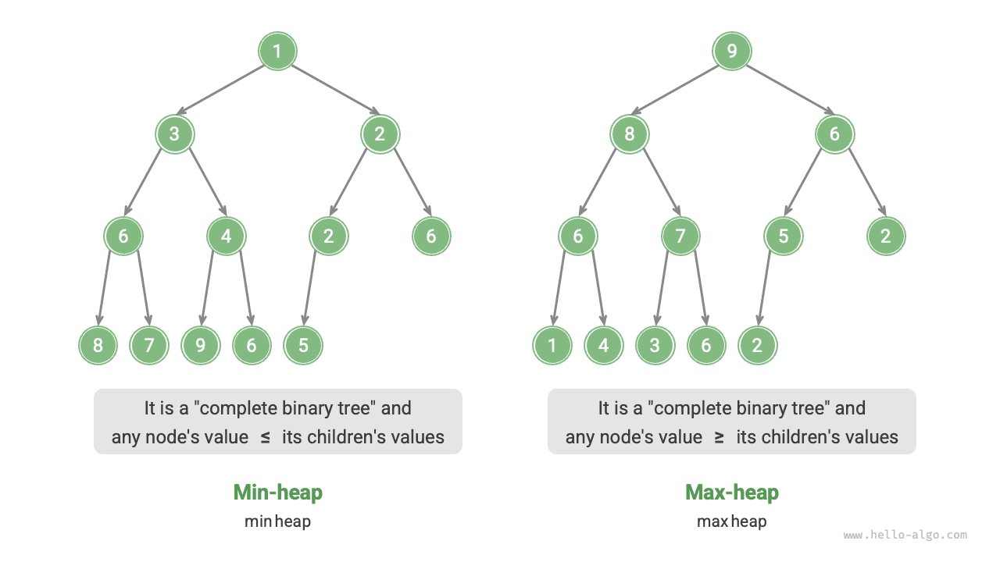
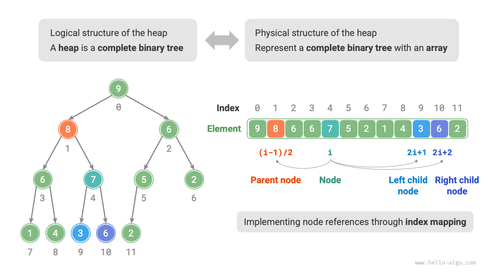
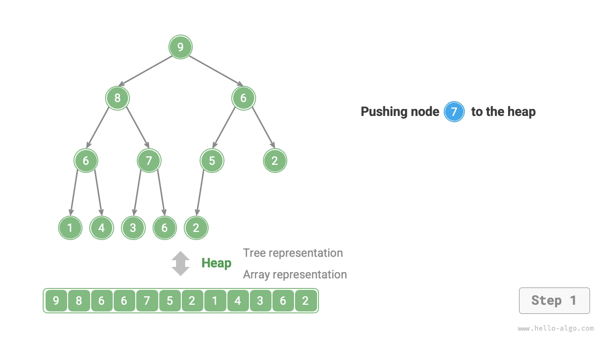
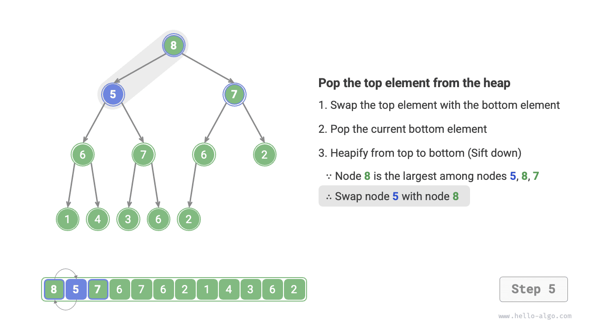
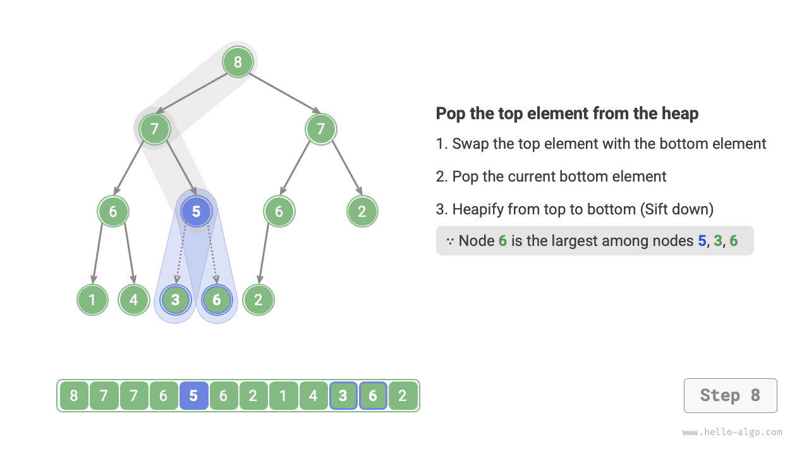

# ヒープ

<u>ヒープ（heap）</u>は特定の条件を満たす完全二分木です。下図のように、主に二種類に分かれます。

- <u>最小ヒープ（min heap）</u>：任意のノードの値が、その子の値以下（$\leq$）です。
- <u>最大ヒープ（max heap）</u>：任意のノードの値が、その子の値以上（$\geq$）です。



ヒープは完全二分木の特殊な場合なので、次の特徴を持ちます。

- 最下層のノードは左詰めで、ほかの層はすべて埋まっています。
- 根ノードを「ヒープの先頭」、最下層の一番右のノードを「ヒープの末尾」と呼びます。
- 最大ヒープ（最小ヒープ）では、先頭要素、つまり根ノードの値が最大（最小）です。

## ヒープの主な操作

多くのプログラミング言語が提供するのは、<u>優先度付きキュー（priority queue）</u>です。これは、優先度に基づいて順序付けられるキューとして定義される抽象データ構造です。

実際には、**ヒープは優先度付きキューの実装によく使われ、最大ヒープは大きい要素から順に取り出す優先度付きキューに相当します**。使う側からは、両者を同等のデータ構造と見なせます。そのため本書では特に区別せず、「ヒープ」と呼びます。

主な操作を下表に示します。メソッド名は言語によって異なります。

<p align="center"> 表 <id> &nbsp; ヒープの操作効率 </p>

| メソッド名      | 説明                                             | 時間計算量  |
| ----------- | ------------------------------------------------ | ----------- |
| `push()`    | 要素をヒープに挿入する                                         | $O(\log n)$ |
| `pop()`     | ヒープの先頭要素を取り出す                                     | $O(\log n)$ |
| `peek()`    | 先頭要素にアクセスする（最大／最小ヒープでは最大値／最小値） | $O(1)$      |
| `size()`    | ヒープの要素数を取得する                                 | $O(1)$      |
| `isEmpty()` | ヒープが空かどうかを判定する                                   | $O(1)$      |

実際には、言語が提供するヒープクラスや優先度付きキューのクラスをそのまま使えます。

ソートで昇順と降順を切り替えるように、`flag` の設定や `Comparator` の変更によって、最小ヒープと最大ヒープを切り替えられます。コードは次のとおりです。

=== "Python"

    ```python title="heap.py"
    # 最小ヒープを初期化
    min_heap, flag = [], 1
    # 最大ヒープを初期化
    max_heap, flag = [], -1

    # Python の heapq モジュールはデフォルトで最小ヒープを実装する
    # 要素の符号を反転してから挿入すると、大小関係が逆転し最大ヒープを実現できる
    # この例では flag = 1 が最小ヒープ、flag = -1 が最大ヒープに対応する

    # 要素をヒープに挿入
    heapq.heappush(max_heap, flag * 1)
    heapq.heappush(max_heap, flag * 3)
    heapq.heappush(max_heap, flag * 2)
    heapq.heappush(max_heap, flag * 5)
    heapq.heappush(max_heap, flag * 4)

    # ヒープの先頭要素を取得
    peek: int = flag * max_heap[0] # 5

    # ヒープの先頭要素を取り出す
    # 取り出した要素は降順の列になる
    val = flag * heapq.heappop(max_heap) # 5
    val = flag * heapq.heappop(max_heap) # 4
    val = flag * heapq.heappop(max_heap) # 3
    val = flag * heapq.heappop(max_heap) # 2
    val = flag * heapq.heappop(max_heap) # 1

    # ヒープの要素数を取得
    size: int = len(max_heap)

    # ヒープが空かどうかを判定
    is_empty: bool = not max_heap

    # リストを入力してヒープを構築
    min_heap: list[int] = [1, 3, 2, 5, 4]
    heapq.heapify(min_heap)
    ```

=== "C++"

    ```cpp title="heap.cpp"
    /* ヒープを初期化 */
    // 最小ヒープを初期化
    priority_queue<int, vector<int>, greater<int>> minHeap;
    // 最大ヒープを初期化
    priority_queue<int, vector<int>, less<int>> maxHeap;

    /* 要素をヒープに挿入 */
    maxHeap.push(1);
    maxHeap.push(3);
    maxHeap.push(2);
    maxHeap.push(5);
    maxHeap.push(4);

    /* ヒープの先頭要素を取得 */
    int peek = maxHeap.top(); // 5

    /* ヒープの先頭要素を取り出す */
    // 取り出した要素は降順の列になる
    maxHeap.pop(); // 5
    maxHeap.pop(); // 4
    maxHeap.pop(); // 3
    maxHeap.pop(); // 2
    maxHeap.pop(); // 1

    /* ヒープの要素数を取得 */
    int size = maxHeap.size();

    /* ヒープが空かどうかを判定 */
    bool isEmpty = maxHeap.empty();

    /* リストを入力してヒープを構築 */
    vector<int> input{1, 3, 2, 5, 4};
    priority_queue<int, vector<int>, greater<int>> minHeap(input.begin(), input.end());
    ```

=== "Java"

    ```java title="heap.java"
    /* ヒープを初期化 */
    // 最小ヒープを初期化
    Queue<Integer> minHeap = new PriorityQueue<>();
    // 最大ヒープを初期化（ラムダ式で Comparator を変更する）
    Queue<Integer> maxHeap = new PriorityQueue<>((a, b) -> b - a);

    /* 要素をヒープに挿入 */
    maxHeap.offer(1);
    maxHeap.offer(3);
    maxHeap.offer(2);
    maxHeap.offer(5);
    maxHeap.offer(4);

    /* ヒープの先頭要素を取得 */
    int peek = maxHeap.peek(); // 5

    /* ヒープの先頭要素を取り出す */
    // 取り出した要素は降順の列になる
    peek = maxHeap.poll(); // 5
    peek = maxHeap.poll(); // 4
    peek = maxHeap.poll(); // 3
    peek = maxHeap.poll(); // 2
    peek = maxHeap.poll(); // 1

    /* ヒープの要素数を取得 */
    int size = maxHeap.size();

    /* ヒープが空かどうかを判定 */
    boolean isEmpty = maxHeap.isEmpty();

    /* リストを入力してヒープを構築 */
    minHeap = new PriorityQueue<>(Arrays.asList(1, 3, 2, 5, 4));
    ```

=== "C#"

    ```csharp title="heap.cs"
    /* ヒープを初期化 */
    // 最小ヒープを初期化
    PriorityQueue<int, int> minHeap = new();
    // 最大ヒープを初期化（ラムダ式で Comparer を変更する）
    PriorityQueue<int, int> maxHeap = new(Comparer<int>.Create((x, y) => y.CompareTo(x)));

    /* 要素をヒープに挿入 */
    maxHeap.Enqueue(1, 1);
    maxHeap.Enqueue(3, 3);
    maxHeap.Enqueue(2, 2);
    maxHeap.Enqueue(5, 5);
    maxHeap.Enqueue(4, 4);

    /* ヒープの先頭要素を取得 */
    int peek = maxHeap.Peek();//5

    /* ヒープの先頭要素を取り出す */
    // 取り出した要素は降順の列になる
    peek = maxHeap.Dequeue();  // 5
    peek = maxHeap.Dequeue();  // 4
    peek = maxHeap.Dequeue();  // 3
    peek = maxHeap.Dequeue();  // 2
    peek = maxHeap.Dequeue();  // 1

    /* ヒープの要素数を取得 */
    int size = maxHeap.Count;

    /* ヒープが空かどうかを判定 */
    bool isEmpty = maxHeap.Count == 0;

    /* リストを入力してヒープを構築 */
    minHeap = new PriorityQueue<int, int>([(1, 1), (3, 3), (2, 2), (5, 5), (4, 4)]);
    ```

=== "Go"

    ```go title="heap.go"
    // Go では heap.Interface を実装して整数の最大ヒープを構築できる
    // heap.Interface の実装には sort.Interface の実装も必要
    type intHeap []any

    // Push は heap.Interface のメソッドで、ヒープへの挿入を実装する
    func (h *intHeap) Push(x any) {
        // Push と Pop はポインタレシーバーを引数として使う
        // スライスの内容だけでなく長さも変更するため
        *h = append(*h, x.(int))
    }

    // Pop は heap.Interface のメソッドで、先頭要素の取り出しを実装する
    func (h *intHeap) Pop() any {
        // 取り出す要素は末尾に格納されている
        last := (*h)[len(*h)-1]
        *h = (*h)[:len(*h)-1]
        return last
    }

    // Len は sort.Interface のメソッド
    func (h *intHeap) Len() int {
        return len(*h)
    }

    // Less は sort.Interface のメソッド
    func (h *intHeap) Less(i, j int) bool {
        // 最小ヒープを実装する場合は、小なり記号に変更する
        return (*h)[i].(int) > (*h)[j].(int)
    }

    // Swap は sort.Interface のメソッド
    func (h *intHeap) Swap(i, j int) {
        (*h)[i], (*h)[j] = (*h)[j], (*h)[i]
    }

    // Top ヒープの先頭要素を取得
    func (h *intHeap) Top() any {
        return (*h)[0]
    }

    /* 実行用コード */
    func TestHeap(t *testing.T) {
        /* ヒープを初期化 */
        // 最大ヒープを初期化
        maxHeap := &intHeap{}
        heap.Init(maxHeap)
        /* 要素をヒープに挿入 */
        // heap.Interface のメソッドを呼んで要素を追加
        heap.Push(maxHeap, 1)
        heap.Push(maxHeap, 3)
        heap.Push(maxHeap, 2)
        heap.Push(maxHeap, 4)
        heap.Push(maxHeap, 5)

        /* ヒープの先頭要素を取得 */
        top := maxHeap.Top()
        fmt.Printf("ヒープの先頭要素は %d\n", top)

        /* ヒープの先頭要素を取り出す */
        // heap.Interface のメソッドを呼んで要素を削除
        heap.Pop(maxHeap) // 5
        heap.Pop(maxHeap) // 4
        heap.Pop(maxHeap) // 3
        heap.Pop(maxHeap) // 2
        heap.Pop(maxHeap) // 1

        /* ヒープの要素数を取得 */
        size := len(*maxHeap)
        fmt.Printf("ヒープの要素数は %d\n", size)

        /* ヒープが空かどうかを判定 */
        isEmpty := len(*maxHeap) == 0
        fmt.Printf("ヒープは空か %t\n", isEmpty)
    }
    ```

=== "Swift"

    ```swift title="heap.swift"
    /* ヒープを初期化 */
    // Swift の Heap 型は最大ヒープと最小ヒープの両方に対応し、swift-collections の導入が必要
    var heap = Heap<Int>()

    /* 要素をヒープに挿入 */
    heap.insert(1)
    heap.insert(3)
    heap.insert(2)
    heap.insert(5)
    heap.insert(4)

    /* ヒープの先頭要素を取得 */
    var peek = heap.max()!

    /* ヒープの先頭要素を取り出す */
    peek = heap.removeMax() // 5
    peek = heap.removeMax() // 4
    peek = heap.removeMax() // 3
    peek = heap.removeMax() // 2
    peek = heap.removeMax() // 1

    /* ヒープの要素数を取得 */
    let size = heap.count

    /* ヒープが空かどうかを判定 */
    let isEmpty = heap.isEmpty

    /* リストを入力してヒープを構築 */
    let heap2 = Heap([1, 3, 2, 5, 4])
    ```

=== "JS"

    ```javascript title="heap.js"
    // JavaScript には組み込みの Heap クラスがない
    ```

=== "TS"

    ```typescript title="heap.ts"
    // TypeScript には組み込みの Heap クラスがない
    ```

=== "Dart"

    ```dart title="heap.dart"
    // Dart には組み込みの Heap クラスがない
    ```

=== "Rust"

    ```rust title="heap.rs"
    use std::collections::BinaryHeap;
    use std::cmp::Reverse;

    /* ヒープを初期化 */
    // 最小ヒープを初期化
    let mut min_heap = BinaryHeap::<Reverse<i32>>::new();
    // 最大ヒープを初期化
    let mut max_heap = BinaryHeap::new();

    /* 要素をヒープに挿入 */
    max_heap.push(1);
    max_heap.push(3);
    max_heap.push(2);
    max_heap.push(5);
    max_heap.push(4);

    /* ヒープの先頭要素を取得 */
    let peek = max_heap.peek().unwrap();  // 5

    /* ヒープの先頭要素を取り出す */
    // 取り出した要素は降順の列になる
    let peek = max_heap.pop().unwrap();   // 5
    let peek = max_heap.pop().unwrap();   // 4
    let peek = max_heap.pop().unwrap();   // 3
    let peek = max_heap.pop().unwrap();   // 2
    let peek = max_heap.pop().unwrap();   // 1

    /* ヒープの要素数を取得 */
    let size = max_heap.len();

    /* ヒープが空かどうかを判定 */
    let is_empty = max_heap.is_empty();

    /* リストを入力してヒープを構築 */
    let min_heap = BinaryHeap::from(vec![Reverse(1), Reverse(3), Reverse(2), Reverse(5), Reverse(4)]);
    ```

=== "C"

    ```c title="heap.c"
    // C には組み込みの Heap クラスがない
    ```

=== "Kotlin"

    ```kotlin title="heap.kt"
    /* ヒープを初期化 */
    // 最小ヒープを初期化
    var minHeap = PriorityQueue<Int>()
    // 最大ヒープを初期化（ラムダ式で Comparator を変更する）
    val maxHeap = PriorityQueue { a: Int, b: Int -> b - a }

    /* 要素をヒープに挿入 */
    maxHeap.offer(1)
    maxHeap.offer(3)
    maxHeap.offer(2)
    maxHeap.offer(5)
    maxHeap.offer(4)

    /* ヒープの先頭要素を取得 */
    var peek = maxHeap.peek() // 5

    /* ヒープの先頭要素を取り出す */
    // 取り出した要素は降順の列になる
    peek = maxHeap.poll() // 5
    peek = maxHeap.poll() // 4
    peek = maxHeap.poll() // 3
    peek = maxHeap.poll() // 2
    peek = maxHeap.poll() // 1

    /* ヒープの要素数を取得 */
    val size = maxHeap.size

    /* ヒープが空かどうかを判定 */
    val isEmpty = maxHeap.isEmpty()

    /* リストを入力してヒープを構築 */
    minHeap = PriorityQueue(mutableListOf(1, 3, 2, 5, 4))
    ```

=== "Ruby"

    ```ruby title="heap.rb"
    # Ruby には組み込みの Heap クラスがない
    ```

??? pythontutor "実行の可視化"

    https://pythontutor.com/render.html#code=import%20heapq%0A%0A%22%22%22%E5%AE%9F%E8%A1%8C%E7%94%A8%E3%82%B3%E3%83%BC%E3%83%89%22%22%22%0Aif%20__name__%20%3D%3D%20%22__main__%22%3A%0A%20%20%20%20%23%20%E6%9C%80%E5%B0%8F%E3%83%92%E3%83%BC%E3%83%97%E3%82%92%E5%88%9D%E6%9C%9F%E5%8C%96%0A%20%20%20%20min_heap%2C%20flag%20%3D%20%5B%5D%2C%201%0A%20%20%20%20%23%20%E6%9C%80%E5%A4%A7%E3%83%92%E3%83%BC%E3%83%97%E3%82%92%E5%88%9D%E6%9C%9F%E5%8C%96%0A%20%20%20%20max_heap%2C%20flag%20%3D%20%5B%5D%2C%20-1%0A%20%20%20%20%0A%20%20%20%20%23%20Python%20%E3%81%AE%20heapq%20%E3%83%A2%E3%82%B8%E3%83%A5%E3%83%BC%E3%83%AB%E3%81%AF%E3%83%87%E3%83%95%E3%82%A9%E3%83%AB%E3%83%88%E3%81%A7%E6%9C%80%E5%B0%8F%E3%83%92%E3%83%BC%E3%83%97%E3%82%92%E5%AE%9F%E8%A3%85%E3%81%99%E3%82%8B%0A%20%20%20%20%23%20%E8%A6%81%E7%B4%A0%E3%81%AE%E7%AC%A6%E5%8F%B7%E3%82%92%E5%8F%8D%E8%BB%A2%E3%81%97%E3%81%A6%E3%81%8B%E3%82%89%E6%8C%BF%E5%85%A5%E3%81%99%E3%82%8B%E3%81%A8%E3%80%81%E5%A4%A7%E5%B0%8F%E9%96%A2%E4%BF%82%E3%81%8C%E9%80%86%E8%BB%A2%E3%81%97%E6%9C%80%E5%A4%A7%E3%83%92%E3%83%BC%E3%83%97%E3%82%92%E5%AE%9F%E7%8F%BE%E3%81%A7%E3%81%8D%E3%82%8B%0A%20%20%20%20%23%20%E3%81%93%E3%81%AE%E4%BE%8B%E3%81%A7%E3%81%AF%20flag%20%3D%201%20%E3%81%8C%E6%9C%80%E5%B0%8F%E3%83%92%E3%83%BC%E3%83%97%E3%80%81flag%20%3D%20-1%20%E3%81%8C%E6%9C%80%E5%A4%A7%E3%83%92%E3%83%BC%E3%83%97%E3%81%AB%E5%AF%BE%E5%BF%9C%E3%81%99%E3%82%8B%0A%20%20%20%20%0A%20%20%20%20%23%20%E8%A6%81%E7%B4%A0%E3%82%92%E3%83%92%E3%83%BC%E3%83%97%E3%81%AB%E6%8C%BF%E5%85%A5%0A%20%20%20%20heapq.heappush(max_heap%2C%20flag%20*%201)%0A%20%20%20%20heapq.heappush(max_heap%2C%20flag%20*%203)%0A%20%20%20%20heapq.heappush(max_heap%2C%20flag%20*%202)%0A%20%20%20%20heapq.heappush(max_heap%2C%20flag%20*%205)%0A%20%20%20%20heapq.heappush(max_heap%2C%20flag%20*%204)%0A%20%20%20%20%0A%20%20%20%20%23%20%E3%83%92%E3%83%BC%E3%83%97%E3%81%AE%E5%85%88%E9%A0%AD%E8%A6%81%E7%B4%A0%E3%82%92%E5%8F%96%E5%BE%97%0A%20%20%20%20peek%20%3D%20flag%20*%20max_heap%5B0%5D%20%23%205%0A%20%20%20%20%0A%20%20%20%20%23%20%E3%83%92%E3%83%BC%E3%83%97%E3%81%AE%E5%85%88%E9%A0%AD%E8%A6%81%E7%B4%A0%E3%82%92%E5%8F%96%E3%82%8A%E5%87%BA%E3%81%99%0A%20%20%20%20%23%20%E5%8F%96%E3%82%8A%E5%87%BA%E3%81%97%E3%81%9F%E8%A6%81%E7%B4%A0%E3%81%AF%E9%99%8D%E9%A0%86%E3%81%AE%E5%88%97%E3%81%AB%E3%81%AA%E3%82%8B%0A%20%20%20%20val%20%3D%20flag%20*%20heapq.heappop(max_heap)%20%23%205%0A%20%20%20%20val%20%3D%20flag%20*%20heapq.heappop(max_heap)%20%23%204%0A%20%20%20%20val%20%3D%20flag%20*%20heapq.heappop(max_heap)%20%23%203%0A%20%20%20%20val%20%3D%20flag%20*%20heapq.heappop(max_heap)%20%23%202%0A%20%20%20%20val%20%3D%20flag%20*%20heapq.heappop(max_heap)%20%23%201%0A%20%20%20%20%0A%20%20%20%20%23%20%E3%83%92%E3%83%BC%E3%83%97%E3%81%AE%E8%A6%81%E7%B4%A0%E6%95%B0%E3%82%92%E5%8F%96%E5%BE%97%0A%20%20%20%20size%20%3D%20len(max_heap)%0A%20%20%20%20%0A%20%20%20%20%23%20%E3%83%92%E3%83%BC%E3%83%97%E3%81%8C%E7%A9%BA%E3%81%8B%E3%81%A9%E3%81%86%E3%81%8B%E3%82%92%E5%88%A4%E5%AE%9A%0A%20%20%20%20is_empty%20%3D%20not%20max_heap%0A%20%20%20%20%0A%20%20%20%20%23%20%E3%83%AA%E3%82%B9%E3%83%88%E3%82%92%E5%85%A5%E5%8A%9B%E3%81%97%E3%81%A6%E3%83%92%E3%83%BC%E3%83%97%E3%82%92%E6%A7%8B%E7%AF%89%0A%20%20%20%20min_heap%20%3D%20%5B1%2C%203%2C%202%2C%205%2C%204%5D%0A%20%20%20%20heapq.heapify(min_heap)&cumulative=false&curInstr=3&heapPrimitives=nevernest&mode=display&origin=opt-frontend.js&py=311&rawInputLstJSON=%5B%5D&textReferences=false

## ヒープの実装

以下では最大ヒープを実装します。最小ヒープにするには、大小の判定をすべて逆にするだけです（例えば、$\geq$ を $\leq$ に置き換えます）。興味があれば実装してみてください。

### ヒープの格納と表現

「二分木」の章で、完全二分木は配列で表すのに適していると学びました。ヒープも完全二分木なので、**配列に格納します**。

配列で二分木を表すとき、要素はノードの値、インデックスは木の中での位置を表します。**ノードのポインタは、インデックスの対応式で実現します**。

下図のように、インデックス $i$ の左の子は $2i + 1$、右の子は $2i + 2$、親は $(i - 1) / 2$（切り捨ての整数除算）です。インデックスが範囲外なら、空のノード、またはノードが存在しないことを表します。



この対応式を関数にまとめておくと、後で使いやすくなります。

```src
[file]{my_heap}-[class]{max_heap}-[func]{parent}
```

### 先頭要素へのアクセス

先頭要素は二分木の根ノード、つまりリストの最初の要素です。

```src
[file]{my_heap}-[class]{max_heap}-[func]{peek}
```

### 要素の挿入

要素 `val` をまずヒープの末尾に追加します。`val` がほかの要素より大きい場合、ヒープの条件が崩れている可能性があるため、**挿入したノードから根までの経路上の各ノードを修復する必要があります**。この操作を<u>ヒープ化（heapify）</u>と呼びます。

挿入したノードから、**下から上へヒープ化します**。下図のように、挿入したノードと親の値を比較し、挿入したノードのほうが大きければ交換します。同じ操作を繰り返して下から上へ修復し、根を越えるか、交換が不要なノードに達したら終了します。

=== "<1>"
    

=== "<2>"
    

=== "<3>"
    

=== "<4>"
    

=== "<5>"
    

=== "<6>"
    

=== "<7>"
    

=== "<8>"
    

=== "<9>"
    

ノード総数を $n$ とすると、木の高さは $O(\log n)$ です。したがって、ヒープ化の反復は最大 $O(\log n)$ 回で、**挿入の時間計算量は $O(\log n)$** です。コードは次のとおりです。

```src
[file]{my_heap}-[class]{max_heap}-[func]{sift_up}
```

### 先頭要素の取り出し

先頭要素は二分木の根ノード、つまりリストの最初の要素です。これをリストから直接削除すると、すべてのノードのインデックスが変わり、その後のヒープ化による修復が難しくなります。インデックスの変化をできるだけ少なくするため、次の手順を使います。

1. ヒープの先頭と末尾、つまり根ノードと一番右の葉を交換します。
2. 交換後、末尾をリストから削除します（交換済みなので、実際に削除するのは元の先頭要素です）。
3. 根ノードから、**上から下へヒープ化します**。

下図のように、**上から下へのヒープ化は、下から上へのヒープ化とは逆方向の操作です**。根の値と二つの子の値を比較し、最大の子と根を交換します。これを繰り返し、葉を越えるか交換が不要なノードに達したら終了します。

=== "<1>"
    

=== "<2>"
    

=== "<3>"
    

=== "<4>"
    

=== "<5>"
    

=== "<6>"
    

=== "<7>"
    

=== "<8>"
    

=== "<9>"
    

=== "<10>"
    

挿入と同様に、先頭要素の取り出しの時間計算量も $O(\log n)$ です。コードは次のとおりです。

```src
[file]{my_heap}-[class]{max_heap}-[func]{sift_down}
```

## ヒープの主な用途

- **優先度付きキュー**：ヒープは、優先度付きキューの実装で通常最初に選ばれるデータ構造です。エンキューとデキューはともに $O(\log n)$、構築は $O(n)$ と、いずれも非常に効率的です。
- **ヒープソート**：データからヒープを作り、要素を取り出し続けると整列済みのデータを得られます。ただし、通常はさらにすっきりした方法で実装します。詳しくは「ヒープソート」の節を参照してください。
- **大きいほうから $k$ 個の要素の取得**：古典的なアルゴリズムの問題であり、代表的な用途でもあります。例えば、話題のニュース上位 10 件を微博のトレンドに選んだり、販売数上位 10 商品を選んだりします。
