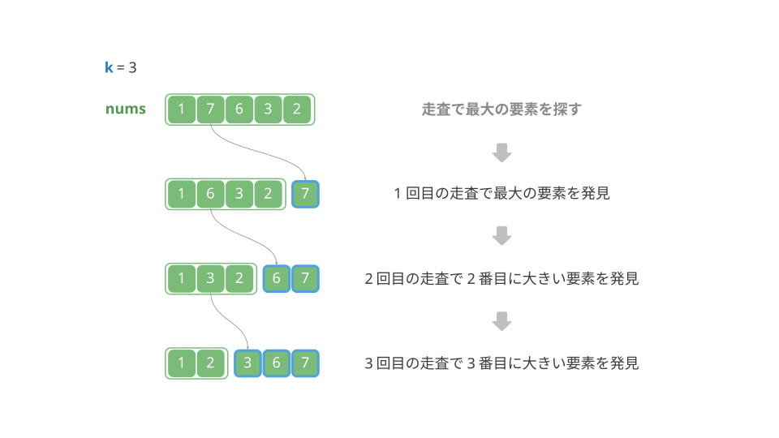
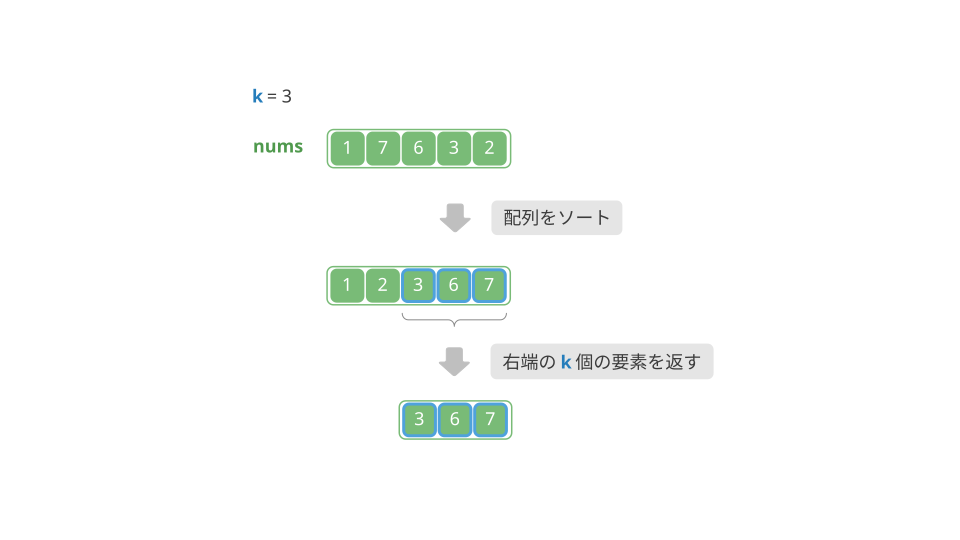
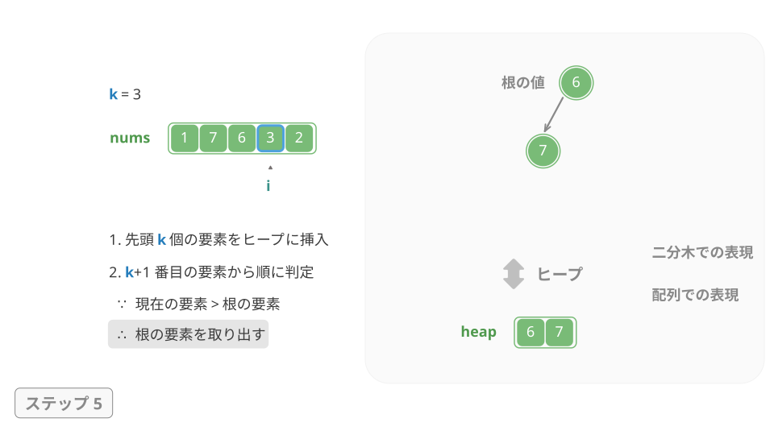
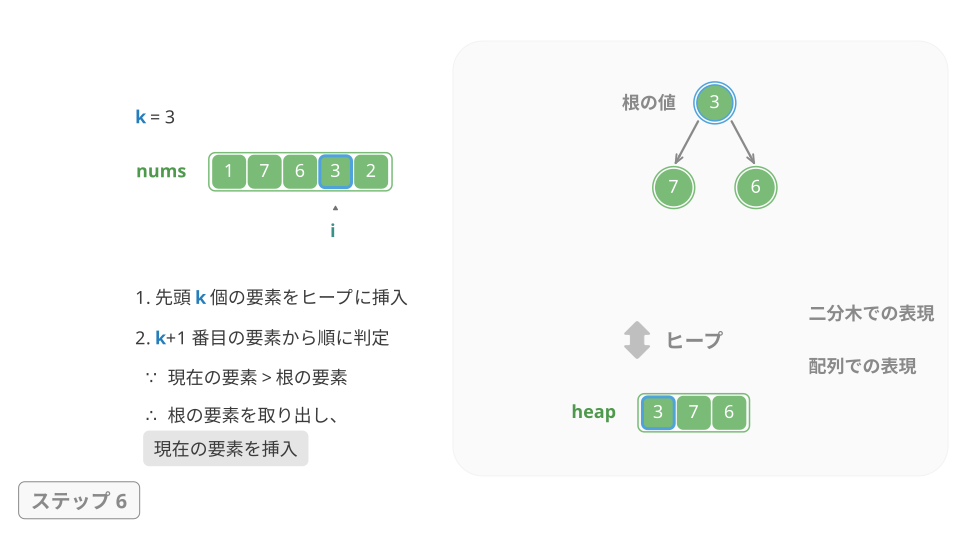

# Top-k 問題

!!! question

    長さ $n$ の未整列配列 `nums` が与えられます。配列の中で大きいほうから $k$ 個の要素を返してください。

この問題について、まず考え方の分かりやすい 2 つの解法を紹介し、続いてヒープを使ったより効率的な解法を説明します。

## 方法 1：走査して選ぶ

下図のように $k$ 回走査し、各回で $1$ 番目、$2$ 番目、$\dots$、$k$ 番目に大きい要素を順に取り出せます。時間計算量は $O(nk)$ です。

この方法が適しているのは $k \ll n$ の場合だけです。$k$ が $n$ に近づくと時間計算量が $O(n^2)$ に近づき、非常に時間がかかります。



!!! tip

    $k = n$ のときには、要素全体が並んだ整列済みの列が得られます。これは「選択ソート」と同等です。

## 方法 2：ソート

下図のように、まず配列 `nums` をソートしてから右端の $k$ 個の要素を返せます。時間計算量は $O(n \log n)$ です。

この方法では必要以上の仕事をしています。欲しいのは上位 $k$ 個の要素だけで、それ以外の要素をソートする必要はないからです。



## 方法 3：ヒープ

ヒープを使うと、Top-k 問題をさらに効率よく解けます。手順を下図に示します。

1. 最小ヒープを初期化します。根の要素が最小値になります。
2. まず配列の先頭 $k$ 個の要素を順にヒープに入れます。
3. $k + 1$ 番目の要素からは、現在の要素が根の要素より大きければ、根の要素を取り出して現在の要素を入れます。
4. 走査が終わると、ヒープに残っているのが上位 $k$ 個の要素です。

=== "<1>"
    

=== "<2>"
    

=== "<3>"
    

=== "<4>"
    

=== "<5>"
    

=== "<6>"
    

=== "<7>"
    

=== "<8>"
    

=== "<9>"
    

コード例は次のとおりです。

```src
[file]{top_k}-[class]{}-[func]{top_k_heap}
```

挿入と取り出しを扱う反復は合計 $n$ 回で、ヒープの長さは最大 $k$ なので、時間計算量は $O(n \log k)$ です。この方法は効率がよく、$k$ が小さいときは時間計算量が $O(n)$ に近づきます。$k$ が大きいときも $O(n \log n)$ を超えません。

また、この方法はデータが次々に届くストリームにも適しています。新しいデータが加わるたびにヒープの中身を調整することで、上位 $k$ 個の要素を動的に更新できます。
