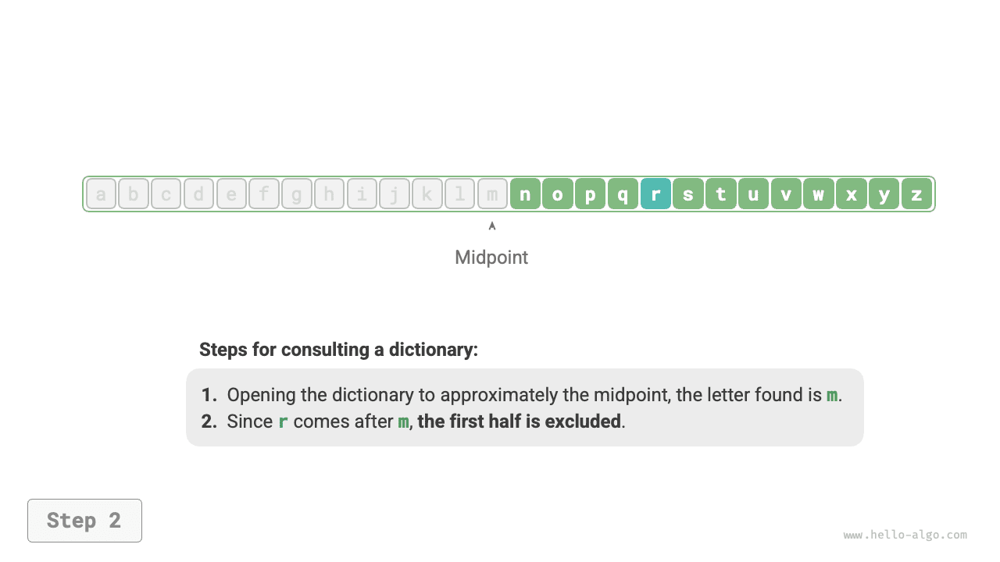
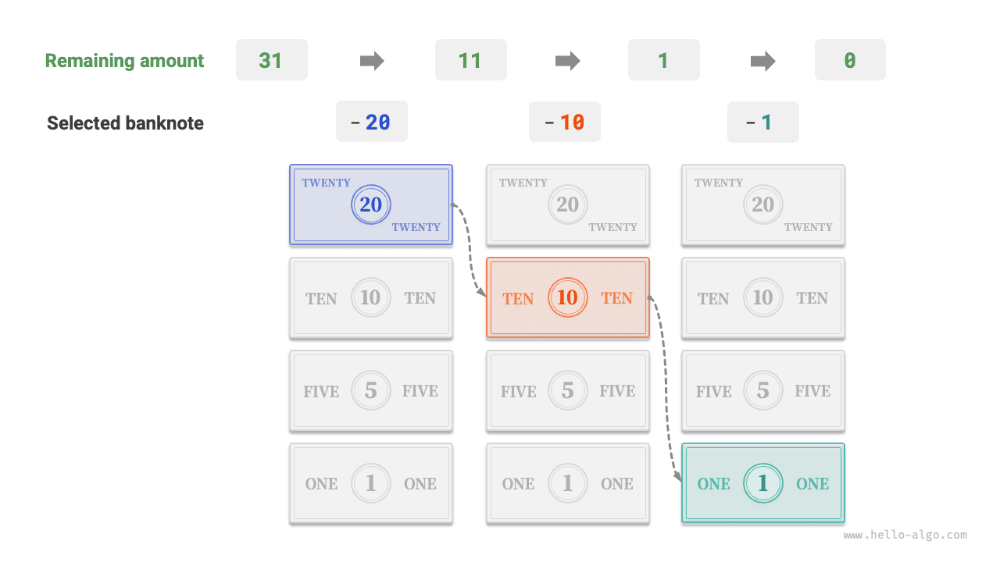

# 1.1 &nbsp; アルゴリズムはどこにでもある

「アルゴリズム」と聞くと、自然に数学を思い浮かべるかもしれません。しかし、多くのアルゴリズムは複雑な数学を使わず、むしろ基本的な論理に基づいています。その論理は、私たちの日常生活の至るところにあります。

本格的にアルゴリズムを学ぶ前に、面白い事実を紹介します。**あなたはすでに、知らず知らずのうちに多くのアルゴリズムを学び、日常的に使っています**。具体的な例を挙げて確かめてみましょう。

**例一：辞書を引く**。中国語の辞書では、各漢字に対応するピンインがあり、そのアルファベット順に並んでいます。ピンインの頭文字が $r$ の字を探すなら、通常は図 1-1 のように進めます。

1. 辞書のおよそ真ん中のページを開き、そのページの頭文字を確認します。$m$ だったとします。
2. ピンインのアルファベット順では $r$ は $m$ より後なので、前半を除外し、探す範囲を後半に絞ります。
3. 手順 `1.` と `2.` を繰り返し、頭文字が $r$ のページを見つけます。

=== "<1>"
    { class="animation-figure" }

=== "<2>"
    { class="animation-figure" }

=== "<3>"
    { class="animation-figure" }

=== "<4>"
    { class="animation-figure" }

=== "<5>"
    { class="animation-figure" }

 図 1-1 &nbsp; 辞書を引く手順 

小学生が身に付ける辞書の引き方は、実は有名な「二分探索」です。データ構造の観点では辞書を整列済みの「配列」と見なし、アルゴリズムの観点では一連の操作を「二分探索」と捉えられます。

**例二：トランプを並べる**。トランプをするときは、毎回、手札を小さい順に並べます。その流れを図 1-2 に示します。

1. 手札を「整列済み」と「未整列」の部分に分け、最初は一番左の 1 枚だけが整列済みとします。
2. 未整列の部分から 1 枚取り出し、整列済みの部分の正しい位置へ挿入します。これで左の 2 枚が整列済みになります。
3. 手順 `2.` を繰り返し、毎回 1 枚を未整列の部分から整列済みの部分へ挿入し、すべてが整列済みになるまで続けます。

{ class="animation-figure" }

 図 1-2 &nbsp; トランプを並べる手順 

この並べ方は、本質的に「挿入ソート」です。小さなデータ集合に対して非常に効率がよく、多くのプログラミング言語のソート用ライブラリ関数にも使われています。

**例三：お釣りを渡す**。スーパーで $69$ 元の商品を買い、レジで $100$ 元を渡したとします。店員は $31$ 元のお釣りを渡すため、図 1-3 のように自然に考えます。

1. 選べるのは $31$ 元より小さい額面で、$1$ 元、$5$ 元、$10$ 元、$20$ 元です。
2. 選択肢のうち最大の $20$ 元を取り出すと、残りは $31 - 20 = 11$ 元です。
3. 残りの選択肢のうち最大の $10$ 元を取り出すと、残りは $11 - 10 = 1$ 元です。
4. 残りの選択肢のうち最大の $1$ 元を取り出すと、残りは $1 - 1 = 0$ 元です。
5. お釣りがそろいました。内訳は $20 + 10 + 1 = 31$ 元です。

{ class="animation-figure" }

 図 1-3 &nbsp; お釣りを渡す過程 

この手順では、毎回その時点で最もよい選択、つまりできるだけ大きい額面を選び、最終的に実行可能なお釣りの渡し方を得ました。データ構造とアルゴリズムの観点では、これは「貪欲法」です。

一皿の料理から恒星間航行まで、ほとんどあらゆる問題の解決にアルゴリズムが関わっています。コンピュータの登場により、データ構造をプログラミングでメモリに格納し、CPU や GPU にアルゴリズムを実行させるコードを書けるようになりました。こうして、身の回りの問題をコンピュータへ移し、さまざまな複雑な問題をより効率的に解決できます。

!!! tip "ヒント"

    データ構造、アルゴリズム、配列、二分探索などがまだ十分に分からなくても、そのまま読み進めてください。本書が、データ構造とアルゴリズムの知識の世界へと案内します。
