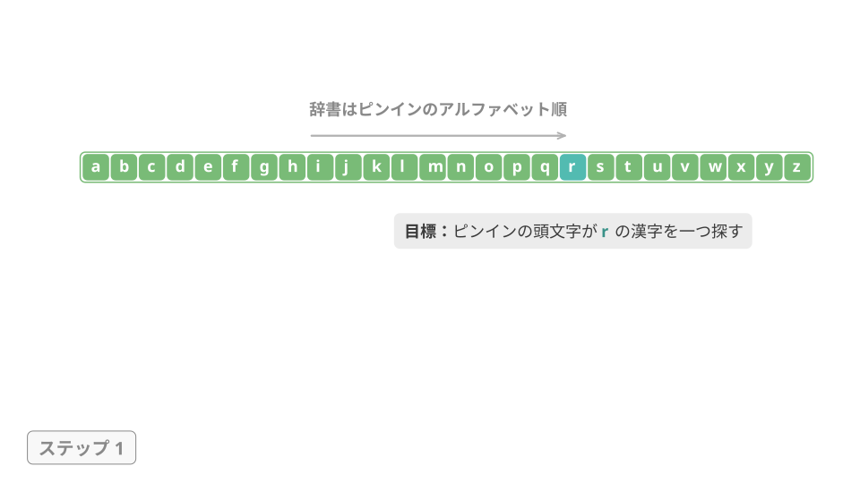
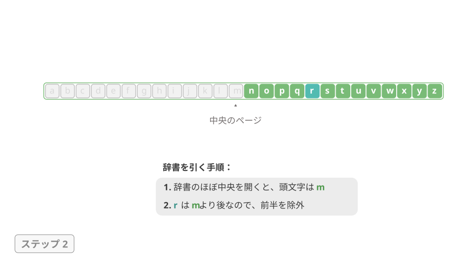
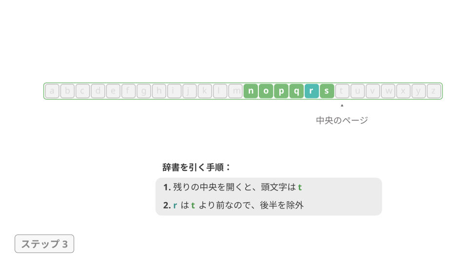
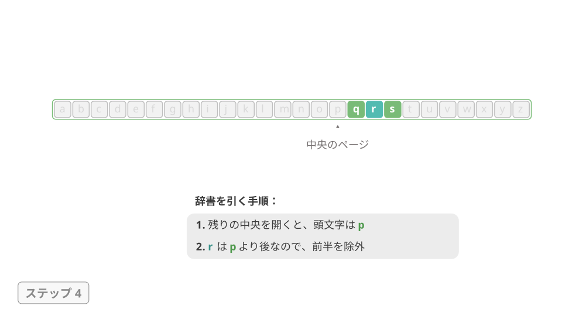
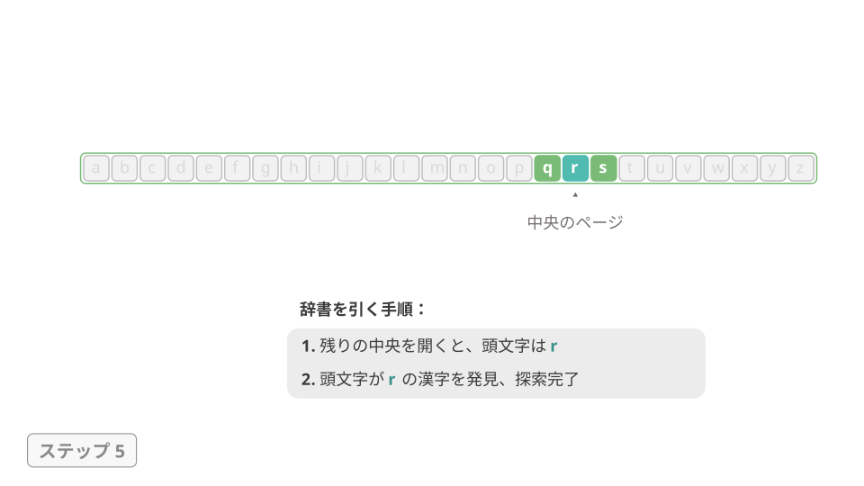
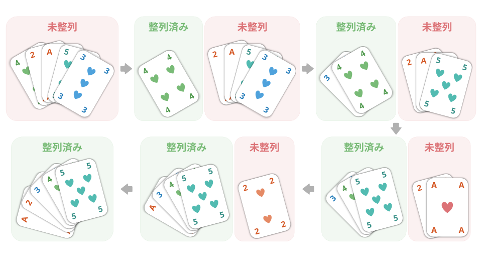
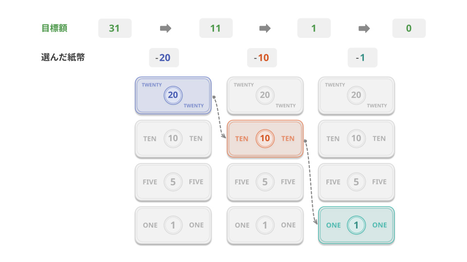

# 1.1 &nbsp; 身の回りのアルゴリズム

「アルゴリズム」と聞くと、数学を思い浮かべるのは自然なことです。実際には、難しい数学を使わず、基本的な論理に支えられたアルゴリズムもたくさんあります。その論理は日常生活のいたるところに見られます。

本格的に学び始める前に、一つ面白いことをお伝えしましょう。**皆さんはすでに、知らず知らずのうちに多くのアルゴリズムを身に付け、日々の暮らしで当たり前のように使っています**。いくつか例を挙げて確かめてみましょう。

**例 1：辞書を引く**。中国語の辞書では、各漢字にピンインという発音表記が対応し、漢字はピンインのアルファベット順に並んでいます。ピンインの頭文字が $r$ の漢字を探すなら、ふつうは図 1-1 のように進めます。

1. 辞書のほぼ中央を開き、そのページの頭文字を確かめます。ここでは $m$ とします。
2. ピンインのアルファベット順では $r$ は $m$ より後なので、辞書の前半を除き、探索範囲を後半に絞ります。
3. 手順 `1.` と手順 `2.` を繰り返し、ピンインの頭文字が $r$ のページを見つけます。

=== "<1>"
    { class="animation-figure" }

=== "<2>"
    { class="animation-figure" }

=== "<3>"
    { class="animation-figure" }

=== "<4>"
    { class="animation-figure" }

=== "<5>"
    { class="animation-figure" }

 図 1-1 &nbsp; 辞書を引く手順 

小学生も身に付けるこの辞書の引き方が、実は有名な「二分探索」です。データ構造の面から見ると辞書は整列済みの「配列」とみなせます。アルゴリズムの面から見ると、辞書を引く一連の操作が「二分探索」に当たります。

**例 2：トランプを並べる**。トランプで遊ぶときは、ゲームのたびに手札を数の小さい順に並べます。図 1-2 のような手順です。

1. 手札を「整列済み」と「未整列」の 2 つに分け、初めは一番左の 1 枚だけを整列済みとします。
2. 未整列部分から 1 枚取り出し、整列済み部分の正しい位置に挿入します。これで左端の 2 枚が整列しました。
3. 手順 `2.` を繰り返し、未整列部分から整列済み部分に 1 枚ずつ挿入して、すべてのカードを整列させます。

{ class="animation-figure" }

 図 1-2 &nbsp; トランプを並べる手順 

手札を整理するこの方法は、まさに「挿入ソート」です。小さなデータ集合を扱う場合に非常に効率がよく、多くのプログラミング言語のソート用ライブラリ関数でも使われています。

**例 3：お釣りを返す**。スーパーで $69$ 元の商品を買い、レジで $100$ 元を渡したとします。店員が返すお釣りは $31$ 元です。店員は自然に、図 1-3 のように考えるでしょう。

1. 選べるのは額面が $31$ 元より小さいお金、つまり $1$ 元、$5$ 元、$10$ 元、$20$ 元です。
2. 使える額面のうち最大の $20$ 元を取ると、残りは $31 - 20 = 11$ 元です。
3. 残りに使える最大の額面 $10$ 元を取ると、残りは $11 - 10 = 1$ 元です。
4. 残りに使える最大の額面 $1$ 元を取ると、残りは $1 - 1 = 0$ 元です。
5. これでお釣りを返し終えました。内訳は $20 + 10 + 1 = 31$ 元です。

{ class="animation-figure" }

 図 1-3 &nbsp; お釣りを返す手順 

この手順では、その時点で最もよさそうな選択、つまりできるだけ額面の大きなお金を使うという選択を毎回行い、最終的にお釣りを返せました。データ構造とアルゴリズムの観点では、この方法は「貪欲法」に当たります。

一品の料理から星間航行まで、ほとんどの問題を解くうえでアルゴリズムは欠かせません。コンピュータの登場により、プログラムでメモリにデータ構造を格納し、コードを通じて CPU や GPU にアルゴリズムを実行させられるようになりました。こうして日常の問題をコンピュータに移し、さまざまな複雑な問題をより効率よく解けます。

!!! tip "ヒント"

    データ構造、アルゴリズム、配列、二分探索といった言葉がまだよくわからなくても、そのまま読み進めてください。本書がデータ構造とアルゴリズムの世界へご案内します。
