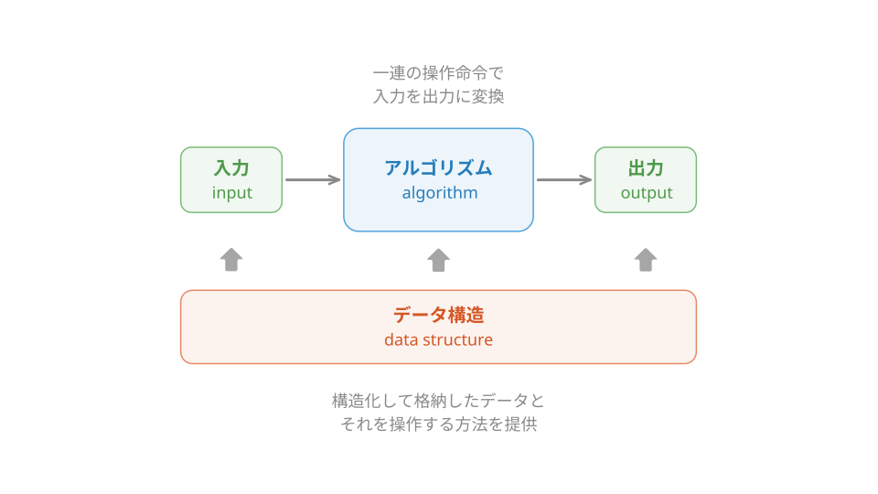

# 1.2 &nbsp; アルゴリズムとは

## 1.2.1 &nbsp; アルゴリズムの定義

<u>アルゴリズム（algorithm）</u>は、有限時間で特定の問題を解くための命令や操作手順の集まりで、次の性質を持ちます。

- 対象とする問題が明確で、入力と出力がはっきり定義されています。
- 実行可能で、有限の手順、時間、メモリで完了できます。
- 各手順の意味が明確で、入力と実行条件が同じなら常に同じ出力を得ます。

## 1.2.2 &nbsp; データ構造の定義

<u>データ構造（data structure）</u>は、データを整理し、格納する方法です。データの内容、データ間の関係、データを操作する方法を含み、次のことを目指して設計します。

- 使用する領域をできるだけ小さくして、コンピュータのメモリを節約します。
- アクセス、追加、削除、更新などのデータ操作をできるだけ速くします。
- データとその論理的な関係を簡潔に表現し、アルゴリズムが効率よく動作できるようにします。

**データ構造の設計には多くのトレードオフがあります**。ある面を改善するには、別の面で妥協が必要になることがよくあります。2 つの例を見てみましょう。

- 連結リストは配列よりもデータを追加・削除しやすい一方、データへのアクセス速度を犠牲にします。
- グラフは連結リストよりも豊かな論理的関係を表現できますが、より多くのメモリを必要とします。

## 1.2.3 &nbsp; データ構造とアルゴリズムの関係

図 1-4 のように、データ構造とアルゴリズムは切り離せない関係にあります。具体的には次の 3 点に表れます。

- データ構造はアルゴリズムの土台です。構造化して格納したデータと、それを操作する方法を提供します。
- アルゴリズムはデータ構造に命を吹き込みます。データ構造だけでは情報を格納するにとどまり、アルゴリズムと組み合わせて初めて特定の問題を解けます。
- 通常、同じアルゴリズムを異なるデータ構造で実装できますが、実行効率には大きな差が出ることがあります。適切なデータ構造を選ぶことが重要です。

{ class="animation-figure" }

 図 1-4 &nbsp; データ構造とアルゴリズムの関係 

データ構造とアルゴリズムの関係は、図 1-5 にある組み立てブロックに似ています。ブロックのセットにはたくさんの部品と、詳しい組み立て説明書が入っています。説明書に沿って一歩ずつ組み立てると、見事な模型ができあがります。

{ class="animation-figure" }

 図 1-5 &nbsp; 組み立てブロック 

それぞれの対応を表 1-1 に示します。

 表 1-1 &nbsp; データ構造とアルゴリズムを組み立てブロックにたとえる 

| データ構造とアルゴリズム | 組み立てブロック                                 |
| -------------- | ---------------------------------------- |
| 入力データ       | 組み立てる前のブロック                             |
| データ構造       | ブロックの形、大きさ、つなぎ方など、部品の構成 |
| アルゴリズム           | ブロックを目的の形に組み立てる一連の操作手順       |
| 出力データ       | ブロックの模型                                 |

データ構造とアルゴリズムは、特定のプログラミング言語に依存しません。だからこそ、本書でもさまざまな言語による実装を紹介できます。

!!! tip "慣用的な略称"

    ふだんの会話では、「データ構造とアルゴリズム」をまとめて「アルゴリズム」と呼ぶことがよくあります。例えば、よく知られた LeetCode のアルゴリズム問題も、実際にはデータ構造とアルゴリズムの両方の知識を問います。
