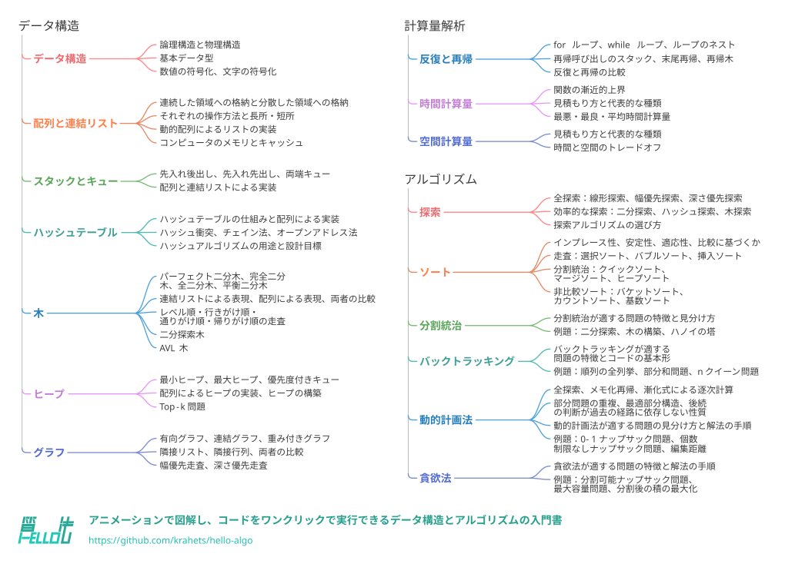

# 本書について

このプロジェクトは、オープンソースで無料の、初めての方にも親しみやすいデータ構造とアルゴリズムの入門書を作ることを目指しています。

- 全編にアニメーション図解を取り入れ、わかりやすい内容を無理なく学べる順に並べました。データ構造とアルゴリズムの知識の地図を、初めての方もたどっていけます。
- ソースコードはワンクリックで実行できます。実際に試しながらプログラミングの腕を磨き、アルゴリズムの動作原理やデータ構造の内部実装を学べます。
- 読者同士で助け合って学ぶことを大切にしています。コメント欄で質問や考えを共有し、話し合いながら一緒に学びましょう。

## 対象読者

アルゴリズムに初めて触れる方にも、少し問題を解いた経験はあるものの、データ構造やアルゴリズムがわかったりわからなくなったりする方にも、本書はぴったりです。

ある程度の数の問題を解き、よく出る問題形式に慣れた方には、知識を振り返って整理するのに役立ちます。リポジトリのソースコードは「演習用の道具箱」や「アルゴリズム辞典」としても使えます。

すでにアルゴリズムの達人という方には、ご意見をお寄せいただいたり、[執筆に参加](../chapter_appendix/contribution.md)していただいたりできれば幸いです。

!!! success "前提知識"

    少なくとも一つの言語のプログラミングの基礎を知り、簡単なコードを読み書きできることが必要です。

## 本書の構成

本書の主な内容を次の図に示します。

- **計算量解析**：データ構造とアルゴリズムを評価する観点と方法、時間計算量と空間計算量の求め方、代表的な種類と例などを扱います。
- **データ構造**：基本データ型とデータ構造の分類方法を学びます。配列、連結リスト、スタック、キュー、ハッシュテーブル、木、ヒープ、グラフなどの定義、長所と短所、主な操作、代表的な種類、用途、実装方法を扱います。
- **アルゴリズム**：探索、ソート、分割統治、バックトラッキング、動的計画法、貪欲法などの定義、長所と短所、効率、用途、解法の手順と例題を扱います。

## 謝辞

本書は、オープンソースコミュニティの多くの方の協力で改善を重ねています。時間と労力を注いでくださった執筆者の皆さんに感謝します。以下、GitHub が自動生成した順にご紹介します。krahets、coderonion、Gonglja、nuomi1、Reanon、justin-tse、hpstory、danielsss、curtishd、night-cruise、S-N-O-R-L-A-X、rongyi、msk397、gvenusleo、khoaxuantu、rivertwilight、K3v123、gyt95、zhuoqinyue、yuelinxin、Zuoxun、mingXta、Phoenix0415、FangYuan33、GN-Yu、longsizhuo、pengchzn、QiLOL、Cathay-Chen、guowei-gong、xBLACKICEx、IsChristina、JoseHung、qualifier1024、hello-ikun、magentaqin、Guanngxu、thomasq0、sunshinesDL、L-Super、Transmigration-zhou、WSL0809、Slone123c、lhxsm、yuan0221、what-is-me、theNefelibatas、Shyam-Chen、sangxiaai、longranger2、codeberg-user、xiongsp、JeffersonHuang、prinpal、seven1240、Wonderdch、malone6、xiaomiusa87、gaofer、bluebean-cloud、a16su、SamJin98、hongyun-robot、nanlei、XiaChuerwu、yd-j、iron-irax、mgisr、steventimes、junminhong、heshuyue、danny900714、Nigh、Dr-XYZ、MolDuM、XC-Zero、reeswell、PXG-XPG、NI-SW、Horbin-Magician、Enlightenus、YangXuanyi、xjr7670、beatrix-chan、DullSword、qq909244296、iStig、boloboloda、hts0000、gledfish、fbigm、echo1937、jiaxianhua、wenjianmin、keshida、kilikilikid、lclc6、lwbaptx、linyejoe2、liuxjerry、szu17dmy、dshlstarr、Yucao-cy、coderlef、czruby、bongbongbakudan、beintentional、ZongYangL、ZhongYuuu、ZhongGuanbin、hezhizhen、linzeyan、ZJKung、JTCPOWI、KawaiiAsh、luluxia、xb534、ztkuaikuai、yw-1021、ElaBosak233、baagod、zhouLion、yishangzhang、yi427、yanedie、yabo083、weibk、wangwang105、th1nk3r-ing、tao363、4yDX3906、syd168、sslmj2020、smilelsb、siqyka、selear、sdshaoda、Xi-Row、popozhu、nuquist19、noobcodemaker、XiaoK29、chadyi、lyl625760、lucaswangdev、llql1211、0130w、shanghai-Jerry、EJackYang、Javesun99、eltociear、lipusheng、KNChiu、BlindTerran、ShiMaRing、lovelock、FreddieLi、FloranceYeh、fanchenggang、gltianwen、goerll、nedchu、curly210102、CuB3y0nd、KraHsu、CarrotDLaw、youshaoXG、bubble9um、Asashishi、Asa0oo0o0o、fanenr、eagleanurag、akshiterate、52coder、foursevenlove、KorsChen、hopkings2008、yang-le、realwujing、Evilrabbit520、Umer-Jahangir、Turing-1024-Lee、Suremotoo、paoxiaomooo、Chieko-Seren、Senrian、Allen-Scai、19santosh99、ymmmas、Risuntsy、Richard-Zhang1019、RafaelCaso、qingpeng9802、primexiao、Urbaner3、codetypess、nidhoggfgg、MwumLi、CreatorMetaSky、martinx、ZnYang2018、hugtyftg、logan-qiu、psychelzh、Kunchen-Luo、Keynman、KeiichiKasai。

本書のコードをレビューしてくださったのは、coderonion、curtishd、Gonglja、gvenusleo、hpstory、justin-tse、khoaxuantu、krahets、night-cruise、nuomi1、Reanon、rongyi の皆さんです（アルファベット順）。各言語のコードの規約と一貫性を守るために注いでくださった時間と労力に感謝します。

英語版は yuelinxin、K3v123、magentaqin、QiLOL、Phoenix0415、SamJin98、yanedie、RafaelCaso、pengchzn、thomasq0 の皆さん、日本語版は eltociear さん、ロシア語版は И. А. Шевкун さんと Yuyan Huang さん、繁体字中国語版は Shyam-Chen さんと Dr-XYZ さんがレビューしてくださいました。皆さんのおかげで、本書をより多くの読者にお届けできます。ありがとうございます。

本書の ePub 電子書籍生成ツールは zhongfq さんが開発してくださいました。読者が自分に合った方法で読めるようにしてくださったことに感謝します。

本書の執筆にあたり、多くの方に助けていただきました。

- 職場の指導役である李汐博士には、じっくり語り合った折に「すぐ行動に移そう」と背中を押していただきました。その一言で、本書を書く決意が固まりました。
- 私の恋人の泡泡は本書の最初の読者となり、アルゴリズムを初めて学ぶ人の立場から数々の貴重な助言をくれました。そのおかげで、初心者がより読みやすい本になりました。
- 腾宝、琦宝、飞宝は、初めて「Hello World!」とコードを書いたときのよい思い出を呼び起こす、独創的な書名を考えてくれました。
- 校铨には知的財産に関する専門的な助言をいただきました。このオープンソースの本をよりよいものにするうえで、大きな助けとなりました。
- 苏潼にはすてきな表紙とロゴをデザインしていただきました。細部までこだわる私に付き合い、何度も辛抱強く修正してくださいました。
- @squidfunk さんには組版について助言をいただきました。また、オープンソースのドキュメントテーマ [Material-for-MkDocs](https://github.com/squidfunk/mkdocs-material) を開発してくださったことにも感謝します。

執筆中には、データ構造とアルゴリズムに関する数多くの教科書や記事を読みました。それらは優れた手本となり、本書の内容の正確さと質を支えてくれました。先生方、先輩方のすばらしいお仕事に感謝します。

本書は手と頭を一緒に使って学ぶことを勧めています。この点では、[『動手学深度学習』](https://github.com/d2l-ai/d2l-zh)に大きな刺激を受けました。読者の皆さんにもこの優れた本をぜひお勧めします。

**両親に心から感謝します。いつも支え、励ましてくれたおかげで、私はこんなにも楽しいことに取り組む機会を得ました**。
