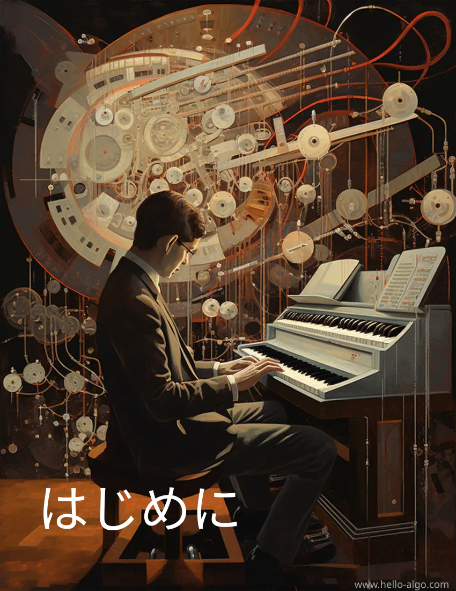

# 第 0 章 &nbsp; はじめに

{ class="cover-image" }

!!! abstract "概要"

    アルゴリズムは美しい交響曲のようです。コードの一行一行が、リズムに乗って流れていきます。
    
    この本が皆さんの心にそっと響き、ほかにはない、深く印象に残る旋律を届けられますように。

## この章の内容

- [0.1 &nbsp; 本書について](about_the_book.md)
- [0.2 &nbsp; 本書の使い方](suggestions.md)
- [0.3 &nbsp; まとめ](summary.md)
