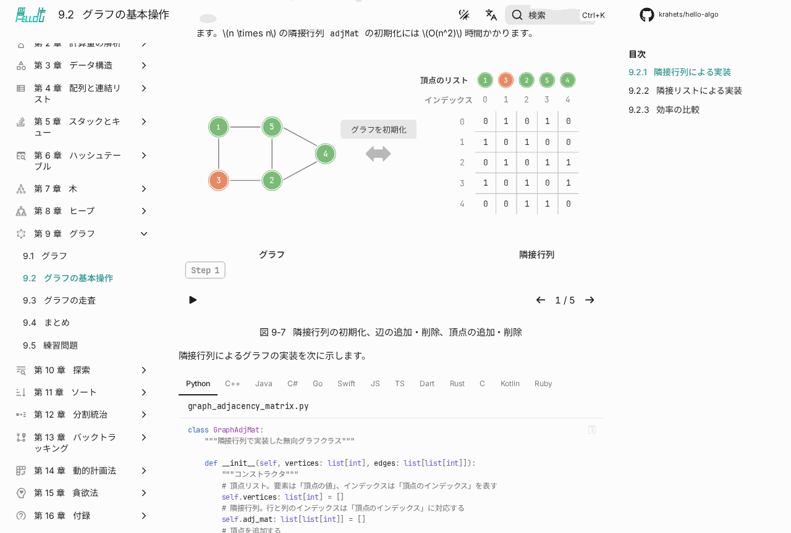
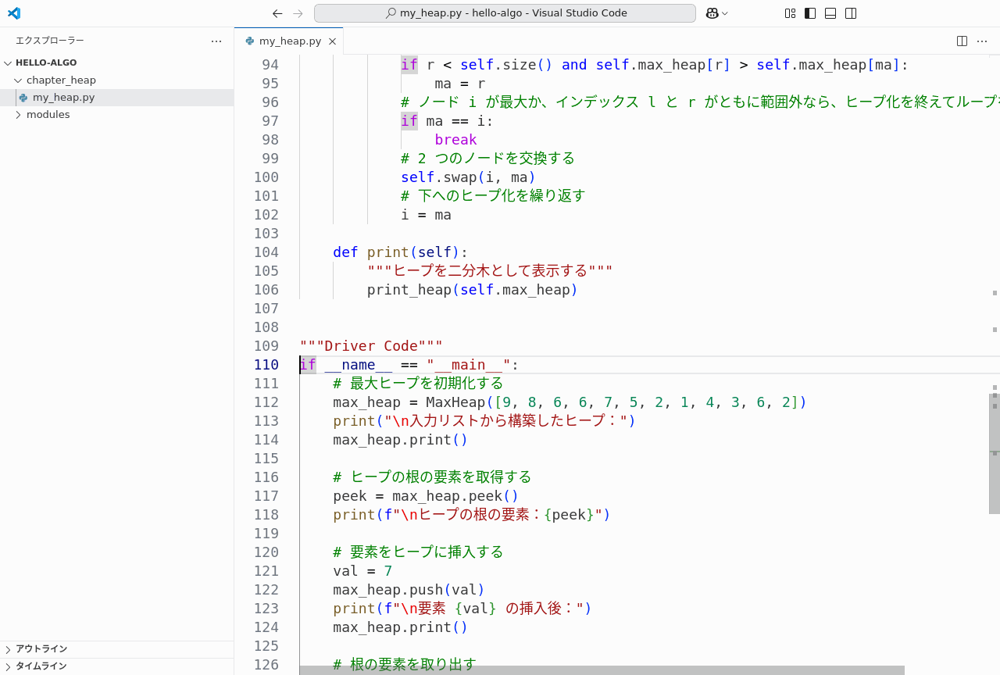
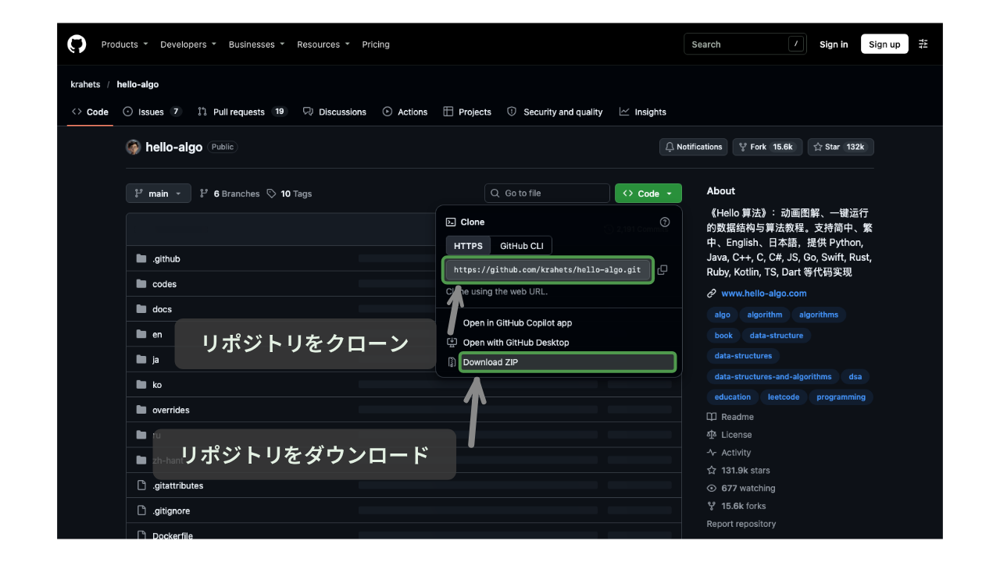
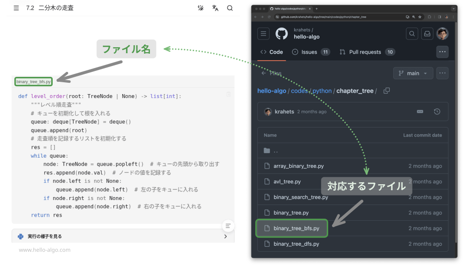
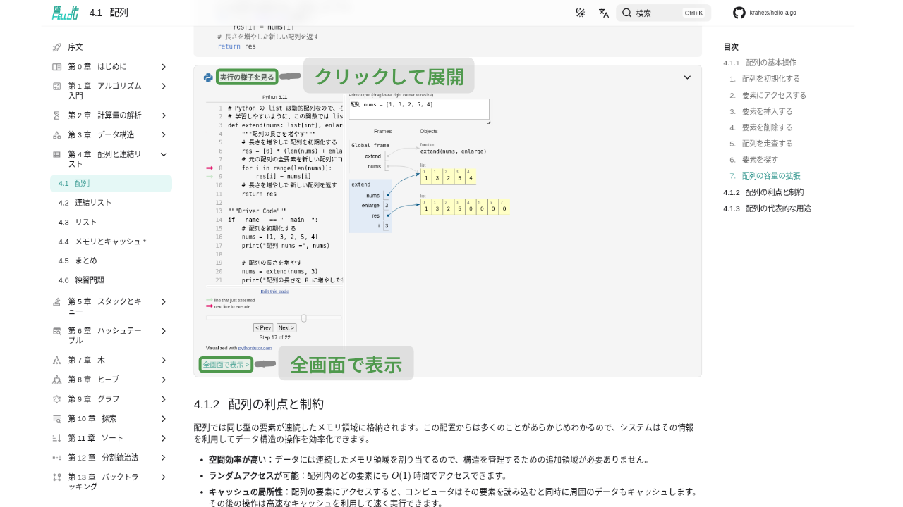
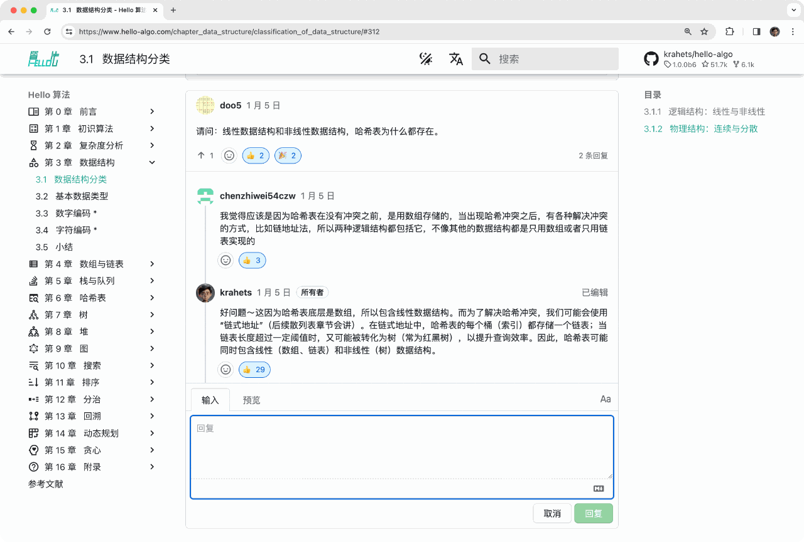
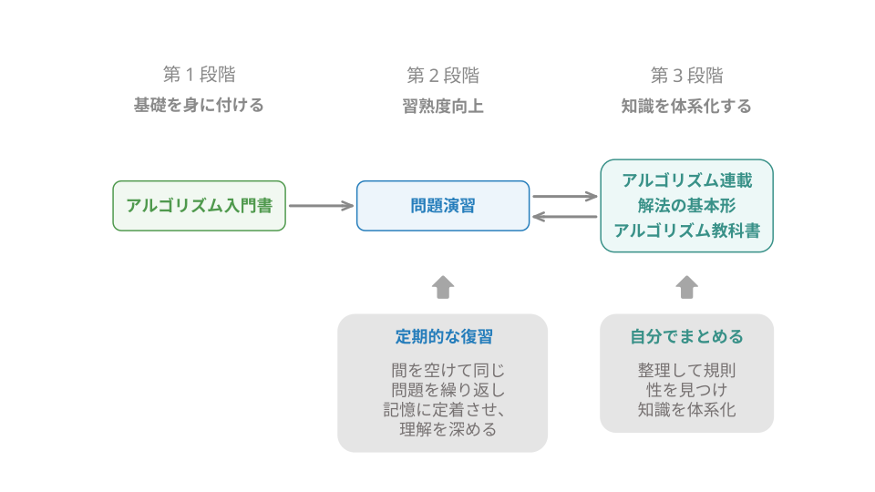

# 0.2 &nbsp; 本書の使い方

!!! tip "ヒント"

    本書をより活用するため、この節を一通り読んでおくことをお勧めします。

## 0.2.1 &nbsp; 本書の表記

- 見出しの後に `*` が付いた節は、必要に応じて読む発展的な内容で、やや難しくなっています。時間が限られている方は、いったん飛ばして構いません。
- 例えば<u>配列（array）</u>のように、専門用語は印刷版と PDF 版では太字、ウェブ版では下線で示します。文献を読むときに役立つので、覚えておきましょう。
- 重要な内容や要点をまとめた文は**太字**で示します。特に注目して読んでください。
- 特定の意味で用いる語句は、意味が曖昧にならないよう「かぎ括弧」で示します。
- プログラミング言語によって用語が異なる場合は Python に合わせます。例えば「空」を表すのに `None` を使います。
- 本書では紙面を簡潔にまとめるため、各言語のコメント規約の一部を省略しています。コメントには主に、見出しのコメント、処理内容のコメント、複数行のコメントの 3 種類があります。

=== "Python"

    ```python title=""
    """見出しのコメント。関数、クラス、テストケースなどを示す"""

    # 処理内容のコメント。コードの詳細を説明する

    """
    複数行の
    コメント
    """
    ```

=== "C++"

    ```cpp title=""
    /* 見出しのコメント。関数、クラス、テストケースなどを示す */

    // 処理内容のコメント。コードの詳細を説明する

    /**
     * 複数行の
     * コメント
     */
    ```

=== "Java"

    ```java title=""
    /* 見出しのコメント。関数、クラス、テストケースなどを示す */

    // 処理内容のコメント。コードの詳細を説明する

    /**
     * 複数行の
     * コメント
     */
    ```

=== "C#"

    ```csharp title=""
    /* 見出しのコメント。関数、クラス、テストケースなどを示す */

    // 処理内容のコメント。コードの詳細を説明する

    /**
     * 複数行の
     * コメント
     */
    ```

=== "Go"

    ```go title=""
    /* 見出しのコメント。関数、クラス、テストケースなどを示す */

    // 処理内容のコメント。コードの詳細を説明する

    /**
     * 複数行の
     * コメント
     */
    ```

=== "Swift"

    ```swift title=""
    /* 見出しのコメント。関数、クラス、テストケースなどを示す */

    // 処理内容のコメント。コードの詳細を説明する

    /**
     * 複数行の
     * コメント
     */
    ```

=== "JS"

    ```javascript title=""
    /* 見出しのコメント。関数、クラス、テストケースなどを示す */

    // 処理内容のコメント。コードの詳細を説明する

    /**
     * 複数行の
     * コメント
     */
    ```

=== "TS"

    ```typescript title=""
    /* 見出しのコメント。関数、クラス、テストケースなどを示す */

    // 処理内容のコメント。コードの詳細を説明する

    /**
     * 複数行の
     * コメント
     */
    ```

=== "Dart"

    ```dart title=""
    /* 見出しのコメント。関数、クラス、テストケースなどを示す */

    // 処理内容のコメント。コードの詳細を説明する

    /**
     * 複数行の
     * コメント
     */
    ```

=== "Rust"

    ```rust title=""
    /* 見出しのコメント。関数、クラス、テストケースなどを示す */

    // 処理内容のコメント。コードの詳細を説明する

    // 複数行の
    // コメント
    ```

=== "C"

    ```c title=""
    /* 見出しのコメント。関数、クラス、テストケースなどを示す */

    // 処理内容のコメント。コードの詳細を説明する

    /**
     * 複数行の
     * コメント
     */
    ```

=== "Kotlin"

    ```kotlin title=""
    /* 見出しのコメント。関数、クラス、テストケースなどを示す */

    // 処理内容のコメント。コードの詳細を説明する

    /**
     * 複数行の
     * コメント
     */
    ```

=== "Ruby"

    ```ruby title=""
    ### 見出しのコメント。関数、クラス、テストケースなどを示す ###

    # 処理内容のコメント。コードの詳細を説明する

    # 複数行の
    # コメント
    ```

## 0.2.2 &nbsp; アニメーション図解で効率よく学ぶ

動画や図は文章より多くの情報を整理して示せるため、内容をつかみやすくなります。本書では**大切な点や難しい点を主にアニメーションで図解し**、文章で説明を補います。

図 0-2 のようなアニメーション図解がある箇所では、**図を中心に、文章を補助として**、両方を合わせて理解してください。

{ class="animation-figure" }

<p align="center"> 図 0-2 &nbsp; アニメーション図解の例 </p>

## 0.2.3 &nbsp; コードを動かして理解を深める

本書のサンプルコードは [GitHub リポジトリ](https://github.com/krahets/hello-algo)にあります。図 0-3 のように、**ソースコードにはテスト例が付き、ワンクリックで実行できます**。

時間に余裕があれば、**コードを参考に、一度自分の手で入力してみましょう**。時間が限られていても、少なくともすべてのコードに目を通し、実行してみてください。

コードを読むだけの場合に比べ、自分で書くと、さらに多くのことが見えてきます。**手を動かしてこそ、本当に身に付きます**。

{ class="animation-figure" }

<p align="center"> 図 0-3 &nbsp; コードの実行例 </p>

コードの実行には主に 3 つの準備が必要です。

**手順 1：ローカルのプログラミング環境を用意する**。付録の[手順](../chapter_appendix/installation.md)に沿ってインストールしてください。すでに用意できている場合は、この手順を飛ばせます。

**手順 2：コードのリポジトリをクローンまたはダウンロードする**。[GitHub リポジトリ](https://github.com/krahets/hello-algo)を開いてください。[Git](https://git-scm.com/downloads) がインストール済みなら、次のコマンドでクローンできます。

```shell
git clone https://github.com/krahets/hello-algo.git
```

図 0-4 に示した位置の「Download ZIP」をクリックしてコードを圧縮ファイルでダウンロードし、手元で展開することもできます。

{ class="animation-figure" }

<p align="center"> 図 0-4 &nbsp; リポジトリのクローンとコードのダウンロード </p>

**手順 3：ソースコードを実行する**。図 0-5 のように、上部にファイル名が付いたコードブロックに対応するソースファイルは、リポジトリの `codes` フォルダにあります。ワンクリックで実行できるので、不要なデバッグに時間を使わず、学習内容に集中できます。

{ class="animation-figure" }

<p align="center"> 図 0-5 &nbsp; コードブロックと対応するソースファイル </p>

手元での実行に加え、**ウェブ版では Python コードの実行を可視化できます**（[pythontutor](https://pythontutor.com/) を使用）。図 0-6 のように、コードブロックの下の「実行の様子を見る」をクリックすると表示が開き、アルゴリズムの実行過程を観察できます。「全画面で表示 >」をクリックすると、さらに見やすくなります。

{ class="animation-figure" }

<p align="center"> 図 0-6 &nbsp; Python コードの実行の可視化 </p>

## 0.2.4 &nbsp; 質問と議論を通じて一緒に学ぶ

本書を読むときは、わからなかった箇所を簡単に飛ばしてしまわないでください。**コメント欄での質問を歓迎します**。私や仲間が力を合わせてお答えします。通常は 2 日以内に返信できます。

図 0-7 のように、ウェブ版の各節の末尾にはコメント欄があります。ぜひほかの読者のコメントにも目を通してください。皆さんがどこでつまずいたかを知ると、自分の理解の抜けを見つけ、考えを深められます。また、ほかの人の質問にもぜひ答えてみてください。自分の考えを共有することが、誰かの学びを支えます。

{ class="animation-figure" }

<p align="center"> 図 0-7 &nbsp; コメント欄の例 </p>

## 0.2.5 &nbsp; アルゴリズム学習の進め方

データ構造とアルゴリズムの学習は、大きく 3 つの段階に分けられます。

1. **第 1 段階：アルゴリズムの基礎を学ぶ**。さまざまなデータ構造の特徴と使い方に慣れ、各アルゴリズムの原理、手順、用途、効率を学びます。
2. **第 2 段階：アルゴリズムの問題を解く**。人気の問題から始め、まずは少なくとも 100 問に取り組み、代表的な問題形式に慣れましょう。初めのうちは、学んだことを忘れて困るかもしれませんが、それは自然なことです。「エビングハウスの忘却曲線」を参考に復習し、通常は 3～5 回繰り返すとしっかり記憶に残ります。お勧めの問題リストと演習計画は、こちらの [GitHub リポジトリ](https://github.com/krahets/LeetCode-Book)にあります。
3. **第 3 段階：知識を体系化する**。アルゴリズムの連載記事や解法の基本形、教科書を読んで知識を広げられます。演習では、テーマ別に解く、1 問を複数の方法で解く、一つの解法を複数の問題に適用するなど、発展的な練習も試してみましょう。さまざまなコミュニティで、こうした練習の体験談を見つけられます。

図 0-8 のように、本書で主に扱うのは「第 1 段階」です。第 2、第 3 段階へ効率よく進めるよう、その土台を築くことを目指します。

{ class="animation-figure" }

<p align="center"> 図 0-8 &nbsp; アルゴリズム学習の進め方 </p>
