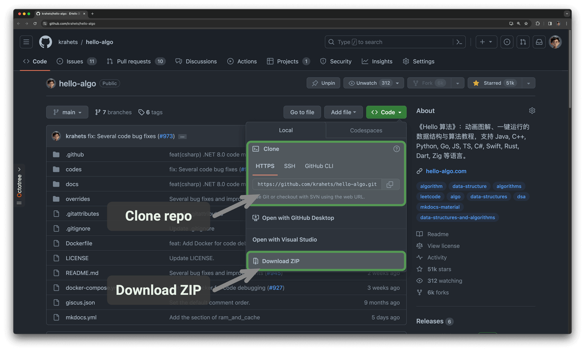
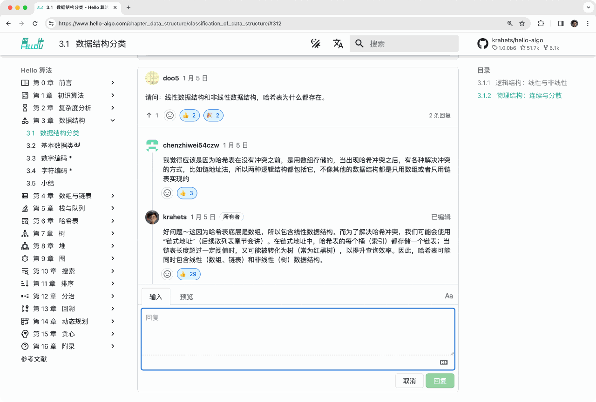

# 本書の使い方

!!! tip

    快適に読み進めるために、この節を最後まで読むことを勧めます。

## 表記の約束

- 見出しの末尾に `*` が付いた節は、やや難しい発展的な内容です。時間が限られていれば、後回しにしてかまいません。
- 原書では、専門用語には太字（紙の本と PDF 版）または下線（Web 版）を使います。例えば、<u>配列（array）</u>のように表します。文献を読むためにも、用語を覚えることを勧めます。
- 重要な内容や要点をまとめた文は **太字** にしています。特に注意して読んでください。
- 特定の意味を持たせた語句は、曖昧さを避けるために「かぎ括弧」で示します。
- 言語によって呼び方が異なる場合、本書では Python に合わせます。例えば、「空」を表すには `None` を使います。
- 本書では、コンパクトなレイアウトを優先し、言語のコメント規約に一部従っていません。コメントは主に、見出しコメント、内容コメント、複数行コメントの三種類に分かれます。

=== "Python"

    ```python title=""
    """見出しコメント：関数、クラス、テストケースなどを示す"""
    
    # 内容コメント：コードを詳しく説明する
    
    """
    複数行の
    コメント
    """
    ```

=== "C++"

    ```cpp title=""
    /* 見出しコメント：関数、クラス、テストケースなどを示す */
    
    // 内容コメント：コードを詳しく説明する
    
    /**
     * 複数行の
     * コメント
     */
    ```

=== "Java"

    ```java title=""
    /* 見出しコメント：関数、クラス、テストケースなどを示す */
    
    // 内容コメント：コードを詳しく説明する
    
    /**
     * 複数行の
     * コメント
     */
    ```

=== "C#"

    ```csharp title=""
    /* 見出しコメント：関数、クラス、テストケースなどを示す */
    
    // 内容コメント：コードを詳しく説明する
    
    /**
     * 複数行の
     * コメント
     */
    ```

=== "Go"

    ```go title=""
    /* 見出しコメント：関数、クラス、テストケースなどを示す */
    
    // 内容コメント：コードを詳しく説明する
    
    /**
     * 複数行の
     * コメント
     */
    ```

=== "Swift"

    ```swift title=""
    /* 見出しコメント：関数、クラス、テストケースなどを示す */
    
    // 内容コメント：コードを詳しく説明する
    
    /**
     * 複数行の
     * コメント
     */
    ```

=== "JS"

    ```javascript title=""
    /* 見出しコメント：関数、クラス、テストケースなどを示す */
    
    // 内容コメント：コードを詳しく説明する
    
    /**
     * 複数行の
     * コメント
     */
    ```

=== "TS"

    ```typescript title=""
    /* 見出しコメント：関数、クラス、テストケースなどを示す */
    
    // 内容コメント：コードを詳しく説明する
    
    /**
     * 複数行の
     * コメント
     */
    ```

=== "Dart"

    ```dart title=""
    /* 見出しコメント：関数、クラス、テストケースなどを示す */
    
    // 内容コメント：コードを詳しく説明する
    
    /**
     * 複数行の
     * コメント
     */
    ```

=== "Rust"

    ```rust title=""
    /* 見出しコメント：関数、クラス、テストケースなどを示す */

    // 内容コメント：コードを詳しく説明する
    
    // 複数行の
    // コメント
    ```

=== "C"

    ```c title=""
    /* 見出しコメント：関数、クラス、テストケースなどを示す */
    
    // 内容コメント：コードを詳しく説明する
    
    /**
     * 複数行の
     * コメント
     */
    ```

=== "Kotlin"

    ```kotlin title=""
    /* 見出しコメント：関数、クラス、テストケースなどを示す */
    
    // 内容コメント：コードを詳しく説明する
    
    /**
     * 複数行の
     * コメント
     */
    ```

=== "Ruby"

    ```ruby title=""
    ### 見出しコメント：関数、クラス、テストケースなどを示す ###

    # 内容コメント：コードを詳しく説明する
    
    # 複数行の
    # コメント
    ```

## アニメーション図解で効率よく学ぶ

動画や図は文章に比べて情報密度が高く、構造が分かりやすいため、理解しやすいものです。本書では、**重要な内容や難しい内容を、主にアニメーションによる図解で示し**、文章で説明や補足を加えています。

下図のようなアニメーション図解がある場合は、**図を中心に、文章を補助として**、両方を合わせて理解してください。


## コードの実践で理解を深める

本書のコードは [GitHub リポジトリ](https://github.com/krahets/hello-algo)で公開しています。下図のように、**ソースコードにはテストケースが付いており、ワンクリックで実行できます**。

時間があれば、**コードを参考に、自分の手で一度書いてみることを勧めます**。時間が限られていても、少なくともすべてのコードを通読し、実行してください。

コードを読むだけよりも、自分で書く過程から多くのことを学べます。**手を動かして学んでこそ、本当の学びになります**。


コードを実行する準備は、主に三つの手順に分かれます。

**手順一：ローカルのプログラミング環境をインストールします**。付録の[手順](../chapter_appendix/installation.md)を参照してください。すでにインストール済みなら、この手順は省略できます。

**手順二：コードのリポジトリをクローンまたはダウンロードします**。[GitHub リポジトリ](https://github.com/krahets/hello-algo)を開きます。[Git](https://git-scm.com/downloads) がインストール済みなら、次のコマンドでクローンできます。

```shell
git clone https://github.com/krahets/hello-algo.git
```

もちろん、下図の位置にある「Download ZIP」をクリックして圧縮ファイルを直接ダウンロードし、ローカルで展開してもかまいません。



**手順三：ソースコードを実行します**。下図のように、上部にファイル名があるコードブロックは、リポジトリの `ja/codes` フォルダ内に対応するソースファイルがあります。ワンクリックで実行できるので、不要なデバッグに時間を取られず、学習内容に集中できます。


ローカルでの実行に加え、**Web 版では Python コードの可視化実行にも対応しています**（[pythontutor](https://pythontutor.com/) を使用）。下図のように、コードブロックの下の「実行の可視化」をクリックすると表示が開き、アルゴリズムの実行過程を観察できます。「全画面で表示」をクリックすれば、さらに見やすくなります。


## 質問や議論を通して共に成長する

読む際には、十分に理解できなかった内容を安易に飛ばさないでください。**コメント欄での質問を歓迎します**。私たちができる限りお答えします。通常は二日以内に返信できます。

下図のように、Web 版の各節の末尾にはコメント欄があります。ぜひその内容にも目を向けてください。他の読者の疑問を知ることで、理解の抜けを補い、さらに深く考えられます。また、他の読者の質問に答え、考えを共有して、学びを支えていただければうれしく思います。



## アルゴリズムの学習の道筋

データ構造とアルゴリズムの学習は、大きく三つの段階に分けられます。

1. **段階一：アルゴリズムの入門**。さまざまなデータ構造の特徴と使い方を知り、各アルゴリズムの原理、手順、用途、効率などを学びます。
2. **段階二：アルゴリズムの問題演習**。定番の問題から始め、まずは少なくとも 100 問を解いて、主要な問題形式になじむことを勧めます。最初は知識を忘れることに悩むかもしれませんが、ごく自然なことなので心配はいりません。「エビングハウスの忘却曲線」に沿って復習し、通常 3～5 回繰り返すと、しっかり記憶できます。おすすめの問題集と演習計画は、この [GitHub リポジトリ](https://github.com/krahets/LeetCode-Book)を参照してください。
3. **段階三：知識体系の構築**。学習では、アルゴリズムの解説記事、解法の枠組み、教科書を読んで知識体系を充実させます。演習では、テーマ別に取り組む、一問を複数の方法で解く、一つの方法を複数の問題に応用するなど、発展的な戦略を試せます。関連する経験談は、さまざまなコミュニティで見つかります。

下図のように、本書は主に「段階一」を扱い、段階二と段階三の学習をより効率よく進めるための支援を目指しています。


