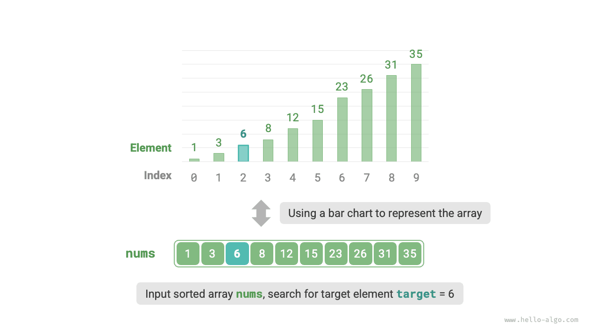
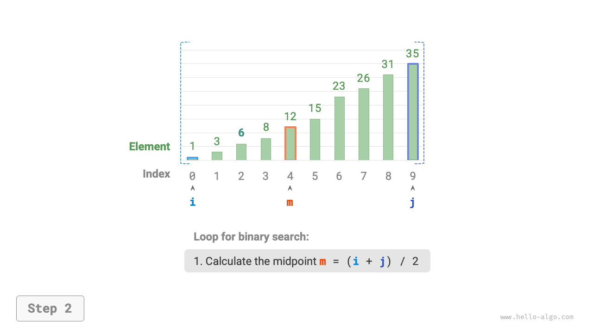
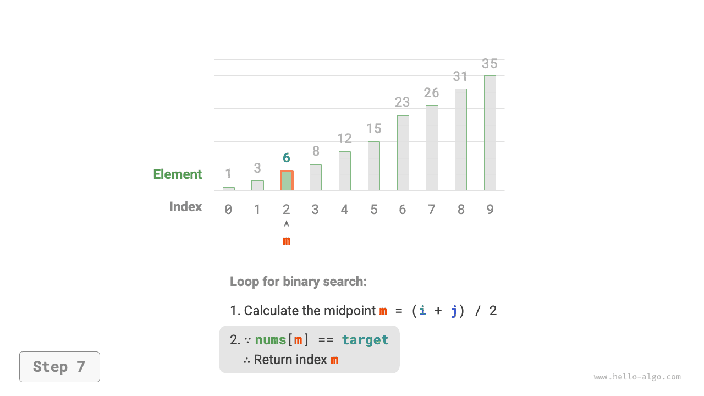

# 10.1 &nbsp; 二分探索

<u>二分探索（binary search）</u>は、分割統治法に基づく効率的な探索アルゴリズムです。データが整列されていることを利用し、各反復で探索範囲を半分に縮め、目的の要素が見つかるか探索区間が空になるまで続けます。

!!! question "問題"

    長さ $n$ の配列 `nums` が与えられます。要素は昇順に並び、重複しません。要素 `target` を探し、そのインデックスを返してください。配列にその要素が含まれない場合は $-1$ を返します。例を図 10-1 に示します。

{ class="animation-figure" }

<p align="center"> 図 10-1 &nbsp; 二分探索の入力例 </p>

図 10-2 のように、まずポインタ $i = 0$ と $j = n - 1$ を初期化し、配列の先頭要素と末尾要素をそれぞれ指すようにします。これらは探索区間 $[0, n - 1]$ を表します。角括弧は閉区間を表し、境界値そのものを含むことに注意してください。

続いて、次の二つの手順を繰り返します。

1. 中点のインデックス $m = \lfloor {(i + j) / 2} \rfloor$ を計算します。ここで $\lfloor \: \rfloor$ は切り捨てを表します。
2. `nums[m]` と `target` の大小関係を判定します。次の三つの場合があります。
    1. `nums[m] < target` なら、`target` は区間 $[m + 1, j]$ にあるため、$i = m + 1$ とします。
    2. `nums[m] > target` なら、`target` は区間 $[i, m - 1]$ にあるため、$j = m - 1$ とします。
    3. `nums[m] = target` なら、`target` が見つかったので、インデックス $m$ を返します。

配列に目的の要素が含まれない場合、探索区間は最終的に空になります。このときは $-1$ を返します。

=== "<1>"
    { class="animation-figure" }

=== "<2>"
    { class="animation-figure" }

=== "<3>"
    { class="animation-figure" }

=== "<4>"
    { class="animation-figure" }

=== "<5>"
    { class="animation-figure" }

=== "<6>"
    { class="animation-figure" }

=== "<7>"
    { class="animation-figure" }

<p align="center"> 図 10-2 &nbsp; 二分探索の流れ </p>

$i$ と $j$ はともに `int` 型なので、**$i + j$ が `int` 型の値の範囲を超える可能性がある**ことに注意してください。大きな値によるオーバーフローを避けるため、通常は $m = \lfloor {i + (j - i) / 2} \rfloor$ という式で中点を計算します。

コードは次のとおりです。

=== "Python"

    ```python title="binary_search.py"
    def binary_search(nums: list[int], target: int) -> int:
        """二分探索（閉区間）"""
        # 閉区間 [0, n-1] を初期化する。i, j は配列の先頭要素と末尾要素をそれぞれ指す
        i, j = 0, len(nums) - 1
        # 探索区間が空になるまで繰り返す（i > j のとき空になる）
        while i <= j:
            # 理論上、Python の数値は無限に大きくできる（メモリ容量による）ため、大きな数のオーバーフローを考慮する必要がない
            m = (i + j) // 2  # 中央のインデックス m を計算する
            if nums[m] < target:
                i = m + 1  # この場合、target は区間 [m+1, j] に存在する
            elif nums[m] > target:
                j = m - 1  # この場合、target は区間 [i, m-1] に存在する
            else:
                return m  # 目的の要素が見つかったので、そのインデックスを返す
        return -1  # 目的の要素が見つからなかったので、-1 を返す
    ```

=== "C++"

    ```cpp title="binary_search.cpp"
    /* 二分探索（閉区間） */
    int binarySearch(vector<int> &nums, int target) {
        // 閉区間 [0, n-1] を初期化する。i, j は配列の先頭要素と末尾要素をそれぞれ指す
        int i = 0, j = nums.size() - 1;
        // 探索区間が空になるまで繰り返す（i > j のとき空になる）
        while (i <= j) {
            int m = i + (j - i) / 2; // 中央のインデックス m を計算する
            if (nums[m] < target)    // この場合、target は区間 [m+1, j] に存在する
                i = m + 1;
            else if (nums[m] > target) // この場合、target は区間 [i, m-1] に存在する
                j = m - 1;
            else // 目的の要素が見つかったので、そのインデックスを返す
                return m;
        }
        // 目的の要素が見つからなかったので、-1 を返す
        return -1;
    }
    ```

=== "Java"

    ```java title="binary_search.java"
    /* 二分探索（閉区間） */
    int binarySearch(int[] nums, int target) {
        // 閉区間 [0, n-1] を初期化する。i, j は配列の先頭要素と末尾要素をそれぞれ指す
        int i = 0, j = nums.length - 1;
        // 探索区間が空になるまで繰り返す（i > j のとき空になる）
        while (i <= j) {
            int m = i + (j - i) / 2; // 中央のインデックス m を計算する
            if (nums[m] < target) // この場合、target は区間 [m+1, j] に存在する
                i = m + 1;
            else if (nums[m] > target) // この場合、target は区間 [i, m-1] に存在する
                j = m - 1;
            else // 目的の要素が見つかったので、そのインデックスを返す
                return m;
        }
        // 目的の要素が見つからなかったので、-1 を返す
        return -1;
    }
    ```

=== "C#"

    ```csharp title="binary_search.cs"
    /* 二分探索（閉区間） */
    int BinarySearch(int[] nums, int target) {
        // 閉区間 [0, n-1] を初期化する。i, j は配列の先頭要素と末尾要素をそれぞれ指す
        int i = 0, j = nums.Length - 1;
        // 探索区間が空になるまで繰り返す（i > j のとき空になる）
        while (i <= j) {
            int m = i + (j - i) / 2;   // 中央のインデックス m を計算する
            if (nums[m] < target)      // この場合、target は区間 [m+1, j] に存在する
                i = m + 1;
            else if (nums[m] > target) // この場合、target は区間 [i, m-1] に存在する
                j = m - 1;
            else                       // 目的の要素が見つかったので、そのインデックスを返す
                return m;
        }
        // 目的の要素が見つからなかったので、-1 を返す
        return -1;
    }
    ```

=== "Go"

    ```go title="binary_search.go"
    /* 二分探索（閉区間） */
    func binarySearch(nums []int, target int) int {
        // 閉区間 [0, n-1] を初期化する。i, j は配列の先頭要素と末尾要素をそれぞれ指す
        i, j := 0, len(nums)-1
        // 探索区間が空になるまで繰り返す（i > j のとき空になる）
        for i <= j {
            m := i + (j-i)/2      // 中央のインデックス m を計算する
            if nums[m] < target { // この場合、target は区間 [m+1, j] に存在する
                i = m + 1
            } else if nums[m] > target { // この場合、target は区間 [i, m-1] に存在する
                j = m - 1
            } else { // 目的の要素が見つかったので、そのインデックスを返す
                return m
            }
        }
        // 目的の要素が見つからなかったので、-1 を返す
        return -1
    }
    ```

=== "Swift"

    ```swift title="binary_search.swift"
    /* 二分探索（閉区間） */
    func binarySearch(nums: [Int], target: Int) -> Int {
        // 閉区間 [0, n-1] を初期化する。i, j は配列の先頭要素と末尾要素をそれぞれ指す
        var i = nums.startIndex
        var j = nums.endIndex - 1
        // 探索区間が空になるまで繰り返す（i > j のとき空になる）
        while i <= j {
            let m = i + (j - i) / 2 // 中央のインデックス m を計算する
            if nums[m] < target { // この場合、target は区間 [m+1, j] に存在する
                i = m + 1
            } else if nums[m] > target { // この場合、target は区間 [i, m-1] に存在する
                j = m - 1
            } else { // 目的の要素が見つかったので、そのインデックスを返す
                return m
            }
        }
        // 目的の要素が見つからなかったので、-1 を返す
        return -1
    }
    ```

=== "JS"

    ```javascript title="binary_search.js"
    /* 二分探索（閉区間） */
    function binarySearch(nums, target) {
        // 閉区間 [0, n-1] を初期化する。i, j は配列の先頭要素と末尾要素をそれぞれ指す
        let i = 0,
            j = nums.length - 1;
        // 探索区間が空になるまで繰り返す（i > j のとき空になる）
        while (i <= j) {
            // 中央のインデックス m を計算し、parseInt() で小数点以下を切り捨てる
            const m = parseInt(i + (j - i) / 2);
            if (nums[m] < target)
                // この場合、target は区間 [m+1, j] に存在する
                i = m + 1;
            else if (nums[m] > target)
                // この場合、target は区間 [i, m-1] に存在する
                j = m - 1;
            else return m; // 目的の要素が見つかったので、そのインデックスを返す
        }
        // 目的の要素が見つからなかったので、-1 を返す
        return -1;
    }
    ```

=== "TS"

    ```typescript title="binary_search.ts"
    /* 二分探索（閉区間） */
    function binarySearch(nums: number[], target: number): number {
        // 閉区間 [0, n-1] を初期化する。i, j は配列の先頭要素と末尾要素をそれぞれ指す
        let i = 0,
            j = nums.length - 1;
        // 探索区間が空になるまで繰り返す（i > j のとき空になる）
        while (i <= j) {
            // 中央のインデックス m を計算する
            const m = Math.floor(i + (j - i) / 2);
            if (nums[m] < target) {
                // この場合、target は区間 [m+1, j] に存在する
                i = m + 1;
            } else if (nums[m] > target) {
                // この場合、target は区間 [i, m-1] に存在する
                j = m - 1;
            } else {
                // 目的の要素が見つかったので、そのインデックスを返す
                return m;
            }
        }
        return -1; // 目的の要素が見つからなかったので、-1 を返す
    }
    ```

=== "Dart"

    ```dart title="binary_search.dart"
    /* 二分探索（閉区間） */
    int binarySearch(List<int> nums, int target) {
      // 閉区間 [0, n-1] を初期化する。i, j は配列の先頭要素と末尾要素をそれぞれ指す
      int i = 0, j = nums.length - 1;
      // 探索区間が空になるまで繰り返す（i > j のとき空になる）
      while (i <= j) {
        int m = i + (j - i) ~/ 2; // 中央のインデックス m を計算する
        if (nums[m] < target) {
          // この場合、target は区間 [m+1, j] に存在する
          i = m + 1;
        } else if (nums[m] > target) {
          // この場合、target は区間 [i, m-1] に存在する
          j = m - 1;
        } else {
          // 目的の要素が見つかったので、そのインデックスを返す
          return m;
        }
      }
      // 目的の要素が見つからなかったので、-1 を返す
      return -1;
    }
    ```

=== "Rust"

    ```rust title="binary_search.rs"
    /* 二分探索（閉区間） */
    fn binary_search(nums: &[i32], target: i32) -> i32 {
        // 閉区間 [0, n-1] を初期化する。i, j は配列の先頭要素と末尾要素をそれぞれ指す
        let mut i = 0;
        let mut j = nums.len() as i32 - 1;
        // 探索区間が空になるまで繰り返す（i > j のとき空になる）
        while i <= j {
            let m = i + (j - i) / 2; // 中央のインデックス m を計算する
            if nums[m as usize] < target {
                // この場合、target は区間 [m+1, j] に存在する
                i = m + 1;
            } else if nums[m as usize] > target {
                // この場合、target は区間 [i, m-1] に存在する
                j = m - 1;
            } else {
                // 目的の要素が見つかったので、そのインデックスを返す
                return m;
            }
        }
        // 目的の要素が見つからなかったので、-1 を返す
        return -1;
    }
    ```

=== "C"

    ```c title="binary_search.c"
    /* 二分探索（閉区間） */
    int binarySearch(int *nums, int len, int target) {
        // 閉区間 [0, n-1] を初期化する。i, j は配列の先頭要素と末尾要素をそれぞれ指す
        int i = 0, j = len - 1;
        // 探索区間が空になるまで繰り返す（i > j のとき空になる）
        while (i <= j) {
            int m = i + (j - i) / 2; // 中央のインデックス m を計算する
            if (nums[m] < target)    // この場合、target は区間 [m+1, j] に存在する
                i = m + 1;
            else if (nums[m] > target) // この場合、target は区間 [i, m-1] に存在する
                j = m - 1;
            else // 目的の要素が見つかったので、そのインデックスを返す
                return m;
        }
        // 目的の要素が見つからなかったので、-1 を返す
        return -1;
    }
    ```

=== "Kotlin"

    ```kotlin title="binary_search.kt"
    /* 二分探索（閉区間） */
    fun binarySearch(nums: IntArray, target: Int): Int {
        // 閉区間 [0, n-1] を初期化する。i, j は配列の先頭要素と末尾要素をそれぞれ指す
        var i = 0
        var j = nums.size - 1
        // 探索区間が空になるまで繰り返す（i > j のとき空になる）
        while (i <= j) {
            val m = i + (j - i) / 2 // 中央のインデックス m を計算する
            if (nums[m] < target) // この場合、target は区間 [m+1, j] に存在する
                i = m + 1
            else if (nums[m] > target) // この場合、target は区間 [i, m-1] に存在する
                j = m - 1
            else  // 目的の要素が見つかったので、そのインデックスを返す
                return m
        }
        // 目的の要素が見つからなかったので、-1 を返す
        return -1
    }
    ```

=== "Ruby"

    ```ruby title="binary_search.rb"
    ### 二分探索（閉区間） ###
    def binary_search(nums, target)
      # 閉区間 [0, n-1] を初期化する。i, j は配列の先頭要素と末尾要素をそれぞれ指す
      i, j = 0, nums.length - 1

      # 探索区間が空になるまで繰り返す（i > j のとき空になる）
      while i <= j
        # 理論上、Ruby の数値は無限に大きくできる（メモリ容量による）ため、大きな数のオーバーフローを考慮する必要がない
        m = (i + j) / 2   # 中央のインデックス m を計算する
      
        if nums[m] < target
          i = m + 1 # この場合、target は区間 [m+1, j] に存在する
        elsif nums[m] > target
          j = m - 1 # この場合、target は区間 [i, m-1] に存在する
        else
          return m  # 目的の要素が見つかったので、そのインデックスを返す
        end
      end

      -1  # 目的の要素が見つからなかったので、-1 を返す
    end
    ```

??? pythontutor "実行の可視化"

    <div style="height: 549px; width: 100%;"><iframe class="pythontutor-iframe" title="実行の可視化" src="https://pythontutor.com/iframe-embed.html#code=def%20binary_search%28nums%3A%20list%5Bint%5D,%20target%3A%20int%29%20-%3E%20int%3A%0A%20%20%20%20%22%22%22%E4%BA%8C%E5%88%86%E6%8E%A2%E7%B4%A2%EF%BC%88%E9%96%89%E5%8C%BA%E9%96%93%EF%BC%89%22%22%22%0A%20%20%20%20%23%20%E9%96%89%E5%8C%BA%E9%96%93%20%5B0,%20n-1%5D%20%E3%82%92%E5%88%9D%E6%9C%9F%E5%8C%96%E3%81%99%E3%82%8B%E3%80%82i,%20j%20%E3%81%AF%E9%85%8D%E5%88%97%E3%81%AE%E5%85%88%E9%A0%AD%E8%A6%81%E7%B4%A0%E3%81%A8%E6%9C%AB%E5%B0%BE%E8%A6%81%E7%B4%A0%E3%82%92%E3%81%9D%E3%82%8C%E3%81%9E%E3%82%8C%E6%8C%87%E3%81%99%0A%20%20%20%20i,%20j%20%3D%200,%20len%28nums%29%20-%201%0A%20%20%20%20%23%20%E6%8E%A2%E7%B4%A2%E5%8C%BA%E9%96%93%E3%81%8C%E7%A9%BA%E3%81%AB%E3%81%AA%E3%82%8B%E3%81%BE%E3%81%A7%E7%B9%B0%E3%82%8A%E8%BF%94%E3%81%99%EF%BC%88i%20%3E%20j%20%E3%81%AE%E3%81%A8%E3%81%8D%E7%A9%BA%E3%81%AB%E3%81%AA%E3%82%8B%EF%BC%89%0A%20%20%20%20while%20i%20%3C%3D%20j%3A%0A%20%20%20%20%20%20%20%20%23%20%E7%90%86%E8%AB%96%E4%B8%8A%E3%80%81Python%20%E3%81%AE%E6%95%B0%E5%80%A4%E3%81%AF%E7%84%A1%E9%99%90%E3%81%AB%E5%A4%A7%E3%81%8D%E3%81%8F%E3%81%A7%E3%81%8D%E3%82%8B%EF%BC%88%E3%83%A1%E3%83%A2%E3%83%AA%E5%AE%B9%E9%87%8F%E3%81%AB%E3%82%88%E3%82%8B%EF%BC%89%E3%81%9F%E3%82%81%E3%80%81%E5%A4%A7%E3%81%8D%E3%81%AA%E6%95%B0%E3%81%AE%E3%82%AA%E3%83%BC%E3%83%90%E3%83%BC%E3%83%95%E3%83%AD%E3%83%BC%E3%82%92%E8%80%83%E6%85%AE%E3%81%99%E3%82%8B%E5%BF%85%E8%A6%81%E3%81%8C%E3%81%AA%E3%81%84%0A%20%20%20%20%20%20%20%20m%20%3D%20%28i%20%2B%20j%29%20//%202%20%20%23%20%E4%B8%AD%E5%A4%AE%E3%81%AE%E3%82%A4%E3%83%B3%E3%83%87%E3%83%83%E3%82%AF%E3%82%B9%20m%20%E3%82%92%E8%A8%88%E7%AE%97%E3%81%99%E3%82%8B%0A%20%20%20%20%20%20%20%20if%20nums%5Bm%5D%20%3C%20target%3A%0A%20%20%20%20%20%20%20%20%20%20%20%20i%20%3D%20m%20%2B%201%20%20%23%20%E3%81%93%E3%81%AE%E5%A0%B4%E5%90%88%E3%80%81target%20%E3%81%AF%E5%8C%BA%E9%96%93%20%5Bm%2B1,%20j%5D%20%E3%81%AB%E5%AD%98%E5%9C%A8%E3%81%99%E3%82%8B%0A%20%20%20%20%20%20%20%20elif%20nums%5Bm%5D%20%3E%20target%3A%0A%20%20%20%20%20%20%20%20%20%20%20%20j%20%3D%20m%20-%201%20%20%23%20%E3%81%93%E3%81%AE%E5%A0%B4%E5%90%88%E3%80%81target%20%E3%81%AF%E5%8C%BA%E9%96%93%20%5Bi,%20m-1%5D%20%E3%81%AB%E5%AD%98%E5%9C%A8%E3%81%99%E3%82%8B%0A%20%20%20%20%20%20%20%20else%3A%0A%20%20%20%20%20%20%20%20%20%20%20%20return%20m%20%20%23%20%E7%9B%AE%E7%9A%84%E3%81%AE%E8%A6%81%E7%B4%A0%E3%81%8C%E8%A6%8B%E3%81%A4%E3%81%8B%E3%81%A3%E3%81%9F%E3%81%AE%E3%81%A7%E3%80%81%E3%81%9D%E3%81%AE%E3%82%A4%E3%83%B3%E3%83%87%E3%83%83%E3%82%AF%E3%82%B9%E3%82%92%E8%BF%94%E3%81%99%0A%20%20%20%20return%20-1%20%20%23%20%E7%9B%AE%E7%9A%84%E3%81%AE%E8%A6%81%E7%B4%A0%E3%81%8C%E8%A6%8B%E3%81%A4%E3%81%8B%E3%82%89%E3%81%AA%E3%81%8B%E3%81%A3%E3%81%9F%E3%81%AE%E3%81%A7%E3%80%81-1%20%E3%82%92%E8%BF%94%E3%81%99%0A%0A%0A%22%22%22%E5%AE%9F%E8%A1%8C%E7%94%A8%E3%82%B3%E3%83%BC%E3%83%89%22%22%22%0Aif%20__name__%20%3D%3D%20%22__main__%22%3A%0A%20%20%20%20target%20%3D%206%0A%20%20%20%20nums%20%3D%20%5B1,%203,%206,%208,%2012,%2015,%2023,%2026,%2031,%2035%5D%0A%0A%20%20%20%20%23%20%E4%BA%8C%E5%88%86%E6%8E%A2%E7%B4%A2%EF%BC%88%E9%96%89%E5%8C%BA%E9%96%93%EF%BC%89%0A%20%20%20%20index%20%3D%20binary_search%28nums,%20target%29%0A%20%20%20%20print%28%22%E7%9B%AE%E7%9A%84%E3%81%AE%E8%A6%81%E7%B4%A0%206%20%E3%81%AE%E3%82%A4%E3%83%B3%E3%83%87%E3%83%83%E3%82%AF%E3%82%B9%20%3D%20%22,%20index%29&codeDivHeight=472&codeDivWidth=350&cumulative=false&curInstr=5&heapPrimitives=nevernest&origin=opt-frontend.js&py=311&rawInputLstJSON=%5B%5D&textReferences=false"> </iframe></div>
    <div style="margin-top: 5px;"><a href="https://pythontutor.com/iframe-embed.html#code=def%20binary_search%28nums%3A%20list%5Bint%5D,%20target%3A%20int%29%20-%3E%20int%3A%0A%20%20%20%20%22%22%22%E4%BA%8C%E5%88%86%E6%8E%A2%E7%B4%A2%EF%BC%88%E9%96%89%E5%8C%BA%E9%96%93%EF%BC%89%22%22%22%0A%20%20%20%20%23%20%E9%96%89%E5%8C%BA%E9%96%93%20%5B0,%20n-1%5D%20%E3%82%92%E5%88%9D%E6%9C%9F%E5%8C%96%E3%81%99%E3%82%8B%E3%80%82i,%20j%20%E3%81%AF%E9%85%8D%E5%88%97%E3%81%AE%E5%85%88%E9%A0%AD%E8%A6%81%E7%B4%A0%E3%81%A8%E6%9C%AB%E5%B0%BE%E8%A6%81%E7%B4%A0%E3%82%92%E3%81%9D%E3%82%8C%E3%81%9E%E3%82%8C%E6%8C%87%E3%81%99%0A%20%20%20%20i,%20j%20%3D%200,%20len%28nums%29%20-%201%0A%20%20%20%20%23%20%E6%8E%A2%E7%B4%A2%E5%8C%BA%E9%96%93%E3%81%8C%E7%A9%BA%E3%81%AB%E3%81%AA%E3%82%8B%E3%81%BE%E3%81%A7%E7%B9%B0%E3%82%8A%E8%BF%94%E3%81%99%EF%BC%88i%20%3E%20j%20%E3%81%AE%E3%81%A8%E3%81%8D%E7%A9%BA%E3%81%AB%E3%81%AA%E3%82%8B%EF%BC%89%0A%20%20%20%20while%20i%20%3C%3D%20j%3A%0A%20%20%20%20%20%20%20%20%23%20%E7%90%86%E8%AB%96%E4%B8%8A%E3%80%81Python%20%E3%81%AE%E6%95%B0%E5%80%A4%E3%81%AF%E7%84%A1%E9%99%90%E3%81%AB%E5%A4%A7%E3%81%8D%E3%81%8F%E3%81%A7%E3%81%8D%E3%82%8B%EF%BC%88%E3%83%A1%E3%83%A2%E3%83%AA%E5%AE%B9%E9%87%8F%E3%81%AB%E3%82%88%E3%82%8B%EF%BC%89%E3%81%9F%E3%82%81%E3%80%81%E5%A4%A7%E3%81%8D%E3%81%AA%E6%95%B0%E3%81%AE%E3%82%AA%E3%83%BC%E3%83%90%E3%83%BC%E3%83%95%E3%83%AD%E3%83%BC%E3%82%92%E8%80%83%E6%85%AE%E3%81%99%E3%82%8B%E5%BF%85%E8%A6%81%E3%81%8C%E3%81%AA%E3%81%84%0A%20%20%20%20%20%20%20%20m%20%3D%20%28i%20%2B%20j%29%20//%202%20%20%23%20%E4%B8%AD%E5%A4%AE%E3%81%AE%E3%82%A4%E3%83%B3%E3%83%87%E3%83%83%E3%82%AF%E3%82%B9%20m%20%E3%82%92%E8%A8%88%E7%AE%97%E3%81%99%E3%82%8B%0A%20%20%20%20%20%20%20%20if%20nums%5Bm%5D%20%3C%20target%3A%0A%20%20%20%20%20%20%20%20%20%20%20%20i%20%3D%20m%20%2B%201%20%20%23%20%E3%81%93%E3%81%AE%E5%A0%B4%E5%90%88%E3%80%81target%20%E3%81%AF%E5%8C%BA%E9%96%93%20%5Bm%2B1,%20j%5D%20%E3%81%AB%E5%AD%98%E5%9C%A8%E3%81%99%E3%82%8B%0A%20%20%20%20%20%20%20%20elif%20nums%5Bm%5D%20%3E%20target%3A%0A%20%20%20%20%20%20%20%20%20%20%20%20j%20%3D%20m%20-%201%20%20%23%20%E3%81%93%E3%81%AE%E5%A0%B4%E5%90%88%E3%80%81target%20%E3%81%AF%E5%8C%BA%E9%96%93%20%5Bi,%20m-1%5D%20%E3%81%AB%E5%AD%98%E5%9C%A8%E3%81%99%E3%82%8B%0A%20%20%20%20%20%20%20%20else%3A%0A%20%20%20%20%20%20%20%20%20%20%20%20return%20m%20%20%23%20%E7%9B%AE%E7%9A%84%E3%81%AE%E8%A6%81%E7%B4%A0%E3%81%8C%E8%A6%8B%E3%81%A4%E3%81%8B%E3%81%A3%E3%81%9F%E3%81%AE%E3%81%A7%E3%80%81%E3%81%9D%E3%81%AE%E3%82%A4%E3%83%B3%E3%83%87%E3%83%83%E3%82%AF%E3%82%B9%E3%82%92%E8%BF%94%E3%81%99%0A%20%20%20%20return%20-1%20%20%23%20%E7%9B%AE%E7%9A%84%E3%81%AE%E8%A6%81%E7%B4%A0%E3%81%8C%E8%A6%8B%E3%81%A4%E3%81%8B%E3%82%89%E3%81%AA%E3%81%8B%E3%81%A3%E3%81%9F%E3%81%AE%E3%81%A7%E3%80%81-1%20%E3%82%92%E8%BF%94%E3%81%99%0A%0A%0A%22%22%22%E5%AE%9F%E8%A1%8C%E7%94%A8%E3%82%B3%E3%83%BC%E3%83%89%22%22%22%0Aif%20__name__%20%3D%3D%20%22__main__%22%3A%0A%20%20%20%20target%20%3D%206%0A%20%20%20%20nums%20%3D%20%5B1,%203,%206,%208,%2012,%2015,%2023,%2026,%2031,%2035%5D%0A%0A%20%20%20%20%23%20%E4%BA%8C%E5%88%86%E6%8E%A2%E7%B4%A2%EF%BC%88%E9%96%89%E5%8C%BA%E9%96%93%EF%BC%89%0A%20%20%20%20index%20%3D%20binary_search%28nums,%20target%29%0A%20%20%20%20print%28%22%E7%9B%AE%E7%9A%84%E3%81%AE%E8%A6%81%E7%B4%A0%206%20%E3%81%AE%E3%82%A4%E3%83%B3%E3%83%87%E3%83%83%E3%82%AF%E3%82%B9%20%3D%20%22,%20index%29&codeDivHeight=800&codeDivWidth=600&cumulative=false&curInstr=5&heapPrimitives=nevernest&origin=opt-frontend.js&py=311&rawInputLstJSON=%5B%5D&textReferences=false" target="_blank" rel="noopener noreferrer">全画面で表示 ></a></div>

**時間計算量は $O(\log n)$**：二分するループでは各反復で区間が半分になるため、反復回数は $\log_2 n$ です。

**空間計算量は $O(1)$**：ポインタ $i$ と $j$ が使う領域は定数サイズです。

## 10.1.1 &nbsp; 区間の表し方

前述の両端を含む閉区間のほか、「左閉右開」の区間もよく使われます。$[0, n)$ と表し、左端は含みますが右端は含みません。この表し方では、区間 $[i, j)$ は $i = j$ のとき空になります。

この表し方でも、同じ機能を持つ二分探索を実装できます。

=== "Python"

    ```python title="binary_search.py"
    def binary_search_lcro(nums: list[int], target: int) -> int:
        """二分探索（左閉右開区間）"""
        # 左閉右開区間 [0, n) を初期化する。i, j は配列の先頭要素と末尾要素の次をそれぞれ指す
        i, j = 0, len(nums)
        # 探索区間が空になるまで繰り返す（i = j のとき空になる）
        while i < j:
            m = (i + j) // 2  # 中央のインデックス m を計算する
            if nums[m] < target:
                i = m + 1  # この場合、target は区間 [m+1, j) に存在する
            elif nums[m] > target:
                j = m  # この場合、target は区間 [i, m) に存在する
            else:
                return m  # 目的の要素が見つかったので、そのインデックスを返す
        return -1  # 目的の要素が見つからなかったので、-1 を返す
    ```

=== "C++"

    ```cpp title="binary_search.cpp"
    /* 二分探索（左閉右開区間） */
    int binarySearchLCRO(vector<int> &nums, int target) {
        // 左閉右開区間 [0, n) を初期化する。i, j は配列の先頭要素と末尾要素の次をそれぞれ指す
        int i = 0, j = nums.size();
        // 探索区間が空になるまで繰り返す（i = j のとき空になる）
        while (i < j) {
            int m = i + (j - i) / 2; // 中央のインデックス m を計算する
            if (nums[m] < target)    // この場合、target は区間 [m+1, j) に存在する
                i = m + 1;
            else if (nums[m] > target) // この場合、target は区間 [i, m) に存在する
                j = m;
            else // 目的の要素が見つかったので、そのインデックスを返す
                return m;
        }
        // 目的の要素が見つからなかったので、-1 を返す
        return -1;
    }
    ```

=== "Java"

    ```java title="binary_search.java"
    /* 二分探索（左閉右開区間） */
    int binarySearchLCRO(int[] nums, int target) {
        // 左閉右開区間 [0, n) を初期化する。i, j は配列の先頭要素と末尾要素の次をそれぞれ指す
        int i = 0, j = nums.length;
        // 探索区間が空になるまで繰り返す（i = j のとき空になる）
        while (i < j) {
            int m = i + (j - i) / 2; // 中央のインデックス m を計算する
            if (nums[m] < target) // この場合、target は区間 [m+1, j) に存在する
                i = m + 1;
            else if (nums[m] > target) // この場合、target は区間 [i, m) に存在する
                j = m;
            else // 目的の要素が見つかったので、そのインデックスを返す
                return m;
        }
        // 目的の要素が見つからなかったので、-1 を返す
        return -1;
    }
    ```

=== "C#"

    ```csharp title="binary_search.cs"
    /* 二分探索（左閉右開区間） */
    int BinarySearchLCRO(int[] nums, int target) {
        // 左閉右開区間 [0, n) を初期化する。i, j は配列の先頭要素と末尾要素の次をそれぞれ指す
        int i = 0, j = nums.Length;
        // 探索区間が空になるまで繰り返す（i = j のとき空になる）
        while (i < j) {
            int m = i + (j - i) / 2;   // 中央のインデックス m を計算する
            if (nums[m] < target)      // この場合、target は区間 [m+1, j) に存在する
                i = m + 1;
            else if (nums[m] > target) // この場合、target は区間 [i, m) に存在する
                j = m;
            else                       // 目的の要素が見つかったので、そのインデックスを返す
                return m;
        }
        // 目的の要素が見つからなかったので、-1 を返す
        return -1;
    }
    ```

=== "Go"

    ```go title="binary_search.go"
    /* 二分探索（左閉右開区間） */
    func binarySearchLCRO(nums []int, target int) int {
        // 左閉右開区間 [0, n) を初期化する。i, j は配列の先頭要素と末尾要素の次をそれぞれ指す
        i, j := 0, len(nums)
        // 探索区間が空になるまで繰り返す（i = j のとき空になる）
        for i < j {
            m := i + (j-i)/2      // 中央のインデックス m を計算する
            if nums[m] < target { // この場合、target は区間 [m+1, j) に存在する
                i = m + 1
            } else if nums[m] > target { // この場合、target は区間 [i, m) に存在する
                j = m
            } else { // 目的の要素が見つかったので、そのインデックスを返す
                return m
            }
        }
        // 目的の要素が見つからなかったので、-1 を返す
        return -1
    }
    ```

=== "Swift"

    ```swift title="binary_search.swift"
    /* 二分探索（左閉右開区間） */
    func binarySearchLCRO(nums: [Int], target: Int) -> Int {
        // 左閉右開区間 [0, n) を初期化する。i, j は配列の先頭要素と末尾要素の次をそれぞれ指す
        var i = nums.startIndex
        var j = nums.endIndex
        // 探索区間が空になるまで繰り返す（i = j のとき空になる）
        while i < j {
            let m = i + (j - i) / 2 // 中央のインデックス m を計算する
            if nums[m] < target { // この場合、target は区間 [m+1, j) に存在する
                i = m + 1
            } else if nums[m] > target { // この場合、target は区間 [i, m) に存在する
                j = m
            } else { // 目的の要素が見つかったので、そのインデックスを返す
                return m
            }
        }
        // 目的の要素が見つからなかったので、-1 を返す
        return -1
    }
    ```

=== "JS"

    ```javascript title="binary_search.js"
    /* 二分探索（左閉右開区間） */
    function binarySearchLCRO(nums, target) {
        // 左閉右開区間 [0, n) を初期化する。i, j は配列の先頭要素と末尾要素の次をそれぞれ指す
        let i = 0,
            j = nums.length;
        // 探索区間が空になるまで繰り返す（i = j のとき空になる）
        while (i < j) {
            // 中央のインデックス m を計算し、parseInt() で小数点以下を切り捨てる
            const m = parseInt(i + (j - i) / 2);
            if (nums[m] < target)
                // この場合、target は区間 [m+1, j) に存在する
                i = m + 1;
            else if (nums[m] > target)
                // この場合、target は区間 [i, m) に存在する
                j = m;
            // 目的の要素が見つかったので、そのインデックスを返す
            else return m;
        }
        // 目的の要素が見つからなかったので、-1 を返す
        return -1;
    }
    ```

=== "TS"

    ```typescript title="binary_search.ts"
    /* 二分探索（左閉右開区間） */
    function binarySearchLCRO(nums: number[], target: number): number {
        // 左閉右開区間 [0, n) を初期化する。i, j は配列の先頭要素と末尾要素の次をそれぞれ指す
        let i = 0,
            j = nums.length;
        // 探索区間が空になるまで繰り返す（i = j のとき空になる）
        while (i < j) {
            // 中央のインデックス m を計算する
            const m = Math.floor(i + (j - i) / 2);
            if (nums[m] < target) {
                // この場合、target は区間 [m+1, j) に存在する
                i = m + 1;
            } else if (nums[m] > target) {
                // この場合、target は区間 [i, m) に存在する
                j = m;
            } else {
                // 目的の要素が見つかったので、そのインデックスを返す
                return m;
            }
        }
        return -1; // 目的の要素が見つからなかったので、-1 を返す
    }
    ```

=== "Dart"

    ```dart title="binary_search.dart"
    /* 二分探索（左閉右開区間） */
    int binarySearchLCRO(List<int> nums, int target) {
      // 左閉右開区間 [0, n) を初期化する。i, j は配列の先頭要素と末尾要素の次をそれぞれ指す
      int i = 0, j = nums.length;
      // 探索区間が空になるまで繰り返す（i = j のとき空になる）
      while (i < j) {
        int m = i + (j - i) ~/ 2; // 中央のインデックス m を計算する
        if (nums[m] < target) {
          // この場合、target は区間 [m+1, j) に存在する
          i = m + 1;
        } else if (nums[m] > target) {
          // この場合、target は区間 [i, m) に存在する
          j = m;
        } else {
          // 目的の要素が見つかったので、そのインデックスを返す
          return m;
        }
      }
      // 目的の要素が見つからなかったので、-1 を返す
      return -1;
    }
    ```

=== "Rust"

    ```rust title="binary_search.rs"
    /* 二分探索（左閉右開区間） */
    fn binary_search_lcro(nums: &[i32], target: i32) -> i32 {
        // 左閉右開区間 [0, n) を初期化する。i, j は配列の先頭要素と末尾要素の次をそれぞれ指す
        let mut i = 0;
        let mut j = nums.len() as i32;
        // 探索区間が空になるまで繰り返す（i = j のとき空になる）
        while i < j {
            let m = i + (j - i) / 2; // 中央のインデックス m を計算する
            if nums[m as usize] < target {
                // この場合、target は区間 [m+1, j) に存在する
                i = m + 1;
            } else if nums[m as usize] > target {
                // この場合、target は区間 [i, m) に存在する
                j = m;
            } else {
                // 目的の要素が見つかったので、そのインデックスを返す
                return m;
            }
        }
        // 目的の要素が見つからなかったので、-1 を返す
        return -1;
    }
    ```

=== "C"

    ```c title="binary_search.c"
    /* 二分探索（左閉右開区間） */
    int binarySearchLCRO(int *nums, int len, int target) {
        // 左閉右開区間 [0, n) を初期化する。i, j は配列の先頭要素と末尾要素の次をそれぞれ指す
        int i = 0, j = len;
        // 探索区間が空になるまで繰り返す（i = j のとき空になる）
        while (i < j) {
            int m = i + (j - i) / 2; // 中央のインデックス m を計算する
            if (nums[m] < target)    // この場合、target は区間 [m+1, j) に存在する
                i = m + 1;
            else if (nums[m] > target) // この場合、target は区間 [i, m) に存在する
                j = m;
            else // 目的の要素が見つかったので、そのインデックスを返す
                return m;
        }
        // 目的の要素が見つからなかったので、-1 を返す
        return -1;
    }
    ```

=== "Kotlin"

    ```kotlin title="binary_search.kt"
    /* 二分探索（左閉右開区間） */
    fun binarySearchLCRO(nums: IntArray, target: Int): Int {
        // 左閉右開区間 [0, n) を初期化する。i, j は配列の先頭要素と末尾要素の次をそれぞれ指す
        var i = 0
        var j = nums.size
        // 探索区間が空になるまで繰り返す（i = j のとき空になる）
        while (i < j) {
            val m = i + (j - i) / 2 // 中央のインデックス m を計算する
            if (nums[m] < target) // この場合、target は区間 [m+1, j) に存在する
                i = m + 1
            else if (nums[m] > target) // この場合、target は区間 [i, m) に存在する
                j = m
            else  // 目的の要素が見つかったので、そのインデックスを返す
                return m
        }
        // 目的の要素が見つからなかったので、-1 を返す
        return -1
    }
    ```

=== "Ruby"

    ```ruby title="binary_search.rb"
    ### 二分探索（左閉右開区間） ###
    def binary_search_lcro(nums, target)
      # 左閉右開区間 [0, n) を初期化する。i, j は配列の先頭要素と末尾要素の次をそれぞれ指す
      i, j = 0, nums.length

      # 探索区間が空になるまで繰り返す（i = j のとき空になる）
      while i < j
        # 中央のインデックス m を計算する
        m = (i + j) / 2

        if nums[m] < target
          i = m + 1 # この場合、target は区間 [m+1, j) に存在する
        elsif nums[m] > target
          j = m - 1 # この場合、target は区間 [i, m) に存在する
        else
          return m  # 目的の要素が見つかったので、そのインデックスを返す
        end
      end

      -1  # 目的の要素が見つからなかったので、-1 を返す
    end
    ```

??? pythontutor "実行の可視化"

    <div style="height: 549px; width: 100%;"><iframe class="pythontutor-iframe" title="実行の可視化" src="https://pythontutor.com/iframe-embed.html#code=def%20binary_search_lcro%28nums%3A%20list%5Bint%5D,%20target%3A%20int%29%20-%3E%20int%3A%0A%20%20%20%20%22%22%22%E4%BA%8C%E5%88%86%E6%8E%A2%E7%B4%A2%EF%BC%88%E5%B7%A6%E9%96%89%E5%8F%B3%E9%96%8B%E5%8C%BA%E9%96%93%EF%BC%89%22%22%22%0A%20%20%20%20%23%20%E5%B7%A6%E9%96%89%E5%8F%B3%E9%96%8B%E5%8C%BA%E9%96%93%20%5B0,%20n%29%20%E3%82%92%E5%88%9D%E6%9C%9F%E5%8C%96%E3%81%99%E3%82%8B%E3%80%82i,%20j%20%E3%81%AF%E9%85%8D%E5%88%97%E3%81%AE%E5%85%88%E9%A0%AD%E8%A6%81%E7%B4%A0%E3%81%A8%E6%9C%AB%E5%B0%BE%E8%A6%81%E7%B4%A0%E3%81%AE%E6%AC%A1%E3%82%92%E3%81%9D%E3%82%8C%E3%81%9E%E3%82%8C%E6%8C%87%E3%81%99%0A%20%20%20%20i,%20j%20%3D%200,%20len%28nums%29%0A%20%20%20%20%23%20%E6%8E%A2%E7%B4%A2%E5%8C%BA%E9%96%93%E3%81%8C%E7%A9%BA%E3%81%AB%E3%81%AA%E3%82%8B%E3%81%BE%E3%81%A7%E7%B9%B0%E3%82%8A%E8%BF%94%E3%81%99%EF%BC%88i%20%3D%20j%20%E3%81%AE%E3%81%A8%E3%81%8D%E7%A9%BA%E3%81%AB%E3%81%AA%E3%82%8B%EF%BC%89%0A%20%20%20%20while%20i%20%3C%20j%3A%0A%20%20%20%20%20%20%20%20m%20%3D%20%28i%20%2B%20j%29%20//%202%20%20%23%20%E4%B8%AD%E5%A4%AE%E3%81%AE%E3%82%A4%E3%83%B3%E3%83%87%E3%83%83%E3%82%AF%E3%82%B9%20m%20%E3%82%92%E8%A8%88%E7%AE%97%E3%81%99%E3%82%8B%0A%20%20%20%20%20%20%20%20if%20nums%5Bm%5D%20%3C%20target%3A%0A%20%20%20%20%20%20%20%20%20%20%20%20i%20%3D%20m%20%2B%201%20%20%23%20%E3%81%93%E3%81%AE%E5%A0%B4%E5%90%88%E3%80%81target%20%E3%81%AF%E5%8C%BA%E9%96%93%20%5Bm%2B1,%20j%29%20%E3%81%AB%E5%AD%98%E5%9C%A8%E3%81%99%E3%82%8B%0A%20%20%20%20%20%20%20%20elif%20nums%5Bm%5D%20%3E%20target%3A%0A%20%20%20%20%20%20%20%20%20%20%20%20j%20%3D%20m%20%20%23%20%E3%81%93%E3%81%AE%E5%A0%B4%E5%90%88%E3%80%81target%20%E3%81%AF%E5%8C%BA%E9%96%93%20%5Bi,%20m%29%20%E3%81%AB%E5%AD%98%E5%9C%A8%E3%81%99%E3%82%8B%0A%20%20%20%20%20%20%20%20else%3A%0A%20%20%20%20%20%20%20%20%20%20%20%20return%20m%20%20%23%20%E7%9B%AE%E7%9A%84%E3%81%AE%E8%A6%81%E7%B4%A0%E3%81%8C%E8%A6%8B%E3%81%A4%E3%81%8B%E3%81%A3%E3%81%9F%E3%81%AE%E3%81%A7%E3%80%81%E3%81%9D%E3%81%AE%E3%82%A4%E3%83%B3%E3%83%87%E3%83%83%E3%82%AF%E3%82%B9%E3%82%92%E8%BF%94%E3%81%99%0A%20%20%20%20return%20-1%20%20%23%20%E7%9B%AE%E7%9A%84%E3%81%AE%E8%A6%81%E7%B4%A0%E3%81%8C%E8%A6%8B%E3%81%A4%E3%81%8B%E3%82%89%E3%81%AA%E3%81%8B%E3%81%A3%E3%81%9F%E3%81%AE%E3%81%A7%E3%80%81-1%20%E3%82%92%E8%BF%94%E3%81%99%0A%0A%0A%22%22%22%E5%AE%9F%E8%A1%8C%E7%94%A8%E3%82%B3%E3%83%BC%E3%83%89%22%22%22%0Aif%20__name__%20%3D%3D%20%22__main__%22%3A%0A%20%20%20%20target%20%3D%206%0A%20%20%20%20nums%20%3D%20%5B1,%203,%206,%208,%2012,%2015,%2023,%2026,%2031,%2035%5D%0A%0A%20%20%20%20%23%20%E4%BA%8C%E5%88%86%E6%8E%A2%E7%B4%A2%EF%BC%88%E5%B7%A6%E9%96%89%E5%8F%B3%E9%96%8B%E5%8C%BA%E9%96%93%EF%BC%89%0A%20%20%20%20index%20%3D%20binary_search_lcro%28nums,%20target%29%0A%20%20%20%20print%28%22%E7%9B%AE%E7%9A%84%E3%81%AE%E8%A6%81%E7%B4%A0%206%20%E3%81%AE%E3%82%A4%E3%83%B3%E3%83%87%E3%83%83%E3%82%AF%E3%82%B9%20%3D%20%22,%20index%29&codeDivHeight=472&codeDivWidth=350&cumulative=false&curInstr=5&heapPrimitives=nevernest&origin=opt-frontend.js&py=311&rawInputLstJSON=%5B%5D&textReferences=false"> </iframe></div>
    <div style="margin-top: 5px;"><a href="https://pythontutor.com/iframe-embed.html#code=def%20binary_search_lcro%28nums%3A%20list%5Bint%5D,%20target%3A%20int%29%20-%3E%20int%3A%0A%20%20%20%20%22%22%22%E4%BA%8C%E5%88%86%E6%8E%A2%E7%B4%A2%EF%BC%88%E5%B7%A6%E9%96%89%E5%8F%B3%E9%96%8B%E5%8C%BA%E9%96%93%EF%BC%89%22%22%22%0A%20%20%20%20%23%20%E5%B7%A6%E9%96%89%E5%8F%B3%E9%96%8B%E5%8C%BA%E9%96%93%20%5B0,%20n%29%20%E3%82%92%E5%88%9D%E6%9C%9F%E5%8C%96%E3%81%99%E3%82%8B%E3%80%82i,%20j%20%E3%81%AF%E9%85%8D%E5%88%97%E3%81%AE%E5%85%88%E9%A0%AD%E8%A6%81%E7%B4%A0%E3%81%A8%E6%9C%AB%E5%B0%BE%E8%A6%81%E7%B4%A0%E3%81%AE%E6%AC%A1%E3%82%92%E3%81%9D%E3%82%8C%E3%81%9E%E3%82%8C%E6%8C%87%E3%81%99%0A%20%20%20%20i,%20j%20%3D%200,%20len%28nums%29%0A%20%20%20%20%23%20%E6%8E%A2%E7%B4%A2%E5%8C%BA%E9%96%93%E3%81%8C%E7%A9%BA%E3%81%AB%E3%81%AA%E3%82%8B%E3%81%BE%E3%81%A7%E7%B9%B0%E3%82%8A%E8%BF%94%E3%81%99%EF%BC%88i%20%3D%20j%20%E3%81%AE%E3%81%A8%E3%81%8D%E7%A9%BA%E3%81%AB%E3%81%AA%E3%82%8B%EF%BC%89%0A%20%20%20%20while%20i%20%3C%20j%3A%0A%20%20%20%20%20%20%20%20m%20%3D%20%28i%20%2B%20j%29%20//%202%20%20%23%20%E4%B8%AD%E5%A4%AE%E3%81%AE%E3%82%A4%E3%83%B3%E3%83%87%E3%83%83%E3%82%AF%E3%82%B9%20m%20%E3%82%92%E8%A8%88%E7%AE%97%E3%81%99%E3%82%8B%0A%20%20%20%20%20%20%20%20if%20nums%5Bm%5D%20%3C%20target%3A%0A%20%20%20%20%20%20%20%20%20%20%20%20i%20%3D%20m%20%2B%201%20%20%23%20%E3%81%93%E3%81%AE%E5%A0%B4%E5%90%88%E3%80%81target%20%E3%81%AF%E5%8C%BA%E9%96%93%20%5Bm%2B1,%20j%29%20%E3%81%AB%E5%AD%98%E5%9C%A8%E3%81%99%E3%82%8B%0A%20%20%20%20%20%20%20%20elif%20nums%5Bm%5D%20%3E%20target%3A%0A%20%20%20%20%20%20%20%20%20%20%20%20j%20%3D%20m%20%20%23%20%E3%81%93%E3%81%AE%E5%A0%B4%E5%90%88%E3%80%81target%20%E3%81%AF%E5%8C%BA%E9%96%93%20%5Bi,%20m%29%20%E3%81%AB%E5%AD%98%E5%9C%A8%E3%81%99%E3%82%8B%0A%20%20%20%20%20%20%20%20else%3A%0A%20%20%20%20%20%20%20%20%20%20%20%20return%20m%20%20%23%20%E7%9B%AE%E7%9A%84%E3%81%AE%E8%A6%81%E7%B4%A0%E3%81%8C%E8%A6%8B%E3%81%A4%E3%81%8B%E3%81%A3%E3%81%9F%E3%81%AE%E3%81%A7%E3%80%81%E3%81%9D%E3%81%AE%E3%82%A4%E3%83%B3%E3%83%87%E3%83%83%E3%82%AF%E3%82%B9%E3%82%92%E8%BF%94%E3%81%99%0A%20%20%20%20return%20-1%20%20%23%20%E7%9B%AE%E7%9A%84%E3%81%AE%E8%A6%81%E7%B4%A0%E3%81%8C%E8%A6%8B%E3%81%A4%E3%81%8B%E3%82%89%E3%81%AA%E3%81%8B%E3%81%A3%E3%81%9F%E3%81%AE%E3%81%A7%E3%80%81-1%20%E3%82%92%E8%BF%94%E3%81%99%0A%0A%0A%22%22%22%E5%AE%9F%E8%A1%8C%E7%94%A8%E3%82%B3%E3%83%BC%E3%83%89%22%22%22%0Aif%20__name__%20%3D%3D%20%22__main__%22%3A%0A%20%20%20%20target%20%3D%206%0A%20%20%20%20nums%20%3D%20%5B1,%203,%206,%208,%2012,%2015,%2023,%2026,%2031,%2035%5D%0A%0A%20%20%20%20%23%20%E4%BA%8C%E5%88%86%E6%8E%A2%E7%B4%A2%EF%BC%88%E5%B7%A6%E9%96%89%E5%8F%B3%E9%96%8B%E5%8C%BA%E9%96%93%EF%BC%89%0A%20%20%20%20index%20%3D%20binary_search_lcro%28nums,%20target%29%0A%20%20%20%20print%28%22%E7%9B%AE%E7%9A%84%E3%81%AE%E8%A6%81%E7%B4%A0%206%20%E3%81%AE%E3%82%A4%E3%83%B3%E3%83%87%E3%83%83%E3%82%AF%E3%82%B9%20%3D%20%22,%20index%29&codeDivHeight=800&codeDivWidth=600&cumulative=false&curInstr=5&heapPrimitives=nevernest&origin=opt-frontend.js&py=311&rawInputLstJSON=%5B%5D&textReferences=false" target="_blank" rel="noopener noreferrer">全画面で表示 ></a></div>

図 10-3 のように、区間の表し方が異なると、二分探索の初期化、ループ条件、区間を縮める操作も変わります。

両端を含む閉区間では、左右の境界がどちらも含まれるため、ポインタ $i$ と $j$ で区間を縮める操作も対称になります。そのほうが間違いにくいため、**一般には両端を含む閉区間で書くことを勧めます**。

{ class="animation-figure" }

<p align="center"> 図 10-3 &nbsp; 二つの区間の定義 </p>

## 10.1.2 &nbsp; 長所と制約

二分探索は時間と空間の両面で優れた性能を持ちます。

- 二分探索は時間効率が高く、データが多い場合、対数時間の計算量が大きな利点となります。例えば、データの大きさが $n = 2^{20}$ のとき、線形探索には $2^{20} = 1048576$ 回の反復が必要ですが、二分探索では $\log_2 2^{20} = 20$ 回で済みます。
- 二分探索には追加の領域が不要です。ハッシュ探索など、追加領域を必要とする探索アルゴリズムと比べて、領域を節約できます。

ただし、二分探索はすべての場合に適しているわけではありません。主な理由は次のとおりです。

- 二分探索は整列済みのデータにしか適用できません。入力が未整列の場合、二分探索のためだけにソートすると割に合いません。ソートの時間計算量は通常 $O(n \log n)$ で、線形探索や二分探索より大きいためです。また、要素を頻繁に挿入する場合は、整列状態を保つために所定の位置へ挿入する必要があり、その時間計算量 $O(n)$ も大きな負担となります。
- 二分探索は配列にしか適用できません。要素に飛び飛びに、つまり非連続にアクセスする必要がありますが、連結リストではその効率が低いため、連結リストやそれに基づくデータ構造には適していません。
- データが少ない場合は線形探索のほうが高性能です。線形探索は各反復で判定が 1 回だけですが、二分探索では加算 1 回、除算 1 回、判定 1 ~ 3 回、加算（減算）1 回の計 4 ~ 6 回の基本操作が必要です。そのため、データ量 $n$ が小さいと、線形探索のほうが速くなります。
