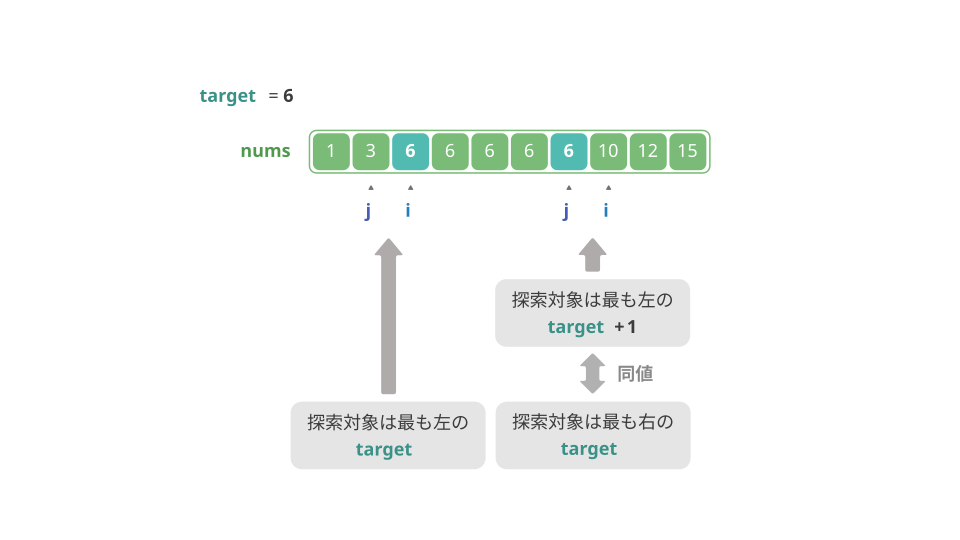
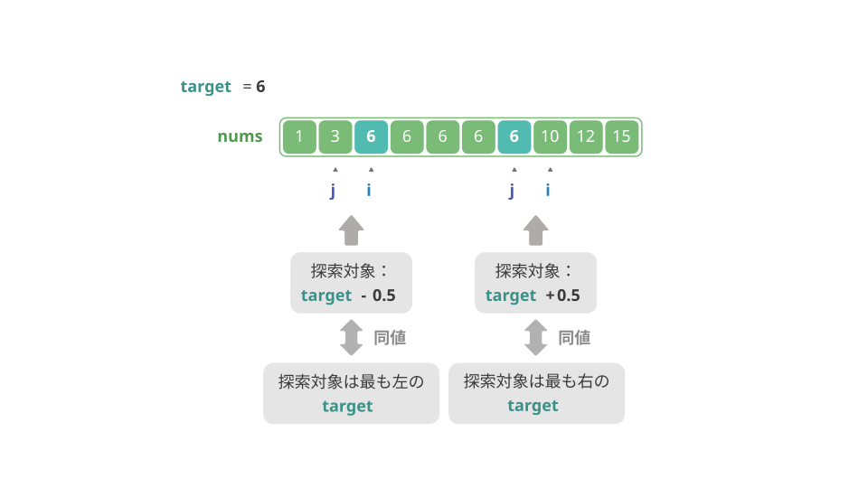

# 二分探索による境界の特定

## 左端を探す

!!! question

    重複する要素を含む可能性がある、長さ $n$ の整列済み配列 `nums` が与えられます。配列内で最も左にある `target` のインデックスを返してください。その要素がなければ $-1$ を返してください。

挿入位置を二分探索したときのことを思い出してください。探索が終わると $i$ は最も左にある `target` を指します。**つまり、挿入位置を探すことは、最も左にある `target` のインデックスを探すことにほかなりません**。

挿入位置を求める関数を使って左端を探してみましょう。配列に `target` が含まれていないこともあります。その場合、結果は次のいずれかになります。

- 挿入位置のインデックス $i$ が配列の範囲外です。
- 要素 `nums[i]` と `target` が等しくありません。

これらのいずれかに当てはまれば、その場で $-1$ を返せばよいのです。コードを以下に示します。

```src
[file]{binary_search_edge}-[class]{}-[func]{binary_search_left_edge}
```

## 右端を探す

では、最も右にある `target` はどう探せばよいでしょうか。いちばん直接的な方法は、`nums[m] == target` のときにどちらのポインタで区間を狭めるかをコード上で入れ替えることです。ここではコードを省きます。興味があれば実装してみてください。

ここからは、少し工夫した二つの方法を紹介します。

### 左端を探す方法の再利用

実は、最も左の要素を探す関数を使って、最も右の要素も探せます。**最も右の `target` を探す問題を、最も左の `target + 1` を探す問題に置き換えます**。

次の図のように、探索が終わると、`target + 1` が存在する場合、ポインタ $i$ はそのうち最も左のものを指します。一方、$j$ は最も右の `target` を指すので、**$j$ を返せばよいのです**。



返される挿入位置は $i$ です。そこから $1$ を引いて $j$ を求めます。

```src
[file]{binary_search_edge}-[class]{}-[func]{binary_search_right_edge}
```

### 要素の探索に置き換える

配列に `target` がない場合、探索の最後に $i$ は `target` より大きい最初の要素を、$j$ は `target` より小さい最も右の要素を指します。

そこで次の図のように、配列に存在しない値を作り、それを使って左端と右端を探せます。

- 最も左の `target` を探すには、代わりに `target - 0.5` を探し、ポインタ $i$ を返します。
- 最も右の `target` を探すには、代わりに `target + 0.5` を探し、ポインタ $j$ を返します。



コードは省きますが、次の二点に注意してください。

- 与えられた配列には小数がないため、値が等しい場合の扱いを考える必要はありません。
- この方法では小数を使うので、関数内の変数 `target` を浮動小数点数型に変更します（Python では変更は不要です）。
