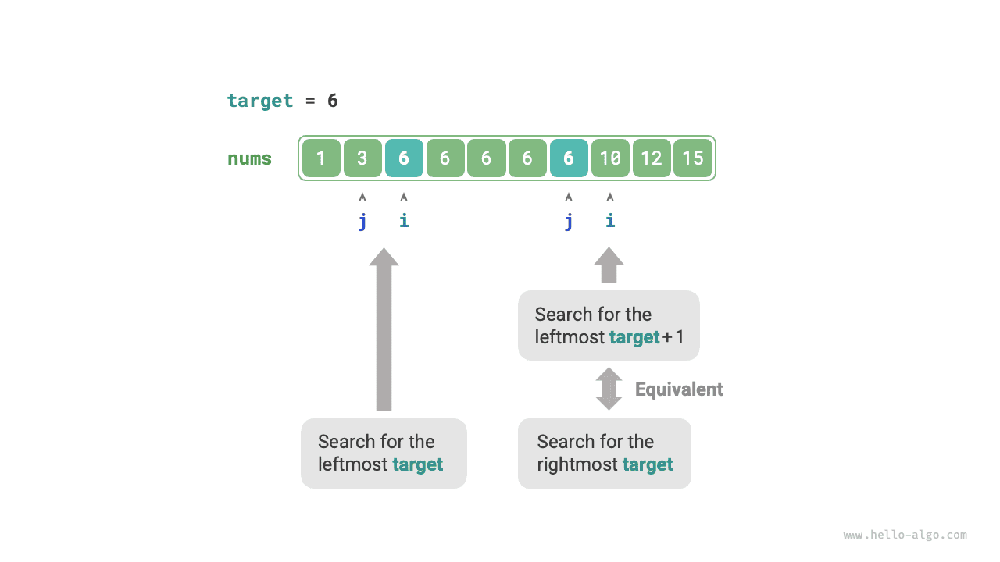

# 二分探索で境界を探す

## 左の境界を探す

!!! question

    重複する要素を含む可能性がある、長さ $n$ の整列済み配列 `nums` が与えられます。配列内で最も左にある要素 `target` のインデックスを返してください。含まれない場合は $-1$ を返します。

二分探索で挿入位置を探す方法を思い出してください。探索後、$i$ は最も左の `target` を指します。**つまり、挿入位置の探索は、本質的には最も左の `target` のインデックスを探しています**。

挿入位置を探す関数を使って、左の境界を探すことを考えます。ただし、配列に `target` が含まれない場合、次の二つの結果になる可能性があります。

- 挿入位置のインデックス $i$ が範囲外になります。
- 要素 `nums[i]` が `target` と等しくありません。

このどちらかに当てはまれば、そのまま $-1$ を返します。コードは次のとおりです。

```src
[file]{binary_search_edge}-[class]{}-[func]{binary_search_left_edge}
```

## 右の境界を探す

では、最も右の `target` はどう探せばよいでしょうか。最も直接的な方法は、`nums[m] == target` の場合にポインタで区間を縮める操作を書き換えることです。コードは省略するので、興味があれば実装してみてください。

ここでは、さらに工夫した二つの方法を紹介します。

### 左の境界を探す処理の再利用

実は、最も左の要素を探す関数を使って、最も右の要素を探すこともできます。具体的には、**最も右の `target` を探す問題を、最も左の `target + 1` を探す問題に置き換えます**。

下図のように、探索後のポインタ $i$ は最も左の `target + 1`（存在する場合）を指し、$j$ は最も右の `target` を指します。**そのため、$j$ を返せばよいのです**。



返される挿入位置は $i$ なので、そこから $1$ を引いて $j$ を得る必要があります。

```src
[file]{binary_search_edge}-[class]{}-[func]{binary_search_right_edge}
```

### 要素の探索への置き換え

配列に `target` が含まれない場合、最終的に $i$ は `target` より大きい最初の要素を、$j$ は `target` より小さい最も右の要素を指します。

したがって、下図のように、配列に存在しない要素を用意して左右の境界を探すことができます。

- 最も左の `target` を探す場合：`target - 0.5` の探索に置き換え、ポインタ $i$ を返します。
- 最も右の `target` を探す場合：`target + 0.5` の探索に置き換え、ポインタ $j$ を返します。


コードは省略しますが、次の二点に注意してください。

- 与えられた配列には小数が含まれないため、等しい場合の処理を考える必要はありません。
- この方法では小数を使うため、関数内の変数 `target` を浮動小数点数型に変更する必要があります（Python では変更不要です）。
