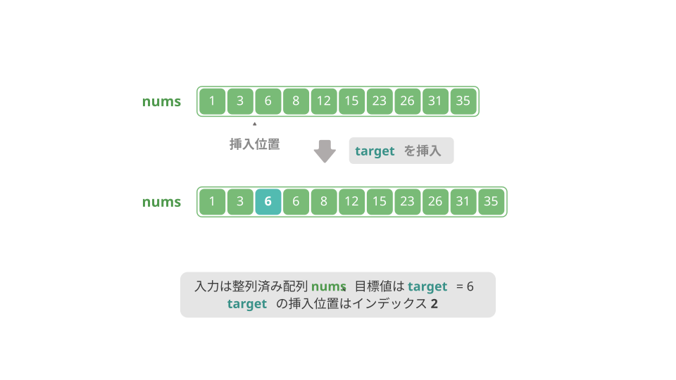
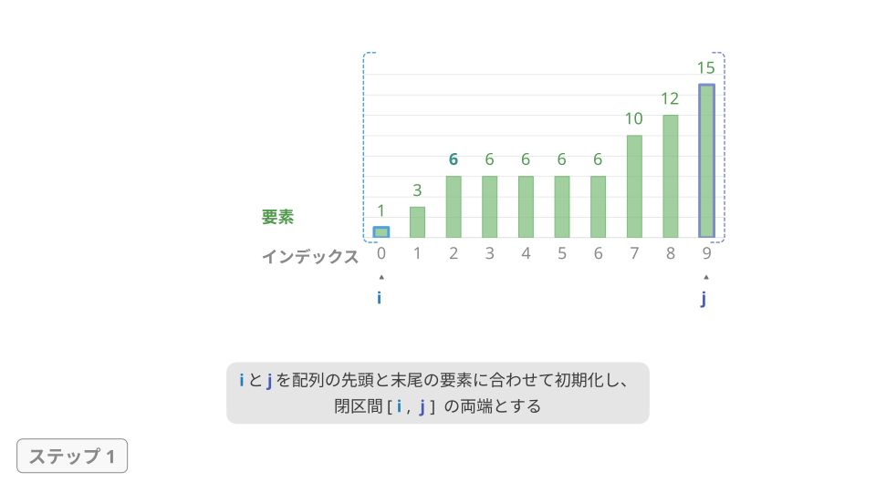
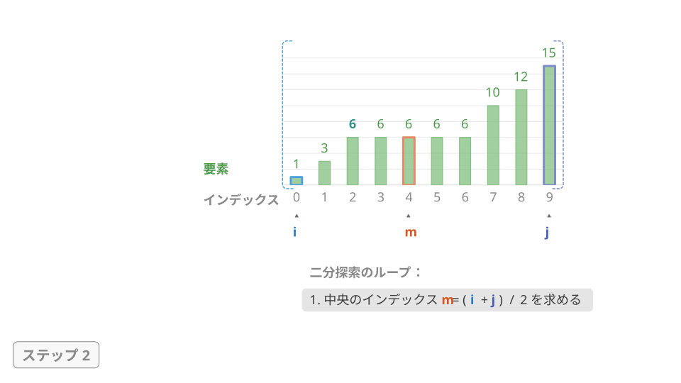
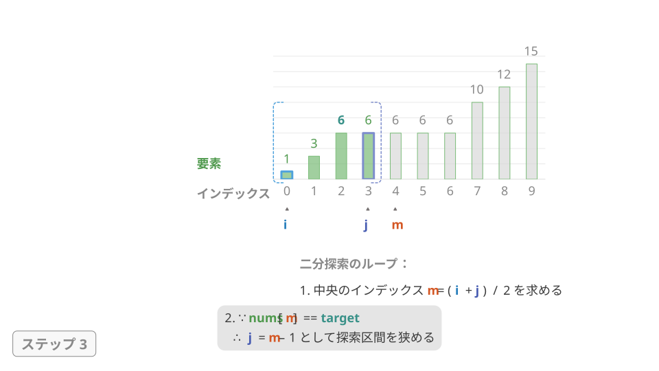
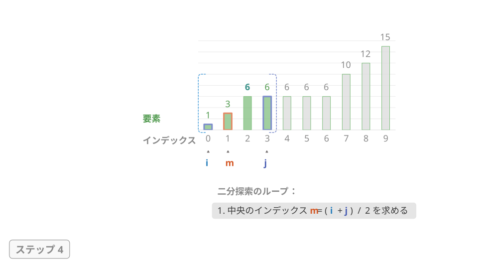
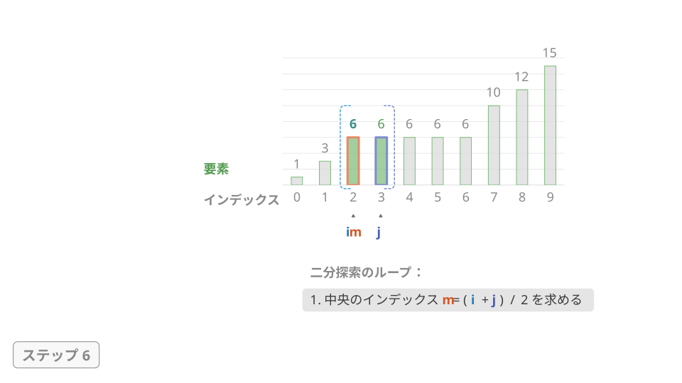
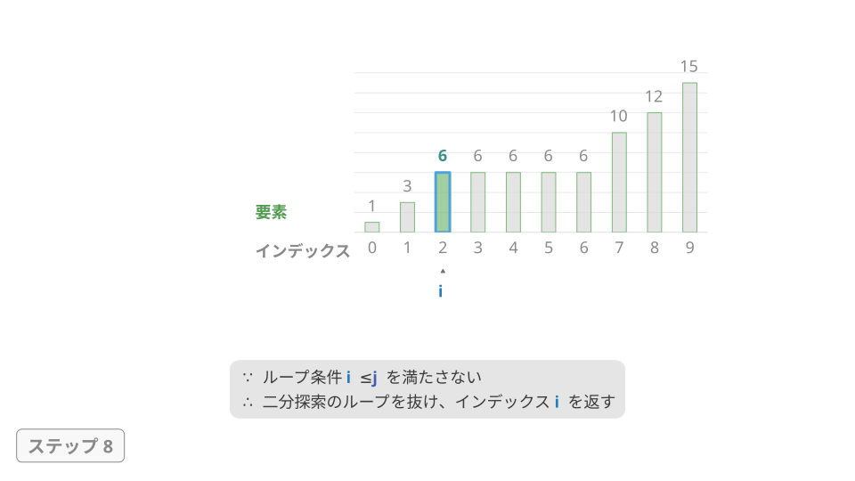

# 挿入位置の二分探索

二分探索は目標の要素を探すだけでなく、その要素を挿入する位置を求めるなど、さまざまな派生問題にも使えます。

## 重複する要素がない場合

!!! question

    長さ $n$ の整列済み配列 `nums` と要素 `target` が与えられます。配列に重複する要素はありません。ここで `target` を配列 `nums` に挿入し、順序を保つものとします。配列にすでに `target` があれば、その左に挿入します。挿入後の `target` のインデックスを返してください。次の図に例を示します。



前節の二分探索のコードを再利用するには、次の二つの問いに答える必要があります。

**問い 1**：配列に `target` があるとき、挿入位置のインデックスは、その要素のインデックスと同じでしょうか。

問題の指定は `target` を等しい要素の左に挿入することです。新しく挿入した `target` は、それまで `target` があった位置に収まります。つまり、**配列に `target` があれば、挿入位置のインデックスはその `target` のインデックスです**。

**問い 2**：配列に `target` がないとき、どの要素のインデックスが挿入位置になるでしょうか。

二分探索の手順をもう少し詳しく見てみましょう。`nums[m] < target` のときに $i$ を移動するので、ポインタ $i$ は `target` 以上の要素に近づいていきます。同様に、ポインタ $j$ は常に `target` 以下の要素に近づいていきます。

したがって、二分探索が終わると、$i$ は `target` より大きい最初の要素を、$j$ は `target` より小さい最も右の要素を指します。ここから、**配列に `target` がない場合の挿入位置はインデックス $i$ である**とわかります。コードを以下に示します。

```src
[file]{binary_search_insertion}-[class]{}-[func]{binary_search_insertion_simple}
```

## 重複する要素がある場合

!!! question

    先ほどの問題で、配列が重複する要素を含んでもよいことにします。ほかの条件は同じです。

配列に `target` が複数あると、通常の二分探索で得られるのはいずれか一つの `target` のインデックスだけです。**その要素の左と右に、あといくつずつ `target` があるかはわかりません**。

この問題では、等しい要素のいちばん左に目標の要素を挿入します。**そこで、配列内で最も左にある `target` のインデックスを探す必要があります**。まずは次の図の手順を考えてみましょう。

1. 二分探索でいずれか一つの `target` のインデックスを求め、それを $k$ とします。
2. インデックス $k$ から左へ順に走査し、最も左の `target` を見つけたら、そのインデックスを返します。


この方法でも答えは得られますが、線形探索を含むため時間計算量は $O(n)$ です。配列に `target` が多数ある場合は効率がよくありません。

今度は二分探索のコードを拡張してみましょう。次の図のように、全体の流れは同じです。各回でまず中央のインデックス $m$ を求め、次に `target` と `nums[m]` の大小関係に応じて場合分けします。

- `nums[m] < target` または `nums[m] > target` なら、まだ `target` は見つかっていません。通常の二分探索と同じ操作で区間を狭め、**ポインタ $i$ と $j$ を `target` に近づけます**。
- `nums[m] == target` なら、`target` より小さい要素を探す範囲は区間 $[i, m - 1]$ です。そこで $j = m - 1$ として区間を狭め、**ポインタ $j$ を `target` より小さい要素に近づけます**。

ループが終わると、$i$ は最も左の `target` を、$j$ は `target` より小さい最も右の要素を指します。**したがって、インデックス $i$ が挿入位置です**。

=== "<1>"
    

=== "<2>"
    

=== "<3>"
    

=== "<4>"
    

=== "<5>"
    

=== "<6>"
    

=== "<7>"
    

=== "<8>"
    

以下のコードでは、`nums[m] > target` と `nums[m] == target` の分岐で同じ操作を行うので、この二つの分岐をまとめることもできます。

ただし、条件を分けて書いておくと、処理の理由が明確になり、コードを読みやすくできます。

```src
[file]{binary_search_insertion}-[class]{}-[func]{binary_search_insertion}
```

!!! tip

    この節のコードはすべて閉区間を使っています。興味があれば、左閉右開区間を使う方法も実装してみてください。

このように見ると、二分探索ではポインタ $i$ と $j$ にそれぞれ探索の目標を定めているだけです。目標は特定の要素（たとえば `target`）の場合もあれば、ある範囲の要素（たとえば `target` より小さい要素）の場合もあります。

区間を二分する操作を繰り返すうちに、ポインタ $i$ と $j$ はそれぞれ定められた目標に近づいていきます。最後には答えを見つけるか、境界を越えたところで止まります。
