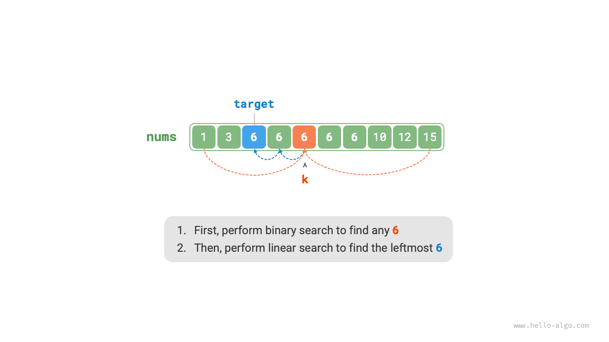
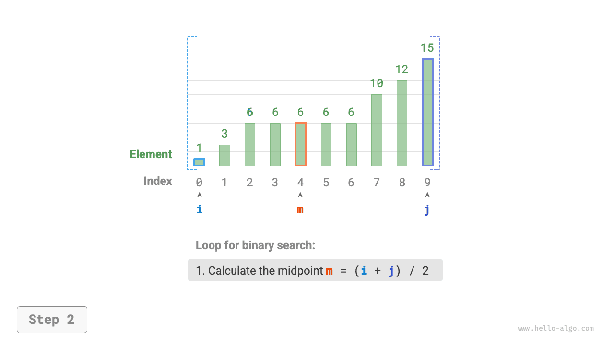
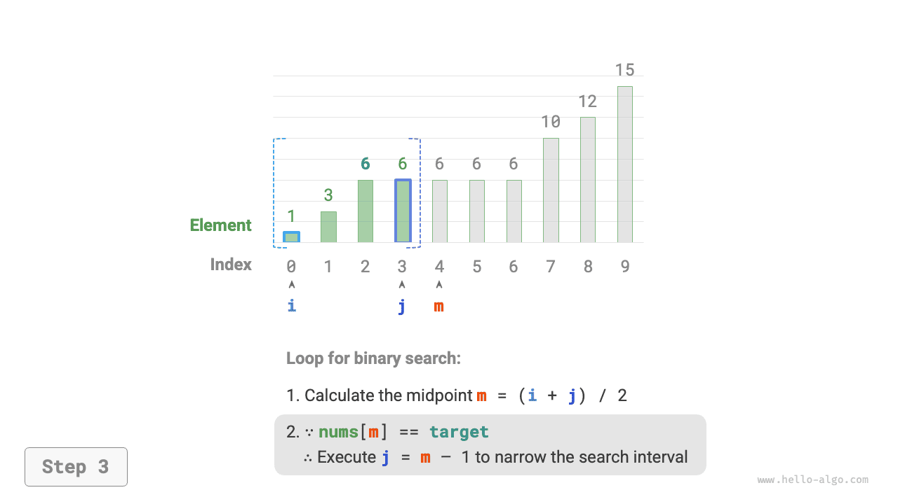
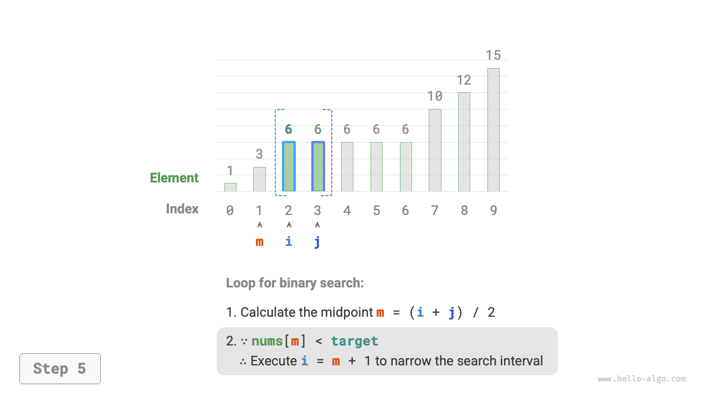

# 二分探索で挿入位置を探す

二分探索は目的の要素を探すだけでなく、その挿入位置を探すなど、多くの派生問題にも利用できます。

## 重複する要素がない場合

!!! question

    長さ $n$ の整列済み配列 `nums` と要素 `target` が与えられます。配列内に重複する要素はありません。整列状態を保ちながら、`target` を配列 `nums` に挿入します。すでに `target` が存在する場合は、その左側に挿入します。挿入後の `target` のインデックスを返してください。例を下図に示します。


前節の二分探索のコードを再利用するには、次の二つの問いに答える必要があります。

**問い一**：配列に `target` が含まれる場合、挿入位置のインデックスはその要素のインデックスでしょうか。

問題では、等しい要素の左に `target` を挿入するよう求めています。つまり、新しく挿入した `target` が元の `target` の位置に入ります。したがって、**配列に `target` が含まれる場合、挿入位置はその `target` のインデックスです**。

**問い二**：配列に `target` が存在しない場合、挿入位置はどの要素のインデックスでしょうか。

二分探索の過程をさらに考えてみましょう。`nums[m] < target` のとき $i$ が移動するということは、ポインタ $i$ が `target` 以上の要素へ近づいているということです。同様に、ポインタ $j$ は常に `target` 以下の要素へ近づいています。

したがって、二分探索が終わると、$i$ は `target` より大きい最初の要素を、$j$ は `target` より小さい最も右の要素を指します。**配列に `target` が含まれない場合、挿入位置のインデックスは $i$ だと分かります**。コードは次のとおりです。

```src
[file]{binary_search_insertion}-[class]{}-[func]{binary_search_insertion_simple}
```

## 重複する要素がある場合

!!! question

    前の問題で、配列に重複する要素が含まれる可能性があるものとし、ほかの条件は変えません。

配列に複数の `target` があると、通常の二分探索ではそのうち一つのインデックスしか返せず、**その左右にいくつの `target` があるかは分かりません**。

問題では同じ要素の最も左に挿入するよう求めているため、**配列内で最も左の `target` のインデックスを探す必要があります**。まず、下図の手順を考えてみます。

1. 二分探索でいずれかの `target` のインデックスを求め、$k$ とします。
2. インデックス $k$ から左へ線形に走査し、最も左の `target` が見つかったら返します。



この方法でも求められますが、線形探索を含むため時間計算量は $O(n)$ です。配列に `target` が多数重複している場合、効率が低くなります。

そこで、二分探索のコードを拡張します。下図のように全体の流れは変えず、各反復で中点のインデックス $m$ を計算し、`target` と `nums[m]` の大小関係を判定します。次の場合に分かれます。

- `nums[m] < target` または `nums[m] > target` の場合、まだ `target` が見つかっていないので、通常の二分探索と同じ操作で区間を縮めます。**これにより、ポインタ $i$ と $j$ が `target` へ近づきます**。
- `nums[m] == target` の場合、`target` より小さい要素は区間 $[i, m - 1]$ にあるので、$j = m - 1$ として区間を縮めます。**これにより、ポインタ $j$ が `target` より小さい要素へ近づきます**。

ループが終わると、$i$ は最も左の `target` を、$j$ は `target` より小さい最も右の要素を指します。**したがって、インデックス $i$ が挿入位置です**。

=== "<1>"
    

=== "<2>"
    

=== "<3>"
    

=== "<4>"
    

=== "<5>"
    

=== "<6>"
    

=== "<7>"
    

=== "<8>"
    

以下のコードを見ると、条件分岐 `nums[m] > target` と `nums[m] == target` では同じ操作を行うため、二つをまとめられます。

それでも、条件を分けたままにしておけば、論理が明確で読みやすくなります。

```src
[file]{binary_search_insertion}-[class]{}-[func]{binary_search_insertion}
```

!!! tip

    この節のコードはすべて両端を含む閉区間で書いています。興味があれば、左閉右開の書き方でも実装してみてください。

全体として見ると、二分探索は、ポインタ $i$ と $j$ にそれぞれ探索目標を定めるものにすぎません。目標は特定の要素（例えば `target`）である場合も、要素の範囲（例えば `target` より小さい要素）である場合もあります。

二分を繰り返す中で、ポインタ $i$ と $j$ はあらかじめ定めた目標に近づいていきます。最終的には答えを見つけるか、境界を越えて停止します。
