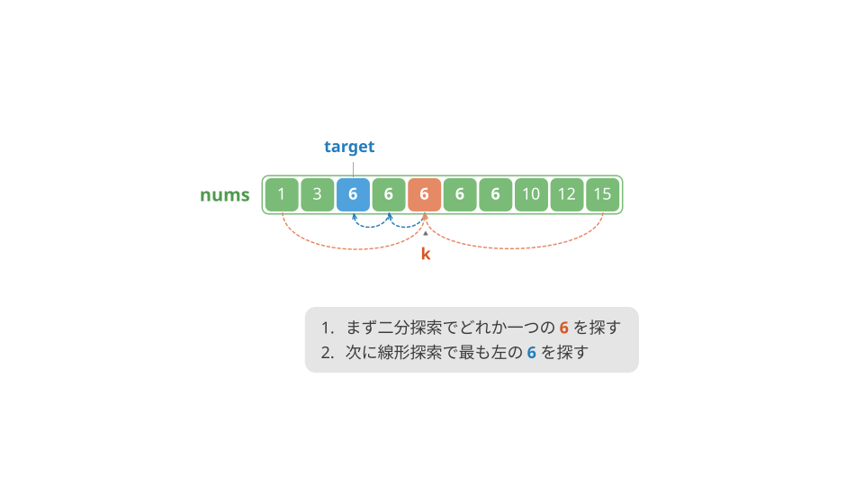
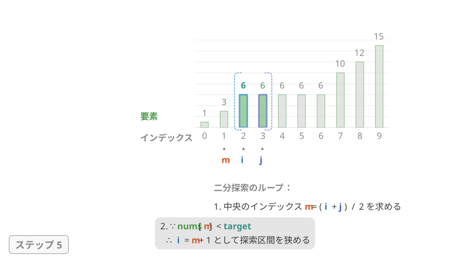
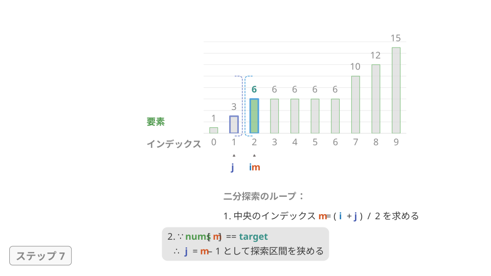

# 10.2 &nbsp; 挿入位置の二分探索

二分探索は目標の要素を探すだけでなく、その要素を挿入する位置を求めるなど、さまざまな派生問題にも使えます。

## 10.2.1 &nbsp; 重複する要素がない場合

!!! question "問題"

    長さ $n$ の整列済み配列 `nums` と要素 `target` が与えられます。配列に重複する要素はありません。ここで `target` を配列 `nums` に挿入し、順序を保つものとします。配列にすでに `target` があれば、その左に挿入します。挿入後の `target` のインデックスを返してください。図 10-4 に例を示します。

{ class="animation-figure" }

<p align="center"> 図 10-4 &nbsp; 挿入位置を二分探索するためのサンプルデータ </p>

前節の二分探索のコードを再利用するには、次の二つの問いに答える必要があります。

**問い 1**：配列に `target` があるとき、挿入位置のインデックスは、その要素のインデックスと同じでしょうか。

問題の指定は `target` を等しい要素の左に挿入することです。新しく挿入した `target` は、それまで `target` があった位置に収まります。つまり、**配列に `target` があれば、挿入位置のインデックスはその `target` のインデックスです**。

**問い 2**：配列に `target` がないとき、どの要素のインデックスが挿入位置になるでしょうか。

二分探索の手順をもう少し詳しく見てみましょう。`nums[m] < target` のときに $i$ を移動するので、ポインタ $i$ は `target` 以上の要素に近づいていきます。同様に、ポインタ $j$ は常に `target` 以下の要素に近づいていきます。

したがって、二分探索が終わると、$i$ は `target` より大きい最初の要素を、$j$ は `target` より小さい最も右の要素を指します。ここから、**配列に `target` がない場合の挿入位置はインデックス $i$ である**とわかります。コードを以下に示します。

=== "Python"

    ```python title="binary_search_insertion.py"
    def binary_search_insertion_simple(nums: list[int], target: int) -> int:
        """挿入位置の二分探索（重複する要素がない場合）"""
        i, j = 0, len(nums) - 1  # 閉区間 [0, n-1] で初期化する
        while i <= j:
            m = (i + j) // 2  # 中央のインデックス m を求める
            if nums[m] < target:
                i = m + 1  # target の探索範囲は [m+1, j]
            elif nums[m] > target:
                j = m - 1  # target の探索範囲は [i, m-1]
            else:
                return m  # target が見つかったので挿入位置 m を返す
        # target が見つからなかったので挿入位置 i を返す
        return i
    ```

=== "C++"

    ```cpp title="binary_search_insertion.cpp"
    /* 挿入位置の二分探索（重複する要素がない場合） */
    int binarySearchInsertionSimple(vector<int> &nums, int target) {
        int i = 0, j = nums.size() - 1; // 閉区間 [0, n-1] で初期化する
        while (i <= j) {
            int m = i + (j - i) / 2; // 中央のインデックス m を求める
            if (nums[m] < target) {
                i = m + 1; // target の探索範囲は [m+1, j]
            } else if (nums[m] > target) {
                j = m - 1; // target の探索範囲は [i, m-1]
            } else {
                return m; // target が見つかったので挿入位置 m を返す
            }
        }
        // target が見つからなかったので挿入位置 i を返す
        return i;
    }
    ```

=== "Java"

    ```java title="binary_search_insertion.java"
    /* 挿入位置の二分探索（重複する要素がない場合） */
    int binarySearchInsertionSimple(int[] nums, int target) {
        int i = 0, j = nums.length - 1; // 閉区間 [0, n-1] で初期化する
        while (i <= j) {
            int m = i + (j - i) / 2; // 中央のインデックス m を求める
            if (nums[m] < target) {
                i = m + 1; // target の探索範囲は [m+1, j]
            } else if (nums[m] > target) {
                j = m - 1; // target の探索範囲は [i, m-1]
            } else {
                return m; // target が見つかったので挿入位置 m を返す
            }
        }
        // target が見つからなかったので挿入位置 i を返す
        return i;
    }
    ```

=== "C#"

    ```csharp title="binary_search_insertion.cs"
    /* 挿入位置の二分探索（重複する要素がない場合） */
    int BinarySearchInsertionSimple(int[] nums, int target) {
        int i = 0, j = nums.Length - 1; // 閉区間 [0, n-1] で初期化する
        while (i <= j) {
            int m = i + (j - i) / 2; // 中央のインデックス m を求める
            if (nums[m] < target) {
                i = m + 1; // target の探索範囲は [m+1, j]
            } else if (nums[m] > target) {
                j = m - 1; // target の探索範囲は [i, m-1]
            } else {
                return m; // target が見つかったので挿入位置 m を返す
            }
        }
        // target が見つからなかったので挿入位置 i を返す
        return i;
    }
    ```

=== "Go"

    ```go title="binary_search_insertion.go"
    /* 挿入位置の二分探索（重複する要素がない場合） */
    func binarySearchInsertionSimple(nums []int, target int) int {
        // 閉区間 [0, n-1] で初期化する
        i, j := 0, len(nums)-1
        for i <= j {
            // 中央のインデックス m を求める
            m := i + (j-i)/2
            if nums[m] < target {
                // target の探索範囲は [m+1, j]
                i = m + 1
            } else if nums[m] > target {
                // target の探索範囲は [i, m-1]
                j = m - 1
            } else {
                // target が見つかったので挿入位置 m を返す
                return m
            }
        }
        // target が見つからなかったので挿入位置 i を返す
        return i
    }
    ```

=== "Swift"

    ```swift title="binary_search_insertion.swift"
    /* 挿入位置の二分探索（重複する要素がない場合） */
    func binarySearchInsertionSimple(nums: [Int], target: Int) -> Int {
        // 閉区間 [0, n-1] で初期化する
        var i = nums.startIndex
        var j = nums.endIndex - 1
        while i <= j {
            let m = i + (j - i) / 2 // 中央のインデックス m を求める
            if nums[m] < target {
                i = m + 1 // target の探索範囲は [m+1, j]
            } else if nums[m] > target {
                j = m - 1 // target の探索範囲は [i, m-1]
            } else {
                return m // target が見つかったので挿入位置 m を返す
            }
        }
        // target が見つからなかったので挿入位置 i を返す
        return i
    }
    ```

=== "JS"

    ```javascript title="binary_search_insertion.js"
    /* 挿入位置の二分探索（重複する要素がない場合） */
    function binarySearchInsertionSimple(nums, target) {
        let i = 0,
            j = nums.length - 1; // 閉区間 [0, n-1] で初期化する
        while (i <= j) {
            const m = Math.floor(i + (j - i) / 2); // Math.floor() で小数点以下を切り捨て、中央のインデックス m を求める
            if (nums[m] < target) {
                i = m + 1; // target の探索範囲は [m+1, j]
            } else if (nums[m] > target) {
                j = m - 1; // target の探索範囲は [i, m-1]
            } else {
                return m; // target が見つかったので挿入位置 m を返す
            }
        }
        // target が見つからなかったので挿入位置 i を返す
        return i;
    }
    ```

=== "TS"

    ```typescript title="binary_search_insertion.ts"
    /* 挿入位置の二分探索（重複する要素がない場合） */
    function binarySearchInsertionSimple(
        nums: Array<number>,
        target: number
    ): number {
        let i = 0,
            j = nums.length - 1; // 閉区間 [0, n-1] で初期化する
        while (i <= j) {
            const m = Math.floor(i + (j - i) / 2); // Math.floor() で小数点以下を切り捨て、中央のインデックス m を求める
            if (nums[m] < target) {
                i = m + 1; // target の探索範囲は [m+1, j]
            } else if (nums[m] > target) {
                j = m - 1; // target の探索範囲は [i, m-1]
            } else {
                return m; // target が見つかったので挿入位置 m を返す
            }
        }
        // target が見つからなかったので挿入位置 i を返す
        return i;
    }
    ```

=== "Dart"

    ```dart title="binary_search_insertion.dart"
    /* 挿入位置の二分探索（重複する要素がない場合） */
    int binarySearchInsertionSimple(List<int> nums, int target) {
      int i = 0, j = nums.length - 1; // 閉区間 [0, n-1] で初期化する
      while (i <= j) {
        int m = i + (j - i) ~/ 2; // 中央のインデックス m を求める
        if (nums[m] < target) {
          i = m + 1; // target の探索範囲は [m+1, j]
        } else if (nums[m] > target) {
          j = m - 1; // target の探索範囲は [i, m-1]
        } else {
          return m; // target が見つかったので挿入位置 m を返す
        }
      }
      // target が見つからなかったので挿入位置 i を返す
      return i;
    }
    ```

=== "Rust"

    ```rust title="binary_search_insertion.rs"
    /* 挿入位置の二分探索（重複する要素がない場合） */
    fn binary_search_insertion_simple(nums: &[i32], target: i32) -> i32 {
        let (mut i, mut j) = (0, nums.len() as i32 - 1); // 閉区間 [0, n-1] で初期化する
        while i <= j {
            let m = i + (j - i) / 2; // 中央のインデックス m を求める
            if nums[m as usize] < target {
                i = m + 1; // target の探索範囲は [m+1, j]
            } else if nums[m as usize] > target {
                j = m - 1; // target の探索範囲は [i, m-1]
            } else {
                return m;
            }
        }
        // target が見つからなかったので挿入位置 i を返す
        i
    }
    ```

=== "C"

    ```c title="binary_search_insertion.c"
    /* 挿入位置の二分探索（重複する要素がない場合） */
    int binarySearchInsertionSimple(int *nums, int numSize, int target) {
        int i = 0, j = numSize - 1; // 閉区間 [0, n-1] で初期化する
        while (i <= j) {
            int m = i + (j - i) / 2; // 中央のインデックス m を求める
            if (nums[m] < target) {
                i = m + 1; // target の探索範囲は [m+1, j]
            } else if (nums[m] > target) {
                j = m - 1; // target の探索範囲は [i, m-1]
            } else {
                return m; // target が見つかったので挿入位置 m を返す
            }
        }
        // target が見つからなかったので挿入位置 i を返す
        return i;
    }
    ```

=== "Kotlin"

    ```kotlin title="binary_search_insertion.kt"
    /* 挿入位置の二分探索（重複する要素がない場合） */
    fun binarySearchInsertionSimple(nums: IntArray, target: Int): Int {
        var i = 0
        var j = nums.size - 1 // 閉区間 [0, n-1] で初期化する
        while (i <= j) {
            val m = i + (j - i) / 2 // 中央のインデックス m を求める
            if (nums[m] < target) {
                i = m + 1 // target の探索範囲は [m+1, j]
            } else if (nums[m] > target) {
                j = m - 1 // target の探索範囲は [i, m-1]
            } else {
                return m // target が見つかったので挿入位置 m を返す
            }
        }
        // target が見つからなかったので挿入位置 i を返す
        return i
    }
    ```

=== "Ruby"

    ```ruby title="binary_search_insertion.rb"
    ### 挿入位置の二分探索（重複する要素がない場合） ###
    def binary_search_insertion_simple(nums, target)
      # 閉区間 [0, n-1] で初期化する
      i, j = 0, nums.length - 1

      while i <= j
        # 中央のインデックス m を求める
        m = (i + j) / 2

        if nums[m] < target
          i = m + 1 # target の探索範囲は [m+1, j]
        elsif nums[m] > target
          j = m - 1 # target の探索範囲は [i, m-1]
        else
          return m  # target が見つかったので挿入位置 m を返す
        end
      end

      i # target が見つからなかったので挿入位置 i を返す
    end
    ```

??? pythontutor "実行の様子を見る"

    <div style="height: 549px; width: 100%;"><iframe class="pythontutor-iframe" title="実行の様子を見る" src="https://pythontutor.com/iframe-embed.html#code=def%20binary_search_insertion_simple%28nums%3A%20list%5Bint%5D,%20target%3A%20int%29%20-%3E%20int%3A%0A%20%20%20%20%22%22%22%E6%8C%BF%E5%85%A5%E4%BD%8D%E7%BD%AE%E3%81%AE%E4%BA%8C%E5%88%86%E6%8E%A2%E7%B4%A2%EF%BC%88%E9%87%8D%E8%A4%87%E3%81%99%E3%82%8B%E8%A6%81%E7%B4%A0%E3%81%8C%E3%81%AA%E3%81%84%E5%A0%B4%E5%90%88%EF%BC%89%22%22%22%0A%20%20%20%20i,%20j%20%3D%200,%20len%28nums%29%20-%201%20%20%23%20%E9%96%89%E5%8C%BA%E9%96%93%20%5B0,%20n-1%5D%20%E3%81%A7%E5%88%9D%E6%9C%9F%E5%8C%96%E3%81%99%E3%82%8B%0A%20%20%20%20while%20i%20%3C%3D%20j%3A%0A%20%20%20%20%20%20%20%20m%20%3D%20%28i%20%2B%20j%29%20//%202%20%20%23%20%E4%B8%AD%E5%A4%AE%E3%81%AE%E3%82%A4%E3%83%B3%E3%83%87%E3%83%83%E3%82%AF%E3%82%B9%20m%20%E3%82%92%E6%B1%82%E3%82%81%E3%82%8B%0A%20%20%20%20%20%20%20%20if%20nums%5Bm%5D%20%3C%20target%3A%0A%20%20%20%20%20%20%20%20%20%20%20%20i%20%3D%20m%20%2B%201%20%20%23%20target%20%E3%81%AE%E6%8E%A2%E7%B4%A2%E7%AF%84%E5%9B%B2%E3%81%AF%20%5Bm%2B1,%20j%5D%0A%20%20%20%20%20%20%20%20elif%20nums%5Bm%5D%20%3E%20target%3A%0A%20%20%20%20%20%20%20%20%20%20%20%20j%20%3D%20m%20-%201%20%20%23%20target%20%E3%81%AE%E6%8E%A2%E7%B4%A2%E7%AF%84%E5%9B%B2%E3%81%AF%20%5Bi,%20m-1%5D%0A%20%20%20%20%20%20%20%20else%3A%0A%20%20%20%20%20%20%20%20%20%20%20%20return%20m%20%20%23%20target%20%E3%81%8C%E8%A6%8B%E3%81%A4%E3%81%8B%E3%81%A3%E3%81%9F%E3%81%AE%E3%81%A7%E6%8C%BF%E5%85%A5%E4%BD%8D%E7%BD%AE%20m%20%E3%82%92%E8%BF%94%E3%81%99%0A%20%20%20%20%23%20target%20%E3%81%8C%E8%A6%8B%E3%81%A4%E3%81%8B%E3%82%89%E3%81%AA%E3%81%8B%E3%81%A3%E3%81%9F%E3%81%AE%E3%81%A7%E6%8C%BF%E5%85%A5%E4%BD%8D%E7%BD%AE%20i%20%E3%82%92%E8%BF%94%E3%81%99%0A%20%20%20%20return%20i%0A%0A%0A%22%22%22Driver%20Code%22%22%22%0Aif%20__name__%20%3D%3D%20%22__main__%22%3A%0A%20%20%20%20%23%20%E9%87%8D%E8%A4%87%E3%81%99%E3%82%8B%E8%A6%81%E7%B4%A0%E3%81%8C%E3%81%AA%E3%81%84%E9%85%8D%E5%88%97%0A%20%20%20%20nums%20%3D%20%5B1,%203,%206,%208,%2012,%2015,%2023,%2026,%2031,%2035%5D%0A%20%20%20%20%23%20%E6%8C%BF%E5%85%A5%E4%BD%8D%E7%BD%AE%E3%81%AE%E4%BA%8C%E5%88%86%E6%8E%A2%E7%B4%A2%0A%20%20%20%20target%20%3D%206%0A%20%20%20%20index%20%3D%20binary_search_insertion_simple%28nums,%20target%29%0A%20%20%20%20print%28f%22%E8%A6%81%E7%B4%A0%20%7Btarget%7D%20%E3%81%AE%E6%8C%BF%E5%85%A5%E4%BD%8D%E7%BD%AE%E3%81%AE%E3%82%A4%E3%83%B3%E3%83%87%E3%83%83%E3%82%AF%E3%82%B9%E3%81%AF%20%7Bindex%7D%22%29&codeDivHeight=472&codeDivWidth=350&cumulative=false&curInstr=5&heapPrimitives=nevernest&origin=opt-frontend.js&py=311&rawInputLstJSON=%5B%5D&textReferences=false"> </iframe></div>
    <div style="margin-top: 5px;"><a href="https://pythontutor.com/iframe-embed.html#code=def%20binary_search_insertion_simple%28nums%3A%20list%5Bint%5D,%20target%3A%20int%29%20-%3E%20int%3A%0A%20%20%20%20%22%22%22%E6%8C%BF%E5%85%A5%E4%BD%8D%E7%BD%AE%E3%81%AE%E4%BA%8C%E5%88%86%E6%8E%A2%E7%B4%A2%EF%BC%88%E9%87%8D%E8%A4%87%E3%81%99%E3%82%8B%E8%A6%81%E7%B4%A0%E3%81%8C%E3%81%AA%E3%81%84%E5%A0%B4%E5%90%88%EF%BC%89%22%22%22%0A%20%20%20%20i,%20j%20%3D%200,%20len%28nums%29%20-%201%20%20%23%20%E9%96%89%E5%8C%BA%E9%96%93%20%5B0,%20n-1%5D%20%E3%81%A7%E5%88%9D%E6%9C%9F%E5%8C%96%E3%81%99%E3%82%8B%0A%20%20%20%20while%20i%20%3C%3D%20j%3A%0A%20%20%20%20%20%20%20%20m%20%3D%20%28i%20%2B%20j%29%20//%202%20%20%23%20%E4%B8%AD%E5%A4%AE%E3%81%AE%E3%82%A4%E3%83%B3%E3%83%87%E3%83%83%E3%82%AF%E3%82%B9%20m%20%E3%82%92%E6%B1%82%E3%82%81%E3%82%8B%0A%20%20%20%20%20%20%20%20if%20nums%5Bm%5D%20%3C%20target%3A%0A%20%20%20%20%20%20%20%20%20%20%20%20i%20%3D%20m%20%2B%201%20%20%23%20target%20%E3%81%AE%E6%8E%A2%E7%B4%A2%E7%AF%84%E5%9B%B2%E3%81%AF%20%5Bm%2B1,%20j%5D%0A%20%20%20%20%20%20%20%20elif%20nums%5Bm%5D%20%3E%20target%3A%0A%20%20%20%20%20%20%20%20%20%20%20%20j%20%3D%20m%20-%201%20%20%23%20target%20%E3%81%AE%E6%8E%A2%E7%B4%A2%E7%AF%84%E5%9B%B2%E3%81%AF%20%5Bi,%20m-1%5D%0A%20%20%20%20%20%20%20%20else%3A%0A%20%20%20%20%20%20%20%20%20%20%20%20return%20m%20%20%23%20target%20%E3%81%8C%E8%A6%8B%E3%81%A4%E3%81%8B%E3%81%A3%E3%81%9F%E3%81%AE%E3%81%A7%E6%8C%BF%E5%85%A5%E4%BD%8D%E7%BD%AE%20m%20%E3%82%92%E8%BF%94%E3%81%99%0A%20%20%20%20%23%20target%20%E3%81%8C%E8%A6%8B%E3%81%A4%E3%81%8B%E3%82%89%E3%81%AA%E3%81%8B%E3%81%A3%E3%81%9F%E3%81%AE%E3%81%A7%E6%8C%BF%E5%85%A5%E4%BD%8D%E7%BD%AE%20i%20%E3%82%92%E8%BF%94%E3%81%99%0A%20%20%20%20return%20i%0A%0A%0A%22%22%22Driver%20Code%22%22%22%0Aif%20__name__%20%3D%3D%20%22__main__%22%3A%0A%20%20%20%20%23%20%E9%87%8D%E8%A4%87%E3%81%99%E3%82%8B%E8%A6%81%E7%B4%A0%E3%81%8C%E3%81%AA%E3%81%84%E9%85%8D%E5%88%97%0A%20%20%20%20nums%20%3D%20%5B1,%203,%206,%208,%2012,%2015,%2023,%2026,%2031,%2035%5D%0A%20%20%20%20%23%20%E6%8C%BF%E5%85%A5%E4%BD%8D%E7%BD%AE%E3%81%AE%E4%BA%8C%E5%88%86%E6%8E%A2%E7%B4%A2%0A%20%20%20%20target%20%3D%206%0A%20%20%20%20index%20%3D%20binary_search_insertion_simple%28nums,%20target%29%0A%20%20%20%20print%28f%22%E8%A6%81%E7%B4%A0%20%7Btarget%7D%20%E3%81%AE%E6%8C%BF%E5%85%A5%E4%BD%8D%E7%BD%AE%E3%81%AE%E3%82%A4%E3%83%B3%E3%83%87%E3%83%83%E3%82%AF%E3%82%B9%E3%81%AF%20%7Bindex%7D%22%29&codeDivHeight=800&codeDivWidth=600&cumulative=false&curInstr=5&heapPrimitives=nevernest&origin=opt-frontend.js&py=311&rawInputLstJSON=%5B%5D&textReferences=false" target="_blank" rel="noopener noreferrer">全画面で表示 ></a></div>

## 10.2.2 &nbsp; 重複する要素がある場合

!!! question "問題"

    先ほどの問題で、配列が重複する要素を含んでもよいことにします。ほかの条件は同じです。

配列に `target` が複数あると、通常の二分探索で得られるのはいずれか一つの `target` のインデックスだけです。**その要素の左と右に、あといくつずつ `target` があるかはわかりません**。

この問題では、等しい要素のいちばん左に目標の要素を挿入します。**そこで、配列内で最も左にある `target` のインデックスを探す必要があります**。まずは図 10-5 の手順を考えてみましょう。

1. 二分探索でいずれか一つの `target` のインデックスを求め、それを $k$ とします。
2. インデックス $k$ から左へ順に走査し、最も左の `target` を見つけたら、そのインデックスを返します。

{ class="animation-figure" }

<p align="center"> 図 10-5 &nbsp; 線形探索で重複する要素の挿入位置を求める </p>

この方法でも答えは得られますが、線形探索を含むため時間計算量は $O(n)$ です。配列に `target` が多数ある場合は効率がよくありません。

今度は二分探索のコードを拡張してみましょう。図 10-6 のように、全体の流れは同じです。各回でまず中央のインデックス $m$ を求め、次に `target` と `nums[m]` の大小関係に応じて場合分けします。

- `nums[m] < target` または `nums[m] > target` なら、まだ `target` は見つかっていません。通常の二分探索と同じ操作で区間を狭め、**ポインタ $i$ と $j$ を `target` に近づけます**。
- `nums[m] == target` なら、`target` より小さい要素を探す範囲は区間 $[i, m - 1]$ です。そこで $j = m - 1$ として区間を狭め、**ポインタ $j$ を `target` より小さい要素に近づけます**。

ループが終わると、$i$ は最も左の `target` を、$j$ は `target` より小さい最も右の要素を指します。**したがって、インデックス $i$ が挿入位置です**。

=== "<1>"
    { class="animation-figure" }

=== "<2>"
    { class="animation-figure" }

=== "<3>"
    { class="animation-figure" }

=== "<4>"
    { class="animation-figure" }

=== "<5>"
    { class="animation-figure" }

=== "<6>"
    { class="animation-figure" }

=== "<7>"
    { class="animation-figure" }

=== "<8>"
    { class="animation-figure" }

<p align="center"> 図 10-6 &nbsp; 重複する要素の挿入位置を二分探索する手順 </p>

以下のコードでは、`nums[m] > target` と `nums[m] == target` の分岐で同じ操作を行うので、この二つの分岐をまとめることもできます。

ただし、条件を分けて書いておくと、処理の理由が明確になり、コードを読みやすくできます。

=== "Python"

    ```python title="binary_search_insertion.py"
    def binary_search_insertion(nums: list[int], target: int) -> int:
        """挿入位置の二分探索（重複する要素がある場合）"""
        i, j = 0, len(nums) - 1  # 閉区間 [0, n-1] で初期化する
        while i <= j:
            m = (i + j) // 2  # 中央のインデックス m を求める
            if nums[m] < target:
                i = m + 1  # target の探索範囲は [m+1, j]
            elif nums[m] > target:
                j = m - 1  # target の探索範囲は [i, m-1]
            else:
                j = m - 1  # target 未満の最も右の要素を [i, m-1] で探す
        # 挿入位置 i を返す
        return i
    ```

=== "C++"

    ```cpp title="binary_search_insertion.cpp"
    /* 挿入位置の二分探索（重複する要素がある場合） */
    int binarySearchInsertion(vector<int> &nums, int target) {
        int i = 0, j = nums.size() - 1; // 閉区間 [0, n-1] で初期化する
        while (i <= j) {
            int m = i + (j - i) / 2; // 中央のインデックス m を求める
            if (nums[m] < target) {
                i = m + 1; // target の探索範囲は [m+1, j]
            } else if (nums[m] > target) {
                j = m - 1; // target の探索範囲は [i, m-1]
            } else {
                j = m - 1; // target 未満の最も右の要素を [i, m-1] で探す
            }
        }
        // 挿入位置 i を返す
        return i;
    }
    ```

=== "Java"

    ```java title="binary_search_insertion.java"
    /* 挿入位置の二分探索（重複する要素がある場合） */
    int binarySearchInsertion(int[] nums, int target) {
        int i = 0, j = nums.length - 1; // 閉区間 [0, n-1] で初期化する
        while (i <= j) {
            int m = i + (j - i) / 2; // 中央のインデックス m を求める
            if (nums[m] < target) {
                i = m + 1; // target の探索範囲は [m+1, j]
            } else if (nums[m] > target) {
                j = m - 1; // target の探索範囲は [i, m-1]
            } else {
                j = m - 1; // target 未満の最も右の要素を [i, m-1] で探す
            }
        }
        // 挿入位置 i を返す
        return i;
    }
    ```

=== "C#"

    ```csharp title="binary_search_insertion.cs"
    /* 挿入位置の二分探索（重複する要素がある場合） */
    int BinarySearchInsertion(int[] nums, int target) {
        int i = 0, j = nums.Length - 1; // 閉区間 [0, n-1] で初期化する
        while (i <= j) {
            int m = i + (j - i) / 2; // 中央のインデックス m を求める
            if (nums[m] < target) {
                i = m + 1; // target の探索範囲は [m+1, j]
            } else if (nums[m] > target) {
                j = m - 1; // target の探索範囲は [i, m-1]
            } else {
                j = m - 1; // target 未満の最も右の要素を [i, m-1] で探す
            }
        }
        // 挿入位置 i を返す
        return i;
    }
    ```

=== "Go"

    ```go title="binary_search_insertion.go"
    /* 挿入位置の二分探索（重複する要素がある場合） */
    func binarySearchInsertion(nums []int, target int) int {
        // 閉区間 [0, n-1] で初期化する
        i, j := 0, len(nums)-1
        for i <= j {
            // 中央のインデックス m を求める
            m := i + (j-i)/2
            if nums[m] < target {
                // target の探索範囲は [m+1, j]
                i = m + 1
            } else if nums[m] > target {
                // target の探索範囲は [i, m-1]
                j = m - 1
            } else {
                // target 未満の最も右の要素を [i, m-1] で探す
                j = m - 1
            }
        }
        // 挿入位置 i を返す
        return i
    }
    ```

=== "Swift"

    ```swift title="binary_search_insertion.swift"
    /* 挿入位置の二分探索（重複する要素がある場合） */
    func binarySearchInsertion(nums: [Int], target: Int) -> Int {
        // 閉区間 [0, n-1] で初期化する
        var i = nums.startIndex
        var j = nums.endIndex - 1
        while i <= j {
            let m = i + (j - i) / 2 // 中央のインデックス m を求める
            if nums[m] < target {
                i = m + 1 // target の探索範囲は [m+1, j]
            } else if nums[m] > target {
                j = m - 1 // target の探索範囲は [i, m-1]
            } else {
                j = m - 1 // target 未満の最も右の要素を [i, m-1] で探す
            }
        }
        // 挿入位置 i を返す
        return i
    }
    ```

=== "JS"

    ```javascript title="binary_search_insertion.js"
    /* 挿入位置の二分探索（重複する要素がある場合） */
    function binarySearchInsertion(nums, target) {
        let i = 0,
            j = nums.length - 1; // 閉区間 [0, n-1] で初期化する
        while (i <= j) {
            const m = Math.floor(i + (j - i) / 2); // Math.floor() で小数点以下を切り捨て、中央のインデックス m を求める
            if (nums[m] < target) {
                i = m + 1; // target の探索範囲は [m+1, j]
            } else if (nums[m] > target) {
                j = m - 1; // target の探索範囲は [i, m-1]
            } else {
                j = m - 1; // target 未満の最も右の要素を [i, m-1] で探す
            }
        }
        // 挿入位置 i を返す
        return i;
    }
    ```

=== "TS"

    ```typescript title="binary_search_insertion.ts"
    /* 挿入位置の二分探索（重複する要素がある場合） */
    function binarySearchInsertion(nums: Array<number>, target: number): number {
        let i = 0,
            j = nums.length - 1; // 閉区間 [0, n-1] で初期化する
        while (i <= j) {
            const m = Math.floor(i + (j - i) / 2); // Math.floor() で小数点以下を切り捨て、中央のインデックス m を求める
            if (nums[m] < target) {
                i = m + 1; // target の探索範囲は [m+1, j]
            } else if (nums[m] > target) {
                j = m - 1; // target の探索範囲は [i, m-1]
            } else {
                j = m - 1; // target 未満の最も右の要素を [i, m-1] で探す
            }
        }
        // 挿入位置 i を返す
        return i;
    }
    ```

=== "Dart"

    ```dart title="binary_search_insertion.dart"
    /* 挿入位置の二分探索（重複する要素がある場合） */
    int binarySearchInsertion(List<int> nums, int target) {
      int i = 0, j = nums.length - 1; // 閉区間 [0, n-1] で初期化する
      while (i <= j) {
        int m = i + (j - i) ~/ 2; // 中央のインデックス m を求める
        if (nums[m] < target) {
          i = m + 1; // target の探索範囲は [m+1, j]
        } else if (nums[m] > target) {
          j = m - 1; // target の探索範囲は [i, m-1]
        } else {
          j = m - 1; // target 未満の最も右の要素を [i, m-1] で探す
        }
      }
      // 挿入位置 i を返す
      return i;
    }
    ```

=== "Rust"

    ```rust title="binary_search_insertion.rs"
    /* 挿入位置の二分探索（重複する要素がある場合） */
    pub fn binary_search_insertion(nums: &[i32], target: i32) -> i32 {
        let (mut i, mut j) = (0, nums.len() as i32 - 1); // 閉区間 [0, n-1] で初期化する
        while i <= j {
            let m = i + (j - i) / 2; // 中央のインデックス m を求める
            if nums[m as usize] < target {
                i = m + 1; // target の探索範囲は [m+1, j]
            } else if nums[m as usize] > target {
                j = m - 1; // target の探索範囲は [i, m-1]
            } else {
                j = m - 1; // target 未満の最も右の要素を [i, m-1] で探す
            }
        }
        // 挿入位置 i を返す
        i
    }
    ```

=== "C"

    ```c title="binary_search_insertion.c"
    /* 挿入位置の二分探索（重複する要素がある場合） */
    int binarySearchInsertion(int *nums, int numSize, int target) {
        int i = 0, j = numSize - 1; // 閉区間 [0, n-1] で初期化する
        while (i <= j) {
            int m = i + (j - i) / 2; // 中央のインデックス m を求める
            if (nums[m] < target) {
                i = m + 1; // target の探索範囲は [m+1, j]
            } else if (nums[m] > target) {
                j = m - 1; // target の探索範囲は [i, m-1]
            } else {
                j = m - 1; // target 未満の最も右の要素を [i, m-1] で探す
            }
        }
        // 挿入位置 i を返す
        return i;
    }
    ```

=== "Kotlin"

    ```kotlin title="binary_search_insertion.kt"
    /* 挿入位置の二分探索（重複する要素がある場合） */
    fun binarySearchInsertion(nums: IntArray, target: Int): Int {
        var i = 0
        var j = nums.size - 1 // 閉区間 [0, n-1] で初期化する
        while (i <= j) {
            val m = i + (j - i) / 2 // 中央のインデックス m を求める
            if (nums[m] < target) {
                i = m + 1 // target の探索範囲は [m+1, j]
            } else if (nums[m] > target) {
                j = m - 1 // target の探索範囲は [i, m-1]
            } else {
                j = m - 1 // target 未満の最も右の要素を [i, m-1] で探す
            }
        }
        // 挿入位置 i を返す
        return i
    }
    ```

=== "Ruby"

    ```ruby title="binary_search_insertion.rb"
    ### 挿入位置の二分探索（重複する要素がある場合） ###
    def binary_search_insertion(nums, target)
      # 閉区間 [0, n-1] で初期化する
      i, j = 0, nums.length - 1

      while i <= j
        # 中央のインデックス m を求める
        m = (i + j) / 2

        if nums[m] < target
          i = m + 1 # target の探索範囲は [m+1, j]
        elsif nums[m] > target
          j = m - 1 # target の探索範囲は [i, m-1]
        else
          j = m - 1 # target 未満の最も右の要素を [i, m-1] で探す
        end
      end

      i # 挿入位置 i を返す
    end
    ```

??? pythontutor "実行の様子を見る"

    <div style="height: 549px; width: 100%;"><iframe class="pythontutor-iframe" title="実行の様子を見る" src="https://pythontutor.com/iframe-embed.html#code=def%20binary_search_insertion%28nums%3A%20list%5Bint%5D,%20target%3A%20int%29%20-%3E%20int%3A%0A%20%20%20%20%22%22%22%E6%8C%BF%E5%85%A5%E4%BD%8D%E7%BD%AE%E3%81%AE%E4%BA%8C%E5%88%86%E6%8E%A2%E7%B4%A2%EF%BC%88%E9%87%8D%E8%A4%87%E3%81%99%E3%82%8B%E8%A6%81%E7%B4%A0%E3%81%8C%E3%81%82%E3%82%8B%E5%A0%B4%E5%90%88%EF%BC%89%22%22%22%0A%20%20%20%20i,%20j%20%3D%200,%20len%28nums%29%20-%201%20%20%23%20%E9%96%89%E5%8C%BA%E9%96%93%20%5B0,%20n-1%5D%20%E3%81%A7%E5%88%9D%E6%9C%9F%E5%8C%96%E3%81%99%E3%82%8B%0A%20%20%20%20while%20i%20%3C%3D%20j%3A%0A%20%20%20%20%20%20%20%20m%20%3D%20%28i%20%2B%20j%29%20//%202%20%20%23%20%E4%B8%AD%E5%A4%AE%E3%81%AE%E3%82%A4%E3%83%B3%E3%83%87%E3%83%83%E3%82%AF%E3%82%B9%20m%20%E3%82%92%E6%B1%82%E3%82%81%E3%82%8B%0A%20%20%20%20%20%20%20%20if%20nums%5Bm%5D%20%3C%20target%3A%0A%20%20%20%20%20%20%20%20%20%20%20%20i%20%3D%20m%20%2B%201%20%20%23%20target%20%E3%81%AE%E6%8E%A2%E7%B4%A2%E7%AF%84%E5%9B%B2%E3%81%AF%20%5Bm%2B1,%20j%5D%0A%20%20%20%20%20%20%20%20elif%20nums%5Bm%5D%20%3E%20target%3A%0A%20%20%20%20%20%20%20%20%20%20%20%20j%20%3D%20m%20-%201%20%20%23%20target%20%E3%81%AE%E6%8E%A2%E7%B4%A2%E7%AF%84%E5%9B%B2%E3%81%AF%20%5Bi,%20m-1%5D%0A%20%20%20%20%20%20%20%20else%3A%0A%20%20%20%20%20%20%20%20%20%20%20%20j%20%3D%20m%20-%201%20%20%23%20target%20%E6%9C%AA%E6%BA%80%E3%81%AE%E6%9C%80%E5%88%9D%E3%81%AE%E8%A6%81%E7%B4%A0%E3%82%92%20%5Bi,%20m-1%5D%20%E3%81%A7%E6%8E%A2%E3%81%99%0A%20%20%20%20%23%20%E6%8C%BF%E5%85%A5%E4%BD%8D%E7%BD%AE%20i%20%E3%82%92%E8%BF%94%E3%81%99%0A%20%20%20%20return%20i%0A%0A%0A%22%22%22Driver%20Code%22%22%22%0Aif%20__name__%20%3D%3D%20%22__main__%22%3A%0A%20%20%20%20%23%20%E9%87%8D%E8%A4%87%E3%81%99%E3%82%8B%E8%A6%81%E7%B4%A0%E3%81%8C%E3%81%82%E3%82%8B%E9%85%8D%E5%88%97%0A%20%20%20%20nums%20%3D%20%5B1,%203,%206,%206,%206,%206,%206,%2010,%2012,%2015%5D%0A%20%20%20%20%23%20%E6%8C%BF%E5%85%A5%E4%BD%8D%E7%BD%AE%E3%81%AE%E4%BA%8C%E5%88%86%E6%8E%A2%E7%B4%A2%0A%20%20%20%20target%20%3D%206%0A%20%20%20%20index%20%3D%20binary_search_insertion%28nums,%20target%29%0A%20%20%20%20print%28f%22%E8%A6%81%E7%B4%A0%20%7Btarget%7D%20%E3%81%AE%E6%8C%BF%E5%85%A5%E4%BD%8D%E7%BD%AE%E3%81%AE%E3%82%A4%E3%83%B3%E3%83%87%E3%83%83%E3%82%AF%E3%82%B9%E3%81%AF%20%7Bindex%7D%22%29&codeDivHeight=472&codeDivWidth=350&cumulative=false&curInstr=5&heapPrimitives=nevernest&origin=opt-frontend.js&py=311&rawInputLstJSON=%5B%5D&textReferences=false"> </iframe></div>
    <div style="margin-top: 5px;"><a href="https://pythontutor.com/iframe-embed.html#code=def%20binary_search_insertion%28nums%3A%20list%5Bint%5D,%20target%3A%20int%29%20-%3E%20int%3A%0A%20%20%20%20%22%22%22%E6%8C%BF%E5%85%A5%E4%BD%8D%E7%BD%AE%E3%81%AE%E4%BA%8C%E5%88%86%E6%8E%A2%E7%B4%A2%EF%BC%88%E9%87%8D%E8%A4%87%E3%81%99%E3%82%8B%E8%A6%81%E7%B4%A0%E3%81%8C%E3%81%82%E3%82%8B%E5%A0%B4%E5%90%88%EF%BC%89%22%22%22%0A%20%20%20%20i,%20j%20%3D%200,%20len%28nums%29%20-%201%20%20%23%20%E9%96%89%E5%8C%BA%E9%96%93%20%5B0,%20n-1%5D%20%E3%81%A7%E5%88%9D%E6%9C%9F%E5%8C%96%E3%81%99%E3%82%8B%0A%20%20%20%20while%20i%20%3C%3D%20j%3A%0A%20%20%20%20%20%20%20%20m%20%3D%20%28i%20%2B%20j%29%20//%202%20%20%23%20%E4%B8%AD%E5%A4%AE%E3%81%AE%E3%82%A4%E3%83%B3%E3%83%87%E3%83%83%E3%82%AF%E3%82%B9%20m%20%E3%82%92%E6%B1%82%E3%82%81%E3%82%8B%0A%20%20%20%20%20%20%20%20if%20nums%5Bm%5D%20%3C%20target%3A%0A%20%20%20%20%20%20%20%20%20%20%20%20i%20%3D%20m%20%2B%201%20%20%23%20target%20%E3%81%AE%E6%8E%A2%E7%B4%A2%E7%AF%84%E5%9B%B2%E3%81%AF%20%5Bm%2B1,%20j%5D%0A%20%20%20%20%20%20%20%20elif%20nums%5Bm%5D%20%3E%20target%3A%0A%20%20%20%20%20%20%20%20%20%20%20%20j%20%3D%20m%20-%201%20%20%23%20target%20%E3%81%AE%E6%8E%A2%E7%B4%A2%E7%AF%84%E5%9B%B2%E3%81%AF%20%5Bi,%20m-1%5D%0A%20%20%20%20%20%20%20%20else%3A%0A%20%20%20%20%20%20%20%20%20%20%20%20j%20%3D%20m%20-%201%20%20%23%20target%20%E6%9C%AA%E6%BA%80%E3%81%AE%E6%9C%80%E5%88%9D%E3%81%AE%E8%A6%81%E7%B4%A0%E3%82%92%20%5Bi,%20m-1%5D%20%E3%81%A7%E6%8E%A2%E3%81%99%0A%20%20%20%20%23%20%E6%8C%BF%E5%85%A5%E4%BD%8D%E7%BD%AE%20i%20%E3%82%92%E8%BF%94%E3%81%99%0A%20%20%20%20return%20i%0A%0A%0A%22%22%22Driver%20Code%22%22%22%0Aif%20__name__%20%3D%3D%20%22__main__%22%3A%0A%20%20%20%20%23%20%E9%87%8D%E8%A4%87%E3%81%99%E3%82%8B%E8%A6%81%E7%B4%A0%E3%81%8C%E3%81%82%E3%82%8B%E9%85%8D%E5%88%97%0A%20%20%20%20nums%20%3D%20%5B1,%203,%206,%206,%206,%206,%206,%2010,%2012,%2015%5D%0A%20%20%20%20%23%20%E6%8C%BF%E5%85%A5%E4%BD%8D%E7%BD%AE%E3%81%AE%E4%BA%8C%E5%88%86%E6%8E%A2%E7%B4%A2%0A%20%20%20%20target%20%3D%206%0A%20%20%20%20index%20%3D%20binary_search_insertion%28nums,%20target%29%0A%20%20%20%20print%28f%22%E8%A6%81%E7%B4%A0%20%7Btarget%7D%20%E3%81%AE%E6%8C%BF%E5%85%A5%E4%BD%8D%E7%BD%AE%E3%81%AE%E3%82%A4%E3%83%B3%E3%83%87%E3%83%83%E3%82%AF%E3%82%B9%E3%81%AF%20%7Bindex%7D%22%29&codeDivHeight=800&codeDivWidth=600&cumulative=false&curInstr=5&heapPrimitives=nevernest&origin=opt-frontend.js&py=311&rawInputLstJSON=%5B%5D&textReferences=false" target="_blank" rel="noopener noreferrer">全画面で表示 ></a></div>

!!! tip "ヒント"

    この節のコードはすべて閉区間を使っています。興味があれば、左閉右開区間を使う方法も実装してみてください。

このように見ると、二分探索ではポインタ $i$ と $j$ にそれぞれ探索の目標を定めているだけです。目標は特定の要素（たとえば `target`）の場合もあれば、ある範囲の要素（たとえば `target` より小さい要素）の場合もあります。

区間を二分する操作を繰り返すうちに、ポインタ $i$ と $j$ はそれぞれ定められた目標に近づいていきます。最後には答えを見つけるか、境界を越えたところで止まります。
