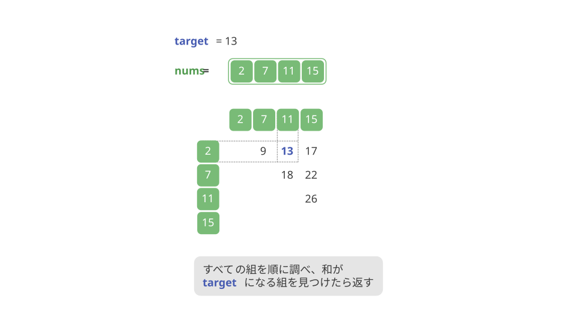
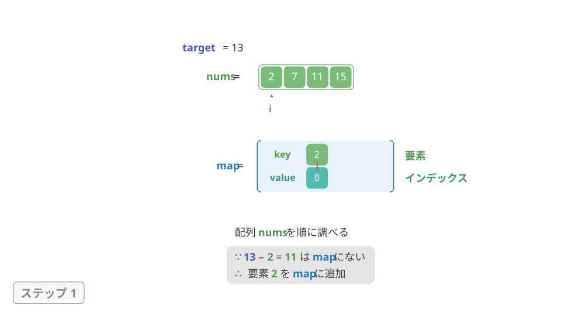
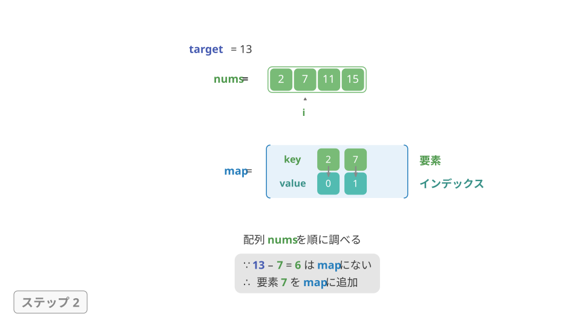
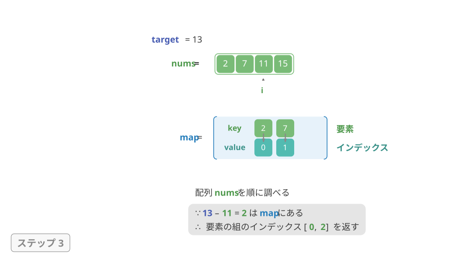

# ハッシュを用いた最適化

アルゴリズムの問題では、**線形探索をハッシュ探索に置き換えることで、時間計算量を減らせることがよくあります**。一つの問題を通して理解を深めましょう。

!!! question

    整数配列 `nums` と目標値 `target` が与えられます。配列から和が `target` になる二つの要素を探し、そのインデックスを返してください。解が複数あれば、どれか一つを返せばかまいません。

## 線形探索：時間をかけて記憶領域を節約する

考えられる組み合わせをすべて順に調べてみましょう。次の図のように二重ループを使い、各回で二つの整数の和が `target` と等しいかを判定します。等しければ、それらのインデックスを返します。



コードを以下に示します。

```src
[file]{two_sum}-[class]{}-[func]{two_sum_brute_force}
```

この方法の時間計算量は $O(n^2)$、空間計算量は $O(1)$ です。データ量が多いと非常に時間がかかります。

## ハッシュ探索：記憶領域を使って時間を節約する

ハッシュテーブルを用意し、配列の要素をキー、そのインデックスを値にします。ループで配列を走査し、各回で次の図の手順を実行します。

1. 数値 `target - nums[i]` がハッシュテーブルにあるかを調べます。あれば、その場で二つの要素のインデックスを返します。
2. `nums[i]` をキー、インデックス `i` を値とする組をハッシュテーブルに追加します。

=== "<1>"
    

=== "<2>"
    

=== "<3>"
    

以下のコードのように、一重のループだけで実装できます。

```src
[file]{two_sum}-[class]{}-[func]{two_sum_hash_table}
```

この方法ではハッシュ探索によって時間計算量が $O(n^2)$ から $O(n)$ になり、実行効率が大幅に向上します。

追加のハッシュテーブルを保持するため、空間計算量は $O(n)$ です。**それでも、この方法のほうが時間と空間のバランスがよく、この問題の最適な解法です**。
