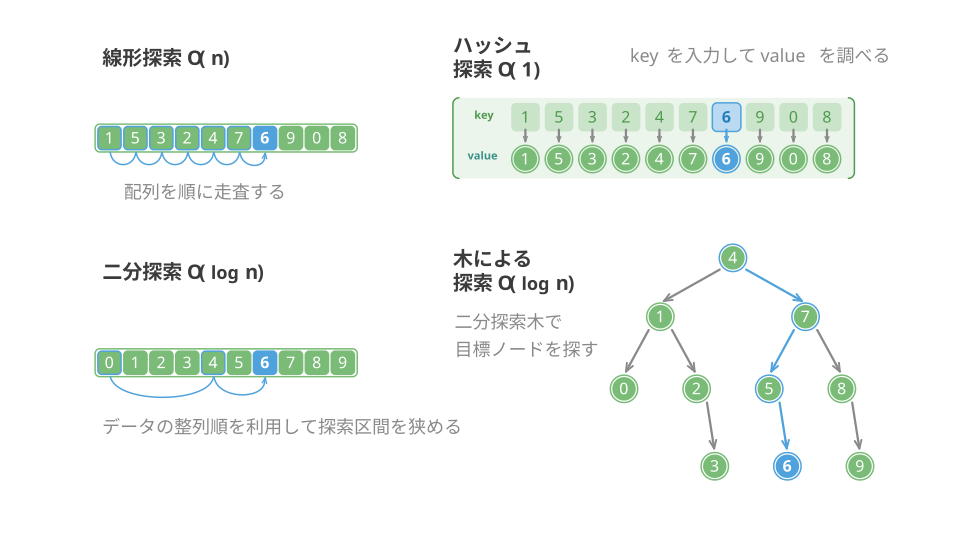

# 10.5 &nbsp; 探索アルゴリズムを振り返る

<u>探索アルゴリズム（searching algorithm）</u>は、配列、連結リスト、木、グラフなどのデータ構造の中から、特定の条件を満たす要素を一つ、あるいはひとまとまりの要素を見つけるために使います。

探索アルゴリズムは、実現のしかたによって次の二種類に分けられます。

- **データ構造を走査して目標の要素を見つける方法**です。配列、連結リスト、木、グラフの走査などがあります。
- **データの構造や、データについてあらかじめわかっている情報を利用して効率よく要素を探す方法**です。二分探索、ハッシュ探索、二分探索木を使った探索などがあります。

これらはいずれも前の章で取り上げた内容ですから、探索アルゴリズムはすでにおなじみのものです。この節では、これまでの知識を整理しながら探索アルゴリズムをあらためて見ていきます。

## 10.5.1 &nbsp; 総当たり探索

総当たり探索は、データ構造の要素を一つずつ調べて目標の要素を見つけます。

- 「線形探索」は配列や連結リストなどの線形データ構造に適しています。一方の端から出発して要素を順に調べ、目標の要素が見つかるか、見つからないまま反対の端に達したところで終わります。
- 「幅優先探索」と「深さ優先探索」は、グラフや木を走査する二つの方法です。幅優先探索は開始ノードから一層ずつ探索し、近くのノードから順に訪れます。深さ優先探索は開始ノードから一つの経路を行けるところまで進み、引き返して別の経路を試すことを、構造全体を走査するまで繰り返します。

総当たり探索の利点は、単純で幅広く使え、**データの前処理も追加のデータ構造も必要としない**ことです。

一方、**この種のアルゴリズムの時間計算量は $O(n)$** です。ここで $n$ は要素数なので、データ量が多い場合には効率がよくありません。

## 10.5.2 &nbsp; 適応型探索

適応型探索では、整列順などデータ固有の性質を利用して探索の手順を工夫し、目標の要素をより効率よく見つけます。

- 「二分探索」はデータが整列済みであることを利用して効率よく探す方法で、配列にのみ適用できます。
- 「ハッシュ探索」は、検索に使うデータと探したいデータをハッシュテーブルのキーと値として対応づけ、キーから値を引く方法です。
- 「木による探索」は、二分探索木など特定の構造をもつ木で、ノードの値を比較して候補をすばやく除外し、目標の要素を見つける方法です。

この種のアルゴリズムは効率がよく、**時間計算量が $O(\log n)$、さらには $O(1)$ になることもあります**。

ただし、**これらのアルゴリズムを使うには、データの前処理が必要になることがよくあります**。たとえば二分探索では事前に配列をソートする必要があり、ハッシュ探索と木による探索では追加のデータ構造が必要です。その構造の維持にも時間と記憶領域がかかります。

!!! tip "ヒント"

    適応型探索のアルゴリズムは検索アルゴリズムとも呼ばれ、**主に特定のデータ構造から目標の要素をすばやく取り出すために使われます**。

## 10.5.3 &nbsp; 探索方法の選び方

要素数 $n$ のデータ集合から目標の要素を探す方法には、線形探索、二分探索、木による探索、ハッシュ探索などがあります。図 10-11 にそれぞれの仕組みを示します。

{ class="animation-figure" }

 図 10-11 &nbsp; さまざまな探索方法 

これらの方法について、操作の効率と特徴を表 10-1 にまとめます。

 表 10-1 &nbsp; 探索アルゴリズムの効率の比較 

|              | 線形探索 | 二分探索           | 木による探索             | ハッシュ探索        |
| ------------ | -------- | ------------------ | ------------------ | --------------- |
| 要素の探索     | $O(n)$   | $O(\log n)$        | $O(\log n)$        | $O(1)$          |
| 要素の挿入     | $O(1)$   | $O(n)$             | $O(\log n)$        | $O(1)$          |
| 要素の削除     | $O(n)$   | $O(n)$             | $O(\log n)$        | $O(1)$          |
| 追加の記憶領域     | $O(1)$   | $O(1)$             | $O(n)$             | $O(n)$          |
| データの前処理   | /        | ソート $O(n \log n)$ | 木の構築 $O(n \log n)$ | ハッシュテーブルの構築 $O(n)$ |
| データの順序 | 順序なし     | 順序あり               | 順序あり               | 順序なし            |

探索アルゴリズムの選択には、データの規模、探索に求める性能、データの照会や更新の頻度なども関わります。

**線形探索**

- 幅広く使え、データの前処理は一切必要ありません。探索が一度だけなら、ほかの三つの方法では前処理だけで線形探索よりも長い時間がかかります。
- データ量が少ない場合に適しています。その場合は、時間計算量の違いが実際の効率にあまり影響しません。
- データの維持に特別な作業が必要ないので、更新頻度が高い場合に適しています。

**二分探索**

- データ量が多い場合に適しています。効率が安定しており、最悪時間計算量は $O(\log n)$ です。
- 配列の格納には連続したメモリ領域が必要なので、扱えるデータ量には限りがあります。
- 整列済み配列を維持する負担が大きいため、データを頻繁に追加・削除する場合には適していません。

**ハッシュ探索**

- 平均時間計算量は $O(1)$ で、検索に非常に高い性能が求められる場合に適しています。
- ハッシュテーブルはデータの順序を保てないため、整列済みのデータや範囲探索が必要な場合には適していません。
- ハッシュ関数と衝突への対処方法に大きく左右され、性能が低下するリスクが比較的高くなります。
- 衝突をできるだけ減らして検索性能を保つにはハッシュテーブルに追加の領域が必要なため、データ量が極端に多い場合には適していません。

**木による探索**

- 木のノードはメモリ上に分散して格納されるため、膨大な量のデータを扱うのに適しています。
- データの順序を保つ必要がある場合や、範囲探索を行う場合に適しています。
- ノードの挿入と削除を繰り返すうちに、二分探索木が片側に偏り、時間計算量が $O(n)$ まで悪化することがあります。
- AVL 木や赤黒木を使えば各操作を安定して $O(\log n)$ の時間で実行できますが、木の平衡を保つ操作には追加のコストがかかります。
