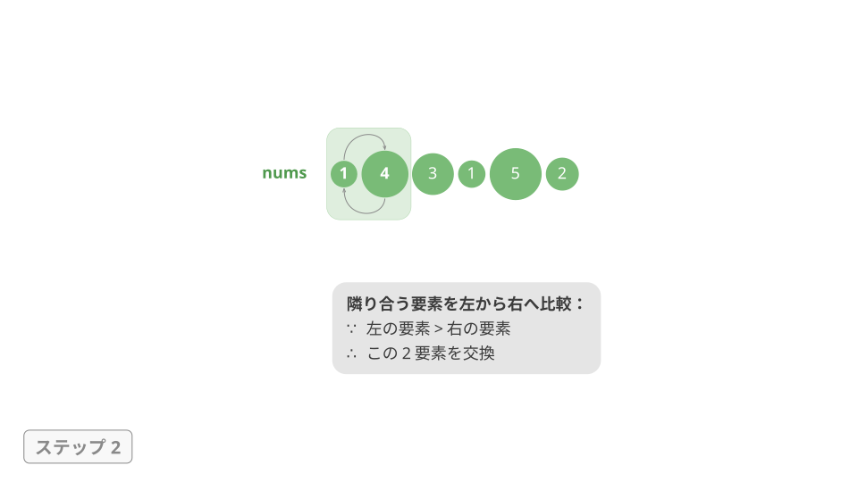
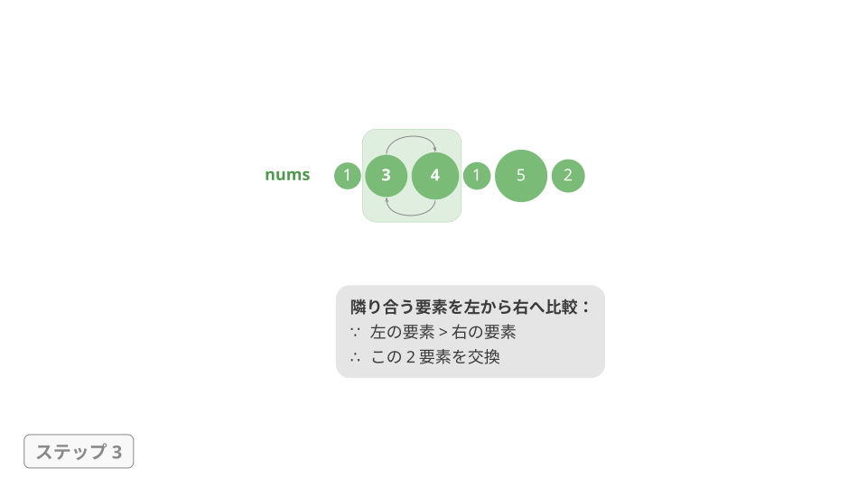
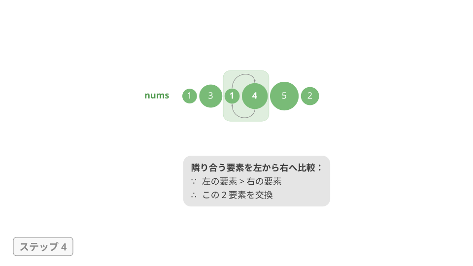

# バブルソート

<u>バブルソート（bubble sort）</u>は、隣り合う要素の比較と交換を繰り返して並べ替える方法です。泡が水底から水面に浮かび上がる様子に似ていることから、この名前が付きました。

下図のように、要素の交換で泡の動きを表せます。配列の左端から右へ進み、隣り合う要素の大きさを順に比べます。「左の要素 > 右の要素」なら、両者を交換します。右端まで走査すると、最大の要素が配列の右端に移ります。

=== "<1>"
    

=== "<2>"
    

=== "<3>"
    

=== "<4>"
    

=== "<5>"
    

=== "<6>"
    

=== "<7>"
    

## アルゴリズムの手順

配列の長さを $n$ とします。下図にバブルソートの手順を示します。

1. まず $n$ 個の要素を走査し、**交換によって配列の最大要素を正しい位置に移します**。
2. 次に残りの $n - 1$ 個の要素を走査し、**2 番目に大きい要素を交換によって正しい位置に移します**。
3. 同じように $n - 1$ 回走査すると、**大きいほうから $n - 1$ 個の要素がすべて正しい位置に移ります**。
4. 残る 1 要素は必ず最小なので並べ替える必要はなく、これで配列のソートが完了します。


実装例を示します。

```src
[file]{bubble_sort}-[class]{}-[func]{bubble_sort}
```

## 効率の改善

ある走査で一度も交換が起きなければ、配列はすでに整列しているので、そのまま結果を返せます。そこでフラグ `flag` を追加し、交換のない走査を検出したらすぐに結果を返すようにします。

この最適化を行っても最悪時間計算量と平均時間計算量は $O(n^2)$ のままですが、入力配列が完全に整列していれば最良時間計算量 $O(n)$ を達成できます。

```src
[file]{bubble_sort}-[class]{}-[func]{bubble_sort_with_flag}
```

## アルゴリズムの特性

- **時間計算量は $O(n^2)$、適応的なソート**。各回で走査する配列の長さは順に $n - 1$、$n - 2$、$\dots$、$2$、$1$ で、その和は $(n - 1) n / 2$ です。`flag` による最適化を加えると、最良時間計算量は $O(n)$ になります。
- **空間計算量は $O(1)$、インプレースソート**。ポインタ $i$ と $j$ が使う追加領域は一定です。
- **安定ソート**。走査中、値が等しい要素同士は交換しないためです。
