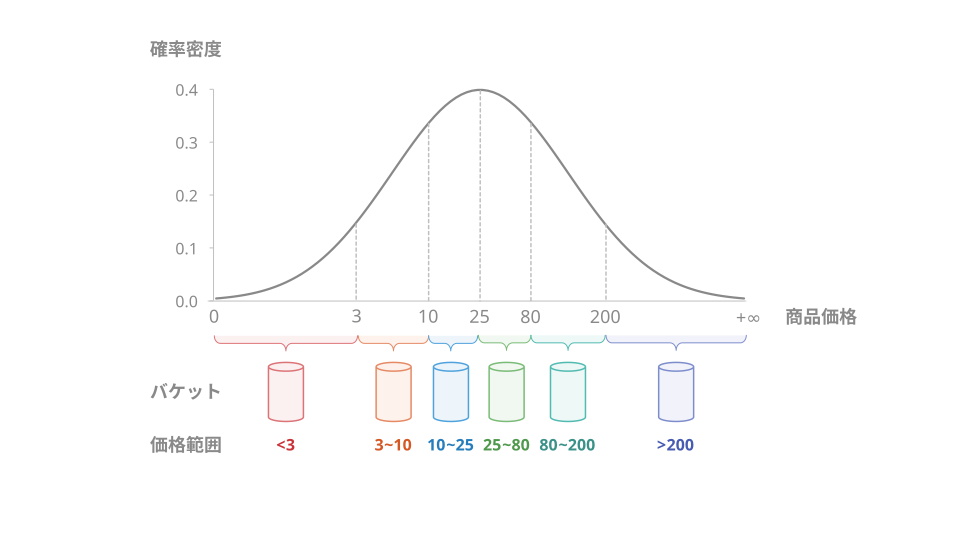

# バケットソート

これまでに見たのは、要素同士の大小を比較して並べ替える「比較ソート」です。この種のアルゴリズムでは、最悪時間計算量の下界は $\Omega(n \log n)$ です。次に取り上げる「非比較ソート」には、線形時間で実行できるものがあります。

<u>バケットソート（bucket sort）</u>は、分割統治の典型的な応用例です。大小順に並んだ値の範囲に対応するバケットを用意し、それぞれにデータを均等に振り分けます。次に各バケット内でソートし、最後にバケットの順にデータをすべて連結します。

## アルゴリズムの手順

長さ $n$ の配列を考えます。要素は範囲 $[0, 1)$ の浮動小数点数です。下図にバケットソートの手順を示します。

1. $k$ 個のバケットを初期化し、$n$ 個の要素を $k$ 個のバケットに振り分けます。
2. 各バケットを個別にソートします（ここではプログラミング言語の組み込みソート関数を使います）。
3. バケットの値の範囲が小さい順に結果を連結します。


コードを次に示します。

```src
[file]{bucket_sort}-[class]{}-[func]{bucket_sort}
```

## アルゴリズムの特性

バケットソートは大量のデータの処理に適しています。たとえば入力が 100 万要素あり、メモリ容量の制約から一度にすべてを読み込めない場合、データを 1000 個のバケットに分け、バケットごとにソートしてから結果を連結できます。

- **時間計算量は $O(n + k)$**。要素が均等に分布していれば、各バケットの要素数は $\frac{n}{k}$ です。1 個のバケットのソートに $O(\frac{n}{k} \log\frac{n}{k})$ の時間がかかるとすると、全バケットでは $O(n \log\frac{n}{k})$ です。**バケット数 $k$ が十分大きいと、時間計算量は $O(n)$ に近づきます**。結果の連結にはすべてのバケットと要素を走査するので $O(n + k)$ の時間がかかります。最悪の場合はすべてのデータが 1 個のバケットに入り、そのソートに $O(n^2)$ の時間がかかります。
- **空間計算量は $O(n + k)$、インプレースではないソート**。$k$ 個のバケットと、合計 $n$ 個の要素を格納する追加領域が必要です。
- バケットソートが安定かどうかは、バケット内のソートに使うアルゴリズムが安定かどうかで決まります。

## データを均等に振り分けるには

バケットソートの時間計算量は理論上 $O(n)$ に達します。**そのためには、各バケットの要素数をそろえることが重要です**。実際のデータの値は一様に分布するとは限りません。たとえば淘宝（タオバオ）の全商品を価格帯によって 10 個のバケットに均等に分けたいとします。100 元未満の商品は非常に多く、1000 元を超える商品はごくわずかです。価格帯を等幅に 10 分割すると、バケットごとの商品数に大きな差が生じます。

均等に分けるには、まず大まかな境界を決め、データを 3 個のバケットに振り分けます。**次に商品が多いバケットをさらに 3 個に分け、すべてのバケットの要素数がほぼ等しくなるまで繰り返します**。

下図のように、この方法では実質的に再帰木を作り、葉に集まるデータの数をできるだけそろえます。毎回 3 個ずつに分ける必要はなく、データの特徴に応じて分割方法を選べます。


商品価格の確率分布があらかじめわかっていれば、**その分布に基づいてバケットごとの価格の境界を決められます**。データ分布を求めるために必ずしも個別に集計する必要はなく、データの特徴に合う確率モデルで近似することもできます。

下図では商品価格が正規分布に従うと仮定します。この分布に合わせて価格帯を設定すれば、商品を各バケットに均等に振り分けられます。


